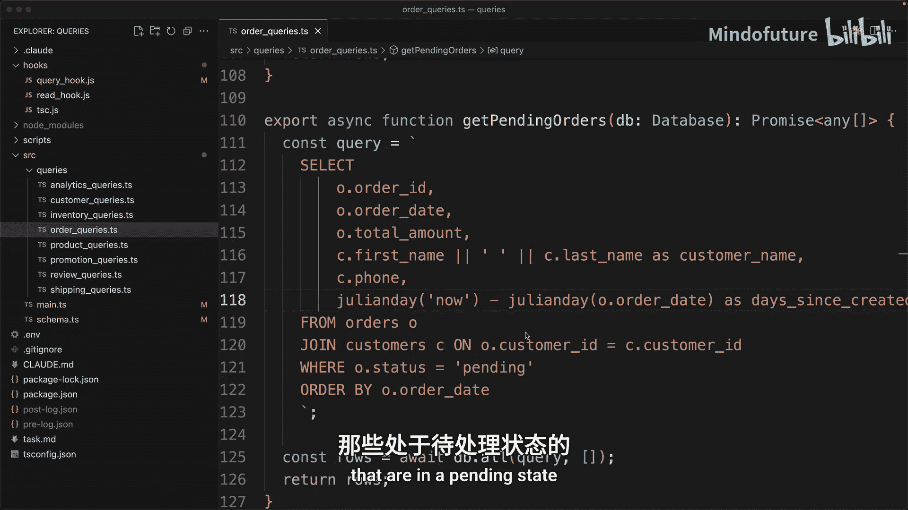
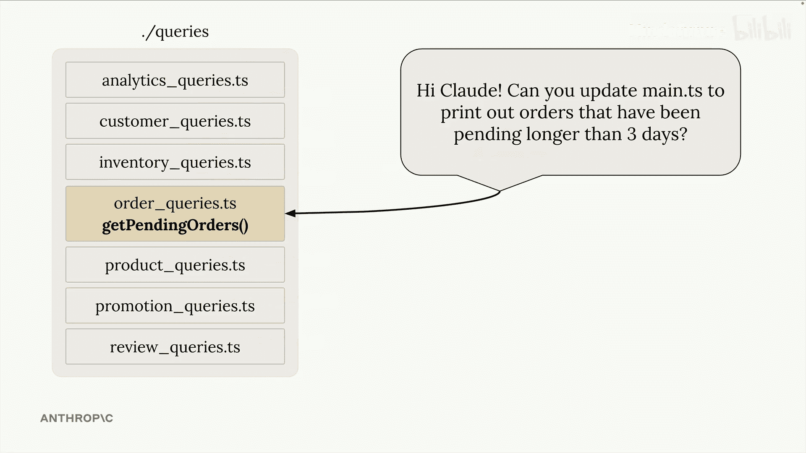
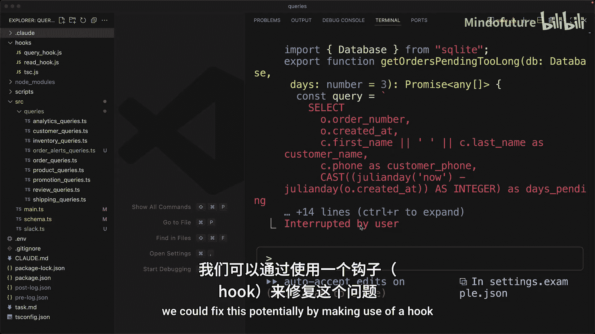
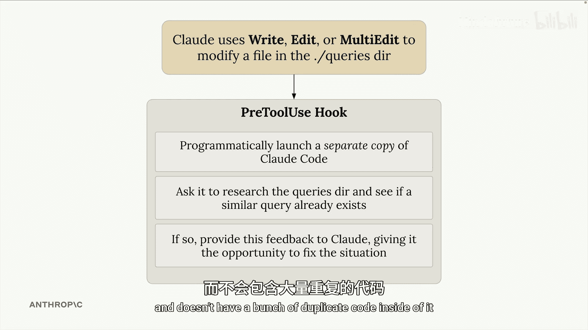
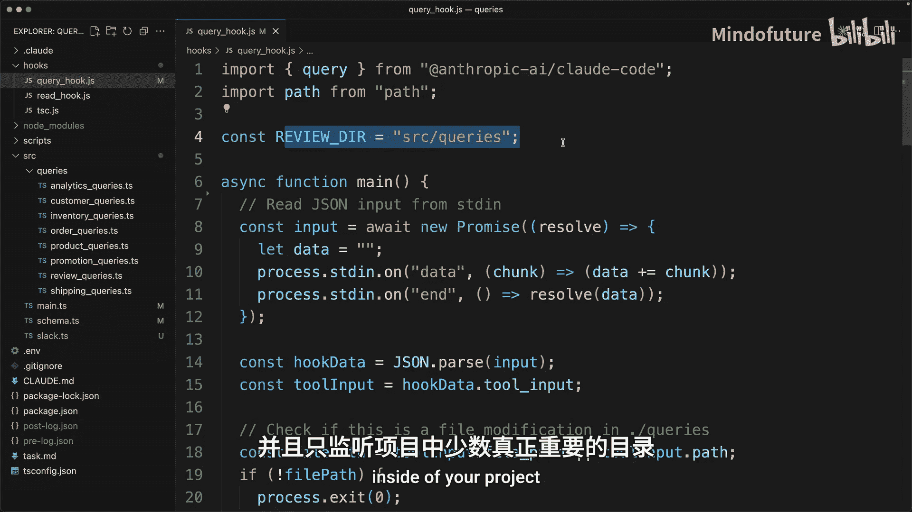

# 【Anthropic】Claude-Code-官方完全教程-｜-Claude-Code-in-Action-｜-vibe-coding-p13-P13_Useful_hooks--BV12TzGBCERK_p13-

In this video， I'd like to show you some really useful hooks that you might want to use on your own projects。

 These hooks are intended to address some common weak points in cloudde code to help you understand how the first one works。

 let me give you a quick demonstration of a problem that Cl code sometimes runs into especially on larger projects。

 So inside the SRC directory I'm going to find schema do Ts。Inside of here。

 theres just one single function called create schema。

 This function is called from the main dot Ts file， specifically right here。 Now。

 I'm going to go back to the schema dot Ts file， and I'm going to update the function definition。

 I'm going to say that if you ever want to call this function。

 you must also pass in a verbose argument that must be of type Boolean。 Now。

 as soon as I added in this change， if I go backward to the main dot Ts file。

 I'm going to get a type error because I just updated the definition of this function。

 but I have not actually added in a value for verbose。

 So the error right here says specifically argument for verbose was not provided。

Now I'm going to undo that change very quickly。I'm going to close the main dot Ts file。

 I'm then going to open up cloud code and ask it to make the exact same change。Now， if I run this。

 C code is going to have absolutely no issue making this edit whatsoever。

But it's going to update this file。 And then unfortunately， after making that change。

 So there's the new verbose true right there。 Unfortunately。

 Claude won't go around the project and try to find where that function is actually called and try to update any of the different call sitess。

 So if I now open up main dot T S， we'll see that we do， in fact， have an error over here。

 And Claude didn't really catch this， unfortunately。

 So the first hook that I want to show you will fix this solution super easily。😊。

In case you're not familiar with TypeScr， and if you're not， that's totally fine。

 if I close out a cloud code and run the command TSC no emitm。

It's going to run a type check on my entire project。 And in this type check。

 we can see that the error is very evident right here。

 So it's complaining about our call to create schema from that main dot Ts file。

 So my idea for a hook is really simple。 I think that any time that we edit a typescript file。

 we should run the typescript type checker and see if there are any distinct errors。 If there are。

 we should attempt to feed these errors back into Cla immediately inside of a posttool use hook。

 and hopefully this will give Cla a signal and tell it that there is a type error that it just introduced that it probably needs to go and fix somewhere else inside of our project。

😊，Now I already put this hook together for us， fortunately。

 just to save us a little bit of time inside the hooks Tsc。js file。 So inside this file。

 I've got a bunch of logic put together to run the Typescript type checker。

 take any errors that found and pass them back into Cla。At present。

 I disabled this hook just so I can give you that demonstration you just saw。

 so I disabled it by adding the process exit0 right there。

 I'm going to delete that and now this hook should be working Aok。

So if I now go back to the schema dotts file。Remove that verbose flag。Restart cloud code。

And ask it to make the same change once again。It will make the change。 And then hopefully this time。

 it will immediately gets that feedback from the Tcr type checker saying， hey。

 you've got an error somewhere else in the project that you' just introduced。

 and hopefully Claude will go and fix it。 So we can see right here， there's the edit that was made。

 We got some edit operation feedback from the hook that we put together。

 So it found an issue inside of one of our different files。 And Claude is now saying， okay。

 I understand I introduced an error。 I need to fix the call to create schema inside of main dot Ts。

 And then the next update it makes is going to attempt to go into that file and update that function call to add in that missing argument。

😊，So this is a hook that you might want to try implementing on your own personal projects now even though this hook was implemented specifically for Typecrrit。

 it still works for any other kind of type language where you can run a type checker very easily。

 even if you're using an untyped language you might even implement the same idea functionality using test instead of running a type checker so every time an edit is made you could run your test to make sure that the edit is okay。

Now， the next hook that I would like to show you is a little bit more challenging to explain。

 But once you get the idea behind it， I think that you will definitely find this next one really helpful。

 particularly in larger projects。 to help you understand this other hook。

 I want to give you a little bit of background on this project inside of the SRC queries directory。

 There are many different files。 Each of these different files contains many different sQL queries written inside of different functions。

 In of the order queries do Ts file in particular。 I want to point out that there is a function inside of here called git pending orders。

 This query goes through a database that contains some e-commerce related data。 And in theory。

 it's going to find all the different orders that have been created that are in a pending state。

 So just keep that function in mind for a moment。😊。

Okay， so I'm going to show you a couple of good diagrams really quickly to help you understand a common problem that starts to arise inside of larger projects。

 so in this diagram I've got my list of different query files on the left hand side and as we saw each of those different query files contains many different queries。

😊，Inside of that orderqueries file in particular is the Git pending orders function。

 so we've already got a query put together that will attempt to find some different pending orders。

Now， if I go to Claude and ask it to update the main dot Ts file to print out all the different orders that have been in a pending state for longer than three days in a perfect world。

 Claude would find the order query do Ts file， it would find that existing query and it would make use of it as opposed to writing out a brand new query。

 So that's what we want。 and we'll see that if we make use of Claude right now and ask it to do exactly that。

😊。

We're going to get exactly the result we want， so I an ask Cla in the main dots file。

 print out orders that have been pending。Now， to Cla's credit。

 it is going to take a look at the different query files that exist。

 It's going to find the order queries file。 And then inside there。

 it's going to recognize that there is already a query called gett pending orders。

 and it's going to attempt to use that function as opposed to creating a new query。

 We didn't want a new query。 we wanted Clade to use the existing function。

 So when we gave Clade a very focused and directed task。 It was able to understand that， yeah。

 probably shouldn't write a new query。 It should at least take a look at some of the ones that already exist。

 And that was definitely good。😊，Now， I'm going to give Claude a little bit of a curve ball。

 I'm going to purposefully make this task a little bit more difficult。 First。

 I'm going to run slash clear to clear out all the context we've gained。

 Then I'd like you to take a look at the task dot M D file inside this file。

 I put together a prompt that is still going to ask Claude to find orders that have been pending for a while。

 but I've also wrapped it up in some larger project。

 I'm asking Claude to write out a slack integration that's going to message a specific channel once a day with all the different orders that have been pending for too long。

 So in this scenario， we still want to find orders have been pending for too long。

 But now I've wrapped it inside this larger task。😊，And if I take this task。

And then feed it into Cla again after doing that slash clear operation。

 we're going to see that this time around， unfortunately。

 it's not going to stay quite as focused and it's going to end up trying to write out a brand new Gi pending orders query。

 which is， again， not what we want， because that would be a duplicating code throughout our project。

If I let this run for a bit， I will eventually see that yes。

 it does in fact make a brand new query called Git orderss pending to long。

So this is an example of where Claude kind of lost focus and decided to write a brand new query as opposed to reusing an existing one。

 And again， we've got some duplicate code here， which is probably not what we want。 In addition。

 it didn't only create the new query。 It also created a brand new file。

 which is also probably something we don't want。 We'd probably want this order related query to be added to the orderqueries file。

So now that we understand the issue here， let me show you how we could fix this potentially by making use of a hook。

 Allright， so whenever Claude attempts to write， edit or use the multi-edit tool to modify something inside thequeries directory specifically。

 I'm going to run the following hook first inside this hook。

 I'm going to launch a brand new separate copy of Cla code。

 I'm going to ask this new copy to take a look at the change that was just made and take a look at some of the existing code inside the queryries directory and see if a similar query is already inside there。

 then if there is an existing query， then I'm going to take that feedback and send it back to the original copy of Claude。

 and I'm going to ask Claude to maybe decide to fix the situation So remove the added query and make use of the one that already exists。

😊。

So this is going to allow us to make sure that thequeries folder generally stays clean and doesn't have a bunch of duplicate code inside of it。

So let me show you how this would work in action。 First， I'm going to flip back over here。

 I'm going to delete the brand new order alerts。Quries doTS file that was made。

 and the Slack dotTS file that was made as well。Then I'm going to find inside the hooks directory the query hook file。

 So already put this hook together for us right now it is currently disabled because I got a process do exit at the very top。

So let's walk through this hook really quickly first。

 I'm going to tell this thing that it's only going to review changes to the SRC queries directory。

Then a little bit lower， I'm going to check and see if the change that was just made was made to thequeries directory。

After that， I've then got a long proier that is asking Claude to do a review on the change that was just made。

 And then after that is where I'm launching Clade code programmatically。 specifically。

 these lines right here。This is making use of the Cla code TypeSscript SDK。

 I can give you a lot more information on it in just a little bit right now just understand that this right here is essentially the same as us making use of Cla code at the terminal Once cloud code runs and I get a response back out of it。

 I check and see if Claude decides that yeah the changes look okay or maybe we've got a duplicate query and if we do then we're going to exit early with an exit code of2 which is going to give this feedback back to Clade and hopefully tell it that needs to make a change。

So now that I've got this additional hook put together and enabled by removing that process exit zero at the top。

 I'm going to again restart cloud code。And then run the same query again。

 and hopefully this time it might initially put in that duplicate query。

 but then our hook right here is going to run and hopefully tell it， hey。

 we don't want that duplicate code， you should make use of some already existing query to implement this functionality。

NowCcode is once again going to attempt to create a brand new completely separate query file。

 not making use of the old query that already existed when it tries to create that file， however。

 our hook is going to run。 This is going to launch that separate copy of clo code which is going to do some research and find that there is。

 in fact an existing query that can be reused。It's going to provide some advice and say， hey。

 you could probably go and update this other existing query to suit your purposes perfectly。

 and we'll see some feedback from Claude， our primary instance that we are interacting with saying。

A yes， there is this existing query， let's just modify that existing query rather than attempting to write out a brand new one。

Now， the downside to this hook is that it's going to take some additional time and expense to run every single time I want to edit something inside the queries directory。

 But the upside is that I'm going to end up with a lot less duplicate code inside my queries directory。

 So it really comes down to a set of trade offs for you deciding whether or not you want to implement something like this in your own project。

 If you do， I would at least recommend doing what I showed you inside of the query hook。

 So this one right here。 and only watching maybe a handful of directories。

 like really important folders inside your project just to minimize the amount of extra work that is being done。

😊。

