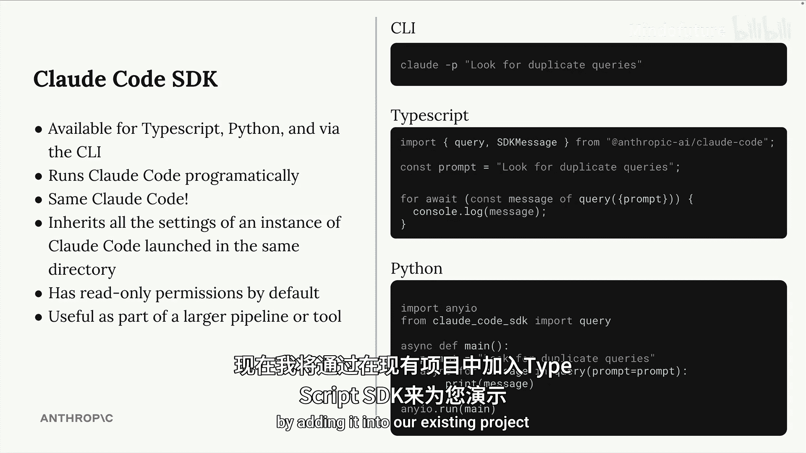
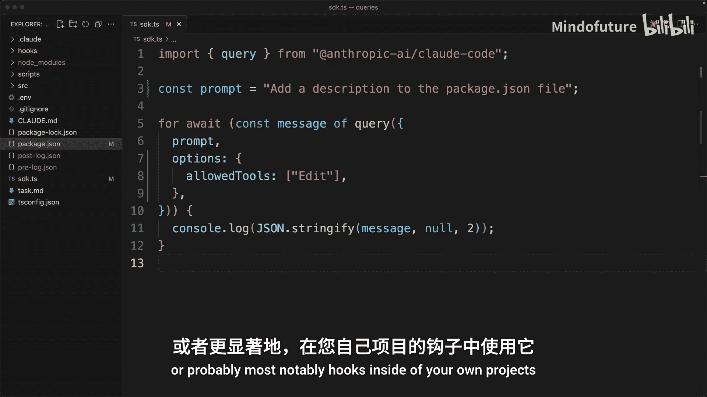

# 【Anthropic】Claude-Code-官方完全教程-｜-Claude-Code-in-Action-｜-vibe-coding-p14-P14_The_Claude_Code_SDK--BV12TzGBCERK_p14-

As we are looking at the query review hook a moment ago， we got a brief look at the C code SDK。

 The SDK allows you to use cloud code programmatically。 You can use the SDK via the CI。

 Tyscrriip library or Python library。 This is the exact same cloud code that you already use at the terminal。

 It has all the same tools and we use them to complete a given task。

The SDK is most useful as part of a larger pipeline or tool， as we saw in that hook a moment ago。

 you can easily wiring cloud code as part of a larger process to add in a bunch of intelligence to some given workflow。

Now I'd like to give you a quick demonstration of the TypeScrt SDK in particular。

 by adding it into our existing project。

Back inside of my editor， I'm going find the SDK do T S file inside the root project directory inside of here。

 I put together just a little bit of code to get us started with the SDK。

 I'm going to update the prompt at the top and ask Claude to look for duplicate queries inside the SRC queries directory。

 Then I'm going to save this file and to run it。 I'll open up my terminal and execute NPm run SDK。

 Now， this is not a built in command or anything like that。 just you know， behind the scenes。

 it just executes this file as a normal Tpescript file。

 I just put together this little shortcut for us to make running a Tyscript file a little bit easier。

 When we run this， we'll see the raw conversation between our local copy of cloud code and the clo language model message by message。

 Eventually， we'll get cake back to the command line。

 The very last message printed out will contain the final response from Cla。 Now。

 there is a little bit of a gotcha out around the SDK。 And that is that by default。

 it only has read abilities。 So in other words， it can only read files， directories。

 do grip operations and so on。 It does not have the ability to write or。😊。

Edit or create and so on files。To give it right permissions。

 you can either manually add in right permissions to the query call right here。

 or alternatively you can add in some permission settings to your settings file inside of your dot cloud directory。

 Let me show you how we can allow the SDK to use the edit tool within this project。

 I'm going find the prompt argument right here right after it， I'll add in options， put in an object。

 All tools， thatll be an array， and I'll put in edit。I'm then going to update the prompt at the top。

 and I'll ask it to add a description to the。Package。Json file。

Now I'm going to save this and run NPp and run SDK once again。And then once it is complete。

 I can open up the package do Json file， and I will see that it did， in fact add in a description。

 so now it definitely has the ability to edit files。As I mentioned earlier。

 the cloud code SDK is most useful as part of other tools。

 so I would encourage you to think of opportunities to use it in helper commands， scripts。

 or probably most notably hooks inside of your own projects。

