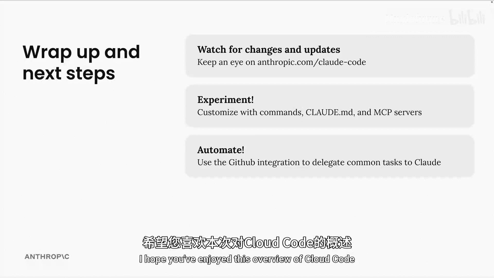
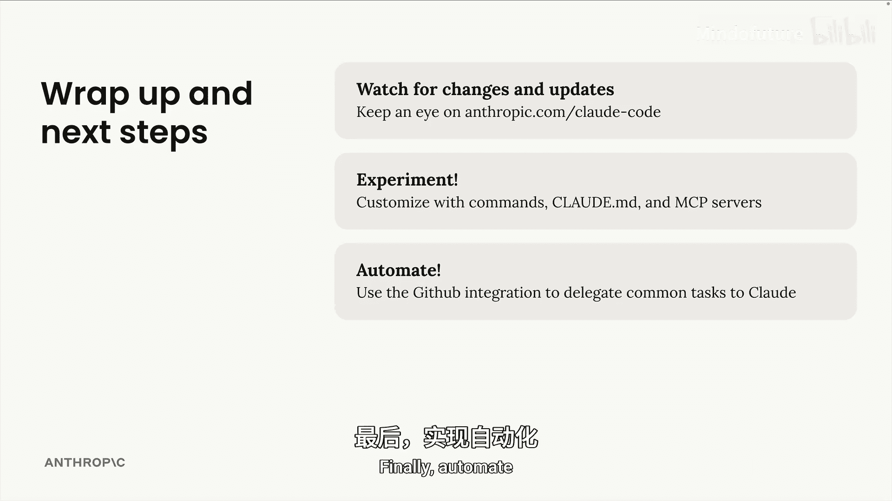
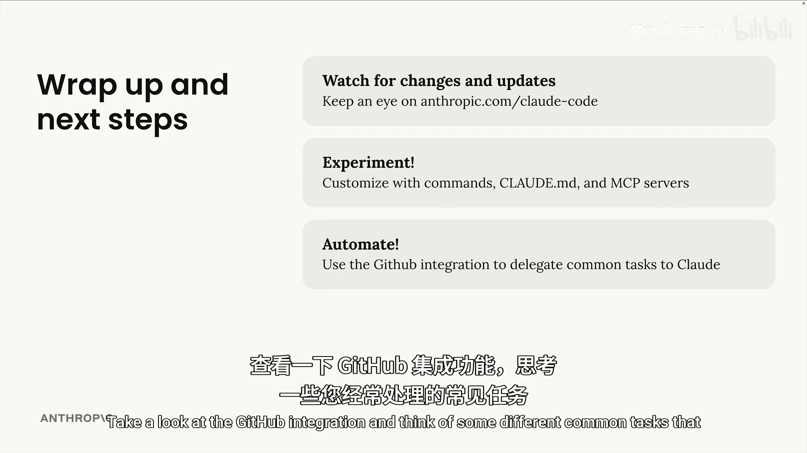
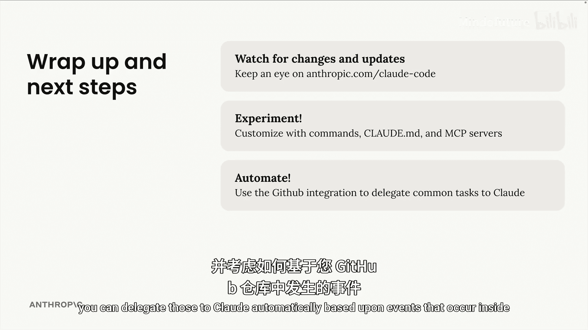
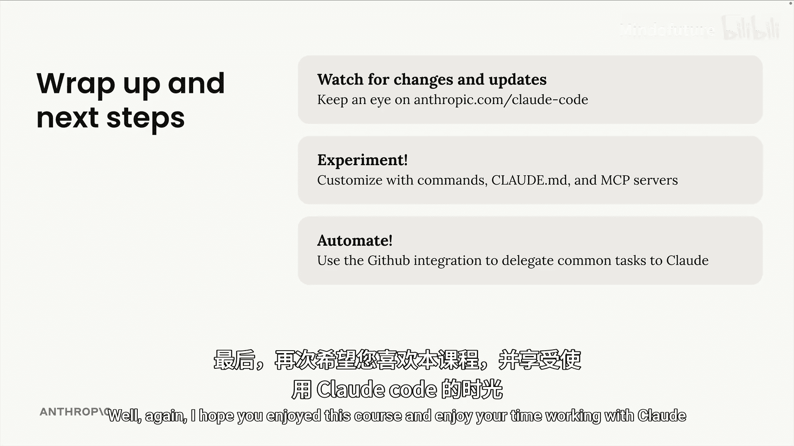

# 【Anthropic】Claude-Code-官方完全教程-｜-Claude-Code-in-Action-｜-vibe-coding-p15-P15_Summary_and_next_steps--BV12TzGBCERK_p15-

I hope you have enjoyed this overview of Clade code。 Before you finish up。

 I want to give you some advice on where to go from here。 First。

 keep in mind that Cla code is constantly changing and in active development。

 So keep an eye on the homepage of cloud code。 I've got the address to it right there。

 and watch for new features and techniques to come out。 Secondly， I really recommend you experiment。

 There's a lot of different ways to customize cloud code and really tailor it to your particular use case。

 Try to author some custom commands or put extra instructions in your cloud M D file and also try out a couple of the different MCP servers beyond the ones we looked at inside this course。

 Finally， automate。😊。

Take a look at the GitHub integration and think of some different common tasks that you go through all the time and think of some ways you can delegate those to cloud automatically based upon events that occur inside of your GitHub repository。

Well， again， I hope you enjoyed this course and enjoy your time working with Claude Code。

