# 卡耐基梅隆大学【中英⚡密码学导论｜15.356 Introduction to Cryptography】 p01 P1 Lecture 1 Classical Ciphers and One-Time Pad -BV16V6GBYEAA_p1-

So in any cryptography class， the first primitive which we always study is encryption and that is also what we will start with here today。

😊，诶。So as I mentioned， this class， not only it focuses on explaining you the big ideas and so on。

 but also how to formalize these ideas and how to analyze the schemes and so on。

So before we start discussing encryption， let's first start discussing what encryption is， okay？

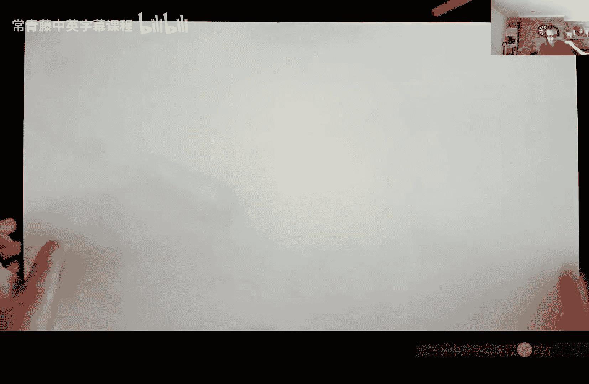

So let me start by writing。Symsymmetric key encryption。Sax。

So we will talk about security and so on later on。But let's first talk about what a symmetric key encryption systems should look like。

And I'm sure that you know that there's also something called this public encryption。

 which we'll get into later on， but classically people have just looked at symmetric encryption and what it does and so on。

Okay， so we will denote it by。Sケ。一。😊，Sometimes people also call it secret key encryption。

 you can also call it a cipher and so on， okay？🤧嗯。So any symmetric encryption scheme consists of three algorithms。

 so when you specify let's say you design your own symmetric encryption scheme。

 you must specify three different algorithms。So， must consist of。3。😔，Algotthms。

And I hope that you can read what I'm writing。Just give me a second。Okay。嗯。嗯。Okay。

 so what are the three algorithms？The first algorithm is called。

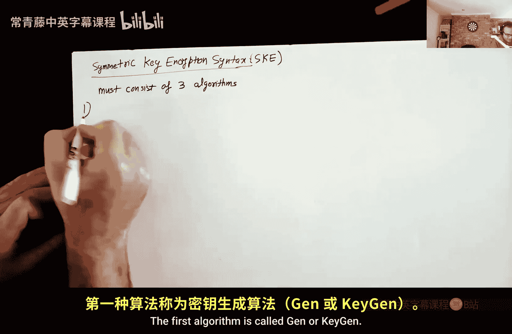

Jen or keygen。And this is not gay， this is copper。Yeah。So as the name suggests。This algorithm。

 in some sense generates a random key。And then just outputs it。Okay， and in different algorithms。

 this procedure might be different。And when we discuss the actual algorithms。

 we will see how it works。The stakes。As。Input。What is known as a security parameter。And outputs。

A secret key。Let's call the ski kit。And note that the input is Ka the。The output is a secret keyK。

 so what is a security parameter？😊，And this is something that you will see all the time in cryptography。

So when we talk about encryption schemes or really any kind of algorithm in cryptography。

 you always have a security parameter in mind。😊，So in some sense。

 the security parameter is going to determine the length of the key。😊，If you choose like 100 bit key。

 it might give you some sort of security like the aver can break your system can guess your key with probability2 to the power minus 100。

Maybe you are not happy to do the power minus1 maybe you want to do the power minus000。

 so in that case you would set your Ka to be bigger and the key generation algorithm will output a much longer key net in that case right so you can also think of Kappa as the size of the key。

So， the security parameter。Determines。The size。Of the key。The second algorithm。

Is called the encryption algorithm， so encryption algorithm takes two inputs。The first is。

The secret key。Which is the key generation algorithm output。

 and then second is the message which you want to include。😊，And then this algorithm outputs。

A cipher text。C。Right。😊，And then finally， we have the decryption algorithm。

Which again takes the secret key as input， it takes the cipher text。And it outputs。A message。M。Okay。

 so this is what the basic syntax looks like I have not talked about the security or any of the properties which this should satisfy。

 but。Let me make two remarks。So， remark  one is that。Scheme might specify。A particular message space。

So as an example。The message。Must be an element of some message space。This。Currently M and。

This method space could， for example， just be two messages。Let's say attack or defend。

 let's say you are in a war right， and you only have two possible commands to give to your soldiers either attack or defend。

Like all this message could be any  hundred0 bit message。So as an example。

 this method space could be equal to。0，1 to the power。50， let's say right。

 so in that case this team allows you to encrypt any 50 bit messages。Okay。Now。

 if you choose a message， which is not part of this。😡，Message space。All bets are off。

The encryption scheme may not work correctly， maybe it works correctly。

 but the security no longer holds and so on。Right， so in that case， I mean， it's like using。

A room heater to boil water。Not anything can go wrong in that case。And then we have another remark。

 let's call it the correctness requirement。So correctness just says the following。

You generated the secret key。As intended using the key generation algorithm。

 then you encrypted some message M using the encryption algorithm。Now。

 when you decrypt the resulting cipher textex using that key。

 you should always get back the same message。😊，Okay。And we can write it。In terms of probability。

Correctness says that。Probability of。Deecryption。The probability that you decrypt a Cyphertex C and it results in m such that。

The key came from the key generation algorithm using Ka。And。Cciphert came from。

The encryption algorithm。Using K and M。This。Probability must be equal to one。

You should always get back the same message。What about security？Let me not talk about that yet。😡。

Okay。So， this is。So far our definition， and we will come back to。Do this later。

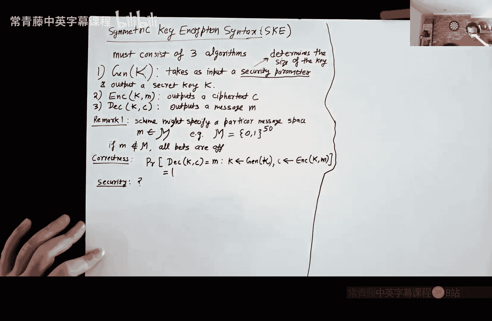

Now let me look at some of the classical ciphers。Probably the oldest recorded cipher in history is what is known as。

Cesar cipher。I hope I'm smilinging it correctly。天。So Caesar cipher was used like more than 2000 years ago in Roman Empire where Juliaus Caesar used the cipher to send like messages to his commanders。

 his war generals。It's a very simple cipher， probably worked very well at that time。

 but you know I will show you the cipher and you will immediately tell me how to make it very simple。

So。😊，Let me specify the Caar cipher and。The first algorithm which we need to specify is keygen。So。

In Caesar cipher， there is no security parameter。You can give it a security parameter。

 but it will ignore it because the key is always sort of fixed length。So key is just an integer。From。

0，2。25。And where does this come from in English language。

 we have 26 different characters from A to Z。RightSo the0 to 25 just represents picking one of these characters。

 So a represents0 getting picked and 25 corresponds to z。How do I encrypt a message？

So let me specify the method space。For C cipher， the message base is just。A sequence。Off。English。

Letters。And for simplicity， let's assume there's no comma， there's no space。

 of course you can generalize the cipher to those cases as well。Shift。嗯。Each character。In M。バイケ。

And I'll take an example。The last algorithm is the decption algorithm， which takes。

The resulting sphertex in the key and you shift back。Each character in Cypherex。Again。

 by the same amount。Okay。😊，So as an example， let's say yourre。He is。One， just to make my life simple。

 let's say your message is。Attack。What is the Cypherex in this case， so a shifted by 1 becomes B。

T shifted by one S T U， it becomes U。 So B U， U， then again， B， and then D。K becomes。L。Okay。😊。

So let's say you are naive， you don't really know much about encryption and things like that。😊。

The Cypher text might look like complete junk to you。

 it may not necessarily reveal what the message is and so on。Right。

 so it's probably a very smart idea at that time， but。

Any ideas on how we can break the Caesar cipher？Is this secure and we have not defined security yet。

 but。You know， intuitively， we all understand what encryption scheme is supposed to do。Okay。

 so let's see。 there are some。Okay， so quite a few interesting ideas， just try all 26 possibilities。

 Yeah， that's probably the simplest answer in this case。Try all possible keys。

And here the keyspace is just so limited right I don't even need a computer for this I can just try every possible key I can just do a reverse shift。

 try to decive every possible key and then I can look which message makes sense presumably I can identify the correct message when I see because it will be some message in English sentence hopefully something I can understand right so this is very easy to read。

😊，So it is not secure。I doubt。So let's move on to our second tall example and why they will let me remark that this is called as。

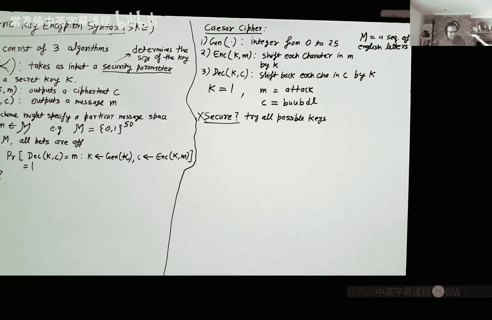

Ccipher text。Only attack。This attack only requires。

You do have just one sphertex and then you can sort of launch an exhaustive attack and you will be successful。

Cyphert only attack is。The worst kind of attack， because it means that your scheme has no security whatsoever。

There' is also a plain text Cyphertex attack where you can attack the scheme only if you get a pair of message and Cyphertex and then all further messages you can get。

😊，Why are we defining with the assumption that we know what the algorithm is's that's a very good question and。

I should probably write it here。So you can think of it as sort of a religious rule in modern cryptography。

Yeah。You can never rely on。Your algorithm's being。Secret， right。So there are two reasons for it。

First reason is。What is the probability that。Adversary can。Guess your algorithm。Honestly。

 I don't know。😡，What this probability is。You know， if you ask me， if you give me like 100 bit number。

 right， or if you pick 100 bit number and if you ask me to guess it。😊。

You can tell me that the probability that I'll be successful is like 2 to the power minus 100。

But what is the probability that an adversary can guess your algorithm？😊，I don't know。

's just mathematics doesn't tell me that。So this is hard to say。Right。So in the worst case。

 let's just assume that adverly can guess my algorithm with high probability。😊。

The second reason for this is that。There are all kind of things like。

 let's say there's an insider attack。Okay， there could be computer hack。am soon。

So typically when you design a cryptographic algorithm。

 there might be a large team of people who are involved， like a large team of mathematicians。

 they collaborate together， they come up with an encryption algorithm。😊，So if the enemy， for example。

 let's say gets hold of any of them or they collude with the enemy， you know。

 of course the enemy knows your algorithm， on the other hand。

 picking a random secret key is very easy。One person can do it or even a computer can do it， right？

For designing an algorithm， necessarily some humans have to be involved。

 so that's the reason we never want to rely on an algorithm being secret。Okay。Okay。

 so let me come back to any other questions and feel free to keep asking questions。

 I hope we can keep the class interactive。So this is as far as Caesar cipher go， let's go back to。

What can be seen as a generalization of Caar cipher， which is known as the substitution cipher？😊，有。

And by the way， in the morning we already uploaded lecture notes for the first four lectures and you can find all this content in the lecture notes as well。

🤧嗯。So in substitution， cipher。阿in。The security parameters kind of ignored。

 it's an old cipher and the key is sort of。Has a fixed length。So a substitution cipher is。

A random permutation of。The 26 English letters。Random。Permutation。O。26。Letters in the language。

 And what do I mean by random permutation。 Let's say you start by writing。

You start by writing the whole the whole list of letters and then corresponding to8。

I pick a letter at random。历史。Is I want to map to see。So there are 26 possibilities for mapping a。

Then。A permutation means that you cannot repeat the same thing。When I'm mapping B。

 I cannot pick C again， but I can pick any other letter so let's let's map this to L。

C is mapped to K and so。Okay， and this。This can be seen as the permutation。Enncryption takes the key。

 which is this whole table。So this tells you that the key may not always be just just a uniform random number。

 that the key might be more intelligently sampled。So。The encryption is very simple。

 what you would expect。Look up the table， and。Replace。Each letter。

By the letter which it is markeded to。😡，How does the decryption work？

It's just reverse lookup in the table。If you have the table。

 then you can look at the character in the Cyphertex， you can go back。Okay， now the question is。

 is this secure？So first of all， is the description of the Cypher clear or should we take an example of how it works？

😊，嗯。Quer enough。So it's clear。Okay。Okay， so is this cipher secure？So maybe just like Caesar Cypher。

 let's try every possibility key， right？So what is the number of。Possibilities。F。Okay。

So can somebody tell me what is the total number of possibilities？Yeah。So this is 26 factorial。

This is because。When we are looking at a we have 26 possibilities to map it to then since we don't want to repeat the next letter has 25 possibilities。

 then 24 and so on。Okay。😊，So maybe a modern computer can go through all the possibilities。

 but certainly for example， 50 years ago or 100 years ago， this was too too much okay。

 so let me say this might be too much。To try。Okay。So perhaps the same kind of attack as on the Caesar cipher。

 maybe that's not practical here for substitution ciphers。

So is this secure any more ideas how we can try to break it？

You can just go back to Ash sheetita's answer from earlier frequency analysis。Mmhmm。😊，Yeah。

 so frequency analysis is a very helpful and general tool。

 and a lot of the classical ciphers fall to the same technique， frequency analysis。😊。

If you have some plain text， you can also get some of the mappings pretty easily yeah so there are some good suggestions so first even before going to the frequency analysis。

😊，Let's say， I get。A bunch of plain text and Cyphertex right then I can just see what the whole mapping is right and how can I get a bunch of plain text and Cyphertex again let's go back to the v scenario which is which is very helpful in illustrating many of these things。

😊，So let's say I'm the enemy and every day I intercept some cphert from the party which I'm fighting。

And I know that the Cyphertex either says attack or defend。

Then I intercept the Cypherex and later on I can see that day what happened。

Did I get attacked or were they defending and in that case at the end of the day I know exactly what the message was right even though it's too late but eventually I get to know what the message was。

😊，And you know， such kind of scenarios can happen essentially in any application。

At a much later point of time， maybe the message also gets leak。

And if you have the message and the Cypherex， you can basically reconstruct the entire thing。😊。

But frequency analysis。😊，Yeah。But nice。ハ連た。So the idea in frequency analysis is that。😊。

In English language and essentially in any other language which you can consider。😊。

The letters are not random lesions I。 There's a specific pattern， right so。

We can consider the frequency of letters。So the frequency of E。Is something like 12。5%。

So E happens to be the most frequent letter in English language。The frequency of T。

 which is the second most common。letterter is 9。28%。And again， these frequencies。

 it probably also depends on the text and so on。 But if you analyze large enough text， then。

Like these are roughly the numbers， which you will see。A being the third most common， which is 8。04。

Okay， so what is the idea here？😊，I look at the sidephertex， and say。In Cypherex， and by the way。

 for for launching this attack， I have to collect a large amount of Cypherex。

 Maybe I don't know the corresponding message， but suppose in Cyphert， I noticed that。Here is。

The most frequent。Lettter。Okay， then in some sense。

 I have a good idea that maybe actually E was mapped to K。😊，Right。😊，And again。

 let's say I can look at the second most frequent letter in the ciphertex。

 and that probably tells me that it's T。And I can keep going on like this right so so this gives us a way to decode some part of the table。

 maybe it will not take you all the way。😊，But there are other things which you can do。

There's also frequency of。Bgrams。S I have a small question。

So so like the war scenario that you mentioned that like I can guess the key and I will be able to decode and like in the night I will find out whether I got attackedgged or defended right so but my question is that like okay so every morning you get the message you try our random key generator and you try to decode it right but like you'll only find out in the night what happened so every will generate a new random key so how is this process useful to us like unless you know the exact message。

Like we can keep on trying to decode the random permutation， but like what will be right So。

 so good question， if your enemy is changing the key every day， then。What I describe doesn't work。

And can you repeat， I could not hear。Yeah， I'm just saying that if your opponent is generating a new random key every day and the opponent is changing the key every day。

😊，Then it doesn't work what I describe。In my description。

 I was assuming that the key is sort of static and will be used across a long period of time。Okay。

 basically like what I'm trying to asking is that like。

even if you decode a message without the actual message。

 you can never find out right that I decode it correctly。Well， that may or may not be true。

 right because？😊，If let's say you have many possible decodings， and only one of them makes any sense。

then you know which one is the correct one？Right because because the plain text message is not necessarily like junk or random all the time。

 presumably the plain text message makes sense to somebody。😊，Thank you， thank you。Okay。

 so frequency of bygrams。 So diagramgrams is a pattern of two letters。

 which occur together pretty often。 So T H。Is a very common combination， so this is like 3。5。6%。

So now suppose you were able to decode T， you know what T was mapped to and now in the Cyphertex you look at that character and you see what is the most frequent character which occurs immediately after that one。

😊，And then you have a good idea that probably it it's mapped to edge right so we have the frequency of T。

 we have the frequency of IN， which is。2。43% and so on。And then we can talk about。Frequency of。

Double letters。And this is， again， double E turns out to be very common。So 0。38%。

Double O turns out to be very common。0。21， right？ So， for example， in the Cypherex。

 let's say you see double K a lot of the times。 You probably know that E was mapped。Okay。

 so this is not foolproof by any means。this attack makes several assumptions。

 the first one is that you have a large amount of cphert which you are able to collect somehow and the second is there's also a lot of hidden trial involved。

😊，So a lot of hit。And。Trial， right， So maybe substitution cipher does have some security。 Maybe。

 you know， it might be hard to decode it to the last letter。

 But the point is that once you record enough， right， you can fill in the rest。

 And just getting started and making sort of the first step is always the most difficult thing。

Do any of the classical ciphers try to avoid leaking information？In the length of the message。

 I don't know if I understand the question。That would be equivalent to just a substitution cipher。

Yeah， do people ever mix Caar cipher with substitution cipher exactly that will just be equal into substitution cipher。

 you know， you combine the two and you would just end up getting a different random belt。Okay。😊。

So substitution cipher is also not。Good， maybe it's marginally better than Caesar cipher。

 but it's also not something which you want to try to use in practice。Okay， so now let's move on。

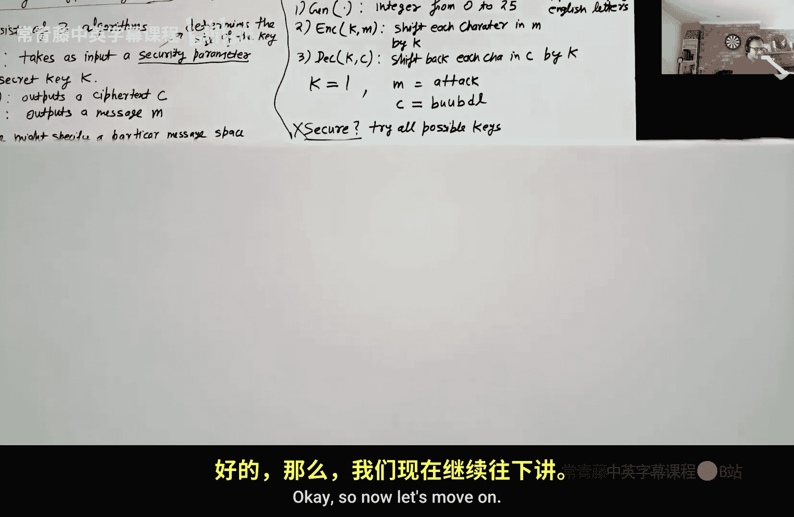

The last classical cipher， which we will look at today。

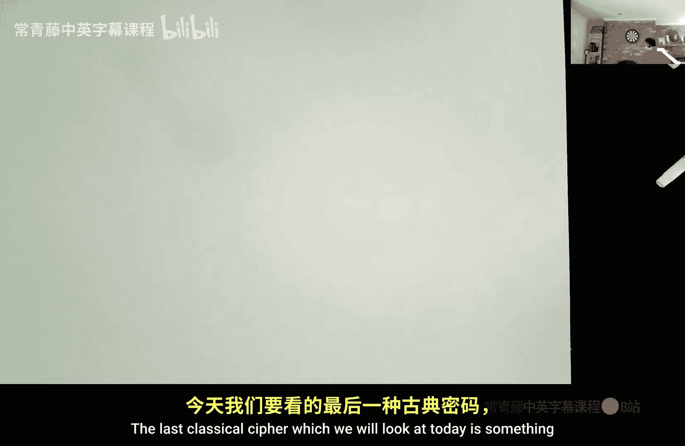

Is something which is known as visionary site。

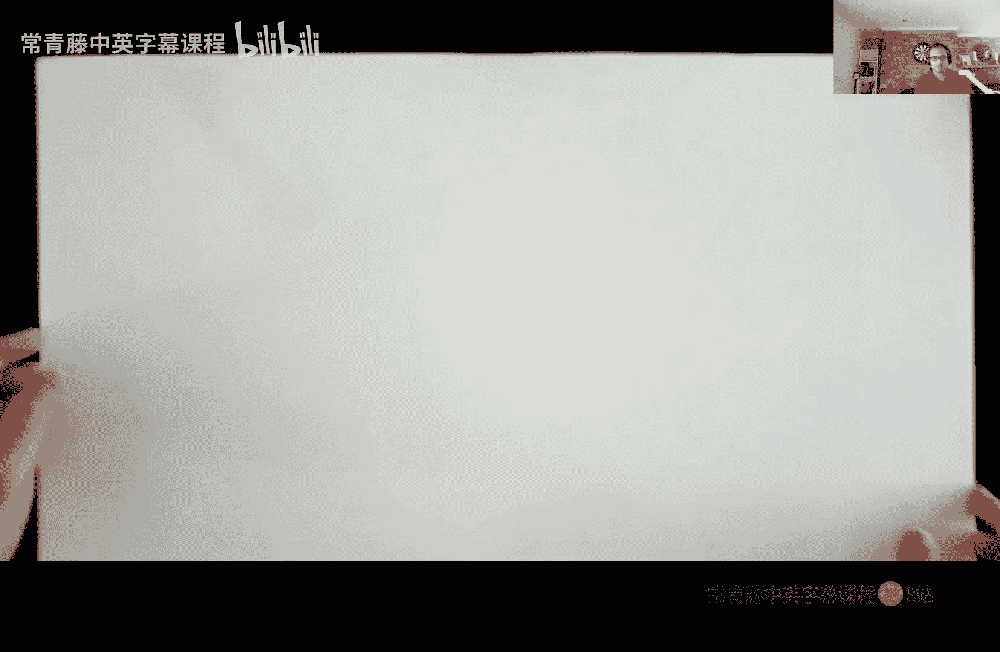

So imagineary cipher。The key generation actually does take a security parameter as input。

So key generation takes Ka as input and。Outputs。A random。English。String of。Lth。

 which is determined by copper， let's say for simplicity。Just the length is cup by itself。

How does the encryption work？Encryption takes this key and the message is input。And。

The first step is that you repeat the key。So， let's。

I think it's maybe easier to explain it with an example so say that key is。ビーエイー。Okay。

 so in encryption first。Let's say， our message was。Attack。And your key is。B A E， okay。

 so key is smaller than the message。 What we do is we just repeat the key to make it equal to the message。

ビーエーイー。Okay。😊，And if for example， your message was five characters instead of six。

 then we will just cut off at B。And your cipher text is just。Each character of the message。

Shifted by some number which is determined by the corresponding character of the key。Okay。😊。

So here B corresponds to shift of1， a corresponds to shift of0， B corresponds to shift of 1。

 so the Cypherex becomes B。And t remains t because it's shifted by zero， then t shifted by4。

Let me not spend too much time in the calculations。Okay， is the encryption clear？

And then decryption is what you would expect。You just shift back。Again。

 depending upon each character of the key。So now let's try to discuss an attack。

Which I guess the black marker is better than the red one， right？😊，Right。

 so any ideas on how we can attack it？So let me go through the questions。

If it could be one of two different words。You just cased on the length of your strain。

 couldn't you do a similar frequency analysis yeah each。Whatever all you saying， yeah。Maybe， but。

Sometimes the length is equal， So for example that， for example， looking at attack in defend。

 they have equal length。But you're right， that if that so。If you know the length tells you something。

 then maybe， on the length of like BE。Oh， I see， okay。こ。

Because one in every three letters here goes by the same shift and so on。

So current cpher tend to be not great at leaking versus lamb。

Right so okay can you hide the message length maybe maybe that's what you guys were asking all along the the short answer is unfortunately no right because if Im encrypting one gigyte file right I cannot hope to get a ciphertex which is like one megabyte。

You cannot compress the message a so， so you can increase the length。

 but unfortunately one problem is if you increase the length， the cpher text is。

 let's say much longer than the plain text， then this is also a reason for why your cipher might be considered inefficient。

😊，RightSo so in general， the length of the message is not something which we try to hide。

Frequency analysis module length here。 I think many people have the right direction。

 So in the attack， the first step is。Guess。The land。Off the key。Maybe you are wrong。If you are wrong。

 all bets are off。But then you can just try again。So， you might。Need to try。Several times。

But length of the key is something which potentially is guessable right because it's not like I'm using a key which is which can be anywhere from one bit to two to the power 100 bits right that's2 to the power 100 bit just just too much so maybe it's like 1 hundred0 bits maybe it's like 50 bits it's not something which you cannot enumerate over。

😊，So now we will assume that our gas is correct。And I will tell you， in that case， what happens。

So now you separate out。Out the cipher text。In many parts。Okay， so say your guess is。

Say the length of the key。Is three。 and you managed to guess that correctly and say your cipher text is。

B T， I think， let me check one of the students。Thankfully， they did this。Oh no。Yeah。

 I think you used a as1 rather than zero。 Okay， let me just write something random here。With the一。P。

 X， Y。Now， what you do is you create three parts because the length of the key is three。

Steve was the first and the fourth character， so BPP。C 2 is。D X。C，3 is。意わ。ok。😊，Now。

 the observation is that if you look at C1。Every character。Shifted by。The same。Amount。Right。😊。

This is because in C1， every character in some sense was encrypted with the same letter of the key。

And now。We are back to Caesar Cypher。Right so C1 is an instance of something which is encrypted with Caar cipher C2 is again encrypted with a different key but the same Caar cipher and so on。

 but now the problem is in Caar cipher we just sort of did and we could tell when the result was correct and when it was not correct right here that may not necessarily be the case so the next step is to do a frequency analysis。

And you do this frequency analysis separately for each part or each component of the Cypherex C。

And in fact， the frequency analysis here will be much simpler than the frequency analysis in the substitution cipher。

 because in the substitution cipher you had this whole random permutation， the whole table。

 and here it's just a single shift of all the characters。😊，Okay， good questions。So first。

 is that Act clear？😊，And this brings me to my next point。What if the key length。

Is actually equal to the message length。So in that case。

 frequency analysis just doesn't work because you know each sphertex component is exactly one character and you know I don't know what kind of frequency analysis you can do if you only have one sample。

And the answer in that case is that。Viionary cipher is actually secure。

 as somebody already pointed out， and this is equivalent to one time pair， which we will study next。

And， in fact。This goes for a lot of classical ciphers。 So， for example。In Caesar cipher。

 let's say you only entered one character。Your message is not longer than that。 Then you know。

 CsAcipher is also secure if you just use the key only ones。In substits， Ipher again。

 let's say yourre。Maybe it's it's a little bit harder in substitution Cypher。Yeah， okay。

 I'm not claiming anything about subtition cipher， but at least Caesar and vi cipher are secure。

 assuming that the message length is short enough。😊，So now for a change。

 let's try to look at some of the secure ciphers， most notably one time pad。

 which is known as a very simple， perfectly secure cipher。Okay。

Any questions before we move on from the subject of classical ciphers and by the way。

 this is not by any means an exhaustive list of classical ciphers， there are much more。

Even like very sophisticated classical ciphers， like you might have heard of enigma machine in。

In the Second World War， which was used by Germany， and that's like a huge interesting machine。

 pretty complex cipher。So let me look at the questions。By the way， feel free to just speak up。

Just unmute yourself。Ader of chat is also fine。So one of the questions is that what what does C1 c2 and C3 stand for so if your guess for the length is Les say 3 right。

 then you take the whole ciphertex and then you divide it into three parts。

The first part will consist of the first letter， the fourth letter， the seventh letter， the。

11th letter or maybe the 10th letter and so on right the second part which is C2 will consist with the second letter the fifth one and so on and why are we dividing Cyphertex into components like this because。

All the characters in one component。😊，They are shifted by the same amount。

Which might make our life simpler。Yeah， so coming back to EnIma machine。

 there's a very interesting movie， the imitation game， I don't know how many of you have seen it。😊。

But if you're interested in like classical ciphers and how it was used in the warfare earlier。

 it might be an interesting fun movie to watch the movie is about the life of Alan Turing who is of course one of the founders of computer science。

And he was a mathematician by training， and he was recruited by British military， I guess。

 to help with breaking cphers。And one of his contributions was trying to automate this process of breaking cphers。

So in the second World War， Germany was sort of changing the key every day。

And the cipher was pretty complex， there was this whole team of mathematicians and they were kind of racing against time。

😊，To try to find the key and by the time they were successful very often the key would already be changed right so Turing realized that there had to be a better way。

And what he did was he， he designed this huge machine and humans could maybe try like several keys。

Possibly every hour or something like that， but this machine could try various possible keys like every minute。

😊，And that made the process so much faster and that helped the British actually break this encryption scheme which the Germans were using。

😊，And the movie estimates that just this fact alone actually shortened the time of the wall by something like 18 months and it saved something like nine or 10 million lives。

And some people argue that this machine built by tuuring can actually be seen as like the first modern computer。

 so the birth of computer science， at least in some sense。

 owes a little bit at least to cryptography。And in the movie， they even show this huge machine。

 it's like bigger than a room and things like that。But anyway yeah。

 so as I mentioned anigma machine is also not secure。

 so why is it the case that there are all these classical sulphers you know very smart people tried for like thousands of years and yet all of them are insecure。

😊，So these classical ciphers and the designers， they were sort of missing。One。

 very important insight。Wwhich is something which you will see by the end of this class。

 which is known as the Shanons The， so we will see one time pad and we will see Shanons here and Shanons theorem really tells you that you know you completely have to change your approach to designing classical ciphers。

 these you know substitutions， shifting no combination of these things is going to help you。

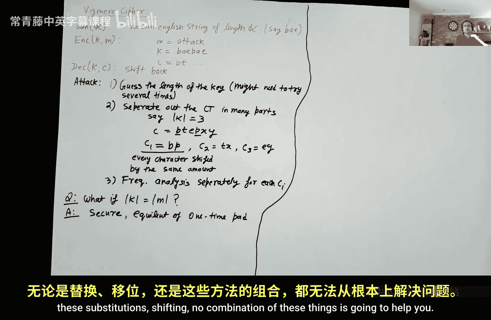

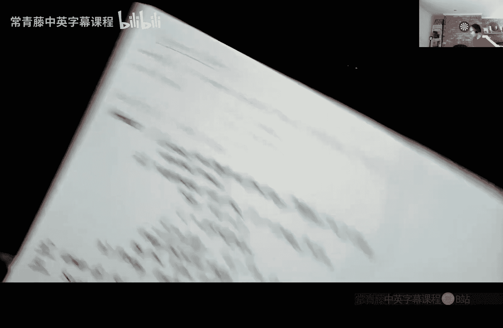

So now let's come back to the definition of encryption again。And let me erase some of this。

Let's come back to security。If we want to design like really secure ciphers。

 we need to talk about what we mean by a secure cipher， right？

So here I can talk about various options for security。So， intuitively。😊。

A perfectly secure encryption scheme。😊，Must perfectly hide the message， whatever it means， right？

So here is our first attempt。Maybe probability of。Adversary， who is given the cipherex as input。

Guessing the message or outputting the message。Maybe we want this probability to be really like zero。

 right？😊，And maybe that will be perfect security。So is this a good definition？😊。

Is this something we can strive towards in the ideal world， any thoughts？Yeah。

 so this definition is clearly impossible。😊，This is because。You can just guess。

Adversary doesn't even need to look at the Cypher types right so your encryption scheme can be complete magic。

 but still the averary has nonze probability of guessing the message。

 even if your message is like one gigyte right the probability I just make up a random string the probability that it would be exactly equal to your message is nonze right。

😊，So this is not good。So maybe we were being too ambitious， right。

 So maybe our second attempt should be that。The probability that adverary guesses the。Message。

Maybe it's not zero， but maybe it's something which is like。

Something like really small maybe coming from our security parameter。嗯。So， say something like。

2 to the power minus100。And he talks on this。Good， bad。什么。And by the way。

 this whole exercise tells you why it was so difficult to design encryption schemes because even just talking about intuitively。

 we understand right what an encryption scheme is supposed to do。

But mathematically defining what an encryption scheme is supposed to do and trying to argue that。

The scheme your design indeed has this property， you know， that's probably very hard。Okay。

 so there are some good comments， the probability should be proportional to the message length。呃。

And yeah so so here again this is a good point， so again going back to the war scenario let's say the enemy knows that I only have two possible commands attack or defend then even without looking at the cpherex the enemy can always guess my message with probability half。

Right so this is also too ambitious。It's not something which we can achieve。Right， so in some sense。

 this suggests that。I need to look at the message space。

 I need to understand what is the a priority probability of adversacy guessing the message， right。

And after seeing the cpherex， the probability cannot go down， right。

 maybe it stays the same and maybe it goes up right？Okay， so in the ideal world。

 the probability should stay the same。That's what I want。Very roughly， probability of。Guessing。Sts。

Roughly the same。I don't want to specify the message space。

 I don't want to know which distribution you are picking your message from。

 what are the possible messages and so on。What I want is that whatever the probabilityability of guessing the message was before seeing the cyberex。

😊，It should stay the same after seeing the session。来。

So this is what I would refer to as perfect security。😊，Or you can call it perfect secrecy。Okay。

 do I have enough space？Iてうん。So， perfect。Security。Perfect security essentially says that。Cciphert is。

Independent of the message。Now this might seem counterintuitive right or how how can Cytex be dependent of the message。

 I mean， aren't we exactly encrypting the message？走。Let me say something here。

 Cyphertext distribution is independent of the message。So essentially what this says is that。😊。

Ccipher text。Doesn't tell you。Anything extra。About M。Yeah。Unless， of course， you have the key。

And in that case， you can just run the dec algorithm and you can recover。The cyclephertic。Sorry。

 the message。Okay， and。A more formal definition is。For every pair of messages。M1， M2。And implicitly。

 the message has to be within the message space specified by the encryption scheme。

 but let me not write that explicitly here。And this is an important equation。😊。

For every pair of messages， for every cipher text as well， in fact。The probability that。

Encryption of K comm M1。Gives the cipher text。Condition on。Okay coming from。Heey generation。Gパ。

Is exactly equal to。Probability。The same thing here， except。M1 changes to M2。

Maybe I should just write it after。一个。Condition on。経営画面フラン。Okay， I hope it's not too hard to read。

So what does this equation tell me？This a question tells me that regardless of which message you started with。

😊，As long as you generated your key correctly at random。

 the probability that you would end up with a Cyphert C stays the same。Okay。😊，So， essentially。

 regardless of。Which message？You started with。Cciphertex distribution is。The same or identical。

Any questions？And we will see an example of one time pad。

Does it independent mean that if you encrypt one message twice。

 you will get two different ciphertexts， no， not necessarily。And now let's look at one time pad。

 which will hopefully make this a little more clear。And I want to keep the definition。嗯。On screen。

So okay， so let's start from here。One time pad is a very simple encryption scheme and yet provides you。

Perfect security under certain conditions。So in one time pad， the key generation takes。

Security parameter is not really that important one time pad ignores the security parameter。

 but that's for a different reason。One time is perfectly secure。

 so the security parameter can be thought of as infinite in one time。So。Sample， and let me。

Now switch back to modern times where we work with binary rather than English alphabets。But。

You can change that if you want， sample a binary string K。Such that the length of gear。

Would be equal to the length of the message。So suppose you anticipate。Enncrypting。Hund0 bit messages。

 then you must select a key， which is also 100 bits。How do we encrypt？

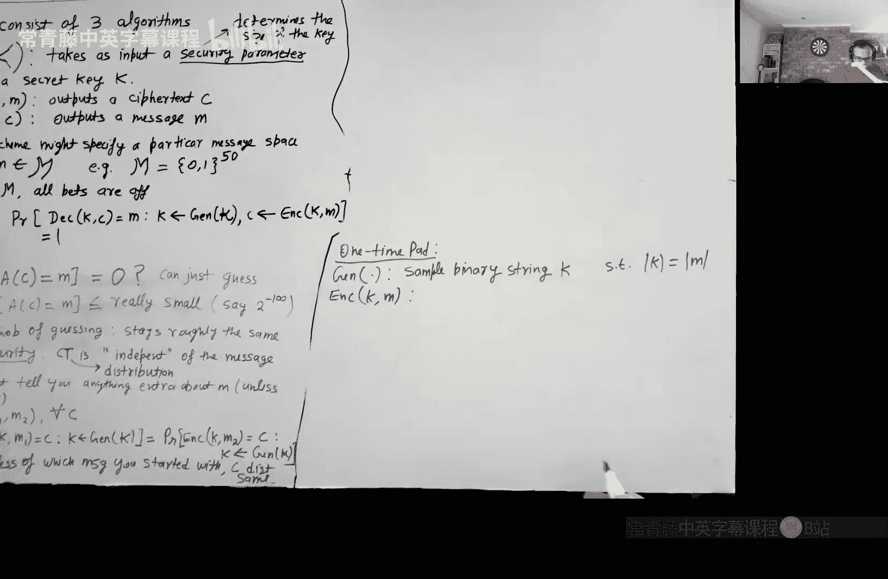

The cipherax is just。K， bit Y， X， R。M。Okay， I hope everybody is familiar with the Xorgate。

And how do you decrypt？Output C XR M。It's really simple and extremely fast。😊，In hardwareware。

 for example， like you can exc gigabytes of data per second。Why is this。Correct。

 or why does this satisfy the correctness property？So observe that。M， X， R K。Sorry。😔。

This should be C X or K。Not them。XO has the cancellation property so if you。

Exle with the same string twice， it just cancels out and you get back the original string。Now。

 what about perfect security？So let's try to compute it。For every C。Such that。

Size of the C is equal to the size of the message， which is also equal to the size of the key。

What is the probability that you end up with this particular C？😡。

Probability that the encryption algorithm。Outputs。And， by the way。For every。M1 and M2。

J comma M1 gives the C。Such that。K is the output of。Key generation。

Can somebody tell me what this probability is？And by the village let's also call this N。や。

So this is just one by2 to the power minus n。Because this is also equal to the probability that。

The key will end up becoming。嗯。Cciphertext， XR。M1。Such that。Keys sampled by the key generation。

 right？But given that key is random， the probability that key is equal to any specific string。

Is actually equal to 1 by2 to the power minus1。And the same thing。Where I am talking about。Empple。

Okay。So I might be encrypting and M1， I might be encrypting M2 I always get。

The same exact same Cyphertext distribution。The cipher text is。Note that。

Cyphert is entirely uniform here。And by the way， as the name suggests。

 we are only talking about encrypting a single message here。

We will come to encrypting multiple messages with one time pad data。Ohや good。Thank you。 It should be。

We wantt invite to do the power end。Yes。So now there are various natural questions， which can ask。

While talking was one time back。So the question is。What about longer message。Or what about。Reusing。

Qi。So that's a very natural question， right， because in symmetric key encryption。😊。

Imagine how it will be used so let's say we have Alice and Bob maybe they will meet in a cafe and they will exchange some secret randomum number which nobody else knows about and then you know they go back to different countries then they are trying to encrypt messages to each other。

😊，So in that case， it's not convenient for them to like meet every day， exchange new keys and so on。

So ideally I would like to use my key multiple times and ideally maybe I want to encrypt like a one gigabyte file or keep encrypting multiple long files。

😊，Yeah， there's a question， what do you mean by Cyphertex uniform。

 it comes from uniform distribution， which means that the probability that you see any specific string is just one by two to the power end。

So unfortunately， one time pad doesn't work in that case。And why is that。

 let me even tell you an explicit attack on one time pad so given。Let's say。M1， X， R K and。M2 X R K。

Easy to compute。M1 X R M2。So let's see， let's say this is Cypherex 1， this is second Cyphertex。

 if I just ex these two spherex together， the key just cancels out and I can recover M1 XR M。

 which might be very valuable information。Right so in particular。

 let's say I I know one of these messages， I can immediately recover the other message。

 I can also immediately recover the key， even if I don't know any of these messages。😊。

Being able to compute any function of these two messages might be not what we want。

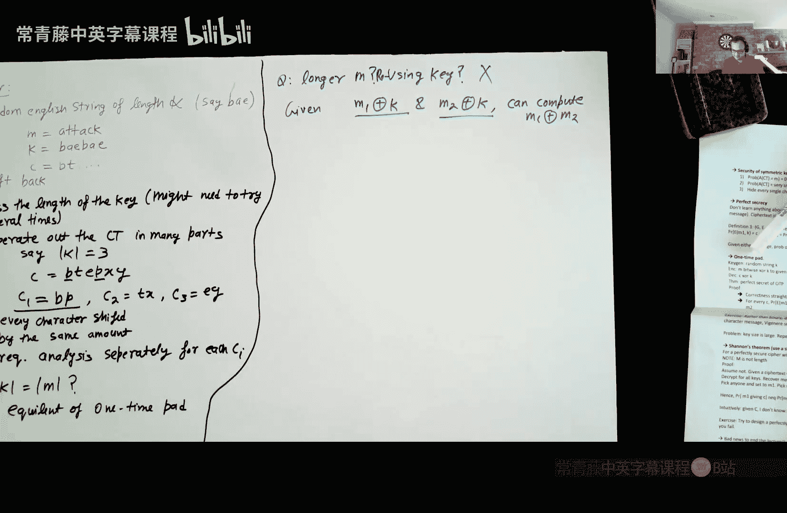

Okay。So now the question is， maybe there exists a different scheme similar to one time。

 which gives us the ability to encrypt longer messages， the ability to reuse the key and so on。

So unfortunately， Shannon showed that this is not going to be。Possible， so。Shanance。T름。

And this works not only for one time， but for any cipher which you can ever design。🤧呃。

For a perfectly。Secure cipher。Or， let me。Call it perfectly secure secret key encryption。

And here the key spaces。Okay， and。So let's say with message base。M。And。keyペ。Let's say， here。

It must be the case that。The key space。Is。Greatter than or equal to the message space。Otherwise。

 the cipher cannot be perfectly secure and note that。

This is not the length of the key or length of the message。😡。

This is the total number of possible keys。So the proof is actually pretty simple。

So we will prove it by contradictions， say。There exists some secret key encryption scheme。Such that。

The key space is actually smaller than the。Method space。

We will try to show that such a scheme cannot be perfectly secure， right？

So let me just give you the intuition。So， you are given。Say acipherex， C。

What you can do is you can decrypt。😊，With every possible。K？Okay。😊。

Now you will end up getting messages。So you will recover some set S。Which， let's say， is equal to。

As1 up to some。It's up to something， right？So these are the number of messages which you and now my claim is that the size of this set S。

Is at most equal to the size of the。キいスペス。Right because I pick a key I decrypt and I will get one of these messages。

😊，So why am I not using equality here， why am I using this less than equal to sign？

And this is just because。Two different keys might give me the same decrypted message。Yeah， exactly。

Okay， and what this means is that there exists some message。M prime。Which must be。哦， sorry。Yeah， so。

By the way， this also means that。Size of this set is actually less than。The whole message this。

This means that there should exist some message。 Let me call it M prime。

 which is a part of the message space， but。E prime is not a part of。This sadness。Okay。😊。

This means that。屎。Could not have， and this is just a sketch you can see a more formal proof in the notes。

C could not have come from。嗯。Come from the message implant。

Because you decrypt C exhaustively with every possible key， you never got and， right？

M prime can never lead to C。This follows from the correctness property。

RightAnd now we are done essentially。This means that。呃。Some message， M。Gifts。S with。

Non zero probability。Another message， M prime gives C with。Zero probability。

 and this essentially directly violates the definition of perfect security。😊。

De of corporate security says that regardless of what message you started with。

The distribution of the sphertex must remain the same。

 which in particular means that the probability of every C。

Coming from M or M prime must remain the same。And here these two probability are different。Okay。

 so this is bad news。Does this mean that we have to live in a world where？Keys cannot be used。

Or you cannot really encrypt long files and so on。So maybe that's what it looked like when Cha theorem came out and Cha theorem is really the reason why things like frequency analysis and so on they work and they break all the classical ciphers。

But the good news。Is that this attack requires？Deryptting the cipher text。With every possible key。

And by the way， this Shanon theorem does give you an explicit attack， right。

 because given a Cyphert C。😊，Maybe I don't know the message which it is encrypting。

But I know the message which it is not encrypting。😡，In particular， it's not encrypting empire。

Which is still bad。来。😊，Right， so Shanon's theorem in order to launch this attack request decrypting the Cyphertex with every possible key。

 and if the number of possible keys is like 2 to the power 100。

 then certainly modern computers cannot launch this attack even it might be hard even for supercomputers to launch this attack。

😊，So this is our hope and this is what we will try to exploit in the next few lectures to get sort of good encryption schemes which hopefully can be used in practice。

And the possible exercise for you to play with is you can try to design a perfectly secure encryption scheme where the key size is smaller than the message size。

😊。