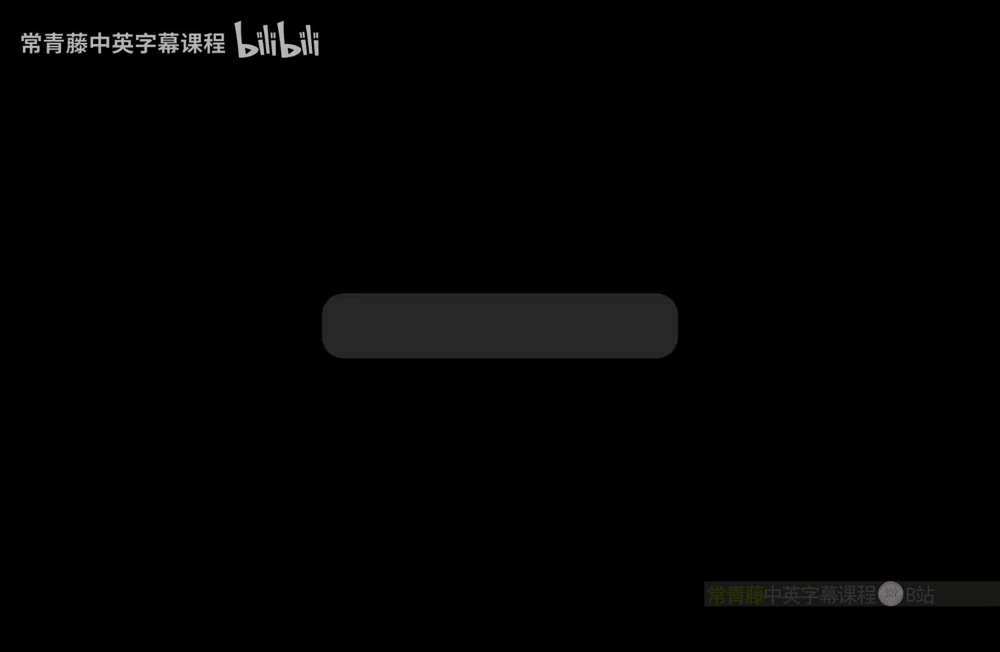
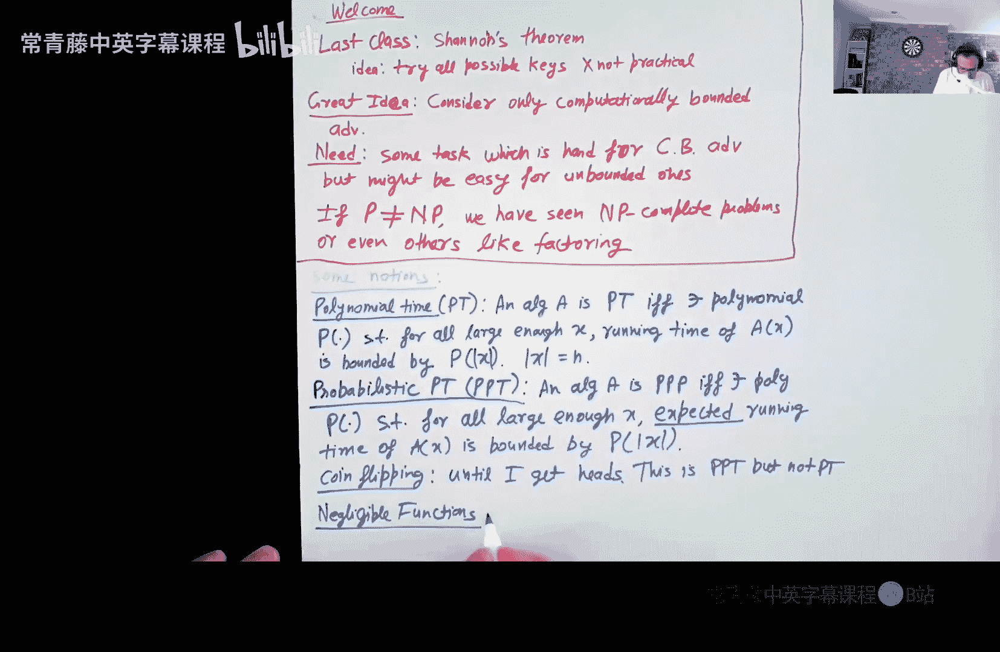
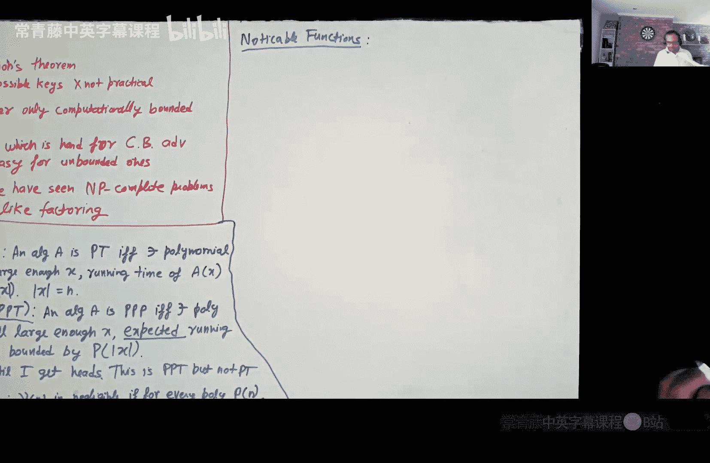
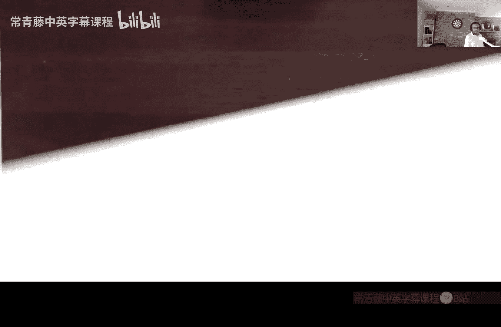
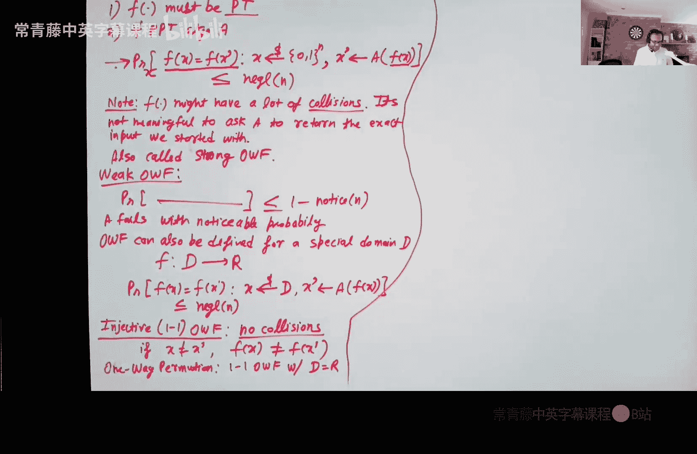
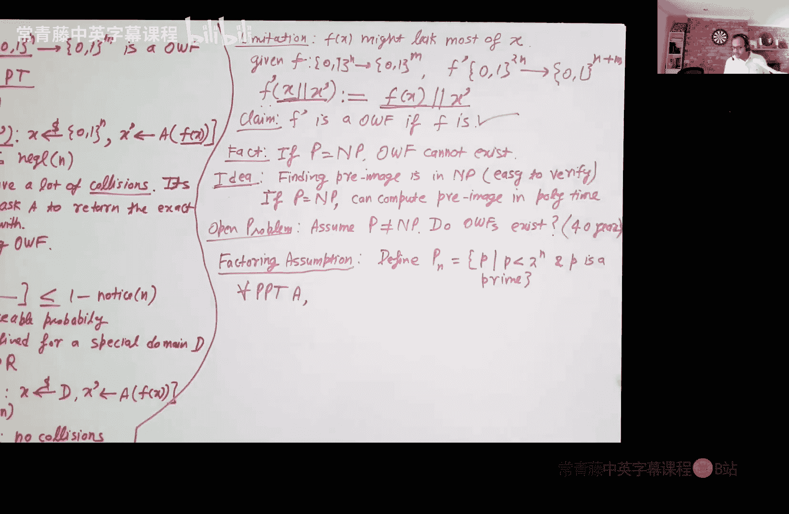
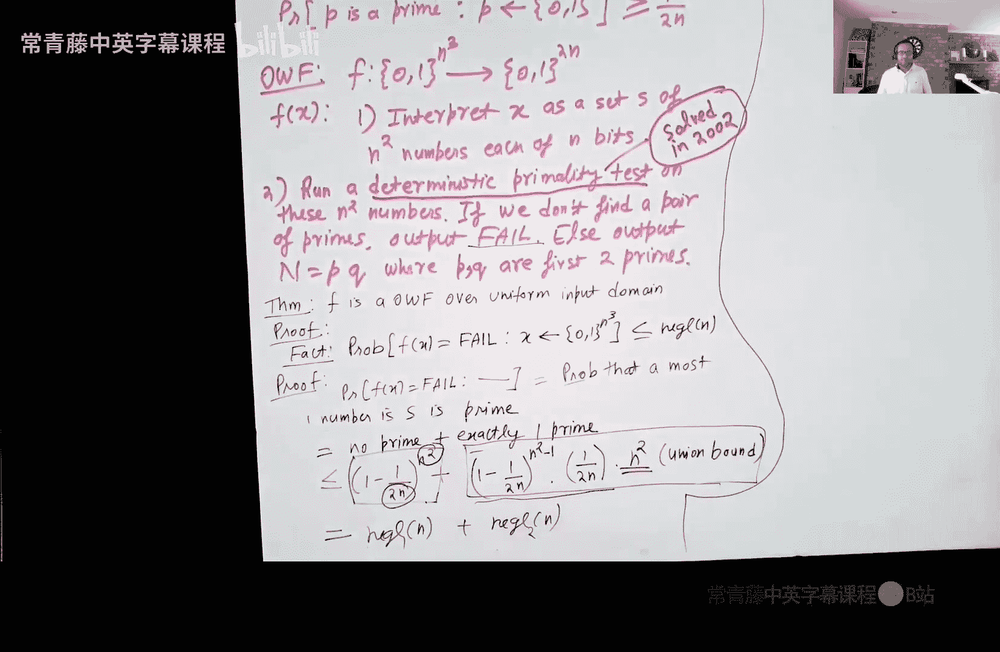

# 卡耐基梅隆大学【中英⚡密码学导论｜15.356 Introduction to Cryptography】 p02 P2 Lecture 2 One-Way Functions -BV16V6GBYEAA_p2-

Hi， everyone。I hope you can hear me and let's get started。So。O。😊。

So let's start by recalling where we were last time and then we will pick it up from there。

So last time we ended up with some bad news。Last class。We saw the Shanons theorem， right？

And basically。Shannon's Theorem told us that。As long as we are considering perfect security。

Any encryption scheme。Whose key size is less than the message size or？

Any encryption scheme in which you reuse the key time and again。That can be broken in some sense。

 right？And the idea here was。Try all possible。Ks。And now the good news is that。

If we restrict our attention to adversaries who don't have all the computing power in the world or who don't have all the time in the world。

 maybe this attack is not practical for them， right？So this is just。An idea to move forward。

And let's call it。A great idea。The idea would be to consider。

Only computationally bounded adversaries。So these adversaries cannot try every possible key if the number of keys is like。

 let's say two to the power hundred， they are not capable of going through all the keys。

 and hence we can still hope to get security against these kind of adversies。Like。😊。

So if we are to rely on the adversary being computationally rebounded。What do we need， We need。

Some ask。Which is hard for。These kind of computationally bounded。Adversaries。But。Might be easy for。

Unbounded ones。Right because Chas Theorem tells us that for unmanunded adversaries。

 we cannot hope to get anything close to perfect security and Cha's theorem in fact also gives us an explicit attack in some sense。

So now our hope is to look for heart problems。Which computationally and bounded adversaries cannot solve。

 right？And。We might already have some candidates in mind， so as an example。If P is not equal to NPp。

I'm sure all of us have already seen things like。NP complete problems。Or even other problems， like。

Factory。So this is what we will try to rely on。Okay。

 so to be able to argue you about these kind of problems and constructions based on these problems。

Let me introduce some notation。Some basics， like。What is polynomial time and so on？So， some。Nots。

Some very basic notions and we will make use of these throughout the class。

 let me use a different marker。So the first notion is that of。Polynomial time。

And let's also denote it by just PT。So， we say that。An algorithm。It is。Polynomial time if。

And on the if。There exists some polynomial。B。😊，And I hope we all know what a polynoial is。

A polynomia has the following form p of x equals。X to the power n plus sorry a of x to the power n plus B of x to the power n minus-1 and so on。

Such that。but on。Large enough inputs。For all large enough S。搞吗？Running time of。A of x。Is bounded by。

P effects。Rather， be of length of it。So typically we will denote the length of x as n。

And we also call n to be the input size。Right， so essentially what this is saying is that you look at any algorithm a。

 its running time might depend on some specific input。But we need that for every input。

 this algorithm a hall in polynomial time。And we will also refer to this algorithm as an efficient algorithm。

Then there's also the notion of。Probabilistic polynomial time。Probbilistic PT or less's。Call it PPT。

And we was。So this is essentially the same as P， except that now we are talking about the expected running time of that。

😊，The algorithm might be randomized。And。The running time of the algorithm might depend on the random coins。

Which it produces in any given run。And we need the running time to be time。So， again， an algorithm。

A is set to be probabilistic polyial time again， if and only if there exists。Some polynomial。P of x。

 such that。For all。Large enough。X。Now， expected running time。Expected running time of。A of x is。

Bounded by。Be of side of things。Okay， as an example。We can take quiet flipping。

So let's consider the following experiment I keep flipping a coin until I get a head right so in that case we cannot bound the running time of this algorithm for all we know I might just keep flipping a coin and I might never get a ahead right on the other hand the expected running time of this algorithm is probabilistic polynomial time it's PPT。

So I flip a coin until。I get heads。So， this is。P，P T， but。Not guilty。Okay， so in cryptography。

 generally we will consider algorithms or adversaries whose running time is probabilistic。

So any questions so far？Yes， good question， yeah。Every polynomial time algorithm is also probabilistic polynomial time。

If the overall running time is bounded by some polymial。

 then expected running time is also bounded by the same polynomial。Now we will talk about。

What is known as negligible functions and noticeable functions。

So these notions， polymial time and probabilistic polyial time。

 they will generally be used to talk about the running time of algorithms。

Neeggligible and noticeable functions， we will typically use them to talk about probabilities。

Prooverty of success and so on。So what is a negligible function？Intuly， this is a function。

 which is like。Very small， almost exponentially small。So， a function。Let's call it U of n。

Is called a negligible function。接bo。If， for every。ponoial。B。😊，Of N。For all large enough。And。😊，搞吗？

N of N。Is actually less than one by。毕月份。Okay， and we did not。These by。And AGL of N。Okay。

 and as an example。So what is an example of a negligible function？

A very simple example is one by2al power end。Like because you can pick any poly。

For large enough n1 by 2 to the power n will be smaller than1 by pole。And typically， we would like。

The success probability of the adversary to be negligible。And then finally。

 let me introduce noticeable functions。So these are functions which may be small。

 but not necessarily like。Exponently small。

So a function FN。Is。Noticeable。If and only if。There exists a polynomial。

Let's call this polyial P of n。Such that。For all。Large enough。And。😊，Actually。They exist polynomials。

P of N and。Too often。Such that。🤧For all large enough n。This function F of n。Is less than or equal to。

嗯。Q of n。But greater than I call to。1 by。毕业份。And then we will denote these by。Notice。And。Okay。

 so they might be as large as a polynomial and they might be as small as one by polynomial。

And of course， if we are talking about probabilities here， then F of n cannot be greater than one。

And it can be as small as someone by P ofM。But if we're talking about probabilities。

 then making a upper bound like。Two of n necessarily encompasses one。

And so is it worth like having a Q of N？We could just say is this equal to one。Yeah。

 if you are only talking about probabilities， then probably Q often can be dropped。

 but we are just trying to keep the definition in general。Okay。And some simple facts to keep in mind。

So the first one is。Suppose I have two negligible functions。neligible。N times。Ne个 level will do end。

What is that equal to？That's also negligible。Now， what if I multiply a negligible function？

And a noticeable function。Do I get negligible or do I get noticeable？So， this is。

Let's call it negligible one。ok。😊，And then similarly， if I add。Let's say， negligible， plus。

Noticeable。I get。Some noticeable function。And then if I add negligible and negligible。

 I will continue to get negligible。😊，And soon。Okay， any questions？

So now let's move on to something which is the focus of this class， which is。One way function。Wai。

 why is the second fact true。Neegligible times noticeable。Yeah， so。So if some quantity is noticeable。

 then that quantity is at most equal to some  Q of n。来。On the other hand。

 negligible is even smaller than any one by polying。In particular。

 negligible is even smaller than one byq of n。So this times this。Will be smaller than。Anyone by body。

Of。Is it clear or should we do it in more detail？no， that's fine。 Thank you。All right。

 so what are our functions and why do we study these objects？So in some sense。

 one functions are sort of the easiest cryptographicitive to design our easiest cryptographic periitive。

 which you can think about。So in encryption schemes。In some sense， the cphertex must hide。

The full message。Right。And you can define encryption in different ways。

 but any good encryption scheme， even if it leak like let's say。

 half of the message or even if it leaks like one bit of the message。

 we will never call it a good encryptionions。On the other hand。In one way functions。Output must hide。

At least。Something about them。In other words， the output or the cipherex。

 you can call it whatever you want。The only thing which we want is that it should not leak the entire input or the entire message。

If it leak like half of it， that's fine。So in some sense， one way functions the。

They ask for a much weaker requirement compared to。Comp to encryption schemes。

 and that is why we will start with one functions。Okay， and very roughly， what are one way functions？

This is just the intuition we will have a formal definition， So in one way functions。

 there are no keys。There's no decryption process。In fact。When we talk about oneW functions。

 it may not be immediately obvious why one functions have any use whatsoever。

 but we will see that once we have oneW functions you can actually design encryption schemes and you can do a lot more。

So a one way function。Takes an input from some domain and gives an output in the range。

And it should have two properties。So number one is。F of x。Is polynomial time。

 or let me just say F is polynomial time。Which means that。For any input。X。

 let's say f of x is easy to compute can be computed in polymerialta。Okay。😊，Another property。Is。

Given let's say you're given some y， which is F of x。诶。Given why。Inverting， y is。Hard。

One way of thinking about it is。If y equals f of x。Access called。Aプ image of Hawaii。

And what we are saying here is that。Given why finding any pre image of y is hard。

And well be formal in a moment， what does it mean inverting wise heart？

2。So now let's。Let's take the formal definition of formula functions。So。

A one way function might take some。And with input， and might give you。An endbit。M bit output。

So this function is called a formula function if it satisfies the following two conditions。

 condition one， as I talked about is that。F must be。Polynomial time note that。

Not probabilistic polymial time， just polynomial time。The second condition is as follows。

 so it's represented by probability。For every。B哔滴。Algothm A。

 you can also think of this algorithm as an adversary。呃。Probability that。F of x equals f of x prime。

Suchuch that。Acc is chosen uniformly from。01 to the power m， which is the input domain。嗯。And。

X prime is the output of。The algorithm on。F of x。So there's probability。Is some negligible function。

In。So let's try to understand what this equation means。

So this equation is saying that first you sample a random string。Which is of land and。

Then you compute F of x。On this random string， then you give the output。To the adversary8。

And now this adversary a tries to guess what x is x prime。

 so let's say x prime is the guess of this adversary。And now we are looking at the probability that。

X prime is a valid pre image of。Effleex。So we are looking at the probability that f of x equals f of x square。

ok。😊，So maybe to understand it better， let's consider the following question。So what if？

We only required the following probability of。X equals x prime。And rest remains the same and we ask。

This probability to be。卖给这个。O。😊，So essentially， we give adversity of effects。😊。

And adversary has to give us x exactly， x prime must be equal to x。

So that's one way we could have defined one functions。Now， the question is。

 is this a good definition？So any thoughts？Is this a good definition bad and if bad， why is it bad？

So essentially， is it meaningful for us to ask the adversary to give us the exact input which？

They started with。Yeah， it's a stricter restriction that is true。

It could be that there are like two inputs that match the same thing and so in that case an anniversary couldn't meaningfully distinguish。

嗯嗯。😊，Okay， maybe I'll give you a hint。What if f of x equals0 always？Right so in that case。

 just this trivial function actually satisfies。This condition。来。😊。

Because the output just has no information about the input。

 so how is the adversary going to guess what the input was right adversity will not be able to do that。

So unfortunately， obviously this function is completely meaningless。

 we cannot hope to use this function to do really anything interesting in cryography。喂。😊。

On the other hand， if we look at this notion。And we look at this function。

Then clearly this function doesn't satisfy this probability equation because any adversary can just output any x right and every x is a valid privilege because every x gives you the same output。

So that's why。We will get rid of this and we will just make a note that。It is not。呃 maybe。

F might have。A lot of collisions。What is a col is a col happens when two different inputs are mapped to the same output。

Also I have a small question。Yeah。So when we are calculating this probability。

 so the adversary knows。😊，The function F， right。Adverly knows adversedverly knows the function that's yeah。

 that's correct。Yeah， like he can he can design his algorithm knowing the function is， right。

 exactly。Goodはいいや。And yeah this is a general comment in cryptography later on we will discuss encryption and we will discuss various kind of algorithms algorithm is always known to the asive。

It's only the random input or the random key which you sample， which may not be known to that。

And by the way， what is this probability taken over？This probability is taken over the choice of x。

Because really in this whole experiment， the only random thing which I am sampling is sex。Okay， yeah。

 so coming back to the note， F might have a lot of cols。It's not。Meaningful。To ask a。To returnだ。

Exact input。We started with。And by the way， this definition， as I said， as I explained。

 this is also called。Strong when we function。And we can。

Also defines something which is known as weak one function。

So strong one function says that the probability that the diversity can guess the output is really small。

 it's negligible。Weak1 way function requires that this probability。Is not one。😡。

So at least some noticeable fraction of the time adversary phases， maybe not all the time。Okay。

 so probability， again， the same thing。Is less than or equal to。1 minus。Noticeable。

So what we are saying essentially is that。Ifffs。Witht。Noticeable。Probability。

Here we were asking A to fail with probability very close to them。And as you can imagine。

 weak when functions are。In some sense， much easier to design compared to strong functions。

And another thing to note here。Is that。One way functions can also be。Defined for。A special domain。

So your one wave function will go from。And input from this domain D。

To some range R and here we were assuming that our domain was uniform inputs。

 but the inputs might be coming from some other distribution or some other domain。And in that case。

 we acquire the security of one way functions。To only we hold。

 the input was sampled from this domain， so。To write it in a more gentle way。

Now access sample that uniform from the D。And everything else remains the same。And this must be。

At most ne。We can also define stronger motions of runway functions。Injective or one to one。

One move functions。So essentially， here。We require the function to have no collisions。

Which means that。In an injective one function， if x is not equal to x prime。

Then f of x must also not be equal to f of x prime。And for injective on function， in fact。

 this definition， this probability is actually equal to asking x and x prime to be the same。

We can also define。Of one。Of one way permutation。In one wave permutation。

 we require it to be a one to one1 wave function with。Domain and range being the same。Professor。

 can you move the camera down just a little bit？I'm du， so are you able to see the last line？

It's a cutoff like halfway。Oh really okay。Thank you。😊。

So we will try to design one wave functions， weak one way functions， injective and so on。

 they have different applications as we will see later on。

But let's first try to understand what one functions are right what do they hide and what they don't hide。

 so first of all， because there is no key there is no decryption process as such。Give an F of X。

There' is no way to recover any pre， there's no way to recover x or x prime。So first。

 a major limitation of gun wheel function， which we all should keep in mind and sometimes all of us forget that。

The limitation here is that。F of x。Might leak。More topics。Okay。

 the definition only requires that probability it leaks all of x or all of x prime it leak any pre image in full this probability is ne。

But for example， a function f might leak half of the input almost all the time。And in fact。

Given a one way function F。I will design another run way function F prime。

Which always leaks half of its inputer。And let me be clear about the input domain。So。F X on。

Nbit inputs。And I will design F prime。Itch actually apps on。Two and inputs。And will give you。

An output which is n plus M bits。So now consider the following。Fplan。F prime takes。X concatenation。

 x prime as input。Both of these strains are Ms， each both of them are random。And it acts as follows。

It gives you f of x。And it gives you。X prime in plane。来。😊。

So there's one function called the early leaks。The second half of its input。

 or I should say this function leaks the second half of。It's simple。And now， my claim is that。

F prime is。Of one wave function。If。F is。And yet F prime makes half of its input。

So why is this claim true？😊，Well， if f is a one way function， then given f of x。

 you cannot compute x。Okay。So now given this full output。You are not able to compute X。

But to invert a prime， you have to compute both x and x prime。So let's claim。Sees to be do。

Any questions？So this is a major limitation， which we should all keep in mind。Another fact。

To keep in mind is that if。P was equal to NPp。One way functions cannot exist。And here。

 let me just talk about the proof idea， it's very simple。So if p equals NP b， this means that。

This means that if I can verify a solution， I can also come up with a solution。Right。😊。

So the first observation is that。Finding the pre image of your wave function。Is in NP。Okay。

 this is because。Given a pre image， it's easy to verify。If somebody gives me a pre image。

 let's say x prime， I can just apply F to it。And then I can verify that you know f of x prime is indeed equal to y。

If and hence。If p equals N P。You can also compute。Some pre image。In polynomial time。Right， and hence。

This probability here。It'll just be one。Because there exists not even a PPT。

 but there exists just a polymial time algorithm， which can find a pre image always this。

So now the next question is。It's a major open problem。Let's say we assume that。P is not equal to n。

Do one way functions exist？Based solely on this assumption。So if p is not equal to NP。

 that means that。There are NP complete problems which cannot be solved in polymial time。

 can you take one of these NP complete problems and build one way functions from that？

So this problem has been open for like。Like， 40 years。

So we unfortunately cannot solve this open problem， at least we don't know how to do it。But。

We will make a slightly stronger assumption。We will instead use something like factory， right？

And by the way， factoring it's a strong assumption。

It's an assumption which is stronger than just assuming P is not equal to NP because。

We don't know if factoring is emptycomplete or not。

It may very well be the case that p is not equal to NP and yet factoring is easy。

But we will just assume factoring is hard and we will try to design a only function based on that。

Okay。😊，So。Let me now define the factoring assumption。And that should。

Give us some kind of one wave function。So factoring assumption at a very high level。

 it says the following you pick two large primes。😊。

You multiply them and let's call this sum number capital n right given capital M。

 it's actually very hard to recover these two large times。So define。B sub n。

To be the set of all Nbit plan numbers。It's a number P， such that。P is less than2 to the power N and。

He is a。くラい。Okay。Now the factoring assumption says the following。For every PPT adversary a。

The following holds。

The probability that。This。Adversary。We give this adversary some number capital N。

 and this adversary gives us。ピか嘛球。Assuming that。Hecom you啊。Sample at random from。

The set of all Nmb primes。And。And is set to be。B大9。So this probability is。

Less than equal to negligent。Okay， so I start by sampling two primes， you multiply them。

You give the multiplication as input to the adversary and you ask the adversary to produce this。

This PM。The probability that any adversary is able to do that is negligible。

 that's the factoring assumption， right。You know。This has been open for something like 300 years。

People have tried to find efficient algorithms for factoring。

 but they have failed a lot of very smart mathematicians have tried this。

 so our confidence in the factoring assumption is pretty high。So note that of course。

 if you had unbounded time， I can just try every possible P and Q。

 but what we are looking for is we are looking for a probabilistic polytime algorithm and our assumption is that it cannot exist。

So now let me start with a very simple construction for one way functions， but for a special domain。

 for a special input domain。So one way functions for。Special。Input。Doomain， D。

And let me try to define what D is。So sorry there's a question the probability doesn't depend on adversaries random coin。

 I assume you're talking about this definition， yes it does。数系十四。Probty is taken over x and。

Random coin of avers。And here the probability is taken over the choice of P。

 the choice of Q and the random coins of the adver。A good point。

So now if you are talking about one functions for a special input domain。啊。

The input is only supposed to come from this domain and the guarantee that the function is one way only holds if the input comes from this input。

If you choose some other type of input， inverting might be very easy。So what is this input domain？

Well， this input domain just consists of sampling two primes。So D is defined as follows， in fact。

 it's probably easier to look at D as a distribution。So just says sample P comma Q from。Be yourF。

And then you output。X， which is。P contactcateation to。Okay。😊，So the input X。

Is guaranteed to have two Nbit crime concatenated with each other。And now the function。

 one way function F。Is defined on this D and it works as follows。So。F of x。Works as。Flows。

So step one is。Interpret the input X as。ピパ沫큐。So x is supposed to be two n bits。

 you first pass this input， you divide it into two numbers and bits each。And then， you output。

N equals p times 2。Okay， where is simple。Now my claim is that given the output。😊。

It's actually difficult to compute the input。And as you can see。

 that almost directly seems to follow from the factoring assumption。Factory assumption says that。

Given n， you cannot compute P and Q， you can do it only with thatlig probability。

And we will do a formal proof of this， so this is great as an intuition。

 but as I mentioned in this class， if we want to try to prove things formally，😊。

And this will be essentially our first proof of security。

And probably the simplest proof of security because as you can see this almost directly follows from the factoring assumption。

 but what Im trying to convey here is really how to write a proof of security and what a proof of security means。

So let me take some questions。For the factoring assumption， P and Q are output by the adversary。

 why does it need to be random？I think they only need to belong to P ofN。

 so it's very important that you choose the primes or randoms， for example。

 if you always choose fixed primes。Then diversity might already known those primes。Right。

So PNQ are not output by the adversity， PNq are chosen first。

And then you construct capital n out of these。And the factoring assumption onlyhoods if you choose P and Q properly at random。

Doesn't the factoring assumption assume that both P is not equal to NP and factoring isn't at P？So。

 as written factoring assumption。Does't assume that p is not equal to MP。

 although the fact that p is not equal to MP is implied by the factoring assumption。

So this is a sufficient statement。And it also。Already implies。That p is not equal to。And。

Because if he is not equal to imped in factoring， just becomes easy。

Facting also assumes that the average case is hard。

Not that there exists a single Pq pair which is hard yeah so the assumption as I stated it essentially assumes that average case factoring is hard right I'm just saying that you get P and Q at random so I'm really talking about like an average prime here rather than a special prime and factoring should be hard for primes chosen like this。

So D equals P concatenation Q P is yeah exactly， so yeah。

 you wrote you wrote it more formally than I did。Any other questions？Actually。

 let me erase the left side of the board。And we will try to do the proof here。Okay。

 so we will try to prove that。This construction is secure as per this definition。So， now。

 the theorem is that。F is。A one way function with respect to。This distribution or this domain D。

Almost all the proofs in cryptography are done using contradiction。So assume not。

Assume that F is not a ver function。Then what you want to do is you want to construct an algorithm a to break the factoring assumption。

Okay， so I assume'm not， Sir。Suppose you're given。So towards contradiction， you are given。

A PP algorithm a。Which。Takes as input。F of x。And。givesives a pre image。V。Noticeable。Rability。

It's not with high。O。So what is the reverse of this definition。

 what is the what would be the contradiction here， the contradiction here would be if there exist in algorithm a。

Which can give us the premise， not with negligible probability， but with noticeable。

And towards to prove to complete the proof， we will。Construct。Another algorithm PPT B。

Which takes as input capital N and。ho gives。The corresponding prime P and Q， hence。Violating。

The factoring assumption。And if we indeed believe in the factoring assumption。

 that means that they cannot exist such a P and hence they cannot exist such a P。So。

B of n works as follows。So no prizes for guessing here， B of n。In workss。A on。Input N。Okay。😊，嗯。

Say air returns。Some X prime。Interpret X prime as。Let's say P prime， concatenation Q prime。Check if。

N is indeed equal to p prime times。就不。If so。Output。E prime comma  Q prime。L output。Fail。

And my claim here is that。If A succeeds， then B also succeeds。What does it say after prem？

With noticeable probability。With probability。Better than equal to。No dis先。

Why are we sampling both the prime independently in the definition？

So suppose both primes are the same。Then n equals p square and taking square root is actually not that hard。

So maybe there is some special distribution where。P and Q are right from each other and still factoring is hard。

 but。The most natural definition is you start with independent PNQ。And now here's my claim。If。Fli。

A pre image。With noticeable probability。Then。Sorry， not F a。不懂。Then P factors。

With notice of probability as well。And here you can clearly see that the success probability of B and A are the thing。

So这就是算序里的。And of ourproof。Any questions？All like， so our next goal would be to design one way functions for。

A uniform input to me as opposed to this special input to me。

And our very high level idea would be as follows， so our input would be uniform。

 but it would be large。😊，And we will try to look for primes in the input。

If we find two prime in the input， then we will multiply them and we will put them in the output。

And in that case。we would be guaranteed that given the output。

Finding the entirety of the input would be hard。Unfortunately。

 if we don't find a couple of frames in the input， then。Then this construction doesn't work。

So we need two things first。We need to understand what is the probability that a random number is prime。

Second， we will want to start with a large enough input so that we can indeed find two primes in that with high probability。

Okay， so here was rely on。Sbiev's theorem on density of times。So Chvis Hiem essentially says that。

The probability that。P is a prime。Such that。Peace chosen uniformly。As an n bit number。

 this is greater than equal to1 by。对。Surpris are not that way。If you choose a random number。

 then there is some noticeable， reasonable chance that that number is prime。Okay。

 and we will not try to prove it。It's a fact from number here。

And now we will try to build one the functions from this。One with functions。When me function F。

And the input will be。Pretty long and cube。And the output， I think， is two indexs。

So this one way function works as follows。2 to the power N or two here， just2 n。

So here is the description of F ofx。Step 1。Interpret X。As。A set。Yes。O。N square。Numbers。Each of ns。

Okay。😊，So if x is n cubed， then you can write these down as n square numbers each of end。

The second step is。Ran a determinstic。Primary test。On these。And quiet。Numbers。If we don't find。

A pair of primes。Output。废用。Okay。😊，Otherwise， you output n equals Pq where。第一个嘛Q啊。First， two prime。

Right， so， by the way。This deterministic primary test is very important， because。

As we mentioned before， the algorithm must really run in polymial time。

 it cannot be a randomized algorithm。So testing， if a number is prime or not。

Doing it in a deterministic way， this was an open problem for a while。And this was solved。

Only in 2000。读。And since then there have been some improvements which have been proposed。

 so thankfully this simplifies the construction of formulaway functions。

So now observe that if the output is fail。啊。The function is actually very easy to in。

Just pick n square numbers， none of them must be prime， and that's a valid pre of fail。

So we really don't want this output fail to occur too often。

And this is where we will use Chabiev scale。Okay。😊，So overall， the theorem which we want to prove is。

F is a one way function。我我。Uniform。Input domain。And。Before we get started with the proof。

 let me prove a very basic fact and that will already sort of convince you that this is indeed a under assumption。

So the fact is that probability。哦。F of x outputting fail。Such that。X was chosen uniformly from。

That required input domain。Is netism。Okay。So what is the probability that F effectsX outputs fail？

It's the same as the probability that you choose。N square random numbers。

 and we don't find two primes in there。Okay， so this。This probability。Of FFx giving you fail。Okay。

 this is the probability that。Very roughly。That at most。1 number。In the set S。This plan。

Which is also equal to the probability that。We have no prime plus。We have。Exactly what。

So these two statements are just the intuition and now let me try to write。More formal。

 So what is the probability that none of the numbers is prime？So this probability is at most。

The probability that。One random number is prime。嗯。不 sorry。Probty that one random number is not prime。

 It's one by。1 minus1 by 22，1 by2 n and rise to the power。N square。

So what is the probability that exactly one prime this means that。The same thing， but you get it。

N square minus1 times。And then the last or one of the numbers is。And to the far end into。N square。

 And this comes from a union bound。Because we have n squared numbers。

This is the probability that the first one is prime but none of the rest is then you need to check the probability that the second one is prime and none of the rest is and so on。

 so n square is just for the union。So， this number。As well as this number。They both are negligible。

And I think the exact formula for this is this is less than， I think。

1 minus1 by e something like that， you can check the notes for the exact calculation here。

But in general， the intuition is that。Whenever this is higher than this。

Significantly higher you will end up with something that is。

So this is great。😊，Now， at least intuitively， we have the following that。

Probability of the output being fail is negligible right so in that case even if the adversary inverse the boundary function。

 we are fine。Doesn't happen too often。 And now。Rest of the time。There's a capital N in the output。

And you need to factor that。To compute input。And the probability of adversary doing that successfully is also neglig。

So now I need to describe。I have a small vision。Yeah。

So like even if like remember we did that example of f of x equal to zero like even if we are outputting fail isn't the probability of the adversacy being able to reverse it very low till like we prove this this is good that like we will not fail most of the times but like even if we were outputting fail from going from fail to the。

😊，Input is like almost a random guess， right nobody can guess。

What was the input if you just give them fail？So we are working with。

 let me show you the definition of one functions。So we are working with this definition。

So adversever， we only need to start put some x prime， which is a valid premium。

 such that f of x equals F of x prime。Okay， you are saying so the adverse we can output any of those which don't have a prime number in it exactly。

Yeah， everybody just just needs to。Chhoose and square numbers such that none of them is prime and then that will be a valid preage and thats something it is not a one to one one way function that's what I said is wrong right yeah exactly this is not a one to one one way function。

Yeah， otherwise， you can just always output fail。And that's never going to help you。Thank you。

 thank you。So。Now， let's try to arrive at a contradiction。And with this fact。

 we will try to construct B。So suppose。Not。Suppose this f is not a formula function， okay？We will。

 again， build。B to。Factor。Some given input。And B of M will work as follows。As you can expect。

B of N will。Invoke。If and。Okay。See the。Pre image。And。Look for。Two primes。Which lead to。And。If。

Such two primes are not found。Output， let's say， bo， I don't want to use scale again。And now。

 our goal is。都。Consider the probability。That。A of N gives。Something with be and。

So what is this probability？Okay。Ideally， I would like to say that this probability is equal to the success probability of。

Is it equal to the inverting probability of。A of F of x。Is that true？So here， unfortunately。

 this is not true。This is because。Of faith。Here I'm never giving fail as input to A of N。

But normally， F ofX sometimes would also have failed if F ofx is computed correctly。

So I cannot make a label like this。And since I'm running out of time， let me just。

Do a very high level proof sketch， you can see a formal proof in the notes。So this probability。

That it outputs P and Q， such that。Such that。P andQA crimes。And。And is just。He you。

So this is what I want。 And this probability is equal to。And let me just call this。To be successful。

This is equal to the probability that is。Successful。Conditioned on。F of。X equals。B。Into。Actually。

 I think let's get rid of this first question。Probability that is successful。

Into probability that f of x equals fail。And by the way， here we will have the conditioning that。

X is generated at random。The probability that。A successful given。F of x is not equal to。

Fail into probability that。F of x is not equal to3。So， this。As we have seen。

 this quantity is negligible。And this probability is at most one， right， so this is just。

Negligible of N。Lastス。Look at this term。So it's less than equal。Plus。Probability， that is。Successful。

Such that。F of x is not equal to fail。Into probability that。

And let me just substitute this probability by。烦。Okay， and now we note that this is。Noticeable。

So this means that。The probability that is successful， given F ofx is not equal to fail。

 this must also be noticeable。If F of x is not equal to fail。

 this means that F of x equals capital n。Which is a product of two plants。

Which means that when a is given capital n， which is a product of two drives。

 a is successful with noticeable problems。And this。Essentially， also implies that。Be also successful。

With noticeable。So any questions？So at a very high level。

 our worry in this proof was only a following that if we have given an adversary。

 which expects the output of a one wave function。RightBut the output of a value function might be capital n or it might be same。

If we prove that the output of a boundary function is failed with very small probability。

 that means that the adversary must invert at least some of the times。

 some noticeable fraction of the time， even when the advers is given capital line。

And if the is doing that， that means the is factor numbers。

