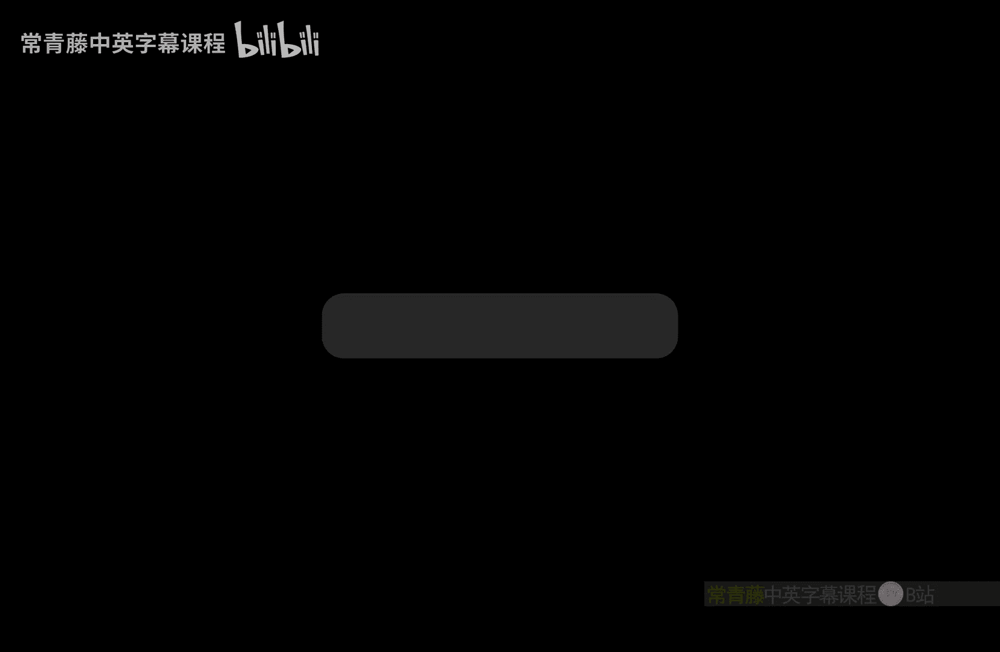
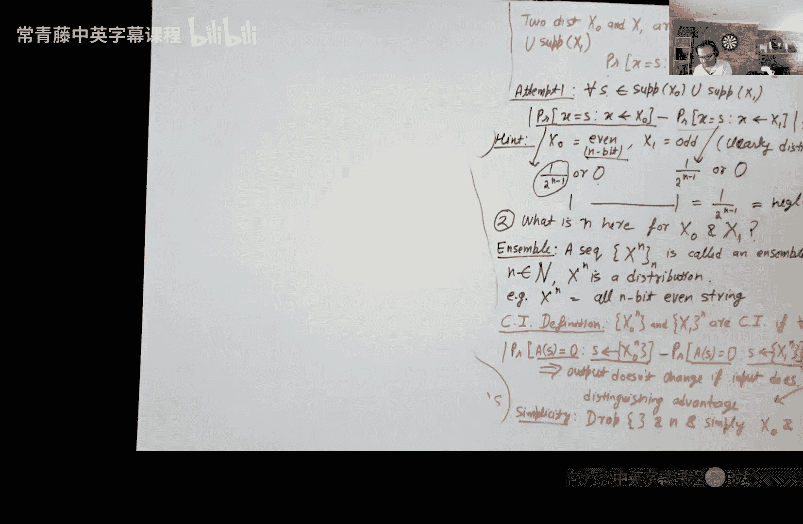

# 卡耐基梅隆大学【中英⚡密码学导论｜15.356 Introduction to Cryptography】 p03 P3 Lecture 3 Hard-Core Predicates and Computational Indistinguishability -BV16V6GBYEAA_p3-

I like time everyone。I hope you can hear me， let's get started。

So just let's start with a recap of where we were last time。So。

Last time we studied one wave functions。And very roughly one way functions are functions which are easy to compute but hard to invert so easy in one direction but hard in the other direction and we also saw a construction of one way functions based on the factoring assumption right it was not a very difficult construction and we were even able to prove the security of the construction based on the factoring assumption。

😊，But a major limitation of one way functions。😊，I that we don't know what they would leak right the only guarantee with one functions is that they don't leak the entire input but they might leak half of the input they might leak even more than half and things like that right so this is a major limitation which we will sort of try to overcome right now。

So a limitation is that one way functions。My league。A lot of the。Input bits， in fact。

 for all we know， they might leak almost all of the input bits and just some of the bits might remain。

 right。So now our goal eventually is of course to construct things like encryption schemes right in encryption schemes we want the message to be hidden entirely right even if an encryption scheme leaks like a single bit of the message we are not happy with that。

😊，And our eventual goal will be to take techniques which we developed in the context of one way functions and build bigger and more beautiful primitives like encryption is one。

 but today we will focus on pseudoandum functions and so on。😊。

So lets just try to think about how we can overcome this limitation。😊，Okay。

 fine one way functions might leak a lot of the input bits。

But is there some subset of the bits or even like say one bit？

Is there even a single bit in the input？Which I can point to and I can be confident that hey。

 my well function is going to keep this bit hidden in some sense right so that is the question。😊。

So is there any bit？Of the input x。Which the one way function F。Will not。Lak， okay。

And I am not going to define formally， but by leaking， if you could think of it as。😊，As you know。

 enabling an adversary to guess this bit with probability clearly better than half。😊，Okay。So， now。

The first observation is that。It's actually very easy to design Man functions。😊。

Which don't leak some specific bit so。You can always design。A one way function f prime。Give an F。

Such that， let's say F prime。Doesn't leak。Say the first bit。

And how does F prime work F prime takes as input some bit B concatenation x。😊，And then， just outputs。

F of effects。Okay， so if prime takes an n plus 1 bit input and just ignores the first bit and applies the one way function f to the remaining n bit。

😊，And here you can see that a prime clearly hides the first bit B。😊。

But this is a specific one way function right so this is not what we are talking about。😊，So。

 Im given an arbitrary。One way function。F。The question is， can I point to。Any specific。Bit。

 let's say。The I at bit。Which F heights。嗯。O。So any thoughts about that？Can I point to any specific。

 let us say the I bit or whatever you can choose the value of I so that I am sure that the value function f hides this particular bit。

😊，And the answer to this question， unfortunately， is no， right。😊。

Because you can choose any eye and I can always design a one way function which leaks I。😊，Okay。

For any eye。A one way function F。Might leak。爱。Okay。

 so this is unfortunate right I cannot even point to a single bit which f is not going to leak。

 so here is my new question。😊，I have to be less ambitious now。 And my new new question is。

 is there any。😊，1 bit function。Let's say。At。Of x。Such that。F of x。Hights。A of X。So， as an example。

🤧嗯嗯。H of x。Might， let's say， you know。Exard or and。Certain bits and things like that。

 right we can talk about any Boolean output h ofx。😊，Okay， so。

Is it possible to construct some function edge like that such that any one will function F is guaranteed to hide this edge of x？

😊，So any thoughts about this？So again， the output of fetch of x is just a single bit。And again。

 the answer to this。Is no。There cannot exist。A universal。E of x， such that。F of x。Hirs。H of X。

 because。And the reason for this is， again， you know， we can always construct another a frame of。X。

 such that。F prime is just h of x concatenation of。F of x。And this is just a single bit。

 so if f of x is a one way function， then f prime is also a one way function。😊，嗯。

Because giving a single additional bit of information is not going to help diversity that much。

If the probability of guessing x was negligible earlier。

 even given such x the probability of guessing。😊，X is still going to be negligible。Okay， and so。

H of x being1 bit。Can。Cant。Increase。Success probability of。Anni aversity。And hence。

 this is also a one function。Okay， so。So let me try to define a little more formally what we have been looking for。

So the definition is。Hardcore。Let's， let's write the definition in a different color。嗯。So。

 the definition is。Hardco predicates of a one way function。So， by the way。

 sometimes they are also called as hardcore bits or HCB。Okay， so by the way。

 a predicate is just a function with a single bit output。😊，So， a predicate。At。Which。

Takes an n bit input and gives you a single bit as output。Is。A hardco predicate for。A function。F。

 again， this is a one way function。Which takes an n bit input and gives you an output。

If the function edge is。Polynomial time comp。And far。Every PP adversary。예。嗯。

What we want is that the probability that given the output of F。

The probability that an adversary can guess the output of edge。😊，Is roughly half。

So the adversary is given f of x。And the adversary has to guess h of x we are looking at this probability such that。

Ex is chosen uniformly from。The input domain。This should be。

You cannot say this is negligible because it is just a single bit I can always guess this bit with probability half。

😊，But what we want to say is that this probability is just half right half plus negligible not significantly more than that。

if we can claim something like this， then we can claim that yeah indeed h of x is a single bit。😊。

Which this one will function。F of x hides perfectly in some sense。All right。

 and as we observe that no single construction of edge of x is possible。

 which would work for every one way function。😊，There's a question is this because it increases the probability of guessing by only a factor of two that's yeah。

 that's exactly correct。😊，Can't increase success probability of any adversary a。Yeah。By。

More than a factor of two。Okay， so what do we do now？😊，So here is our idea。So， we will pick。

E at random。Whatever random means we will see in some sense。Independent of the description of。

The one way function F。Then， hope。That。Vd。😔，High probability。F of x。Does not leak。H of x。

So this will be about hope。All right， Any questions so far。And we will see that， in fact。

This hope will we will be able to realize this。So let me define the inner product function and our hardcore predicate will be based on this inner product function。

😊，So inner our product between。In a product is also just represented as IP。Between some strings。

 r and x。Is represented as。X and R inner product。Is just equal to。

And let me just write it in plain English。Okay， this is just submissionmmission。X， I， R I， over I。

Marto。Okay， I'm sure that many of you have seen this before。So， essentially。I chooses a subset。

Of the bits。Of x。Then， you sum those。Some them or。Moto。Our summation over mo2 is also。The same is X。

Or X are the selected bits。So， as an example， let's say the first bit of r is 1。

 every other bit is 0， then we will just select the first bit of x and output will be the same as the first bit of x。

😊，And now here is the goldre lanturum。I think it was 1987 or at ti8， let me go with it ti8。🤧嗯。

So let your given function F。Which goes from。And widths to。Mbits。嗯。Now sample。Are uniformly。

From01 to the power end。So， R is a random。Enbit string。Then。

You define the hardcore predicate edge of x as just。X in our product R。

So this is a hardcore predicate。Of F。With1 minus。Negligible of N。Probability。

And this probability is taken over。Sice of。The random string are or the choice of the preddicate edge。

So， what this theorem essentially says is that sure we don't have any fixed universal hard code predicate。

😊，But as long as you choose your hard code prediccate at random in this way。

Independent of the1 way function F。Then with very high probability。

 this will be a hardcore predicate for this particular one function f。😊，O。嗯。

So the full proof of this theorem is not something that we will be able to cover。

 I will just give you a basic intuition。 The full proof is pretty long and complex， so we will just。

Look at a。Toy case just to sort of you know， build our intuition。And what is the intuition here？😊。

The intuition here is that。Suppose given the output of the one way function。

An adversary is able to guess the output of h of x。Let's say for a large number of Rs。

 or let's say for any R。Then you can actually solve a system of equations to just completely recover X。

😊，Which would mean that the adversity has inverted the boundary way function。Okay。

 so just in more detail。So， towards contradiction。Suppose there exists a PP adversary。In which can。

Which can guess this inner product。For。Anynie。啊。😮，With probability， let's say one。😊。

So this would be the most extreme adversary。And by the way， one one thing I should note is that。

The description of。Ech。Which in also， which in particular。Contains R。Is public。

 it is given to the adversary。Okay， so the advers is indeed given R and the adversary has to guess this inner product of x and R。

😊，So now yeah， so suppose you are given a very extreme adversary which can like just completely break your hardcore predicate。

😊，In the most disastrous way possible right just choose any hardcore predicate like this aly just breaks it with probability one can just guess the output with probability one now at least in this case I can show you right away that that this adversary can also invert the one way function leading to a contradiction。

😊，Okay。So， we will。Build。Another PP adversary B。To invert F。And in fact， our PPT B will succeed with。

Probability one， in fact。Okay。😊，So， B takes。Yeah。F of x as input。And the goal of B would be。

To invert。F of x。And B works as follows。嗯。So， step。one。Is。Choose R 1。Which is equal to one。0，0。0。So。

 this is an n bit strain and only the first bit is 1 every other bit is 0。Now。Use a。To recover。

The inner product of x and R1。And now what is the inner product of x and R1？So， this。Gifts。offff。嗯。X。

So let me change the notation a little bit here。I don't want to。So let's call the first bit。

Lets we will represent the first bit as this。哎。系。Now we will recover x1。Right。

 because if you take the inner product of x with an r1 where r1 is 0 except in the first place。

 the inner product is just supposed to be the first bit of x。😊，Step 2。You choose。

And now you can already guess， right？0，1。Everything else is zero and then。You recover。no。😔，X2。

And then you keep going。Step n since x is n bit。You will recover X N， and now you have the whole X。

ok。😊，And now。Be can output。The per image。And， in fact。If。If a is successful with probability 1。

 then B will also be successful with probability1。😊。

So this is just a very toy case now the question is。What if。A guesses。With probability。

 just let's say。Not one， but。Let's say， half plus。Noticeable of n， right？🤧う。

Another question I can ask is what if a guess is only for a random r but not for rs of this specific format right so the only guarantee that we have with a is that it guesses far a random r with probability half plus noticeable。

😊，So， this。The intuition again in this case is that we will essentially try to use the same strategy。

 but now we will sort of has have noisy equations。😊，So， in this case。

 we will end up with noisy equations。What do I mean by noisy equations？

Some of the equations can be correct。Maybe more than half of them are correct。

 but many of them will be wrong。Because the guess of a can be wrong， and the question is。

 can you still recover x in this case？And the answer turns out to be yes。 And by the way。

 this is also called as。Gold right 11。Le decoding。Yeah。And this is not something which we can。

Gover right now。So essentially， what we have been able to do now is that。😊。

Given any one way function， I can choose a hard code preddicate edge such that edge of x is essentially uniform given the output of the one way function。

😊，And now we can hope to do great things with this because I have at least a single bit。

 which is essentially uniform to the adversary。😊，So now we will move on to。

Core randomness and how one might be able to design pseudoor random functions。🤧Yeah。

So there is a question about the definition of inner product。

 what do you mean by our choose a subset of？Bits of x over Ma2 near the definition of in。

So maybe I should give an example of inner product。So what is the inner product of。

Let's take x to be 0，1，1，0。And let's take R to be one。0，1，1。So let's look at R here。So。

Here we have one， so we select the first bit。Here we have zero。

 so we leave this bit out here again we have one one， so we select this。Okay， so essentially。

 we are summing。0。1，0。Which is just one。And once you take mark 2， it doesn't make any difference。So。

 this R selects。A subset of。Bits of x。And then you just sum all these bits。

And how do you select the subset， the bits of r tell you which bits of x to select and which to leave out。

As another example， suppose。Here， we had。0，0，0，0。Which means that we don't select any of the bits。

Of x， which means that the output is just 0。And if it was 1，1，1，1。

 then you would just sum up over all the bits of x。

So another question can you explain why a universal hardcore predit cannot exist good？

So this brings me to this equation。So， suppose there exists a universal hardco predicate。

 which is h of x。😊，Ech of x should work for any one function， right。そ性。Ech of x。Works for。

Any one way function。Now we will build a one new function。F prime。Such that。A of x fails for the x。

And how does F prime work F prime of x equals just。

H of x concatenation with f of x where f is any other generic value function。

So there are two steps now。Step1， we have to convince ourselves that f prime of x。

Is a one way function。If， F of x。Is。Okay。And this is not completely trivial， right because。😊，诶。

F of x guarantees that given F of x， you cannot compute x， but maybe given F of x and h of x。

Maybe somebody can compute X， right？So， the proof of this is that。F prime of x。Only gifts。Ech of x。

 in addition。But this is only a single bit。But。This can only increase。Guessing probability of。X。By。

A factor of。杜。But this means that if it was negligible earlier。😊。

Two times negligible is still negligible， So it would continue to be neligible。

So can you please explain how this that factor of two comes like how how are you writing this that like it can only increase by a factor of two like where does the two come from Okay so lets say I choose 100 bit string I ask you to guess it right you can guess it with probability2 to power minus 100。

Now let's say I am feeling generous， I want to help you。 I will even tell you one bit。

Of my 100 bit string。So how much can your success probability go up？But but but it's not like I just。

 I just know that one bit right， I also know F of it。

So I might I might figure out something from that and h of x play so F of x is something which you knew even earlier right F of x is a one way function。

 which means that given one f of x。😊，Your probability of guessing was Le 2 to the power minus 10。Now。

 in addition to F of x， I just give you a single bit。😊，Yes， okay。

 How much can the probability go up from2 to the power minus 10 f of x is something which you had in both cases。

 right。In case one you only had f of x your probability are2 to power minus 100 case2 you have f of x and in addition you have some one single bit of information but but like it is a 100 bit string right so my probability will be a little more than2 to power minus10 right total to power minus00 is the probability when I have nothing。

Okay， okay， so let's say I give you F of x。And let' us say your probability of guessing x in that case is 2 to the power minus  et0。

😊，80 okay so so thats that that is case one where you have f of x your probability of guessing is to do minus at Now in addition I give you one more bit of information about x。

Okay， then your probability at most is going to be2 to the power minus-79。 Yeah， why， why late。

 how are you saying this statement， I mean， because this one bit is something if I don't give you right you can you can anyway guess this with probability half。

Right。So I still don't understand properly。 So say case 2。Given edge of x。

Your probability of guessing is。Let's say it becomes true to the power minus 50， suddenly。Now。

 this is case2。Okay， I hope you can read it now in past one。Now I can go back to case 1。

I can I am not given an h of x， but I can just guess h of x and I'll be correct with。

Probability half。And now I am in case2， so it is half times 2 to the power minus 50。

Which is much better than to do the power minus 80。

So the the point is that if I just give you one be。😊。

It's something which you could have even guessed on your own。

 so that that's not something which is going to help you that much。Okay， any， anything else。

There is another question， so the statement is supposed to be that for all F。

That takes an orbit string。F prime takes in and it turns an m plus1 which string does this probability then。

Increase at all。 Yeah， So F prime does give you m plus 1 bit output。嗯。So。So。

 this shows that a universal edge cannot exist， which can work for any output length。But you know。

 you can drop one of the bits of F of x and again， that doesn't change things very much。And yeah。

 if I go into the proof of that， I think it will take very long。

 I can maybe explain it in office hours。And the reason we were failing earlier is because your F prime was actually dependent on edge。

😊，Right。And now in goal Direct 1th theorem， what they did was you fix f first and then you choose edge。

😊，So H and F， they are independent in some sense and that's why we were able to succeed。

Any other questions？Yeah。Okay， so now we will try to do nice things using hardcore predicates。So。

 first is。Seore random generators。And these are also known as PRGs。So， first。

One of the points I want to make is that。Randomness is。Trickkey slash。Expensive。In the electronic。

World， and why do I say that， So how do you generate randomness in the physical word。

Maybe I just take a coin and I keep flipping right every time I flip a coin。

 I can essentially generate one bit of randomness。😊，That's or that's sort of the assumption。

 you know， quantumum says that maybe it's not true， but let's believe it is true。

Now in the electronic world。How do computers generate randomness？So。

 they don't have any in builtt coin essentially it is like a circuit which is more or less deterministic so computers use many factors to generate randomness like the current temperature or what is the current temperature of the CPU the last few keystrokes which you had you know the movement of your mouse and things like that and once you combine and of these things the hope is that you know the output is sufficiently unpredictable。

😊，And you know， once you use like a random number generator in Python or whatever。

 this is basically the process it goes through。So， this is a very heuristic approach to generating randomness and in fact。

😊，What I can tell you is that many cryptoyems。물ロpen。Because of。A defective random number generator。

And the point is that in cryptography you know randomness is everything right I generate my secret key at random if an adverary can guess my secret key then there is just no hope to get any kind of security whatsoever。

😊，RightSo so randomness and keeping randomness secret and private in some sense is very important in cryptography。

😊，But it can be tricky so so what can we do right so lets let's say I need like1 thousand0 bits of randomness right？

Now， a very natural question is。😊，The question is， can I generate small number of random bits？😊。

And then in some sense， deterministically expand them to get a very large number of random bits。😊。

So can I generate say。And random。Bits。And。Deterministically。Expand to。Doing。Randdom bits。So。

 essentially， I'm looking for。A function， G。Which takes an n bit uniform output and。It gives me。

A  two n bit uniform output。And output。offff。G is。Uniform。So now here's my question to all of you is。

Can such a random can such a deterministic function exist。Okay， good。 So yeah， G can only have。

 The answer is no， because。😊，G can only have。2 to the power and。Different outputs。

And why is this a problem。If I generate a 2 n bit uniform string。😊。

I will end up with like2 to the power2 n different possible numbers and here if you do this in a deterministic way you only get2 to the power n so drawing a picture here these are2 n2 to the power n bit strings and。

2 to the power n is a much， much bigger sec，2 third power 2 n。And if you apply。So this is。

 let's say R G。So if you apply G， then you only end up with a very small set。Of total power and size。

And this is clearly not uniform。😊，I will give you a test。So suppose we have two distributions。

 So say。Distribution， x。0 is。Output of G。On。N random bits。Distribution x1 is。2 n random bits。

And my test is just。Given distribution。Oh， let's say。Keep sampling。From the given distribution。

Say a very large number of times。 let's say true to the power。Hundred and times。See how many unique。

Numbers you get。恐怖。Okay， if I get at most true to the power and unique numbers， I know that。You know。

 the distribution is x to 0， otherwise， the distribution is x1。😊，Okay， so x 0 and x1， they dont。

 they are not the same any in any case， in any sense。So。I have a small question。

 why does G have to map an element on the left side to only one element on the right side by canic map to randomly to a new element life？

😊，It's a function， it's a deterministic function。It takes an input and it gives you an output。

If it is deterministic， then on the same input it will always give you the same output。😊，Right。

 so now a very good point， this test is very expensive。😊，Okay， which brings me to。

Cudandum generators and that is exactly why pseudoendum generators are possible。😊，So。

 here is the observation that。😊，Maybe if the test。Or let's call it a distinguisher。Is， let's say。

 probabilistic polynomial time。Maybe theres a hope， right？Because let's say n is 100。

 you just cannot keep。Sampling so many times from the given distribution and this will this will turn out to be correct and this is why you know you have these magical objects which can deterministically take like lets say and bits and you can expand them to2 and thousand and1 million times and whatever you want。

😊，So this is like almost impossible when you think about it， but crypto makes it possible。😊。

So this also brings me to a very interesting observation， which is that。😊。

When you look at like almost anything in crypto， you consider unbounded time adversaries。

 it just completely breaks down， but as soon as you go to polyial time adversaries。

 you know everything just sort of magically falls into place。😊，So this is very interesting。

So what we are looking for here is。In in a PRG。So a PRG is， again， text。And bits。 And for now。

I want to expand to two n bits。And here this 2 n is somewhat arbitrary I could。Ask for。

Any expansion factor？嗯。So I want to design a function such that。嗯。Output of G。Is。What I would say。

Computationally indistinguishable。From。U of 2 n， this is。The uniform distribution on two n bits。

And this notion of computational indistinguishability is very important。😊。

It's probably the single most important definition。Not only in this lecture。

 but maybe you know maybe like the first quarter of the course。It's very， very important definition。

So now let me try to define what computational in distinguishistinguishability。😊，Might mean。

And for that。I will try to remind you of the definition of a distribution。

And what do I mean by two distributions being identical？O。So what is a distribution first？

So let's say this capital X。Is a distribution and every distribution has a support or a sample space。

Distribution over。Support。are。Sample space。S。If it assigns。And typically。

 it should be a non zero probability。It's nonze probability。Pace of S。To。To an event。😔。

Small S in this capital S。Such that。The sum of all these probabilities is one。So sum over all S。B。

 S is just one。Al right， as an example。Let's say x is a distribution of flipping a coin right so then the sample space is just had or tails。

And the probability which is assigned to head is half。

 probability of tail is also half and the sum is one。Now let's talk about identical distributions。

And then we will hopefully try to generalize the notion of。

Identical distributions to computationally indistinguishable distributions。

What I want to say is that。Two distributions， let's call them。X0， and。X1。Are identical。If， for all。S。

In， and sorry， So here。S is also known as support of。X。Just notation。So， S in。Support of x0。Union。

Support of。X1。So you look at every possible event。And essentially the probability of that event。

In x 0 and x1 should be the same。What I want is that probability of。要三包。X from。X0。对。

And I want to say that here。For all。Okay， I already wrote， sorry for our less。X equals S。

And now X is drawn from。X1。Okay。So the probability of every event。

In x 0 and x1 is identical you take any event s。So is this clear？These are identical distributions。

And now let me try to define what computationally and distinguishable distributions might mean。

And this will be a failed attempt。😊，Attempt1。So， a very natural attempt right here we are talking about these two probabilities being identical。

😊，Maybe these probabil should be very close to each other。Like negligibly close to each other。

 maybe not identical， right？So here's my attempt for all S。

And then I will ask you for a problem to point out a problem in this attempt。

For every event in the support。X 0 union。X1。Maybe the probability that。X equals S。Such that。

X is drawn from。X0。Minus。The the same probability， but。X equals S when。Drawn from x1。

So maybe what I want is that。These two probabilities should be negligible。Looks pretty reasonable。

 actually。😊，But there are multiple problems with it。

So I think you need to sample infinite finite many times to actually calculate those probabil。

 is that a problem？No， not really。Shouldn't they both sum to one。嗯。Yeah， I mean。

X 0 and x1 are still distributions， so they do satisfy。😊，This notion， and we will require that。

 so surely。The probability of all events will sum to one。

And in addition for computational indistinguishability， we require this rather than this。😊。

Is this good or bad？And let me give you a hint， maybe。So think of x0 as。All even numbers。And x1 as。

All odd numbers。Let's say n bit even an n bit on them。So what is this probability？😊，Let's say， even。

And even n bit number and in odd n bit number。 So what is this probability。Half no。

It's either 100 depending on what S is。So note that this probability is defined for a specific S。

Right， so this。So the problem now is that for a specific S， for a specific number。

What is the probability that you get that number？It's actually really small。

 right it's like on minus1 exactly yeah so it's either0 or it's1 over two to the power and minus1。😊。

And I can see the same thing here。That's already negligible， right so。

So the first observation is that clearly。😊，You give me samples from x0 versus you give me samples from X1。

😊，So， this is。Clearly distinguishable， right？I can give you a correct answer with probability 1 I can just test if the number is even or not on the other hand。

😊，This probability here is either。1 by 2 to the power n minus1。

Because this is the number of even numbers。R 0。If you pick s to be odd， then for x to 0。

 this probability would just correspond to 0。And similarly， this probability would either be。

1 by2 de bar and -1。A isze。So for any particular S。😊，This。let me just copy this equation。

 so this is exactly1 by 2 to the power and minus1。😊，Right if you pick an even number。

This will be 1 by 2 to the pi and minus-1， and this will be 0。

For an odd number here we will have 0 and here we will have1 by two toth power and is。So。

 the difference between these two is 1 by total pi and minus1， but that is actually negligible。

 right？😊，But still， we can clearly distinguish these two distributions。

And why are we able to do that because？😊，Even though， for any specific S。

This difference is negligible。There is an exponential number of s。So when you sum over all of them。

 this probability actually。Becomes one。Rather than anything negligible。

Does this mean that sample space of identical distributions should be the same yes？

From this identical distribution definition， it follows that。Samples space should be the same。

Because if it is 0 in one should be0 in the other and y sub vera。Okay。

 so I hope this this example is clear so this example essentially says that you know we are talking about events which anyway have very small probability like negligible probability。

 then you cannot ask for the difference in probability to be negligible that is just meaningless for any distribution it will be negligible。

😊，So， that's problem one。So let's call it problem。 There's another problem。

 which is more of a syntactic problem。Which is what is n here？If I start with two distributions。

 x0 and x1。There's nothing， which is。Changing no size of the input， which is increasing or reducing。

And so on。Right so we really need to talk about a set of distributions or an ensemble of distributions and in my example I already did that x0 was an nbit number right。

😊，So let me define what an ensemble is。So we will fix the second problem first。

 and then we will fix the first problem。So ensemble is a sequence of distributions， a sequence。

Capital X。N N， so essentially x1， x 2， x 3， and so on。It is called， and。Enemble。

So this is more of a technical point， it doesn't really affect our intuition or thinking very much。😊。

If for each。And in the set of。So， this is the set of。Natural numbers。X1 is。A distribution。

As an example。😊，是。哦。Enbit。Even。Stngs are all uniform and bit strings and things like that， right。

 So it's nothing fancy just。Now I have just introduced a parameter n and I can talk about things being regligible in N。

Okay。And now let me try to give you the actual definition of computational and distinguishable。😊。

So computational and distinguishability。Definition。And this， as I said， this is。

Probably the most important definition for today and maybe the next one or two weeks as well。

There's I think there's a question。Okay， looks like， okay， great， thanks， Justin。

So what do we want very intuitively what we want is that given the PPT adversary a。😊。

Maybe we give this adversary samples from x0， maybe samples from x1。

 this adversary should not be able to distinguish that。😊。

So I will just try to take this English sentence and I will just try to put it in more mathematical terms。

😊，So， what I want is that。For every P。Adversary a。I look at the following two probabilities and I would ask these probabilities to be very close to each other。

Probability that as S。Outputs。0 that。S is coming from， let's say。X。0 n。Oh， sorry，5。So。

 two these two ensembles。X 0 and x1。嗯。Are set to be computationally indistinguishable。If for every。

PPT adversary A the following holds。So first time sampling Chrome。S 0。

And Im looking at the output of the adversary。😊，What does adversary think of this sample？Next。

 I will sample from。X1。And I would ask these to be very close to each other。

So now let's look at this equation。The probability that as outputs something specific lex is 0。

It remains the same whether it was given this type of input or it was given this type of input。

So that's sort of a more。Convoled way of， or maybe a less。Natural way of saying that。

The output of a doesnt change if you change the input。

Which essentially means that a is unable to tell the difference between inputs of the first type and the inputs of the second type。

😊，Okay该说 essentially실。Output is。Independent。Of。I should not say independent， but。嗯。

Output doesn't change。If input does。So now just as aity checklists go back to our even strings versus odd strings examples right so now I can obviously construct and construct an adversary which just checks if any string is even。

If it is， it outputs0， otherwise it outputs 1， right？

So now let's say I'm sampling from the even string distribution。

Then this adversary will always output one and hence this probability is1。On the other hand。

 I start from when I start sampling from the odd distribution。The probability of this。

Is actually zero because adversary a always outputs 1。So， I will have 0 minus1。

 which is you take the mod thats 1， not not anything which is close to netligible。So any questions？

We will see another natural definition and we will compare。The two definitions。Okay。

 so let's see another definition， actually。The definition or and so。So， in general。

 maybe distributions are not computationally indistinguishable。😊，So this quantity is known as。历四。

Let's call it the distinguishing advantage。So， if the distinguishing advance is negligible。

 we call the two distributions to be computationally indistinguishable。😊，And by the way。

 far simplicity。😊，We will just essentially drop this。Curly brackets and N， and。Simply， we will use。

X 0 and x1。And we will implicitly keep in mind that these are actually distribution and symbols。😊。

Rather than just a single distribution。Okay， so now let's move on to another definition and we will try to compare the two。

嗯。え？是。

So that this definition is called prediction advantage。

And this might be a more straightforward way of defining things so in prediction advantage。

We ask the adversity to just predict。Which sample he got？

From x 0 or x1 aver just has to guess this fact and we look at the probability that the a was is successful。

😊，So any adversity can of course guess and be correct with probability half。

 but we don't want this probability to be much more than half。😊，So， we say that。

Distribution ensembles x0 and x1 and again I am dropping the curly brackets and the n。Have。

Prediction advantage。Epsilon。If for every P。For every PPT adversary A。

We are looking at the following probability。So a is given some some sort of sample。

And x could be coming from。X0 sorry。X， B。So B is first picked at random。

And then the sample is given from。Xb。So we are looking at this priority， right？😊。

An adversary which doesn't even look at the sample can be correct with probability half。So。

 we are interested in seeing how much this adversary is able to do。Compared to half and we need this。

To be not negligible， you need this to be epsilon。And if Epsilon is negligible。X0 and x1 have。

Prediction。Indistinguishability。ok。😊，So this might seem like a more natural definition。😊。

I have two distributions， I pick one of them at random adversary sees a sample and then adversary has to tell me which distribution I started with。

😊，But。These two definitions are actually equivalent。So， here is a lemma。So Lamma says that if。

X0 and x1 have。Computational indistinguishability。Then。They also have。

Prediction and distinguishability。And the proof of this is， it's not difficult， mostly。嗯。

Elementary priority calculations。そせ。X 0 and x1 indeed have computational indistinguishability。Right。

 in that case。Sorry， have。Prediction and distinguishability in that case。

 I need to prove both directions。So in that case， probability that。A X equals。B。Be sampled at random。

And x is sampled from Xb in that case。Mus half。So， this is guaranteed to be negligible and let me just try to write this in a slightly different form。

So， this is a x so we will just expand these into two cases case1 where b equals0 and other cases when b equals 1。

Into probability that。B equals 0。Plus。A X equals1。And the sample is chosen from x1 now。

And the probability that b equals 1。Right， minus half。So is this， hopefully this is clear。

And by the way， this is half， this is half because B is a uniform string。😊，So I'll take half outside。

And then， I just have probability of。A giving me zero。Such that x comes from x0。Plus。

I am looking at this probability now。😊，And I can write it as1 minus。Probability that。AX gives me 0。

And x comes from。X1。嗯。What is the probability that ax equals 1？😊。

1 minus the probability that a x equals 0 because。The adversary is supposed to output either0 or 1。

G and then -1。So this one and one will cancel out。And this expression is exactly。😊。

The distinguishing advantage。So this is half times the。Distinguishing advantage。O。

And I think I didn't use inequality anywhere。This is all equality。 So this implies that。If。

1 is negligible。So， is the other。So in fact， they are within。Factor of 2。From each other。Right。😊，So。

You know what is true between friends right in the bigger scheme of things looking at advantages。

 looking at asymptootics， this factor of two doesn't really matter at all。😊，So。

 why did we use the computational in distinguishistuability as opposed to the maybe the more natural prediction advantage？

😊，So， we prefer。The computational anddistinguishability definition。Because。It's。Much nicer。

What do I mean by much nicer let's leave that to next time next time we will see very nice composition properties of this。

😊，Competition and distinguishability definition， which means that you don't really have to go into the exact math。

 exact probability most of the time once you build the right intuition about it you can almost think about it as you would think about some argument in English。

😊，Okay， so we will see some of these composition properties next time。

