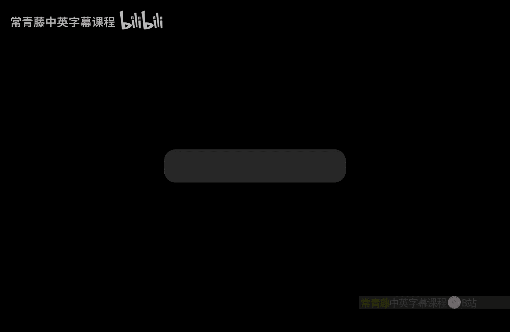
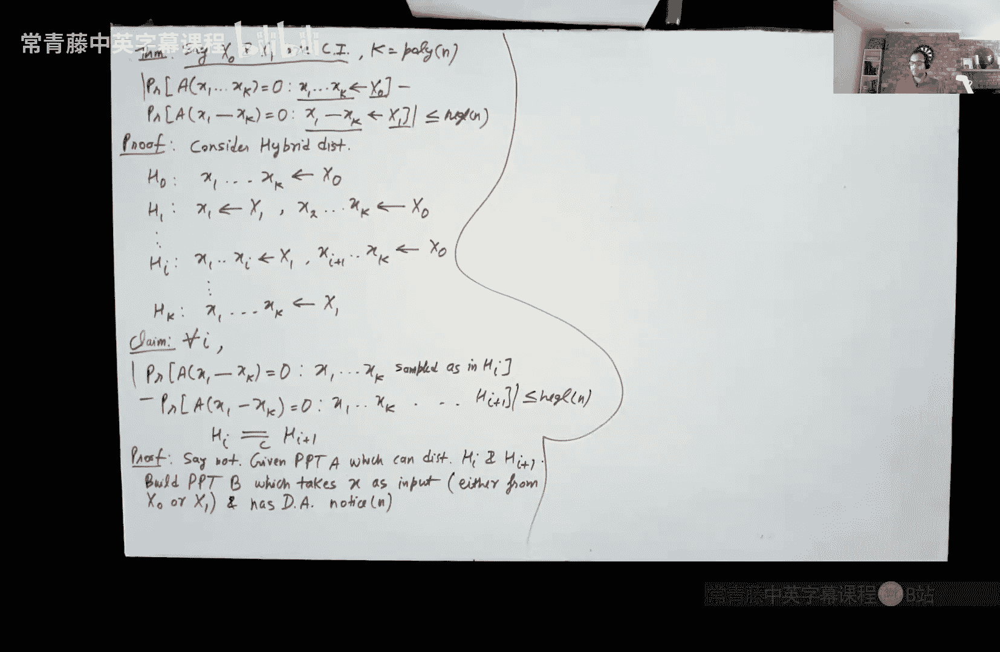
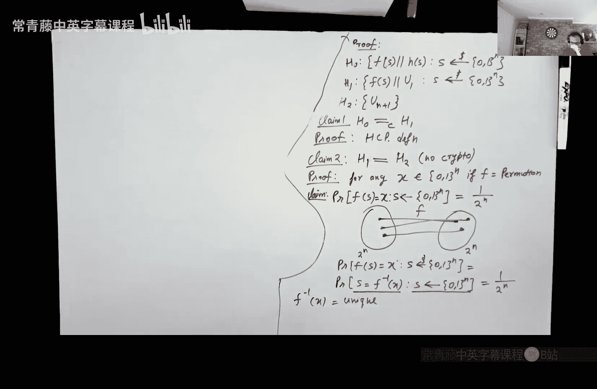

# 卡耐基梅隆大学【中英⚡密码学导论｜15.356 Introduction to Cryptography】 p04 P4 Lecture 4 Hybrid Arguments and Pseudo-Random Generators -BV16V6GBYEAA_p4-

Hi everyone， so let's get started so first。The homework is out。

 the homework is available on Canva and you have little more than a week to submit it。

 it's due Wednesday， midnight。Okay， so we will continue from last time。

 So last time we saw the definition of。Computational indistinguishability。

 which is a very important definition。 We saw the definition of prediction induability。

 and we saw that they are equivalent so let's。Let's try to recall what they were。

So computational inuability。Or C I in short。Is as far severea given。

Two distributions or two distributions ensembles x0。And。X1， right， And we say that。

They are computationally indistinguishable。If for every P。Adversity or algorithm a。

The probability that。A outputs。0。When given a sample。From x0 minus。The probability that。A outputs0。

 if given a sample from。X1。So， this probability is。Very close， almost the same negligible in M。

 right？And。By the way， this probability is also known as in general， it's also known as。

Distinguishing。Advantage。With respect to x0 and x1。With respect to。X0 and。X 1。

 and we will also denote it by。Exbscellent。Epsilon may or may not be negligible， if it is negligible。

 then we say that these two distribution and symbols are computationally indistinguishable。

But in general， we can talk about distinguishing advantage even for distributions which are not computationally indistinguishable and then we sort of had。

A different definition， which is the prediction in distinguishability。

 which some people might find more natural and。In prediction and distinguishability。

 you are given a sample either from x0 or x1， and you have to predict where it came from。

And we want this prediction probability to be as close to half as possible。

 So here what we need is that for every p adversary。It。😊，The probability that。Is presented as sample。

And a has to guess the bit B。Where be is generated at random。And。Acc is sampled from。X B。So。

 of course。You can always。I be correct with priority behalf。Adversaries， guess。

Should be correct only with probability negligibly close to half。And we also saw that。呃。

That computational indistinguishability and prediction indistinguishability。

 they are equal and up to a factor of two in the last class。😊。

So the question now is which definition do we work with right and we almost always choose to work with computational and distinguishishability because it's much nicer and that's something which we will see in the lecture。

So computationally distinguishability。At a very high level。It's nicer in the sense that。It's。

It requires。Less probability。Calculations or working with this definition in some sense minimizes the sort of annoying calculations which we have to do and the reason for that is some very nice properties。

 some composition properties which this notion has。So some basics of。

Computational indistinguishability。So first of all， is， of course， the rotation。If。

X0 and x1 are computationally distinguishable， we write it as follows。

X0 is competition and distinguishable to x1 or。More accurately。Because these are。Andem both。

Distribution en sampless。We ideally should write it like this， but。You know。

 just to make our life simple and is everywhere so we just drop it along with these decades。Second。

Nice property or it's really the first property。Is the property of closure？For every P。

Let's call it machine or algorithm。M。😊，Okay？嗯。Let me， let me rephrase it。C then ensembles x0 and x1。

Are computationally indistinguishable。Then for every TPT。Machine M。

So now we can define a new distribution。M of x is0。Is also computationally in distinguishable to MF。

X1。Okay， and what is this M of x0， it's this distribution。M of x。Conditioned on X drawn from。

X0 and similarly。We can write here。Okay， and just as an example。Maybe M outputs。The exc of。All。

Input bits。Or it can be any arbitrary function right so the machine M takes as input some string and basically can do any polynomial time computation on it。

 any probabilistic polynomial time computation and if you know the string was drawn from two distributions which are computationally indistinguishable。

We have the guarantee that even the output of this machine M。

Will be computationally distinguishable as well。RightSo why does this hold should be very intuitive？

If I start with something that's computationally indistuishable。

 this means that no PPT machine can tell them apart。

 which means that output of any PPT machine applied on these distributions should also be computationally indistinguishable。

And we can prove it by contradiction。😊，So。Suppose not。And say， we are given a P。Adversary 8 to。

Distinguish， let's say。M of x0 and。M of x1。Then we will build。Another PPT adversary。

Build PPT adversary B。To distinguish。X0 and x1。And B is just。A of。M。So B just fast applies。

M to the input。And then A can distinguish it， so B just applies a to it， and if a is successful。

 then B is also successful。If the probability that a gives0 is different。

When we started with M of x0 versus m of x1， this means that probability that b output0 will be different。

When we start with x0 compared to when we start with x1。So even in identical distributions， right。

 I have samples from identical distributions， I can do any operation on these samples。

The result will still be identical， so。Similar similarly here for computational indistinguishability。

 you know， you can do any polyial time operation on the samples and computational indistinguishability will be preserved。

And finally， perhaps。The most important property。Is the property of transitivity。

So consider three distributions。X， Y， and Z。そ say。Distributions， x and y have。

Distinguishing advantage。Let's say Epsilon one。Then let's say， Y and Z have。Distinguishing advantage。

🤧Epsilon 2。Then。What can I say about X and Z， so this can also be seen as like triangle inequality。

Then， X and Z have。Distinguishing advantage。At most。Epsilon  one plus。Excellent， too。Okay。

So this is an important property。And really， this property is what makes the。

The definition of computational ind will is so nice。

Which makes us want to work with computational and distinguish。Okay。

 so proof is now we are given the fact。That。Probability that a x equals 0。When x comes from。

Capital x minus。Probability a X equals 0， then。X comes from y。

So now we are given the fact that this is。🤧Absilon one。And now we' will try to compute。😊。

The following expression， we want to compute the probability。Of again， x is coming from capital x。

Versus Z。X is coming from。Z， right， so this is what we are interested in computing and we want to show that this is at most Epsilon1 plus epsilon。

Right。Now we will look at this。Expression。And we will try to substitute its value from this equation。

So this expression is。At most epsilon one plus this quantity at most， right？So this is at most。

Epsilon1 plus。Probability a equals 0。When x comes from。Why。Okay， and minus。Again， a x equals 0。

X comes from Z。And now what is this quantity？This is given to us， this is just absolute two at maps。

This is Epsilon 1 plus epsilon2 and by the Epsilon 1 and Epsilon 2 a positive quantities。

So in the end， we have this inequality。Shouldn't you need some more casework here for the absolute value like because you're inside the absolute value replacing the probability AX equals zero x comes from x with the maximum value for it does not actually guarantee the maximum value for the entire absolute value。

嗯。Like you're maximizing one component in the absolute value if the other component were large and this component were say zero then you'd get a negative。

 which would be larger， whereas if you made this one larger essentially you're upper bounding it you'd make the entire thing smaller so we are relying on the fact that absolute one is positive。

And this probability probabilitybabilities are always positive。Right， so in that case。

I'm putting the maximum so this is positive， this is positive right。

 so if I increase this a little bit。The overall dessert only goes up。

So I'm relying on the fact that essentially everything here is positive。

The overall result goes up if that probability is greater than the probability on the right already。

 the overall result goes down if it's less。I think。

We can always just use a triangle inequality to make it simple。Yeah， we could do that。Sureir。So wait。

 I'm still trying to understand it。So that you are saying that this step is not necessarily true。

 as I stated。I believe not， but' the other student give a good explanation for why this still works and so I'm okay with it。

嗯。Thankけ。So you are saying， even if。Okay， so first。Let's call this probability1， this is two。

Are you okay with saying that one is less than equal to？Eppsilon 1 plus。2。我 money just someone。Right。

 because yeah all these are positive， Yeah， I'm okay with that。

So then what is the problem of what is the problem with the。

Taking this and substituting it with this。Just in for example。

 if like probability one were equal to zero， let's say and probability that ax equals0 when x is drawn from z were equal to one。

 let's say so you're saying you're saying this is zero and this is what？No D， the thing on the right。

 the thing you're subtracting probability A x equals0 given the x is drawn from z。

If that were like one， let's say。Okay， that's one。Then the upper expression you have is like the absolute value of0 minus1。

 which is the absolute value of negative one， which is one。So this is0 minus1。Okay。

 so you' are saying this is one and this is zero， you are saying other the way around pton zero second one one Oh oh。

 I see I see I see。 So you're saying if this probability is much larger than this one。

 yeah then increasing this might actually yeah that's a good point Okay。

 so we do need to use triangling quality。Okay， good。 Thank you。🤧Okay， okay， anyway， so。

So we all believe the result， epsilon 1 plus epsilon 2， that's the maximum。

And this leads to a very nice lemma， which we will use time and again。

And essentially like I would say 70 80% of the proofs in cryptography use this lemma in some way or the other and I'll tell you like at a very high level why this lemma makes so much sense。

 so this is called the hybrid lemma。And hybrid lemma is just the generalization of this transitivity property。

So suppose we have， let's say M distributions。So suppose x1 to X M。Distribution and symbols。And say。

There exists。Some adversary A， which。Distinguishes。X 1， and。X， M。F。Advantage。

Let's call the advantage epsilon。So essentially， what I'm saying is that。😊。

The distinguishing advantage between x1 and xm is， let's say， Epsilon。

I think there are a few questions， let me take a pause。O， good。Then what can I say between。

What can I say about the distinguishing advantage between let's say X I and X plus one？

So then it implies that。Then there exists some I。Such that。The distinguishing advantage。

Of or with respect to。X， I and X， I plus 1。Is。At least。Epsilon divided by M。Okay。

 and the proof is almost immediate from。The transitivity property。So， say。Not。嗯。Save for all I。

Distinguishing advantage。Of X， I and。X I plus1 is。At most。Or less than equal to。Is。

Less than Epson by M。Then can we compute the distinguishing advantage advantage between X and X1 and Xm？

Then distinguishing advantage between。X 1 and X M is。At most。M-1 times。Epsilon divided by M。Okay。

 and this is from the transitivity property， I just sum。

I sum the distinguishing advantage between x1 and x2， x2 and x3， x3 and x4 and so on。

 and I know that none of them is more than x1 by m。

 so there some cannot be more than this m minus1 times。Epsilent by M， which is。Less than epsilon。

 and that's a contradiction。Okay。Any questions。So， simple enough and。A corollary of this。

Corollly says， suppose。M is poly of N。So we are not taking exponential number of distributions。And。

For all， I。X， I and X， I plus 1。Are computationally indistinguishable。Then。X1， and。X， M are。Also。

Computationally indistinguishable。Okay。And the proof is just。The distinguishing advantage between。

X1 and X M。Is at most。M minus-1 times。Neeggligible。In N， which is still。Neagegligible。Okay。

 does this make sense？Any questions？嗯哈。So how does this help us in general in cryptographic groups？

So many times when you are building a cryptographic system， there are several components in it。

RightMaybe there's a one way function， maybe there's a PRG， maybe there's a public key encryption。

 private encryption， you are using all of these things at the same time in a cryptographic system right and your whole system in some sense relies on the security of each of these。

Okay， so then to prove security， often there are several steps。In in step I。

 you would rely on security of let's say， public key encryption in step J。

 maybe some other primitive， right？So now the question is each of these primitives individually are secure。

 but when you put them together， the question is does the system still continue to be secure okay and the way we will use this corollary。

We can take an example of example of a car in a real world right it has nothing to do with cryptography so suppose you are a car manufacturer right you source parts from from different companies。

So for there are many parts right there's tires， there's engine battery and so on so you found a generic supplier right which can supply each of these parts or many of these parts to you and then you have your branded supplier and the generic one costs much lower right and you performed various lab tests comparing the branded parts and the generic parts。

And you were able to conclude that。It is not possible to distinguish a branded part from a generic part。

And this holds for tires， batteries， and so on， right？

But your left tests only look at one component at a time。Now the question is。😡，对。

When you actually make up the whole car。Let's say using generic parts alone。

Does the car fall apart or does the quality go down significantly compared to if you were using all the branded parts？

Right and using a hybrid argument， we can prove that actually the generic parts car will be as good as the branded parts car。

Right， and why is that the way you would prove it is。So， generic。嗯。Versus branded。Butars。In a car。O。

😊，I'm giving you the fact that。For each part， generic and branded versions are indistinguishable。

Okay， now you build the whole car using either generate parts or branded parts。

 and you have to prove that these two different cars are also indistinguishable。

And how can we do that， what we will do is。We will consider a series of intermediate cars。Okay。

 so you start with。With all branded。Okay。😊，And then change。One part at a time。Okay。

 and now you see how the cloud behaves。If now you can distinguish the car。😡。

Between step I and step i plus one。Then that gives you a lab test。

just to distinguish the part which you just replaced from generic and branding。Okay。

 and assuming that there is no such test。Then we have an overall guarantee in the end that generic and branded parts in a car。

 you know， these two cars will be indistinguishable。

And we will try to mimic a similar strategy in cryptographic proof。Any questions so far。

 does this analogy make sense？So are you saying something like if we have a composition of functions and at each step they are indistinguishable。

 then the final thing will be indistinguishable。Correct。Yeah， because if we change one at a time。

 then you know， either there will exist a step。When we noticed a substantial change in the car。

And if there exists such a step， then basically that step can be used to distinguish just that part。

Or if such a step doesn't exist， then basically your whole car is good。Thank， thank you very much。

So this also holds only when we are doing poly number of art replacements， right？Yeah。Because yeah。

 if you do some super columnial number of steps。Then even if each step individually adds negligible。

 you over time， these negligible quantities can become parliament。

So neglig negligible times polynomial is still negligible。

 but negligible times some exponentialent or any super polylynomial function may be polynomial。Right。

 so are there any indistinguishability notions which can hold for super poly or。Exponential。Well。

 if each individual step。Is is non negligible。 Let's say exponentially small。 Then you can add。

Slightly less than exponential number of times in your result could be。Would be negligible。Okay。

 so now let's have an exercise， let's do an exercise just for fun make to try to make use of hybrid arguments and we will try to prove something very useful。

So now here is a question just from curiosity， right？

So if you look at the definition of computational indistinguishability。😊。

Adversary is given a single sample。😊，Either from x0 or from x1 right and we have a guarantee that adversary cannot distinguish these two so what if instead of a single sample advers is given let's say two samples either from x0 or x1 or many samples let's say let's say K samples。

So can we still claim competition in sctuaity？So here's my theorem。So suppose。

We have two distribution ensems， x0 and x1。啊。Computationally indistinguishable。Then， my claim is。

You look at the probability that it takes。Many samples， x1 of 2 x， let's say K。

And outputs zero when all of these samples are coming from。The the bus。Distribution。X is 0 minus。

Probability that。Again， we have。Okay have samples， but now all these samples are coming from。

Caper deexa。And now my claim is that。This is also negligible， assuming that。It is。Quality of N。Okay。

 so what this says is that。Even if I give you polymial number of samples。

Your distinguishing advantage still continues to be negligible。And this matches with our intuition。

Because you if I cannot distinguish one sample。And then as I increase the number of samples to k。

 let's say， my expectation is that my distinguishing advantage will also get multiplied by again。

 just a factor of k， but not more。And K times negligible is still negligible if K is a polynomial。

And just this will be our first proof。Using a hybrid argument。So let's try to do it。

Even though it's very simple。So again， going back to the CA example。Let's try to change。

This distribution to this slowly。Okay。😊，So here we have。

K samples all coming from x0 here we have k samples all coming from x1。

 so what we will do is that we will change the samples slowly one at a time。

So we start with all samples from x0。Then we will just change the first sample。😡，To come from X 1。

All others will continue coming from x0。And then we will change the first two samples。

 first three samples， and so。RightWe do it in small steps， in baby steps and in each step。You know。

 two subsequent steps have computational ininguability。And this follows from the fact that。

A single sample is guaranteed to have competition and distinguishability。

So let's define several distributions。Consider。And by the way。

 these are called as hybrid distributions。Consider the following hybrid。Distributions。H 0。Is。

All the samples come from。Xスゼ。Okay。Now， at one。X1， we will change to come from capital x1。

X2 up to X K are sampled from。X to0。What is the IF distribution here？X。

 Y and up to X I are coming from。X 1， the remaining。Are coming from。X，0。And what is Hk going to be？

HK is our final target， so everything is going from X1 now。Okay。And my claim， now。Is that for all I？

Probability of。E giving。A again takes x1 to xk。Giving zero。You know， x 1，2， X， K。Sampered as in。H I。

And I compare it with。X1 to X K as sampled as in。H I plus1。My claim is that。This is negligible。

And you know， once I'm able to prove this claim， I am essentially done。

And this follows Feram the Kululu。So what is the proof of this claim？And by the way， in short。

 I can also write。Just to make my life simple。HI is computationally distinguishuishable from HI+。

Yeah， maybe I should have just written that。So suppose。Not right， we will prove it by contradiction。

And so， say， we are given。A PPT adversary。Let's say a。Which can distinguish。Distinguish at eye， and。

HI plus one。Okay， with with。Noticeable advantage。Now we will build。Another PPT adversary B。Okay。

Which。Oh。Take X。As input。And by the way。X could be coming from。X0 or it could be coming from x1。

So this adversary B takes a single sample as input。And。呃。Has。Distinguishing advantage。

Noticeable in N。Okay。😊，So any ideas on how we can try to build this adversary B？Okay。

So adversary B obviously has to use adversary A。But adversity A unfortunately， needs case samples。

And B only has one sample。So what do we do？

Randomly select the rest of the samples。Yes， B samples， the remaining samples。

And the good news for us is that if you look at H and HI plus one。Right。

All the samples except is it the IF sample or I+ 1 S sample？IPlus1 example。All samples。

 except the I plus one is sample， we know exactly how to sample， right。So now B works as follows。

So what B will do is。Be the sample。X 12 X I。From。From where， from。From x1。Now， X， I plus 1。

Is equal to x and。X is the input to be。Okay。The remaining samples will come from x0。

So X I plus2 up to Xk。Are from。X0， okay。Now observe the following。😡，If X。Was from。诶。X0。

This implies that。X 1 to X K。As in hybrid I。Otherwise， if x。Was from， let's say。X 1， then。X1 to x K。

As in hybrid i plus1。Okay。Now， we。Druns。A giving these case samples as input。Okay。If。

Probability of B。Outputting zero， So B runs a。And。Outputs， whatever。A output。Okay。

 and now we have to argue that。That the probability of be outputting， sorry， probability of。一。

Probability of B outputting0。Is different if x was coming from x0 versus x1？So， if probability of。

A outputting0 is。Different in hybrid。H I and H I plus1。 And by different， I mean。

Noticeably different。Then， the probability of。Be outputting。Zero is also different。If。X from。

X0 versus。Ex1。Okay， and this is basically the end now we are done。We have been successful in。

In constructing a PPT adversary B。And the probability that it outputs zero is actually different even when given a single sample。

And this virus。The computationally distinguishistinguishability of x0 and x1。

 which was our starting assumption。Any questions？So we will do several proofs。Like this。

So in general， many times you are looking at distributions， which might look very different。

So maybe you are overwhelmed in a single step trying to prove that they are indistinguishable or they look the same but。

You know， going in baby steps， changing things one by one， of course， really makes things much。

 much simpler。So now we are ready to come back to。

Seudor random generators， which is what really inspired all of this discussion and we will see a very simple construction of pseudo randomum generator。

🤧嗯。😊，So just to remind you of a discussion about pseudo anum generators before。

What we are really looking for is some object or maybe some function mistakes like。N bits of input。

 a random input。And which sort of stretches it into a much longer random input。

A much longer random st。Right so we saw that in general， this cannot be done。You know。

 if there's an exponential time machine， exponential time adversary。That can always。

 it can always distinguish。A truly random2 n bit string。

From string which was deterministically generated from say Embit string。喂。😊。

But our hope is that you know， because we live in a world which is hopefully polynomial time。

This will not stop us from constructing pseudoendum generators。

So let's try to define pseudo random generators the definition is very intuitive。

 so first of all it's deterministic and then second it takes a small random string and converts it into a large random string。

A pseudo randomum generator is。We are looking at a little。Deterministic。不。放生。

Let's call this function G， it takes。Some string n。 And by the way， this is also called as a seed of。

AピLG。And gives you a longer output。Let's call this L of M。So， a did is。Goodd。A PRG， if it satisfies。

The following three conditions， the first condition is。G is polynomial time。The second condition。Is。

L of N is larger than N。Right。If the output length can be the same as the input。

 then we can basically construct a trivial function which just outputs its input， we don't want that。

And here。L， N minus N is。改。The stretch。The stretch of our PRGG。And finally。

 what is the last condition， it's of course the most interesting condition we want that the output of G should look indistinguishable from a uniform output。

ok。😊，And normally maybe well need to write like a long definition in terms of probabilities。

 but now looking at computational and distinguishability。

 this should be very easy for us to express mathematical。😊，So what we want is。G of x。

Where x is sample that random from。0，1 to the power N。

This distribution is computationally indistinguishable from。A uniform distribution on。L and bits。

Okay， so very simple。This is the distribution which is generated when you sample x at random and then compute G of x。

So here observe that we only need to generate n bits at random and here we are generating L of n bits at random and yet these two distributions essentially look the same。

So now let's try to construct pseudorandom generators。And it's a very simple construction。

We will use hardcore predicates。And we will use one way functions， or rather one way permutations。So。

 recall。Hardcore predicates。So I will show you a slightly different definition of hardco predicates。

 again， stated in terms of computational in distinguishinguishability。

And now we are already sort of starting to appreciate。

Competal and distinguishuability and how simple it makes things。So。You have given a oneway function。

Oh。F， which I's say。啲 some。And but input， and。Give some output。A hardco predicate of。F。

Is some function H。Which only gives you a single bit output。And remember。

 hardcore predicates guarantee that this is one bit of information。About the input。

Which the one wave function hides， you cannot predict it with probability much better than half。

So now I can try to write it in terms of computational and distinguishability。

You choose your random input。And this is computationally distinguishable from。F of x。

Uniform distribution on a single bit。Right？So this is essentially saying that。Given F of x。

Ege of x looks the same as。A uniform bit。So this is just an alternative definition of hardcore predicates。

And we will try to use it。Okay， any questions？So now let's try to have a simple construction for。

For pseudoandum generators。And we will make our life simple， you know。

Just maybe a baby step towards the final pseudoandum generator that we want we will build a。

One bit stretch PRG。So we will build a pseudo randomum Gen， which takes。And bits。And。

Gives you an n plus 1 bit output。And what we will assume or what we will。Start with is that F is。

One way permutation， not a function。So， F takes。An endbit input and gives you an end bit output。

And what is a one way permutation basically。It takes the whole domain。

And the range is sort of a permutation of the domain。So there are no collisions。

The domain and the range have the same are the same function are the same sex。And so on。And E is。

Hardcore。Predicate of。F。And our construction is very simple。😊，So we will define the function G。

It takes some seed。As input， and this is defined to be。F of。S。Concatenation。Edge of S。Okay。

 and that's it。So why does this look like a good PRG？So this is obviously uniform。

And this follows from this。Essentially， the definition of。Hardcore preicates。

You don't given on the output of the one way function。

 hard per predicate is supposed to look uniform。And now my claim is that this is also uniform。

If F is。Of one way permutation。And why is that because？The input S is uniform。And because of that。

The output is also uniform。This is a property of away permutation。And by the way。

We have not yet seen a construction of a permitutation we will later。See that。The RSA function。Is。

One reitation we'll have to wait for a few weeks before we get to that。食。

Could you please explain why like if S is uniform， then F ofS will if F is a one way permutation。

 it will be F ofS will be uniform。Yeah， we will do a formal proof of this。Okay， thank you。

But essentially， the intuition is that。A permutation preserves the whole entropy of the input anyway we'll get to it。

Okay， good question， why can't this be the identity function？Instead of about collaboration。

Any thoughts？Because we can invert it right。Well， here in PRG are we are not bothered with within version or something like that that they won't exist like H for the identity function。

 right Yeah good。Exactly， so if you just replace it by， let's say S， right？

H of S is no longer uniform given S。So a hard code predicate looks uniform only given the output of the binary function。

 of course， given the input you can compute the hard code predicate。

So now we want to prove that this looks essentially uniform。

And we will do the proof using a hybrid argument。Why， because。

Our PRG is built off two different components。Gone with permutation and hardcore predicate。

So in different hybrids， we will rely on the security of these two different parametersitives。

So now let me define hybrid distributions at zero is just。The output of the one way。

 the output of the PRG， which is this G of S concatenation。Hch of S where。Ass a sample from。0。

1 to the power。And。😊，Now， at one。Sorry， not， it's not G of S， right？Yeah。Ephiphs。

F of S concatenation， u1。So here I just changed the output of the。

Of the hard code predicate to uniform。 And then finally， we have。You of。Enless one。Yeah。O。😊。

And our goal is to prove that。The distribution at zero is computationally indistinguishable from the distribution at2。

Okay。Now my first claim。Is that h0 is computationally indistinguishable from H1。Pro如。

You just need to look at。The hardcore Crdit definition。Okay。😊，So what we need， it's exactly what。

This definition of hardpo predicate gives you。S like identical。Claim to。

We will try to prove that in fact， we will not use computational indistinguishability here。

H1 and H2 are， in fact， identical， Okay， so h1 is identical to S2。No crypto involved here。

And this will just follow from the fact that f is a one way parametermutation。So now， yeah。

 let me answer the question which was raised before。🤧あ。For any。Let's say， X。In。0，1 to the power N。

Probability that F of S。And as a sample from uniform here。哎 fourth。S equals this S this x。

As a sample from you。So my claim is this is one by two to the power end。If F is a one way。

 it doesn't even have to be one way perutation， if F is a permutation。And for that， we will just。

Consider these two sets。To the power end strengths， to the power end strengths。

And this is our function F。Okay。So what is the probability of？F。Of S equals x。Yeah。S is uniform。

Is the same as。The probability that。S equals F inverse of x。Okay， and by the way， F inverse of x。Is。

Unique。If it's a under experiment， that's literally the definition of a one to one function。

So this means， and now if s is sampled uniform， S is sampled randomly。

 what is the probability that S equals something specific some specific string。

 so this is just one by two to the body。Okay， any questions？And by the way， this is not the proof。

 This is just。Maybe let's call it a claim within the proof。But I mean， this game essentially。

Complete the picture。

Just let me try a new marker。Okay， so now what remains is just this， right？Now。

 we are looking at the。Probability that。Or distribution。Yeah。Okay， let's look at the probability。

For any。X。In this set，0，1 to the power N。Probability that。X equals。F of S concatenation with。

Some bit B。Such that。As a sample uniformly from。Z1 to the power N。And。B comes from。有问。

So this probability is equal to the probability that and by the way。So B is sample independent of S。

 okay？Which means that I again write it as follows。X1 to n equals F of S。

Assuming that S is sampled from。Zero1 to the power N。Times。The probability that。X， N plus1 equals。

Be there。Be sampled。As a uniform bit。So these are the first n bits of x。

So this is something we have already calculated。So this is just one by two to the power n times。

This is half。Access fixed。エます。So this is just one by two2 to the parent plus one and hence。

Which implies that。That。H1 is actually equal to。The uniform distribution。

Because the probability of any n plus one。String being picked is exactly one by2 to the power and plus one。

And this is the end of our proof。So maybe this doesn't look that powerful to you after all， you know。

 we are just stretching the random string only by a single bit。

But next time we will see that just by applying this process。Tatively。

 you can extend it by any poly number of fits。You go from n to n plus 1， then n plus 2 and so on。

And again， the security of that construction will also follow from a hybrid argument。

 we will leave that to next。But like always， when you have to increase one bit youll have you have to do a polynomial time calculation so it will be like order of input into that polynomial calculation every time won't that be too expensive。

嗯。So it only comes in the security Yeah， I guess maybe let's let's wait till next time。

Any questions about the one bit stretch PRG？Okay， then I guess， and the homework is out。

We will stop here。