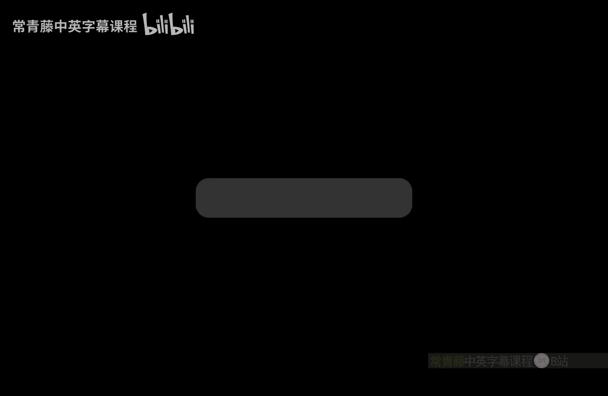

# 卡耐基梅隆大学【中英⚡密码学导论｜15.356 Introduction to Cryptography】 p05 P5 Lecture 5 Pseudo-Random Functions -BV16V6GBYEAA_p5-

Okay hi everyone， let's get started。😊，So last time we were discussing pseudoran generators and if you remember we were able to construct a pseudoran generator with just a single bit stretch right so the pseudoran generator was able to take like a end bit seed or n bit input and was able to stretch it to just n minus n plus1 right so we want to do better and it's not very difficult to do better by just applying this process iteratively。

😊，So today we will start with the goal of constructing polynomial stretch pseudoandum generators。So。

 our goal will be。Poly stretch。PRG， right？So we need to construct a function。Let's call it G。

Which takes。And end bit input， and。Stretches it to L of n。There。L of N is。Any polynomial in n。

 it could be n square n cube or whatever you want it to be。🤧嗯。And we will assume that we are given。

We are given a PG from the last class。Which is just。One bit stretch PG。Okay。So how does G work？

GP takes as input seat。Okay。And it works。As follows。So as you can expect。

 we will apply G1 and we will get n plus1 bits。😊，Then we will take N of these。

Apply G again that will give us further n plus one so in every step we are sort of getting one bit for free and we will keep accumulating those bits and finally we will have an output which can be as long as we want。

😊，The polymial stretch PiZ， right？So this works as follows essentially what you would expect。

So we will do it in many steps。So if we need an L of LN bit output， we will basically have Ln steps。

😊，So in each step， we will。Select a new seed， so the first seed。

 which we call as0 is basically the same， which is given to us as input。

And then what you do is you apply G of S。And that gives you an n plus1 bit output。

And that will give us our next seed， which is S1 and。If you will give you an extra bit。

 let's call it a free bit。😡，Which will appear in the。Okay， so we keep with B one。

And then you apply G to S1。This was S 0。 Then you get S2 and。B2。And finally， you have。G， S of L。L。

 N-1。And that would give us。S of LN， concatenation。B of LN。Okay。

 so now we have accumulated NF free bits and we will just output these。😊，So output。B1。

 concatenation B2。Finally。BL。Of end。Okay， and these are L ofn bits， which is exactly what we wanted。

😊，So a couple of observations to keep in mind。There's a question in chat。Okay， good。 Yeah。

 I was just getting to that the question is。So。In various intermediate steps as well as the last step we get where Cs。

😊，So， an observation is that。It is not safe。😡，To use intermediate seats。So， for example。

Let's say I give you an intermediate seat， let's say S1 or let's say S2， so given S2。

One can actually compute。B3。S 3， B3， and。And all subsequent。Bits as well as subsequent seat。

 So you don't want to have S2 in the output， but。On the other hand。You can include。

As of Ln in the output。If you wanted to， right？So that would increase the output by further end bits doesn't really make a difference。

 so just for cleanliness we don't include it in the output we just include these three bits and that's what our output would be。

And now let's try to analyze this。😊，Okay， now my claim is that。GP is indeed， a PRG。

So could you please reexplain this note， I could not properly understand it like why is it not safe and what is that could you please Okay。

 so we we are generating these intermediate seats， right？So let's say I include the the first field。

 Let's say S1 or S2。 I include， let's say I include S2 in the output， okay。

But I still continue including all these subsequent bits， but given S2。

 these bits are not random anymore right because given S2 I can compute S3， B3， I can compute S 4。

 b4 and essentially everything after that。Okay， okay， I see say thank you。 Thank you very much。

 These bits B2 to B of Lm or rather B3 to B of L。 They are not random。

 They don't look random given S2。Okay， okay thank you thank you said on the other hand。

 the last seed is not being used any further， so if you wanted to， you could include it in the Okay。

 so just the last seed we can use in that yeah。So our claim will be GP is a PRG assuming。知。Is， right。

And how do we prove this claim again？How do you start any proof？

You start thinking about a hybrid argument。That's a strategy not just for this lecture。

 but essentially for the entire course。So we will define a series of hybrids。

A zero is basically the same。As our construction， which is GP， okay， and now let's move on to H1。

So our strategy would be we have several implications of G and one by one。

 we will replace the output of each G。By a uniform string。So at G， we will。Again。Start。

By the first seed being just the input。But now here comes the difference。 So here， instead of。

Invoking G of S0。I。Use uniform distribution to sample S1 and B1。But after that。😊。

I start using G again。And from this point onwards， I continue to use G。And then finally， you have。

At I write。So， up to。S I and B I。I sample。Uiformally， and after that point。I start using my。G。

So now here's an interesting observation。You look at these previous strings。来。😊，呃。Sorry。

 this should be BI plus1。You look at all the previous seeds。😡，Just the SiI strings。

They are not being used at all。😡，In this experiment at I。Right，Because， for example， we never used。

As of I minus1， so just something to keep in mind。There's no need to generate them。And then finally。

 we will have our edge of。L N。There。呃You know。All steps。Use。You of N plus。As opposed to PRG。

 so there's no invocation of a PRG here。Okay。😊，So the previous ones are still used to generate like B1。

 B2 B3， right， so they will appear in the output。So B1， B2， B3， they are all designed up plate。

 they have no correlation with the seats and seats are not being used to generate these。So yeah。

 you're right that we do need to continue generating B1 B2 and B3。

 but there is no reason to generate， for example， S1 s2 and S3 Oh so every single seed before I is drawn from uniform。

咋的。So every single seed before I is drawn from the uniform distribution， not just SiI。Yeah， exactly。

 okay， thanks yeah。And now， let's。We have our claim that。

H I is computationally indistinguishable from H I plus1。For all I。Right。😊，And now observe that。

What is the difference between H and H plus1？The only difference between。H I and H plus 1。Is。In how。

S I plus1 concatenation， B， I plus1。Is generated。Right。In H eye。V use。G ofSI。There as I。Is uniform。

And in H plus one。We have you of。And plus one。Okay。

 and now we can see that this basically directly follows from the security of G that these two distributions should be in distinguishable。

Okay， so given one。BBD。咦。😊，That's爱 for。Which。Distinguishes H and H plus 1。We can build。

Another PPT adversary B。Which takes as input。Which takes， let's say let's call it Y I。Plus one。And。

This is from 01 to the power n plus1。Which is either。Output of G are。

Is sample from a uniform distribution。And。Be the set。S I plus one concatenation。BI plus1。To be Y i+1。

Right， everything else。Is as before。All the previous seedss， they are uniform。

 all the subsequent seedss they are generated by applying a PG。Okay。So now we will set this。

And then sample all other。S， I and B eyes。As in。H I。Invoke a。If this is。Or rather， let me know。

If air distinguishes， then。B also distinguishes。With the same distinguishing advantage。

Right if a can distinguish H and H plus 1， then B can distinguish the PRG output from a uniform output。

And that essentially completes our proof。Okay， any questions？

So I have a small question like why are we sampling all the other Ss and Vs。

 shouldn't we like after we set the S+ one？Concatetnation B+1。

 shouldn't we then apply the G again and again finally to give the output to the adversary？Yeah。

 you don't need to sample any of the previous seat。No。

 but like for the seedss that are afterwards like will will we sample them or will we apply the G again and again like so like yeah you will apply G again and again yeah so so by sampling I don't mean randomly sampling or maybe sampling is not the right term。

I should say sample or compute。Okay， thank you。 Thank you。The earlier ones are sampled。

 the later ones are computed。Professor， why do we need to compute all other sis？By constructing B。

 we are trying to break the original PRG right， Yeah， that will be the one sample。

So B will only have one sample， but B needs to invoke a right and a needs the entire P as your output which is B1 to be L right so you do need to generate all the Bs。

Thank you。So here， as you can see， the main idea was。

We make such a small change that the only change was changing the PLG output to uniform and then you can just rely on the security of that particular PG invocation even though we use the PG many times so this is why hybrid argument makes things very convenient。

So now we have done something which is very nice。Now we have a PRG which can take a small uniform string and can convert it into a very large string which still looks uniform to a P a right so now let me come back to one time pad So what does this allow us to construct so a major limitation of one time pad was that。

You know， your key had to be as long as the message right。

 so imagine your key is like 1 hundred0 bits your message is one gigabyte one time pad just completely fails。

But now the nice thing is。Applying a PRG first on your key allows you to stretch your key to whatever amount you like。

 and then you can use one10pa to encrypt a message which can be as long as you want。嚟。😊。

So a very rough construction， we will come to encryption schemes more formal and we will discuss it in more detail at that time。

 but just just to give you an idea of one application of PRG。Is that。It allows us to build。

One time pad for。Let's call it long messages。😡，Okay， now let's assume that your。

K is k I'm just writing things informally and let's say your M is larger than than k it can be much much larger than k okay then what does your encryption do。

Encryption will take K and the message。And the encryption will output。M XR。G p。Of a key。Okay。

 so you apply a PRG such that the output length is equal to the length of the message。

And then you are ready to encrypt the message using one type five。

So so if I'm sending this message to you， then how will you make sure that the like the generating like I generated key of length M on my side and you also generate something of length M on your side。

 how will we make sure that both of those things are same？

So you will need to agree on size of the message。No but even if you agree on the size of message since it's probabilically it is probilist randomly generating the key right it might generate one key for you and one key for me so if so look in encryption schemes you and I have to start with the same key right？

You are the you are the decryor and the encryptor， we share key， right so。And Bob。ち？

Share the keyK and let me finish the decion， I think maybe it will answer your question。

So the decryption procedure will take k and the Cypherax。And then it will output Cxr。Again， GP of K。

If both of us have k， both of us can compute GP of K and remember the PRG is deterministic。

 it's not randomized。Oguki I in district。 Thank you。And of course。

This kind of encryption scheme is not going to satisfy perfect security， right。

 Per security refers to unbounded adversaries， which can obviously completely break the P。

So what kind of security would they satisfy well intuitively does satisfy something good。

 but we will see when we come to encryption schemes。

 how we can define encryption schemes for PPT adversaries and there are various notions which we look at。

But there's still a limitation here。So what is the limitation， it is still one time。Right。

The problem is， of course， I can make my key as large as I want， but。Once I use Mackey， it's used。

 it cannot be used again。Couldn't we just keep generating further bits of randomness if we wanted to have script five？

Exactly， so that's that's a good point so you can do that yeah like yeah you can divide your PR your output into many parts。

 use the first part， then use the second part and so on。

 So one problem with that is that encrypter and decryer they need to be in sync。All the time。

 like if the order of the messages gets reversed or something happens， you know。

The the the the scheme fails So that's one problem and in fact we can even assume that there might be a single encryptor in multiple decryors right so Im the commander I'm sitting at home I'm giving commands to you know many different soldiers who might be at different locations So in that case it's not clear how they can all maintain the same counter They don't talk to each other right。

But on the other hand， you know， you can even include the counter publicly in the。You know。

 in the Cypher textex。So yeah， will we will see how that is done， but ideally， you know。

 there might even be multiple encryptors， multiple decryors so you know。😊，Ths kind of。

 maybe you can make them， make them work。Not an ideal solution。So。

A much better solution is using pseudoorran functions。Which we will study next。

Se randomum functions are a generalization of PGs and in some sense more powerful than PRGs and yet they can be constructed from PGs。

O。So another thing I wanted to mention is that。There's a very nice result by。I Partlyazo and Luby。So。

In our construction we used one way permutations right we use one way permutations to build one bit stretch PG。

 then we generalize it to poly stretch PRG， but maybe we can imagine a world where one way permutations。

They don't exist but maybe one way functions exist right for example。

 from factoring we were able to construct one way functions。

 but we haven't even seen one way presentations so far we will see that later so in Paliazzo and Lubi proved a very nice result。

So they built PRGs from。Just。Anyone will function。And when the function is really like the most basic primitive in cryptography。

 and it's nice that this basic primitive is sufficient to construct something which is seemingly more powerful。

 something like PRG。😊，Okay， so now let's start talking about PRs。Core random。

Not Gens now well talk about pseudoranum。Functions。

So here the idea is that we want to use a single seed or a single key to generate a very large number of random strengths。

😊，Okay。😊，嗯。So， you know， one option again is generate a single random strength of it into many parts and so on。

But pseudo random generators can actually even let you generate an exponentially large number of random。

And why do we care about that？So pseudo random functions， in some sense。

They are a cryptographic equivalentant of random functions。Graphic equivalent。Of random functions。

And what is a random function？A random function。Let's call it RF。It takes some input。Let's say， M1。

And it gives you。An output M2。A random function is deterministic。😊。

In the sense that if you query with an input multiple times。

 you will continue getting the same answer。So a random function can be visualized as a table。Okay。😊。

How many entries does the table have？So a table looks something like the following。

T has many entries and all zero。One。And so on。 Okay， so this will be。2 to the power M1。Entreries。

And these are all。Random strength。Okay， so it's a table which maps each input。To a uniform output。

Okay， there' is no further logic to that just take every input， generate a random string。

 and that is what the output will be for that input。A random function stores this entire table。

You give it some value x， it looks up the value of x on the left。

 and it outputs the corresponding string on the right。Okay。

 is the definition clear for random functions？And even though， you know。

Tno functions might look simple。They are huge objects。You cannot store random functions。诶。

Hard boost store。Right so think ofm1 as like let's say 100 bits。

 then you are talking about storing two to the power 100 entries。

 so which is just an exponential amount of storage。It's something which is needed。

Is it similar to random molecules， yes， exactly it is random molecule。😊。

Is it one to one not necessarily？sNo property， just basically every output is uniform。

But the thing is that。If you query， if you give the same input twice。

 you will continue getting the same output。What is the difference between PG and Prlf。

 we will see the definition of P。Okay。😊，So a random function is hard to store these。Exponation sized。

Objects。Right， but it would be nice if we could construct a function which we can actually store and the function would behave like a random function。

And that would exactly be。What PRf would allow you to do okay？So a PRf。Is a function。

Which actually takes。😊，秋き。The key will be。01， the key will be n bits。And it will take another input。

M1 and it'll give you some output。Thank部。Okay， so key is supposed to be secret。It will stay。

 you know。嗯。Whoever generates the CRRS， it will just secret with them。

 and then anybody can query this function F。And anybody who queries either a random function or this function pseudo to random function。

 they cannot tell the difference between these two。Okay。Yeah。

 so the difference between PRG and PRf is that a PRf takes two inputs。So it can also be seen as like。

A random access。必亚金。So imagine a PRG， which gives you an exponential exponentially long string。

 and you are able to access any position of that。And the second input。

Tells you which position I'm interested in。And it'll give you the swing in that position or bit in that position。

Okay， so now maybe let's try to define PRfs a little more formal。So let's see here the PRf。

Definition。Okay， so a function。So typically， we will denote this by。The key or seed。

You can also call it S and。The position。Or the input is x。

So this is called a PRf if the following conditions are satisfied so first。As usual。F。

On every input runs in polynomial time and it is deterministic。TheSecond condition， what do we want？

So here the second condition is a little bit interesting， so we want。

The output to look something like uniform。So。Maybe。Maybe I need for all X。F of。Okay。

So let me try to give you a definition which will not work。

 but hopefully he will tell me why it will not work okay。So consider the following。Distribution。

 F of。ケかエ。Their case sampled。嗯。At uniform。And this is。For every X。This looks computationally。You啊。

And do for。Every。So essentially what I am saying is if the key is indeed generated at random。

Properly。Then for every X， you list all possible outputs and that should look indistinguishable from。

The uniform distribution。プラブリ。Is this a good definition， any problems？Eventually for a given key。

 the function could be very non random， and like always returned the same output just while distributed over the space of keys。

Well， you could have said the same thing about PRGs， right？

So that's that's always the case for encryption， for example。

 let's say I choose some bad key encryption can be bad so we only require security to hold for uniformly generated keys。

So what else？So look at the size of this。Size of the sample。

I'm basically taking the function output in every possible X， I'm concatenating all of that。😊。

And I require that this huge string should essentially look uniform。Right。The problem is。This is。

Exponential sized。Right so imagine a hybrid argument where。We will take。X1 by one。

 and we will replace the output by uniform。So we will end up going through an exponential number of fibers in that case。

And in that case it's hard to talk about computational and distinguishability。

 even if two subsequent hybrids they are close to each other negligible advantage and so on。

 the overall sum could be huge， right？In fact， as long as we are talking about PPT adversaries。

 they cannot even take。For example， this distribution as it。

Because even reading the input requires exponential time。So this is not good。Let's get rid of it。

We need something more clever。So evenドあ。There are exponential number of possibilities for x right a PPT adversary can only make so many ques。

😊，Can only choose so many different values of x can be output， right？

So we will just focus on those questions。Okay， we will require for every PPT。😊，诶。

Probability that a wins。In the guessing game， which which I'll just define。

Should be less than equal to half。Plus。那个什吧。O。😊，And just looking ahead， what is the guessing game？😊。

In the guessing game， the adversary interacts either with a random function。

 making polynomial number of queries， or it interacts with a pseudo random function。

And this aversary cannot tell the difference between the two。

So the guessing game is defined as follows。Guessing game is。As follows。Step one。

Theres an adversary and then there's a challenger。オケ。And we will see how that makes sense。This。

A random。きけ。And。A random bit。B。So the challenge a queries。Step 3 is。A queries with。Some X I in。

0ero1 to the power M1。Now， depending upon what B is。😡，If b equals zero。写单这。Response。

With the PRF output。 So F of K comma。Exci。If b equals1。The challenger uses a random function。O。

So let me explain the point number four once again。

So the challenger chooses a bit B and depending upon that。

 the challenger decides either to use this the pseudoran function or use a random function。

 right a random function doesn't necessarily mean that you don't even look at the query。

 you generate something random and you give it out because the answers have to be consistent。

So you see if Xi has been queried before， which means that Xi equals xj for some J less than I。

And if so， you give the same response。Else。Sample from。U of M2 and。Respond。Okay。And in that。

 and by the way， this。The step three and4。These steps can be repeated。Any polynomial number of times。

And then finally， a outputs。A guess。Be prime and。When if。B prime equals。B。Right。😊，So。

So throughout the experiment， a can make several queries。

 all of these queries are either going to the PRf or going to a random function。

 and then at the end a has to guess what it was interacting with。Right and of course。

 you can always win with probability half without making even any queries。

 so what we need is the probability of a winning to B less than or equal to half plus negative。

And then looking ahead。The way we can hope to prove something like that is by just doing a hybrid argument over the number of queries。

 so we will try to replace the response for each query by by from PRF to uniform and finally you know we will start with a PRF finally we will end up with a purely random function at there。

And because there is only polynomial number of queries。

 our number of hybrids will be limited to a polynomial again。Okay， so now let's try to build a PF。

And we will be able to build a PRf。😊，From any PRG。So what we will use is。So we are given a PRG。

 let's call it。ジ。Which doubles its input， so it takes an n seed and converts it into two nbit output。

And we will build a function。Which will take an n bit input。And it will take an M width。Index。

 and will give you。An n bit output， but you can generalize to basically any output length later on。

So， let's。Let's warm up slowly。😡，So。So say m equals one。Okay。It's just a very simple case。

How do we do it？So do not。The0 of。さけ？这比。Fast and bits。Of。知要。And G1 of K to be。Last tender。

So any ideas on how we can handle the case when m equals one？Return either zero or one。Well G0 or G1？

Exactly， yeah so。So in this case， F ofK comma。Ex。Is just。G X of K。Okay， x is one bit。い。

Now let's try to go to two bits。What can we do here？Any ideas？Well， maybe we try to use thecursion。

So。This is G0，0。けえ。X equals 0，0。Sorry。Okay， let me just write as。G of x 2 G of x 1。Okay。So here。

Xi is the IF bit。哦。X。So you look at the first bit。Depending upon that， you select either G0 or G1。

 your output is uniform so you can apply this process once again and again select either G0 or G1 so I can write it in the form of a。

So this is your K。And this is。G0 of k and。じワのふけ。And now again， these are Mbit。Cs。So this is G0， G0 K。

This is G1 of G0 k。And then similarly here。This will be G0。ジワけ。And the last one with G1 g1k。Okay。

So you look at your input。😊，You basically choose a path in the tree。

 each input represents a path in the tree。Okay。😊，So let me describe to you the final construction for any input length X。

Okay， I think the definition of guessing game is simple enough。

So here is our refine final construction。F of k comma X。Looks like the following。So， the last。Yeah。

 the last invocation is just G of X M KM， and that gives you k minus1 and this is your。啊。Okay。

 and we can extend our tree further。So many leaves and depending upon what your input is。

 you start with the root， you either go left or right depending upon whether the next bit is 0 or one and you finally you end up with some。

Some leaf of the tree。And that gives it up。Okay， so hopefully the construction is key。

 any questions about the construction？Now， how do we prove that？This whole thing is secure， right。

 So this is a slightly。Not so straightforward hybrid argument， but still not so bad。So。

So there are two things to keep in mind， first of all。

We cannot hope to take this whole tree because it's exponential size。

 we cannot hope to replace each leaf by uniform。That's not what we want to do。

We only want to look at the relevant leaves which were queried by the adversary。

 and we want to just replace the content on those leaves to be uniform that that would be our very eventual goal。

But theres another problem， which is that each leaf actually involves a whole path， right。

 Each leaf is not generated using a single invocation of the pseudo function G。

Each leaves essentially involves basically M invocations of the pseudo random function， right？

So we don't want to replace all of them by uniform in in one go。 right。

 We want to take 1 g at a time， and we want to replace it by uniform。 Okay。

 so our strategy at a high level would be we will start from the top。For each query。

 and then we will replace。At the first level， we will replace PRG output by uniform。

 then we will go to the second level， replace PRG output by uniform。

 and we will continue the strategy all the way down。Okay， and we need to do this for every query。

 so we will actually go level by level。So in our proof。

 we will consider the following set of hybrid arguments。So at zero is our。Original tree。In at1。

We look at all the nodes which are relevant or which are queried at level one。So， all。Quared nodes。

Let me say up to level one。A。Are uniform。And then， apply。G for。All subsequent levels。Okay。

 and what is H？So I'm calling this level zero， this is level1 two， and finally well have a level 10。

What is a choice？Allqueried node up to level。I are。Uniform。And you apply G for the subsequent levels。

Makes sense now。Something to observe。You look at level i plus one。And abo。Notes at level。

Sorry I minus1 and above。Don't play a role。Right。😊。

Because what is the role of node set level I minus-1， you apply PRG。

 and then you get the node set level I。But notes at level I are already uniform here。

 right So essentially you are like cutting off。Some upper part of the tree。

 You don't even need to sample uniform strings for that。

 I can just directly sample uniform strings for。Level I。

 I don't need to care about the top half of the tree。And then finally， we will have our level HM。

Where all node at level M are uniform。And again， we are only talking about query notes。

So now what does HM correspond to？In our jam， every query selects a leave。

Or a node at level M and each node is basically uniform， So in H M。Here。All queries。呃。

Answered as per。A truly random functional now。So we are starting with a PRf and we basically changed the answer of all the queries to a random function。

The output length of f is n or M， it seems if m equals one。Yeah， the output length is always n。

And this comes from the fact that。The output length of G is 2 n。Okay， so you will apply G。

 you will basically like get。Two two children， each having output length and。

Hertputland doesn't depend on。X are its size。Okay， any questions。So now let's try to look at。

The proof of this construction。

Let me see if I can continue using this， this board。So let me just keep the tree and。

It is the construction。🤧Now。Note that。If you look at hybrid I and hybrid I plus one， right？

We are in a single step， we are still replacing several PRGs by random。Because there are many quas。

So that is still not the best which we can do， so even between hybrid I and hybrid I plus one we will define even more hybrid okay so now our claim is let me write it here。

Hybrid I is computationally indistinguishable from hybrid I+1。Now。

 what is the difference between hybrid eye and hybrid eyeoin？😊。

The only difference is in the i plus 1 F level。Okay， so in I plus1 S level。In hybrid I。

 they have PG outputs in hybrid I+1， these nodes are uniform。So。H Ize is。The same as H。K， H， I， J is。

Let me write a I one， actually。AtI1 as we look at the first query。

That first query will select some node at level I。Or rather I+ one for false query。The node at。

Level I plus 1。And it's sibling。Its selected。Uniformly。Now， maybe let's look at。The tree and。

Let's say this was level I， and this was level。H plus one。Okay。

 and let's say your query goes something like。Like this。And then it follows some part of the tree。

Now what I'm doing is。I am removing this。Invocation of the PRG。

This invocation of the PRG resulted in。These two nodes。They are siblings of each other。

So now I remove this and instead I select this node and this node。Uniformed。

So these are nodes at level I+1， this is the selected node at level I+1， this is its sibling。

 and we choose both of them uniformly。And now the nice thing is if you look at。H I 0 and H1。

I am only replacing one invocation of the PRG with a uniform output。And now I can use PRG security。

And then you keep going like that。And then， finally， we will have。

At I of Q where Q is the number of queries。And then for the last。Or the QS query。Notor at level。

I plus one， and it's。Sibing。Selected uniformly。If not already changed。

So it is possible that two different queries will end up selecting the same node。So in that case。

 it's possible that it was already changed to uniform if that is the case we do nothing in this hybrid。

So， now。This hybrid grade is the same as。H I。Plus one。Right？

And if we can show that each subsequent hybrid is computationally indistinguishable， then basically。

HI and HI plus1 are also computationally in distinction。

And if you compare any two subsequent hybrids here。

 you can immediately use the security of PR genome。Because for example， in hybrid。

HI 0 and hybrid H 1。 The only difference is how these。Two values are selected。Earlier。

 they were output off。The PRG。And。You know， now it's just two uniform strings。

So given an adversary A， which can distinguish these two hybrids。

 you can construct another adversary B， which takes a2 n length string and puts them here， right？

If they PG output。We are in this hybrid。 Otherwise， we are in this hybrid。

So if you can distinguish these two hybrids， I can distinguish uniform from the PRGR。

And that's essentially the whole argument now。Any questions？So essentially。

 what we have done is we have taken sort of。PRG， which sort of stretched the randomness by an polynomial factor and PRf in some sense。

 stretch the randomness by an exponential factor。Even though you don't access all of it。

but if you look at the whole， like all the leaves put together。

 there's an exponential number of random strengths。And this would really help us， actually in。

In building and prevention schemes， we will see that later。So just to give you a sneak peek of how。

This can be applied to encryption。Now， what you can do is。

 let's say I want to encrypt various different messages。对。Every time I can just use a random index。

 I don't have to remember any of the previous indices。

And just because there's an exponential number of indices。

 the probability that I will use the same index twice is now negligible。😊，Okay， so。Encryption。

What does it look like？M and K。So select X。At random。And now your cphert is it contains x in clear。

And it contains the message， and。The PRf output。🎼K comma X。Okay， how do you decrypt？Look up X from C。

Recover F ofケ command。Ex。And。これかわれ。So this is like a one time pad key。

And we are almost guaranteed that we will never use this one time pad kick twice because you are selecting x at random and x is large。

And again， we will look at this。This encryptions came in more detail at a later point。

But this scheme does not work for long messages， does it。Well。

 it depends on what the length of the PRf is。Yeah， you are right， but。You know。

 if the message is long， I can additionally also apply PLG here。

OkaySo let me write a general note actually， just generalizing PRs。So how do I construct？

A PRf with a much longer output length。So， it takes N。 it takes。And one and。

The output is M2 where M2 can be much larger than。So far， I constructed。

I constructed a PRf where M2 and N are the same。So there are multiple options。Option1。

Start with a pseudo randomum function。Which takes an end bit input， but now gives you。

2 M to bit output。Right and now the length of each leaf will be M2。Or another option is。Apply。GP to。

The PR output。And then you can stretch the output to any desired length， whatever you want。Okay。

 so we will stop here， I'm still around for questions。

