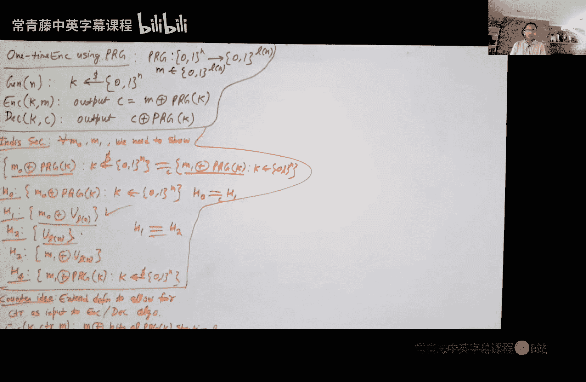
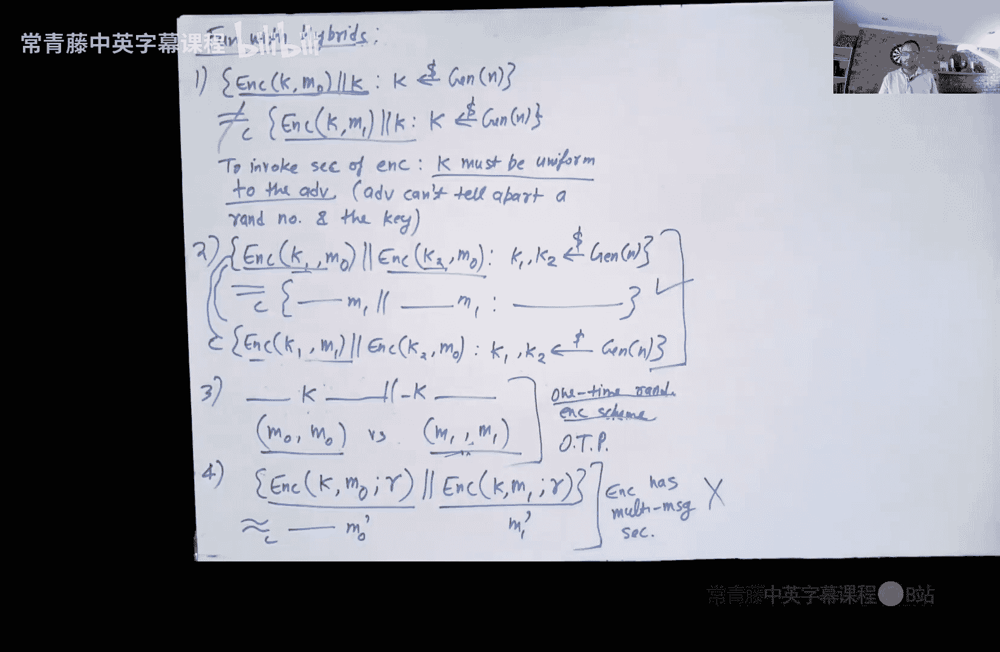

# 卡耐基梅隆大学【中英⚡密码学导论｜15.356 Introduction to Cryptography】 p06 P6 Lecture 6 Symmetric Key Encryption and Fun with Hybrids -BV16V6GBYEAA_p6-

Okay， great， so let's get started。😊，And we will look at。We will look at encryption schemes today。

I hope you can hear me well。So we will mainly look at secret key or symmetry key encryption schemes。

😊，And in some sense， we have already done that before we have been through the one time pad and we have been through many of the classical ciphers。

But of course， the classical cphers could be broken and the problem with one time pad is that。😊。

It had its limitations right so the key had to be at least as long as the size of the message and the key could not be used and so on。

😊，So today we will try to design provably securesymmetric encryption schemes which do not have any of these problems。

😊，Okay， so let' us try to recall first what was the definition of symmetric key encryption schemes。

And we saw the definition of perfect security， which is something which will not want to work with。

 we will try to come up with a computational definition， so lets let's get started with that first。😊。

So， symmetric key encryption。😊，Or。Also it's also known as private key encryptions， the same thing。

Symme key encryption。Let's call it SKE。So， any symmetric key encryption scheme must specify three different algorithms as you can expect。

😊，The first one is the key generation algorithm。Which sort of takes the security parameter as input and。

Outputs。The secret key K。Right so the security parameter in some sense will determine the length of your secret key。

😊，And。In many schemes the secret key might be just a random number in other schemes。

 it might be chosen in a more sophisticated way。Then we have our encryption algorithm。

 which takes the key。Takes the message and it's supposed to output the Cypher textext C。

And then we have the decryption algorithm which takes the key， the same key。

And the cpher attacks and it outputs。Some message， let's call it。Mbri。Okay。

So this is just the syntax and。When do we call a symmetric encryption scheme to be a good symmetric encryption scheme？

😊，So， there are two properties first is correctness。

 so correctness specifies what happens when there is no adversary right so in that case as you do you would expect。

😊，If you did the key transition properly， if you encrypt it properly and you decry it properly then m prime and M should be the same right you should get back the same message so here we want to say。

😊，The following。Correctness， property is。What you would expect the probability that。

The decryption algorithm on K and C gives you the message。M。Such that。Gay is。Genenerated properly。

 and。C is encryption of。The message m under K， this probability should be1。

So correctness must always hold。And now what about secrecy， what about privacy？😊，So。

 it will be a very straightforward generalization of perfect security。😊。

which we have already seen so perfect security talks about two distributions being identical and here we will just change the two distributions to being computationally indistinguishable so lets try to recall perfect secrecy。

😊，So what is perfect secrecy？😊，It must be the case that for every pair of messages。M0 and M1。

For every cipher text， see。Probability that。You encrypt the message M0 and you get C。Such that。

Okay is。Genrated properly， this probability should be exactly the same as。

The probability of getting C when you start with M1 instead of M。And again， this。This is the same。

 right？And now what I want to do is I want to just make a slight change to this definition。

 so recall that we saw Shannon's theorem earlier which showed that any scheme which is perfectly secure。

 which has perfect secrecy can actually be broken if the key size is smaller than the message size。

Right so how do we overcome this and in some sense the proof of the Shannons theorem already gave us a hint in Shannon's theorem we construct an adversary which sort of goes through every possible key so the adversary is bounded and we would like to work with computationally so the advers is unbounded sorry in Shannons theorem and we would like to work with computationally bounded adversaries and we would like to overcome this limitation。

Okay， so。Essentially here we were saying that these two cipherts sort of。Look identical completely。

 so lets try to generalize this。😊，And this will give us what is known as。Indistinguishability。

Basedase security and note that this is not the only definition of of security for symmetric encryption。

 but probably one of the most natural， if not the the most natural so。Indistinguishability。

Based security， let's just call it in distinguishistu wishability security。

 what we need is that for every pair of messages。M0 and M1。The distribution of Cyphert。

Start thing with Mze。😊，Should look computationally indistinguishable from the distribution when we start with M1。

 right？So on the left side， we have。Enncryption of M0。And a key is generated properly。

That always goes without saying， so this is computationally indistinguishable from。

The cpherex produced by M1。And again， the key is generated。Properly， right？So。

 what this says is that when an adversary looks at two different cipherts。😊。

Having versus M0 or M1 adversary cannot even tell them apart。😊，Right。So。

 this is mostly the definition which we will work with why is this the right definition so again。😊。

When we considered computational indistinguability。

 we also considered the prediction indistuability or the prediction probability based definition。

 we can try to do the same thing here and we will see that these notions are actually equivalent。😊。

So let me try to define another。Definition in distinguishability。

Security and let me just call it an alternative definition。You could probably have also called it。

Prediction and distinguishishability， but in cryptography we typically just refer to it as indistinguishability security。

An alternative formulation。 So here what we need is， again， for every。M0 and M1。

For every PP adversary。哎。we will choose one of these two messages at random and we will ask the adversary to predict which one we chose。

😊，And adverse， you should not be able to succeed with probability。😊，Noticeably， more than half。Okay。

 so probability that。Adversary。Gets the Cypherex C and adversary is able to output a guess for the bit B such that。

诶。Key is generated properly。Next， you choose B at random。Which basically selects the message。😊。

That you encrypt and then finally。Your cipher text is an encryption。Under K of the message。MB。

And what we need is。This probability should be very close to half。

RightSo this is a very natural definition。😊，And by the way。

 an interesting thing to note in this definition is why do we only consider two messages right your message could be very long。

 there could be many different possibilities of the message and so on。😊。

So the nice thing about just considering two different messages is that。😊，Essentially。

 you can think of it as giving a lot of information about the message to the adversary。😊，So。

 suppose your message is very long right， suppose we even give the adversary all the bits except a single bit of the message。

😊，Right， given this information in adversary head there are only two possibilities for the message adversary already knows all the bits then the remaining weight could either be 0 or 1 then we call these messages m0 or m1。

😊，Right and even at that point， adversity cannot determine this last remaining build of the message。

And instead of a bit of the message， it could be any arbitrary predicate of the message like Xor of all the bits or something like that。

 right so。😊，Yeah， so here we are really saying the following。😊，The security of the encryption scheme。

Does not depend on the message being private。😡，Okay， it only depends on the key being private。

Even if asary knows most of the message， still the remaining information。

Its it's hidden in some sense。So the one thing that's sort of counterintuitive here is that this definition seems to be trying to prove like if we have messages and we don't know the key。

 we can't know we won't know what they encrypt to， whereas it feels like what we'd want for security is like if we had cipher textex and we don't know the key。

 we can't figure out what the original message was and so does this direction just like reply the。

Imply the inverse as well or。No， in fact， if you look at the second definition。

 adversary is actually given the Cyphertex， right？😊，Adversity has to guess the message。Well。

 but we generate the ciphertex as like one of these two things and so it's really guessing does this thing encrypt to a given Cyphertext。

 not does this ciphertext dec to Yeah， so the only thing we require is that you generate the key properly and you generate the Cypher textex properly。

 Cyphertex should be one of these two messages。And then adversary sees the cipherex right adversary sees the cipherex and the goal of the advers is to guess the message。

😊，And maybe what you are saying is might be more true for this definition。😊，Because。

 but even in this definition， right， you see like two different cipherts and。

Or rather you see one cipher text and you have to guess which messages it is coming from。Okay。😊。

Any other questions？Allright， so let's very quickly。

 let's try to prove that these two definitions are equivalent before we move on and the proof is like。

😊，Very similar to the proof of computational indistinguishability and prediction indistinguishability being equivalent we saw that they were equivalent up to a factor of two and that is exactly what we will end up getting here。

😊，Okay， so let me try to see if I can。Fit the proof here。So， the statement is。😊，Indistinguishability。

 security。Implies。Indistinguishability， security。Alternate definition。And vice versa。

I'm just inventing my own notation here。So how are we going to do it so let's。Okay， let me just use。

this part。So， again， we will just do one direction and the other direction is just sort of doing all the steps in the reverse orders so suppose。

😊，That。嗯。四。Indistinguishability， security holds。ok。So。

 you are given that your scheme satisfies this definition and we want to prove that this implies that scheme must also satisfy this alternative definition。

😊，So if the industrial issevability security holds。Let's try to see。Compute。

Indistinguary security alternative equation。For lack of a better word。

 So we are looking at this definition and we will try to sort of compute this。Okay， so。So first。

 if indistinguishability security holds。What does this mean。

 this means the following the probability that。A gets access to C and outputs 0。Such that。Yeah。

K is chosen from。The key space and。C comes from。En encryption of K。Of M0。This probability minus。

Probability that a of C equals 0。Same thing， except now we are encrypting M1。So， this is。Negligible。

 right。So I'm just taking this equation。Sorry， not this this equation。And I'm expanding it。

Right so if indistinguishability security holds， then the probability of a outputting0 on these two different Cypherex distributions cannot be very different negligibly close。

So what we will do is we will call thiss。😊，第一。😊，And we will call this。Be blind。Okay。

And this means that P and P prime are very close to each other。Now， let's go to the。

Alternative definition。 and let's just try to express it。In terms of P andP prime。谁？😊。

Is't isn't this the like the IS and ISA， the same thing as prediction indiability and computational indiability proof that we did last thing last class？

😊，有。Yeah， I already said that。啊使。Okay， so now。Maybe I don't even need to do it in a lot of detail。嗯。

So now we are looking at probability of。A equals。咦。Such that， you know， case generated properly and。

We generated at random。And C is translated。By encrypting。K and M B。

So we we want to compute this minus half。And now we can divide this into two parts， right？😊。

Part1 is when b was 0， part2 is when b was 1。So， this is the probability that。A C equals 0。And。

Is sampled from Kgenhen。And C is。Encryption of k comma M0。Into probability that b is half。

 so this is just half。😊，Plus。Oh。Now we are looking at probability that AC equals 1。And you encrypted。

1。😊，Into half。Minus half， that's what we are interested in。So note that this is what is this。

 This is exactly。Ha。This is exactly P。Oh。P times half。Plus。What is that？This is 1 minus p prime。

Times half， minus half。Okay， and then in some sense。This is。P by 2 minus p prime by 2。And that is。

 of course。Negligible， if。P and P prime， they are negligibly close to each other。Okay。Any questions？

So now let's move on to actually building。Sytemetric key encryption。

So I already hinted in the previous classes how we might be able to do that。😊。

So the first construction will just follow from a PRG。And it will give us one time security。

But it would still be better than one time pair in the sense that。

You can encrypt messages which are longer than the key。😊，Okay， so one time。Encryption using。B20。So。

 here we will。Start with a PRG， let's call it。You are given a B。So how does key generation work？

So you just sample a key。And let me actually specify。Okay。The input size of the PRG。So。

It takes an n bit seed， and。It stretches into L of n bit。Output。

And we will assume that your message space。Is。M is coming from。0，12 L of n。So。

 how do you sample the key key is just a random string？😊，off。

leth end because this is what our PRG will need later on。How do you encrypt？Using this key。

Your cipher text is simply。M X。PR G of K。Okay， we are just using one time pad except that now we are first stretching our key。

😊，To the required size by an application of PRG and if our PRG is any good。

 then you know the output of the PRG still looks uniform。Which is what the one time pad needs。

How do you decrypt thecipher text？You output CxR。Pアオケ。Okay， correctness is obvious。😊。

If you do everything properly， then you get back the same message。Which you started with。😊。

Or which you encrypted。And let's try to prove。The security。Okay。

 so we will try to prove indistinguishability security。And to do that。😊，What do we need。

 we need the following for every M0 and M1。We need to show。The following。M0， X R。PR G of K。Such that。

Ks uniform。Is computationally indistinguishable from。M1 X。PR G of K。Where。Gay is。uni。Right。

 is this is the fivepher text。😊，When you start with M0， this is the Cypherex when you start with M1。

 you need to prove that these two Cyphert distributions。😊，Look， computationally indistinguishable。

Right。And again， we will just use a hybrid argument this proof is you know。

 completely straightforward。😊，So， our hybrid is0。Will be M0 xr。휘아게。Gs uniform。Hybrid1 is。M0 x R。

 let's call it。Uniform distribution on。L and L， okay。And again， I'm not。呃。

I am not doing the proof in in great detail， but here the point is that。If the key was generated。

At uniform。Then the guarantee that the PG gives you is that the output of the PG looks uniform right if somebody can distinguish h 0 and h1 some PPT adversary then you can construct another PPT adversary which can distinguish the output of the PG from uniform。

Okay， so this follows。H 2 is。If I take a uniform string。I can exhort anything with it。

The result is also a uniform string。Okay， and you can try to prove it by looking at any specific string and you can try to verify that the probability that you arrive at that string。

😊，Here， as well as here is just。2 to the power minus L of n。Okay， so this。Hybrid。And。Hybrid2。

 they are actually equal distributions。There is no cryptography involved I am not even talking about computational in distinguishistuishability on the other hand hybrid 0 is computationally distinguishishable from hybrid 1。

😊，And here we have executive equal typically written with this sign。ok。And then。You go to hybrid 3。

 which is M1 XR UFLN。Right， so。Starting with H2 now we start going in the reverse direction except instead of M0。

 we are talking about M1 here。Hybrid 4 is。M1， ex。The PR G of K。K is uniform。And then， we are done。

End of the proof。Okay， any questions， does this make sense？Can you go from H1 to H 3 directly。

H1 to S3， Yeah， actually you can do that。In fact， you don't ever need any hybrids after H2。Right。

 another argument which you can write is that。😊，M1。

I computationally indistinguishable sorry you can say h 0 and h 2 are computationally indistinguishable right and in the same way we can show that starting with M1。

😊，Again， we can arrive at2 and then by transitivity。😊，You can go from M0 to M1。Okay。

 so what this means is now give on a PRG。😊，We have been able to overcome the limitation of one time impact。

Now， our key can be small like just n bits and you can encrypt arbitrarily long messages。Right。

Now the question is this is still one time thats that is the main remaining limitation of this the scheme。

 So what do we do about that right we would like to go。😊。

To schemes where we can encrypt multiple messages even。Right。So， one option is to keep a counter。😊。

And note that。In the counter idea， I talked about it a little bit last time。

You have to change the definition of encryption scheme。😊，Right， so to show you the definition。Again。

An encryption scheme only takes the key and the messages input。😊。

It doesnt take as input any counter or any other type of state， right？So counteridea is。

Extend the definition。To allow for。Accounter CTR as。Input to。Encryption and decryption algorithms。

Let me not write the full definition again。And then basically， what what does our scheme look like？

Key generation remains the same。Enccryption takes as input。The key， the counter CTR and a message。

Okay。And then， you output。M X， R。Bits of。PR GK。Starting from。Position。C TR plus 1。

So that is your ciphert。And then your CTR becomes。The older counter plus。Lent of the message。Okay。

Now yeah and the decryption will also take the counter。

 the decryptor will also keep maintaining the same counter， right。😊，So there are two problems here。

 So one is the problem of synchronization so first。What if there are multiple encryptors？Yeah。

So that's question number one， right？If there are multiple encrypters。

 you need to make sure that your counter the same counter is not used more than once。

Right and in distributed computing， keeping a synchronized value across multiple different machines。

 it is a notoriously hard problem。😊，Another question is。Efficiency， as we go on。So， not that。After。

 let's say you have encrypted a million messages。Then what you need to do is when you want to encrypt the next message。

 right？You need to apply the PRG， you need to keep expanding the output until you reach like the millionth plus one bit。

Okay， so as you encrypt more and more as your system gets older and older。

 it becomes more and more efficient。😊，More and more inefficient right because you need to continue evaluating the PG and continue stretching the output until you actually get to a place which you have not used before。

嗯。So yeah， so this is a simple idea， but we would like to do better。😊。

And we will try to do better using a PRf。😊，So， our goal would be using a PRf。

 we would try to construct an encryption scheme。😊，Whi is secure for encrypting multiple messages。

 right？😊，But our definition so far only talks about encrypting a single message。😊。

So， our first goal will be to first define what it means。

Foreign encryptions came to be secure for encrypting multiple messages。Okay， and this is known as。

Multi message encryption， let's。Swiap out the board。

。嗯。Okay， yeah， so looking at this play in all definition， you encrypt once。

 you decry once and then you start talking about security and so on。😊，So that's not what we want。Oh。

So， in multima security， you encrypt a set or a vector of messages。😊，So， now you have。For every。啊。

Bed of。Message vectors。Okay， so let's denote these by。嗯。0。I。Where I goes from。1，2， let's say Q of n。

Here， Q is a polynomial。And then you can choose a completely different。Set of messages。Okay。

 and by the way， the length of the messages should be the same。So for all I。

M0 i length must be the same as M1 I。lenent。What do we need。Experiment1。

I encrypt everything from this set。From the first set。Experiment2。

 I encrypt everything from this set， right？So， I obtain a bunch of cipherts in experiment one and experiment 2 and what I want is that given all of these cipherts together。

😊，And adverseverse， we cannot tell whether we started with the first vector or the second vector。So。

Looking at the distribution。Enncryption under the key K of。M0， I。ok for all。And K is。

Coming from key generation。So this is a bunch of Cypherexs。

And what I need is that this should be computationally in this enulishable。From。

All the Cypherts are included in the distribution。Right。Does this make sense， any questions？

Should I had a small question， maybe I missed this but like via QN dash and QN。

 like why are they not same？😊，嗯。Oh， it's a comma， not。哦，行。Yeah， it's the same。

 It can be any polynomial number of messages。Okay， so before we try to construct。

Enncrupption schemes， which can provide security against。This type of definition。啊。

Let me make a very important point。Which you should always keep in mind。

 and that's the importance of。Randomization in encryption schemes。Okay。

 so in cryptography you will see that almost all the encryption schemes which we use in practice they are randomized what this means is that the encryption algorithm generates some sort of random number and uses that to generate the ciphertex。

😊，And we will see why that is the case。So here is a theorem。Which says that。

Any symmetric key encryption with。Multi message。Security。Must be either randomized or stateless。

Sorry， stateful。Okay， stateful we have already seen by keeping keeping counter how we can construct a multi message encryption scheme。

😊，U。But we don't really want to go to state full encryption schemes。

Because of the problems which I talked about。So then this theorem is saying that essentially we have to go to randomized encryption scheme。

So proof of this is actually very simple。😊，Consider two different message vectors。😊，So。

 this is vector 1。Versus。历 say。And1。M2 where。M1 is different from M2。Okay。Now， observe that。

If you encrypt M0 twice。Yeah。If。Your encryption scheme is deterministic and。Stateless。

You get the same Cyphertex。Okay， so。What is the input to the encryption algorithm？

Input is the key and input is the message right if you encrypt m0 twice you are doing it under the same key。

Then key is the same M0 is the same， message is the same。😊。

There is no randomness involved in encryption。😊，There is no counter involved in encryption。

So the output must remain the same。Any deterministic and stateless encryption scheme。

Has the disadvantage with that when you encrypt the same message。😊，You get get the same cipher text。

Right。🤧嗯。So here you will end up getting something like。C0 C0。

Here if you are encrypting two different messages then the cipher text must be different。

 this follows from the correctness property。😊，Then you get c1 and C2， okay？

And can you distinguish between this and this？Of course， you can。

Just by comparing if the two strings are the same or different。Right， so。This。

Is not by any means computationally indistuable。Okay。

 so such type of schemes cannot satisfy multi message security。Any questions？

So now how can we satisfy。Is that IND CCA no？CCA security is a more advanced definition which we will not look at。

😊，It's IN D CPA。Okay， so let's try to construct then。Multi message encryption schemes。

And we will try to use a PRf。🤧嗯。So you are given a PRf。Let's just denote it by PRf。

This takes as input。An n bit seed。Okay。And then another index。Of M1 bits， and then it gives you。

And m2 bit output。And about。Messages。Which we want to encrypt。We'll have this length。M2。Right。So。

So how does this work， key generation is just。Sample uniform string of n bits。K， encryption。Now。

 encryption is randomized。Okay， so what you do is。You first sample a random string。Of M1 bits。

And then you output your cipher text。See， your cpherex will now have two different components first is this random number or the index is given in clear in the Cyphertex。

😊，Next。You evaluate the PRM。On the secret key and this random index。And you exalt it with the。

Message。And let's also denote it by c1。Or let's see， okay， see0 and C1。

So there are two different components in the Cypheraxex。😊，How do you decrypt？The given cipher text。

Again， very natural as part of the spherex， you have the index right you have the PRf key。😊。

So you evaluate the PRrf。And then you just ex it with C1 and then you get back your。Original message。

Okay， so you output so C equals。C 0 and C1， you output simply。C1， ex。The PRf output on。K and。C0。Now。

 the interesting thing about this encryption scheme is that even if I encrypt the same message multiple times。

😊，I am very likely to get different Cyphertex just because this random number is sampled uniformly every time。

😊，And very likely it will continue to be different。Okay， and again。

 correctness is straightforward here。😊，Let's try to prove security。🤧嗯。And as you can expect。

 while proving security， we will try to rely on the fact that。😊。

The PRf output is indistinguishable from uniform and hence this is also essentially like a one time pad。

So let's try to construct several different hybrids。And again。

 keep in mind that we are encrypting multiple messages。😊，Not just one。In the security game。So。

 hybrid0 is just。Our initial distribution， so keep this equation in mind。

We have two different message vectors。 we are trying to prove that。

this will be our at0 and this will be our last hybrid and we will try to prove the indistinguishability between these two hybrids。

😊，So at 0 is just this。😊，🤧嗯。Which is。That you are given。Let's call it。Are I。讲吗？M0， I。Exile。B rf。

On K and。嗯。啊哎。And here。OurI is chosen at。Random。M1。Okay， so this is。And key is generated。Uformly。

Tro 01 to the power n。Okay， so this is our starting Cyphertext distribution。😊，Right for each message。

 lets call it M0 y。I generate a sample a random number array。😊，🤧。

And the output consists of R in clear and then。M0 I x or the PRrF output on this random number R。嗯。

Now， our first step。Would be to。Replace this PRf。By a purely random function。Okay。

 and then we will try to rely on the PRf security in disabled。So are I？M0， I XR。

Random function is denoted by just RFf。And there is no key here。Right。And now our claim。

Is that these two distributions are computationally indistinguishable。Okay。The proof。

It essentially follows from the definition of PRf。And the fact that PRF and RFfs。

 they cannot be distinguished。So suppose again， let's do it in a little more detail by contradiction。

So say you are given。A PPT adversary。诶。Which can actually distinguish。H is 0 and h1。

What this means is that this PPT adversary takes a sample from either h 0 or from h1 and then。😊，啊。

Can tell apart these samples， in some sense。Then， we will build。Another PPT adversary B。

Which can break。The security of the PRf more precisely。😊，Which can win。The guessing game。

So the security of the PRf， I will remind you。With probability。Half plus。Noticeable often。

So how is the security of PRF defined。So。You have a challenger and you have an adversary。

 so here are adversary B。Can make several queries。All these queries are either answered。😊。

By computing the PRf。Or by the random function。Right。

And if our adversity can guess with probability better than half。Which one it is？

Then we win the guessing game。Okay。So how does B work？😊，So note that B has。M0 I is all。

In built inside。Okay。And then。Far。Every eye。B samples are I。Andque is the challengeger。On this all。

And then uses the response。Let's call the response。Capital。Should be superscript。

Let's call the response capital R。To construct。All the Cyphertex。Right。

So if the challengers was responding with a PRf。Then the sphertex distribution is exactly from at 0。

If the challenger was responding with a random function。

 then your Cyphert distribution is exactly h1。😊，Okay， so now if the PP adversary a。😊。

Can tell apart these two ciphertex distributions。Then B can tell apart if it was a PRf or it was an RF。

And B win the guessing game with probability by than half。😊，Okay， so this。Claim holes。是。😊。

Any questions？No one question。Yeah so for for be right when it when it samples a bit0 or one right and like it will either get a random thing or something from the Cytex but like at0 has all of the things from the Cytex and H1 has all the things from the random thing but what we will get is like say first two from the Cytex the next three from the random so how will ourdver adversary a can distinguish like if you give it no no no no no so recall the definition of PRf。

😊，So yeah， that's an important point to think about in the definition of PRf。😊。

The challenger flips a bit B。😊，And based on that， the challenger decides。😊。

Whether to answer the queries using PRf or RFf。After that point， there are many queries。

 polynomial number of queries。😊，But all of them are either answered using PRf or RFfs。😡。

The same thing right if b was 0， all of them would be answered using PRf。😊，If b was 1。

 all of them would be answered using RF。Okay， even then you cannot guess the B B Okay， okay。

 so we we won't sample B for each query。 Yeah， the challenger samples B once。Okay。

 okay and this directly comes from the definition of PRf。Okay， thank you sir thank you。Yeah。

 in the definition of PRf there is a single B， you keep making multiple queries。

 polynomial number of queries and then you just have to guess this single bit B。😊，So。

 this seems like an easy job， but you know， even this bees is not guessable except with probability close to half。

Okay， any other questions？Okay， so now yeah so。The next hybrid is。H 2。In that 2， we get rid of this。

Random function business entirely。So in H 2， we output。Are I。And M0， I X R。Some random number。

 completely random number R。Okay， and again， R I and capital R， they are both。Samper。Uniformly。

Either from。M1 or M2， just appropriate length。Okay케이。嗯。So， now， note that。

A random function did not always give you a completely random output。

Because if you query the same index twice， even in a random function， you get back the same value。

Here， even if this little arrays are the same for two different messages。

Capital Rs might still be different。So that is the only slight definition。Okay。If。So。

 what I will claim is that。H1 is actually identical to H2。Condition on the event that。Are I and。

R J are different。If I and J are different。So if there are no collisions in picking R。

 then basically these two hybrids are essentially identical。😊，Okay， but then you note that。

Probability of a collision is negligible。 probability that。Some R I equals some R J。Such that。

 you know， they are picked at random is。Is exactly equal to。1 by two to the power。

 the length of these strings， which is。M1， I guess。Okay， so you can take a union bound。

But there are only a polynomial number of these strings。So。Probability of any collision。Happening。

Collision happens。With negligible priority。And then finally， we will have our hybrid 3 where。

We can just replace this value with completely uniform value。So the same thing， except。That now。

This is just actually let me just why not change the message just like last time。

 so this is your M1 I。Exer。爱你。Because R is now completely uniform。

And we will be able to claim that S 2 equals S3 and again。

 you do the same hybrids in the reverse order and finally。

You get to the same distribution except you have been able to switch the message。Okay。

 and I wanted to spend some time on。Gral techniques for constructing hybrid arguments a little bit before this class ends。

嗯。You know， you can look at the details in the notes。So any questions？So now this is very nice。

 right？😊，We were able to construct a PRf from any PRG and then give one a PRf。

We can sort of construct。Almost a dream version of encryption schemes。K can be small。

 you can encrypt very large messages。 You can use the key any polynomial number of times and so on。

 which is， of course， what we want in practice。😊，Right。

So now let me take the remaining 10 to 15 minutes of the class。😊。

To talk about hybrid arguments in general and common mistakes while talking about hybrid arguments and so on。

 so it will just be a bunch of questions which I hope that you will be able to answer for me。嗯。嗯。是。

Kss will have。Fund with hybrids。So suppose we have a student， let's say Bob。

 who is enrolled in our class。😊，And。Bob submits the first homework and。

Bob makes various type of arguments and。Hopefully you will try to tell me if these arguments are good or bad。

Okay， so。Let's say we start with this distribution。K comma M0。Concatenation， K where。

Kase sampled from。嗯。So。So this is the Cyphertex and the key concatenated with each other。Okay。

 case sample at uniform。And。Let's say Bob writes that。By the security of the encryption scheme。

This is computationally indistinguishable from when we are encrypting M1。😊，So。😊。

Is this correct or is there a problem here？😊，I am starting with a very simple question。So。

 note that this distribution consists of the ciphertex and the key concatenated with each other。😊。

Okay， so。Looks good to one student。Or you could decrypt it and then you could get back to the message。

Yeah， so clearly if。Somebody gives me。Either this distribution or this distribution。I have the key。

 I can just。Enncrypt sorry， I can just decrypt and recover the message， right？And then clearly。

 these two distributions are not computationally indistinguishable。So what went wrong。

 So I am looking for a more precise answer。So clearly， you know， the statement is wrong。

 but the hybrid argument， it seems like。😊，It was done correctly， So what is going on。

M0 and M1 are recoverable constants that identify the distribution。Well， that was the case。

Even if key was not present。I guess just the like hybrid argument assumes that the key is unknown。

 essentially what we're making。Yeah。That is a good point。 So that is essentially。

What it boils down to so note that do I have the definition of encryption I think I raised it okay。

 so note that security of the encryption schemes they rely on the key being chosen uniformly at random。

Right。And then adversary only gets to see the cphertex。😊。

And then we have a guarantee that any PPT adversary cannot tell apart。😊。

The cpherex for M0 from Cypherex for M1。Okay， so only in these conditions。

 the security of encryption holds。😊，So。To invoke。Security of encryption。He must。Be uniform。

To the adversary， okay？If you indeed generate the key and just give it to the adversary。😊。

It was generated uniformly， but。It is no longer uniform to that advers。Okay。

 what do I mean when I say key must be uniform to the adversary？It means that adversary。Can't。

Tell apart。A random number。And the key。Okay。And as long as this condition is satisfied。😊，啊。

You can invoke the hybrid argument。But here， because you just put key as part of the output which the averary sees。

😊，K is no longer uniform to the adversary and hence this hybrid argument is wrong， right？😊。

Let's go to another hybrid argument。So。I will encrypt the same message twice。M0。Concatenation。K2。M0。

Such that。K1 and K2 are both。Generated properly。And Bob writes that this is computationally and distinguishistuishable from the same distribution except that。

You are encrypting M1。Is this correct or wrong？And feel free to take a guess， you know。

 no points for guests。For getting the answer correct on， we are just trying to have fun。Okay。

 one student is guessing that this is wrong， any other thoughts？Pay to me。Okay。

 another guess is correct。啊。I don't think it's correct the hybrid argument。Don't go through。Here。

 we have another。Another wrong and in the chat， another one correct， so we have two verses two。

Any other guesses？Okay， another one for correct。So we are lean towards correct now， okay， yes。

 this is actually correct。😊，This is because。The security of the encryption scheme does not rely on the message being private。

It only relies on。The key being sampled uniformly。Okay。

You can actually try to prove this using a hybrid argument a more detailed hybrid argument So what I can try to do is I can write。

😊，Inscriptryption of K1 comma M1。And encryption of。K2 with M0。So， I have two cpherax。

I switched M1 first。So， I can claim that。These two guys are computationally indistinguishable。

And why is that because？😊，Even in the security of encryption。Adversity even given both messages。

 MZ and number。😊，They are not supposed to be private or anything like that。

 even you are completely given M 0 and M1 and it still， you know I can。😊。

I can swap mz M1 in the cpherex and still that also cannot tell the difference。😊，Okay。

 so one way of viewing encryption is that。😊，As long as you guarantee the encryption key that you know key is chosen in a nice correct way。

😊，It will guarantee the moon for you as far as message is concerned。

you can encrypt the same message multiple times。😊，And oh， and by the way， I forgot， sorry。Only if。

Encryption is multi message secure。Right。And in fact， you know， multima is secure。😊。

Oh no no no sorry I made a mistake you don't need multima security here because these two keys are different uniform so this holds for every encryption scheme。

😊，If this。KK1 and K2 was the same then you would need multimat security here。

So these kind of things are very important to keep in mind。😊，So does this make sense or？

So let's go to the third exercise。😊，Third one is essentially the same as the second one， except that。

We put the same key in both places。m sorry， could you talk again why if it were the same key。

 it would need multi message security。Yeah， so if it is the same so that's that's my third example。

 right， so yeah we'll discuss that。😊，So， if your key is the same， then with the same key。

 you are encrypting。😊，Twice。Right。So this almost follows from the definition of multimat security that。

You encrypt here your vectors can be seen as。M0， M0。Versus your another vector is M1 and M1。Okay。

And multima security basically says that this is a vector of length2。

 even if you have an abitrarily long vector of any polynomial length。

 multime security says that given all these cipherex versus theseciphert。

 they look computationally indistinguishable。😊，So， we are planning to add。

These examples to the notes。They don't exist in the notes right now， but hopefully。

By the end of this week， we will have updated notess with these examples and。

Detail of why it does or doesn't work。Yeah， did you have a question Yes， yes， So said for three。

 you said you need multi message security， but if you are encrypting the same message like M not and M not with K1 and K1 and on the other side。

 M1 and M1 with。😊，Yeah like a different key like like the same key why do you need multi message security like multi message security was required when you are m not m not and M1 M2。

 right。😊，Like because if I have M1 M2 then and am not I not then I can say that my first and second half are same so I can easily tell one and the other apart because M1 and M2 will never go to the same sideax。

 but if you are encryptically M1 M1 and M not M not then I think you don't need multi messagesage right？

😊，So I think you are thinking about the counter example。😊，So。

 the same counter example you are right it doesn not apply when I have m0 m0 and M1 M1 right so it is possible that even single key security might be fine in this example。

😊，But it may not be。Because what I'll do is that if you have an adversary for even for single message I'll just like what I'll do is I'll so I can construct an adversary when you are encrypting it only one which is like you can easily generate a counter example when you are encrypting it only once because what you can do is you will give me two encrypted message I'll just concatenate them again like if you give me two messages Ill just concatenate them and send it to the adversary that can distinguish the three part and then this will be a like adversary for the that distinguishes the single encryption scheme so okay so let me say let me say yeah I understand let me say a little bit more here。

😊，啊。Think about one time。Randomized encryption。Scheme。So， in that case。

 if you encrypt the same message twice。😊，Maybe this encryption scheme becomes completely insecure。

Because if it is randomized， you will get two different spherex here。😊。

And maybe you put these two cyberphertexs together。

 you can recover some information about the message。directly。So。😊，But if you use。

 let us say one time pad or any deterministic or straightless。

 then you are right that you cannot tell apart these two。So maybe this was not such a good example。

But in general， if you are。Reusing your key， you are encrypting multiple messages with your key to talk about any kind of security you do need multi messages security。

😊，I am sure that you can construct one time secure randomized encryption schemes。

 which will actually allow you to distinguish these two messages。Okay。

 let me move on to the sort of the last example which I was thinking about。So now， what you do is。

I have a randomized encryption scheme。And I use the same。I use the same randomness。Multiple times。

🤧So。I encrypted。A message。Let's say， M 0。With randomness R。And then I encrypt another message。

With the same randomists are。Now， I would like to claim。That。M0 prime and M1 prime。

That I can change the。Mess is vector。 and by the way， encryption has。Multi message。Security。唉。So。

 yeah。What do we think about this？So this is probably the most tricky。

So recall that in the definition of。offer。Encryption and how the encryption algorithm is defined you are supposed to generate R at random。

😊，Okay， so this turns out to be also wrong。Okay， because the security of the encryption schemes relies on R being uniform。

😊，Right。And。If you are reusing R， then you know。This guarantee goes out of the window。

If we are doing any funny business with us so that our in no longer be uniform。Then。Yeah。

 we cannot rely on anything， so there's a question why is R being passed？😊。

As an argument to encryption so you don't need to pass it this just denotes that。

There are two encryption algorithms and they share they use for whatever reason they end up using the same randomness are。

So。Security of encryption。Relies on。Number one。K uniform。Number 2。Randomness。As the name says。

Uniform。Any reuse。嗯。Or。Disclosure。off。嗯。Even a part of these things。Will require。

New proofs or new security arguments。Maybe it still works， maybe it doesn't。

 but at least the standard definition says nothing in that case。😊，Okay。

 and we have already seen that。😊，For example， if somebody was reusing the key one time pad became insecure。

 but then you know， we explicitly were able to construct new encryption schemes where key reuse was fine。

Okay， so with multi message encryption schemes， maybe key reviewsuse is fine but still randomness reviews I don't know never talked about that。

 maybe you can construct new type of encryption schemes which even allow for randomness reviews。😊。

But at least standard security guarantees goes out of the window。Okay， and by the way。

 let me contrast this with one way functions。😊，In one way functions， the security relied on only。

The input being uniform。Okay。So run方 support。The input is not being chosen uniformly。

 then maybe one functions can be invertible。Or maybe if the advers is given， you know， some。

Some fraction of the input， maybe when the functions can be invertible。So。

 that' is why it's very important to look at security definitions and sort of hard code in your brain。

What the security relies on？And。You have to pay special attention to。Things that are。uniform。

So this is probably the most important。Things that are uniform。

 it means that adversary really must have no idea about that。

And only then the security holds otherwise basically the whole thing might just go out of the window。

Okay， any questions before we stop？Okay， so we will stop and yeah。

 we will put out the notes for this part soon。😊。