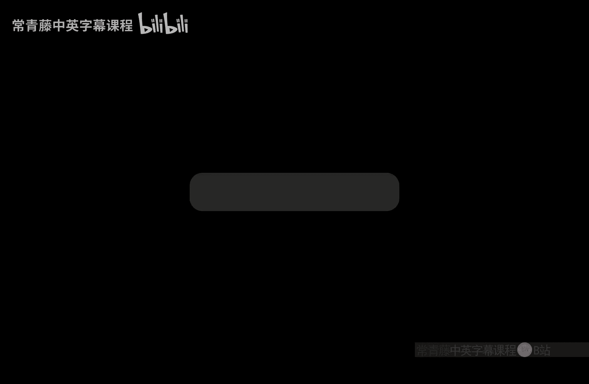
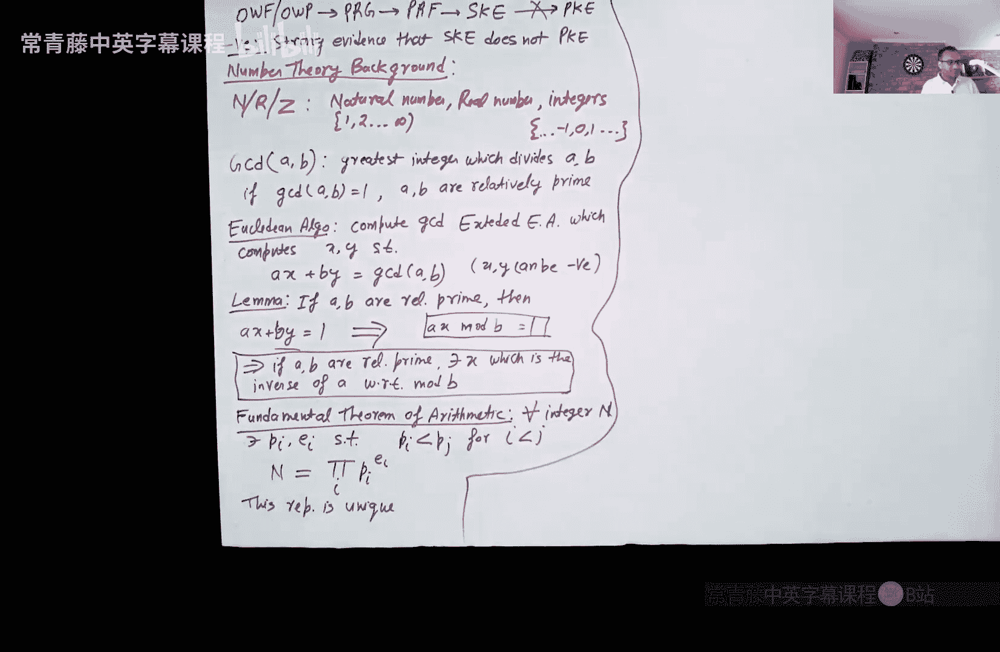
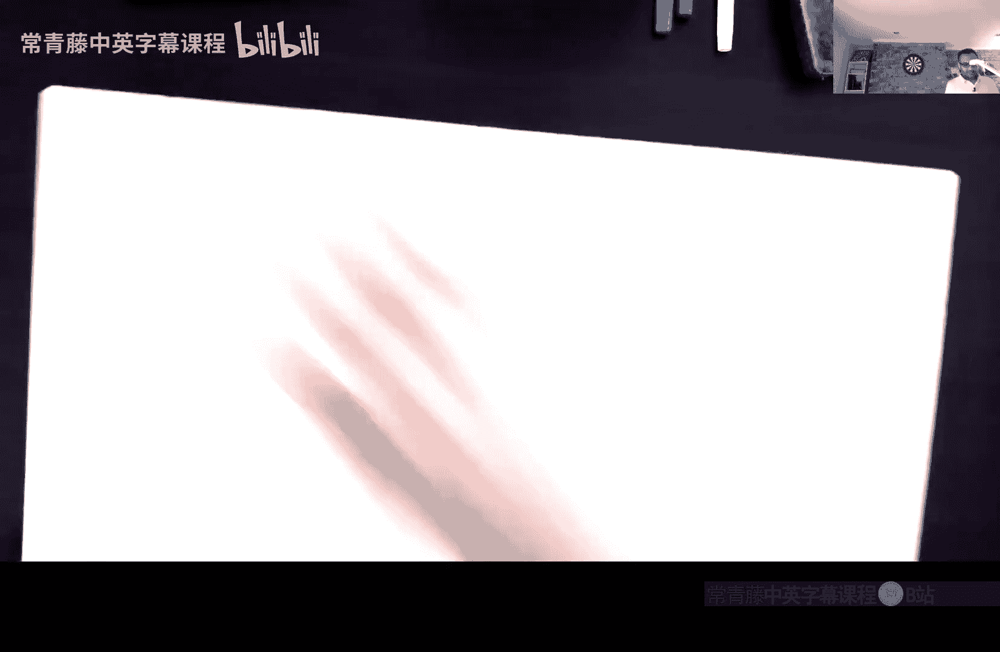
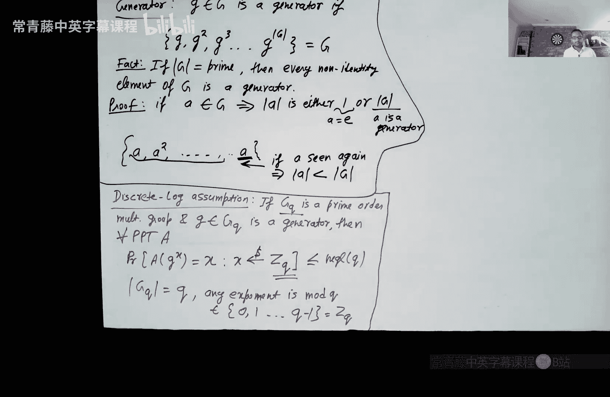

# 卡耐基梅隆大学【中英⚡密码学导论｜15.356 Introduction to Cryptography】 p07 P7 Lecture 7 Number Theory, Discrete Log Problem, Diffie-Hellman Problems -BV16V6GBYEAA_p7-

Okay， hi everyone， welcome and let's get started。So today we will switch gears a little bit。

And we will have some background on number theory。So just to remind you what we have done so far is that。

We started sort of with one way functions。And there variants like。One way permutation。Using that。

 we were able to construct。Croran generators in a black box way then we were able to construct。

Sudorranum functions in a black box way。We kept going and last time we constructed symmetric key encryption just from these primitives。

 so primitives like one way functions or one way perutations which might look very weak。

It turns out that they are very powerful and they can give you things like PRG and symmetric key encryption。

 right？😊，But。The backbone of the internet is really public key encryption right because symmetric key encryption is only for the parties who can sort of meet。

😊，And they can generate a shared secret and we can communicate only once we have this shared secret which nobody else knows right but for example。

 lets think about what happens when you open a website。So let's say you open some website。

 let's say Googleo。com or Gmail。com or something like that。

You want to check your email so you would like your emails to be encrypted so you need to establish a secure connection with Google do co right or gmail do co but you and gmail they have you have never met each other right you don't have a shared secret key so for this reason we need。

Public key encryption， right， and we will see how public key encryption enables。

Secure communication over the Internet。But in public key encryption very roughly you can encrypt with the public key and then there is a separate secret key which will allow you to decrypt messages。

😊，So ideally， we would like to sort of continue our play the style and we would like to build。😊。

Public key encryption。Just from， let's say， any symmetric key encryption。

So that has been a dream for a very long time， but unfortunately。😊。

This is still a major open problem。The open problem is given any symmetric key encryption。

Can you use it in sort of a black box way and build a public encryption so people have tried to solve this problem for the past 30。

 40 years。You know， no solutions so far and in fact， there have even been some negative results。

Some negative results。Which have shown strong evidence。That。Symsymmetric key encryption。

Does not necessarily imply public key encryption。So， in other words。

There have been what is known as black box separation results which show that you cannot take a symmetric key encryption and convert it in the black box way to public key encryption。

If you want to build public encryption， you necessarily need something else。Okay。

 so that is why today we will we will look at assumptions like the dispute log assumption later on we will look at the RSA assumption。

😊，just assuming a one way function of one perutation is not going to be enough。

 at least as of now we don't know how to build public encryption from just these assumptions。😊，Okay。

 so so today we will not build public encryption rather we will just drive into number theory and we will sort of collect the necessary facts which we will need for the rest of this course。

😊，对。Okay， so。Number theory background。So first， some notation。We have natural numbers。

 we have real numbers。And we have Z。Which is the in teachers。So， natural numbers。

Is just numbers from。I think one。To up to。Infinity。Then we have real numbers。

Which we all know what what they are， you know， there is a number。

 then there is a decimal point then another number。And then we have the set of。

Integers so integers can be from minus infinity to plus infinity。So -1，0，1， and then。

All the way up to minus infinity here n plus infinity here。嗯。

So we will just study some very basic properties of numbers， just some math background for today。

So what is the GCD？Of two numbers A and B。去。So， this is just the。The greatest。Integer， which。

Sort of divides。A and B。Okay。If GCD of A and B is 1。We say that A and B are。Relatively prime。嗯。

How do you compute？嗯。The GCD。It's known as that。Euclidean algorithm。

 it's actually one of the oldest algorithms known to mankind。So。Euclidean。Algothms。

It allows you to compute DCD and in fact it' is a very efficient algorithm。

 not even of course it is polynomial time， but it's actually very fast in practice。And in fact。

 there's also something which is known as。The extended Euclidean algorithm。Which。

Allows you to compute。X comma y， such that。A x plus。By is actually equal to the GD of。A and B。Okay。

 so for simplicity for most of this lecture， just assume that the numbers which we are starting with A and B。

 they are positive。😊，And they are interiors。So you start with A and B and。

Extended Euclidean algorithm would allow you to compute integerous x and y such that ax plus by is exactly equal to the GCD of A and B and by the way here。

X and y can be negative。And many of you might have taken the 251 course where I think we actually look at how the Eludean algorithm works。

And this gives you a very nice lelemma， which we will。Use and which we will keep in mind。嗯。So。

 the lemma is。If A and B are。Relatively prime。Then that means that ax plus。By equals 1。

 which implies that。AX equals 1。Mod why？Okay。So when I say， maybe let me write it differently。

A X mod。Why is one。O。And。I am sure that most of you have seen modelular automatic mod y is just mod y of any number is just you divide that number with y and then you are just left with the remainder。

Okay， and here if you take mod y on both sides， then。

BY being a multiple of y just goes away and the remainder which is left is just atmost ax。W。

 don't you typically want this in terms of my be。So利。Thank you。Yeah， might be。Okay。

 what this means is that。If A and B are。Relatively prime。Then there'd exist x。

Which is the inverse of。诶。With respect to。妈的逼。😡，So if you look at this equation， then。

X can be called as the inverse of a because a x equals just one。Okay， and this is a very nice。😊。

Observation。So in cryptography we like to work mod primes right and in fact in cryptography primes hold a very special importance。

😊，And one of the reasons for that is is this that。If， for example。

 let us say be is prime right then every number is relatively prime to B and hence every number will have an inverse with respect to B。

And this is something which we will exploit later on。

Another very basic and important fact to keep in mind。Is what is known as the fundamental theorem of。

Arthmetic。It is sort of a very grand name and it says that。😊，For every integer。And。And again。

 let' us only keep positive integers in mind all these things can be generalized to negatives。

 but I don' not want to go there right now。There exists。B i。E I such that。PI is not equal to Pj。

Such that n can be represented as follows。PI race to the power。EI。嗯。In fact。This representation is。

Unique， so what I am saying here is that there exists a unique set of prime numbers。

You multiply these numbers together， you can use a particular number multiple times and you will get back the number capital n。

Okay and the reason why it' is called the fundamental theorem of athme is I think it is in some sense inspired by chemistry。

 so in chemistry we see that there are all these fundamental atoms and basically everything else which we see is made up of these fundamental atoms。

😊，All the molecules and compounds and so on， so here we are saying that you look at primes。

 you can look at primes as these fundamental numbers and then every other number is just made up by multiplying some subset of primes together。

And not only that， in fact， this representation is unique。😊，And just to be more precise。

To make sure that this representation is unique。PI must be less than P J for。Iless than。Okay。

 so P1 is the smallest than P2 and so on。This essentially this this order list is unique。

Now let's come closer to cryptography， we will recall the notion of groups。Okay。

 so a set group is essentially a set G。With the operation and this is known as the group operation。

 by the way。Let's denote it by this dot inside a circle it takes as input。

Two group elements and outputs another group element。So this this set with this operation is called。

A group。And let's denote it by G comma this operation。If the following four conditions are satisfied。

 the first condition is closure。For every A And B in G。🤧嗯。A group operation B is also in G。

Okay and in fact this is this is already sort of implicit in the definition of the group operation。

 so you do you pick two elements on the of the group， you apply the group operation。

 the result will always continue to belong to the group。😊。

The second condition is the existence of identity element。😊，So， there must exist an identity element。

 let us denote it by e。😊，Which is an element of this group G。Such that。For all。エーエジ。

A group operation， the identity element equals。The identity element operation a。Equals itself。

So group operation， applying the group operation on the identity element with any other element results in just that other element。

Doesn't change the element at all。The third property is associivity。It's a very natural property。

For every now let's start talking about。Three elements from the group for every ABC。

Which is part of the group。Let's say I want to apply the group operation on A， B and C， right？So。

 I have to pick either A and B first or B and C first。

 so associivity says that it doesn' not matter which one。You pick first。

So as it associivity just says that A and B。And then， see。Equals。A and。First， you apply B and C。Then。

 finally， we have the。Inverse operation。Or rather， the existence of an inverse。

Which says the following。For every element A in G。There exist another element， X in。G， such that。诶。

Group Op X。Is equal to x group operation a。It's equal to the identity element。🤧嗯。

And we will see various examples of groups。😊，But。But basically。

 when you are trying to prove that something is a group。😊。

Most of the time you need to pay attention to the inverse and the closure property。

Identity and associivity they are typically pretty easy to prove。😊，Okay。

 so now let's oh and by the way， a very natural property is that。😊。

A group operation B must be the same as B group operation A， but that is an additional property。

It is not guaranteed in all groups， so these are called as Ebelian groups。Which says that。

A operation B is the same as B operation A for all A and B， which are part of the group。Okay， and。

Just to make my life simple， I will just refer to it as。Mulipplication， because。

Typically in cryptography， the group operation will be multiplication mark number n。😊，But， you know。

 just arbitrary， you can call it edition， you can just call it a group operation。

Another thing I want to define is the order of。The group。And it's represented by G， And this is the。

Number of elements。エンダグプ。Okay。So this is as far as the definition goes now。

Let's try to see some examples。嗯。So perhaps the simplest example of a group is。

What is known as Zn and the group operation will be just addition mod。And。Okay。

So Zn is just all integers from 0。Up to。And minus-1。Okay， so all integers smaller than N。

But positive。Or non negative。And。By the way， because this group operation is。

Some variant of addition， this is known as an additive group。😊。

If the group operation resembles addition， we call it an additive group。

 if it resembles multiplication， we will call it a multiplicative group and so on。😊，But of course。

 just keep in mind that it's not really just additional multiplication。

 it's model addition or model multiplication。So let's try to prove that this is a group。😊，So。

Maybe you can help me here， so how do I prove the closure property？So closure property says that。

If A and B are。In the end， then I want to prove that。A plus B mod。N is also in。Zian。Okay。

 how do I approve it？The is closed under integers， so you get like A plus B is an integer。

 and so A plus B mode is within ZN。Yeah， so a plus b is an integer and of course。Any inte are modern。

So sorry first a plus b is a positive integer right if A and B are integers could be0 but at least it is not negative。

So a plus b is a non negative intesger and then it cannot be n or larger than n。So。

 it is clearly an intesia from 0 to n minus 1 and all such intess belong to the group Zn。Okay。

 identity。Just equals 0， we don't need any explanation here。Associivity is also just。Tvial。嗯。

Then what about inverse？So， here the inverse of。A X will just be。Capital n minus。哎。Right。

Because first of all， capital n minus a。嗯。It is smaller than n， but yet it is greater than 0。

We have to put in a special cases for a equals zero。嗯。Yeah， youre right， so。So in that case。

 the inverse of that would just be0。But I want to make it a little better。And mod n is true anyway。

 So let's。 let's just put more in here。So， now。You know， x， if you add these two。

 you will you will exactly get either n or you will get0。Okay， so this is fine， any questions？

I in the integerous tradition also grow here。Yeah， but generally I want to keep the discussion to sort of finite groups because that's what we will use in cryptography。

Okay， so this was an additive group， which is typically not very useful。😊。

Let's take an example of a multiplicative group。So to do that， let me define something。

hich is is known as ZN star。So Z and star is the set of。哦。Positive integers。嗯。Less than n。

And relatively prime2。Relatively prime to。嗯。Okay， as an example， what is Zp star？😊。

So zero is excluded here。😊，Because every number is relatively prime to the prime number。

 it is just 12 all the way up to p minus1。Okay and for a more complex number， you know。

 you basically have to check。If the number you basically have to compute the G3D of every number with n。

Yeah， people are giving nice examples of other groups as well， a lot of other groups， definitely。😊。

Okay， so now my claim is that。Z and star is essentially a multiplicative group。

And again， to prove that。Ill need your help。So the claim is。Let's prove it for Zp star。

And the operation is just。Mulipplication， mod P。This is a group。Okay，So again。

 we need to prove four properties。So first， we have。The closure property。So we have that A and B。

 they are in。Z P star。And what is a times B？M b。How do we prove that this is indeed in ZP star？😊，So。

 clearly。呃。A is positive b is positive， so a times b is also positive。You are taking mod P。

 so this is clearly also less than p。So， we know that。A times B is an element of。This set。0。

1 to the power P minus-1。How do we prove that it's not actually zero？If we can prove it' is not zero。

 then we are done。Sincely and we were not divisible by P in the starting。

 like and you multiply with them like the remainders can never be。你叫啲。

So this this follows from the fundamental theorem of arithmetic。Right， because。

P does not appear in the representation of either a or B。

 and hence when you multiply them it will not appear in the representation of the result either So a times B is not divisible by p and hence。

 you know， cannot be 0 mod。What is the identity element is just one。Associivity is trivial。

And then finally， we have the inverse property。So how do we prove the inverse property？

Extended you create an algorithm。Yeah， exactly， so we already saw。😊。

The investmentverse property view rely on the fact that。P is a prime and hence with respect to P。

 every element will have an inverse so。This is just extended euc in algorithm so we saw here。

This fact。Right。If A and B are relatively primed then they exist in x。

Such that a x equals1 mod B and B is basically P here。So a will be relatively prime to P。

 and hence there exist in x such that Ax equals 1。So， this is good。And in fact。

 we can even generalize it， although we will not do it right now。For any end， Z N star and。

Mulipplication mod n。Is a group。And let me leave this as an exercise。

 try to extend the closure and the inverse property for this。So now。

A very important general property of groups。So， this is。

Let me simply refer to it as a general property。Of any group。So。

 suppose we have some element a in the group G。Then what we have is。

A to the power sum number k is equal to actually a to the power。Gay mar。The order of the group。Okay。

 and by the way， what does this mean into the power k this is just。A group operation a。Just。K times。

Okay， by default， we will think of the group population as some kind of multiplication model or multiplication。

😊，But more formally， its just A A A a。the group operation with itself。This property is very。

 very useful to keep in mind I will not prove it if you have taken to 51 this follows from。😊。

The order theorem。Okay。So now this property gives us several interesting things。First， it shows that。

For every A in G。A to the power G is actually equal to。呃 one。And by the way， here。

 one is the identity element。And we can even define an order of an element。

So order and of an element is the smallest k。Such that。A to the power， K equals 1。Okay。

 and note that。Order of the element is at most the other order of the group。

But it is possible that you pick some some smaller element and you know there is a smaller k for which it is the power K1。

And the order theorem says that。Okay， in fact。Evenly divides。Order of the group。

So case either the order of the group。If it is smaller than the order of the group， then。

It evenly divides order of the。Another corollary of this fact。Is that。

If order of the group is a prime。Then k must in fact， be equal to the prime。

Because no other number less than the prime divide。Divide the prime。

So now a very natural question is。How do we compute the order。

Sometimes it' is completely trivial like what is the order of。Z n。Order of Z n is just n，0 to n -1。

What is the order of z and star？That's sort of less clear。Okay。

 so typically order of the group can be computed by considering the。

TheWhat is known as the ILs Phi function。Is 5 function is also known as the IS torsion function。

And I Phi function is just phi of n equals。P to the power， I risk to the power。EI minus1。Times。

ピーアイマイナスワン。This is all。For all I。And assuming that。N equals。

Just the user representation from the fundamental theorem of athmetic so。If m equals this。

 then phi n equals this， what is phi n？Fi N is。The number of。Positive integers。Relatively prime。Do。

And。Okay。And this implies that。The order of Z and star。Is actually equal to phi of n。Okay。

 any questions？Should we put a less than n in the definition of FN as well。Sorry。

Of positive integers， less than n。有。Good point。The proof of this， this is actually not very hard。

 you just need to consider。 So here we have these several primes。

PI is and you just need to leave out the numbers which are just some multiples of P for all life。

But Ill skip the proof here。So now we have this。From this， there are several things that that follow。

So first is。It is known as Fmas little theorem。Parma's little theorem just says that。Far。App prime 비。

This is the usual representation for denoting the set of all primes。嗯。For any element a in。

 let's say Zp star。8 to the power P minus-1 is actually equal to 1。And this whole equation is mod P。

So sometimes rather than writing mod P here on the left side。

I just write it after the equation to denote that both sides are actually taken M be。

It's the residue might be。So， how do we prove this。

 how do we prove that it is the power P minus1 is 1？This actually directly follows from。

The general property， because。The order of this group is just P minus-1。 This can be computed from。

The ILS 5 function， in fact， it can even be trivially computed because。ZP star is just 1，2。

3 up to p -1。 So so we have p minus-1 elements。So order of Zp star is just p minus-1 and hence。

We have that a to the power P minus-1 is just one， and this follows from。The general property。

Right general property says that。嗯。Yeah， this one。A to the power art of the group is just one。

Theres also a sort of。Simple generalization， which is known as just。Iist generalization。And in fact。

 I think this is the context in which the P function was introduced。For any。Number n。

 not necessarily a prime。For any a in Z in star now。A to the power phi of n。Is equal to1。Moud end。

And why again， because fire fan is the order of Z and star。Okay。Any questions so far？Okay， good。Okay。

 so we have talked about the general property of groups we have talked about the order of the group。

😊，There is something which is very nice about prime order groups。嗯。Why do we want our group to be。呃。

 prime model。For that， let's come back to this general property。Allright。

If you think about the exponent。啊。It's really the exponent mo the order of the group。

If the order of the group is prime， that means that it is really K mod prime。Right。

 and we like to work model as a prime。 We like to work more prime because there exist an inverse of。

😊，So out of every number mod。Okay， so at least in the in the exponent， if we have more prime。

 that means that in the exponent there would exist an inverse of k。😊。

So this might be vaguer right now， but we will see very nice applications of this fact later on。😊。

Okay， this means that essentially I give you a to the power k， they exist another number k inverse。😊。

You can raise it to the power key inverse。K and K will cancel out。 you will get back。

And such type of inverses can be， can be useful。So。

 that's why we like to consider prime order groups。呃Now。An example。

 a very simple example of a prim or group is。ZB。So if K and K and verse cancel out will we get identity or okay。

 okay， yeah， you will get identity， which is one， so you will get back here。哦对。

So this is a good example of a parameter group。A non example。

And this is a very common point of confusion。Zp star。And the multiplication mode P。

This is not an example of a parameter。The reason for this is that the order of Zp star is p minus 1 because we exclude 0。

Okay， so this is an additive parameter group what we would really like is a multiplicative parameter order group。

😊，Now the question is。Do we have any examples of multiplicative prim or groups？

How might one construct a multiplicative parameter order group so that is what we will ask right now。

So。Its's far from trivial to construct a multiplicative。Primator group， you can take Zp star。

 you can take another number。Z and star， right， Z and star。

The order of Zn star looks something like this， not a prime at all。Wsie three star。Sorry。

 we could use the three star。You can do what。Z3 star。Z 3 star。So Z 3 star。

 what is the order of Z3 star， it is。Isnt the order of z 3 start 2 yeah prime oh2 is a prime okay。

Yeah， you're right， okay。😊，So Z3 star is typically not useful in cryptography because we want our prime to be very large。

 but nonetheless good point。😊，So。So here is our quest， right？We would like a multiply。Cative。

Prime order。Gup。And。To do that。Pick a prime。比。😊，Such that。P equals to Q plus 1。Where。😔。

Q is also a prime。Okay。And by the way， these type of crimes are known as。So is German primes。

And let's see， what' is an example of a prime like this？I think seven would be an example， right。

 because7 is just two times 3 plus one。But we are looking for。Numbers prime is much bigger than 7。

And now we will define a group as follows。Let's call this group。Z Q。And this is equal to。X square。

Mard。B。😊，Such that。X is in。嗯。Z P star。Okay。So you look at Zp star， there are two n elements。😊。

You take the square of all of these elements。That gives you z Q。

And the idea is that if many of these squares are the same， then the order of。

Z Q might actually be lower than the order of。ZB。Start。Okay， and our hope is that of course。

 not only it is lower， it is actually。😊，アップライム？So let's try to prove that this is a prime order group。

Now， my claim is that Zq is a prim or group。And in fact， I will make a more specific claim。

The order of。G Q is actually equal to。Q。And keep in mind that。What is the order of GDPP star？

The order of Z star is actually。東き。Because it's p minus1 and p minus1 is 2q。

So let's try to prove this claim。So， observation one is that。Order of GQ。Is actually at most。Q。Okay。

Why is that because？Consider。An element， X。In。Zp star。And。P minus x。Which is， of course， also in。

Z P star。My claim is that。X square equals。P minus X。Squire。Moud B。So， note that。GQ consists of。

All the elements squared might be okay now I am picking two different elements from Zp star such that their squares are the same。

Okay， this means that order of Gq is at least a factor of 2 less than order of Zp star。

And this is easy because， because what is。P minus Q is square， this is p square plus Q square。

Minus2 p。Xs。And。When you take it mod P， this is a multiple of P。 This is a multiple of P。

 So what I'm left with is just。X squared。Okay。And by the way。This。

X square mod p is known as the quadratic residue of。Now I have the remaining path。

The remaining part is I have to prove that。For。Anynie。Let's call it。X and Y in。Z P star。

If x square equals。Yhy square。More P than， in fact。This implies that。Either x equals y。Or。

X equals p minus。What， let's let me say it y equals P minus X。And if I can prove this。

 then I am done。Then I am essentially proving that。啊。You look at x squared。

There are exactly two elements in。Zp star。Which map to x squared。Okay。

And this is easy to prove I look at x square equals y square。 this implies that。

X square minus y square equals。0 might p。This implies that。X minus y times x plus y is 0 mod p。

This implies that either x equals y not p。Or。X equals。Mus y。Mo P N minus y is the same as。Be way。

I was writing it。Y equals minus x。Mo p， and by the way， minus x is the same as。P minus x。Mby。Okay。

 so this。This sort of。Complete the proof。There are exactly two elements in this。Larger group Cp star。

Which map to the same element in GQ。And hence， the order of GQ is exactly half of the order of Z star and you know。

This means the order of GQ is exactly Q。And by the way， I have sort of。

Skkipped the part where we proved that。Another claim， let me just write it down。Is that。

GQ is actually a group， right？We sort of forgot about that。But。This is this is not so hot。

Let me not get into that。Okay， so good， so now we have a very nice example of the prime order multiplicative group。

😊，You can choose P and Q to be as large as you want。And with large numbers。

 we have a shot of doing something in cryptography。

So how is it it to find P andQ like this like if I because you have to do the priority test always？😊。

啊哈。So how is it like how is it it is like for finding large in that effects by these properties？

Or is it like very direct？Yeah， that's a good question。

 I think the algorithm which we use in practice is just。Start off。Pick a random prime Q。

 and then just test。That 2q plus1 is also a prime。And I think this works well in practice。

 I don't know the exact complexity， the exact running time of the algorithm。

YeahI don't know the exact density of these type of primes。But we can look up the density of。

Sophgerman primes。Okay， thank you， sir。Okay， now。A really nice concept。

 which makes me like groups a lot。So yeah there is a there is a comment then the density of primes under n is asymptotically and by loggan。

 but here we are talking about density of sgerermane primes， not just primes。So this is not enough。

What is a group generator。So typically， this is generated by a lity。😊，So this is called a generator。

If。Take G， you take G square。GQ， you keep going。And finally， you have。

G to the power group of G to the power order of the group。This whole set is actually G。So。

 you took a single element and you were able to generate the entire group using just the single element and the group operation。

😊，Okay。So， the name。That's the reason why I call it a generator。Now， do they exist generators？

Theres another comment。 Yeah， the Wikipedia has。The density of so ger prime。

 So yeah it's not much lower than。Just the density of frames。Right。So do there exist generators？

If so， how difficult is it to find them？Or is there an algorithm to find generators。

 so it is an amazing fact。😊，If。Order of G is。But Im。Then。

Every element of this group is actually a generator except the identity element。Every。😔，Non identity。

Element of。G。Is。A generator。This is easy to prove。😊，Why， because。Again。

 we will use the order theorem we will prove so we have that the order of every group。

Evenly divides sorry the order of every element evenly divides the order of the group， okay。So， if。

It is in G。It implies that the order of a。Is either。1。😮，Or。In fact， it's。

The same as the order of the group。Right。If the order of a is one， then basically。

Is the identity element if the order of the group is G this means order of is is is G。

 this means that。It is a。Genator。Okay。😊，And why should a be a generator if it's。

Order is equal to the order of the group。Right because so here you can see。诶。I start with a。

 I take a square。And so on。Then at some point， the element will start repeating。So， at some point。

Either I will generate the whole group or。I will get back A again。If I get back a again。

 then that means that order of a。So。If。It seen again。This implies that order of a actually less than。

The order of the group。But。That cannot happen in a prim order group because the order must evenly divide the order of the group。

Okay， so just， just proof sketch。So that's why generators are so nice。😊。

If you can take any element you multiplied by itself。

You do modular exponentciation and you can generate basically the whole group using that。

Which is actually what makes the discrete log problem so hard。Which is what we will come to。

So now let me describe to you three different problems。That's really the takeaway of this lecture。

These are problems which are considered to be hard to solve in probabilistic polymial time and we will try to build crypto systems like public key encryption and so on from these problems。

Everything that we have done。Before today has been based on just the factoring problem。

So the discrete log。It's， let me call it an assumption。

The discrete log assumption is that solving the discrete log problem is hard。So， let's say GQ is。

A prime order。Multipplicationicative group。And。G in Gq。Is a generator？

Which means it's not an identity， it's not the identity element。Then， for。Every P adversary。诶。

The following task is hard。Probability that。Is given。Due to the power X。And a has to compute x。

Such that。X is sampled at random。So what should be the space from which x is sampled？

This is actually。Zq。And I'll come to why this is the case。So， this is just。Neegligible in。Okay。Now。

 why are we talking about Zq right we had Zp， Zp star then we have we had Gq。😊，Now， the order of。GQ。

 as we have seen， is just Q。Hence。Any exponent。Is。Mod Q， right。

 which means that any exponent comes from the following set。0，1 up to。Q minusさ。

Ithi is exactly equal to。Dq。So this is essentially the only list of unique exponents as as soon as you go beyond。

Q minus1， you can reduce the exponent mark Q and then you will again fall back into this set。Okay。

 so this this is this is an important problem。To keep in mind。Any questions？

So。A couple of things to note。The discrete log assumption is。Or。Not is， but。Is thought to be。

Its thought to hold。In some。Special groups。And there's a whole community of researchers which are just focused on。

Trying to see trying to look at different natural groups and trying to see if discrete lock can be broken in these groups。

So， there's a bunch of groups in which you know discrete log is not taught to hold。

Another bunch where we think it holds we have good confidence so just saying that Gq is a multiplicative prime order groupq is large that may or may not be enough in fact there are even additive groups where discrete log might hold and so on。

So， our assumption for the class will be that yeah there exist some groups where discrete law holds and hence we will just use those。

😊，To build everything。Now， another question， which I want to ask is。嗯。

Let me give you another note and observation。Is that。Yeah。F of x equals。Due to the power X modd。九。

There。😔，Gs from。Gq and x is from。Z Q。Is a one wave function。Based on the discrete log。Assumption。So。

 this directly follows。😊，Actually。Maybe this doesn't directly follow because here Im asking for the exact same x。

So。So this in some sense， requires a small proof。The observation here is that。F x is one to one。放下。

Okay， and then then will be done。Now， why is Fx a 1 to1 function？Any thoughts on that？

And this follows from the fact that。Little G is a generator of the group。

But what is the precise argument here so so if it was not one to one then like there will be like what is it some k is that G power k equal to G itself and then that k will divide the order of the group but we know that can't happen because the order of the group is prime。

Okay， yeah， that's a good point。Proof。Say， we have。X and Y， they're both in。Z Q， such that。

G to the power x equals G to the power y。Mard。P， actually。So by the way， this is not Mo Q。Okay。

The group population is Almarp。And let me actually not write this， right because。Anyway。

 what do we mean by due to the power X？It means G times g times g where times the group operation。

 so we don't need to explicitly write this modulus。So， if this happens。

That means that G the power x minus。Why is actually。晕。😡，This also means that。

Gitital power x minus y plus1 is actually。嗯G。What this means is that。X minus y plus。1。Must， at least。

 be。Q。Which in turn would imply greater than equal to or。Just greater than。It's actually equal to it。

Equal to some multiple of let me just call it k times q。So this essentially means， actually knows。

Should be。😔，Just x minus y is a multiple of k timesq。Which actually means that x equals y。Margue。

So they if they both belong to ZQ， that means it。They are the same element。Okay。

 because G must first generate the entire group before we see any collisions。And now， it follows。

That this is also a proof of this because。嗯。Because if。A can find x。That means that。

That means that a has sort of inverted the one way function， but if a cannot find x。

 that means that it if it is if it is a one to one function， it is also a one way function。Okay。

 so this this observation。Plus。The discrete log assumption。Should give us the fact that。

This is a one to one。万位方向。Because if a can invert you to the power x。

 that means you get x prime which must be equal to x。Byuy the one to one property。

Which means that you have actually broken the discrete law assumption。嗯。Okay， any questions？

So there are two more assumptions to go through。The DDH assumption and the CDH assumption。Okay。

 so let's write down the。Other two assumptions？不。So first is known as the computational diy Heman assumption。

And we will just call it。The3H assumption。So there was this very nice seminal work of Pifffi and Heman in 1976。

😊，They basically introduced the notion of public key cryptography。

 they introduced digital signatures。K exchange and so on and。The assumption comes from that paper。So。

 it's a variant of the discrete log assumption。So here again。GQ is a prime order group。And。

Should be a multiplicative prim group， in fact。Then the following。Is hard。

So now the adversary is given。True two different group elements G to the power x and G to the power y。

Okay， adversly doesn not have to compute x or y aversly just has to compute due to power x y。

And here。X and y are sampled uniformly again from。ZQ。And what we want is this probability to be。

Neegligible in。Okay。So given digital power x and digital power by。

How can you compute due to the power x y it is completely unclear because of course。

 we know that G to the power x times due to the power y is actually g to the power x plus y。

So multiplying the exponent it a difficult operation we don't know if any good algorithms for that。

One option to solve this problem is。A tries to solve the discrete lock problem。

Right a can try to compute x or a can try to compute y if a successful with either。四。It has。

Let's say X。Then。A can just output J bar y to the power x。And then a is successful， right？

But otherwise what is the option that you have， it's less clear。So this is not to say that。

If you cannot solve the discrete log problem you cannot solve the CDH problem right there might be other ways there might be some other direct yet to be discovered algorithms for sort of multiplying the exponents。

 we don not know。Right。So。Something to keep in mind is that if。Discreet lock problem is。Is hard。C。

 DH may or。May not be hard。Right。But if the discrete lock problem is easy。😊，Then CH for sure is easy。

Which means that Cage essentially assumes something extra。On top of the discrete log assumption。

 So we will say that。CDH assumption。Is actually a stronger assumption。

Than the discrete log assumption。Okay， stronger assumption is we are making something。

You are assuming something very strong。呃。So in cryptography， of course， we prefer weaker assumptions。

The weaker your assumption is the more mild it is。More likely to be true。Yeah。Then finally。

 we will look at the deceaal defelment problem。This is not the assumption。

And it's called the DDh assumption as well， okay。So this assumption is very similar to the。

To the to the CH assumption， except that now。The adversary might even be given g to the power X y。

And still， the adversary cannot distinguish it from a random group element。So in more detail。aga啊。

GQ is a prime order group。Okay。And now， let's。Talk about。Two different distributions。Okay。

 so we will express it in terms of computational and distinguishuishability， but you know。😊。

You can write it in terms of prediction as well。So here the first distribution is due to the power x due to the power y。

InG power x y。Such that。X and Y are。Sample from。Zq。

This should be computationally indistinguishable from。Due to the power X， due to the power。

W and let's call it。Due to the power Z。So here are are， let's call it R okay。Here X。

 Y and R are sampled from。ZQ。We need。These two distributions to be computationally indistinguishable with respect to any PPT adversary。

So， what this is saying is that computing G to power x y is so hard that not only you cannot compute it。

 but even when given the correct answer， you cannot distinguish the correct answer from some random answer or some random group element。

So， again。DDH。Assumption is。Stronger。Then。The CDH assumption right if you can solve the CDH assumption or if you can solve the CDH problem。

 then you can just compute you to power x y and then obviously you can distinguish it from a random group element。

But even if you cannot solve the CdH per problem， maybe there are algorithms to solve the DDH problem。

And in fact， there are some groups where we do know that DDH is easy。😊。

Although we still believe that CH is hard。But there are other groups where we believe that DDH is also hard。

So so in general the discrete log assumption is hard to solve because like the infinitefinite series that we have for the log exempt that does not apply in the group that we have talked about。

 if that's the reason that it is so sort tough to find out the log due to the power of it。😊，Yeah。

 log behaves very differently。😊，In the model athmetic world。好。Also just as a detail。

 all of these negligible in queue， is that intended to mean like negligible in the length of queue or like in log queue essentially？

Yeahや，Okay， because like if I guess a random one， okay， yeah。Yes。

Is't isnn't Q itself a number like why can't it just be negligible of Q like Q is also a number。

 right？😊，Because then I'd have a one over queue chance of guessing it if I just like picked a random X。

Which is not negligible。Okay， okay。Yeah， I mean， in general。

 you really want to look at the length of the input。Because if  Q is exponentially large， right？Then。

Negligible in Q might still be。A very large number。Any other questions？

So maybe the last comment is that。CDH and DDH problems。

 they are very nice because they have a lot of structure。

If you look at the factoring problem maybe it doesn't have so much structure right I give you some number and then you just have to factor it here if I give you g to the power X。

It has a lot of structure in the sense that I can raise it to another power。

 I can do some operations and we will see all of these things next time。

So a lot more cryptographic primitives are based on the discrete log assumption and its variance compared to the factoring assumption and its variance。

Okay， so we will stop here。