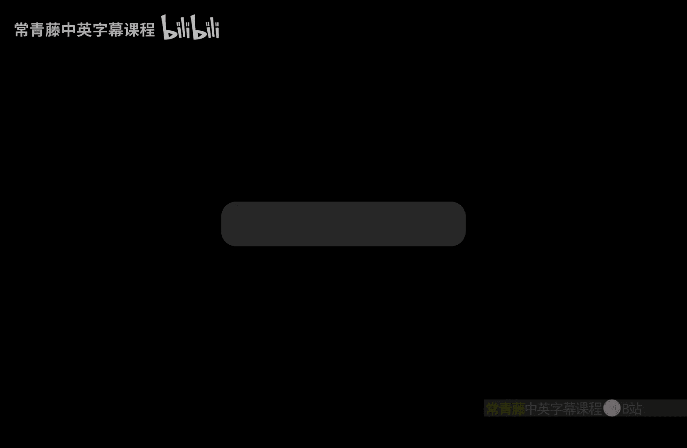
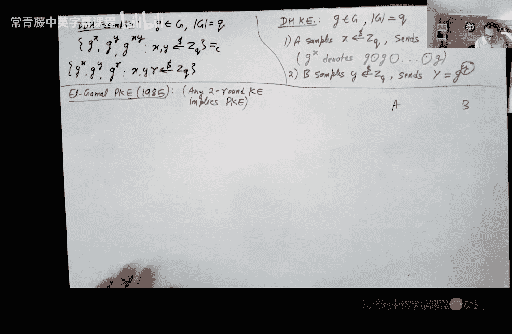

# 卡耐基梅隆大学【中英⚡密码学导论｜15.356 Introduction to Cryptography】 p08 P8 Lecture 8 Diffie-Hellman Key Exchange, El-Gamal PKE -BV16V6GBYEAA_p8-

Hi， everyone。Welcome， so we will continue from last time。So。

 as you remember last time we sort of took a D2 and we went to number theory， right and。😊。

The reason we did that was because we wanted to construct more advanced primitive like key exchange。

 public key encryption and so on。😊，So as I said before last time we cannot do that generically from one way functions or one way perutations。

 at least we don't know how to do that as of now。😊。

So we will see some direct constructions of key exchange and public key encryption today。Okay。

So let me remind you what the DDH assumption was， which will be very useful for today's lecture。😊。

Okay。Okay， so DDH assumption was as follows。So you are given due to the power X due to the power y。

Due to the power X Y。Such that x and y are coming from。Zq。Okay， so。

G is a generator of some group capital G， such that。The order of。Capital G is Q。

And the assumption was that this is indistinguishable from。G to the power x G to the power y。

 and now we have a random group alignment G to the power R and now。X， Y and R are sampled uniformly。

Again， from on Zq。So essentially it is saying that given due to the power x due to the power Y。

 computing due to power X y is so hard that not only you cannot do it。

 but in fact even if I gave you the correct solution。

 you cannot distinguish that from just a random group element。😊。

And based on this today we will look at key exchange。

 we will look at public key encryption and so on so let me start with the problem of key exchange first so a major limitation of symmetric key encryption or private key encryption is that let's say I want to send a private message to one of you then we need to meet first right and we need to generate a secret key and we need to exchange it securely just the two of us should know the secret key and nobody else。

And if we have something like that， then I can encrypt messages and I can start sending encrypted messages to you。

😊，But what if you know， we have never met before right So let's say I want to send a private message to to one of you right and let's say I can only basically。

Just communicate over Zoom， no private messages， nothing like that， I can talk， you can talk。

 all the other students are watching。And we just want to exchange public messages。

Such that at the end， just you and me。We will have the secret key and nobody else would。😊。

Right so when you think about it like that， it almost seems impossible， right because。😊。

We didnt have any secret to start with we only exchanged public messages which everybody was watching so if you and I can compute a secret key。

Why should。Anybody else have a problem doing that。so it almost seems impossible。

 but it is actually not that hard to design key exchange protocols and we will see how to do that。😊。

So KSJ was a problem introduced in the seminal work of Dfien Heman。

 this is a paper called New Directs in cryptography published in 1976 Dfi and Heman later even got a tuuring award for this work。

😊，This work introduced the notion of basically。Digital signatures， public key encryption。😊。

keyey exchange and so on they were not able to actually construct public encryption we will see how to do that Algamal and RSA did that at a later point。

Okay， so what is key exchange？😊，Let's try to define key exchange first。So。

A key exchange protocol its a protocol between two parties。So a key exchange。

Protocol that's denoted by pi。Allows。Do P P。Parties。Alice and Bob， let's just call them A and B。

And note that private randomness is very important in a key exchange protocol because obviously the only difference between。

😊，A participating party and an Eavesdper is that a participating party has the private randomness using which it generated its messages whereas Eavesdroper can only just see the public messages exchanged。

😊，So RA and RB have。Let's call these random tapes。So these random types are R A and R B。Respectively。

都。Talk back。And fourth。So these two parties can exchange multiple messages with each other。😊。

So to talk back and forth in the following way。A and B generate。A protocol transcript。

 let' us call it tau。What is the protocol transcript？😊，啊。That's random tape。

So whats the protocol transcript its basically a record of the entire conversation I send you some message。

 you send it back to me， you send me some other message and so on so we just。

Concatenate all these messages， and that's your protocol transcript。So A and B talk to each other。

 they generate some protocol transcriptal。Now， what is the view of Alice in the entire protocol？

View of Alice is everything which Alice has。So， view of。诶。What is the view of a？😊。

It is the private randomness which she used， she obviously knows that and she can obviously see the entire public transcript。

And similarly， we have。View of Bob is。R B and tau。B doesn't know R and so on。And then， finally。

Alice and Bob。Output。きつけへ。And。Kb， respectively。As a function of。They are respective。Views。Okay。

 so Alice will look at RA and tau do some computation on it and compute K similarly bar would compute Kb。

😊，And we basically need two properties。😊，First of all， we need。Correctness。

Correctness just says the following。Probability and the probabilitybil is taken over the choice of RA。

And choice of RB。Probability that K equals。KB should be just one。Okay。

So both the parties must agree on the key。If so， we just call it the keyK。So。

 at the end of the protocol， both parties can compute the key waters we need。😊。

Adversity should not be able to compute the key。In fact。

 not only should the adversary not be able to compute the key。

 the key must in fact look uniform to the adversary。So security says the following。For every P P。

Adversary eve， so Eve is an eaves dropper。😡，Eavesdpper just watches the communication。

 it doesn't actively tamper with the communication。😊，So what is the view of Eve？😡，可以。

Can anybody tell me what is the view of E in the protocol？Just how。Exactly。こ。

Eve doesn not have any private randomness of any of the parties Eve just sees all the public messages and what we want is that given talk the keyK should look uniform。

Okay。So， we can express that in the form of computational indistinguishability。The key K and tau。

Should look。Computationally indistinguishable from。K and。Use size of。できけ。

right and I can expand expand this in a longer way k comm a tau such that you know。

 RA and Rrb are sample at uniform， then tau is the output of the protocol pi and then。

K is the output of Alice and Bob。On Tau and their respective randomness and so on so。

We are just looking at the output of the entire experiment。Yeah。

Why are we replacing tau with uniform rather than K with uniform？Cos，Good point。Yeah。

 the key should look uniform if I， not the transcript。Alternatively。

Sometimes we don't necessarily want the key to be uniform， but rather。A random group element。

So in that case， what we would need is。K and tau should look computationally indistinguishable from。

G to the power R commau。Such that。Are is sampled uniformly from ZQ。嗯。

RightSo when we are running the key exchange protocol。

 we can ask for keys of different format or different size and so on。So now let's try to build。Sorry。

Now， let's try to build。Let's try to build key exchange protocol。

And we will see what diiffy Heman key exchange is and how it works it is pretty straightforward almost comes from the DDH assumption so lets keep the DDH assumption in mind。

Dfi Heman key exchange。So。Here we have a group G。And little G is the generator of this group。

 and again， the size of。The order of the group G is， let's say Q。

And we assume that DDH assumption holds in this group。

Then the key exchange protocol works as follows。So， step1。Alice。Samples。Some element X。From Zq。Okay？

And Alice sense。Capital x equals。G to the power， small x。And by the way， again。

 let me state and even write that。Gital power X really denotes。G， its。

 it's really the group operation。 It's not。It is not the standard multiplication。

 whatever the group specifies， for example， in So germane based prime order groups。

 it will be due to the power x mod be。Okay， so we will try to use the group in a black box where it is just the group operation。

😊，Bob does something symmetric。So Bobb samples， let's say why。From Z Q。And Bob sends。Capital y。

 which is equal to g to the poweru y。ok。😊，So Alice and Bob。Set。

K to the power A equals K to the power B equals K equals。G to the power X， Y。Okay。

 how do Alice and Bob compute this？😊，For Alices， it will be basically。

Y to the power x right Alice receives y from the other party Alice has small x。

 So y to the power x is due to the power x y and Kb equals。X to the power， little y。

And both of these things are equal just g2 power x y， so here is a very nice point， right。

This protocol allows you to compute the key。😊，If you had either this little x or little y。

 either of them is fine。but if you have none of these then basically it is not clear how to compute it and in fact。

 we will so show that DDH says that in that case， in fact you cannot compute it。😊，Right。

So correctness is fine。Correctness is this basically。Now let's try to talk about security。Okay。

So security says that Dey Heman key exchange。😊，Is secure。assuming。DdH holes。In the group， capital G。

And this is almost by definition， so what is the view what is tau。Tau is just。别。X and G to power Y。

Sorry， was there some question。So view of the adversary is just top。😊，O。Now。嗯。

We know from the D assumption。That， given。Due to the about x。ジルパワ。G to the power X y。Okay。

 so this is just。到过吗？Sorry， let me write it here computationally distinguishable from。G2 power X。

 G to power Y and G2 power R。Okay。But now note that。The left side is basically。To and。デキ。

On the other hand， right side is。Basically， taua。G2 power R where R is a random group element。

And this is exactly what we wanted。😊，Let's look at this alternative definition of。

D we have in key exchange。Right， so looking at the transcript， the key essentially looks like。😊。

A random group element to the adversary。Okay， it's a very simple construction。Any questions？Okay。

 so now a very interesting question， which I hope you can answer。What about an active attacker？😊。

An active attacker can modify messages。😊，Okay， an active attacker sits on the channel between Alice and Bob。

 they can receive messages from one party， they can change the messages in any arbitrary way before relaying them to the next party。

😊，And they can do that throughout the entire protocol So against active attackers。 So yeah。

 this is also called as man in the middle。嗯。So， is。Dey helpman key exchange secure against。

A man in the middle attack。ノ子。No why not why not so what I can do is like when say like you and some students were exchanging messages so I captured both of your messages and send you two new messages like to you and to the student also so now you you'll work with my keys inside of both of the keys I can do stuff。

😊，Okay， yeah， that's a good point。嗯。So essentially the idea is that there can be a man in the middle who can run a separate key exchange protocol with me and another key exchange protocol with another student and they will have both the keys。

 they can decrypt my messages as well as messages from the other student， they can see the messages。

 they can modify the messages and so on。So can there be a key exchange protocol which is secure against active attackers？

So this is actually impossible。And the reason for that is that Alice and Bob have never met there is no notion of identities。

 so in that case the following attack is always possible。😊，So we have Alice。

 we have man in the middle， we have Bob。So。Alice and man in the middle， they just talk honestly。

 right there's no cheating required here。And then man in the middle has a separate session with Bob。

And there is a key key here， key K prime here， so man in the middle just follows the honest strategy and they will end up with a different key with Alice and another key with Bob。

 they will be in possession of both the keys。RightSo later on。

 whatever message Alice encrypts and sent to Bob。It will be under key K。

Which man in the middle has can decrypt。😊，Read the message then encrypt it under K prime。

So Alice and Bar will have absolutely no idea that there is somebody sitting in the middle watching their messages。

😊，Just decrypting and we encrypting with the appropriate keys。Okay。So yeah。

 so key exchange protocols， they don't necessarily give you everything that you want。😊。

And we need something more。So later on， we will look at certificates and STTPS protocols using which you can establish a secure connection even if there is a man in the middle。

So there is a question is there a significant delay not necessarily。

 you know this is all being done using computers？😊，So， yeah。It's almost instantaneous。So。

 to continue moving on and eventually design a solution for secure communication。

 we need to look at public key encryption in fact， public key encryption turns out to be somewhat more powerful than key exchange。

So in their original paper， diy and Heman were able to construct。😊，Key exchange。

 but not public encryption they left construction of public encryption as an open problem in their paper。

And it was solved shortly thereafter。So， we have seen secret key encryption now lets look at。

Public key encryption。So here， the idea is that。😊，There are different keys for encryption and decryption。

 the encryption key can be made public。Okay케。So， there are three。Algothms。

When dierman first came out with the paper and they just said that this problem is hard like did the entire world just assume because they are saying it is hard so they started working with that al like because till now we don't have any proof that it is actually hard。

😊，So first of all， unless you resolve the P versus NP problem， there is no hope to prove that。

That DDh is actually hard if you prove DDH is hard that automatically implies p not equal to NP。

rightSa for the factoring problem and so on so yes they did propose these problems the community did try to solve these problems for a while people are still trying to solve and break DDH but you know 30 40 years later nobody has been successful so that's really our only sort of confidence。

And we can say the same for factor and we can say the same for lattice based cryptography。

 Sha 256 and so on， so almost all of cryptography is based on unproven assumptions and that' is inherent because until you resolve P versus NPp。

 it will stay like that。😊，Okay， so public key encryption has three algorithms。

 first is the key generation algorithm。😊，Okay， key generation algorithm takes the security parameters as input。

In fact， really should be one to the power end， but let me skip that。It's a randomized algorithm。

 which outputs。A public key and a secret key。😊，Second algorithm is， of course。

 the encryption algorithm。Which takes the public key and the message input and。

It outputs acipher text C。Then， finally。And encryption is also。Randomized。And finally。

 we have the decryption algorithm which takes the secret key and the cipher textex。😊，And it outputs。

Some message， let's call this message M。Okay。Now。Just like last time we will require two properties first is correctness and secondary security correctness just says that if you do everything correctly then the message that you decrypt should be the same as the message that you encrypt with probability 1。

So this should hold for every message M。What we need is the probability that。Deecryption with S。Of。

Acipher text， which is。Enncryption with Pk of M。we are looking at the probability that this description gives you the message M。

Such that。SK and P K。Indeed， came from。The keyja nation algorithm。So， this probability should be one。

Now， what about security？😊，It is very similar to secret conion。

Except that now the adversary is given the public key in addition to the Cypherex。😊。

So this is known as。Indistinguishability security for。Plic key encryption is also called。I N D CP。

There are stronger notions， I'll talk about them a little later。Okay。So this requires the following。

😊，For every pair of messages M0 and M1。For every PPT adversary a。The following should hold。Yeah。

 I dont you it right here PT just we will require computational in distinguishistinguishability of Cyphertext encrypting m0 from the Cyphertex encrypting m1。

Okay so。In one distribution you are given。PK and M0。Cypherex as well as Pk。Okay， says that。P， K。

 Sk comes from。ジ。And yeah。This should be computationally indistinguishable from。

The case where you are encrypting M1。Right， pretty natural definition。Okay and as always。

 we can talk in terms of prediction rather than computational in distinguishistinguishability。😊。

It's equivalent， as always。So alternate formulation， same notion9 DC CPPA。So， here。

We chose one of these two messages at random adversary sees the cpher textex and adversary has to guess which message it was。

😊，So we are looking now at the probability。So， this is。Needed for every PPT adversary。Adversary gets。

The public key aary gets。Enncryption of。Enncscriptryption under。PK of M。Okay。

 and we are looking at probability that adverseverly successful successfully guesses B。😊，Such that。

As always， Pk Sk。Gen it properly。And。Be sampled at random。So， this probability minus half。

Should be very close to。那个lig基本。Right。I can always output a random bit， but essentially that's。

That's what the adversary is restricted to doing。Any questions？

So now let's try to look at before we construct public key encryption。

 let's try to look at some of the。Basic fundamental properties of public key encryption。So。

 what about randomized public encryption should public encryption be randomized or deterministic？

What about one time versus multitime public encryption and so on？Okay， so let me give you。A fact。嗯。

So， we saw。deterterministic。Secret key encryption。We saw it was bad。

A really deterministic and stateless we are just talking about stateless here。😊，Now。

 what about deterministic？Public key encryption。This is actually a complete disaster。And why is that？

Can somebody tell me why deterministic public encryption is so bad？If you want to distinguish。

 you can just encrypt the message because you have the public key and you can check if the encryption you get is equal to the one you're looking at。

ok， good。So let me just explain you with the help of an example， let's say。The two messages are。

 let's say。Attack or defend。Okay。And lets say my public key encryption is deterministic right I am the encryptor I choose one of these two messages either attack or defend and I send the cyberpher textext over。

😊，Adroversesity can just decrypt the Cypher text without the secret key how because aversity can encrypt attack。

😊，Defend and then compare a cipher text with the two cipher text which he obtained it's going to match one of them and adversely basically knows what your message is exactly right。

So essentially what we are saying is if。Message is。Either small or it has low entropy。

Low entropy means the number of possibilities of the messages is small， lets say polynomial。

Then a P A can。Entirely recover your message。And that's really bad。

So that's why you would almost never see deterministic public encryption。Having said that。

 deterministic public encryption has been studied， it has its applications。😊，So as an example。

 think about。Applications of。Deterministic public encryption。

If you are encrypting high entropy messages， deter public encryption might actually give you something。

 so an example which I like is let's say you want to encrypt a database， right？😊，Enncrypt。

 let's say not even a database。 I'll encrypt some。Text。You know， one word。At a time。Okay。

 now deterministic public encryption will allow you to do search on this encrypted data。😊。

What you can do is let's say I'm the server， I am storing this entire encryptto text， right？😊。

The client comes to me and client says， hey， I want to find all instances of a particular keyword。

Lets say I want to find all instances of pitttsburgh in the text then I as the server can just encrypt Pittsburgh。

😊，And I can just。Set it。I can just look for that particular string in in the entire encrypted。Text。

 and then I can return all the instances where。That encrypted text occurs。Okay。

 so even though it does weaken the security a little bit in encrypted search it is actually very useful and there have been some other applications of deterministic public encryption。

😊，Should I have a small question，So just so like if I do something like this that I always use deterministic public key encryption but what I do is in my message I have a end word and after that I add it with random number of zeros like say five la zeros or five core zeros and then I send it and like so because like earlier we said that like like because the space is so large like the a can't compute all the messages so then also I'm safe right if I use the deterministic public key encryption but I add myself with random number of zeros or like a lot of zero。

😊，Well， maybe not random number of zeros but random number that is what you are saying。I mean。

 if it's a random number of zeros， I can。Maybe look at just the size of the cipherex and I can figure out how many zeros there are and I can just try okay okay so random number a big random yeah yeah if you encrypt yeah if you pad it with a random number then thats not deterministic。

Public encryption anymore。W because but my message is like encrypted using。😊。

P data what you are saying is we can try to convert a deterministic public key encryption into a randomized one by modifying the encryption algorithm to generate a random number and append it to the message。

😊，So， any encryption which samples a random number and uses that in the Cyphertex that is not deterministic right so yeah what you are saying is you can convert deterministic to randomized so yeah something like that might work。

Depends on which encryption scheme we are。We are using。屋企啊。嗯。

Okay good so another question is about one time security versus multitime security and here is a very nice fact about public encryption。

😊，As far as public encryption goes， one time security is actually equivalent to multitime security。😊。

Okay。So let's say we have one time。Secure。Public key encryption is also。是。

Let me call it multi message。One message and multi messageage。Okay。

 we don't even define multima security， let me do that quickly。😊，It's a simple generalization。Okay。

 multi message。Secure。Public key encryption。Let me actually era it and I will use this space for the proof。

Okay this is。Multi message security。So， we have two message vectors as you can expect。😊，So。

 we have a vector。And， let's call it。Am I 0。And we have。是。Another vector。M1 I。ok。😊，And now。

 advers is even。Adversaries either give an encryption of all the messages here or all the messages here。

Given the public key， they should look computationally indistinguishable。说3些里。

Enncryption under public key of。M0 I。Cave for all I。And the public key。Such that。

The public keys the keys are generated honestly， this is。Computationallydistuishable from。

The case when we encrypt。The other message vector。Okay， the definition is is the definition clear？

And now the situation actually is very different from。😊，From symmetric key encryption。

Insymmetric key encryption， we had one time pad。😊，which was only one time secure but definitely not multi inec we had other constructions of multi in secure symmetric encryption fortunately in public encryption once you construct something with one message security it is also automatically secure with multiple messages。

So let's try to prove it。And we will use a generic hybrid argument again。

The reason why this hybrid argument works。😊，When the same thing doesn't work forsymmetric key encryption is because now you have the public key and you can encrypt messages publicly on your own。

And that plays a very crucial role here。So， we will construct various hybrids， hybrid0 is just。😊，嗯。

我不。It's just the。First message vector。And then， the public key。Okay， hybrid1。

We start changing messages one by one。So hybrid1 is encryption。M11。Okay， but the rest。

Of the messages are the same。MZ I。I is greater than equal to 2。ge keep going。And finally， you have。

Hk。Where the first k messages are coming from the second vector。M when I。That I is。

Less than or equal to k。Okay。And then， you have。Okay。M0 I。I is greater than equal to k plus 1。

 and then finally， you have the public key。Okay， and eventually。

You will have the encryption of the second message vector entirely。Yeah。

These are our hybrids and we will prove that。Will prove that hybrid。

K minus 1 is actually computationally hidden distinguishinguishable from hybrid k。For all。Okay。

 any questions about the proof structure？And again。

 here the basic idea is that what is the difference between hybrid k minus1 and hybrid k？😊。

It's just the K atciphertext， right？The K at Cyphertex either comes from the first message vector or the second message vector。

So， we will take it from outside from a challenger。😊，Right， and we will try to distinguish。

If it's an encryption of MI。K -1 or。So which messages are different， let me write them down。

Difference is in。Either it's。In hybrid k -1， it's。Mk 0 versus。M K1， right。In that quiet position。

So now let's say you are given an adversary。P，P T  A to distinguish。H k minus1 and hk。We will build。

P，P T B。To distinguish。Encryption of。M 이렇게。From。Encryption of。M1 K。Okay。

Because that's essentially the only Cypher text which is different。😊，How do we do it。

 why does it work only in the case of public key encryption？😊，So here the idea is that。

B takes acipherex C as input。And B has to determine。Is it this or is it this？Right， so be places。😊。

See in the k position。And now here comes the crucial point。😊，For all other positions。

B uses the public key to prepare。To prepare Cypherex。On its own， without the help of any challenger。

 any external party。Okay。And now， if C was。Let us say this。

 then this is hybrid hk minus1 otherwise it is hybrid hk。😊，So if a can tell you which hybrid this is。

 then B can tell you which Cyphertext C was。Which breaks the one time security of。

Public key encryption。Okay， so this basically completes the proof。Any questions？

This cant work for deterministic public encryption Yes， that is correct because。

The reason is that for deterministic public encryption， you can't even have one time security。

Given a cipher textex encrypting one of the two messages， I can immediately tell which one it is。き？嗯。

嗯。So now let's try to build public encryption。And again， we will use the DDH assumption。

So we will see what is known as Algamal public key encryption。Sovi and Heman。

 they published their paper in 1976， they were stuck on building public encryption。

They left it as an open problem in their paper， even though they did have this this key exchange protocol。

Then later on， like two or three years later， RSA came along。It was in 1978。

 I believe that RSA was proposed as a public encryption system。Then finally， algamal。

Came along only in 1985。So basically nine years after the original diy Heman paper。

And you will be shocked Algamal public encryption is actually almost the same as Dffy Heman key exchange。

😊，So what we will see is that there is already a public key encryption system hiding in Dyhelman key exchange。

😊，The idea is basically you look at the first message as the public key and you look at the second message as sort of the cipher textex。

😊，And thats that was basically the entire insight which which Algaal had so sometimes you know very smart people can think about a problem for like nine years stupid solution you know。

😊，Maybe they can't see it。And。So， essentially what you see is that。😊，Any it to round。

Key exchange actually implies。Plic encryption。Okay， so let's write down the。The D element exchange。

 So this was。Yeah。

Alice sends a message the power X。Bob sends a message。Due to the power Y， and then。

Used due to power X Y。To encrypt。Now。Again， coming to key generation and here。

Se parameter is Q because Q is the style of the of the group。 So again， let's assume。You have。

G capital。G， this is the generator and order of capital G is  Q。嗯。So， now youre。

Key generation works as follows。 So again， sample。Except random from。Z Q。Your secret key is just x。

Your public key is G to the power X。Okay， so the first message essentially sub you public key。

How do you encrypt？😊，So let's say I have a message M。And by the way， the message M must be。

In the group G。So you can encrypt any group element。清。So， let's say sample。喂。Again， from。ZQ。Okay。

 actually， let me call it R rather than y。And then your cipher textex is just。G to the power R。Okay。

 which is the same as this message。Then finally， I do want to encrypt the message I obtained the key。

Due to the power X。And Xr。And then I just multiply message my message with it。Okay， and the idea。

 which we have see in the proof is that。If G to power Xr looks random。

 then even m times G to power X looks random， a random group element。

So this is essentially your cpherdex。And let's call this。C 1 and C2 so Cypherex has two components。

 let me call the Cyphert。Just see。So the decryption algorithm takes the secret key and the Cyphertex as input。

How would this work so first the decryptor has to compute the shared key。😊，Did the power X。ok。

So first， you compute。See one to the power。😔，Your secret key。Okay， and this will essentially be。

ジルドパデ。Od。Oh。Okay， and then you output。C，2 times。The inverse of this。C 1 to the power minus。SQ。Okay。

 and this will essentially be。M times2 the power X are。I don't know why I keep writing why。

Due to per minus X。So， this is just M。M times J to power 0。Which is the identity element。Okay。

 so correctness is good。Any questions？So now let's try to prove security。

And remember that because we have already shown。😊，One time security implies multitime security。

 we only have to show one time security。That's the nice thing about public encryption。So。

 security says the following。嗯。Algamal Public encryption is。I N D CP。assuming。Dage holes。

In the groupji。So。What do we need to do， we basically need to show。The following。是。Enncryption of。

The message M 0。Such that。B， K， S K comes from。Jen。Looks computationally indistinguishable from。

Encryption of M1。嗯。Right so now let's consider the following sequence of hybrids。Hybrid 0 is。So。

What is encryption of peaky comma？em0。It's a。So let me write， oh， I missed the public key here。

And also on the right side， we have the public key。So you have the public key and the Cypherex。Now。

 let' us look at the hybrid0， hybrid 0 is just the public key and encryption of 0。

So the public key is just to do power X。And then encrypt encryption is due to the power R comma。

M0 times。G to power X R。Okay， and let me。Let me skip this part， this is everywhere。What is hybrid1？

Hybrid1 is due to power X。You住 for啊。And finally， M0 times2 to the power z。Where additionally。

 these from。Zq。Hybrid 2。G2 power X， G2 power R。And due to power Z。 So no message here。Higher 3。

Due to the power x due to the power R and M1 times due to the power of z。Z random again。Then finally。

 we have our last hybrid。Which is due to power x due to the power R。And M1 times due to the power。

X R。Okay， and note that。This is the left hand side， and this is the。Right inside。So。

 if you can show that。All these hybrids are indistinguishable from each other we are done。我。

So what is the difference between hybrid 0 and hybrid 1？I'm just replacing this。

Due to the power Xr by a random group element， okay， so hybrid。

Z is computationally in distinguishuishable from hybrid 1 and this directly follows from the DDH assumption。

So does this follow from the fact that MO will always have the inverse in the group？No。

 not necessarily。Because if you are given m not into G2 power Xr and m not into G2 power of Z and you can multiply them with m not inverse if you can distinguish between two of them。

 you can distinguish between them that yeah yeah you don't need that here we are essentially using the fact that。

If two distributions are indistinguishable。Oh， okay， okay， okay then A of X and A5 then。一般。

Any PbT function is also indistinguishable。Great，Thank you sir thank you Okay。

 because if I am given due to power X due to power R and G to power Xr。

 I can multiply I am0 to the third component on my own。😊，Okay， is this clear any questions？Now。

 my claim is。H1 is actually identical to H2。And here we will use the fact that G is a generator essentially。

😊，Okay。So， since。呃Since。G is a generator。It means that。M0 is equal to some G to the power。

 let's call it。Z0。ok。Now， what is。M0 times。Gitital powers Z。This is equal to。Due to the power Z plus。

00よ。Okay。And now my claim is basically easy to the power。😊，They were。These uniform from。

Zq is actually the same as G to the power。Z plus z 0。Where。😔，Z is sampled from ZQ。

And this should hold far。Every zero0。Okay， essentially what I'm saying is。😊。

I sample some random element from ZQ。Or I sample a random element and then add something fixed。

It's the same distribution。It gives you the same random element。O开始。

This proves that Stro and H2 are the same， essentially。🤧嗯。Is this clear。And then finally。

 what about h 2 and H3？S2 and S3 again， they are identical。Here I have。

Due to the power z here I have M1 times g to the power z both are equal to a uniform group element。

Then finally， what about h3 and h4。They are computationally indistinguishable。And that's what from。

The really are just assumption。Okay， so this is basically a proof that。

Algamal is secure public encryption system。🤧嗯。So， we don't have time to start RSA。

 we will do that next time。Let me end with some some comments about the security。Okay。🤧嗯。

So people have considered various stronger notions of security。So here， what was the adversary given？

In I D。CPAA advers is given。Public key and。acipherex so there are stronger notions like I D CCA even their variance there is something which is known as CCA1 CCA 2 and here the idea is that adversary is given。

Public key and cipher text。And。Deecryption of several。sipher text。Of。Adversaries， choice。

Why do we do that？😊，So let's say you are an unsuspecting party。

Adversity keeps sending you many encrypted messages， you decrypt them。😊，And based on them。

 you replied to the adversary。Right so， the point is that now when I reply to the adversary adversary might actually know what the decryption was so adversary prepared the cipher textex without potentially knowing the decryption I decrypt it I send my reply that might leak some information about what the message inside the Cypherex was。

😊，So adversary might essentially trickrick me in some sense。😊，To decrypt several cipher attackss。

 which it prepared。And potentially that might leak additional information。😊，Right。😊。

So this is known as the CCA chosen Cyphertext attack。

Adversary chooses the cipher text and uses that somehow in attacking me。😊。

And we know of public encryption systems which are secure even according to this definition。

 Algama is not secure secure according to this definition。😊。

You need to do some more work to convert Algamal to get CC security and so on。

So the point is that IND CPPA security is more or less like the starting point rather than you know the gold standard of public encryption security。

😊，Okay， so we will stop here for today and I am happy to take questions。H。

