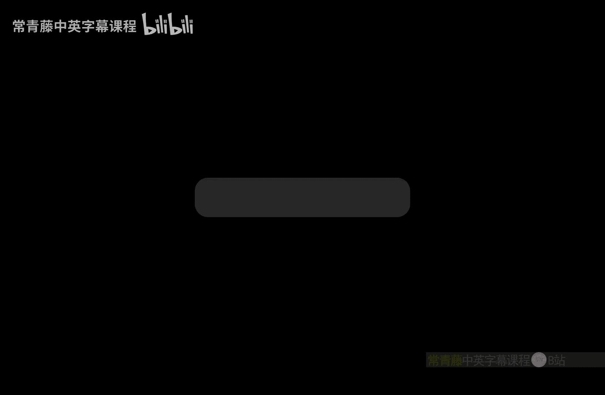
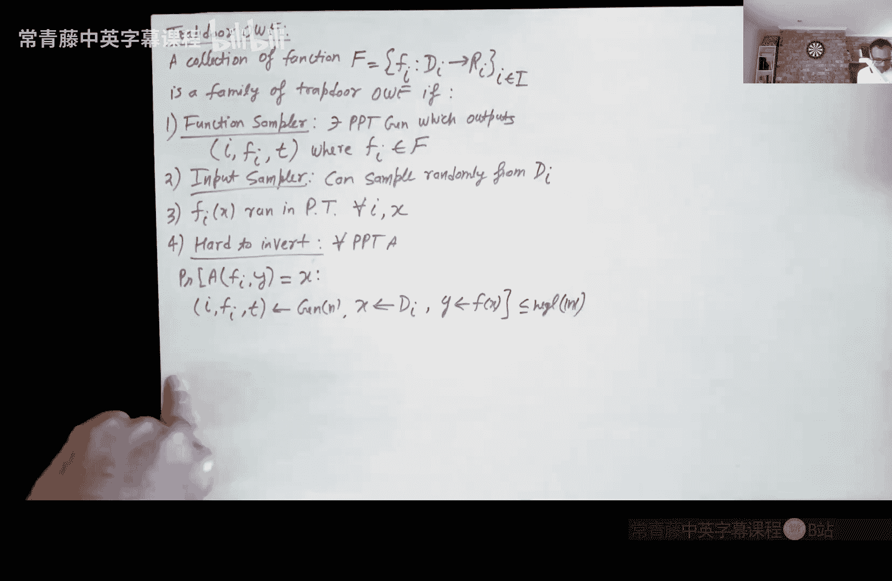
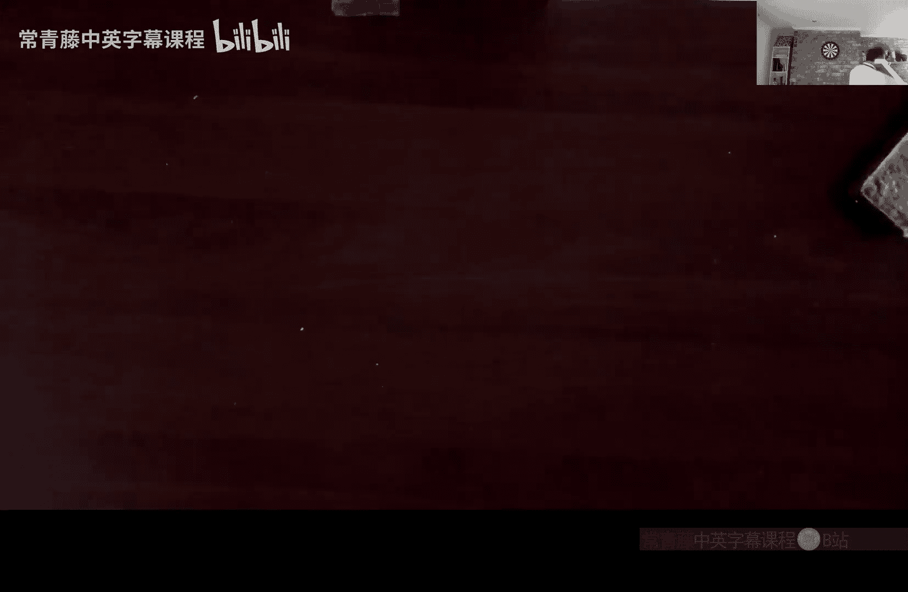
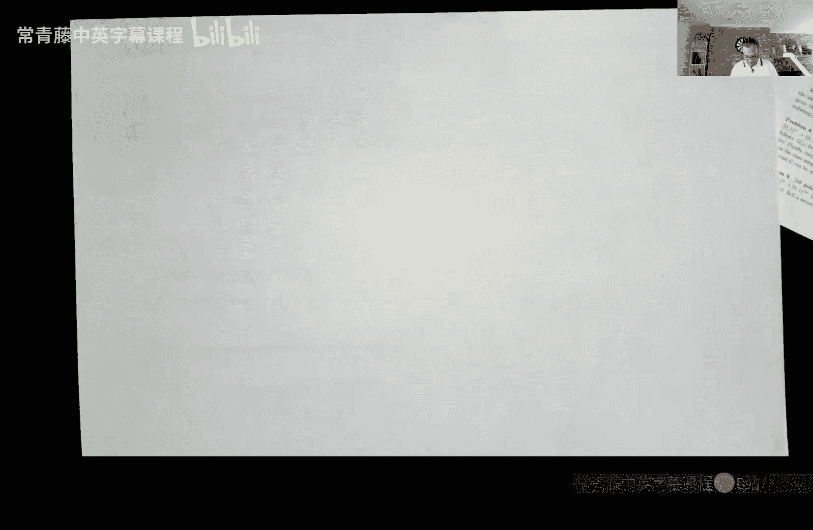

# 卡耐基梅隆大学【中英⚡密码学导论｜15.356 Introduction to Cryptography】 p09 P9 Lecture 9 RSA, HW discussions -BV16V6GBYEAA_p9-

Okay， welcome everyone， I hope you can hear me。So let's get started。😊。

Today we will continue the study of public key encryption last time we saw Algamal encryption and today we will see the RSA function note that RSA is typically known as an encryption scheme but textbook RSA as such is not an encryption scheme directly。

 we will see why that is the case today and we will see how to convert it into a secure encryption scheme。

Okay， and then we will also pick some of the problems from the homework and we will see their solutions。

So let me remind you the IND security for encryption， right？It's called IND CPA。

 the chosen plain text attack。Says the following， So you are given。An encryption of。let' say。M0。

And the public key， such that。Bk Sk come from。The key generation。

And what we need is that this should be distinguishable from。

The encryption under Pk of another message M 1。Such that again。B escape comes from。Key generation。

 right， and this should hold for every pair of messages M0 and M1。Yeah。好了。

And another very important fact to keep in mind is that any good public key encryption。

Scheme must be randomized。And this is to avoid a very simple attack because if it is deterministic。

 then an attacker can just encrypt the message on his own and just match it with the cipher textex if it matches。

 then you recover the message。😊，Okay， so now let's look at the RSA assumption。

RSA was actually the first public key encryption scheme proposed by Reve Chemine and Edelman in 1978。

 which is sort of two years after the seminal paper of Dfiian Heman。😊。

But RSA is not the simplest public encryption key。The simplest one。

 at least in my opinion is Algamal， which is sort of very straightforward and which is what we looked at in the last class。

😊，And then of course， Reve Chemir and Edelman， they got tuuring award for proposing RSA RSA is used basically like。

Everywhere on the Internet right now。So before we look at RSA encryption。

 let us look at the RSA function， so it is helpful to view RSA as a function rather than as an encryption scheme directly。

😊，So if we will look at the RSA。Function。Which also leads to the RSA assumption。

A lot of people say that RSA secure assuming factoring is secure that is not true。

 the security of RSA requires factoring to be hard， but in fact it requires more than that。😊。

The security of RSA is not equal to the factoring assumption we will see that later。😊，Okay， so first。

Step is。Okay， maybe the first step is。You pick two large primes P and Q。Such that。

P is not equal to Q。Okay， you can decide your length which of course will be determined by the security parameter you can pick primes of 512 bits distinct primes and that is your starting point and then you compute。

What is known as the RSA modulus？Which is n， which is just p times q。Okay， so known as the RSA。

Modulus。Okay， and here keep in mind。😡，That Z and star is the group now。

Z and star is the set of all numbers， all positive numbers starting from 1。Up to n minus1。

 which are relatively prime to n。Now， the next step。Is to choose the exponent。Choose E。To be from。

Or let me note the order of the group。So what is the order of。Z and star。

Order of z and star is phi of n where phi is I phi function， right？Which is equal to p minus1 times。

Q minusイナ1。啊小明。P is not equal to Q。And very important thing to keep in mind is that。😊，Given n。

But let's say not P comma Q。Computing phi of n。Maybe hard。

Not because Phi of n requires knowledge of P and Q。If I just give you n。

 it' is not clear how you would do it。And in fact， that's one of the assumptions which IA has。

In fact， you can prove that computing  phi of n is hard， assuming factoring the number n is hard。😊。

Now the next step for you is to choose an exponent。So you choose E。To be。

It very important something may be strange here to be from z。F and。star。O。😊。

And I'll try to explain why this is the way it is。😊，Or in other words。Is from one to。Phi of n。in-1。

And。Relatively prime。To five of them。Not n， but5 often。Okay。

 this is because e lives in the exponent e is an exponent right so mod n becomes mod phi of n in the exponent。

😊，Right so that is why whenever we are talking about model arithmetic in the exponent。

 you always want to talk more five often them。😊，And why do we need it to be relatively prime that we will see later on？

Okay， so now let me define the RSA function。It's very simple。😊，RSsA function is denoted by。F。

And comma E。Mか嘛一。Models and the exponent they are not the inputs to the RSA function。

 They are actually hard coded inside the RSA function。 The input is some message X。😊。

Where x is an element of。Z and star。And the RsA function simply outputs。X to the power E mod。And。

Okay。😊，Now， give one next to the power E mod n。Is there any way of recovering X？Right。

So keep in mind。😊，To recover x。You need to take。The E root。Right。If I have x squared to recover x。

 I need to take the square root， if I have x to the power y， sorry x to the power E。

 I need to take the e through to recover x。😊，So now the remaining task sort of， which we have is。

Is there any way of taking the ear through it here？Okay， and turns out there is。😊，And this is where。

This will play an important role。Okay。So， given E。You can compute。So by the way。

 I'm just starting with an informal sort of。Understanding of RSA。

 we will have a more formal description of RSA just coming。So， you have to compute a D。Such that。

E times D。Equals 1。Modify often。Okay。So， first of all。😊，Why would this D exist？😡，Any ideas？

Does this D exist at all and if so， how can we compute it？Inverse exists for each element， right？

Okay， yeah there are some answers on chat as well yeah， so basically。

It exists because if an element is relatively prime。😊，So。

 if e is relatively primeed to this mod phi of n， then an inverse of e exists with respect to mod phi of n。

 then this is something which we saw earlier in the number theory class。Right。

And you can compute it using the。Extended Euclidean algorithm again。So， good。Now。

 we are almost done as far as recovering this。This x is concerned， okay， so give  and D。

I can now compute。So， this is given to you mod and I can raise this whole thing to the power deep。

What I get is。X to the power， E D modd。N okay， what is x to the power E modern？😊，X to the power E D。

Mod n is actually x to the power E D modd phi of n。Moode n， right， And this follows from。IS theorem。

And what is this， this is just。😊，X model。Because E modifier of n is actually one。

So you recover the exact same x which you started with。Okay， so the nice thing is。😊，呃。

G and D you can invert and you can recover this function， you can recover the input text。😊。

Without D it is somewhat less clear how to do that right and how do you compute D？😊。

So here is an important observation to keep in mind。You need the order of the group。

 you need phi of n。😡，To compute D from。一。RightAnd on the other hand。

 computing phi of n actually requires the factorization of n。😊，Okay。

 so unless we have factorization of n it is not clear how you can ever compute this this this number D。

And now we are already sort of making progress， it looks like E is almost like a public key which would allow you to encrypt the message X。

😊，And D can be seen as like a private key which would allow you to recover x given the cphertex x to the power e mode。

😊，Okay， so this is good as far as intuition is concerned， but we have to stop right here。😊。

This is because。😊，R as a function。Is unfortunately deterministic。😊。

This means that this cannot be a secure encryption scheme。

Right so that is why RSA is not a secure encryption scheme RSA is what is known as a trap door1 way permutation a trap door1 way function which can be turned into an encryption scheme using some randomness which we will see later on。

😊，So now let's see exactly what RSA is。 Let's try to formalize what RSA is and。

Let' us try to study this this object and what we can do with it。오케이。🤧嗯。

So I specified that as a function。Let me also specify the RSA assumption。Okay。

 Rs assumption basically says that given an x to the power E model n。

 you cannot compute x unless you have factors of n。😊，Okay케。

So RA assumptions is the following probability that。For this should hold for every PPT adversary。诶。

Probability that x to the power。E equals。Y mod and。Such that。P and Q were。Large primes。

N was computed at PSP times  Q。And。He was sampled from。The star of。肺恩。And in fact。Normally。

 he doesn't even need to be randomly sampled。Even though that is what we are doing here。

 if you want your encryption to be faster， you want to choose E to be small。Right。

 because encryption requires a sort of exponentation to e the smaller e is the faster you can do it。

So typically in practice E would be some number like 2025 and then D would be much larger。😊。

On the other hand， if you want inversion to be faster then you know E and D must roughly be the same size you cannot put D to be very small because then obviously it becomes guessable is what which is not what you want。

😊，So E is not random or is it random from a set of small numbers？E can be fixed sometimes。

I there are some unsafe values of E， there are some safe values of E。

 and as you can expect the safe and unsafe set， it kind of changes depending upon the advances in cryp analysislysis and the attacks and so on。

😊，Okay， typically， most values are fee fixed values。Mostly it will be safe。Okay。Now， what you do is。

You sample a random y from。Z， and star。And then you try to invert you try to invert with respect to this why so you give。

The adversary a。You give the adversary E N and y， and adversary outputs。Some x。ok。

And now we are looking at the probability that。😊，X to the power e is indeed y。

 which means that adversely successfully inverted this。

And what we want this should be negligible in n。rather。赛日粉。Okay。

 so essentially RSA assumption say is that you know， given the RSA modulus。

 given the exponent inverting the RSA function is hard。😊。

So this essentially suggests that RSA gives you a one way function。😊，Okay。

 not very interesting we already constructed one functions before just from factoring in a much simpler way。

😊，But now the interesting observation is that。😊，あれ。Function。Is also a permutation。

And this is the interesting part。😊，Right because we have not constructed one with permutations so far。

So why is RSA function a permutation？Any thoughts？So because that element can be generated right and when you exponentiate it like it will。

Give you each time a different member of the group。嗯嗯。I， maybe that proves one to one。

Not necessarily perutation。Like you can do it for all elements in the group and like it is one to one and it is one way then it is one way one one way per right。

So， one to one。And one way it does not imply that it's a permutation。So。

What you need for a permutation is that the domain and the range should be the same。

Input and the output should belong to the same set。

 which is actually the case in RSA right so in RSA x comes from。😊，Z and star。And f of x。

 which is x to the power E modd。And。Also in the end star。Okay。So that's the first observation。

The first observation is that the domain and the range are exactly the same。😊。

Second observation is that。😊，There's a one to one mapping。Between。Elevements of the domain。

 which is your input。😊，And。Elements。Of the range。Which is your output。

 and this follows from the fact that。Givenive an output。There exists a unique input。

Right and we have already seen how to compute this unique input if you have D then given the output。

 you can just recover this input。😊，right no multiple possibilities or something like that there is just one input given the output I can recover it if I have d which means that there exists a unique input given every output。

😊，Okay， any questions so far？So RSA is one way RSA is a permutation。😊，What else？

The interesting thing is RSA also comes with a trap door， which is D which allows you to invert。😊。

This this function。So， that' is a property which we have not thought about before。😊。

Certainly a one way permutation doesn not require this property。

 so RSA does give us something extra even compared to a one way permutation。

So RsA is what we call a trap door one way perutation。😊，嗯。

And let's try to define what trapor when perutation is。

So let me try to define a trap do when we function。Yeah。

So trapor function is a collection of functions。😊，It's not a single function because。😊。

The exponent E and the modulus n is sort of hard coded in the function。

 different values of E and N will lead to different choice of the function。嗯。

So let's denote this collection by。Capital F。Which is。Sort of。FI。There。

It goes from some domain to some range。Okay。And I is in some。Some set capital I。

So if we say that this is。A family of。Proor one way functions。

If the following conditions are satisfied， first condition being。First of all。

 there is a function sampler you should be able to pick from this set。

This just corresponds to picking P and Q and picking the RSM moduluus。And the exponent。

So function sampler requires that they exist to PT algorithm then which outputs。Some I F I and。

A trap door tea。Where I is part of this family F。Okay。

 so when you sample the function you get the description of the function and you get a the trapor being d for RSA。

😊，Second property is the input sampler。It just says that you can sample。Randomly， from。嗯嗯。

From the domain。The third property says that the。The function can be efficiently computed。So， F of x。

Runs in polynomial time。For all， I and。All X。Now， what is the fourth property？😊。

F properties that this function should be hard to invert without the trapor。Yeah。

Just says following for every PPT adversary a。喂。😊，The probability that。Is given。

The description of the function F and a is given some y， which is the output。

A has to produce some x prime。Such that。F of x prime equals y。

So this is the probability that a is able to successfully invert y。😊，喂。I， F I and T are。

Genrated properly。X was sampled from the domain。W was sampled from the range。Is。Actually， wait。

 I think we don't need this。If it's a experimentation。Because X x prime will always be the same。So。

 this probability should be。Just negligible。Okay。

Finally。What we want is that if you have the trap door。Then actually you can invert this。

In polyial time。Easy to invert with。Pbdo。Okay， so we will just simply say that there exists。

A polynomial。Time， I'll go to them。Which is given。I f i。The trap dot and also why。

And it outputs x such that。F of x equals y。Okay， if you have the trapp door。

 you can invert in polynomial 1， the last property just says that for all I。😊，嗯。

FI is a part of mutation。So， I'm defining。Forbor when implementationutations directly。

You can also define trapdo functions by just leaving out this last property。

 but then you have to deal with x and x prime not being equal。It is a much clearer definition。Okay。

 any questions？And what we will show is that based on the RSA assumption。

 RSA is actually a trap over mypermutation。Okay， so now let's see。嗯。So trapor one way permutations。

Based on the RSC assumption。Okay， and this， in some sense we have already seen。First。

 we need to specify the function sampler。So， one is。Function sampler。And how does it work？

You choose P and Q to be。Large primes。Then you compute n to be。P times Q。Then you sample E from。

Z and star。And then finally。You compute。D， such that。E equals one mod。Phi of n。Okay。

 so now what is your function and what is your trapor？😊，🤧嗯。So you have I and F。

Which is essentially the description of the function。This is basically E and N。Which would be public。

And your trap door is just。D。Okay， makes sense。Second is your input sampler。😊。

Import sample is as you can sample uniformly from。Z and star。Okay。Now。

 if you don't know factorization of n， can you still sample from the end start。

 can you still test if。If something is in Z and star or not。Now， this can be done。So。

 what you do is you can pick a random number from 1 to n and then you just compute the GCD。😊，Test。

 if。G CD of x and n is1。And by the way， to compute the GCD， you don't need factors of n。

Just the I algorithm tells you how to compute a GCD it is one of the oldest algorithms I think several thousand years old。

对。Third is。Of course， the RSA function can be computed in polynomial time just a modular exponnunciation。

If you have taken to 51， then we actually see a very efficient algorithm for modular exponentation。

 which is based on the square and multiply。😊，Fourth property is hard to invert。And this， by the way。

 follows from the RSAS submission。 let me show to you。Let's keep the board here。

So RA assumption says that。😊，Advers is given the RSF function， which is just E comma n。

And advers is given some random y from Z and star。The probability that adversly can output in x。

Such that x to the power e is y modern， this should be negligible。

Is E supposed to be generated from yes， good point。Msed， this is Pofen。Thank you。Okay。

 so hard to invert follows from。That is the assumption。So， number 5 is。Easy to compute。

Easy to invert。V trapor。And this is true， you can just use D。And given an x to the power E。

 you can compute x。This is something which we have already seen。And the last point is。

FI is a polymerutation。So again， something we have seen already。

Doomain and range are the same regardless of what。N is or E is so for every value of I fi is actually a permutation。

O， so。Gur， so RSA is a trapomicical limitation。😊，Any questions？

Now why do we bother with a trapor one way permutation can you do something with Trado1way peration something that we actually knee like encryption scheme？

😊，So we will see we will see how to convert a trap door。😊。

One way permutation to an encryption scheme to a public key encryption scheme which will be secure according to our good IND CP definitions。

😊，And let me keep the definition of trapdo and my perutation。So。

 I will give you a general compiler which can convert any trapped over map mutationut to a secure public key encryption scheme。

You can use it on RSA， you can use it on anything else of your choice。

And this uses old ideas which we have already seen before。😊，诶。So。We used。

1 to one one functions are let us say， one way permutations。

To construct a secure symmetric key encryption scheme。And this used hardco radicates。

 which is also what we will do here。So public key encryption。Using trap door one way pers。

 and we have to specify three algorithms for public key encryption。😊，嗯。

We look at the homework problems later on。So the three algorithms are key generation， right？

Encryption and decryption。😊，Okay。So how does key generation work？As you can expect。

 the key generation just consists of running the function sampler。So， run the function。Sampler。Okay。

 and the function sampler gives you。IF I and the trapor top。Okay， and as you can expect。😊。

Your public key is just I and F5， which is the description of the function。

 your secret key would just be the trap door。Now， let's say you want to encrypt。

Some message under the public key。Okay， and by the way。

 it's important that message must be part of the。Doomain。In particular。

 for RSA message must be part of ZN star。So how do you encrypt？

And here we can already think about something。Which we must do。

We must use some randomness for the encryption to be secure。Okay， so lets just close our eyes。

 let's just generate some random numbers first。So。Actually。

 we will try to encrypt a single bit message， sorry。嗯。Okay， so first step is you sample R。From。

The domain。Okay， and this can be done using the input sampler here。Now， your cipher text consists of。

F I。Applied on R。Okay， now give1 fhi。😊，If you don't have the trapor， you don't have R。😡，Okay。

 R is one way for you。How can we use this to encrypt the message？Any ideas？

So how do we encrypt a message using something？It cannot be computed。I mean。

 one option normally is I can just publish Rx or M。😊，This is option1 R X or M。

 but this doesn't quite work because。R is one way right the guarantee is that the adversary cannot compute R。

😊，Entirely。Maybe at you can compute some bits so far。

One way functions can leak some part of their input。So。

 this is not good what you want is you want to use the hardcore predicate of R here。

And that's why M is just one bit。 So you can publish M X or。The hardcore predicate of R。

And let me call these。Two components of the cipherex， where。H， I is。Hardcore， predicate or。Of F。嗯。

Okay， everyone we function has a hardcore predicate， something which we have already seen。😊，Now。

 how do you decrypt？You are given the secret key， which is the trap door。 You are given。

You are given cipher text。Okay。🤧嗯。So decryption has two steps。Use the secret key to recover。Are from。

F I， of R。F I of R is just c1， which is part of Cyphertext。😊，And then， compute。At IFR。And。

Recover M from。C度。Right。嗯。So this is why outdoor is useful。😊。

So it hard group et is just a single bit， right， like。How will we take an exerpt the entire message？

So yeah， that's why message is also just a single bit right now。

How do you encrypt a longer message just encrypt it by bit？😊，So。

 for every bit you will choose a different R。And compute the hard corere predicate and just fix all the relevant it。

Okay， thank you sir。Okay， good。 So now。How do we prove security？Right。

A security proof basically follows from the fact that this。FI is a one way function。

In the absence of the trapdo。So， by the way， correctness should be obvious here。😊。

And in the security proof， what we want is we want to show the following。So， we have。嗯。

We have the public key， which is you are given。So first you are given the Cyphertext F of R。M0 XR。

H I of R。And then you have the public huges。I comma f。Right， this is your。Hybrid0。

And then you will have the first hybrid。Where you would replace this hardcore predicate with a uniform bit B。

Everything else remains the same such that。Be sampled at random from。0，1。

How do we prove h 0 and h1 are indistinguishable just by relying on the fact that。FF of R is。

A one way function， it implies that。HI is a hardcore predicate。

Which implies that it output must look uniform。And then we can do the。

The usual steps we have done that so many times now。You can change。This 2 M1。😔。

This is now exactly like a one time pad。Okay， and then finally。

 we will have a three where we will change。Be to just。HI your far。And then S3 is exactly。

Your cipher text， which encrypts the message on。Okay。And again， as I said before。😊。

How do you encrypt a long message just encrypted bit by bit？So the scheme is not used in practice。

 by the way， this is probably the simplest way to convert RSA to a secure public encryption system。

 but there are schemes which are which are sort of much more practical。

The reason this is not practical is because you need to chop off the messages you need to encrypt them bit by bit。

And like for each bit that we transfer， we are actually transferring a much bigger number also with it。

 right， like the。Thing that will get inverted。いや。For example， FI of R is a group element。😊。

Offfi young star。So that's definitely not a single bit。So each bit of the message。

Gueass expanded to a much bigger string in the Cypherex。Yeah。

So now we are done with public key encryption next time we will start message authentication codes and digital signatures。

 I believe and in the remaining time that I have today。

I want to pick some of the problems from the homework。嗯。And hopefully you will have the grade。

Homework back in a couple of days， we are targeting Friday。Okay， I don't know if you can read it。

So I got some feedback from the Ts regarding which questions。

They were sort of tricky and people made mistakes。So let me start with the last question。

 which is question number nine。So， problem 9。And Im sure that you cannot read it so let me just explain problem to you。

So， you are given。Two different PRGs you are given G1 which。Expandse and bits to。2 n bits。

 and you are given another PG， which expands。The same and bits to。2 ends。

And now you define another function。Let's call it G。Which will expand。And it's now to。4 andbits。

RightAnd G simply takes the n width see as input。And G is defined to be。G1 of s， concatenation。

 G2 of S。Okay， now the question。Was is G also a PRD？Does this give you sort of。A uniform。looking啊。

String of foreign bits。Assuming that G1 and G2 RP PRGs right so the answer to this question is no right and here is a very simple counter example。

What if g1 equals g2？Okay， if g1 equals G2， then。😊，G1 is still a PRG G2 is still a PRG， and yet。

Regardless of how you pick the seed。The first half of the output and the second half of the output。

Would always be identical。Which is very unlikely to happen in a uniform foreign bit string。

Right so it's very easy to distinguish。😊，This type of string from a uniform string。So。

 this is not a PRG at all。😊，But that's not the end of the answer， right？

So you can give a counter example， but。嗯。You are also expected to show where the hybrid argument breaks down。

Okay， so this is a good counter example we can keep in mind。

 but let's see and forget about this counter example。😊，Okay， lets try to do our usual proof。So。

 let's try to。Start with the distribution。G1 S concatenation。G2 S， by the way。

 feel free to stop me anytime if something is unclear or if you have any questions。

And here the see is sampled。Uniformly。So， this is our first distribution。What we can try to do now。

Is we are used to replacing things one by one right so what we can try to do is lets try to replace the output of g1 by uniform。

So。Let's try to put the uniform。Let me call it。四为 one。Concatenation。G2 of S where。As is uniform。And。

Why1 comes from you to win。The uniform string of two ins。嗯。Right。

 and presumably after that point you would replace。😊，G2 of s by another uniform string。

 and then you will end up with a completely uniform output。

RightSo this is sort of the hybrid argument which you would naturally consider。😊，Now。

You might be tempted to write that at 0 is computationally indistinguishable for match1 maybe you dont realize this there is this counter example that is fine right when you are writing a proof you don't need to exhaustly think about every possible counter example that is the point of a proof if it goes through it goes through right so why doesn't it go through。

So， let's try to。Gru it。And here I'm giving sort of a natural argument which you can try to write。

So let's try to prove it by contradictions， say not。So you are given a PPT。Adversary a。And which。

Can distinguish。At 0 from。at one。Right， we can try to build。Another PT adversary。Let's call this B。

Okay， now we will take。Y1 has input。And。Y1 is。Either a。G1 of S。Such that。As is。Uniform R。

Why one could be。A  two n bit uniform string。And the goal of B would be to distinguish。😊。

The case where y1 was coming from here versus here if you are able to do that。

You contradict the fact that G1 is PRG。Okay， so good。Now， what B1 does， what B does is。

B takes as input y1 and works as follows。Step 1。Is。Invoke。The given PP adversary a on。Y 1。

 concatenation。G2 of S。If a can now distinguish。And Ill ask you what is wrong with this hybrid argument。

It can now distinguish。H 0 and H1。Then we can actually distinguish。This case from this case。G1 of S。

As is uniform。From。要啊。😔，对。So we can distinguish the case where y1 was sampled from this versus this。

Okay， and if a has a noticeable advantage， then B also has a noticeable advantage。Okay。

 so this this almost looks like a standard hybrid argument， what is wrong with it？

You can't compute G2 office。Good， yeah， the main problem here is。B does not have G2 ofs。Right。

B is given1 g1 of s。😊，Or maybe B is given uniform， right？😊，But B doesn not have the seed， right。

 What we can try to do is。What if these samples。Yes。At the randomum。And then B in V a。

 what is wrong with this？G1SNG2 S1 the same。有。So if B samples s a random。

 then basically this S and this S。They they are independent， right， they are different。

Then you end up with。Then you have。Basically。一的。G1 of。As one concatenation。G2 of S 2。

Or if y was coming from here， you have。You to end concatenation。G2 of S2。Right。

But you you never have this。So that's why the hybrid argument breaks down entirely。

And one very nice technique。😊，To see if a proof breaks down or not right away without without going through all of this is always remember that the security of the PG relies on the seed being uniform。

😊，Right in the definition you always choose your seat to be uniform。But now。If。

 if I want to rely on security of。ジーワス。Give1 G to S。Is the seald uniform， I don't know， right。Maybe。

 maybe not。🤧嗯。So security of one way functions relies on input being uniform。😊。

Security of PRG and PRf rely on the seed being uniform。

Security of encryption relies on the key being uniform and the randomness。

Use as part of encryption being uniform， it doesnt rely on message being uniform and so on right so for every cryptographic primitive you should keep in mind what is uniform and what what is not。

Any questions？So can you reex this part where you just told about like like what is the best way to figure out that the proof is wrong。

 I could not understand that part properly Okay so let's let's look at this this step。

We are trying to argue that G1 S isdistinguishable from uniform。Give1 G2 S。Right。

But the security of a PG requires that the seed must be uniform。😊，Now the question is。Give1 G2 of S。

Is as uniform。To the adversary， a。If the answer is yes。You can make this jump。

If the answer is no or I don't know， I cannot prove it， you cannot make this。And given G2 of s。

 at least I don't know how to prove us is a uniform， right？

Maybe output of the PG leaks like half of the seed and only uses the other half in a nontrial way。

Well， okay， maybe not。But in any case， it's not clear。Okay， so this is a very important point and。😊。

This is really， like the core of。Hybrid arguments， I have tried to explain that before in the class。

I mean， really， like if you understand。what the security relies on for different primitives like encryption。

 PRf， PRG。You will do most of the hybrid arguments correctly you will be able to sort of avoid the common mistakes。

So that's why I think this question is so important。Anything else？对。嗯。

So now let's try to get through a couple of other。Other questions？哦。

Okay， so which one should we pick next。I think maybe six is a good idea。So what is the problem six？

So maybe we should do five and six together， let me do five first。And I think9。

 five and six were sort of。The questions were students did not do as well。As expected。

So in question5。You are given G， you are given a one way function。Which is。

You are given a one way peration， okay。Okay， then should we do four before five。

 should we do four before five？Or should we directly to5。Okay， let's do five directly。

So you are given one array permutation G， right？So G was from n n n bits to n bits。

And now your goal is to prove that。😊，G， which is the composition of。G， composed with itself。うん。

Is also a one way permutation。So there are two parts to this question first you need to prove that。

This is one way next you need to prove that this is also a parameterutation。😊，Right， so what is。

Gcompose with itself， this is just。嗯。This is just G of G of x。🤧嗯。Now we know the following。呃。

Probability that。A is given。G of x。And a outputs x。Such that X is picked uniformly from。0ero，1。

We know that this probability is。Negligible in size of end。

Right this is just the definition of a1 way parameterutation。😊。

My claim is that this also implies that probability that。A of G of x。Equals x， given that。

X is now picked in a somewhat strange way。X is actually G of x prime where。X prime is picked。

Unform you。My claim is that this is also negligible。😊。

And why because you have to look at this distribution and this distribution。😊。

My claim is that these distributions are identical。Yeah。Okay， and。The fact is。Output of。

Any one web permutation。On a uniform。嗯。Input。Is also uniform。Right。

 and this is something which we have seen when we were trying to prove that。

We were trying to prove the PRf， we are trying to construct PRf from one deploymentuts。好。

Or it was PRG， so our construction of PRG was something like this。F of S。

And H of S right here S was uniform， we tried to argue that F of S is uniform。And given of a。

 H ofS is also uniform。And intuitively is follows because。😊。

As long as you know domain and range are the same， if your input is uniform。

 then your output is also uniform。😊，So， you can look at the。系啊嗯嗯。That lecture。So。

 this already proves that and by the way， what is this distribution？😊。

This is the same as saying that。Probability。嗯。呃，A of。G of G。Of x prime。Okay。

 do we have the right number of brackets？So this is the thing as saying the following。啊。Where。

X prime is chosen。These are really the same statements。

Right I am just putting the value of x as g prime of x。Okay， and by the way， this also implies that。

😊，Probability that a can output。G of G of x prime。呃。

probabilityty that AI outputs x prime is also negligible now。And why is this the case？Any guesses？

And geocomposition to is aation。Does't require you to。

So basically since like that x prime will always be equal to like it is one way right so so once like g of x equal to G prime of x then x has to be equal to x prime。

😊，Yeah， but。You are given the fact that a cannot compute g of x prime。

RightMaybe I can compute X prime。How did we conclude that it cannot even compute X prime？So。

 this follows from the fact that。G is a polynomial time。functionunction。

RightBecause if let's say a can compute x prime。Then it can also compute G of explain。

Just because given x prime， I apply a polymial time function and I get G of x prime。

So if computing G of x prime is hard， computing X prime also must be hard。😊，Right。

 so this this proves that。This is one way。Okay， does this make sense， any questions？And now let me。

 let me skip。Proving that。You also need to prove that the composition is a permutation。

But I think students generally did well on this part if you realize that you have to prove it。

So let me try to cover question six as well。So question6 asks you to prove the following。

You are given。1 to one。Function， it's not necessarily a one way function。Let's call this function F。

Which has。The hardco， which has a hardco predicator。Your goal is to prove that。

F is also a one way function。A strong one function。Okay。Actually， this is very simple。😊。

So suppose not。Say you are given a PPT adversary a。Which inverts F。With。Noticeable probability。Okay。

 and now the idea is that if you are able to invert F。😊，Then you can compute the hardcore preddicate。

Absolutely， with probability one。But if you are unable to invert app。😊。

Then you just output a random guess for the hardcore predicate。Right， and because。

You are inverting with noticeable probability with noticeable probability。

 your answer is always correct。😊，Remaining times your answer is correct with probability half so overall your probability of guessing correctly is actually slightly better than half。

😊，Okay， so your adversary B。Which takes y as input it works as follows。Step 1。You run A of y。And。

If a gives。X。Such that。Y equals f of x。Then， great。I can compute the hard codere prediiccate。

 which is H of x。😊，Else。Output a random。Bit。Okay。So。

 here you are successful exactly with probability half here you are successful with probability1。

 when you try to compute the overall probability of success。

 it will be some half plus noticeable assuming that this case happens with noticeable probability。嗯。

So we will stop here and I am around for questions。Yeah。Thank you， Profeor。

