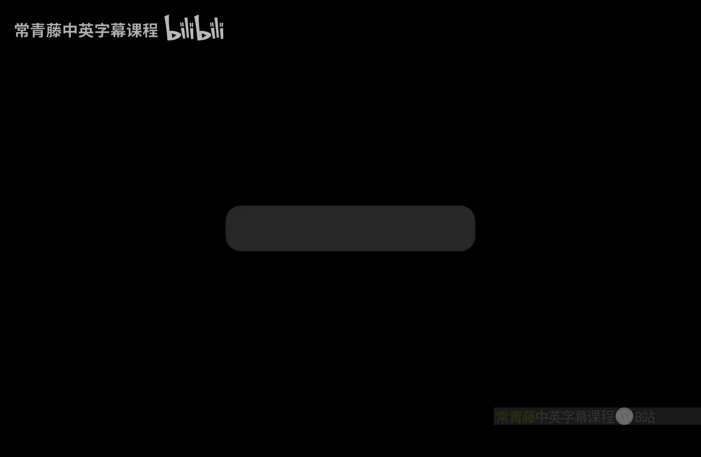
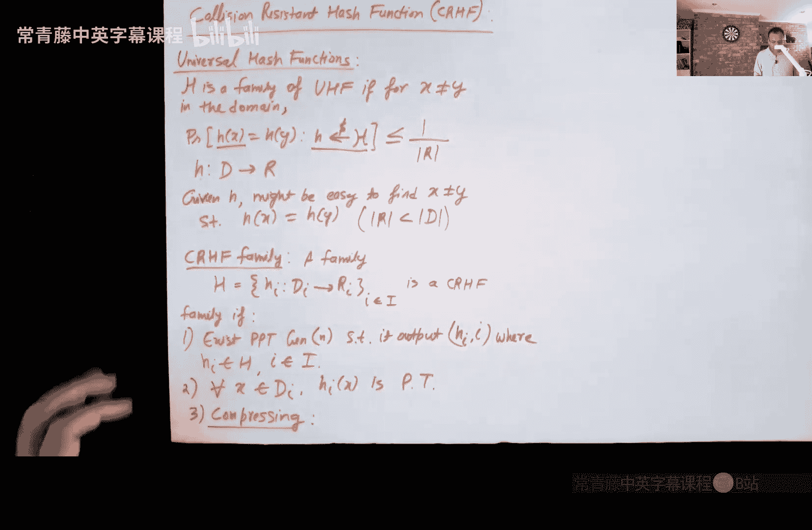
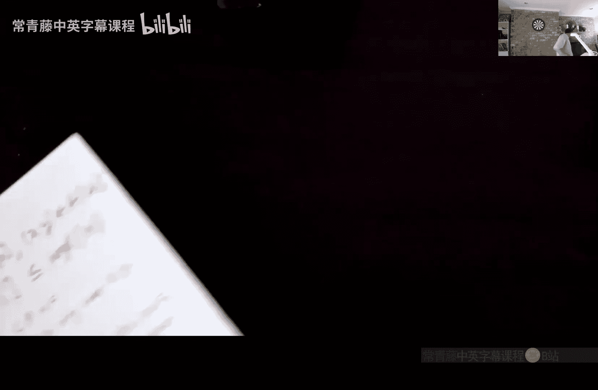
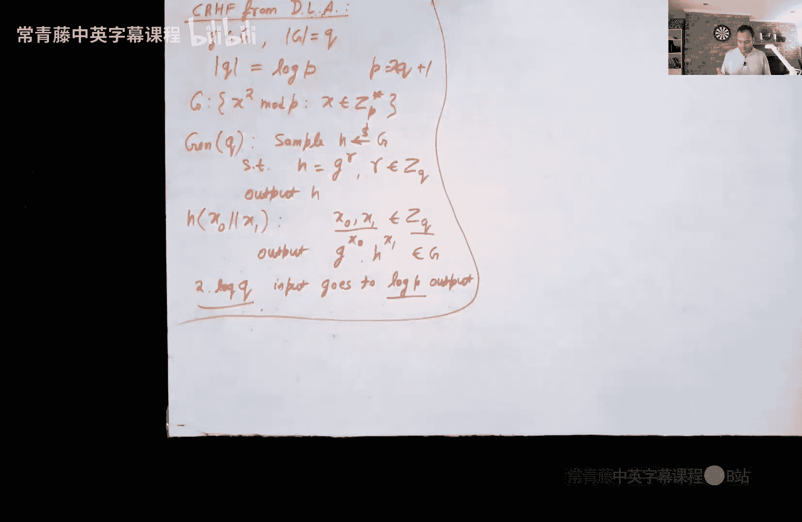

# 卡耐基梅隆大学【中英⚡密码学导论｜15.356 Introduction to Cryptography】 p10 P10 Lecture 10 Message Authentication Codes, Collision Resistant Hash Functions -BV16V6GBYEAA_p10-

ok系 everyone。Let's get started。So last time we were studying encryption schemes right so we have looked at Algamal。

 we have looked at RSA and so on。So the question is， what's next？来， so。

Many people think of encryption as like once you encrypt a message it's like a black box right there's nothing intelligent that you can do on the encrypted message so that's not true at all and one of the least unexpected one of the least expected attacks are so called mauling attacks。

A tampering attacks。And even if you don't have the secret key to an encryption scheme。

 even if you cannot decrypt the message， there are still some very intelligent maybe adversararily successful operations which you can run on encryption schemes and let me start with an example of one time pad right we always think of one time pad as sort of a secure encryption scheme。

But there are some unexpected things which you can do so as an example， so let's say。Next slide。

 we have。Alice， and we have Bob。Okay， and let's say。

Let's say Bob is a stockbro and Alice is a client。Okay， and。

Alice wants to send some instructions to Bob， maybe sell some stock or something like that。

So the message which Alice wants to send is。Is， let's say。Sell some stock， let's say， Apple。Okay。

 and Alice and Bob， this year a secret key K， and they are using。A one time plan。Okay。

 and then we have the adversary， let's call the adversary Tru d。Adversacy sitting over the channel。

 watching all communication and adversary can actually tamper with every message， right？😊。

Trudy doesn't like Alice very much。So。Rrudy would like Alice to lose a lot of money。你。😊，So。

The goal here， which let's say Trudy has is。If the instruction is cell。Let's say， Apple。

Then it should be converted to。By Apple。And if it is。By it should be converted to。Sell， okay。

 so just the opposite of。What Alice wants to do and of course。

 Trudy has no idea what the secret key is right and they are using one time So is this possible in one time。

Any ideas on why？How can you do this？Just Xor buy apple and cell apple。Yeah， exactly。

 So in one time pad。Let's say I take the Cypherax。And by the way。

 as we define in one time pair was for binary strings。

 but you can define one time pair even for larger alphas。Okay。都。What is C XR？Sell apple。Exile。

By apple。Right so let's call the Cyphert C prime and now my claim is that if c was cell C prime would be by and y sub cell right because if if C was let's say。

K， X，r。That's a cell apple。Okay， then what we have is that cell and cell will cancel out and you would be left with KxO bi Apple。

which is exactly the encryption of buy and similarly if here we had buy。

 then buy and buy will cancel out and you will be left with them。

so you can just sort of flip this message in a very interesting way without having any information about the key。

And these are known as morninging attacks。Maulling and or very naturally， you can call them。

Tempering attacks。Okay。🤧う。And by the way， one time pad is not the only scheme which suffers from these kind of things。

And there's also Alal。So what is the problem in Almar？In Algamal， theres a different kind of。

Tmering which you can do。So。So again， so let's say。Le， we are using public encryption。

 So there's there's no shared key anymore and maybe。

Alice and Bob and Alice is sending some encrypted message。To， to Paul， right。

And using the Almal crypto system and here maybe let's assume auctions okay。

 so let's say Bob is is a seller Bob is selling a phone or something like that right Alice would like to bid let's say $100。

And there are many other people interested in the phone。

So there's Trudy who is also interested in the phone。And this is a closed a。

So just to to keep the security of the auction process。

 everybody is encrypting their bids and sending it to Bob right goal of Tru D is of course to win the auction without any kind of overpayment。

 so Trudy would like to bid just something slightly higher than Alice and just win the auction。

And this would of course compromise sort of the security of the whole as process and Trudy can do that very easily。

 So so let's say the ciphertex of Alice is。G to the power R and。M times due to the power。

AR and here the public key is。G to the power A right so you have gama you generate G to the power R and then your message then the way you encrypted is message time G to the power A。

What can what Trudy can do is Trudy can compute another cipher text。

Even though Trudy cannot decrypt and recover the message M， Trudy can prepare a cipherex。

 which is due to the power R and let's say。Hundd01 divided by 100。Times m times G to the power。Yeah。

For simplicity， maybe let's just say twice of the message。不。Okay， and then improve means the auction。

 of course。And Trudy's bid is highly correlated with Alice's bit。

 even if Trudy cannot decrypt the message。RightSo these are all sort of unexpected problems if you think of encryption as a black box。

 maybe these things look kind of strange to you that something like this can be done， but in fact。

 almost all the encryption schemes in practice suffer from these kind of attacks。In RSA。

 you have a similar attack。And so on， like preventing these kind of attacks is not that easy。

So what we would like is we would like to design a solution to prevent any kind of。

Tampering or mauling of the Cypherex。Or the message， right， So， so we have two kind of。

We have sort of two high level goals in cryptography first is protecting confidentiality and second is protecting integrity。

And typically we treat these two things as separate from each other。

There is no reason to mix the two let's study we already studied confidentiality。

 we study encryption， let's study integrity separately。And if you need both。

 you will just use both of these parameters。Okay， so probably the simplest sort of cryptographic primitive。

 which。Allows you to deal with integrity is a message authentication code。And then in the next class。

 we will also study digital signatures。So message， authentication code。Are just maths。For shot。都嗯。

So here， Alice and Bob， they have a shared secret Ki。This is different from digital signature。And。

They would like to communicate a message。Such that the message cannot be tered with。

If K is sitting on the channel temps with the message。

 then the recipient can detect and can reject the message。Okay。😊。

So let's look at the definition of max。So any max scheme consists of。3 PPT algorithms。

Algothum one is called the key generation。Which takes the security parameter metal as input and。

Outputs shared key key。Okay， and the sender and the sea will the store this。

The second algorithm is the Mac algorithm。Which takes as input。

 the key and the desired message as input and it outputs。A map， we will denote it by sigma。

And then the last algorithm is known as the verify algorithm or the verification algorithm。

Takes us input the key， the message and sigma。Okay， so observe that it takes both。The message。

 as well as stigma。And then it simply outputs a bit。Orput zero slash1。

0 means reject one means accept。And essentially， reject means that the message was tampered in transit。

Except means is that everything is fine。Okay， and again， there are two properties。

Which you need to satisfy the first property is correctness。It just says that， you know。

 if there was no tampering， then the verification algorithm must always accept。

So correctness is the following probability that。Vify of K M。And sigma is run。Such that。

K is the output of。He generation。And。Sigma is a valid output of。The Mac algorithm。

So this probability should just be one and this should hold for every message。Right so this is。

 of course， natural and then。How do we define the security of this？Of this pymiditive。So intuitively。

 what we would like is the following。Our adversary is able to see。

The Mac on several different messages， potentially even chosen by thatver。Even then。

 the adversary should not be able to come up with a valid map on a new message。

And the way we formalize it is as follows。We ask for the following。 So we say that。

So the security is called unforgeibility。And we say the following for every PPT。Adversary a。Okay。

The probability of。え？Winning the forging game。Is negligible and what is the forging game intuitively adverary asks for max on several different messages and adverseverly win the game if it is able to output a valid map on a new message。

Okay， so4ging game has。Let me just write it as。A game between a challenger and adversary。

The challenger。 and a。Do the following。As the first step。See samples。A maki using。

The key generation algorithm。She keeps the key secret。

The second stage is known as the learning stage。So in this case， adversary a。Sends a message， am I？

To see。Okay。😊，See response back or see sense。Sigma I， which is。Computed as。The map of K command。A I。

Okay， and this step is repeated。For。Some polynomial number of times。And then， in the end。

Which is a step known as the guess step。Adversary supposed to output。M and Sigma。Okay。

We say that adversary has won the game。Advery events if。For all I。M is not equal to MI and yet。

The verify algorithm。Except。PM sigma。Is one。Okay， and the probability of any PPD adversary even in this game must be negligible。

Any questions？So by the way， we will look at digital signatures in the next class。But very briefly。

 the difference between the digital signature and the Mac algorithm is this verification procedure。

In digital signature there's a public key using which anybody can verify the signature here you need the secret key key to verify so the key for in some sense signing and verification is the same in message of conigation codes。

So now let's try to build message authentication codes。So very simple construction。

So we will essentially show that pseudoran function is already a message authenticdiation code。

So let's try to recall。What your random functions were？So in pseudo random function， again。

 there's a secret key。Using which you can compute the PLF output on any message。

We are calling the message an index。For pseudo random functions and the key property of pseudo random function is even given the output of the PRf on several different messages。

Which you can choose， you are an adversary。Still the output of the PRf on a new message。

Looks indistinguishable from random to。This in particular also means that， you know。

 if you cannot distinguish it from random， then for sure， you cannot produce it on your own。

Reduccing it would be the same as like。Guessing a long random string。

 which you can only do with negligible problems。So let's see this in more detail。So building Mac。

 we will try to use a PRf。So here is the key generation algorithm。嗯。Run。He generation。

For the given PRf。Let's denote this Pf by F。An output。The keyケ。Even in PRfs。

 we had an algorithm to generate the secret。Or the seed in that case。

I hope it is visible if it is not then。Let me know I can use a different marker。So。

How does the Mac algorithm work？Takes the key and the message， and。Sigma is just。F of。

K comma and very simple。You just evaluate the PRf on the given message。How do you verify？He am sigma。

Output1， if。Sigma equals。F of K comma M。And。0。アたルバイズす。Okay。

 you have the verification algorithm has the key， has the message so it can evaluate the PRf。

The correctness is straightforward。So let's just discuss about unfoldflgibility a little bit。Okay。

 so how do we prove unflibility， this almost directly follows from the definition of the PR。

So in PRF， we had a similar game。It was called the guessing game in case of PRf。

 and the idea was that。The adversary is given access to the PRf。

Adverity can query the PRrf on several different messages。And。呃。After that。

 the adverary sort of has to guess if it is interacting with the PRf or if it is interacting with the random function。

And the key observation is that。If you were indeed using a random function。Then just directly。

 it follows that。The probability that you can produce the output on a new message。Is negligible。

Because that would be equivalent to guessing purely uniform random string。

Which can only be done with negligible probability。So anyway。

 let's start to prove it by contradiction。So say a PPT。Aversity A can。Then。The forging gain。With。

Noticeable probability。Okay。😊，So first。Here's Cla1。So let's just see what happens in the game。

In other words， a queries。The challenger with。Several messages， let's call them M1 to M。Q of N。Gets。

Max m Sigma 1 to sigma Q of n。And produces。M gamma sigma。Which passes the verification test。

With noticeable ground。Now here's a simple claim。If。See answers。Quries of a。Using a random function。

As opposed to using a PRrf。A winds， only。とか。Neegligible probability。O。😊，Prove of this claim is。Is。

In this case。The output of the random function， let's call it RF。Of。S么 key here。Rf of M is。

Independent of。Rf of M1 up to。Rf of M。9N。If， for all， I。M is different from MI。Okay。😊。

So then assuming that the output is long enough。Output is basically a random string。

 which is uniform and independent of。Everything which aversary has seen so far， and in that case。

 the probability that aversary can guess it is essentially negligible。So this is fine。

And now we can already observe that。Thatver을。Fs if you are using a random function。

 but succeeds if you are using a PRf and then in some sense this adversary a already sort of distinguishing between a random function and a PR。

So then we will build an adversary B。To distinguish a random function from。アピア。And how does B work？

B invokes aversary A。If a queries。With some message， MI I。Then note that。

B is now interacting with the challenger of the PRf game。Be forwards。To the challenger。And gets。

Either the random function on MI or。P Rf of。几个咩咪。Now。If after all， the queries are finished。If a。

It seedss。嗯。If a succeeds， then it must be the case that。We are interacting with Pf。

We output appear outputs。PRf as the guess。Else。The outputs。A random bit。As the guess。Okay。

 and remember that the in the PRf game， you only have to succeed with probability just slightly better than half。

So here in this case， we succeed with probability half。In this case。

 we succeed with probability almost close to one。So overall。

 be succeeding with probability better than half， assuming that this case happens with no disable probability。

And this is essentially the end of our group。How does A A knows that it succeeded？Yeah。

 that's a very good question again byqueting the challenger。

But the challenger can give you randomrose， right， then how will you know。So。Yeah。

 let me know it here。Finally。A outputs m comma sigma。Then。We sense。And to。The challenger。And sees if。

The response。Is Sigma。Okay。😊，If so。If so， then a has succeeded， right？And in that case， I raised it。

 but in that case， basically。Yeah。If so。The guess of B is Pf。Yeah that。Yeah， the idea is that。

 of course， if the challenge was using a random function。

Then the probability that a succeeds is very little。So if you see a succeeding。

 then it means that Challenger was not using a random function challengeenger was using a PRf。

And if it doesn't succeed， we have no idea， thank you sir， thank you very much。Any other questions？

So by the way， one of the things I forgot to mention is。🤧Even if you are using a Mac。

There's always a possibility of replay attacks。Right。So as an example。We have Alice and Bob。

 and let's say Bob is a soldier。Okay。😊，AndEvery day， Alice sends a message。Which is either attack。我。

Defend。And they don't want enemy to change the command， they don't want enemy to change。

 attack to defend or vice ver。So the idea here is they will share a secret key and then they will send。

The message and。A map on the message。So is this a good idea？I mean， potentially you can imagine that。

Mac will guarantee that you cannot change the message。Right。

 so any problems to this like after two messages， you can find out whether it what was attacked。

 what was different and you can use that Mac code and change the output。Yeah。

 so Mac basically just guarantees that。You cannot change it to a new message， right。

 but you can always replace。Some message with an older message。

Because you already have a valid Mac on the older message。

RightSo if you just send this command attacks like defend then basically after a couple of days。

 the system is completely insecure I can just as an adversary， I can just replay the old map。

So what would be。The solution here。So， people are talking about。

Can't you just append some randomness in the message and nos in the message， yeah。

 that's a good idea except that now you have to keep track of the randomness and the norms。

So Alice and Bob， they have to maintain a list of。All the random strengths that have been used so far。

 and you have to make sure that。It's the same string if the same random string is being。

Used once again， then。Then God must reject。That's one option， maybe a cleaner option here is。

That you append the date with the message。Assuming that you only send a single message every day。

 just app the date is like a panic counter， which will never be used。

Or you can append the date and the exact。So， reple attacks are。Notoriously harder to。

To sort of take care of many crypto protocols。Which were designed。

 they were deployed in practice for several years and at some point a weekly attack was found。

Because it's a large protocol， several messages you can imagine that。It's kind of hard to imagine。

 you know。There's also an attack where， for example。

 a Mac from the first round can be used in the Mac in the third round and so on。

So you have to be very careful against these type of attacks。嗯。🤧嗯。Okay， good。

 so now let's move on to our next primmeteritive。Which is。A col resistant hash function。啊。

CRHF first shot。🤧And college and resistant hash functions are。Very relevant to the study of。

Of Macs and digital signatures， because。Sometimes they can be used to compress the message。

And then you only map or you only sign the smaller message。

 and we will see that in more detail in the next class。So let's first recall what are hash functions。

So I'm sure that all of us have seen some kind of hash function。

 maybe not cryptographic hash function。But for example。

 many of us might have seen universal has functions。There's universal hash function。

 there's pairwise independent hash functions， there's one wave functions。

The variance for hash functions is essentially， I don't know， like dozens of different properties。

So universe are the hash functions。So typically， when you define a hash function。

 you define a family of hash functions。So you'll see that edge。Is the family of。

Universal hash functions。If for every x not equal to y。In the domain。Of inputs。Probability of。

Hx being equal to h Y。Such that。It is sample from this family。Must be less than equal to1 by。

Size of the range， where。It goes from。The domain to the range。What this is saying is。

For any two inputs X and Y， you pick a hash function at random and。

A good property of a hash function is that。They are unlikely to pollide the outputs。

The outputs should be different。Of course， there's always a probability of collagen if the range is very small then so this is basically the best that you can do。

And these type of hash functions are very useful in， for example。Search。

So let's say I have a bunch of elements。Which I want to arrange in a hash table。

So what I would do is the position in which I will store an element in the hash table will be determined by the output of the hash on that string。

Okay， so if the hash function for example， on x gives me， let's say。That's the 500。对 then。

X will be stored in the 500 bucket。And this makes searching almost linear near time because let's say I get some element which I need to look up in the table。

 I can just hash the element and I can see the exact position of the element。

And I can just directly go to the position and I can retrieve it。

So that's why universal action are very useful。But here， observe the following。That。

This property only holds if。That is chosen uniformly。After X and y。Okay， in particular。

If you are given edge。Might be easy。To find。X not equal to y。Such that。

Hch of x is still equal to h of y。Okay， this is entirely possible universal hash functions don't guarantee anything in this case。

So on the other hand， cryptographic hash functions， which are called resistant hash functions。

They still guarantee， in some sense， policies and resistance in this case。And by the way。

 this might hold if the size of the range is smaller than。The size of the domain。

 So if the size of the range is smaller then of course。

 there exist many cols and you might be able to actually compute a coler。🤧嗯。So instead。

 we would like to study。A collisionsn resistant hash function family。

And these type of hash functions require some sort of cryptography。

 Uni hash functions are very easy to design like。You might have seen linear constructions like。

If x is the input， then the output of the half function is basically ax plus b。

And they are finding a colgen might be a matter of just solving a linear question。Okay。

 so let's look at the CRSF family。So， a family。It's called this family。Capital edge。

So it has many functions。At I。And each function might have a domain might have a range。

More often than not the domain and the range will be the same for every member of the family。

And there's some eye in。Capital I think of capital I as some large。Sa。So this is a CRF。Family。

 if the following property is hold。Okay， and we will have four different properties here。Property1。

Is that。hasash function from this family should be easy to sample， you can sample this in PPT。

So there exists。A PPPT algorithm。Jen。Such that。It outputs。Some H and I。Well。HI is a member of Edge。

And I is in。Capital like。Second property is that every hatch function must be polynomial dying。

 of course。Okay， so for all X in the domain DI。HI of X。Run in polynomial time。The third property。Is。

The compression property。Which means that。

For every eye， the size of the domain。Must be larger than the side of the range。嚟。

And then the last and of course， the most interesting property is。Plicant resistance。

It says the following for every PT anniversarydversary。诶？The probability that。一。

It gets as input a randomly chosen has function。Can run on it for polynomial amount of time and then probability that a is able to output a collision must be neglig。

So， probability that。H I of x equals。At I of y。There。HI and I。Coming from。기존的。And。Then。

X comma y is produced by。The adversary。Who is given。I and H I。And finally。X。Is not equal to y and。

X and y are in the domain。Of the action。This must be equal to。Negligible in the security parameter。

So I don't understand one thing that like if thatver is given a y itself。

 then how is this definition different from the universal actionshen and in that definition you said that we can find x and y is that h of x equal to h of Y。

😊，In the definition of universal hash functions。The adversary is not given edge。In fact， you choose。

X and y first， and then you choose the hack function。So x and y don't depend on the has function。

Okay， thank you so thank you。 Thank you very much。So if for every。So you pick。A fixed pair x comma y。

 and then you pick the hydrogen function。🤧Okay， so。So let's look at a couple of facts。Okay。

 maybe let let's do some basic sanity check on this on this definition。

 so why is this property3 compressing why did we put it here？What if I take this property out？

And let's say we are only left with property 12 and4。Is this。

Still sort of an interesting definition in that case。Or does it become trivial？

So suppose domain is actually equal to the range and I just need。This squ and resistance property。

There can just be no collisions， it can be like a one to one method。Yeah。

So if you take out this this third property， then basically an identity function is a good color and resistant hash function。

Yeah。On the other hand， if the domain is indeed larger than the range。

Then just by the pigeonhole principle， collisions do exist。But they must exist。

Two different inputs which map to the same output。And then the game becomes somewhat interesting。

 even though collisions might exist， we still want adversary not to be able to find these collision。

And that's where in some sense， crypto comes in。Is n related to the size of the range here n is related to the size of the domain as well as the range and even the number of。

Even the size of the family might depend on it。Okay， so let's see here a couple of。But。So。

 fact one is。So， no single。At。Can be。Of Colism resistance a hash function。Okay。🤧Why。

 why did we bother talking about a family and？🤧Ping a random from this family， why。

 why can't I give you a single hash function and tell you， hey。

 this is equal is an instant hash function。 just go ahead and use this。

Just hard coding the collisions。いや、 goodル。So suppose I give you a single harsh function right the size of the domain is bigger than the size of the range。

 that means polys do exist right？So， in that case。For。A single edge。Okay。They are always。嗯。They。

 of course， exists。A PPT adversary A。Which may have。X and y。Hardquartered。

Or just built in in its school。This is a very common point of confusion， right？

So many people ask the question， you know。Aadversary a supposed to run in polynomial time and maybe if the cols are hard to find。

 how can averary even have this hard code right but here the point is that。

We don't care how you come up with this adversary。Right as long as diversity can run in polymial time。

 this is a valid adverse。Right and here we are not talking about how to construct a andm just claiming that there always exist a。

Which is， of course probabilistic polynomial time and a would just have these x and y return in its。

So this a does run in polymial time and is able to produce collas。Okay， does this make sense？Now。

Let's look at another fact。So earlier we studied one way functions。

And here we don't need anything like one wayness。Or something like that， in fact， as I said。

 if I remove this compression property。It just becomes trivial and identity function is a good collisionant resistant action。

RightBut it turns out that CRer chips and when the functions， they are actually intricately related。

In fact， any good CRHF is also a one function。So。The second fact is。Sufficiently。Compressing。C chefs。

Are also one with functions。Sorry， just give me a second。 My phone。Buzzy Mon。

Ne need to put on island。Okay and what do we mean by sufficiently compressing CRFs the size of the range must be much smaller than the size of the domain right so let's say your input is like 2 n bits and your output is n bits。

Then you are compressing by a factor of two。And I would call that to be a sufficiently compressing sea。

And this fact is not that straightforward to see it takes a couple of minutes。Okay。So suppose。诶 say。

For all I。Let's say the size of the input。And I'm not talking about by the way， the size of the。

Doomain are the range。四。Size of input。Equals， let's say， two times the。下一个方。Okay， and for simplicity。

 let's say。In other words。For all I。DI is， let's say， equal to。2rue to the power to n， and。Okay。

 size of the domain is2 do power 2 n size of the range is2 do power n。So observe something here。

 even though it might look like the domain is like the twice of the range or something like that。

 actually here the domain is exponentially larger than the size of the。

So domain is something like this， domain is2 to power n times2 to the power n。

And range is like really smart。P to the bottom end。There are collisions everywhere， basically。

So what is the idea， how do we prove this second fact？

Theupp the function is not one way can we hope to find a collision？So if the adversary can output。

Ex complement X bar that。Also map then that will be a collision， right。

What is x complementary so like if aver is able to invert F。

Like we assume that there exist adversity for the one wave internet and then it when you given F of exit it in words。

😊，The F of action gives you X and that is a collision， right。Yeah。

 I guess maybe what you're saying is the following。

So suppose there are like several inputs which map to the same output， let's say even two inputs。

 which map to the same output。So you start with one of them。Then you compute the output。

And then you apply the adversary of the one way function on that。嚟。😊。

Then what is the probability that you would get the first input versus the second input？

So it doesn't matter which you input you started with right the adverse we only get to see the output and will give you any one of the valid input。

What is the probability thats exactly the input that you started with at one half？In fact。

 if there are more collisions， it might even be much smaller than how。Okay。

 so if the adversary gives you a different input compared to the one that you started with。

 then great， you already obtained a collision。Yeah， so in this example。

Very roughly for each output there are two to the power and inputs to choose from。

But not that that doesn't hold for every output that's just the average right maybe some output only has a single input。

 but then you know there's a bunch of inputs more than two to the power and inputs which are going to the same output。

Okay， but just because the collisions are so high， the probability that you end up with an output。

Which has multiple pre images is actually very recent。

And the probability of obtaining a collagen has to be just noticeable。To obtain a contradiction。

Right， so let me not do the entire proof because I need to move to the construction as well。

 but basically the idea is that。You are given。PPT adversary a。To invert。The function at I。

 then what you do is B works as follows。You pick X。At random from the range。Then， run。A on。F of x。

And then we will have we just need to do the following。Probability that。It returns。

Ex prime article to x。Such that。F of x prime equals。F of x， this probability is。Not disagree。

That's the last step which you have to prove and again we will just rely on the fact that because there are cols everywhere。

Probity that x is equal to x prime cannot be very close to one。Okay， any questions？

So now let's talk about constructing collision and resistant as。Okay。

So we will just use the discrete log assumption。We don't need anything fancy like DDH or CDH。

So we will build CRHFs from。The discrete lock。不算吃。And first we will build CHFs， which。

Roughly compress the input to。Do好。Or by a factor of two。So again， we will consider。ブロック。Capital G。

 a generator， small G。To that order of G equals。You。😊，Okay， and note that。

What is the sign of the group element？It's equalqu to actual log。B。Okay。

 going back to the Sofi Germaner construction。So remember that in So gentlemen construction。

 this this group G was。Just x squared。So x square might be。Yeah。There。X is from。ZP star and。Pals。

录Q的是吧。Okay， but P and Q， they are roughly the same sites。Just。

Maybe P is just one bit longer than you。Okay， so now how does the hash function work？

And your security parameter in this case is like either P or Q， you can use Q here。

So you sample at random from the group。Such that。H is equal to some。Due to the power R。Okay。

 and R will be in。自き。Your hash function。Is just。Just this edgech。Okay。

And how do you compute this hash function？So the hash function takes as input。X 0 concatenation。

 x 1 where。X 0 and x1 are both in。Z you。And then what you do is you output。

Due to the power x0 times S to the power。Excellent。Okay， and this is an element of the group。So。But。

So what is the size of the input？They are both coming from ZQ， so it's two times lock Q。

And then the output size is lock P。And Lo P and Lo Q， they are roughly same。Just plus one， taxi。

So the compression factor is almost two here。And that's it。

 that's the description of the hash function。So why is this？What isn't a distinct。

Okay， so。So maybe let's look the definition of the CRHF here。And I will try to convince you that。

Everything except the collision resistance property obviously holds。

So the first property requires that you should be able to sample the hash function。And this。

 of course is true sampling the hash function is just sampling a random element from the group。

The last function does end in polynomial time。We just need two model explanations here。

And the hash function is compressing。As I said， it's。Compression factor is like like two。

 And then finally， you just need to prove this property。That finding any collision is very hard。

And my idea would be。To prove that if an adversary can find a collagen。

 adversary can actually compute the discrete log of edge。So in other words， itverse。

 we can compute R。Okay， so claim。Is。This is a valid。Pooliisms are distant has mentioned。看没有。So again。

 we will prove it by contradiction。So suppose your adversary， suppose PPT adversary A。Givenive edge。

Let's say the adversary can output。X 0 and x1， such that。Okay。

 so I'm mixing up the notation here because。I'm using E for the group element as well as for the function。

So。Let me just denote it by。Email。TheE of the action function。Oh， let me just don it by capital edge。

嗯。这 is that。Capital。Oh， sorry， not x zero to x1， but rather。Can output。X0， x1。Not equal to。X0 prime。

Excellent prime such that。Hash of x 0， x1。Is equal to hash of。X0 prime， x1 prime。So we will build。

Another PP。B to solve。The discrete lock problem。Okay。So B takes has input。呃。V takes as input。Some G。

Some edge study where。H equals0 to power r。And the goal of B would be to compute R by using the adversary a。

So what does B do？It's very simple be invos。A on edge。And。A hopefully returns。X 0， x1。

It's not equal to。X 0 prime and x1。Grime。Such that the hash outputs must be the same。

 which means that。Due to the power。X0 times。As to the power X1。Equals due to the power。

X0 prime times S to the power。X1， time。Right， so now you have these two pair of inputs with this special property。

So what this means is。G of x 0 plus。Are excellent。Equals。G of x0 prime plus。R X1 prime。Okay。

 because h equals due to the power R。Ithich also means that。X 0 plus R x1。Equals x0 prime plus。

R x1 prime。Margue。Okay，q is the order of the group， so exponent is always computed molecule。

Now let's just try to solve for R， we have x0 x1 x0 prime and x1 prime。This means that。

R of x1 minus x1 prime。Equals。At0 prime minus。X。0ロ？Which means， again， everything is bar Q。

It means r equals。X0 prime minus x0。Divided by x1 minus。X1 prime。Now。We are almost done。

 but not quite。And why？is division like this allowed in modular arithmetic？😊，Yeah啊，I mean。

This is just the inverse of。X1 minus x1 prime mark Q and remember Q is a prime。So if Q is a prime。

 then every element has an inverse。So I can write it as multiplication。R to the power minus1。

So what is the remaining step here？It can be a division by zero like x1 prime and x1。Yeah。

 that's great。So we didn't even use the fact that these two numbers are different。

So now we need to prove a different claim。It is that x1 is actually not equal to x1 prime。Mario。Okay。

😊，But this equation by itself doesn't give you that。This equation just tells you that。

Either x0 and x0 prime are different。Or X1 and X1 b or different。

But we do need x1 and x1 prime to be different。So how do we conclude this？

So since there are like tourist per N collisions， then like the adversary outputting the same thing is very one by tourist for N。

 like not tourist for N tourist per Q probability。😊，No， di just gives you two questions， right？こで。

They will be different， right like it has to be the exact same string， right？Like in the second half。

 okay， so advers is a PPD adversary。This adversary。

The only guarantee that you have about this adversary is that it gives you one colorgue。

And maybe the carefully chooses the collision。To make sure that beef。

even though there might exist many other collisions。

And we don't have access to those collisionants in Parliament。Okay。

 so proof of this claim is actually very simple。In fact， when the adverse outputs is collision。

 it must be the case that。Actually， x0 is different from x0 prime and xon is different from x。

Even if one of them is the same， then basically。Otherwise one must be the same as。Okay， so proof is。

We prove it by contradictions， so suppose。Suppose this is equal to this and now。

Let's look at this equation。So we will not go all the way to the division yet。

You will stick to this equation， right。So here now we have the fact that。

This is actually equal to this。Which implies that。X0 is actually equal to x0 prime。Mcuure。

Which means that。Actually， the two。Two inputs are identical。Okay。

 and note that ZQ is the domain here， sorry ZQ stop。So do I put start no。Okay。Any other questions？

So I have once one question that every time if I want to write like use a collision resistance as function to ensure this quality every time Ill have to sample the small it right。

😊，二。What do you mean every time？Like whenever I want to like， hash it。I mean。

 you can sample it once and then you can hash it any number。

You don't have to keep changing your attitude。Because once you sample the hash function。

 assuming that。Everything else which you do after that fact。

It's polynomial time and we believe that our universe is polynomial time。Then。

Probability that at any point， anybody will stumble upon a collision。I nelig。Okay。

 so this is ensured that the like the small dataar generated will be private to me。😊，Smallest。

 sorry say that again。The the small edge that I generated to sample the has function。

 it will be private to me like small that is what。You mean， yeah， yeah， in fact。

 you don't even need to generate the smaller you can just sample a random element edge。

And you can throw away on。Because it's not required for the operation of the。Okay。

The evaluation of the never needs the smaller。So basically like the additional security of the cryptographic function is coming because like we are taking one random element from the family and since the diversity does not know which element we have taken thats why like it is impossible for them to。

😊，hard for the collision in。I mean， essentially， the reason you need to pick a random element is because you are relying on the discrete log assumption。

And the discrete log assumption says that solving a discrete log is hard only if you choose the element at run。

But if you have a fixed element， then maybe adversary already has the discrete law of that。😊。

So then it's not a contradiction。So you just need to pick an element whose discrete log is sort of unknown。

Thank you。 Thank you。 Thank you。Okay， so just just。Maybe a couple of final comments is。🤧嗯。

We constructed one we functions from。So from just factoring and we didn't use the law problem。

So the question is， suppose I give you a one way function。

 can you construct a college assistant has function from that？

And the answer to that question is still an open problem。So suppose I give you a one way function。

Without making any additional assumptions， generically can you convert it into a collision resistant half function？

So this is like a 30，40 year old open problem in cryptography and。You know。

 people believe that the answer is negative。So you do need some extra。Sttroger assumptions for。

For college andre hash function， on the other hand， given college andre hash functions。

 building a one function is easy as we have already seen in this。

Another question is we build hash functions with a compression factor of like close to two。

 what if I want to compress my input a little bit more？

So it turns out that you can essentially use the same technique。

And this will be a problem on the homework。You will need to generalize this construction to sort of any arbitrary compression ratio。

Okay， so we will stop here next time we will see digital signatures and we will see a very nice application of。

But isn这 a心态。