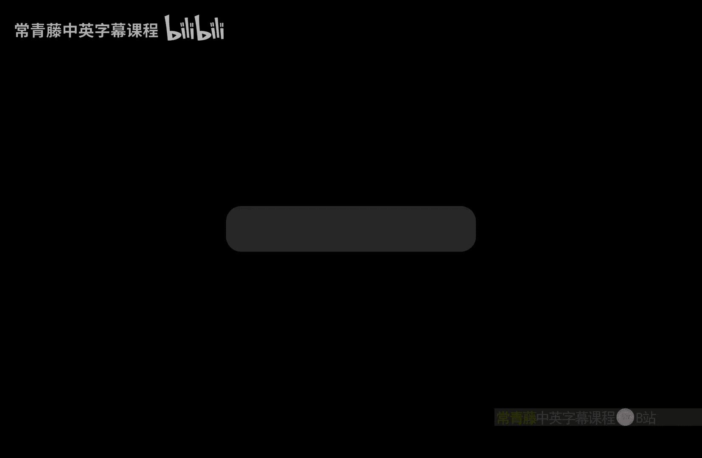
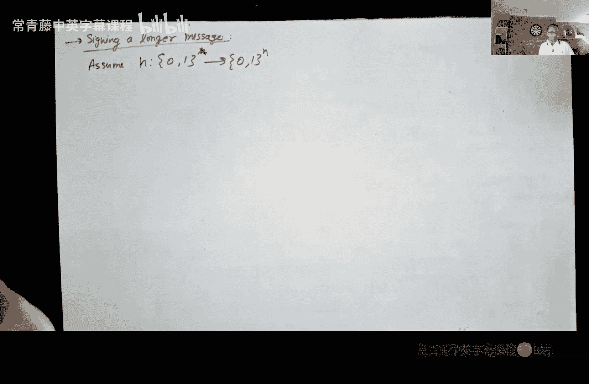
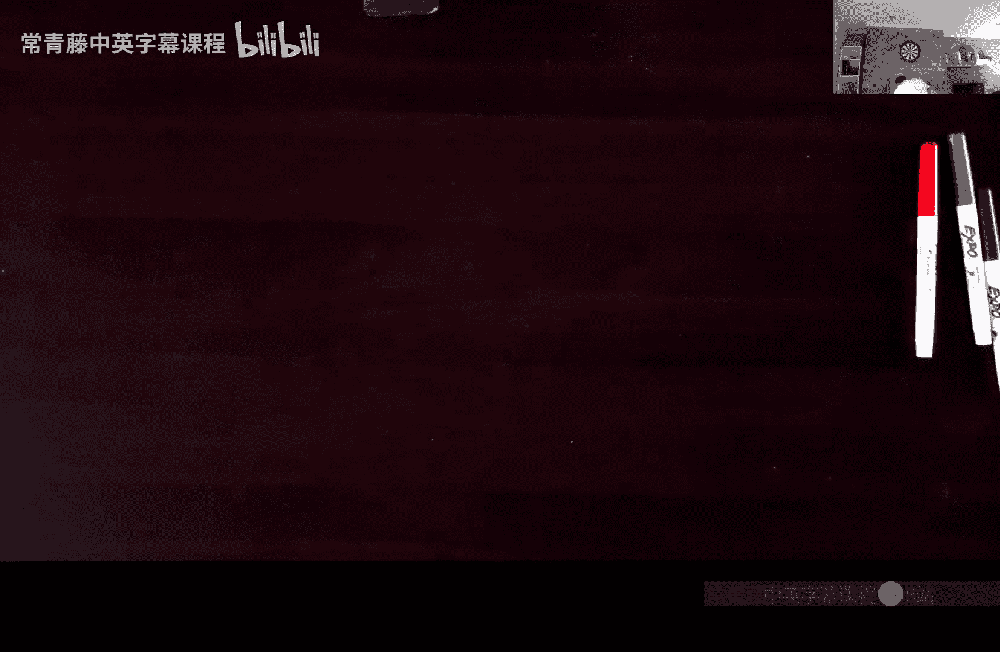
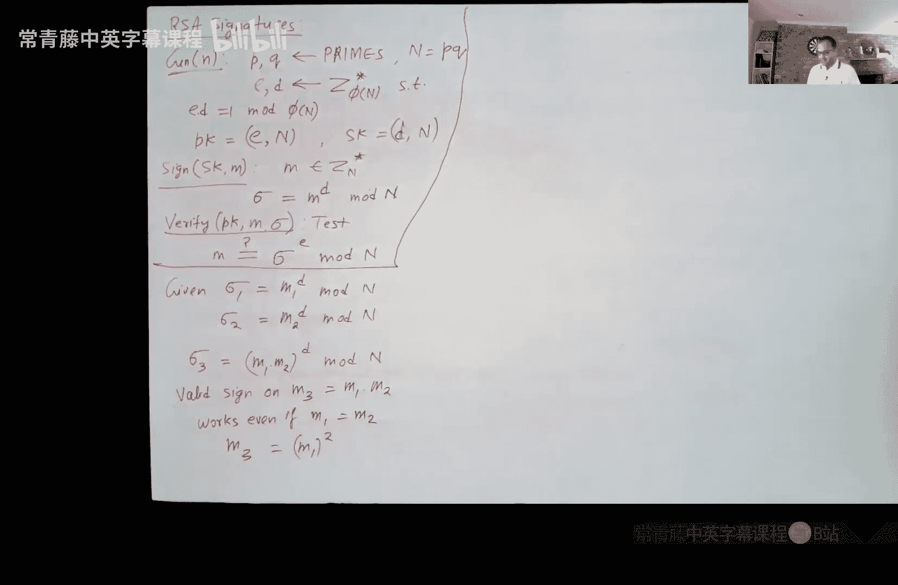

# 卡耐基梅隆大学【中英⚡密码学导论｜15.356 Introduction to Cryptography】 p11 P11 lecture 11 Digital Signatures -BV16V6GBYEAA_p11-

Okay， let's get started。I hope you can hear me。Okay。

 so last time we looked at message authentication codes and the idea was that if you are sending a message。

 you want to prevent it from being tampered in transit。And for message authentication codes。

 the sender and the receiver had to have a share secret key， right？😊。

You cannot really use message authentication codes unless you are talking with somebody who you already know。

Who you have met and have generated a key and so on。 So for example， again。

 let's say you' are opening some kind of website， let's say Google dot com or something like that。

You cannot really use message authentication codes because you don't have a private shared key with Google right so you need something different and this is where digital signatures come in。

😊，So very roughly the difference between digital signatures and Mac is。😊。

Somewhere similar to the difference between public key encryption and secret key encryption。

In in digital signatures， only the person holding the secret key can sign。

 but then everybody who has the public key can verify your signature。😊，Okay。

 so let's try to define what digital signatures are。And as you know。

 digital signatures are basically used。All over the internet。

 they are used in the STTPS protocol and so on。 so it's really。You know。

 it's one of the backbones of security over the internet。Okay。

 and the idea here is that everybody can verify even though the only person who can sign is the one holding the secret key。

😊，So again， any digital signature scheme must have three PPT algorithms。

The first one being the key generation algorithm as always。And this algorithm outputs。

A secret key and a public key。Okay， you can publish a publication key in a newspaper or on some website or something like that。

😊，And then let's say you want to sign a message M。 so then you would use your secret key SK and the message M and this algorithm would output。

A digital signature which we will denote by sigma。And then finally similar to max。

 we will have an algorithm。Which is called verify algorithm。

So this algorithm does not take the secret key。Instead， it will take the public key as input。

 it will take the message and it will take the signature。And it will output。0 or one。

Acept our reject。And then there are two properties which this this system has to satisfy the first property is correctness。

😊，And correctness just says that you know you generated the the key pair correctly。

 you sign correctly， then the verification algorithm will always accept。😊。

So correctness says that for every message M。Probability that。The verify algorithm。

Which takes as input， the public key， the message and。The signature sigma。

We are looking at the probability that this outputs one or this accepts。Conditioned on。诶。

Generating the public key and the secret key correctly from。The key generation algorithm。And then。

 finally， sigma is。Sign of。SK command m。This priority should just be one。

 so this is what happens in the honest。Exec of the system。

And what do we want from security and by the way， the security for for digital signatures is also known as ungeability just like Mac？

😊，So again， it is almost identical to two maxs， so we will consider a challenger and a PP adversary。

😊，the challenger generates the secret key and the public key and gives the public key to the adversary adver you can look at the public key and decide a bunch of messages and can ask for signatures on all these messages。

😊，And then the goal of the adver is to output a signature on a new message。😊。

Which passes the verification test。If the adversary is able to do that。

 we say that adversary has one and we want the probability of adversary winning to be negligible。😊。

Okay， so again， we have。A PPT adversary A， we have a challenger。是。C。😊，And。

Let's let's say various stages， stage one is。The keygen or the start stage。So here。

 the challenger generates。S， K and P， K from。Key generation challenger keeps Sk to itself。And since。

P K to the adversary a。Okay， so second step is learning。Where， for all。

I from 1 toqn where  Q is some polynomial。I send some message。MF I。And。Case response with。Sigma I。

 which is。The signature on this message。With the secret。ok。And then finally， we have the。Forgery。嗯。

A has to output some message and signature。Evens if。For all I。M is not equal to MI。

 so it's a new message。And yet at the same time。The signature is accepted。 The signature is valid。

 which means that verify of。PKM and Sigma is what。Okay， and what we want is probability。Of a winning。

Must be。Negligible in the security parameter。오케이。So， hopefully the definition makes sense。

 very similar to the previous definitions。😊，And there's a weaker notion which we will consider and which we will。

😊，hich we will construct first， and this is known as one time signatures。

And here the adversary only gets to make a single query。😊，So here， which is the same， but。

The bar on the number of queries is one。So， in other words。A sense。And1。Get Sigma 1。

Then immediately after that， it doesnt get the opportunity to make any more queries。😊。

A has to output m and sigma right away。Okay， so one time signatures it is a weaker perimeter because。

😊，We only requires security against a single query。😊，And yeah。

 one time signatures are somewhat easier to construct compared to general multitime signatures。So。

 if you have a one time signature scheme， you only want to use it to sign a single message。

If you sign even two messages， then maybe the security is just completely gone。Okay， and by the way。

 the digital signatures were introduced。😊，By again， by Diffy and Heman。

In their seminal paper in 1976， the paper is called New directions in cryptography。

 that's the paper which really introduced a lot of these things， including public key encrypture。H。

Key exchange and digital signatures and there is an interesting story。Behind this Dfiel and Heman。

 they imagined the notion of digital signatures， they imagined that that is something which can be very useful。

 but they were stuck on building digital signatures for a long time。😊。

And then they were having lunch with this researcher， his name is Leslie Lamport。

He doesn't even work in cryptography he works in distributed computing and they mentioned the problem of digital signatures they said oh it's very interesting what seems like a very difficult problem to solve and within a few minutes Lamor had a solution for。

😊，For digital signatures and that became the first ever digital signature scheme。

And the solution appears in the paper of Dfi and Heman， but in the acknowledgement section。

 they do credit Laor for suggesting this solution。😊，And Dfiel and Heman， of course。

 they got the Turing award later on for their paper。

 Leslie Lemport also got the Turing award but for completely different things for a body of research in distributed computing。

Okay， so let's look at the La port signature scheme。Laampport one time signature key。

And the interesting thing thing here is that。😊，As I mentioned before。

 we don't know how to construct public key encryption from secret key encryption or one way functions。

😊，Typically， we would think of digital signatures as。😊。

Something in the class of public key encryption。 There is a public key。 There's a secret key。

But on the other hand， we do know how to construct digital signatures from any one way function。😊。

That's something which is pretty interesting。Okay， so we will just use a one way function。

And we will use this one function in a generic way to build one time signatures from this。😊。

And let's say the message length is。So length of the message。

 lets say small and lets say the same as security parameter。

 we can talk about smaller and larger messages as well later on。So how does key generation work？

So in key generation， Sk is。Just a bunch of two n random strings。Or n pair of random strings。So， x 0。

1。X 0，2 up to。X 0， n。And。X，1，1。X 1，2。Up to。X 1。嗯。And theyre all uniform。

You uniform from the domain of one functions。So， this is your。Secret key， long secret key。

What is your public key？Public key is just the one way function f applied on each of these strings。

So why运。0， y 0，2。😔，Y is 0， n， and。Y 11。Y 1，2。Up to51。嗯。Where。Y b i。Is equal to F of。X。B。哎。Okay。

 suggest the one way function applied to each of these strings and just a sanity check it is clear that you cannot compute the secret key from the public key。

😊，Because you need to invert the boundary function if you want to do that。

And how do you sign the message？嗯。So the signature。😊，Is we take these。N pair of uniform strings。

And we choose one string from each pair。Depending upon what that bit of the message is。So。

 in particular。If the first bit of the message is 0， we will pick this。If the second bit is 1。

 we will pick this and so on and we will just concatenate all these things。So， sigma is basically。

X 1。M1 where M1 is the first bit。Concatenation。X to M2， where M2 is the second bit。X， N， M， N。

And here。A I is。The I bit of。M。Okay。🤧嗯。How does the verification process work？So sorry。

 this science has to take secret。The verification process only takes the public key。

 takes the message， takes the signature。And how do you verify well？😊，You take。

The n components of the signature， you apply the one we function， and then you match it with the。

Value inside the public key。So you want to check。If。For all I。Y I is equal to。Well II of MI。

Is equal to F of。X I of MI。If so， except。Else you reject。Okay， so the high level idea here is that。😊。

You have an endbit message。And that message basically selects like a bunch of these。

Images of the oneway function and the signature has to to contain the corresponding pre images。Okay。

 is the scheme clear， should we go to the security proof？嗯。Okay。

 and the security proof is actually very simple because。😊，If you want to change the message。

Let's say you want to change the first bit of the message。Then you have to invert the one function。

 then you have to output a pre image which was not part of the original signature。

What role does the length of the strengths play in our scheme does it affect security well？

X i's are from the domain of the one function。Okay， and as long as it's a value function it iss fine。

 you know， you work with whatever domain it specifies。Case of when we function from the domain。

To the range， and。For all I， this must be from Ding。Or rather。Okay。

It's sampled uniformly from the domain。嗯。Any other questions？So， correctness is straightforward。

 lets skip correctness， let's go to the proof of security。😊，Okay。

 so remember that it's only a one time signature scheme so the adversary gets to see a single signature or a single message。

So we will prove it by contradiction， suppose you are given a PP adversary a。And what does a do？

A queries。With some message， it's called this message M1。

It receives as a response the signature Sigma 1。And then finally， a will output。

M and sigma as the forgery。There。M is not equal to。M文。Right， so this is the security game。So。

 if m is not equal to M1， then there must exist a bit where they differ。😊。

So let me call this bit to be。Actually， I want to use the subscript notation lists。

It's called this M prime。Okay。And suppose the IF bit of M is different from the IF bit of。Eblem。Okay。

 they have to differ in one of the bits， lets say that that bit is i， that position is I。😊，Okay。

 then let us look at the intuition fast before going into the formal proof。😊，Then， what does a。Gets。

A gets x of。Am I。And by the way， for simplicity。Let's even say that。A I was0。And。😊，M prime was1。

 you can do the other case in the same way。Then a gets。X，0 of I。As part of。

The signature is called sigma prime。As part of sigma prime。Now。

 the interesting part is that a has to output。X。I of one。As part of。识嘛。Right。

And can you compute X of 1 fromxi of 0？Well， no， they are all independent random uniform strings。

There is no relation between the different ex size。So。

 essentially a has to output thisxi of 1 as part of sigma。And is just given F of。This number。X I of1。

 which is。Y a1。Okay， so special a has to invert the one function here。So this is just the intuition。

 this is not the complete proof because。We basically have to construct B。

B is an algorithm which would invert the ver function， So we have to be a little bit careful here。

Okay， so let's put this in the intuition。Now， B takes。Y as input？😮，Okay。Now， what does B do？

B has to choose the public key first。So， the idea is that B would act as the challenger。

 B would invoke a， B would get the forgery and based on that B would。Hope in word， why？Right。

 so now the question is， what does B do？With why。So this proof is a little bit different from。😊。

The previous proofs that we have looked at so far。Because we only gets one y as input and has to sort of。

Produce the public key， which has two n images of the one function。Any ideas？Okay。

 so here the idea would be that。😊，You put why。In a random location。

 so you have two n possibilities where to place y in the public key。

 you just pick one of them at random and that will be why。The other ones B will choose。On his own。

And the idea is that with probability1 by 2 n。😊，That is the y which a will end up inverting。😡，Okay。

 and if the original probability was noticeable， even if you divide it by2 n。

 the result is still noticeable。😊，So that's basically the idea here and this idea is used in a lot of different places。

 in a lot of different security proofs in cryptography。😊，Okay。

But how can we control which bit a differs on， Maybe a always differs on the first bit， for example。

Yeah， so the point is that if you choose your location at random。

Then the probability that it will end up becoming the same as the location which a chooses。

Would be like one by two one。Okay， that makes sense。嗯。And， in fact。You know。

 as we will see there there is also another problem so B takes y as input。就是。Let's say。

 let me call it。Iilda。And betil up。At random。And then you set y equals。W of betda。And I drill。Okay。

Now。Or rather， the other way around。Yeah。So this is where we planted the challenge。嗯。For others。

B chooses x。咪 I。On his。on。이렇케이。And then。B sent the public key， Pk。Which is equal to。All the。是的。😔。

On his own， and。Compute。Y B I equals。F of X， B。Okay， so observe that B knows the pre image of。

2 n minus one of these strings。But there is one string which B doesn' not know the prim to。

And that's why。Right and B is hoping to to get the premium of this string。Okay， and then you send。

Yeah。The public key， so constructed。To。날 was3 에요。ok。

Now we are not done adversary is just not going to reply with the forgery adversary is going to query。

对。So a queries with the message and prime。And now B has to respond with a signature of membrane。

B might not always be able to do that。😡，The reason for that is that B does not have the complete secret key。

 one of the pre images is missing。😊，Okay。So if sigma prime needs。The pre image。

N is the privilegeage of。Why beda。I tell the。Which is also equal to y。It just。Be about。

B is not capable of。Computing a signature here。Right。So by the way。

 this would happen with probability half。😊，Otherwise， else。We can compute the。Signatures。Sigmaプ。

And then finally， at the end。嗯。A response with some signature M comma sigma。Okay。If sigma has。呃。

Pリ image of。Why be tutled， I tell a。B is done。S， again， be false。Okay。And what is this probability。

 the probability that b abouts here， this is like half。

And what is the probability that sigma has the pre image of？This way。Yeah。哦。So this is just one by n。

Okay， so this probability is the same as the probability that。😊，This is the same as。Probability that。

M and。E prime differ。And precisely。嗯。I tilleth bit。Okay。

 and since they differ in at least one bit maybe more， this probability is at least 1 by n。😊，Okay。

 so it seems like。With probability 1 by 2 n。Be successful if a successful。

This means that if A was successful with noticeable probability。

 B would also be successful with noticeable probability。So， this is basically。The whole proof。Okay。

 so let's move on to。To multitime signature or。Even before that。

 let's move on to the length of the message and how we can deal with that。So， by the way。

 the limitations of this signature scheme are actually very similar to one time pad， right？😊。

Here the key grows with the length of the message。And you can only sign a single message。

Right the size of the secret key depends on n there n is the number of bits in the message similarly the size of the public key would grow。

 so just imagine you wanted to sign a very long let us say one gigte long file this system is going to be really inefficient。

Alsos bit， just as a detail， wouldn't you need and not to be the number of fits in the message like it feels like you'd need some higher granularity whereas if like each x10 and x11 was a bit then the like set of functions from x10 to X Yeah D to y0 so these be very cannot be these strings cannot be bit。

For sure， Okay， so then like they are they are from the domain of the one function。And yeah。

 so that's why it's not even two end bits， it's really two end strings。Okay。

So it would be something you would use like and is maybe like a square root of the bits or what would you do in practice？

So n is really the security parameter you can think of， I mean。

 you can think of n as something like 100。😊，Right， so here。

I use the length of the message to be n as well as the security parameter to be n there is no reason that these two should be the same。

 I just did it for convenience So here the length of the secret key I can try to compute。

Lth of the secret key。Is equal to length of the message times。Land of each。X B。

And the length of each string in the domain is something like。This is something like nbits。Okay。

Thank you。So this is at least as long as the size of the message， but in fact， much longer than that。

嗯。哦。So definitely a good starting point， but not the ideal solution。

We can have a one way function from one bit domain no so yeah keep in mind that you cannot have one way functions with one bit domain because that is very easy to invert。

I can just try both inputs and one of them is going to match。The output。

So the only reason we were able to construct linear functions is because the domain was very large and you cannot exhaustively try all possible input。

Okay， so there are there are sort of。😊，Two limitations which we will try to overcome one is what about the length of the message and second is what about signing multiple messages turns out that unlike one time pad here you can keep going further and you can modify the scheme。

To overcome both of these， these limitations。 So first。Let's look at。Signing a longer message。Yeah。

This is not that hard。😊，In fact， I already talked about it at some point in one of the previous lectures。

 any idea on how we can do this？🤧嗯。系相信。Yeah， you can just has the message message first。

 you can use a collisional resistant hash function and you can just sign the output。😊，So。

 we will assume。A collision resistant hash function。历 say。The function takes as input。

Something which is very long。Okay， and there are hash functions like that。

 they can take an input of arbitrary length and just produce a fixed length output。

So lets say the output is just n bits。

Where the hash function is chosen from a collision assistant hash function family。

And the size function must be public。It's part of the public key。So。Okay。

 and then what you can do is your。🤧嗯。You output。You just sign with the public key as before hash of the message rather than the actual message。

Okay。And then how do you verify？And let's say this is。Sigma。

 the verification will have two parts first。You want to ensure that the verification algorithm。

I keep writing。PK should we ask the sign。So first， you ensure that the correct hash is signed。

And then you want to ensure that。And so I is correct。 given the given M。

and why is this good why can we just sign the hash of the message this even secures this valid signature scheme。

😊，So again， we are doing it in the context of one time signatures。😊。

But the same argument applies even for multit signatures， so lets try to prove it by contradiction。😊。

By the way， is the scheme clear。😊，This is famously known as the hash and sign paradigm。

 which is used everywhere on the internet。So let's see why this action sign is good it so secure。嗯。

So again， we will prove it by contradictions say。😊，Adverity C is the signature M1 sigma 1。

And outputs another signature。M and sigma and now we can consider two different cases。

Case one is E of。H of m1 equals h of M。😊，So， here。A found a collision。InH。

Which contradicts the assumption that。This edge was coming from a collision resistant hash function family。

 So we conclude that this case， in fact。Cannot happen。

Except with negligable probability in case2 is h of M1 is actually not equal to。Hge of M。 And here。

Is signed indeed a new message。And this contradicted the。Security of the underlying。

One time signature。Scheme。 so now the idea is we are just signing the hash。

If the hash turns out to be different， then basically you are signing a different message。

And if your original scheme was secure， this hasian sign would also be secure。

If your hash turns out to be the same， then sure， you can use the same signature。But。

To come to this case， you have to find a collision in the hash function。

And this is for one time signature， but basically the same argument works。

Even if you are signing multiple messages。Okay， so this basically allows us to extend。😊。

Our previous scheme to still one time， but now we can sign arbitrarily long messages。Okay。

 any questions？When you say multiple messages， you'll sign them only once。

 but you can sign more than one message。😊，No， this is still one time。

 but we can sign just arbitrarily long messages we cannot not sign multiple messages yet。Okay。

 sorry yeah I think I mishel something Thank you。 Yeah， I don't know。 maybe I misspoke。 Yeah。

 this is still a one time signature scheme if you are starting with a one time signature scheme。

If you are starting with a multitime signature scheme。

 then this gives you a multitime signature scheme， but anyway， let's focus on one time for now。

So now we will go to signing。Multiple messages。And this is a very interesting technique。😊，So。

 I'll show you。How to build a stateful signature scheme。Where。You know， key generation。

Is the same as before？m this is the definition， by the way。Define stateful。Signatures， okay。

Signing algorithm takes。对。The secret key， the message and。Some state。And then outputs。Sigma and。

New state， let's call this new state state prime and next time when you sign you want to operate on state prime。

And verify algorithm is the same as before。We cannot really make ver algorithms stateless because you know there are many different verifiers。

😊，Gify algorithm must be public， so you just need the public key。And how does this help？Okay。

 the very high level idea is。The limitation now is you can only sign one message。

With one pair of secret key and public key。Okay， but what if we could generate a new secret key in public key every time？

😊，That would be fine right that would be secure， but the problem with that is that now you need to keep changing your changing your public key。

😊，Which you don't want to do， in fact， the verify algorithm just takes a fixed public key。So。

 that doesn' not work so the idea here is that you every time you do generate a new public key and secret key pair and what you do is you sign the new public key。

With the old secret key。Okay， so public key I plus 1 is signed using secret key I。

And then there is this whole chain， you need to verify the whole chain if you want to verify the signature。

And let's see this idea in a little more detail。Okay， so now let's we are given。Let me call this。G1。

 S 1， and V1。Which is a one time signature。Scheme。We will define。A new signature scheme。

 which will be a multitime signature scheme。So what is Gen， it's the。그湾。Output the public key。

 which it produces。Output the secret key， which it produces。And by the way， initially。

State equals empty border。How do you assign？You need a escape。 You need the message。

 and you need the。You need the empty state in the beginning。Okay。Now， designing algorithm some runs。

G1 again。And you get。PKI and SKI。Thats say this is the I message which you are assigning。嗯。Okay。

 so now。What do you output。嗯。So now your signature sigma。Let's call this Sigma I。

Is equal to the following。So you use S1。On。SK。I1。And。

The message that you want to sign concatenated with the public keyPKI。And then concatenation。

A I minus1， concatenation， sigma， I minus1。All the way up to。And one。And。Sigma 1。

So your signature consists of the entire history。Of the messages and the signatures which you have produced。

And。The new signature。Which signs the new message and the new public key。Okay。And by the way， the。

You need to add。嗯。BK i s k i。Sigma， I and。M equals MI to the state。And the verification algorithm。😊。

Takes the public key， the message。And the signature。Okay。And then。Verify the whole chain to recover。

PKI minus-1。And then verify sigma i on。The message MI， which is equal to the message M。So。

The verify algorithm only has the initial public key。But fortunately， it has all the messages， right？

So it starts with the very first message， it verifies the first message。

 which also gives you the second public key。Then you go on， you verify the second signature。

 which gives you the third public key。And so on， and finally， you get the last public key。

 which is used to sign the last message。So that's the high level idea。

If you want to encrypt your message， you should sign the cipher textex。Yeah， you can do that。

You can encrypt and sign。Professor， I have a question here。

ASo MI is basically m concateninated with PKI， is it？A I is。M concatenated with P K I， yeah。

And that's where we are using the fact that you can actually sign long messages with a shorter public key。

So the major limitation of course of this。The scheme is that the signature keeps growing the length of the signature。

Right， the idea here is that。Every time you need to use a fresh secret key and public key。And hence。

 you need to include the entire history。The entire chain。Okay。

 so what about improving the signature length？Is there any way we can improve the signature length here。

What about using a tree as opposed to a chain？Okay， good。 dear。

 Some already suggested a tree out of the messages。Okay， and the way you would build a tree here is。

Instead of this。You would select two new public keys each time。So you would sign M concatenation。

 PKI concatenation。PK I prime。Okay， and the idea is that I dont need to give you the hot tree。😊。

I only need to give you the path from the root to the leaf。

And let me not go into like full formal details of this construction， I think。

There are more details in the notes。But the basic idea is that。Each。

Message belongs to one of the leaves of the tree。And you just need the public keys along this path。

And once you have the tree it actually dramatically improves the length of the signature instead of growing linearly now you only have login logarithmic growth。

 which is you know exponentially smaller than linear。So any questions？

So， there are better ways of designing digital signature schemes。😊。

The nice thing about this was we only ended up using like collisionlagen resistant hash functions and just one way functions。

We didn't really use sort of any specific assumptions like discrete log or factoring because。

The advantage of not relying on a specific number theory assumption is that。

Even if that assumption is broken in the future。Maybe another assumption comes in。

 which will give you one functions and then your scheme will continue to work。

Any candidate construction of one way functions and call the hash function。

 it could be from factoring， could be from discrete log， that's fine。For the previous construction。

 but in practice， we want something even more efficient and we can do that using RSA。🤧。

So RS signatures are very widely used， there is something which is known as。

ECDSS signatures which are widely used and so on， so we will look at RSS signatures。So interestingly。

 RS signature is。😊，Identical to RS encryption except that you switch the role of the public key and the secret key。

And I should warn you that。Switching the role of PK and SK doesn't always work。

Right for example you cannot take alal and switch the role of SK and PK and hope to convert it into a signature for RSA because the process is just so symmetric because in RSA remember that encryption was sort of one exponentialonation decryption was also just another exponentialonation and these two exponentialon short sort of cancel out so this very nice property the symmetric property of RSA is what。

Helps us convert it into a signature scheme or what helps us view it as a signature scheme。

So let's see here。And by the way， RSS signatures or textbook RSS signatures they are not secure directly as。

😊，As we will talk about， and almost also the case with RSA encryption。

My RsA function really gives you a trapable perutation first and then you need it to convert it to an encryption scheme。

Similarly in our signatures， first we will get something which resembles the signature scheme but not quite it will be insecure and then we will show how to fix the problem。

So how does the key generation work as before we will generate？Two primes。Each of length n。Okay。

 we will sample E And D from。Z of。Fi and。Star and by the way here， n equals。以Q。Such that。

E times D must be1。Marud。😔，快 end。嗯。And then your public key is now。咦个吗？And。

Right and what is your secret key？Secret key is。D。How do you sign a message the message must be part of。

Z and star。Just like the RSA encryption。And to sign a message， you just encrypt it。

Except that you use D。Instead of E。So， your sigma is。M to the power D。Maude。😔，And。And as I said。

 this scheme is actually insecure and I'll ask you why it is insecure。😊，s verifyfi b记噶嘛。

And let's put N as part of the secret chaos。So you need to test。The following， you need to test if。

M is actually equal to。Sigma is to the power E。Mardan。Okay。

And when you compute sigma S to the power E， E and D will cancel out and you will get M。

And if this test passes， you output 1， which is except otherwise you output reject。😊，Okay， nowや。

Now I am hoping somebody can tell me why。This is a bad signature scheme。

So if like you have two messages M1 raised to power of D and M2 raised power of D。

 then you can calculate M1 M2 is the power of D right by multiplying them。Yeah， good。So this this is。

 by the way， this is called themorph homomorphism in RSA。RSA is a homomorphic signature scheme。

 it is a homomorphic encryption scheme， which leads to like all kind of。😊，Interesting computations。

 which you can do。Which makes it insecure。So let's say you are given。Sigma 1， which is。

M1 to the poverty D。Mard n。And you are given a signature on another message M2。Okay케이。Now。

 sigma 3 can be computed as you just multiply these these two signatures and this will become M1 times M2 to the power D。

Mot 3。 and this is a valid signature。On the message。M3， which is equal to M1 times。M2。Okay。

So clearly， RA is not a good signature scheme。Now， my next question is RSA at least。

A one time signature scheme。Which means that the diversityvers is now only given signature on a single message。

Can you compute a signature on a different message？You can compute it on the identity， right？Yeah。

 good。Yeah， there is also an answer in the chat I mean here we didnt use the fact that M1 and M2 are different right so。

😊，It works， even if。M1 equals M2， right？ And then your M3 will be。

M1 square which is which is still not the same as it right might be different。

So now the question is， how do we fix this problem？

And this is why we say that textbook RA is completely insecure。

We should never even think about using it。And as I said before， this is known as the。

Hhomomorphic property of RSA。Okay， so how do we fix this problem。Let' us look at this equation。啊。

Let's hash the message before you sign it。And let's see what happens in that case。

So now you just change the signature scheme。Just change the signing algorithm so that。

So as part of the public key， we also put a hash function。

What type of hash function one way function， collision resistance， hash function。

 Ill talk about that later。Okay， so now the signing algorithm becomes。Stigma is。

Haash of M to the power D。Mod end。Okay。Now let's say you want to forge and again to how do you test this should be equal to hash of him。

Let me just。Added the description here。Okay케。How do you verify just test the hash of the message should be equal to。

Sigma to the power E model。Now， does the forgery still work？So again， let's try to compute sigma 3。

Which now will end up becoming hash of M1 times。Hsh of M2。To the power。D。Mard and。

And this is a valid。Signature on M3。If。Hash of M3 is equal to hash of。And one times hash of。M2。Okay。

So now we need a has function。Where。Satisfying this equation is kind of hard。

Right adversity can keep trying many different M1 M2 and M3 and the probability that。This is。

This equation will be satisfied is kind of small。Okay， now what if。A hash function is。

A true random function。嗯。What is a true random function， it is a huge exponential size table。

 you can query with M1， you get some random string， query with M2。

 you will get some other uniform random string and so。

So what if the size function was a true random function？So it won't be deter， right。

Now a true random function is deterministic there is no， I mean。

If you generate the whole exponential size table。All the queries can be answered deterministically。

IfIf you make the same query twice， you are going to get the same answer。So yeah。

 if the hash function is a true rh function， then in fact。This works， right？The probability。😊。

For every M1， M2 and M3。Probability， that hash of。And3 is going to be equal to hash of。

M1 times hash of M2。Will be exponentially small。 It will be negligible in。

The size of the output of the hash function。Right， because。These are just three random numbers。

This is R3。This is r1 and this is r2， or I should say。Three random group elements。

Here we are thinking about a hash function， which gives you。

And output T Z and star so that you can apply the RSA function on it。

RightSo if these are three independent random random group elements。

The probability that r3 will be exactly equal to r1 times r 2 that is going to be very small。

 negligible。Okay， but the problem， of course， is that。

We cannot really use a true random function that storing that true random function will require you exponential time。

Okay， so what if。The hash function is a pseudo random function。

And we have seen before that zero random functions sort of look in distinguishistuable from true random functions。

So what if H is a PRf？And I will tell you， it doesn't work but。I am hoping somebody can tell me why。

One guesses， messages are not uniform。That's fine messagesss serve as the index。

Here is the property of two randomness of PRf dependent on choosing the seed randomly like。Here。

 who will choose。Yeah。That's a good point。And。The point is， if I'm talking about。A Bf。

I really need to generate a random seed or a random key。And then I can feed it any message。

And then the guarantee is that if key is uniform。To you， let's say you are the adversary and。

F of k comma， some message is also uniform to you， right？

But now the problem is we want our verification process to be public。O。

 if the verifier cannot evaluate the hash function or the PRf， then the verifier cannot verify。

The digital signature， right， So this means that。K must be public。Now。

 if k is public K is not uniform anymore。And then。Basically， every security property of。Of PRf。

 which we were relying on。That sort of goes out of the window。Okay。Nonetheless。In practice。

This is called the random oracle assumption。Or it is also called the random vertical model。

 The model says that。Something like let sayia。256， actually。Behaves like。A true， random。方式。

The code of Sha 256 kind of obfuscated doesn not really make sense to you， you can evaluate it。😊。

You will find no patterns in the output。Even if there is no secret key， everything is public。

 you can evaluate it publicly， but basically you know。😊。

Coorating the output is very hard all the outputs on different inputs。They sort of look uniform。

 independent of each other and so on。So this is a very strong assumption。But。You know。

 making this assumption allows you to。To do a lot of things。

Including get a secure version of the RSA signature scheme。Okay。

 so basically in the random vertical model are assuming random verticals。😊，呃。Yeah。

 hashing the message first basically gives you a secure signature scheme。

And we will not try to prove it formally， but basically you can see that these kind of correlation attacks are very hard。

😊，So random vertical is really a very strong assumption。

 it means that the hash function is a one way function。

 collision resistant hash function behaves like a PRf with a public key and a lot of other different things。

😊，W does a single collision the has function does not work？面。How can you prove that this？

Ecation is hard to satisfy for calling distant hash functions。

Con instance does not imply that this cannot be done It is difficult to find an m M with H of M3 called like so H of M1 into H of M2 is some value right so it is very difficult to find an m such that。

H of M equal to what like h of M1 into h of M2 like that， why doesn't that work？

But where is the collisionla here？It's entirely possible that all three output outputs are different and yet the third output is the multiplication of the first2。

嗯。Right。Right for for obtaining a college and you need two outputs which must be identical here you are not getting that all three are different。

Okay， so。So I guess we will stop here and I am still around for questions for some time。

