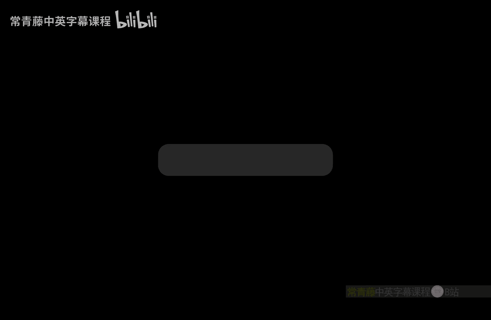
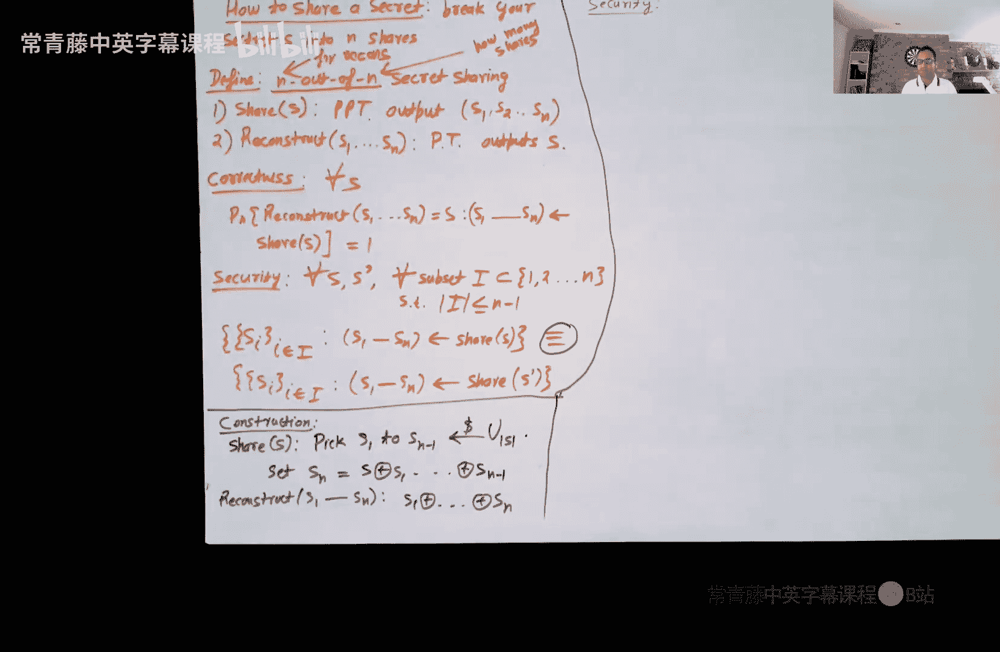
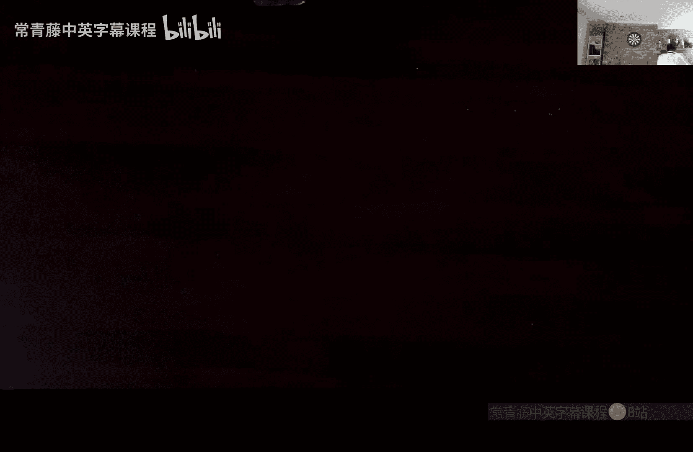
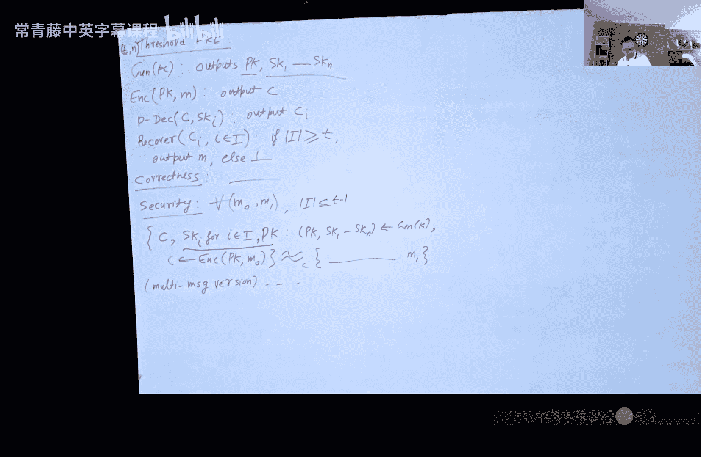

# 卡耐基梅隆大学【中英⚡密码学导论｜15.356 Introduction to Cryptography】 p12 P12 Lecture 12 Secret Sharing -BV16V6GBYEAA_p12-

Okay， welcome everyone， so let's get started。😊，So， today we will kind of consider a one off topic。

 but a very interesting topic， very important for the foundations of cryptography。😊。

It's known as secret sharing schemes。清楚。How to share a secret。

That was the title of the original paper which sort of started this line of inquiry。

 the paper was by Adi Shair Shamir is also the S in RSA。And the question is as follows suppose。😊。

Maybe coming coming to the modern times so suppose you have a lot of sensitive data and you would like to store this data securely on a cloud right so one option is of course you go ahead hire a cloud and then just put your data all on the cloud right but this data is sensitive and maybe you don't trust the cloud provider。

right this data might have your business secrets and so on and you just don't want to reveal this data to anybody so here one option is you can encrypt the data and you can just store the encrypted data on the cloud but then the question is you know where do you store the key right you don't have any reliable storage and things like that right so one option is rather than hiring a single cloud provider you can hire like multiple cloud providers right and you can break your data into several parts and store like one part on each cloud provider。

Okay and the question is how do you break the data into several parts right so one option is maybe your data is a1 gigabte long file so you hire like 10 cloud providers and the first 10% goes to the first one second10% goes to the second one and so on right so there is something which is clearly wrong with that in that every cloud provider can see some significant chunk of your data right you don't want that so the question is is it possible for me to break my data into several shares。

Right and store one share or each cloud such that neither cloud provider gets any information about mettata。

😊，Okay， so this is known as a secret sharing scheme。嗯。So， here。The idea is， you want to。Break your。

Secret， so let's denote the secret by S。Into， let's say， and shares。

And there are various types of secret sharing schemes depending upon the reconstruction requirements。

😊，Of course no single cloud provider gets access to your data but how do you recover your data at a later point right so one option is maybe you have to go to all the N cloud providers and you have to recover all the shares and only then you get back the original data so this is known as an n out of end secret sharing scheme another variant is called a threshold secret sharing scheme threshold means that maybe you set a threshold key and as long as you you have T out of these n shares anyT out of these N shares you will be able to recover your data。

So we will consider both of these in the class today。

 so let's start with the simpler case which is n out of end secret sharing much easier to construct and simple to understand so let me define。

😊，Now。And。Out of n。Secret sharing。Okay。And any n out of N secret hearing scheme must specify two algorithms the first algorithm is known as the sheer algorithm。

😊，So note that in secret sharing schemes there is no key nothing like that there is just a secret and then there are shares of the secret So the share algorithm takes your secret s。

This algorithm must be probabilistic polynomial time。And this algorithm must output。S 1。S 2 up to S。

 N。These are n shares of the secret S。The second is the reconstruction。Algorithm， given the shares。

 how do you get back your original secret so。😊，Reconstruct。And this takes as input。Some anxiouss。

This is polynomial time。And this。Outputs the secret S。Okay， its so simple。

 just just two algorithmvertms。And then there are two requirements which these algorithms must satisfy。

First， as you can expect is the correctness requirement。

 which is that you know I take my share I sorry I take my secret， I use the share algorithm honestly。

😊，To get several shares。And then I reconstruct， I should get back the same secret which I started with。

Okay， so correctness just says the following。😊，The probability that。Reconstruct of。

S1 up to Sn equals S such that。S 1 up to S， N。Are the result of。Share of S。

And this probability is just one this should hold for。😊，Every secret S。오케이。

The second requirement is of course， the more interesting one， which is the security requirement。

And it says the following。😊，If you don't have all the shares。Then you cannot reconstruct。

The the secret， in fact， you get no information about the original secret。😊，So， by the way。

 what does this n out of n stand for？So， the first parameter is。How many you need it for。

Reconstruction。And this is how many。Sharrees you have。

Okay so this first one means that you need n shares for reconstruction。

 the second one means that you the total number of shares is n。And n out of n means you need all。

All the shares for reconstruction so security is actually defined in a very similar way compared to the encryption schemes。

😊，So in encryption schemes we say the following that you look at Cypher text two different cipher textex the first one encrypting m0 another one encrypting m1 and they should look the same right so here what we will say is that you look at n minus1 shares。

😊，In the first case they are coming from S0， in the second case they are coming from S1 and they should look the same。

😊，Okay， so let me just to be consistent with the notation in the notes for every S and S prime。

These are our two different secrets。😊，And for all subsets。I， so I is a subset of。And。Such that。

The size of this subset equals n minus1 what is this subset this subset is the subset of shares that the adversity has。

Okay， so adversity can have。A-1 or。Less than in minus1 shares。

And the guarantee that we need is the following。😊，You look at all the shares as I。In this subset。

Okay。Such that。S 1 to S N is coming from。Share S。This should be。This distribution should be the same。

Or maybe computationally distinguishduishable。And here now。The shares are coming from。The secret。

S prime。Okay。Nowm here I am writing these two distributions are the same。That's a strong definition。

Competation and indinguishability also looks fine。So there's a question。

 why don't we have I and I prime？呃。I mean， if you have I and I prime and they are different。

I can immediately distinguish this from this right just by checking which side of shares is this。

So one way of thinking about it is like。😊，Let's say。Out of my 10。

 let's say nine cloud providers are dishonest。And they are trying to recover my trade secret。Right。

So in both the cases， the same nine cloud providers are different and to these cloud providers。

 these nine cloud providers。😊，啊。They cannot tell if my secret is S or S prime。😊。

So that's sort of the guarantee that。We have。RightConsider different i doesn't really make much sense here。

😊，Any other questions？And the reason I put exact equality is because we can actually achieve exact equality。

😊，🤧嗯。There is no cryptographic assumptions， no factoring， no discrete log。😊。

It's a PR information The construction。Unconditionally secure。

 so the nice thing is even if later somebody proves that p equals NPp secret sharing is one of the things which would still be alive in cryptography。

😊，不。Okay， so now let's look at how we might be able to construct an out of end secret sharing。

So it's a really simple construction。😊，Whenever we see sets in cryptographic proof。

 we can assume that all items are labeled and in adverse， we can distinguish between them。🤧嗯。Yeah。

 I am not saying that the the shares are labeled or they are not labeled， but they may be labeled。

Right， for example。If I am the IF cloud provider， maybe I know that I am the IF cloud provider。

 maybe I can even put my name as part of the share。😊，Yeah， I think in some sense。

 part of this question will be answered when we look at Chemi secret sharing。😊。

So in this n out of N secret hearing， it doesnt really matter which set the shares are coming from。

 you don't need to know the set。I mean， in fact， anyway， you need all the shares。Right。

 so the set doesn't really matter。 On the other hand， in Shami secret sharing。

 which is the threshold secret sharing， we will see later on that you need to know the index。

 actually。Okay， so let's look at the construction。So any thoughts on？How a construction might work。

It's something to do with polynomials and I don't remember all the details。Well。

 you don't even need that for yeah good。Somebody is answering XR， which is exactly what we will do。

So， the basic idea here is that you pick n minus1 shares completely at random and the last one is picked so that the x are of all of them is equal to your secret。

😊，Okay， so the construction is the shared algorithm。Works as follows。

 it takes as input of course the secret， right？嗯。Pick S 1，2。S N-1。From you。Size of the secret。

And then。Set S N to be。S。Exalt S1。X are S n-1。Now， how do you reconstruct your given S1 to Sn？

You just output。The exO of all of these。Okay， and thats that's the whole construction。哦。

So how do we prove the security of this construction？😊，All， let me give you some intuition。So。

 what we want to prove is that you look at any and minus1 shares。😊。

They don't give you any information about us。Right。

So what happens if these n minus1 shares happen to be the first n minus1 shares？

Then it's completely clear right first n minus-1 shares anywhere being sampled uniformly。

 we didn't even use the the secret as for those。So maybe a slightly non trivial case is。😊。

Maybe you are not given the first n minus-1 shares， maybe you are given the last share and then。

N minus two of the remaining ones。So， in that case in that case is there is a little bit of work required。

 but the basic idea is that you know， regardless of which n minus1 shares you pick。😊。

They will always look like uniform strings to you。

RightSo these these strings in some sense， if you know about KY is independence。

 these strings are n minus1 y is independent。Anyway will not use that fact。

 so lets try to prove the security from scratch。So the basic idea is。😊，We will show that。N n-1。

Shares。A。Uniform and -1。Stngs。And this is， regardless of the。Secret。

So regardless of you started with s or S prime。😊，诶。I look at these and minus1 shares。

 this is just uniform distribution on the left as well as on the right。So identical。Okay。

 so let's try to。To go through two cases， case one is。Our set is exactly equal to。one do啊 do。N -1。

Let's make it an ordered set。Okay。So you are looking at the first 10 minus1 shares。

Then what we will say is that。So this is the perial case。😊，For every。😔，Fixed。String vector。As1 up to。

S N -1。This， this is smallest。So， I'm looking at。Fixed n minus1 strings。Of the right length。

What is the probability that。Capital S I equals。Small S I。For all I。In。1 to n -1。Such that。

Capital as。呃。And they are coming from the share algorithm。So what is this probability？

So essentially I selected n minus1 strings ahead of time。😊。

And I am looking at the probability that the first n minus1 shares。😊。

They are exactly equal to these strings。And note that。

The first n minus1 strings are chosen completely at random。So this is just equal to one by。

2 to the power size of S。H to the power。N，-1。Right。

Which is exactly equal to the uniform distribution。Okay， any questions？うん。

So here in this case one I am really just defining the uniform distribution again。😊。

So S is the length of each of these strings， data n minus1 strings。And hence。

 this is the probability of seeing any specific vector。Now， the second case， again。

 Ill do the same thing。😊，I will try to compute so in the second case。I some arbitrary。

Set of n minus1 indices。Such that。N is an element of。系。Which means the last year is included。😡。

And one of the earlier shares might be missing。And together， these two cases cover everything。

So again， I can try to compute the probability。S， I equals。S I。So， okay。And this is for all I in。

Capital I。And。These shares are。Coming from the share algorithm。

This is what I want to compute now and I want to conclude that this should be also the same。😊。

So what is this equal to？This is equal to the probability that。嗯。啊啊啊啊。S N equals small S N。And。S。

 I equals。Small as I for。For all， I in。For all other I。Okay， so just breaking it into two parts。

And then just again， so these。These capital Ss are coming from the sheer algorithm。

So what is capital。S N。This is actually equal to。Small S， which is your。Secret and。Capital S 1。

XR capital S 2。Up to capital S。N -1。So we are looking at the probability that this is equal to small Sn。

Okay and the rest remains the same。Okay。そて。J is the missing share。Which means that。

J is not an element of。系。So then I can write this probability as。Probability that。S J。Is equal to。

Small S N。Exhort S。Exon。Capital S1。Capital has2 and so on。And then rest remains the same。Okay。Now。

 what is this probability？Note that Sj was chosen at random。And。These are anyway fixed strings。

And these strings are also chosen at random independent of Sj。So this part is just one by。

Do to the power S。And again， this part is one by。2 to the power S。To the power n minus-2， which is。

1 by。To the bar side office us。And -1。Which is also the uniform distribution。So essentially。

 all I did was I was given the。The Nth share and I was looking at the probability that this nth share is equal to a specific string right I translated I translated that probability into the probability that。

The JS share， which was the missing share as J is equal to some specific string。

And then I was back to case1。Okay， any questions？And by the way。

 once we have shown that the n minus-1 shares are coming from the uniform distribution。

 this means that the distribution is actually independent of the secret that you started with。

And hence。The left side as well as the right side。Should be identical。

Okay， so this was a very simple construction。😊，One of the disadvantages of this construction was that。

All the shares are very long actually if your secret is very long right so let's say you start with a one gig long file you hire like 10 different cloud providers on each of these cloud providers you have to store a share which is also1 gigyte。

😊，Is there any？I can improve the construction， I can improve the storage requirement。

And this is a kind of a nice， simple puzzle。So maybe I buy one gigyte of space with only one cloud provider or another once the space can be something much smaller。

There is a suggestion PRG， how specifically are you planning to use PRG？Okay。Yeah。

 another suggestion just split the key and store encrypted data， that is a good suggestion。Yeah。

 so what I can do is I have these。Many different cloud providers。I can encrypt。

My secret using some key okay， and this key is， of course， very small。

 and I can just break this key into。K1 to K N。And。These differents of the key go to different cloud providers and then this huge encrypted cipher textex。

Maybe I store it on the first cloud， right？And here， the idea is that。If， for example。

 even one of the shares of the key is missing， then basically you have no information about the key and hence you cannot really decrypt the stpherex。

So to be able to use this。This scheme we are back to computational indistinguishability。😊。

Because we have to rely on encryption and encryption will require computational assumptions。

 encryption cannot exist if p equals np。Or at least encryption where the key length is smaller than the message length。

Okay， so this is one sort of nice optimization in practice。😊，Now。

 another question is what if some of the some of the shares are unavailable right。

 So maybe here you are also thinking about。Erero tolerances。

Maybe one of the cloud providers went out of business or maybe the server crashed。

Or something like that。And you want to set some threshold T as long as so that as long as you have T shares。

You should be able to recover your original secret。If you have less than T shares。

 then suddenly there is no information about the secret。

So this is known as T out of N secret sharing scheme。D out of n。I can also write it as。D out of n。

Or the same thing， typically we just write it as this。Secret sharing。

And let's try to define T out of N secret sharing。Share algorithm is really the same。

S algorithm outputs。And secrets， right？And shares。不。Now， the。

Reconstruction algorithm doesn't need all of these and shares。

The reconstruction algorithm just needs。S I， for all I in。Some index set capital I。

If the size of this set is greater than or equal to t。Eu output。The the secret。

If there are not enough shares。Output bo。That reconstruction is supposed to fail in that case。

What is the correctness requirement？😊，For all， I， such that。Size of I is， at least。第。

Probability that。Reconstruction succeeds。And gives you the original secret is should should be one。

 right？This probability is one。Regardless of which that you take。

As long as the third side is large enough。Security refers to the case when。

The set I is not large enough。So for every set I such that。Size of I is less than T。Again。

 we are looking at。As I， for all， I in。I such that。S1 to Sn coming from the share algorithm。

This should be identical to。The same thing， except that。Your secret was a primeme。

So it' is a natural extension of the n out of N secret sharing scheme。In definitionfinition。🤧嗯。

So of building T out of N secret sharing turns out to be a much more interesting problem。

And let me try to explain to you one naive construction。So in the na construction。

 let' us try to just use nar of N secret hearing as a black box。😊。

And we will try to convert it to t out of anticiuring。Okay， so here we have several parties right p1。

比都。阿都 b。And， right。So let's deal with each。Set of tea parties， one by one。O。So what I do is。I have。

S 1 up to。SD。And let's call it one。And we will use。T of T secret sharing。

 the exc always secret sharing scheme。So， we take the share。

 we divide it into t parts using t or t out of t secret sharing skin。

And then we distribute this to the first tea parties， let' us say。Okay。

 so if the first three parties come together。😊，They can reconstruct the speaker。喂。Now。

 what is the problem with this？😊，Just the size blows up。

 you get like exponentially large in the number of parties if you have like Ts。

 say an over two or something。Yeah， I mean， even before that the problem is of course only the first tea parties can reconstruct here if you were to do it for like every set Yeah so my solution to that。

😊，And you already pointed out a problem with the solution， but okay， let me talk about the solution。

Is that because only the first parties can reconcept now， let's take another step， right？😊。

Maybe leave out the first party in this and S1。Let's generate a second collection of。Shares。

And now give it to a different subset of。Tea parties。So maybe S1 goes here and central。

And you can keep doing this。So if you， if you choose every。Subsid of tea parties。

And you repeat this procedure for every subset， right？Then basically the scheme works。

But how many times do you need to run the？Run the T out of T secret sharing。So you need to do this。

 basically。N choose three times。Right。If n and T are small， let's say constants， this is fine。😊。

But if if n is like large like 100 t is like 50 then this this is huge。

 this is this is exponential in n。😊，RightSo this is a knife construction， but unfortunately。

doesn't work in general。If n and T are pretty close， then actually this is fine。😊。

Even if n is very large。So Shami had a very nice solution to this problem。

 and that is known as Shami Se Sherry。Yeah。And he's also the one who really started。

A formal study of this problem of secret sharing schemes。是。

And he had a very nice scheme based on polynomials， which we'll look into。Okay。

 so before we look into the Shais Seet sharing scheme。😊，Let's recall some properties of polynomials。

Okay， so polynomial。1 a one。Some basic facts about polynomial。So suppose F of x。Is a degree。

D polynomial。Then we have the following properties。

First property is how do you define this polynomial， how do you fix this polynomial， right？😊。

So if it is degree D， then it would look something like the following。Equals。

A X to the power D plus B。Let me call these。Is it咯。A D x to the power D plus。

A D minus-1 next to the power， D -1。Plus， all the way up to a 0， a 0 is the constant。

So you can see that there are D plus one unknowns here。

Which you need to fix and that uniquely defines the polynomial。So how do you define the polynomial？

One option is。You fix all these D+ one coefficients。

But we will not do that there is another way of defining the poly。😊。

Another way of defining the polynomial is you just fix D plus1 points on the polynomial。😊。

So in other words， if this is what。If this is what your polynomial looks like。

I fix any D plus1 points on this polynomial。Like let's say I fix F1， I fix F2。And let's say F。

D plus 1。Once I fix these values。The polynom is completely fixed as long as it' is a degree D polynomial。

ok。😊，So defineine just says that。A degree D。Polynomial can be。Defined or chosen。好。By。就精。

T equals D plus 1。Poins。Okay， and there's a reason Im calling。D plus 1 to be T。

In case of threshold secret sharing， this st will end up becoming our threshold for reconstruction。嗯。

And one of the things to keep in so yeah， as an example here， if you're polynomial。😊。

Is a line which is a degree one polynomial。Then you need two points。

To fiscal the line if your polynomial is degree 2 or quadratic。Then you need to fix three points。

On the Y axis and so on。Right。And by the way， something important to keep in mind is that。

We are working。In model athmetic。So in particular， we are working over finite fear。

 something to keep in mind。Rather than model， lets select p where p prime or。

A finite field I don't really want to go into defining finite field and so on。

 let me just say that the difference between a finite field and group is just a group gives you a single group operation。

😊，On the other hand， a finite field gives you two different operations。😊。

Like let's say you need both addition and multiplication then。Finite field gives you both of them。

And clearly when we are talking about polynomials， you know you need to multiply， you need to add。

 so you are really talking about finite field but other than that。

 you know its just everything is just mopy。😊，That's it。The next property， which is really important。

So， as I said， once you fix these points， the polym is completely fixed。😊。

But I what if I wanted to evaluate the polynomial on something else。Let's say， here。

Let's say I want to evaluate polyial on maybe maybe not let me not talk about minus1 because negative numbers don't really exist。

 but let's say here。This is let's say deep plus two。How do I do that？😊。

In case I was working with the coefficient representation of the polynomial。

 if I know  80 minus1 and so on I can just put x equals d plus 2 and I can get the value of the polynomial on that point so that doesn't directly work。

😊，If you are working with this different representation of the polynomial where you fix d plus1 points。

So how do we evaluate any other point on the polynom？And this is known as interpolation。

 polynomial interpolation。Right， so I'm sure that。Many of you have already looked at polynomial interpolation and what it is so。

Given t equals d plus1 points。是。嗯。Can reconstruct。Any other point？off。F of x。Using interpolation。

Okay。So， in other words。Say you are given。X1， f of x1。X2， f of x2。And X T。F of xt。呃。Can compute。

F of x for。Any X。And how do you do polynomial interpolation。

 this can be done using like ran coefficients。😊，So in other words， f of x。Will be the sum of。啊。嗯。

L I of x times。F of X， I。And。I equals 1，2。对。And by the way， this is a universal。放弃了。It's a。

This function is public。And independent of。F。So just a linear operation。

You take a linear combination of the existing values of。

Of F ofxii and that gives you the value on any other point。So， this is known as。

This is an alternate representation of。发了了没有。So these Ls are。Lerangech coefficients。

And here is a third property， which。😊，Maybe you have not seen， you have not thought about before。

And let me call this。No reconstruction。If you are given less than T points。Okay。

So what this says is that let's say you are given。X 1， F of x 1。And let's say， x。T minus1。

 or let me write it as xd。Of course， you can imagine you cannot interpolate。😊，But， it turns out that。

Every other point on the polynomial is maximally undetermined。

What do I mean by maximally undetermined？Yeah， so let's say you're given these。Let's say， Fd。

So I know many points on the polynomial right and you might expect that slowly I am learning the polynomial I' am getting some information about all the remaining points as well。

😊，That is not true at all。sleC。I want to compute this point， right？

Every value of this point is possible。This point could be here， could be here， could be here。

 could be here anywhere。Right， and because this actually follows from the。

The defined property right because this is the last point on the polynomial I can choose this point to be anything I want and that would actually fix the polynomial。

It would give me a valid polym here right so this last point could be anywhere its in some sense maximally undetermined all possible values are possible and equally likely。

😊，So， if you only have D points， then that's it those are the D points you have you don't have any other information about any other point。

And this is a nice property， as you can imagine， our security will sort of rely on this property。😊。

Okay， so now let's try to。To see how Shami secret works。Any questions？

And the basic idea is that in Shami secret sharing， right？😊，嗯。😊，You have。A secret as。

Wwhich you want to share and the secret must be part of the finite field in other words it should be between0 and and minus1 or p minus1 if p is your。

Your prime。The modulus。So what you do is。You set。F of0 equals S。

So the zeroth point of the polynomial is your secret。来。And here I'm talking about。Dear out ofens。

Okay， and set。The degree of。F。Which is D to be。T-1。 Yeah， that's correct。Okay， so I fixed one points。

I need to fix Dmal points。To define the polynomial fully。So， for all。I。Such that。Iyes from one to D。

Choose a I at。Random。Okay。So， the remaining points required to fix the polymial are chosen at random。

So， essentially what we are doing is we have we are picking a random polynomial subject to the constraint that the zeroth point encodes the secret。

😊，Okay， and then your shares are。For all， I。1 to n。Okay。Your share S I equals。I and F。Okay。Note that。

You should not start from 0。Because if you give out F0， then that's essentially your secret。Now。

 how do you recover the secret？😊，And recovering a secret is just simple polynomial interpolation。😊。

Okay。If the size of。The the set is let's say， T or higher。Then you have P points on the polynomial。

You interpolate to recover。F 0。Which is also equal to the secret。 So you just output F 0。So。

 there is a question is there is there any other reason to use a finite field other than practicality is very good question yes。

Actually， there is。嗯。The problem is。This third property， no reconstruction。

 which is like maximally undetermined。So， let's say I work with the infinite set of interiortegers。

Right。In that case， if I am given like d points。And let's say my D points are in the range。

The value of the polynomial is in the range 1200 or something like that。

And then I know the lag coefficients， I have some idea that。The F。

Value on0 cannot be like 1 trillion or something like that。 right So just the size of this。F。

 just the magnitude gives me some information。On the other hand， case of finite field。

 I can actually bypass this problem。😊，In fact， how do you even pick a random number from an infin set of integers you cannot do that right you have to decide this the size first。

Yeah， so just for the trivial reason， we have to work with finite fields。Yeah。Any questions？Okay。

 so now let's look at the proof。And the proof is actually essentially identical to the。😊。

To the proof for exhaust。And again， we will have two different cases， right？😊，In the proof。

 we want to prove that given t minus1 shares。I have no information about the secret。😊。

And as you can expect， Is rely on this no reconstruction property。

So what if I am given the first t minus1 shares？If I am given the first t minus1 shares。

 then essentially I am given the first d shares from 1 to d and here f is already chosen at random completely independent of the。

Of the secret。so that case is fine and again I am trying to prove that that given these t minus1 values these values just look uniform。

😊，They are coming from the uniform distribution regardless of your secret。😊，Okay。

 so if I am given the first t minus1 values， they actually are picked from the uniform distribution。

 so there is nothing to argue here。😊，What if I am given some other set of t minus1 values？Okay。

 and from this set。I would argue that also you know， given the secret。

 I would argue that the first t minus1 points can anyway be computed。Okay， so again。

 instead of looking at。That t minus1 set。Being equal to a specific vector。

 I can convert it into the probability of looking at the first t minus1 points being equal to a specific vector。

just like in the last。And then then again， that probability will be straightforward then you are back to the first case case1。

And the lecture notes have this proof。Like the priority calculation。Okay。

 so let me skip that probability calculation because。😊。

I also want to talk about something which is known as sat encryption。Okay。Okay。嗯。So， threshold。

Public key encryption。Is something which is widely used in practice。

And here the idea is that normally we think of a single encryptor and single decor right I want to encrypt something I am sending it to Alice。

😊，She has the key she can decrypt right but sometimes you don't have a particular recipient in mind。

😊，Maybe you are encrypting a classified file。And maybe only some committee can open this classified file。

😊，可以。Maybe you know you are encrypting some document for the Congress and if the majority of Congress members are present。

 your document can be opened and otherwise not。So， this is known as threshold public encryption where I have a set of decryors in mind if all of them are present or maybe if a threshold number of them are present。

 only then my message can be decrypted， otherwise not。😊。

And threshold public key encryption can be obtained by sort of combining regular public key encryption and a threshold OSmi secret sharing scheme。

😊，And even in blockchains， for example， threshold public key encryption is used all the time。😊，Yeah。

 somebody is asking what threshold signatures， they also exist threshold signatures。Basically。

 you can consider a threshold version of almost all the prims in cryptography。😊。

In threshold signatures， you know you receive a signed document。

 you can verify that this document was indeed signed by a threshold number of the committee members。

😊，Without actually learning specifically in which committee members signed a doctor。And again。

 all of this threshold cryptography relies on secret sharing schemes。😊。

So let's see let's look at threshold public encryption。

 let's first try to define threshold public encryption right。嗯。So。

 the key transition process takes as input the security parameter。

 lets call it k or ka or something like that。It outputs a public key。😊，And it outputs。😊。

A set of secret keys， S K 1 to SK N Okay， and here we are talking about。

T out of n threshold public key encryption so similar to secret sharing scheme I can consider n out of n where I need all the n decryors to be present maybe I need threshold number of them to be present I can set the threshold to be whatever I want as the encryptor and that gives you T out of n threshold public key encryption。

Okay， so now there is a public key and then there are these these n secret keys。

 if there are n decryptors you can give the IX secret key to the IF decryptor。😊。

Encryption is the same， you just need the public key to encrypt your message。And this。

Outputs are Cypherexxi。Okay， and now here's the change。

There is an algorithm which I am calling partial dec。So algorithm takes thecipher text and。😊。

The I secret key。Okay。So， essentially everybody receives the ciphertex， all the decryors。

 I am the IAT decryptor， I have the IAT secret key， I can try to decry the Cyphertex。😊。

I will not get back the message， of course。😊，I will get back a partially decrypted Cypherex。

 let me call it CI。😊，Okay케。And then finally， if a threshold number of。

Of decryors release such a partially decryed Cypherex C。

You can combine all of them and you can recover your original message。

So we can call it recover or reconstruct。And here I need C。There I is in。Capital I。Okay。

If the size of this set， capital i is large enough。Higher than the threshold then。

You output the original message M and L。This algorithm outputs bo。So。

 correctness is what you would expect right I generated the key honestly。

 I encrypted the message honestly。😊，Then。T out of n decryors decryed the message honestly。

Then you apply the recover algorithm on the partially decrypted ciphertex honestly。

 you should get back the same original message with probability 1。😊，Now how do I define the security？

Security says the following that。If only。Let's say t minus1 people decrypt the cpherex。

Then by combining all these partial decptions。You cannot get any information about the original message。

😊，In particular。By looking at this value。For every M0 and M1。

 you cannot even tell the difference between。Something which encrypts M0 versus something which encrypts M1。

Okay， essentially what I am looking at is。You are given the Cyphertext C， and you are given。SK I for。

I in capital I and here the size of capital I is actually small。At most3 -1。And。And the Pk。

 of course。And then PK and SK1 to SK。And coming from key generation。And then。

The Cypheraxex C encrypts m0 in this case。This is computationally distinguishable from。

The same thing except that you are encrypting M1 now。Okay。

AndNot that I am not including the partially decrypted Cyphertex。Only the secret key here， y。

Because earlier， I was saying that given。T 1 partially decpted Cyphert。

I cannot recover the original message。😊，But now I am not giving this partially decpted spherax。Okay。

 and the reason for that is that。😊，I mean， given t minus1 secret keys anywhere you can recover t minus1 partially decrypted Cyphertex so I can put it in here if I want。

 but it is not necessary。Because it can already be derived from SKI and C。Okay。

 and I can also define， by the way。Multi message version， which is more interesting。And so on。

So how do we construct this threshold public key encryption？You can speak others。In this definition。

 in fact。Because I am only talking about a single message version。

Partially decpted Cyphertex might as well be the secret king。Which is not the most interesting but。

That's why I said the multi message version is more interesting。

So let me briefly write about the multi messageage version where。😊，嗯。

So another requirement is in some sense， very informally。Sea ice。Shouldn't help。

The adversary decrypt。Another sphertex。And the construction which we look at actually satisfies this property。

😊，Okay， so what， any ideas for construction？So one trivial construction is as follows。😊。

You can use any public key encryption。The key generation process uses。

Uses any public key encryption in a black box way。And just runs the key generation process。

Of this given non threshold public encryption end times。

And then your PK is just Pk1 concatenation Pk2。Concatenation， PKN。And。And then you output。

P K and S K1 to。SKN。So essentially like1 different public key encryption systems running in parallel。

How do you encrypt the message using？Thats public key。ok。So。You run the Sha secret sharing scheme。

On the message。M and。What you do is you encrypt the IAT share with the IIAT public key。So。

 you output。PKI of S。富罗嚟。Okay， so essentially the Cyphertex contains n encrypted shares。😊。

Okay and now if I am the IS decryor， I look at the IS encryptor chair and I just decrypt it。😊。

And that's my partial encryptption。So if I have the Iot secret key， I can recover the。

The Ih share and I output the Ih share。And then， recover is。Same as reconstruct。Offional musical。

If there is enough number of people sort of decrypting the cipherex。

 then you have enough number of shares， then you can just run the reconstruction procedure of Shami secret sharing。

Okay， so this is fine。A major downside of this is that your cpherex size is actually very large。

And even your public key size。then crypter is having to do a lot of work and crypter has to divide the message into many shares encrypt each year individually right so size of the Cyphert blows up by a factor of n。

😊，They are better constructions。There is one in the notes， which is。Based on Algamal。

Public key encryption。And the idea in that is。The public key remains the same there is just a single public key。

😊，And。Only the secret key changes， only the secret keys in some sense， secret shared。

And still it turns out in Algamal， you can still decrypt and you can still combine the。

The various partial decryptions。So we will look at the sgamalpK maybe next time。Okay。

 we will stop here。 and I'm around for questions in office hours。

