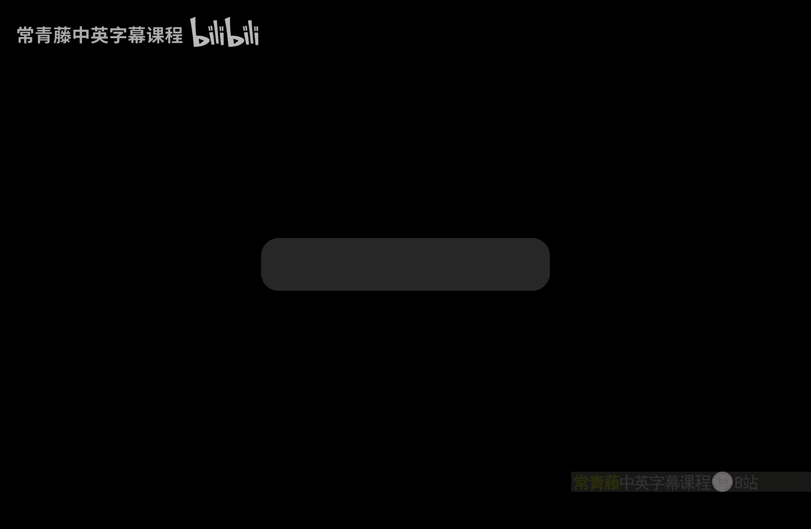
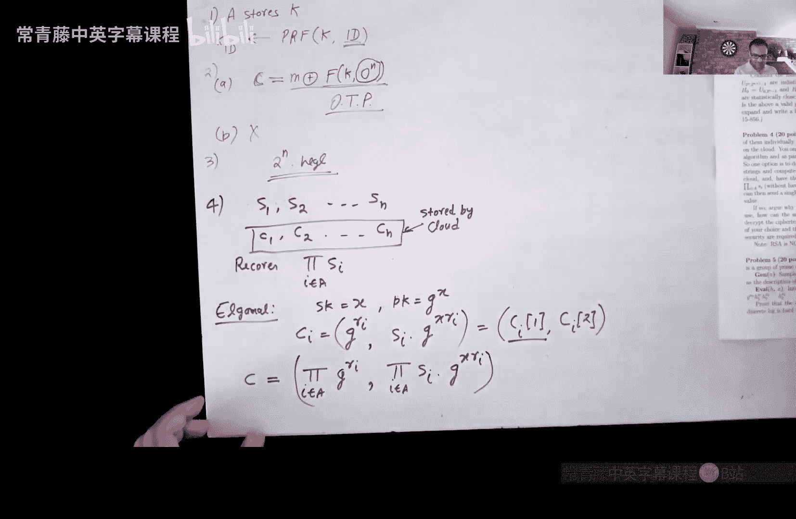
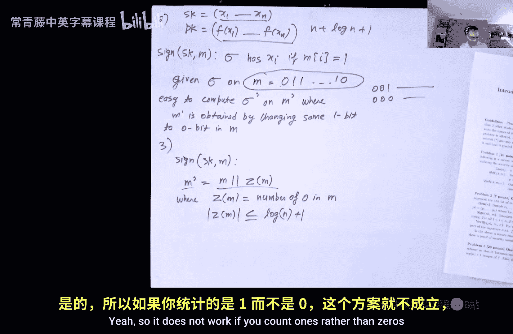
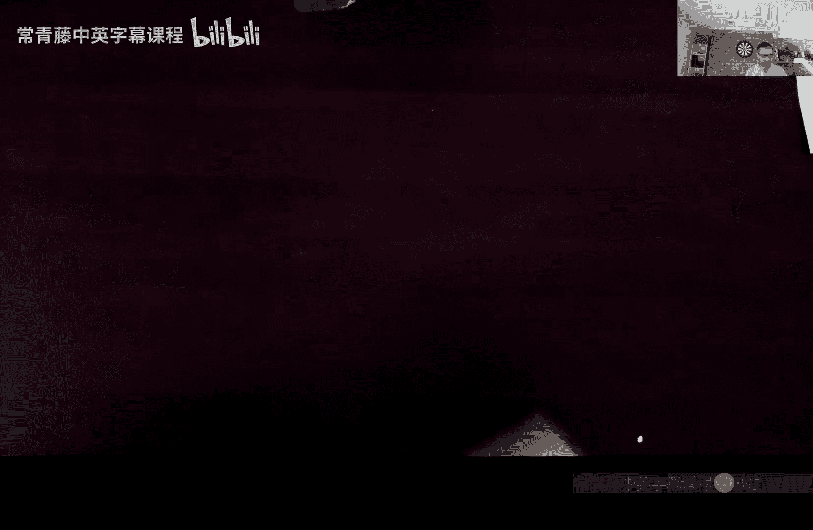
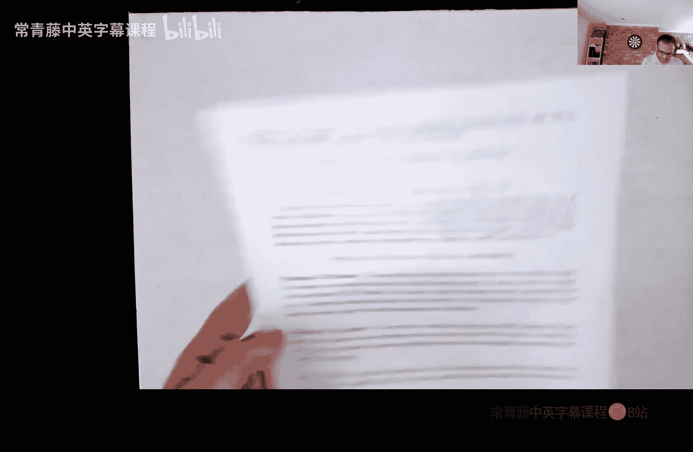
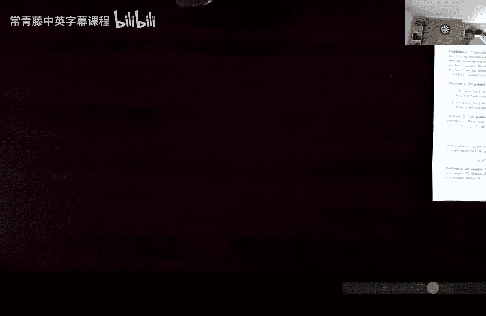
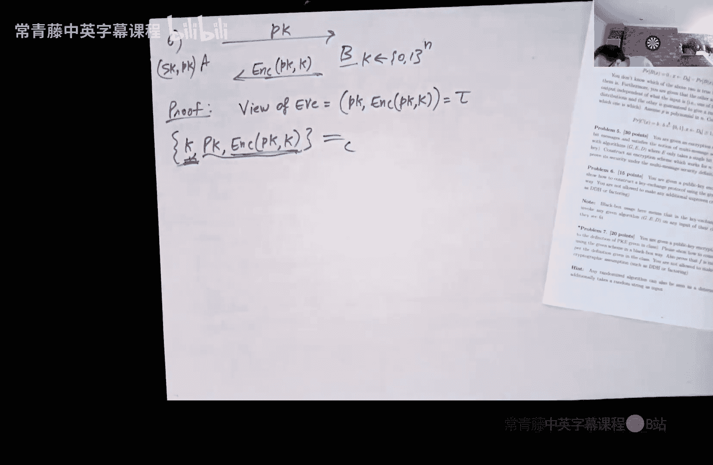

# 卡耐基梅隆大学【中英⚡密码学导论｜15.356 Introduction to Cryptography】 p13 P13 Lecture 13 Midterm and Homework Problems -BV16V6GBYEAA_p13-

Okay， welcome， everyone。🤧嗯。So。Today we are sort of officially past the halfway mark in the course。

And today I wanted to take some time and I wanted to go over the midterm problems as well as some of the problems from the homeworks on which the students did not do as well as other problems。

Okay。So。So first of all， yeah， even before we start getting into problems。

From next week we will sort of start the part two of the course so this course is roughly structured into two different parts the first part focuses on sort of basic foundations proofs of security how to write proofs of security definitions of very basic and fundamental primitives like encryption signature and so on。

The second part is more about how to use these primitives in a bigger system like like we will look at blockchains zero knowledge proofs and secure multiparty competition so the first part is more about building the foundation and the second part is you know making sort of your building taller and taller。

😊，So in the first part。😊，A big component of the the of the course was doing proofs of security and doing proof proofs of security in the right way so that is always sort of the more tricky part of the course because。

😊，You know， you might have realized that。You know。You can do proofs of security but many students they are not sure whether they have done this proof correctly or is there something missing or something like that so rest assured that is not unique to you crypto proofs of security they are sort of very tricky and it takes a while to sort of get a hang of what you need to do and what all are the exact steps required。

So it's great so we are passed that part of the course and。😊，You know。In the second half。

 we focus more on the big ideas rather than the subtle things which people tend to miss。Okay， so。

So let's go over the midterm problems， actually one。Common mistake。

 which the T pointed out and they asked me to sort of talk about it。Is。

Suppose you write some probability。Of something。To be greater than negligible。

So what does this this mean this doesn not mean that the probability automatically becomes noticeable。

This just means that there exists this negligible function such that your probability is greater than this negligible function。

😊，But this is it is still possible that。This probability is is sort of still。

Less than equal to another negligible function。Neegligible prime end。So， when we write。

This negligible of n， it just denotes some negligible function。So。

 these two statements are entirely possible together。

 so if you want to say that something is noticeable it is not sufficient to write something like this。

 rather you should explicitly write greater than equal to some noticeable here。Okay。

 so this is just how to write things correctly we are not deducting any points for this。

 but make sure that。That you use the right language in future。Okay。

 so let's start with the first problem， let me remind you what the problem was。

So in the first problem you have Alice， Alice has hired you as a consultant。

 Alice is the president of a large company having， let's say hundreds of employees。😊。

And Alice would like to send secure encrypted emails to each of them。Okay， and。

The idea is that Alice only has a mobile device， so she cannot really store 100 different keys on the mobile device。

 one for each employee， but rather she can actually remember the email ID of each of her employees。😊。

Right， and。Yeah， you have to design a solution which sort of only uses very small storage to store all the keys right so clearly Alice cannot sort of generate 100 different random keys and expect to sort of compress them and store some small part of that。

So that's not going to work， but rather what you have to do is。😊。

You have to use pseudo randomness here， rather than random keys。So one option is to use a PRG。

Alice just stores a PRG seed and。😊，呃，BS allows you to。

Expand a small seed into a large seed into a large random looking string， but PG。

 it is not clear how to use it， right because。If you want to use PG。

 Alice also has to remember you know， which part of the output to use for which employee。

And looking at the human ID， that is not some information which you can readilyly derive。😊。

So PRG doesn' not really work correctly the correct solution here is to use a PRf。😊，Okay。So。So。

 Alice stores。Prf seed or let's call it key okay？And the key for email ID， this ID。Is derived as。

The PRf output on K comma。This email， lady。Okay Alice just store Alice just has to store this single secret keyK and you invoke the PRf on that。

 the second input would be the email ID all the email IDs are unique so。😊。

All the keys which you would end up using would be sort of pseudo or random。

And then you can use any encryption scheme of your choice， a yes， algama or whatever。

Algamal is actually public key A or any symmetric encryption scheme you can use。😊，Okay。

 sir I had a small doubt in this。Yeah so so while doing this question I also thought the same thing so I specifically did not take PRf because it is not given that the email IDs are part of the group and it can happen that two email IDs like when you take modulus you can like they map the same element of a group and that's why like and for PRG what you can do is you can alphabetically sort the email IDs and then like the first email ID so like say you have the employees you generate a big first of all for the PRf this it doesn't need to be part of any group the construction of PRf which we saw in the class that was for arbitrary strings。

Okay okay okay I'm sorry but but okay for PRG like you can alphabetically sort the like the email IDs and so for example。

 if your key length the output the key lens that you need for one employee's K you generate a PRG and you have T employees you generate K to T length and you alphabetically sort your email IDs and the first k goes to the first the second goes to the so I think yeah we will give some partial marks to that solution but the problem is。

If you want to alphabetically sort right it's not clear that you can do it entirely in your head you have to write all the email IDs on a piece of paper or on the mobile so like like if you have a PRf then like you'll need a PRf whose second input is as large as the longest email I right yeah so you will have to use that that's correct。

So I thought that that might or might not be possible because like。

Like the email like is a string and like。So in the class。

 we saw PRfs where the second input can be an arbitrarily large string。Okay， and in fact。

 if you are worried about that， you can even apply a collision resistantant hash function to the email ID first and then you will sort of get a fixed length output。

😊，So maybe that solution is even better， but。Even if you write the solution。

 you will get full marks Yeah， the problem with sorting is that then you are assuming you are making an additional assumption you are assuming that Alice not only can remember the email I D。

 but also remember the index。Where that email ID occurs in the whole list。

So that may or may not be a reasonable assumption and at least the question doesn't say that you can make the system but like I thought the question was basically on the point of the storage of keys like you you don want to limit the storage of the keys itself like the email ID related storage。

😊，Like it is in the head， okay， I understand understand， thank you。

How a proof of security for this did we expect， is someone just having a hand Yeah。

 so proof of security for this。So。Even if you write pretty clear。

 even if you write a couple of lines saying that all the email IDs are unique and hence you're invoking the PRf on different inputs。

 which means that the PRf output looks like a random function， that's good enough。😊。

But but in the midter， we are sort of more liberal about。Greding。

So we don't really expect you to show all the hybrids here。Any other questions？Okay。

 so let's look at the second problem。So the second problem is F is a PRf and you are given a secret key。

Inncscriptption scheme。So secret encryption scheme looks something like the following cipher text is。

M XR。F of k。And。A string of zeros。And you are asked， is this a good？I missed。

 there's a question in the chat。We assume randomly sampled key in security of symmetric key。

 is it an issue with the output of the PRFS pseudo or random？No， it is not so。I mean， the full。

 if you want to write down the full proof， there will be hybrid where you switch from using PRf to a truly random function。

😊，And once you are using a truly random function， then all your keys are really random。😊。

Coming from the right distribution。Okay， going back to question2。

 so this is how your cipher text is generated， right？And here。

You are exing the message with the output of the PRf on an all zero string。Well。

 output of the PRF on any string looks essentially uniform。Are indistinguishable from uniform。

 So this is。This is very similar to using a one time pad。So this is secure。This is part。

And part B is asking。Is the above Se key encryption key multi message secure？

And the answer to that is clearly no because you are using the same key。😊。

If I was putting the message here or some sort of random string。

As opposed to a string of all zero then maybe we can talk about multima security。

 but I have the same key I have the same string of zeros so every time I am exing with the same thing。

And this is analogous to using a one time pad where you use the key the same secret key multiple times and this is clearly not secure right I can for example take two different cphert I can exc them。

 the keys will cancel out and I will get just X of two different messages。

It already reveals some information about these two messages。So， no。Going to multi security。Okay。

 I hope this is clear。So let's move on to problem  three。

 which was only for the master's in PhD section。So problem three gives you a large number of distributions。

Any two distributions to subsequent distributions。They differ very little。 They differ in only like。

呃，on the。In the beginning and the end， just just two strings。So， any two consecutive distributions。

 they are actually very close， computationally in distinguishistinguishable， in fact。

 they are statistically indistinguishable。😊，But when you look at the first distribution and the last distribution。

They actually clearly look very different。Its's easy to distinguish these two distribution。

 so what is going on？Well， the problem here is that there is an exponential number of fiberids。😊。

The number of distributions is exponential， it is actually true to the power N， I believe yeah。

And even if two consecutive distributions are close to each other。Yeah， when you sum them all up。

 it will be true to the power n times。Some negligible quantity and this may or may not be noticeable。

So at least the usual hybrid argument doesn not let you prove that fast and the last distribution they are indistinguishable。

😊，And this is where the proof breaks down。Okay。So let's look at question four。

 this question is actually pretty interesting。嗯。So。

 this question is essentially asking you to design what is known as a multiplicatively homomorphic encryption scheme。

😊，Okay， and the idea here the what the question is asking is。😊，You are given several strains。

 several messages as 1 to SN。😊，You can encrypt each of them individually using a public key encryption scheme。

😊，And you store all the cipherts on the cloud。Okay， and you yourself store only the secret key。😊。

None of the ciphertex and none of the messages。Okay， so we have these messages as1。

S2 up to Sn and from these let's see you get Cyphertex c1， c2 up to cn。Okay。

 and now what you need is。You would like to recover。

The multiplication of some subset of these messages。I is an A。Where is is some， some subset。

So how do you do that？😊，Well， one option is you download all the cipher texts from this subset。

 so clearly cloud is just storing this。So one option is to download all the Cyphertex。

Cresponding to this subset a， you decrypt each of them individually and then you multiply the resulting messages。

😊，That would allow you to recover。This quantity， but can we do something better， right？

Can you have the cloud compute a single spherex？s that you just decrypt the cpherex and you recover this quantity and the cloud doesn not have the secret key or in fact doesn not have any secrets at all just the cloud just chose the cphertex。

😊，So here the best way to do it would be to use almal encryption。😊，Okay。

 so if you use Almal encryption。😊，How does it work， Your secret key would be some。Let's say x。

Your public key would be G to the power X。Okay， and your Cypherex C would be。Due to the power。

 let's say R I。搞吗？S I times。G to the power X。Okay， let's also denote it as。C i of。1， and。C I of two。

So， each spherex has these two different components。So。

 the cloud is storing all these Cyphertexs and then what you can do is you can send this set a to the cloud。

😊，And cloud can just。Computer Cyphertex， C。Which is as follows。So， that is just pi of。I in a。

G to the power R。Which is just。So， just the first component of the cpherex from set a multiplied with each other。

And i in a。S I times。G to the bar x。啊哎。Okay。

And now， let's say。Deote are to be。Sumation， I in A。啊哎。Okay， then what is C C is just。

So when you multiply all these。呃Comon。It， it translates to addition in the。In the exponent。

So you would just end up getting g to the power R。And then。G to the power， Xr times。Okay。

 and in fact。Let's even denote。S to be。The multiplication of。All the messages in this set。嗯诶。

Then this is just S。O。So this is a valid almal encryption of。😊，Just S。

You don't need to do anything special to decrypt it。Okay， so server。Sense。C to。Who is the character。

 Alice or you okay。The server sends the Cypherex C to you， you have the secret key X。😊。

And you can just decrypt the ciphertex as any other alalciphertex and you can recover the message S。

 which is exactly what you want。😊，Okay， so this shows that。

Algamal encryption has this property of being multiplicatively homomorphic。

And there is this whole area of cryptography， which is about designing different type of homomorphic encryption schemes。

😊，So actually RSA also turns out to be multiplicatively homomorphic because in RSA。

 the cipher textex or rather textbook RSA。😊，Ke textexbook RA。Wwhich is not secure by the way。

 but the Cypher textex in textbook RSA is also just S I to the power E where e is the public key。

Right， so if you multiply all these different sphert together。😊，Pi of I in A C I。 that would be just。

Okay， which is just S to the power E， and if you have D， you can again recover S as usual。

RightBut unfortunately， as we all know， textbook LA is not secure。

 so this is not a valid secure public encryption scheme。😊。

But many encryption schemes have this property。😊，And there's also something which is known as fully homomorphic encryption。

We will talk more about this maybe in the last class。just denoted as FHG in short。

So here I was able to take several cipher texts having several messages I was able to multiply these messages。

😊，Can you add messages。Turns out in Algamal。 we don't know how to。How to come， how to add messages。

 right？If I am able to come up with an encryption scheme。

 which allows me to multiply messages as well as add messages。😊，I actually get。

An encryption scheme which allows me to sort of。Evaluate a whole circuit having addition gates and multiplication gates。

😊，These are known as athmetic circuits。Right so additional multiplication。

 if you get them together that is very powerful you can evaluate any athmetic circuit。😊。

Coming to Boolean circuits， lets say I give you an encryption scheme which allows you to sort of nad two values。

😊，Okay， and we know that Nand is actually the universal operator， its the universal gate。

If I give you the N gate you can implement basically any circuit with the N gate right so the question is can you design an encryption scheme which allows you to evaluate N gates and the answer to that is yes this is。

😊，This is this is a scheme which was given by Craig Gentry in 2009。

And that that was the first ever fully homomorphic encryption scheme。

 we call it fully homomorphic because essentially given a bunch of cphertex。

 you can compute any function on these cipherex without having to decrypt the cphertex。😊。

And this is really powerful right so this means that I can just encrypt my data。

 send it to the server。😊，Without decrypting the data server will be able to do arbitrary computation on this encrypted data。

 return the result back to me in an encrypted form and I can just decrypt it and I can get back the result。

😊，Right。So think about it， this is like executing any program a C program or a Python program。😊。

I can execute a Python program without having access to the input。

 I get encrypted inputs and I execute any arbitrary program on these inputs and I can compute encrypted output。

😊，This is very useful in cloud computing and cloud security and so on。

So anyway we will not get to look at foliomomorphic encryption that is pretty complex based on something which is known as lattice based cryptography。

 but even the simplest encryption schemes like Algamal have at least some homomorphism in built inside them。

Okay， so any questions before we move on。

So now let's look at problem 5。

So problem five is about designing a collision resistant hash function family。

So the description of the hash function is something like a following。

You have the key generation procedure or sorry the。Procedure for generating the hash function。So。

 here G is。You are given that the order of the group is Q and。G is a generator of this group。

So you sample。It 1， at 2， up 2。HK。Where。H I equals。Due to the power array。

Where are I is sampled at random from。Zq。O。These are just random group elements。

And this is basically the description of the hash function。And then how does this hash function work？

Takes as input x。Where x is interpreted as。X0。X 1 up to x K。And the output of the hash function is。

Due to the power x0。S to the power x1 h1 to the power x1。Times h K to the power， X K。

And you have to prove that the above hash function family is call and resistant。😊。

Assuming the discrete law problem。So we saw something like that in the class in one of the lectures。

But。We just had a single h there we had G and we had h so it sort of roughly had a compression factor of 2 here we are building a hash function which has a compression factor of k plus one。

Okay， so let's try to solve this problem。So， to prove that this is collision resistant。😊。

We will use contradiction， of course。So given an adversary a。Which finds cols。

We build another PPT adversary B。Which takes as input y？Where y equals。🤧嗯。G to the power R。

And it outputs。呃。啊。With some noticeable probability。And this will be a contradiction。😊，Right。

So note that here the adversary B has to choose the hash function。And B has a challenge。

We have to solve the discrete log problem， and we have to embed the instance of the discrete log problem in the hash function。

That's a very important step。 I believe that some students。

Sort of implicitly assume that they are given the hash function and。Somehow。

 they have to solve the discrete log of。Of one of the Hs。So。

 that is unclear what you are doing in that case。You always have to take as input the challenge which is why and then you have to compute the discrete log of y okay so B works as follows。

We chooses。三。J randomom。And J will be from 1 to k。😊，And sets H J equals。喂hy。

C called doji to the power。And for all other eyes such that。I is not equal to J。

We will sample our eye。Itself。So it knows all right。And sets。H I equals g to the power。All right。

Okay。So we knows all the exponents except。This one。And let me。Highlight this。Okay。Next is be invos。

A on。This description， h 1， h 2 up 2。H게。Okay。😊，Then， if。A response with。So suppose a responds with。

Two inputs。X and x prime such that。This is the first inputs first input is x。0 x 1。Up to x K。

It's not equal to。X0 prime。X1 prime and。Xk不ラ。Okay。收。That diversity a finds a col and gives us。

This pair of values on so these two inputs are not equal on the other hand。

 the output of the hash function on these two inputs is the same。Which means。But。G to the power x 0。

Dmes。H1 to the power X 1。H K to the power X K。This is actually equal to due to the power。X0 but time。

H1 x1 prime。H机。Escape prime。Okay， so air points with inputs which satisfy this condition。So。

 this also means that。X 0 plus。R1 x 1 plus。RK， X K。Is actually equal to。X 0 prime plus。R 1。

 x 1 prime plus。RK Xk。But I am。And this is mod Q because。Q is the order of the group。Right。

 and here I am just using the fact that。Si is equal to G2 the power R。

So this value is equal to G2 power r and x1。So I am just taking the exponent of G and they should be equal moleculeq。

Is this step clear？And now my the is。Let's call it claim1。There exist， at least。😡，There exist。

 at least。Two indices。J， let' us call them J1 and J2 such that。嗯。Such that x J1 is not equal to。X。

 J 2。And。X， sorry。X J1 prime。Xj2 is not equal to。X J 2 prime。Actually， you don't even need to。

 you just need one index to be different here。And the idea is that if none of the indices is different。

😊，Then。Yeah， then basically。啊啊呃啊。Then it goes x prime。Sorry，1 x equals x prime。

 we assume that we false。 Yeah， then x equals x prime。And okay， yeah。

 the reason I need two in this is to be different is because。If just this is different from this。

Then I might fail。Okay， I need one of these to be different from one of these。

That's what you need to prove。 in fact， even in the previous construction， which we saw in the class。

 we did something like that。Okay， and this is actually easy to see， if not。😊。

Say only one index is different， say only J1 is different。This would actually end up implying that。

R这 one。X J 1 is actually equal to。R J 1 x。J1 prime。Modcu。And this also means that。

X J1 is actually equal to x prime。J1 Markque。And this is by。Multiply by inverse of。R这1。Okay。

 in verse X， this is because Q is applied prime。😊，So at least two indices are different。

 which means that。One of the index must be here。One of the index， it implies that。四。

J1 is not equal to0 One of the indices is non0， we call that let' us say J 1。Now。

 what is the probability that。J equals J 1。So， J is the location where I put my discrete log。

And this is at least。One by game。Okay， which is still non disable。And if。Yeah， if this happens。Then。

Yeah， so in that case。I can actually compute。아제。And how do I compute Rj？😊，Rj times。X J minus。

X prime J would be。Some known value。Mod Q。 So now I am just coming back to this equation。So。

 in this equation， I know every single value except Rj。😊，Okay， this is because。

H J was y I don't know the discrete log of H J， which will be R G。I know everything else。

The remaining Rs I chose on my own， I know all the Xs and X prime， okay。

So I can take all the known values to one side and I will be left with something like this。

And now I have the fact that this is non zero。So， then I can compute。R J and。

This is what my output would be。 This would be the discrete log of y。And that's it。Yeah。

 good question and good answer。So at least one by it could be greater than one by k because multiple indices might be different。

🤧Okay。Any other questions？

So let's con continue to the last problem。So， in the last problem you are given a pseudo random generator G with n bit stretch。

 so it takes an n bit input and gives you a 2 n bit output。

You have to prove that G is also a one way function。Why， okay， let me see the questions。

Where are we using the claim that two indices are different have good question。So， note that here。

J is not equal to 0， so b was given some challenge y， right？

And B choose some index J and sets at J to be y。J cannot be 0， right？ There is no x0。

 X 0 is the same as G。给。So this， this means that。If only x 0 was。Different from x0 prime。

But all the other excs were identical。Then you never get to solve the discrete lock problem。Right。

 because you are。Your chosen index is， is somewhere here。 the randomly chosen index。

On the other hand， if you have a guarantee that at least two are different。

 then one of them can be 0， but the other one has to be from one of these。😊。

Y is R J a pre image for y that' is just by definition。We are setting hj to be y。And。

R J is the pre image of H J。 This is equal to G to2 power。알姐。So， by definition， R J is the。

Disputte log of H J。Not pre image。Rj is the discrete log of Hj and hence it is also the discrete log of y。

😊，Okay，s random generator。So you have to show that G is a1 way function， what is the intuition here。

 Y must G be a one way function。So， suppose I get。The output of G， which is 2 nmbs。

And I am able to find an end bit input。😊，Which leads to this2 n bit string。

That means the output came from the TG。Sorry。You can assume it came from the PRRT。 Yeah。

 it's very high probability。 Yeah， then we know that that that that string cannot be truly uniform。

Okay， because you cannot compress a truly uniform to string into an and string。Okay。

 and I had try to do this a little more formally。Prove that G is a one wave function。

So say you are given。Some people do adversary a。Which inverts。G with some noticeable probability。

Okay， then we will build B。To distinguish。Output of G from。Uiform。So what does B take as input？😊。

Big takes ast put some y where。Why is it 2 n bit string？Okay， and we has to guess。

Is it the output of a PRG or is it truly a random string？😊，Okay。So B works as follows。Be in works。

Aon way。O。Now， there are two cases。是。Ay outputs。Xs， such that。Gpher equals y。

Which means that a indeed successfully inverted。Then B outputs。The gas of B is just PRG。Else。

 what does the output。SB outputs。A random guess。O， with probability half b guess PG。

 probability half b just says random。This is case 1。This is case 2。Okay。

Now we are given that case 1 happens with。With noticeable probability。Okay， why Because。

B because the adversary8 does indeed invert with noticeable probability。And now my claim is。

This claim will essentially complete the proof。In this one。Guess of B is。Correct。With。😔。

Probability 1 minus。At least one minus negligible。Okay。And why？🤧嗯。嗯。

So if a successfully manages to in。Then。Actually， the。Output must indeed be coming from the PRGG。

And this is because if。Why was a uniform。2 and bit。String。Probability that。There exist x such that。

G of x equals y。Is actually negligible。And why is that Because， you know。

There are two to the power and possibilities for y。So I total about 2 n。

And there are two to power and possibilities for x。These are different points。

So very few values of y。To do the power to n minus to do the power n。Values of y have。No Blue image。

They have no pre image with respect to x， you cannot invert them。Okay。

So this means that if we are able to invert them， then。The output is indeed the output of a PD。

Except with nelig probability。Okay， so we have two cases in case two we are winning with probability half in case one we are winning with probability very close to one。

And case1 happens with noticeable probability。So， let me now skip the remaining sort of equations。

 but when you take the average overall of case1 and case 2。

Your probability of winning would be half plus noticeable。Okay， any questions。

We can do the probability calculations also if somebody is confused。So in general。

 this type of argument is used a lot in cryptography。In one of the cases。

 you are winning with priority half。In other case， you are winning with probability noticeably better than half doesnt need to be close to one。

Then the average of these two cases will also be noticeably better than half as long as both of these cases occur with noticeable probability。

😊，Okay， so now let's move on to the homework 3。So in homework 3， I want to talk about。

Primarily the third problem。In fact， the second problem as well because they are connected。

So in the second problem， you are given a one time signature scheme。Which is clearly insecure。

 but it's in it's insecure in a very interesting way， which will help us。

Also solve the third problem。So in the second problem， how do you sign？

So maybe lets let's look at the problem first。So you want to sign n bit messages。In this problem。

 you just generate n random strengths。From the domain of f input domain of F。

And the secret key is Sk is just。X1 up  to x N。And。Yeah。PK equals。F of x1 up to F of x then。

And how do you sign a message？So the signature just consists of。Signature sigma has。X， I if。

The IF bit of the message m equals1。Okay。So you look at the places where the masses is zero and you want to include include the corresponding excise。

So， this is clearly insture because in particular， look at all zero message。😊。

The all0 message has empty signature。And even without making any query。

 I as an adversity can always forge the signature on the all zero message。Okay， going further。

 in fact， give on a signature on。A message， let's say given a signature sigma on some message。

Message M， let's say， messages 0，1，1。云子咯。Easy to compute。Sigma prime on any message M prime。Where。

Epri is obtained by。战争心。1 bit to 0 bit。NM。So essentially I can take this message。😊。

I can flip any0 to 1， sorry， I can flip any one to 0。

And that only makes the signature shorter because I just have to take out that corresponding X。Right。

 so given a signature on this message， for example， it is easy to compute signature on 0，01。😊。

The rest of the message remains the same are0，0，0， and so on。Okay。

 so main thing to keep in mind is that its easy to switch1 to0。

But can you do it the other way around as well？Can you switch any0 to one？That you cannot do here。

If you want to switch any 0 to 1， you will have to invert the one way function because you don't have the corresponding pre image of the one way function。

Yeah。Okay， so this is as far as problem2 goes。And this also gives us an idea to solve the third problem。

So in the third problem。We can increase the size of the secret key and size of the public key。😊。

From M strings to。N plus log n plus1 string。Not all the way up to 2 n。

2 n is what we did in the class。😊，But here we want to do something more efficient。Okay。

And the idea is。We modify。The signing algorithm。So given the message M。

 you define another message M prime。Where M prime is M concatetnation。Z of M。There's Z。

Of M is equal to the number of。Zeros in M。Okay， you represent m as a bit string。嗯。

And you concatenate the number of zeros。So what would be the size of。Z of M。

My claim is that size of z of m is actually less than equal to。Login plus one。

Right if I have 100 bit message， for example。😊，Then I need to represent a number which can be from 0 to 100 and that is just log 100 log 100 plus。

Okay， so now I have a message and prime whose size is n plus log n plus 1。😊。

And then I just use this previous scheme from question two to just sign this message。Okay。

 and even during verification， you have the message M， you can compute M prime。

And you can verify this signature。Yeah， so it does not work if you can'。Once rather than zeros and。

 and。

I'll go in more detail。In the proof。Okay， so now let's say avers is trying to forge the signature。

And again， we are just trying to design a one time signature key， keep that in mind。

So here we can consider two cases。So， maybe let's look at。Let's try to do it by contradiction。

Say adversity。Manaages to forge。Right。嗯。On the message， let's call this message now。

M1 which is not equal to M。Now we have two cases。Cs  one is。And one changes。From。0 to 1。In M。

 So M1 is different from from M， right， which means directly is one of the bits is different， right。

That bit could be you change 0 to 1 or you change  one to0。So， let's look at case 1。

At least at one position M1 changes。M。From 0 to one。At least at。1 index。O。But this is already。

So is already a contradiction just from。From the scheemia in problem to itself。

The property that we observed in this scheme in problem two was you actually cannot change any zero to  one。

😊，Because then you need to include some pre image in the signature which you did not get。

As part of the signature on the message M。So we didn't even make use of our change in this case。

What about the second case， Second case is。M1 doesn't change。Does't change any bit。From 0 to 1。But。

Doess the other way around。And when changes from。1，2，0。

So this is the most more interesting case because this is exactly the problem that we were having in question too。

😊，You can easily change from one to0。But this actually implies that。Z of M1。Is actually greater than。

Z of M。Okay。I did not flip。N 0 to 1， but I flipped。Some were 1，2，0。

It means that overall I ended up increasing the number of zeros。So Z of M1 is equal to z of M。Okay。

Now， if this number is larger than this number， you represent both numbers as bit strength。

This means that。There must exist。Some index。Where。Z of M1 is 1。But。Z of M is。0。Okay。

 that is the only way Z of M1 can be larger than Z of M。😊，But what does this mean， this means that。

Now I look at the second part of the signature。Now， in the second part， I have actually。😊。

Gone from zero to1， I have changed some zero to one。Which again。

 I cannot do in this scheme given in problem two。And this is not the fool proof of security。

 This is just the。H， level lady。Once you are able to prove that。

At least at one index in the overall signature of empire。The adversary is changing sum0 to1。

Then again， you build an adversary to invert the one way function by taking the image of the one way function。

 putting it in one of the random locations。😊，And hopefully that is the location which the adverory inwardts。

But here it is clear that adversary is actually inverting the one we function at least in one of the locations where。

😊，Adversary is going from zero to one。Okay。Should we move on to the second homework？

是。So let me start with the second problem。

So the second problem， you can make the DDh assumption the DDh assumption says that。

Due to the power A， due to the power B， due to the power A Bs computational indistinguishable from。

Due to the power A due to the power B and due to the power R。

And then you have some other distribution whose computational distinguishability you need to prove。😊。

So for now， let's just start with the D。抓不住。G to the power B， G to the power。A。

Its computational anddable from。Due to the power。K， this implies。That。Just for fun， I will add。

Another random group element。This is just a2 is is is random。In both distributions。Okay。

 this really has nothing to do with。😊，Anything else？嗯， you know。

These two are also computationally distinguishishable。Now， what do I do？嗯记 to the power。A2 B。

 So I replace B by a2 B。记 is about aB。To this is comparison distinguisher from。Grupa r。0得 aboutエ度。

Why is this the case？So first， I added some random element and then。

I started doing strange things with this A2。I put a2 here。So why does this step follow？

If you could distinguish the latter one， you could distinguish the former by just doing the multiplication and then using your distinguishuisher for the second。

有。Good， thats that is one way of looking at it。 in fact there is there is a direct lelemma as well。😊。

If two distributions are computationally indistinguishable。You can apply any PT function。

On these distributions and the output would still continue to be。Competly distinguishuable。

So note that I am generating a to myself。I can take this element and I can compute given this I can compute due to the barrier to be myself。

So that's what I do。O。In fact， let's start calling aA1。So no difference just。

I'm renaming to make sure that。We are getting closer to the final result。

And let me just rearrange these。Did about two。唔知道 the power。It0 power A and B， and then need to be。

Ne for a to be。This is computationally distinguishable from G G to the power。

Even I am just changing the order。 I am not doing anything non trivial。G is for r。

 let' us call this r1。This question has asked and our doya。Then you to the power。A读笔。Okay。

 then finally let' us look at this， this is I can apply the DD assumption again。嗯。

Should do I even need to do that？Here B is uniform。

So I don't even need to apply the Gh assumption again。B is uniform B doesn't show up anywhere else。

I can also write it as。Cus power R1 and Gus power。二组。This is identical the last step。

So basically I started with the DDh assumption， I just need to add a bunch of random things and just rename。

😊，And this is what。What we need。This also proves that。These are computationally distinguishable。

是不。是。I think the third problem was fine。Yeah， in the fourth problem， I think many of you did well。

 but。😊，You did more work than required。So in the fourth problem。😊，You are given two distributions。

And then you are given two P algorithms A and B。Such that one of these algorithms distinguishes。

And the other one just gives you a random answer。You don't know which one is which。

And then you have to come up with a single algorithm which distinguishes。😊，How do you do that？

So I was just talking about how there is a general principle which we can use in a lot of different places。

😊，So let's design our algorithm。As follows。So we have to design a PPT predict， okay？

C gets as gets something as input。Then C flips a random coin。And then picks either A or B。And then。

 she just uses。That one。Okay， with probability half。😊，C will end up picking the right algorithm。

Whi distinguish distinguishes with noticeable probability the probability half you know C C picks the algorithm which gives you a random answer。

😊，But now both of these cases are happening with probability half。😊。

And in one of the cases you are getting noticeable advantage in the other case case you are not getting any advantage just random。

😊，But when you take the average of these two cases， you will end up getting noticeable advantage。😊。

Right so C is indeed now an algorithm which。It's a single algorithm， which distinguishes。

With noticeable advantage。But the last part of the question allows you to do prediction。

 which is a slightly different definition compared to computational indistinguishability。

And then in the class， we actually showed that these two distributions。

 these two definitions are equivalent。Compreditional indistinguishability implies prediction in distinguishistinguishability and vice versa。

😊，So if you have an algorithm that can break。Computation in distinguishingability you also have an algorithm which can predict。

With property。Noticeably better than half。So this is a very simple。Iea。

 which allows you to skip sort of ugly probability calculations。Okay。

 so now let's quickly go through6 and7 as well， right。So， in problem six。

 you are given a public key encryption scheme and you have to design a key exchange protocol using that。

I think most people got the idea correct， but some of the people。

Some of you didn't really give any proof of security， so here we have Alice and Bob。

What we can do is Alice can generate。A public key and secret key and send the public key to bar。

Bob can sample a key at。Landom。Let's say L is supposed to be the length of the key or maybe n。

involved just encrypted to the key with the given public key。And。

And then LS can just decrypt the Cypherex to recover the key key。😊。

Now you look at the adversary sitting on the channel who is watching what does this adversary learn adversly learns the public key and adversly learns the Cyphertex。

😊，Intuly， given the public key， you have no idea what the Cypherex is。😊，So good。

 very simple protocol。🤧嗯。And now let us try to prove to prove the secure proof is also a fairly straightforward。

The first thing which you need to realize is。So there is an adversary Eve sitting on the channels。

 a view of this adversary Eve is just。The public key and。The cpherex。给。

Which is also the protocol transcript tau。What do we need to do？We need to prove that K and。

So this is the transcript。 This is our public key。We need to be able to replace。The key with uniform。

O。And unfortunately， here in this distribution。😊，The key K， even though uniformly generated by Bob。

Is not uniform， right because you are also given an encryption of this key。

So I think there's a question about the last。Yeah， well come back to that。

So let me write down the full distribution。And here。Kays coming from。

The uniform distribution and of course， the PK and SK are coming from。

The right key generation algorithm， but let me skip that part so this is computationally distinguishish over from。

嘅别嘅。Now I change the encrypted message。두께 프라임。Okay。Actually， I can just change it to zero。

Or should I change to keep。 Yeah， Let's change to keep time。So。Where both k and K prime are。

Uniform strengths。But。Independent and random。Okay。And here， this is。This is the same as。U of k。Okay。

 so here already if you look at the key and the transcript。

The transcript no longer has any information about the key and key is sampled uniformly at random。

And this step is basically just rewriting the same thing in a different way。😊。

And this is exactly the definition of key exchange。Okay， any questions？

So now let me look at problem 7。In problem seven， you are given a public encryption scheme and you have to。

Use that to build a one way function。This is slightly to the key， because。

One way function is not randomized。😊，It's a deterministic algorithm。😊。

The input of the one way function determines this output entirely。On the other hand， if for example。

 you try to encrypt or something like that， that's going through。Be randomized。Okay。

But nonetheless easy idea， I can define my one function f of x as follows。

Interpret x as a random string， which of course it is in when function your input is a random string。

런 the在哪。And this will give you the secret key and the public key。You throw away the secret key。

 you output the public key。O。Why is this one way？So first of all。

 let's just verify that this is indeed deterministic。😊，🤧It is， right。 So you are running。

Let me clarify。 this is， this is not key generation with。X x as the security parameter。

 rather it me write it as in a different way。This is the key generation algorithm。

Where you use x as the randomness as the random tape。And once you decide the random tape。

 the key generation algorithm essentially becomes deterministic。Why is this hard to invert？🤧嗯。Now。

 given Pk。Can you compute。X。With noticeable probability。Any ideas why or why not。Well， you cannot。

 The reason is that if you have x。😊，You can actually recover a secret key in the public key from that。

This means that if you can compute X， you can compute the secret key。

 which means that in your public encryption algorithm。Given the public key。

 I am able to compute the secret key with noticeable probability。😊。

And that just completely breaks the。Security of the public encryption scheme。

If I can compute Se key from the public key， I can just decrypt any message。Okay。

 let me get back to the question， which。Which was asked， so there seems to be one more question。

What if you find an x the same public key， but with a different？Secret key。Yeah， that's still fine。

Anything which is encrypted under the public keyPK？

Can be decrypted using any secret key which is valid corresponding to this public key and this follows from the correctness property of the public encryption scheme。

😊，Okay， so you are asking， there was a question。You have due to the power B on the left well the for this。

 Im just claiming that this distribution D1 is indistinguishable or it is the same as the distribution D2 the F5 doesn't really matter。

And then I will apply the transitivity of。Competation and distinguishability。

But like you can you can do it without the DDH assumption。Yeah， because。Again。

 forget about forget about this distribution I am just looking at this distribution。

And I am looking at this distribution and Im Im trying to see if they are different or if they are the same。

 right？In distribution D1。I was generating some random。numberumber B。From zq。

And I was computing due to the power， A to B。But you look at the remaining values in this distribution B is really just uniform because none of the other values depend on it。

Right， right thank you so what is a2 times random its also random and I am just calling the random number r2 here。

And then I can look at the left side。 I can say that， yeah， this is indistinguishable from this。

 This is indistinguishable from this。And the rest follows from transitivity。Thank you sir thank you。

Okay good， so we will stop here。 I am still around for a few more minutes。

