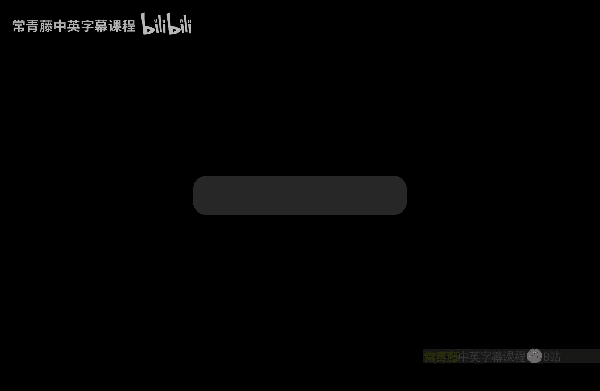
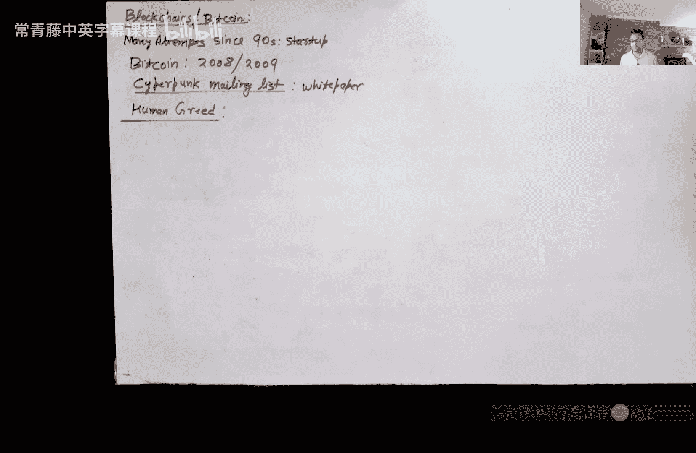
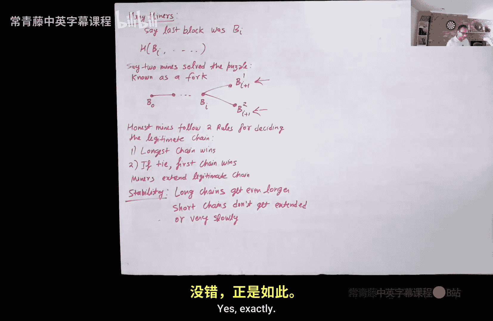

# 卡耐基梅隆大学【中英⚡密码学导论｜15.356 Introduction to Cryptography】 p14 P14 Lecture 14 Bitcoin I -BV16V6GBYEAA_p14-

Okay， welcome， everyone。うん。So today we will officially start sort of the second part of the course。

 which is more about applications than building foundations。😊。

So foundations of course is very important because you need to learn the basic primitives。

 you need to learn their definition， you need to learn how to prove security and so on。

 so proving security may have been optional maybe in like 90s or 80s but today if you want to propose any kind of new crypto system。

 nobody will take you seriously unless you give some kind of security proof for it at least at a high level。

So this is what our goal was in the first part of the course in the second part of the course we will sort of cover like three different topics broadly the first is Bitcoin and blockchains then we will move on to zero knowledge proofs and then we will move on to secure multiparty computation all of these are very exciting topics and very active area areas of research in cryptography。

😊，Okay。So， so today's class specifically will be about Bitcoin。

And later on in the next couple of lectures we will look at other cryptocurrencies。

 so Bitcoin is of course， as you know it's really the first truly decentralized currency right it's calling it an electronic currency maybe not the most precise term because you know electronic banking has been around forever since like 90s you know you have money in your bank account credit card you can do transactions over the Internet so electronic banking has been around so Bitcoin was。

😊，The first truly decentralized currency， which is not backed by any central party， any government。

 any bank and things like that。😊，And there have been attempts to build such a currency in the crypto community since at least the 1990s。

 so it's not as if like this was a completely new idea and nobody had thought about it。😊。

So there have been many attempts， in fact。Since early 90s。There have been many companies， startups。

Which try to do this。Many of them actually had good technology。😊。

For some reason the attempts did not take off and then this there was this unknown guy who was operating under the pseudonym of Saosshiinokamoto。

 so he comes along。And he proposed the Bitcoin system， this was in。2008， 2009。So in 2008。😊。

This person sort of posted a white Paper。And this White Pa was posted on the cyberpunks mailing list。

I believe this mailing list still exists if you want， you can join it。

So first the white Paper was posted。And then in January of 2009。

 the code for the Bitcoin system was posted a fast implementation so to speak and the Bitcoin mining really started in 2009。

So， what is the reason that many of these attempts since the 90s they didn't really take off whereas Bitcoin took off so of course there were some technical advantages Bitcoin was very nice it was a completely new technology not trivial to come up by any means。

But also， at least in my view， one very nice feature which Bitcoin had was it could rely on human greed in some sense。

😊，And that is the component which was missing from the other attempts times So what do I mean when I say human greed so。

😊，So when any new technology comes along right especially when it comes through something like electronic cash and so on。

 maybe initially youre interested in the technology but what is the motivation for being an early adopter right the typical sort of instinct that you will have is just okay that's great let's wait and wait and watch to see if it really takes off right because currency is not something which you can use on your own a currency is only useful if you can trade with others and if there's like very few other people who are accepting that currency then there is not really a great motivation for you to be one of the early adopters of that currency。

😊，So thats sort of the reason why there was like so much inertia behind investing in any new electronic cash or decentralized currencies。

 but Bitcoin had this very nice feature。😊，Wwhich was that there was a great incentive to be an early adopter of Bitcoin and the incentive was that initially the way Bitcoin system was designed was that initially the promise was that if you are one of the early adopters。

 it would be much easier for you to get a large number of bits。😊，And as the system progresses。

 you know， Bitcoins will be harder and harder to come by。😊。

Okay， so initially Bitcoins relies on a process which is known as mining which is something which we will go through today。

😊，Initially what the idea was that you mine a block and you would end up getting a large number of bits。

 something like 50 okay？😊，Every four years this reward will be halved， so it went from 50 to 25。

 then to 12 and half and so on。😊，Okay， so if you are an earlier adopter and also earlier there was much less competition to mine a block。

 so it was very easy to hold a large number of bitins。😊。

And then your instinct would be okay let's just join the system if it takes off you know I am a millionaire or a billionaire and if it doesn' not work well that's fine。

 I wasted maybe some time maybe a little bit of computation but not much。😊，So that's why， you know。

 it was able to attract。😊，A number of people who were early adopters of Bitcoin and then the world sort of started getting out and more and more people started joining the Bitcoin system。

😊，Okay。So。So the prices of Bitcoin， that's something which is always。

A very talked about issue and this also makes the the Bitcoin and the blockchain technology a very polarizing issue。

Which I think it should not be。So why is it a polarizing issue？😊。

Like the prices of Bitcoin shot up from a few dollars to a few hundred dollars then to a few thousand dollars then tens of thousands of dollars then they crashed so many people so it's sort of attracted the attention of Gen Z community who are not really even interested in computer science。

 let alone cryptography and like many of these people they hold the opinion that Bitcoinco is a scam it's a ponzi scheme it should be banned and things like that there's a whole other group of people who are on the other extreme and they think that you know government is not doing any good you know the banks are failing they need bailout all the time they're controlling our life so in some sense the traditional currencies like US dollars and so on they should all be abandoned and we should switch to to Bitcoin or any of these cryptocurrencies。

So that's why you know there's a big debate。😊，Yeah。

 I will come to my personal opinion so there is big debate there are these two extremes。😊。

And whenever people become polarized， you know， all sort of logic goes out the window。😊。

And then you are just left to defend sort of what your initial stand was without any regards to any new information which is presented to you or any logic and things like that and of course this is something which we are seeing in the elections。

 I'm sure that you are following the news。😊，So yeah my personal opinion is that reality is always somewhere in between right so Bitcoin is not something which should replace the entire banking system we don't have to sort of give up our US dollars or our government issued money on the other hand Bitcoin is not a ponzi scheme either it is a very useful very interesting technology it has its application。

😊，There are applications where sort of traditional banking has failed us for so as an example。

 let's say I want to transfer。Some money let's say from US to some some other country。

 let's say China or some something like that right you can do a wire transfer using using traditional banking so the bank will charge you something like 4 $52 for the wire transfer。

 but at the same time bank will also charge you this currency conversion fee which is sort of the hidden fee。

It might take you a day at least like 10 hours or something like that for the money to show up。😊。

Sometimes the money doesn't show up。 Then you call up your bank Sw code was wrong if you have ever done a bunch of。

International transfers， you know， you would understand what a pain it is。

 So Bitcoin is very nice in that sense， like。You can transfer money from any country to any other country。

 I mean the the physical location where your residing is really relevant。😊。

The money gets to the recipient within like less than an hour。

 the newer cryptocurrencies like Ethereum， it's a matter of few minutes before the transfer is finalized。

😊，And the transaction fee， which you have to pay is sort of very little。

It can be even something like a few cents， definitely less than a dollar and there are many other applications of。

Of blockchains， cryptocurrency is just one of the applications but people are talking about using smart contracts and using smart assets。

 there are many companies。😊，Which are exploring like。

Applications of blockchains which are completely unrelatedulated to cryptocurrencies。😊。

So definitely this is a new technology。😊，I think the worth of this technology should not be measured by what the price of Bitcoin is on any given day。

 even if the price of Bitcoin goes to zero， I think this technology is still useful you know and one of the reasons why I like these technologies。

If you see today in society， there is a lot of centralization。😊。

So big companies are getting bigger and bigger right big tech companies。

 they are like holding massive amount of data。😊，Pattterns expire after 15 or 20 years。

 but the personal data these companies collect on you。

They will keep this data for the next 5000 years or even beyond that and there is no timeframe after that this data will be made available to their competitors and they don't delete your data at any point right it's almost impossible for them it almost impossible for you to get them to delete any of the data which they collect on you and their data is of course very important so。

So not just in the in the tech industry in general， big companies are getting bigger。

 the governments are getting more and more assertive。

So in some sense blockchain is a technology is which can be very useful for society because it it brings a lot of decentralization you know maybe what we are seeing is we are just getting started and maybe we will see you know like completely new big companies like Google being created entirely on the blockchain you know no central authority no CEO and things like that or maybe you know it's just a dream right？

😊，But at least I think it's a step in the right direction。😊，Okay， so。Yeah。

 so no central control is one of the defining features of the cryptocurrencies。😊。

Another feature is that。😊，These cryptocurrencies provide some level of anonymity。

So maybe let me just be specific to Bitcoin for today's class。So， Bitcoin provides。Some anonymity。

 Okay， let me。Stress， this wereor some。It does not provide perfect anonymity and when we look at Bitcoin we will see why that is the case。

😊，And because of this anonymity， there is also a negative。😊，So this can be seen as。

A negative as well。And in fact， when this whole cryptocurrency thing was just taking off maybe in 2013。

 2014。Bitcoin was considered to be a currency of。Hackers， criminals。Terrorists and so on。 So。

 so there was a lot of negative press， which was given to Bitcoin at that time。So， for example。

 there was a ransomware。😊，Which was around in 2014 this this ransomware was called as crypto locker。

So， it was a program which would trick you into installing itself on your computer and then it would sort of encrypt your hard drive。

😊，And if you wanted to get back your data， you needed to send some number of bitcoins to some some address or some public key。

And normally， you know。Creating programs or ransomwares like this successfully is very difficult because you know a government or or a law enforcement agency can sort of always follow the trail of the money and then eventually get get to the culprit but in case of Bitcoin this was very hard in fact like。

😊，This， this ransomware was even able to successfully install itself on some。

On some city government websites， it was some public utility cooperation or something like that and then like millions of dollars were extracttorted with from them and only then they were able to get back the data so a lot of such things were happening。

And maybe sometime in 2000。15 or 2016。Sort of the narrative started changing around Bitcoin。

 a lot a lot of large technology company they started realizing that。

That Bitcoin and blockchains can something can be something which is potentially very useful and there was this sort of new industry which was the crypto industry which was coming around a lot of big companies like Microsoft。

 Facebook and I think Paypal， they started sort of investing in this technology， JP Morganorgan Cha。

I used to work at Microsoft in 2015 and '16 and at that time。

 there was a lot of conversation going on about you creating a new kind of cryptocurrency and taking advantage of blockchains in many different ways。

😊，So so this was nice and this is also when sort of the news became more positive around Bitcoin and more investment started coming。

 the public interest in this technology sort of started going up。😊，So yeah。

 so today my goal is let's try to go inside Bitcoin and understand how the mining process really works and what are the sort of different moving parts。

😊，Okay， so。So the core idea。Is that。Bitcoin is really。A public leisure。The core is。

What we say and append only。Public leisure。In principle。

 you can write anything on this public leisureger。😊，It's just sort of a book or a database。

You can add data to the database， you can never delete data which is already inside。And in principle。

 yeah you can write anything on this database。😊，So there are two parts to understanding the technology。

The first part is how to build this ledger。And the second part is。What to post on this leisure。So。

 first part is about building the core fundamental technology。

 the second part is more about building the application what you post on the ledger is really dependent on what you are trying to do cryptocurrency is just one of the applications but。

😊，There are other applications and they would require you to post data of different type。Okay。

So let's， let's go to the first part。Which is building the ladder。So， in some sense。

You write to this leisure one page at a time or one block at a time。

That's sort of the granularity at which you add data。Add one block or。One page。At a time。

So now there is no central authority。Now， who gets to add the next page？

Who decides what the content of the next page would be and what is the process for adding the next page？

So to add the next page。Maybe I should just stick to the。To the terminology of block。

 so to add the next block。You have to solve a puzzle。A puzzle。

 it is a computational or a cryptographic puzzle。😊，And in some sense。

 theres a computation to solve the next puzzle。😊，Whoever wins this competition。

 whoever is sort of the firsts to solve the puzzle gets to add the next block to the blockchain。So。

 this is a very oversimplified statement because in a distributed setting。

 how do you decide you know who was the winner， right？😊。

Maybe two people solve the puzzle around the same time。

Another question is who decides the next puzzle？So， to understand that。

Let's look at the simple system where there is only a single minor。So the Bitcoin system has。

Miners and users。O。So miners are the people who are sort of the backbone of Bitcoin。

They are trying to。Create the next block。And they are trying to make money in the process right users are the end users who are maybe trying to transfer money from one person to another person and they are ready to pay money in some sense to use this system。

So miners have to have。They need a lot of computing power。Users don't need anything。Okay。

So in Bitcoin， the mining happens block by block。😊，When you mine the IAT block。😡。

It sort of gives you the puzzle to mine the i+ 1 x block when that puzzle is is solve。

 you will get the I+ 1 block。😡，So how does this whole thing get started。

 you need what is known as a Genesis block。So Genesis block， let's try to represent it as。B0。K。

 this is the zero block。And this block was decided for us by Satoshiinocommoto。😊。

Who was the person who created。The Bitcoin system。And。This block was the headline。

From a British newspaper， which is the Times。And then the block this the block is just a string。

 right？😊，So this is the date 3rd January 2019。And the headline was。Chancellor on。Brink off。

Second bailout。For。Banks。So this headline was taken from the newspaper because。You know。

 this sort of elevates the concerns that the Genesis block has some trap door hidden inside which allows the creator to to break the security and things like that so so this seems like a very sort of innocently chosen。

Jesisb。And many people also speculate that， in fact。

There is also a comment hidden on the banking system。

 so the banks were collapsing because of the financial crisis at that time and the banks needed bailouts and this was also another reason why something like Bitcoin a blockchain would be attractive。

So idea was that the banking system is failing and we need something else。Yeah， any questions？Okay。

 goods， so as soon as you have B0， the mining process can start。😊，And for simpler cities。

 say we only have one minor。So， there is no competition， nothing like that。

 but there there could be multiple users。So users produce transactions， which they would like。

To write on the public leisure and the miner would facilitate the users to write these transactions on the public leisure So in some sense the miner will collect all these transactions。

Okay。收。In Bitcoin， each minor。Has。A secret key and a public key。Okay。

And this is not for public key encryption。 this is for signature。

And this public key is also sometimestime known as。The address。

The reason for that is when you you when you are sending money to somebody you need their public key。

 so thats in some sense， the address for sending the money。So we only have one minor。

 the mine has this public K secret key。😊，To mine the next block。

 the miner needs the following things。First of all。

 minorr needs to decide what to write in the next block or what to write on the next page in the public Le。

And let me call this。Information is。Let's denote it by Ii。

It would be I1 in the beginning when you are writing the first block， i2 and so on。So， this contains。

All valid。Transactions。Collected。From the users。Right and later on we will come to what valid transactions are but for now you know valid transactions are transactions which have a valid digital signature if you are trying to transfer money to somebody then the miner needs to make sure that you actually have that much money to transfer and so on so we will we will go into what valid transactions mean they will of course be different depending upon what your application is。

So miner collects all these transactions from the users and let' us say the concatenation of all these transactions is this information eyeI。

 so this is just a string。😊，Okay， and now。Let me describe to you the puzzle。To mine。The riot block。

Okay， the puzzle is。You need to find。And I。Such that。There's a hash function et。B i minus1。

 which is the previous block， so we have b 0。To start with。B， I-1。 Then we have。Okay。

 so puzzle to mind， let's say。I plus1 networkク。Just to make things simple， simple。So you has B I。

 you has。I I and by the way， this is just a rough overview。

 you know the order might be different and things like that。The order in which we put these things。

 but it doesn' not really matter we are interested in the main ideas here。So I， I， and then。And I。

 by the way， is called the Nos。And PK is the minor public key。

So you have to find an N such that this hash。Equals。0，0。0。And then star， star， star。Okay。

 so you are looking for a number N such that the hash。😊，Of all these values begins with k zeros。

After these case zeros， you might have anything。Star represents basically like any character。Okay。

And yeah。嗯。If you are successful。This hash value becomes。B， I plus 1。O。So let's observe a few things。

 the first。You can see that the previous puzzle。Plays a role in defining the next puzzle。Right。

The data which you are putting in the block also plays a role in defining whenex puzzle。

And then why do we need to put the public key of the minor here？In the battle。Well。

 whenever you mine a new block in Bitcoin， the reward for mining that block gets attached to this public key automatically。

😊，Right so naturally if you are a minor you would want to put your own public key here。

 but if you are feeling generous you want to give up your reward you want to give your reward to somebody else you can put some other public key。

So any questions so far？Professor。Yeah， what does NI represent？Yeah， and I is a non。 Okay， so good。

 maybe I should explain this in in a little more detail， so。So。

 B is fixed right this is given to you ii is what you want to write this is fixed public key or a minor your public key is fixed right so you start with some value of ni you hash all these four values but the outcome does not start with several zeros。

Right， what do you do in that case？So， in that case， an， you change ni。

 you try with a different value for N。😊，Then you hash again。

Right so you know an I could be let us say 100 bits so there are like two to the power 100 possibilities for and you keep trying all of them right and at some point you will succeed and then you have sort of solved the puzzle。

Okay， and this whole thing。Is known as the puzzle solution。Puzzle solution for。Puzzle bi。That's。咪 i。

i i。And Iピ。Such that。There hash。Starts with。け zeros。Okay， and here。And I sort of the free。Parameter。

Which you can set。To any value that you want。So， II is all valid transactions or they can be a subset of transactions。

 so there is no notion of all valid transactions。The only requirement is that。In II。

 all the transactions that the mine puts in II， they must be valid。

But if a minor decides they can leave out any valid transactions which were broadcast to them。

What if for all NI there is no solution to the puzzle well if you set NI to be large enough that' is not going to happen。

The probability for that is。Neegligative。Right， so。What is the probability。And that。

Some particular N gifts。A valid solution。Now， it depends upon what type of hash function you are using。

if the output of the hash function。Is essentially a random number。

Then this probability is approximately equal to something like1 by2 power k。Right。

But exactly what type of hash function do we want to use here。Clearly。

 we cannot use a PRf because there is no secret key or anything like that。😊，Clearly。

 collision and resistant hash functions are not sufficient here because they don't guarantee that the output is random。

So what we are looking for really is that this hash function should be。A random miracle。

A random vertical is a hash function whose output on any given input is is essentially random。

 it is like a huge exponential sized random table。And the assumption that we are making here is that something like Shawa or Shah 256。

 they behave like a random or。😊，Okay， any questions so far？So yes let's see。

So what is this parameter k？There is another thing to look at， who decides K。

So K is called the difficulty parameter。Which is automatically adjusted。😊。

So typically in Bitcoin system。呃。Something which is hard coded is that there should be a new block。

Roughly every 10 minutes。Right。And this is enforced by sort of selecting the security the the difficulty parameter appropriately。

😊，And the way it is done is that as the computing power on the network increases， you know。

 more and more miners joined。😊，That that also means that a lot of people are doing this hashing and then the solution might be found faster。

So， if the solution starts getting found faster than 10 minutes or if it goes。

 let us say five minutes or lower than that， then basically you increase the difficulty parameter by  one。

And then the puzzle sort of becomes twice as hard。😊，Okay。

 and then five minutes will go to 10 minutes。On the other hand， you know。

 if people leave the network。Maybe the blocks are coming slower than expected in that case。

 you want to reduce cave。And there is no central party which comes along which says， hey， okay。

 now is the time to reduce k， the initial code which Satoshiinocommoto published that already had this logic in built inside。

 the code will tell you what k should be at any given point of time。Okay， and now yeah。

 what is the the probability that any niI gives a valid solution is 1 by2 to the power k。😊，Now。

 as long as the length of NI is much， much larger than K than you are fine。😊。

RightSo or later you will hit some anI， which will give you a value solution to the puzzle。Now。

 let me talk about the incentive。Why do you want to mine right so clearly you need to solve this puzzle puzzle which requires a lot of hashing。

And。That takes electricity， that takes computing power， so you are investing resources。

So the first incentive to mine is that。If you are successful， if you have success。You get a reward。

Some new bits are magically created and are attached to your public key。😊，Okay。

 another way of thinking about it is。😊，If I am successful in mining the next block or the next page I am allowed to write on that page。

 lets say I am Alice I am allowed to write that 10 bitins were created and attached to this public key。

 which is Alice's public。😊，And that' is considered to be a valid statement you don't have to write it explicitly the system in some sense it is implicit。

 you know， other miners understand that yeah you are publicly gained 10 bitcoins。😊。

But in 2040 no new bitcoins will be mined as I mentioned before every four years the reward for mining the next block goes down by a factor of 2。

Okay， so it will keep going down and in 2040。😊，No new bitcoins will be created。

And this is sort of another genius of this system。😊，So obviously。

 the person or the group of person who designed the system。😊。

They were not only good at cryptography but they were also very good at sort of understanding the human psychology and incentives and economy and so on right so Bitcoin is is something which will become more and more rare and hence you can expect that for example in 2040 the prices of Bitcoin will go up even higher。

😊，The harder to come by any asset is， you know， the prices will be higher。Now， the next。Yeah。

 so how how would the system function after 2040， What is the reward。

 What is the incentive for you to keep mining So there's another yeah， there's another reward。

 which is that。If you， there is also something which is known as transaction fee。

Wwhich comes from the transaction which you included in this II right so remember how does a minor construct Ii。

Which is the next block。So， there are all these transactions going around which the users broadcast。

 so this is sort of their wish list which they would like to be included in the next block。And。

If you are a user whenever you broadcast your transaction。

 you also broadcast a commitment for payment。😊，So whoever includes your transaction in the next block。

That miner gets paid this amount of money， right？And this is completely determined the transaction fee is completely determined by the market。

😊，You can propose a transaction fee of 1 cent， you can propose a transaction fee of $1 million。

Of course， the higher the transaction fee which you propose。

 the more incentive it will give to the next minor。To include your transaction in the next block。

Otherwise， the mine may just ignore your transaction and it might never appear in the next block。

Bitcoin places some hard limits on how many transactions can appear in any given block。So。

 let me look at some of the questions how case and first。

 I think I already answered that well the the code which was the original code you know。

That sees you know the rate at which the blocks are getting mined and it has your local clock and things like that so it can see what is the rate at which the blocks are getting mined in the recent past。

And based on that， it will calculate what K would be。And if you get a block。😊。

Or if you get a puzzle solution which does not conform to that k for you。

 that is not a valid puzzle solution and you would reject that puzzle solution。😊。

If you don't have a valid solution to the puzzle， no other miner will include your block as there。

Predecessor， so you don't get the rewardia that' is correct。If your positive solution is invalid。

 everybody will just ignore it。So the only way new bitcoins are added into the system is when someone mines。

And gets the reward。Yeah， that's true。Yeah， or you can transfer a bitco from one person to the other person。

Yeah， mining is the only when new bitcos new bitins are created。

And you can see why the name came about mining， like it's like gold mining or diamond mining。

So you're putting like new coins into circulation。Okay， any other questions so far。

When the transaction fee occurs， does that like delete the bitcos or like who does it go to？

It goes to the same public key。です。The person who mines the next block collects all the transaction fees corresponding to the transactions in that block。

Gotcha。 thank you。And as I was saying， Bitcoin places some hard limits on how many transactions can appear in any given block。

 So if you want your transaction to go to。😊，The next block。

 you want to propose a transaction fee so that you know you make the cut。

Because the rational thing for any minorr would be to take like the first few transactions which are enough to fill the block with the highest transaction fee。

😊，Yeah， what if there is a conflict of two valid next blocks。

 so remember right now I am only talking about the case where there is a single minor。

So I'll go to the case when there are multiple miners， there are more issues in that case， of course。

Okay， so good。 So let's switch to the multi myron case。

🤧嗯。So， yeah， so suppose there are many miners。So they are all competing to solve the next puzzle okay。

 and say。Say the last block was B。And now there are multiple miners who are trying to hash putting B and then some other information here。

And。Ting to find some some nos such that this hash results in a bunch of zeros okay these miners might be trying with different public keys。

 of course they will try with different public keys because every mine has a different public key。

These miners might even have different versions of Ii right maybe。

I pick a different set of transactions compared to you there are no guidelines on which transactions you should pick right because maybe you know I am located in China some other miners located in the US maybe some transaction didn't even make it to me。

These transactions which the users broadcast they are sort of broadcasted maybe they reach some people they don't reach other people right so you look at your views you look at all the outstanding transactions。

Outstanding transactions are the transactions which are waiting to be added to the next block and you pick in any arbitrary way from these list of outstanding transactions typically you would see you would pick the transactions with the largest transaction fee。

RightAnd then all the miners are just hashing， hashing and hashing， right。😊，苏。

The most natural thing here is that whoever is the first to solve the next puzzle。

They would be the one to mine the next block。And they would be the one to collect the reward。

But in a decentralized system it is not as simple as that right who decides who was first who was second and so on right yeah maybe geographically we are very far from each other roughly at the same time we ended up solving the puzzle and then we broadcasted the puzzle solution right。

The other miners who are close to me will hear from me first。

 the miners who are close to you might hear from you first。

 and there might even be with some malicious miners， you know， they can do whatever they want。

So in this case。The system is in a state of conflict， right so say。2 minus。Solve the puzzle。

So this is known as a fork。😡，In the system。So this is our Genesis block B0， this is our block B。

And now for the next block， there are two candidates floating around。There is， let's say B plus 1。1。

😮，And B I plus 1。度。Not just two candidates， there might be multiple candidates floating around。

So at this point， you are an honest minor， it's not clear to you。Which one is the right one and。

Which one you should take and which one you should discard right there may not be an agreement about that。

So if you are an honest minor， you are supposed to follow two rules。😊，For deciding。

So you want to decide which of these two different chains is the legitimate chain。The first rule is。

The longest chain always wins。😡，Okay， if you're an honest minor。If you realize that the chain。

 which you thought was the legitimate chain。Is no longer the longest。

Some other chain has become loggan than that。 you immediately switch to that。😊，O。

So with time your perspective on what the legitimate chain is might evolve it might。Gt。Now。

 it is entirely possible that two chains have the same length so in this picture which I drew right。

😊，Here is the first chain and here is the second chain。

These two chains have the same length right so what do you do in that case？

If the first rule leads to a tie。Then。The first chain which you saw。

Is the one who wins in your opinion， right？And。Then if you are the minor， you look at。

The legitimate chain and then you try to extend that chain。Okay。

 every miner has their own own opinion on what the legitimate chain is and now they are trying to extend this legitimate chain。

😊，Now， let me look at the questions。Do miners always have to broadcast their entire chain no there is like nobody broadcast。

Their team。You just store your chain locally and。If you manage to solve the next puzzle。

 then you broadcast the solution to that puzzle。Otherwise。

 there is nothing else which you need to broadcast。Is there a common algorithm to solve the puzzle？

Well， if by common algorithm， you mean an efficient algorithm， then no just exhaustive search。

 you just try many different values of NI。Right and the way the minus will try to do it is that they will pick some random N and just try with that if that doesnt go to another N。

😊，Or you can try Ns sequentially。 There is really no advantage between randomina and sequential。

The random has an advantage in the sense that。If everybody else is doing sequential。

 then you doing random is actually better。😊，Because。

Because you want to check the nonsenses which the other people have not already failed on。Actually。

 no， that's not even true because your public key is different。

So the puzzle is really completely different from you。 Yeah， yeah， so random sequential。

 it's all the same。Yeah。So do minusrs， how do you know about longer chains if chains are not broadcasted。

 Well， the chains are not broadcasted， but the puzzle solutions are broadcasted， right。And。

I am like I got both of these puzzle solutions so I store them and then let's say I think that this is the legitimate one。

 but the next puzzle solution comes along for this one。Then in my view。

 this chain has become the longest and I need to switch。

So what is the chain chain is just all the puzzle solutions whichever broadcast and if you have been storing that that' is fine。

😊，Now， if you are a new minor joining system， yeah。

 you need to download the whole chain from somebody。Okay。So， now。Is it really the case that？

The forks。Eventually get resolved。 So here we had a fork in the system， right。So there are two。

 these two competing。Sort of chains right what happens from this point onwards？So maybe you know。

 roughly half the miners are working on this， half the miners are working on that。😊。

And because solving the puzzle is a randomized process sooner or later。

 somebody will either extend this chain or this chain。Right。

And let's say one of these chains gets extended， but the other one does not get extended。

Right then the puzzle solution for this chain will be broadcast to everybody。

Everybody will realize that now this being the longest chain is actually the legitimate one and everybody just switches to this one。

😊，And then this one will be actually extended a lot faster compared to this one。Okay。

 so there is something nice， there is a stability property here。Long chains get。Even longer。

St chains。Either they die。By die， I mean they don't get extended。Because everybody switched。Or。

Maybe there are some you know malicious miners， some stubborn miners they don't want to switch。So。

They will be extended very slowly。Since nobody can invert the hash。

 I need to broadcast the puzzle I solve and the puzzle solution。 Yes exactly。

 So you want to broadcast the puzzle solution， which is。

Your nons， your public key and the block。Or the information。Okay。

So now let's look at malicious minus and that also brings me to the 51% attack。Okay， so suppose。

So suppose you are a malicious minor well okay， suppose you are a rational minor。

 you know you don't care about the rules you want to maximize your reward， okay。😊，And， let's say。

You mind this block。Somebody else mindd this block。Okay， so let's say this is。义务。Right。Now。

 it is in your interest that this block stays。Because the reward。For you is only in this chain。

If this chain is discarded and only the upper chain remains， you never got any reward， right？So。

 in other words， at any given point of time。There might be multiple versions of the last page of the public leisure floating around and not only the last page but potentially the last few pages right one of the versions has a reward for you。

 other versions maybe doesn' not have a reward for you。

So it is in your interest to keep the version which has a reward for you。😊，Now， unfortunately。

 let's say you see that。This chain got extended。So this becomes the longest chain。Right。So。Now。

 the question is， do you switch？Or do you not switch to this longest？

Honest miners are instructed to switch to the longest chain， right， but you are malicious。

So let's say you decide to stay and you decide to sort of。Continue building on this longest chain。

So the strategy for you is to stay and hope。Other chain。Not the other chain and hope。This chain。

Where are you staying。Becomes the longest。So this might be a reasonable hope， but actually。If。

The number of honest miners or the computing power of honest miners。

Is much higher than the computing power of malicious miners。Then this is a losing strategy for you。

If the honest computing。Is。Greater than your。咁 building爆啊。And the reason for that is that， you know。

😊，These guys they are already ahead by one block。And。Now。

 there is a lot more computing power now which is dedicated to this chain。So。

 all likelihood this chain will actually become longer and longer and you would be a bigger and bigger loser。

😊，Right the the length the difference between the difference in the length between these two chains will。

Grow rather than shrink。But what if you have majority of the computing power？😊。

And this is known as 51% attack。So， lets say you are a malicious miner you have majority of the computing power then basically you can do whatever you want right this chain becomes longest in fact this chain might become arbitrarily long。

😊，Then you come along and you start working on this chain。

 you have more computing power and you make this chain even longer。

And then everybody will switch to this chain。And in fact， then you can go to some other chain。

 make that chain the longest then everybody switches to that chain right so 51% attack basically。

You can erase。Anything。You can keep the honest minorrs dancing from one chain to the another chain。

 any chain of your choice you can even start from the Genesis block and create a much longer chain than the current honest chain。

And by the way， here。Let me remark that chain length。When you calculate the chain length。😊。

You have to weigh it。By the difficulty parameter k。Okay。

 which means that a chain which has higher values of k。

 that chain is sort of considered to be longer。😊，So。

 this is counting just the number of blocks that is only accurate if in both chain k remains the same。

 otherwise you need to scale up by K。租。Yeah， so 51% attack seems very dangerous， right。

 I can erase anything and so on。So why haven't we seen a 51% attack on Bitcoin so far？

The point is that。51% attack， probably。Will destroy the value of Bitcoin as well。

Right so suppose you are a very powerful mine， you control 51% of the computing power over the network。

😊，Now the question is do you really want to launch a 51% attack which everybody can see and then basically people will just you know run away from the Bitcoin system。

 maybe they will go to Ethereum， maybe they will go to paper currency or whatever， but in any case。

It is not a situation where you are winning right if you have 51% of the computing power the right thing for you to do would be to mining to keep mining honestly and then get a lot of bit。

Which will be financially attractive right if the value of Bitcoin goes to zero。

 you are just losing money。But 51% attack might be actually reasonable for some governments whose sole goal is to destroy this sort of alternate financial system developing。

 so that's why 51% attack is something which people worry about。

So somebody who is willing to lose money， but who wants to destroy the Bitcoin system certainly can do so。

A large enough， let's say， state actor。Who is ready to invest billions of dollars。

So there's another problem， which is。It' is known as infanticide， which is 51% attack。On。

The so called alt coins。So Bitcoin miners are very powerful。😊。

And if you are a powerful miner holding a large stake in the Bitcoin system。

 it is in your interest that computing cryptocurrencies not be。Very powerful。Right。

 you don't want other cryptocurrencies to get established。 So this inicide， you know， not。

Common by any means but something which has been seen is that there is another cryptocurrency which is coming up and the Bitcoin miners don't like it and Bitcoin miners who are very powerful they join the other cryptocurrency in large numbers and sort of launch a 51% attack just destroying the other cryptocurrency entirely。

😊，So another thing to keep in mind is that last few blocks。

In the Bitcoin system are not final by any means。Right because here， of course。

 two blocks mined roughly at the same time。呃。Maybe half the miners are working on this。

 half the miners are working on that and again it might happen that roughly at the same time both of these chains get extended。

😊，So the conflict did not end up getting dissolve， but sooner or later。

 just because it's a randomized process。One of the chains will get longer clearly ahead of the other chain。

And in that case， all the honest minus will switch to the longer chain and then this other fork will sort of die down。

All the minus。Which mind in the other folk， they lose their reward。Because in this version。

 there was never sort of any reward for them。Another thing which we will really look at in the next class is this。

Information。Which I am calling I I。Is arranged。In the form of。What is known as a Merrkel tree。

A Merrkel tree is also known as a hash tree。And this is something that you will look at in the next class。

 but。😊，But， very briefly。One option would have been to sort of just concatenate all the transactions and that would be your Ii。

But the problem with that is that let's say any end user is only interested in a specific transaction。

Then that user has to download all these transactions。

Because user wants to verify the solution to the puzzle。

So Merkel3 allow any given user to focus on a specific transaction while ignoring all of the transactions and still be able to verify that that transaction went through and appears in the blockchain。

😊，Okay， so now let me move move on to。The second part。Which is given this blockchain。

 given this way of maintaining。Sort ofend only public leisure。

 how do you build applications on top of it？Okay， given we only have five minutes left。

Let's start the second part next time。 and instead I'll tell you a couple of other things just about the。

The mining process。So mining pools are very popular。In all cryptocurrencies， including Bitcoin。

And the idea behind mining pools is that there is actually a lot of competition in Bitcoin。

 a lot of miners。😊，And let's say， you know， you want to join the system on your home computer。

You keep investing money。诶。The reward for mining the next block is like。

May let's say it's like 12 bitcoins， so that's like more than 100，000。

You might go several years until you get any reward。

Right so you you need to keep investing maybe buy multiple laptops if you' are only using one laptop you might even go five years 10 years until you see any return on your investment right so you might even go bankrupt by by that point so the idea behind mining pools is that many people they sort of join forces。

To eliminate this inherent randomness。And the idea is that you all join forces。

 you work towards mining the next block。Whoever wins will share the reward with everybody else in the pool。

Okay， and now there are several questions right what if I am dishonest right。

 I get the reward I just run away with it， I don't share the reward with anybody else in the pool。😊。

Second thing is I just joined the pool， maybe I' am lazy， I don't do anything。

 but I just collect the rewards， right？So that these are not things that we want。

 so how are mining pools implemented。So。When we implement mining pools。

 there is something which is known as a trusted manager of the mining pool。

And this manager has a public key PK， let' us call it M。😊，Be game。The first part is。

If you join in this mining pool。You are supposed to mine in such a way so that the reward becomes attached with Pkm。

So， all miners will。Try to solve the following puzzle。B i i i。And I and then not your public key。

 but the public key of。Theキマ。And then you want this to be equal to a bunch of zeros and。Other things。

Okay， now as soon as whenever the mining process is successful， the manager gets the reward。

 the reward automatically is attached to the public key of the manager and then the manager sort of distributes the award。

😊，The reward with all the group members。Now this distribution is not uniform。You know。

 it's not the case that everybody is equal in the mining pool。So。

The key manager distributes the reward。Proportal to the partial proof of works， which you submitted。

What is a partial proof of work？😊，Partial proof of work is。Let's say you got close to the solution。

 but。You got， let's say。K prime less than k。Z。Right， so you were hashing this， you know。😊。

You will get you will you are unlikely to immediately hit。Kase zeros。You know。

 many times you will see k prime， which is less than K。😊，And whenever you hit。This kind of K prime。

You submit this puzzle solution to your group manager。Okay。

 this puzzle solution is of course useless in the context of the blockchain because to mind the next block you really need。

😊，K zeros anything less than that is completely worthless you just need to try again。

 but you keep submitting it as evidence to the manager。😊，The mining pool manager。Right。

 and the mining pool manager can see。😊，You know， if you submitted a lot of partial proofs of work。

 it means that you were working and you were working with respect to。😊。

The public key of the trusted manager。Okay， the the more partial proofs of work you submit。

 the higher the percentage of your reward will be if this mining pool is successful。

Right so this also prevents you from running away with the reward because。

Throughout this entire time， you have to keep working with respect to the。Public key of the。

 of the pool man。是。😊，Why don't we just include like the division from the like the transfer of the Bitcoins from the trusted manager in this BI block itself？

啊。You mean in this I I。Yeah， like basically， like if you are the manager and all the class students are people who are in this。

But the point is that until the block is mined。I mean。You don't really know who did how much work。

 right？ You don't know the。The breakup。But how then the manager transfers Bitcoin like in the next transaction？

Yeah， so in the next transaction after some point everybody is able to submit their partial proofs of work the manager can go through it at that point and then later on maybe the next day transfers money。

No but like then when while you are mining the block。

 you don't know who is doing how much computation for this block。Okay， that is correct。

 but like manager also will need to create a new transaction and there will be a transaction fee for each transfer that I do to other people。

 right。That's true。Okay， thank you。 yeah， I mean yeah。If you have any ideas to resolve it。

 I think that will be a useful idea。theAre the partial proofs weighted by how large K prime is？

Like is a k prime that's minus one better than k with that's just one， Yes， absolutely。Yeah， in fact。

 each mining pool works differently， but very small values of K prime are not even accepted。Like。

 you need to be somewhat close to K。For this to be a valid partial proof of work and the closer you are to k the more the higher weighttage it would have。

Any other questions before we stop？Okay great， so we will stop here and yeah。

 we will go to the cryptocurrency part next time。😊，Should I have you？

