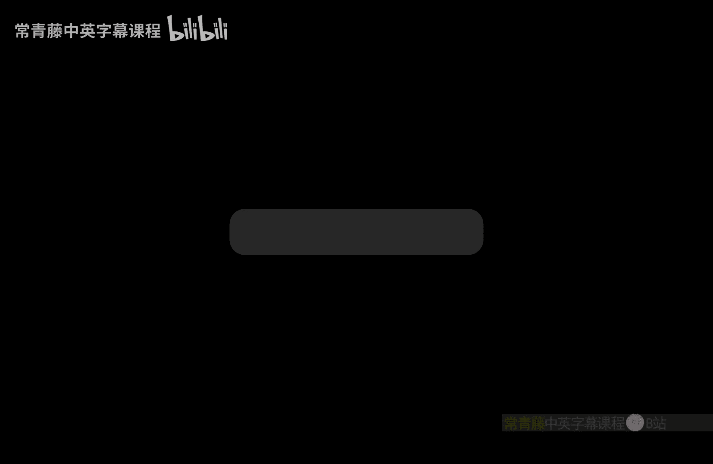
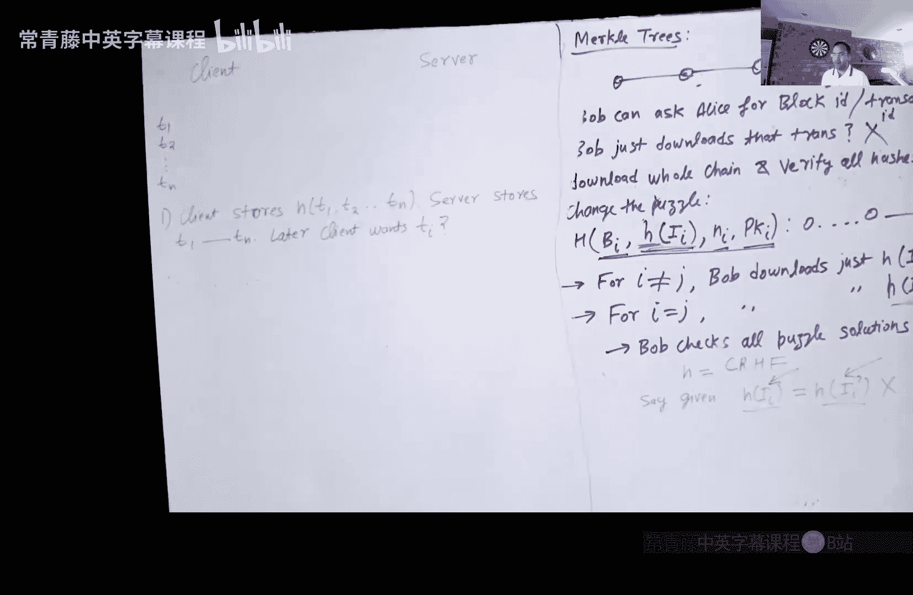
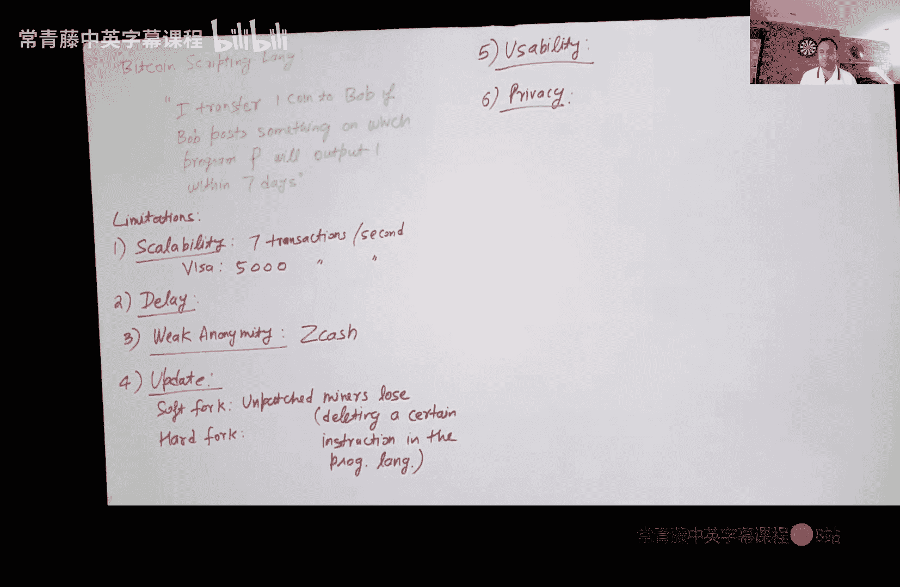

# 卡耐基梅隆大学【中英⚡密码学导论｜15.356 Introduction to Cryptography】 p15 P15 Lecture 15 Bitcoin and Merkle Trees -BV16V6GBYEAA_p15-

Okay， welcome back， everybody。😊，Okay， so let's get started， we will continue the study of Bitcoin。

In this class。So last time we looked at primarily the。

The public leisure part of it right how do you maintain the public leisure how do you make sure that miners sort of agree on what the content of the leisure should be at any given point of time how do you make sure that nobody can erase things from the public leisure and so on。

And as I said before， once you have the public leisure。

 you can build a variety of different applications on it and of course the original application which is still the most popular application is that of cryptocurrency。

😊，So lets see quickly how you can design cryptocurrencies once you have a public ledger。Well。

 as you can expect。😊，嗯。It's not very difficult if you have a public leisure。

 you can just maintain a record of all the transactions who has how much money。

 who sent money to whom， how much on which date and so on。😊，Now。

 the main question is who gets to write on this public leisure。

 the short answer is of course the minor who mines the next block。

 how do we make sure that that minor does not write unauthorized information on this public leisure？

😊，This is ensured by using digital signatures。So， if。Your money is being transferred。

 then you need to digitally sign a statement that you are the one transferring this money。Okay。

 so let's see how spending money works。The only way。

New coins or new moneyies created in Bitcoin is where the mining process whenever a new block is mined some number of coins just magically appear。

😊，In the public key of the miner who I the next block and now that miner can of course transfer this money to somebody else who in turn can then transfer to somebody else and then basically your whole process of electronic commerce can start。

So let me just say in advance that this is somewhat oversimplified。

And I am ignoring many of the implementation details here。

So let's say Alice wants to transfer one Bitcoin to Bob。So Alice needs to digitally sign a statement。

So， let's say。Alice is public key。Is。Pk1。Bob's public key is PK2 and Alice wants to transfer one bit to Bob。

So Alice science。Using SK1。Which is the secret key corresponding to Pk1 the following statement。

I transfer one coin。都。毕给度。Maybe let's even write Pk1 here。So I am Pk1， I transfer。

One kind to pick it to。Okay， and then you broadcast。You broadcast this statement over the network。

 all the miners who are competing to mind the next block will hopefully see this statement。😊。

And by the way， you also need to。Propo a transaction fee。

And that's the part which I am ignoring right now。But in reality。

 you can imagine that there is another science statement from Alice that the mine who includes my statement in the blockchain gets。

 let' us say 1% of a bit。😊，And then you broadcast this entire sign statement。

 each minor will look at the statement and they will decide whether or not。😊。

This statement is worth including in the next block。Okay， if the transaction fee is large enough。

 hopefully most miners will decide that this is worth including。😊。

So most miners will add the statement to the information page， the Ii。Okay。

 and then they are hashing right they are trying to solve the next puzzle if the next puzzle is solved then that Ii which presumably includes the statement goes on the blockchain。

😊，Okay， so before miners do that。😊，Minus run the following test。Minus test the following first。

The signature is valid and second。PK1 has。En of money。In fact。

 in Bitcoin you specifically need to give the you specifically need to point to the coin and its serial number which coin you are spending。

 but let us ignore that for now。Okay， so if the miners are able to test that the signature is valid and Pk1 has enough money。

😊，Only then the minus are supposed to add it to the next block。

If a malicious minor decides to ignore that well， they can do that， but then their block。

 which they mind will not even be considered to be valid and every other mine will。

Not accept that as the correct puzzle solution。O。So minus test and then。Some minor includes。

This in the next block。And then the transaction is not yet finalized because as I said last time the last block and in fact the last few blocks may actually get erased because of forking。

😊，They might be multiple fork and maybe this is not the fork which wins。

 so you wait for a few blocks。😊，And once this block is sort of deep enough inside the blockchain。

 you are sure that this transaction is going to stay。😊，ok。So。

 this is basically the cryptocurrency part， pretty simple application。😊，And。

Let's see a couple of points， so maybe。Let me ask you a few things。So by the way。

 when you wait for a few blocks， it can be。Up to an hour。For the transaction to be confirmed。Right。

Okay， so let me ask you a few questions。So let's say Alice has a new idea。

Alice is not happy with this delay。You know， when you go to a store， you pay for an item。

 you don't want to wait one hour for your payment to go through。Right， so what if。

Alice just sends this science statement above。So rather than Alice and Bob really waiting for a long time for this transaction to E。

呃。Alice just signs the statement， just send it to Bob， Bob checks。

 make sure Alice has a sufficient number of coins and if that happens。

Bob you know just ships the goods or whatever and then of course Bob Bob can broadcast this statement。

 make sure that this is included in the blockchain。

Right where the statement is coming from that does not make much difference。

 the statement is digitally signed by Alice and presumably that is all that matters。

So would this work， if this works， obviously then the transactions will become instantaneous。

So does this work or is there a problem？😊，Yeah。There is a correct answer in the chat that the problem here is double spending attacks。

So， it doesn't work because of。Double spending。Right Alice might have one Bitcoin and at the same time Alice might send a signed statement to Bob Charlie and multiple other people right and eventually only one of them is going to get paid。

😊，Everybody else just loses out。So a few questions just to confirm is the transaction fee included in the message signed by SK yes？

That is correct out of curiosity， what has been the longest switch of one folk branch to the other。

 whether malicious or otherwise， I think its almost never more than one or two。Bitcoin recommend six。

 but I don't think we have ever seen。Us getting anywhere close to 6。A for of L6。So another question。

Is。Let's say now our recipient， Bob is malicious。And Bob takes this science statement。

 Bob collects one Bitcoin， and then Bob sort of just tries to replay the same statement again。And。

 hopefully。Try try to get another bit。 So will this work or no。嗯。啊对就是。

Like what is the advantage that Bob gets by doing the replay attack like he can get some valid transaction only and then mine and get the Bitcoin if what's the point of doing the replay like a false thing？

Well， Bob is trying to get another bit transferred from Alice to Bob。

 just repeating the last transaction sorry。Yeah， so as I wrote here replay attack is actually possible。

 so that is why I am saying that this is somewhat oversimplified but actually in reality there are some。

😊，Like。Coin identifiers， which are included。And once that coin is spent， you know。

Alris no longer has that coin。So replay attack also is not possible， okay another question maybe。

So now we have this whole blockchain， okay？Let's say。Someone modifies。A previous block。

So we have this whole blockchain， right？And let's say there's a minor or a user who is。For example。

 trying to modify this block， what do I mean by modifying this block？

Taking the information included in this block and maybe just let's say deleting one of the transactions。

So is this possible why or why not？Obviously， this should not be possible， but why not？

So I think any honest node will never like only accept new blocks at the end of the current list。

 not in the middle of the list。Well， yeah， that's fine， but what about new honest notes。

 which I joining？Yeah， but like 51% will never happen， right， so。What do you mean，51%， I mean。

Like I'm in new honest honest note， I join and then there are two versions going around。

1 was the original one， and the other one was。The one where information was deleted from here。

So how do I recognize which one is the correct？云。You can like ask say 10 people and say what the majority comes out。

Instead of， that's not the assumption we make in in Bitcoin。

 the Bitcoin assumption is not that majority of the miners are honest。But， rather。

A majorityjo of the computing power is honest。And this is for a good reason because I am an adversary。

 I can create like million different fake identities。😊，And that's not very expensive to do。Yeah。

 so there is a very good answer in the chat。😊，If you try to modify this block。

Then basically that invalidates all the puzzle solutions from this point onwards。Okay。Because why。

 because remember that。😊，What was this block B？😡，Plus one， let's call this block B I Okay。

 and let's say I modify。i爱。So I becomes IA prime。And then there is a couple of other things。

Then I need to try many different nonsenses here。First of all， to make sure that。

I get a bunch of zeros。And note that this was supposed to be。BI plus1。

But now the value of bi plus 1 will change。So it will become B plus1 prime。Right。

And then even if you are not changing this block。😡，Because B plus 1 change to bi plus 1 prime。嗯。

You still have to redo this puzzle。The input to the has changed。So basically。

 all the puzzle solutions become invalidated。😊，Right， and then basically the idea here is。Our rule。

 which was that longest chain。Winds。That comes to your advantage。I change something here。

I have to create all these blocks。Let's say I don't have majority of the computing power。

Then the chain which I create from this point onwards will be smaller than the main chain。

And then my version of the truth will be discarded。And the deeper I go in the blockchain。

 the harder this attack becomes。😡，So I have a small question。

So so for the first one where you said Alice just sends the same statement again to Bob right so like assume that we don't have the coin identifiers right so like or even when you are sending it to Bob Charlie and say Rohan also right so like won't they check Alice current balance and then only add that coin so in then end like if Alice has only one coin like after so one spending happens because the Alice balance become zero even without coin identifier nothing like that will。

So you are talking about question one question one or two one， one in question one。

 my proposal was that Alice just sent the science statement to Bob。

And Bob just checks the digital signature and Bob checks the balance， which Alice has。

But Bob doesn' not try to actively put it on the blockchain yet because。

That will take several minutes or an hour。And then。My point was that， of course， you know。

 Bob can make sure that the statement is valid and so on。

 but Bob can never be sure that Alice is not simultaneously sending this to many people。Yeah。

 but even if Alice was sending right and like somebody else put some transaction on the blockchain and now when Bob is putting because there is a new block Bob has to verify that now whether Alice has not so Bob will never like the double spending will never happen。

Yeah， double spending will never happen， but Bob has been cheated， right？😊。

So here I am not saying that this is a problem for the blockchain。

 I am saying this is a problem for Bob。If Bob accepts the payment without first putting it on the blockchain and without fus。

Making sure that this appears on the blockchain。Bob is not a word。Okay， okay， okay thank you。

 thank you。 Yeah， And that is what I meant by double spending。

 sending it to Bob and Charlie at the same time， both of them accepting without talking to the blockchain first。

Thank you， sir。Okay， so let's move on。Now， let me get to this。Information part。

How do you arrange information in the blockchain？And this is done in the form of。

What is known as murkle trees？So suppose you are not a heavy miner， you are a user。

 let's say you are bomb， right？😊，And。You know， Alice space， you maybe one bit or something like that。

😊，You just want to verify that Alice paid you1 Bitcoin you have no interest in going through gigabytes of transactions and things like that right so you are only only interested in a specific transaction。

So what are the options， let's say this is our blockchain for now。So the first option is。Bob can ask。

Alice， for， for example。The block number。Next's at the block ID slash。😊，The transaction I。Okay。

 and then hopefully Bob can go ahead and Bob can just download this block and in particular even just the transaction in that block and Bob can make sure that this transaction indeed appears。

😊，In the blockchain。But now yeah， so this this might be one of the proposals。Bob， just。

Downloads that。Transaction。Or that block。So now the problem is of course。

 you can download this transaction， you can make sure that this is there。

But where do you download the chain from？Where do you download the blockchain from presumably its a peer to peer network so you just connect to one of the random nodes you ask that node to send this block to you。

But then you are trusting this node。Maybe this block actually never appears in the blockchain and this node maybe is colluding with Alice and just。

Send you some fake information， you see your transaction over there and you are happy。

So you don't want to do that。You are interested in this particular transaction。

 but you would like to verify you would like like to have good confidence。😊，In this transaction。

So then the only way for you would be to start with the Genesis block。

 you know you know what the Genesis block is that already appears in the code of Bitcoin。

And basically download。The whole chain。And verify all hashes。

So that is another approach right you start with the Genesis block you download the whole chain。

 which means that you also need to download the entire block。

 the whole pages and essentially every transaction ever and you keep verifying by hashing and seeing that each hash indeed starts with a bunch of zeros and then you get to the block which you want then you can look up the transaction which you are interested in。

Okay， but this seems very sort of unsatisfactory。Even a small user。

 you have to download like gigabytes and gigabytes of data。

 even if you are interested in just a single transaction right so mu trees。Try to solve this problem。

In fact， let me not even go to Mer trees right now。

 okay let me just propose a very small change to the blockchain system which will essentially like solve this problem to a large extent。

And then market is make it even better it like。😊，Jrry up。So， what we will do is。

You change the puzzle。Well， changet。Compared to what we discussed last time。

This is how it was always in the Bitcoin system， So change the puzzle you put the previous block。

And then you put the hash of the information。Which you want to write in the next block。And this is。

 by the way， a quaismm's assistant hash function me。Right， small here to。

Just to drive home the point that these hash functions can be different。

 they serve different purposes。And then you have your nouns。 and then you have your。Public key。

 And then you make sure that this starts with a bunch of。Zeros。Okay， note that in any given block。😊。

This is like the output of a hash， pretty small size， this is a nonnce which is like 100 bit。

 200 bit number， this is a public key which is again very small several hundred bits。😊。

But if you look at this information I I right thats the list of all the transactions in this block and in Bitcoin。

 for example it can be a megabyte。😊，So on the other hand。

 if my puzzle depends only on the hash of this information。Rather than this entire information。😊。

Then that's great because then Bob can just download the hash of the information at every point。

Can still continue to verify。All the puzzle solutions and only when Bob comes here。😊。

Bob will download the entire information list。Okay。

 because that is the block which Bob is really interested in and that is the block where。😊。

Bob's transaction takes place。Okay， so that's the idea now。F。

Let's call this block J at block for every I not equal to J。Bob。Downloads and when I mean download。

You use PR to peer network。Even if somebody is feeding you false formation， that's fine。

 you can detect it。Bob downloads。Just the hash of all the transactions。And for i equals J。

Bob downloads the hash， of course。As well as。The whole list of transactions。Okay， and then。

Bob checks all。Buzzer solutions。Because Bob has the entire input now for every block。

 Bob can just hash right and just check checks if the output indeed starts with a bunch of zeros。

And in if all of the puzzle solutions are correct， including this puzzle solution。

 then Bob knows that Ii is legitimate。😊，And Bob can look up the transaction。

 make sure it appears in the blockchain。Okay， any questions about this so far？

And why am I using a hash function here？What type of hash function this small edge should be？

Is this a one way function or what？Yeah， good answer so。

Here the hash function is a collision resistant hash function。And why is that？This is because， say。嗯。

Yeah。Suppose it just happens that h of Ii and h of Ii prime are equal。Okay。

 and now only the hash output is included in the puzzle solution。Okay， then this is a problem。😊。

Then basically nobody can tell whether。呃。This is the correct list of transaction or this one。

Right because with E one the puzzle is this。😊，So I can change Ii to II prime blockchain basically remains the same and then there is a problem。

You cannot distinguish what is the right version of the block from the wrong version of the block。

Okay， so you don't want。Something like this to happen。And as long as this doesn't happen。

 you are fine， right， I mean the hash。😊，Is included in the block。 And if the hash sort of。

Fixes a unique input。At least computationally fixes a unique input then。You know that。

That nobody can change that input， which is the list of transactionss。Okay， so this is good。

But we would like to do something even better。Here。At least you had to download this whole。

Sort of this whole block。Of course， that is the block in which you are interested in。

 but you are just interested in a single transaction in this block right maybe we don't need to download this entire block。

😊，So for that purpose， you have Mer trees。嗯。So by the way， for Bitcoin。

 because the block size is just a megabyte。😊，I don't think this optimization is that important but。😊。

You know， people are talking about increasing the block size and things like that once you do do that。

 these optimizations start playing a bigger role。Okay， and I should also mention that mule trees is。

😊，An old concept in cryptography it was introduced in 1970s。

 so they have been around a lot longer than any of the cryptocurrencies。Okay， good。So let's see。

s let's look at this idea。First， I will show you an optimization which will。😊，Cut down the data。

Which Bob has to download by a factor of two。And then we will be able to cut it down even more than that。

Okay， so maybe let me abstract out the problem first because its the concept which is used in a lot of different applications in cryptography。

So here the problem can be seen as follows。So you have a client。Which maybe has very small storage。

 and then you have a server。O。The problem with the client is that。

Client can only store very little information， so client has maybe a huge list of transactions。

So let's call these transactions。D one地图。Up to T， N。

Client would like to off all these transactions to the servers so that server can store these transactions and then later on client would like to be able to download a specific transaction。

 let's say TI。RightBut client doesn't trust the server as far as integrity is concerned。

So what is the option for the client here？So， one option is。Let's call it option1。Client stores。

Just the hash of all the transactions。And let's say， the server。

It storess the transactions themselves。Okay， so client is st something which is very small。😊。

because you have hash functions where regardless of how large the input is the output size is always like160bs or something like that。

But what is the problem with this this solution？So client is a mobile device。😊。

Which really cannot store much。And then say later。The client wants to retrieve， let's say， T。

How would the client be able to do that？If the client just queries， the server gets just TI。

 client is not sure search that the server is indeed sending the correct value。😊。

So what can we do here？

So I guess the only option which。😊，Really， you can try here is。

Client downloads the whole list of transactions。And then client can hash all of these and。

Kient can match this with the value that it is toy。Right if the value matches。

 then client is that this whole list of transactions has has not been modified， this is still intact。

But now the problem is not only you need large bandwidth。

 but again you need large storage right client first has to download these transactions in the memory then hash them。

So this is not all that impressive。Here is another option。

How about dividing this list of transactions into two equal parts？

So let me call the client C and the server is S。What if client stores？😔，H1。

 which is the hash of the first half。To， let's say n by 2。And。Edge2。

 which is the hash of the second half of the transmissions。对点。

And then server were just like last time。Servere to all the transactions。So now。Say， client wants。

Some transaction， let's call it。Let's take a concrete example。

 let's say client wants the transaction T1。So does anybody see how？Client can get that。

And make sure that it has not been modified。Yeah， good answer the client just needs to modify client just needs to download the first half。

So， C gets。T 1 to t and by2 right then client will hash all these transactions and match with h1。

Which it is storing， of course。If the hash passes， then client node knows that all these transactions have not been tampered with and then client basically has T1。

ok。😊，So now you can observe that。The bandwidth has been reduced in half。收。

So bandwidth or maybe let me call it communication。And here， yeah。

 the communication is reduces by a factor of two because now you are only downloading half of the transactions。

😊，And storage on the other hand increases by a factor of two and by storage here I am only referring to the long term storage。

Okay， so this this is maybe a little bit better， but。

We are not too happy with the storage increasing by a factor of two。So any， any ideas on。

How we can achieve reduced communication without increased storage。So， here is an idea。

Maybe the client even hashees these h 1 and h2。😡，And just stores the hash of these values。So， client。

Ses。H equals。H1 co 2， so let me not abuse the notation here， let me call it。What should I call it。

 let's say H3 okay？Okay， and server stores。H 1， h 2， and。All the transactions。Okay。

 so client is just stor a single value now again。Now， what happens when client wants。低稳。

What do we download？So， if client wants T1， then。Client will download。H1 and H2。

And then the first half of the transaction t1 to T。N by2。Okay。

 and the client will run the following checks。The first check is。

Make sure that at3 which the client is sting。Is that equal to hash of。H21 and H2。

If this check passes， then the client knows that。😊。

It has been able to retrieve h1 and x2 the correct version without any tampering。

And now that client has confidence in H1 and H2。😊，Which were downloaded from the server client can check whether H1 is equal to。

Haash of all the this first half of the transactions。Okay， and if these two checks pass。😊。

Client has confidence that the first half of the transactions。

 which he downloaded has not been tampered with。And hence。You can retrieve T1。Okay。

 so what is going on here is。We are doing something like the following。So we have all these values。

T 1， T，2 up two。T， N 2。And T n2 plus 1。Up to T N。So you take all of these。

And you hash them to get h1。You take all of these。Hash them to get H 2。And the hash of these。Is E。

 which is the only thing that the client will store。🤧嗯。And here， of course。

 the problem is that we only cut down the communication by approximately a factor of two。

Can we do better than that？Yes， absolutely， and for that we will have to use a3。So the tree。

 which is which is called as the Mercur tree， it works something like the following。😊，So。

 assume for simplicity。N is a power of two。If it is not。

 you can add junk transactions or empty transactions or whatever。

And the transactions will be the leaves of a tree。T，3， T4， and。D and -1。DN。Okay。😊。

You take the first two， you hash them together。Okay， you take two at a time， you hash them together。

So now here， if you look at this level。The number of node has been cut down by a factor of two。

And then again， you keep repeating。This process。And， finally。You will end up with the root。

This was at tree。Right。And the root is what was。What will be stored？By the client。

And coming to blockchain route is the only thing that would appear in the blockchain。

All in the blockchain puzzle description。Let me call the route， let's say。At。Okay。

 let me just call it edge。So now， let's say。Okay， let me call it at prime。

Just let's be consistent here。So now， sea stores。At prime。 And let's say。C is only interested。And。

The first transaction T1。Okay， now it's a little bit tricky。😊，So what do you download now？S stores。

Basically the whole whole tree， the estroos， all the transactions。

 all the intermediate leaves in the tree and so on。So。

 how does C download P1 and verify that indeed T1 is correct。Okay， so let's see。See downloads。

The1 and all。Red notes。So， this is t1。This is what C will download C will also download its。Sibling。

Using these see you can already compute this value。So this value will be computed by c。

So you can download this node。Given this and this。This value can be computed by C， then C downloads。

This node。And。This can be computed by。C。So see downloads all the red nodes。Then she can。Compute。

The root。It's prime and。Seek and then match。With the stored value。And if the。

If this check passes the values match， then C can be sure that none of these values has been modified。

Because if you modify a single even a single value out of these。😊，The hash output will change。

And the proof which we will skip here。It just relies on the fact that E is。

A collision resistant hash function。Or X comes from a college assistant Ha function family。

Sir I have a small question so like when we discuss hereHF families like we always said that the person who is hashing first samples an edge and then use it to sample and the sampling is the property that gives us the guarantee that no collisions will happen or the adverory won't have a hard coded collision but now in this case since like the client when it needs to compute can't it simple a different hash function than the first one it used。

Or like in blockchain if we are using this in blockchain and like 30 people are there。

 can they sample different different parts of the CHRf family and if they are sampling the same thing then adversely can always find a collision in them。

そう。I mean， one way of thinking about it is that。The hash function has already been sampled for all of us and the hash function is like Sha 256。

😊，So that's really the way it works in practice。The Bitcoin system specifies the hash function which we will use。

And that's just everybody uses。Until somebody can show us collagens in that hash function。

 we will continue to use that。So that's typically how it works in practice like people used to use MD5 at some point and then there was a team of researchers from China who found collisions in M5。

 they published the paper and sort of everybody immediately moved away from that。Okay。

 so Sha 256 like is comes from a family of CRHs and family of has functions that is a CRHf and we use one of them for the Merkel trees。

Yeah， Sha 256， you can think of it as a single hash function rather than coming from a family。

But one way of thinking about it is like the parameters for Sha to 56 when they were fixed。

That can be seen as sampling from a family。Okay， and like when when you were discussing before you especially mentioned that the hash function that we use for blockchain and here are different。

 but like we are using the same function， but it works because it is also CRHs。😊，Yeah。I mean。

 for example， for the puzzle solutions， you really want to use random articless。

A random vertical is like a super hash function。It's a one way hash function， it's a CRHF。

It's like a pseudo random function， everything in bit。So you can use the same hash function。Okay。

 thank you， sir thank you。Yeah， so how many nodes did you need to download here。

So approximately something like login nodes。Download it because login is the depth of the tree。

 and basically。Like you are downloading this， this so really depends on the depth of the tree。

 how many nodes you need to download。So， we started with the solution which required us to download end nodes。

And then we went to n by2， and then this three solution really allows us to go all the way to login。

Loin is like really small， exponentially small。😊，If you have like two to the power 100 transactions。

You just need to download like 100 notess。Which is nothing compared to the power0。

So Mercur trees are used in a variety of things， the client server scenario which I talked about thats of course not specific to blockchains。

 you really can use it for client and server。😊，嗯。Mel trees are also。Known as。

Can also be used for signing several messages。All of which are individually verifiable。😊。

These are known as batch signature schemes or batch message signing。And not just Bitcoin。

 like almost all the cryptocurrencies out there use Merkcur trees in one way or other。😊，Okay。

 any questions before we move on？😊。

So I say one once for now like even now like for the blockchain like I need to download the hash of every the information of each block right and to limit the information that I need for the block。

For which transaction I need to check for that， we are using the Merultries。

You don't need to download the information in every block it just the hash of the information yeah a hash of the information of every block and for the block that I need to verify the transaction then I use the Merkul trees to reduce even that。

Yeah。Yeah， for the transaction which you are interested in for that block。

 you will end up downloading something like。Login values。 thank you。

So another thing to keep in mind with Bitcoin is。Bitcoin has sort of a rudimentary scripting language。

And as far as I understand。The scripting language which was originally proposed in Bitcoin was actually slightly more powerful but what is implemented currently over the network is is much more limited。

scriptcriping language is kind of a conditional transfer of money。😊，So。

 earlier the way Alice would transfer money to Bob is sort of giving an unconditional statement that I here by transfer one bitco to Bob right。

 but Alice can broadcast statements like the following。😊，That I transfer。One kind to Bob。

If and only if。Bob posts some sign statement and let's say sign contract。On blockchain。So， yeah， we。

 we can think about。Let's say I am the landlord。And。

I want to make sure that you will pay me the security deposit。Before resign anything。So。

 then I can ask the tenant to post a sign statement on the blockchain。That the tenant。

Tens coin will be automatically transferred once I post the sign contract lets the sign lease on the blockchain。

Right and then the tenant can post the statement on the blockchain and。

The actual transfer will only happen if。I post the sign contract。

And what is this what do I mean by the sign contract who decides whether this contract is signed or not there is like a program so essentially。

Another way of writing it， which might be more accurate if Bob posts。some。On which。The program， P。

 let's say。Well output。1。Okay， and this program P can be written in some language。

It's like solidity for Ethereum and they have any other smart contract language。Which can。

 which we can talk about。So Ethereiumum， smart contract。Language。

 which is solidity is much more powerful compared to the Bitcoin one。But in E in Bitcoin。

 you can do a limited number of things。Right and here the nice thing is that。

This transfer is automatically done by the miners。Once you post this signed statement。

 the contract is automatically invoked。The program P will be called as the smart contract here。

And it will be run by the minusrs。And the money will be automatically transferred。

And here the coin which you put， which has not yet been transferred。

 that coin goes to escrow in some sense。So here in this statement， if Bob never posts anything。

On the blockchain。Then this coin is gone。It has gone to limbo， it can never be recovered。

So one solution to that is you've put some time limit。

Something on which program will output one within。Let's say， seven days。

And then if if within seven days Bob does post something like this， then Bob gets this coin。

 otherwise presumably this coin will go back to Alice。😊。

Minus some transaction fee or something like that。But that shows the danger of。

Writing smart contracts。If you make a mistake， you can actually delete money。😊。

You can send money to based on conditions which can never be fulfilled and things like that。😊。

And unless you are careful， you can never get back this money and we have seen this happening time and again in Ethereum。

 for example。😊，In Ethereum， there was a company。I forgot the name now。😔，Yeah。

 so they made a programming error which。Sort of。Wwhich forced them to delete something like 90 million worth of worth of assets。

 worth of Ethereia， then that same company made another error and ended up deleting like 400 million worth of coins so if you are a programmer working in this area。

 you know you have to be very careful。So to Bob to post something on the blockchain unless Bob is a mine Bob also needs to request someone that like Bob needs to transfer some coin to someone right and in that message he can post that the contract thing right so for for basically to Bob to post something on the blockchain also Bob also needs to do some transfer right。

Or Bob needs to mine a block or something like like you cant just like Bob can't just go and write on blockchain。

 right？I mean， by posting you mean we are all users right Alice and Bob are users they are not miners So when we talk about posting。

 we really mean like just broadcasting the transaction to the miners and hoping that the miners will included on the blockchain Yeah but if if I'm if I'm broadcasting something through minor I need to pay mine some fees right Yeah yeah so transaction fees are implicit everywhere everybody needs to pay transaction fees。

ok。Like logically， like if I'm Alice is doing something for Bob。

 then Bob should not end up paying money for the contract fully， right？Well， in the contract。

 you can specify who pays the transaction fee and so on。

But here we are not talking about transaction fee this transfer of one coin to Bob that's like much more than any transaction fee。

Transaction fee in Bitcoin can even be the order of a few cents。Oh， I did not know it was that small。

 I thought it was like $100 200。唔no。😔，Okay。So you can actually even pay to a script rather than pay to a person。

So， script will decide at some address which means that the script will have some public key and I can transfer some money to some to the script and that script can be for example。

😊，A banking smart contract or something like that and that script essentially is storing my money。😊。

And then that script has some condition under which I can recover my money or I can transfer it to somebody else。

😊，So these type of scripts are actually the most popular in Ethereum。

Like just the they just have the custody of your money and the way they are written like there are some conditions you can get back your money。

😊，So let's talk about some of the limitations of Bitcoin。Bitcoin was， of course， the first。

Major cryptocurrency which was proposed and it has several limitations because of this which there is a lot of active research which is going on in this area。

The first problem which many people talk about。Is。Scalability of Bitcoin。So in Bitcoin， as I said。

 there is a limit on how many transactions can appear in any given block。😊。

The size of a block is one megabyte which puts a limit on how many transactions there can be we know that every 10 minutes we can only have a single block so that that puts the limit somewhere around。

I believe it's something like。7 transactions。P second。And if you look at large payment processor。

 for example， the visa network。So V I is something like。5000。Transactions per second。

So Bitcoin simply is not designed to be able to handle this type of volume of transactions。So。

 one option which people have discussed in past is of course just increase this size of the block to something like2 megabyte or5 megabyte that seems like an easy solution。

😊，But the problem with all these cryptocurrencies is that。😊，Because there' is no central authority。

 there is like in case of Bitcoin， there is not even a foundation。😊。

Wwhich can dictate how this change can be made and so on， everything is very chaotic。

Any change which you will do that will almost。Stly end up bifurcating the currency into two versions。

There will be a set of miners running the old version。

 there will be a set of miners running the new version and then sort of you know you will have like for example。

 in Ethereum you will have Ethereum and Ethereum classic。😊。

And even the prices for these versions will trade separately and so on。So making any kind of change。

 at least for Bitcoin is just very， very difficult。And even。

Forgetting about the logistics of making a change there is a downside to increasing the block size in Bitcoin so let's say I increase it from1 mebyte to something larger that is a 10 mebyte。

This also means that blocks take longer to propagate。Right。

Which also means that there will be more folks。Because。

Forolks depend on the network delay if the network delay increases， you will see more folks。

So that's one of the problems there have been like many， many。

 many proposals to overcome this problem of scalability。😊，Potentially a harder problem is that of。

Transaction delays。So another problem in Bitcoin is like at least official recommendation is is to wait for one hour。

😊，After the point when your transaction gets into the blockchain to make sure that the transaction will not be erased because of forking and things like that。

 but this is never going to work in practice。If Bitcoin has to see widespread deployment。

You cannot have people waiting for an hour before the transaction is finalized。

So you need something which is almost instantaneous。😊，Or much， much faster and than Bitcoin。

And Ethereum does that Ethereum has。啊。A confirmation time of several minutes。

 maybe something like tens of minutes。But， you know， still nowhere close to instantaneous。

And essentially， like there are no good solutions to this problem so far。For small transactions。

 people have come up with various proposals。To make them instantaneous， but then you know。

 there there' is always some chance that the transaction will be raised， you end up losing money。

Like you can do transactions instantaneously I can give you the product which you purchased。

 but there is always some chance that later on the transaction might get reversed。

So another problem is。Bitcoin only has weak anonymity。So in Bitcoin。

 I operate only under my public key， my public key is my address。

 my public key is not necessarily linked to my identity。😊，But the problem is。

If I start tracking a single public key， I can actually。

Get the complete pattern of transactions which this public key was involved in。😊，Right， so let's say。

Alice and Bob， you know。They do a lot of transactions with each other。And let's say for some reason。

Maybe some offline method， the public key of Alice becomes known to the attackers right and the attackers know that Alice has a lot of transactions with Bob。

Then you know， the attackers can go to the transaction history and attackers can see who Alice was transacting with and the attackers can obtain Bob's public key as well with high confidence。

😊，Right， so。嗯。So， its like you are operating under a pseudony。

 it iss like let's say you cover your face on and maybe your body entirely。😊。

But then you go to the market， you know。You buy the same things， which you usually buy。

 you talk to the same people and so on。So maybe this this covering your face might help you to some extent。

 but there are patterns which can be uncovered here。And in practice。

 people have launched several attacks on the Bitcoin network and people have been able to deanonymize like。

Certain entities， certain transactions and so on。So。

 we do have good solutions to the problem of V anonymity fortunately。

 there is something which is known as Z cash。Here Z stands for zero knowledge proofs。

 which is something which we will look at at a later point we will also look at how Zc works。

So in Zcash， the different transactions they are all unlink cable。😊。

I cannot really target a specific public key and make a list of all the transactions。😊。

And see which other public key that public keys is talking to。In Zcash。

 like every transaction is separate。😊，You can look at any two transactions。

 but you will not be able to see if there is any common party involved in these two transactions。

So Zc it's a nice idea。😊，And yeah， it's also a publicly readdable cryptocurrency。😊。

I think even the market cap of Zcash was over a billion dollars at some point I'm not sure where it stands right now。

Then another problem is updating the blockchain。I already talked about this a little bit。

 but there are two ways of updating the blockchain So one is is is what is known as a soft fork。

And one is a hard fork。A hard work almost always ends up creating two different versions of the currency。

😊，A sort soft folk， usually not。SoSoft work is like something which is very clever。😊，So in soft for。

Unpatched。Miners。Loose。So， again。Here Im referring to the update as the patch。

So here you want to give some incentive for the miners to patch their code and get it to the latest version。

And the way this is done is by making sure that these miners which don't patch the code will end up losing。

😊，And the way this is done is that the minusrs who have patched their code。They will reject。

The blocks which are mined by unpached miners。But the other way around is not to。😊。

If you are a patched miner， unpatched miners will still continue to accept your blocks。Okay。

 so as an example。Let's say。You want to delete。Acer。Instruction in the programming language。

In your smart contract programming language。Right so the patch miners will no longer accept this instruction as valid and any smart contract which contains this instruction will be rejected as invalid。

On the other hand， patch minusrs of course， they are never going to use this instruction。

 so unpaash minusrs have no reason to reject anything which is done by the patch minusrs。

But the other way around， of course， patch miners might reject。Transactions of unpaed minus。

 So at some point， then patched minuss， we realize that they are losing money and。You know。

 people are not accepting their work as valid and things like that。

 so they have all all the incentives to patch and sort of become up to date。😊，On the other hand。

 hard folk is like。There's no compatibility between patched and unpached minus。

And past minusrs might reject past minus the other way around also may or may not happen。

 and in that case you might have two different versions of the cryptocurrency which might start trading separately。

Then another problem is。Usability。So， for example， if you think about traditional banking， right。

 let's say you forget your password。😊，You can always go to the branch， you can call up your bank。

 have them reset the password and then。You are back in your account again。

If you forget your password， you don't lose your money。

In Bitcoin that' is not true there is no central party if you end up losing a secret key。

 let's say your hard drive crashed。Or something like that， stolen or something like that。

There is no bank to go to， there is no central authority which can help you you are basically on your own。

 most likely you will end up losing all your money。In fact。

 we have even seen some funny examples where like。There is somebody who joined Bitcoin system at some early date and they had this key which was in some hard drive or maybe some USB drive which they threw away and then later on they realized that the coins attached to that secret key have like drastically gone up in value they're valued at like something like 50 million or $100 million now and then they are like frantically searching for this USB drive so somebody in fact accidentally through this this key in trash。

And then they started searching。They hired like a company to search basically the entire garbage coming from the city and then eventually the city officials said that you cannot do that。

 this is illegal， so they ended up losing all all their money。And similarly， if youre hacked。

 somebody steals your secret key， they can just transfer all your coins to to some other address and then again like not really any real recourse that you have here。

So， there has been some some research on this usability as well。

 so one of the projects which we are working on at CMU is bringing something like two factor authentication to blockchains。

And you want to do it in a way so that your anonymity is not violated right you don't want to put your phone number or your email address publicly on the blockchain so it's an interesting。

Technical challenge， can you have two factor authentication on blockchain without sort of violating the anonymity of the parties？

Another problem is privacy。So。On blockchains， everything is public。

The code of the smart contract which you put on the blockchain is public。

 all the transactions are public even though you know you have some pseudonyms to protect yourself。

UmEverything with the smart contract， the input， the intermediate state。

 the outputs which the smart contract have， they are all public。

You cannot really store private encrypted access controlled data on the blockchain so there has been a lot of research in this direction as well this is also something which we are working on at CMU can you store sensitive data on the blockchain and make sure that it can only be accessed by authorized parties and nobody else can you make private smart contract encrypted smart contracts so that miners can still execute the contract but the terms and conditions of the contract for example can be hidden this is also a very exciting research direction。

So next time we will look at some of the other cryptocurrencies which。😊，Which have been sort of。

Making some progress。In terms of adoption， in terms of solving technical problems and so on。

 so next time we will look at like what is known as alt coins。

And we will also talk about proof of work and proof of stake。

