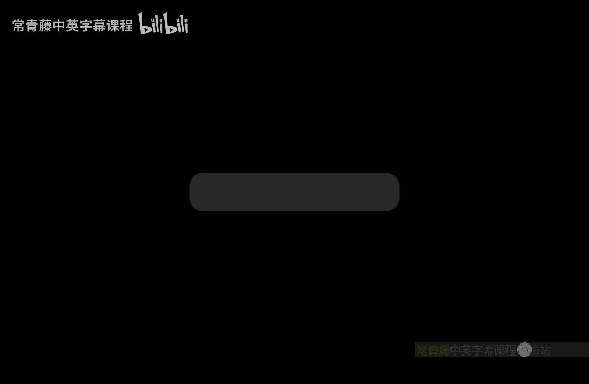
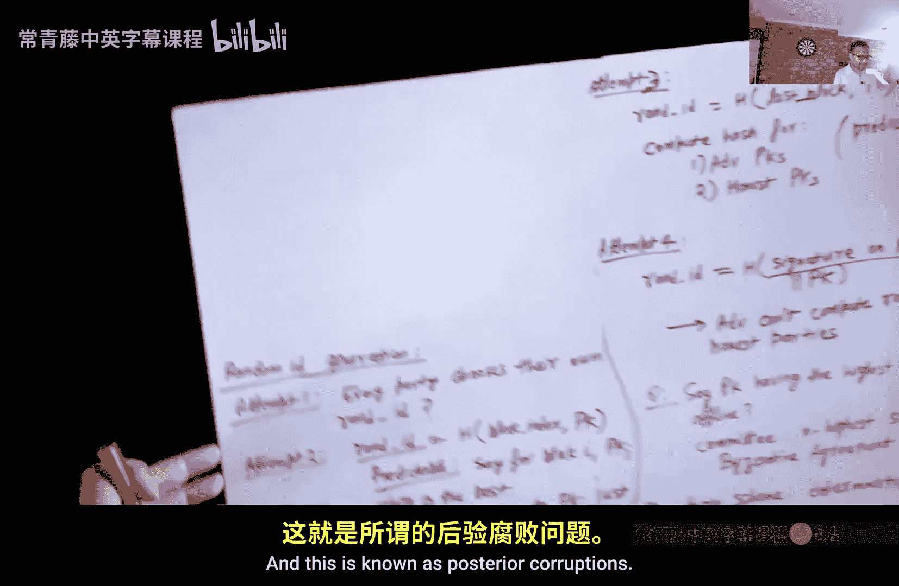

# 卡耐基梅隆大学【中英⚡密码学导论｜15.356 Introduction to Cryptography】 p16 P16 Lecture 16 Other Blockchains -BV16V6GBYEAA_p16-

Okay， let's get started。😊，Welcome everyone， so。😊，We looked at Bitcoin and its fundamentals muel trees in the last couple of classes。

And today we will look at some of the other proposals for cryptocurrencies。😊。

I saw many of you were in Svia' stock today so that was great。Yeah。

 we will look at proof of stake and we will look at a couple of other proposals。

So I did talk about some of the limitations of Bitcoin in the last class。So， perhaps。

The biggest or definitely one of the biggest limitations is that of scalability。😊，So。

 in Bitcoin there is a fixed upper limit on how big a block can be the block size is fixed to be 1 megabyte。

😊，And then of course， that limits the number of transactions that you can do every block。

 which is roughly every 10 minutes， right？So， one very obvious proposal is to just increase the size of the block。

😊，Right what about making the block size5 megabytes or 10 megabytes or something like that right so that is great。

 but unfortunately there is a problem with that。😊，And the problem is。

If you increase the size of the block。The block takes longer to propagate。Okay。

Which means that essentially when you solve the puzzle。

 it takes longer to propagate the puzzle and that also means that。Basically。

 there are more folks in the system。Spialally if you are an honest party。So blocks。Dick。

Longger to propagate。Which essentially means that。Let me draw a picture here。

Suppose somebody did end up solving。The puzzle， which is the next block。

This is the next block somebody mind， but maybe it takes now longer and in that time honest parties are still working on this block。

Which leads to increasing number of folks。And note that even if you are using Mer trees。

 you need to look at the entire block。😊，To validate it right maybe the puzzle solution is correct。

 Maybe the hashes are correct， but maybe there is an invalid transaction in the block and in that case the block would be considered valid invalid。

So。So that's why honest parties need to download basically the entire block and then need to check for themselves if the block is valid or not。

😊，But on the other hand。😊，Maybe the dishonest parties are better connected。

Better connected or better coordinated。So in that case。

 dishonest parties don't waste that much computing power。

As soon as one of the dishonest parties is successful。

 they can very quickly signal to the other dishonest parties that。😊。

You can stop mining here and here's the next puzzle on which you start mining。And that's why。sport。

There are two folks， suppose here we have honest。And let's say。

This for was mined by some dishonest party， but maybe at a slightly later point。

And now all the honest parties jumped here because this came first。But then again。

 we will see many folks。So， essentially。The computation of the dishonest parties is not so coordinated。

On the other hand， if the honest parties are able to coordinate their computation better。

They can have less folksk， but a longer chain。Okay。So。

Even if the dishonest parties have less than 50%。Computing power。Maybe that's enough。

To control the longest chain and to produce the longest chain。

And that is very dangerous because you know you are able to launch a 51% attack with less than 50% of the computing power and in that case you can go back。

 you can erase the history， you can rewrite the history。😊，Basically。

 the security of Bitcoin is completely broken in that case。Right， so the problem here was。😊。

Even if you have less than 50% of the computing power， because you are better coordinated。

 you just you don't waste it in the folks。You focus on a chain and that that chain gets。

Keeps getting longer and longer。So this is a problem this means that in some sense there are problems while talking about the scalability of Bitcoin。

😊，Making Bitcoin more scalable is not as simple as just increasing the block size of Bitcoin。😊，So。

 there is a proposal to overcome this。😊，This is known as ghost。And this stands for。Greedy。heaviest。

Oserved。Subre。And we will see what what it means。嗯。And in fact， this proposal。

 I think it came in 2000。14 or 15。And since that， it has gained。Quite a bit of acceptance。 And。

 in fact， a variant of this。Is going to be adapted by Ethereum。And that variant is known as。Gsper。

And the name is kind of there was a movie in in the 90s where。The name was Casper。

 which is a friendly ghost。So thats that's how they derive the name from this。This word ghost。Okay。

 so here in。Here， let's go back to the problem of scalability。So， you see that。

If the dishonest party is successful。They will have a longer chain。

 but with less folks right on the other hand， honest parties might have a lot more folks。But。

A smallology。Okay。So， why choose。The longest chain。

Why not choose a chain which might have a lot of force？But maybe shorter。

A lot of folks in some sense， show you that。More computing power was invested in this branch as opposed to this branch right so here you can see。

More computing power。So now the new proposal is rather than choosing the longest chain。😊。

You choose the chain or you choose the branch which has the evidence of the most computing power being spent on it。

Okay。So here in ghost。Choose the heaviest。Subre。So， even if。Some honest party produced a fork。

 the fork eventually died down。That for still plays a role in determining whether this particular chain or this particular tree is selected or not。

So， the idea is that。Here， let's say there are two competing subes。

You just look at the number of node here versus number of node here。

And you count all the notes even in the hook。And whichever has the maximum number of nodes that shows the maximum amount of computation and thats what you select。

😊，Okay， so the rule of time， something like the following。The first rule is。

Heaviest subre is the right one。And if there is a tie， then you go to the second rule。😊，Which is。

The first sub。Is the right one。Okay， and if you are working on a sub。😊，啊。

But you see that there is another sub which became heavier， you are supposed to switch to that。오케이。

And just keep in mind that。There is still。Amen。So， for example， if this is the heaviest subre。

 maybe here we will have a chain。Sugg just for simplicity， let me。Extend this one。

So there is still a chain which is represented by this chain in green。

And that is still the main chain and only the transactions which are presented in this chain are considered to be valid transactions。

😊，Why can't honest nodes be working on a subary fog by a dishonest node and making it heavier yeah that that can completely happen。

I mean， if the honest note。Generally produce a subory which is the heaviest and also the first one then of course all the honest node should switch to that right so in in Bitcoin we don't try to prevent honest node from mining any block。

So of course， you can， if even if you are dishonest。

 you can mine many blocks just we don't want dishonest notes to take over the entire network。

Then can't an attack happen like this without 51% attack？啊，no。I mean， in this case here。

What does a dishonest branch mean， A dishonest branch means that。It did not conform to these rules。

Either it's not the heaviest or maybe there's a tie， but it was not the first one。And in that case。

 majority of the computing power will go to the honest branch and that honest branch will get heavier。

😊，If not the longest。Okay， so there is still a main chain and only the transactions in the main chain they。

They remain valid。The transactions in the folks they are not counted even if force determine which chain is considered to be valid in the longest。

So， how do you decide the main chain， what is the algorithm for deciding the main chain？

You start with the Genesis block。And then at every step。Maybe you encounter multiple possibilities。

 so for example， let's say here here you see three possibilities。

You just see which one is the heaviest at every step choose the heaviest。

And you doing you keep doing that recursively。😊，And eventually， you will end up。

At one of the leaves and then you have sort of。Marked the main chain。And if there is a conflict。

 then basically right now we have a for， hopefully the for will be resolved eventually。😊，So。

 last time in Bitcoin we saw the nice property that a long chain tends to get longer and longer。

Which is a very nice stability property。So even here we will prove。

Or it's a simple observation rather。The observation is that。The heavier sub。Becomes。

More and more heavy。So， this is a very nice stability property and this is sort of easy to see because because of our two rules right earlier if there was a conflict the miners were divided across two different subies just at random one of them will get extended and then that becomes the heavier one and then all the honest miners would eventually switch to that sub。

😊，And then because honest is minus control 51% of the computing power。

That sub becomes even more heavy。And the other subies sort of die down or fade away and things like that。

Okay。And the nice thing here is that。Another observation。The honest nodes are the honest minusrs。

They no longer waste。Computation。Because of four folks。

Because every fork plays a role in determining which sub is the heavier one。😊。

Even though the transactions themselves in that folk do not count。Okay。

 so just keep in mind that all valid transactions are still in the main chain。😊。

Folks just tell you which path to take， which chain is the main chain。Okay。

 so this is the ghost proposal and Ethereum is adapting a variant of that which is called CAsper。😊。

And in some sense。It makes progress towards solving the problem of scalability。Any questions？

Can I ask a question about that yeah so in like a scenario where someone has completed a for like they've solved the puzzle。

 but after the fact they realized that someone has already solved the puzzle before them and they are the first person to make the next block。

 is there any incentive for them to report their solved puzzle to like wait the main tree more。

Versus just trying to start to solve the next puzzle。

 like do they get like a small reward for reporting their late puzzle？Yeah， that's a good question。

I think again， it depends on the details of the proposal， I don't know what CASPperR does。But。

What is the incentive for them， So one incentive for them would be to。Make sure that。The sub。

 which they are working in。Remains the heaviest subre and you don't certainly switch and go in a completely different universe。

So that's one and other one， yeah I don't know， maybe it does make sense to give them some kind of reward。

Yeah， and think about waiting the subree there and that makes sense， thank you。Yeah。

 any other questions？I have a question。Over here it seems like the dishonest nodes。

 even if they don't have 50% computation power they can get a heaviest subre like assume that there is a for and then all the dishonest parties start to find the next block on top of a single block like there can be many hashes。

Wwhich can be put on top of a single block right and they decide that instead of just putting in one block。

 they will find many blocks。And then they are essentially making a subary heavy， right？Like。

But the point is that if they have less than half of the computing power。

If all the dishonest parties are working in one sub and honest parties are working in another sub。

 then the honest sub is going to win。I don't think so because in the honest case we are assuming that after every new block everyone starts to try building on top of it。

 so everyone starts a fresh computation whereas the dishonest parties can choose not to start a new computation just try to find many blocks。

 many different blocks which can be put on top of a single block so they are not wasting any computation of their own。

Right。Oh， I think maybe what you're asking is that。

If I continue my competition which has failed so far as opposed to starting a new competition。

 I have a better probability of winning exactly。No， that's not the case。I mean。

 if you have failed so far。You continue this computation versus you start computing on something which is completely different。

It's not going to make a difference。Because every trial， every time you hash。

 the hash just sort of gives random output。UYou know。

 the probability of success in that output is just determined by this parameter k。

But you have already。Got passed some of the cases， which。Are not the right ones， right？Yeah。

 that does not increase your probability of being successful in the cases which you have not tried。O。

Yeah， this， I mean， the fact that you failed in the past doesn't make it more likely that you will be successful in the future。

Every trial is independent。Because every time the input to the hash function is different right you choose a different nouns versus you choose a different nos and a different block。

😊，Doesn't make any difference。O。Okay， good。 so let's continue。So。

 another proposal to deal with this scalability problem and also it relates to the cost of the transactions。

In blockchains is。Let's just call it inclusive blockchain approach。So， they are targeted towards。

2 points。 So one is。Scalability。And the second is they're trying to keep the transaction costs lower。

And here the idea is that so far。😊，We always discard the folks。

And that is important in some sense because。😊，What is。

Therein the folks might conflict with what is there in the main chain and we have to choose one。

 right？But now the point is that maybe there is some information in the folks。

Which doesn't necessarily conflict with the information in the blockchain。And in that case。

Why should we discard that information？Right why shouldn't folk have some useful information。

 so let's say you know。I don't want to pay a significant transaction fee Im some small guy I am willing to wait a few hours to make sure my transaction goes through in the blockchain。

😊，Then I broadcast my transaction and maybe。At least in one of the folks。

 my transactions might appear maybe not in the main。And in that case。

 as long as it doesnt conflict with anything in the main chain， it should stay。

 it should be considered to be a valid transaction and this is exactly the proposal in case of inclusive blockchains。

😊，So， there are still some questions like you know what if the main chain gets extended later on and a conflicting transaction appears in the main chain。

 then what happens does the fog get raised？If so， then you know。

 folks can never be trusted and we are back to the old proposal。So here， the idea is that。

We look at the current state of the blockchain and we look at the current state of all the folks。

If there are transactions in folks。Whi don't conflict with the current state of the blockchain。

 we keep them， we make them final。What that means is that from this point onwards。

Any extension to the main chain will be forbidden from involving any conflicting transactions。

And that's why the transactions in the folks can now sort of be finalized。So in more detail。

 here is the proposal。So suppose there was a fork at this point。But then。This became longer。

And suppose there's some transaction。let's say d i。Here or。

And this is the current state of the system。And suppose TI does not really。

Does not really conflict with anything which is which is in any of the blocks in the main chain。

Then when you are trying to mine the next block。You will look at this block。

And the puzzle that you will try to solve。Is。You are mining on this， this is your puzzle。

But you also take this block。So let's call this block。B I， this is， let's say， block。咪姐。

Your puzzle will be B concatenation Bj in some sense。And then， the remaining things， like。

Your information， your nons。You are publicly key。嘿。And there should be。十。给 zero。So。

 the rule here is that。The next block on the main chain。Ctifies。All。Childless。Ns。

Which have not been certified so far。Okay， and what are the child has nodes of course there is a node in the main chain which is sort of the last one。

 there is a node here in this fork。So you take both of them。 Maybe there's another one here。

You will take this as well and the next node in some sense。Certify all of them。And automatically。

 this means is that what this means is that。😊，If there are non conflicting transactions in these forms。

 they are considered to be valid and part of the blockchain。

And now maybe this node gets extended and maybe the main chain will get extended and then this。

This next block in the main chain will certify this block as well。Okay， so the idea here is that。

You can mine。On the forks。And hope to。Get them included。And then the miners on the folks。

 they are also paid some transaction fee， which might be much smaller than the transaction fee。

Which is paid for the main gene。Okay， and this is nice。 This is inclusive in the sense that。😊。

In Bitcoin， if you are a minor。It might be several years before you are successful in mining the next block just because there's so much competition。

But now in this proposal。😊，You can go to any folks。

 any long abundant for you can try to extend those folks。

And you can try to include new transactions and hopefully。

There would be a block in the main chain which would certify that fork。

or that extension of the fork which you created and in that case you will get paid。

 the ledger will be extended and there will be new transactions which are now included for very little transaction fee。

😊，So， so like a new block， the new coin that comes that comes only in the main chain。

 not in the side chain， the new coin that comes。要。ok  i mean诶。So。Both options make sense。

 right if you want it。You can have a much smaller number of coins created in the fork as well。

But I think the cleanest proposal would be that new coins are only created in the main chain and in the folks。

😊，Sort of the chain is extended only based on the incentive of the transaction fee。Okay。

 and like nobody can do any fraud because if I have 10 bitins and if I need to transfer to someone。

 they need my security。Yeah， that's always the case。you always need to sign your transactions。

 but there is another point here， right？Maybe there is a conflicting transaction。

 maybe let' us say Alice has a single bit in the main chain Alice transferred this bit to Charlie and in the fork Alice transferred this this bit to Bob。

So then we have a conflicting transaction here。And then the transaction in the main chain will take precedence。

But will won' it happen like this that because the side chain has a conflicting transaction will never add this side chain in the main。

No， I mean， there might be many transactions， some of them conflicting， some of them non conflicting。

 So you just add this block to the。嗯，I mean。So the block in the main chain will certify this block。😊。

And automatically all the conflicting transactions are considered to be invalid。😊，Okay， okay。

 So it's like even if the sidewalk has wrong transactions， we still certify them。Yeah。

But that doesn't mean that all the transactions in that will be valid。Okay， thank you。 so thank you。

So this leads to a structure which can be seen as a directed acycl graph。Or a DG。Okay。

 so here we had a tree。 Here we have。An even more advanced structure which is directly directed acyclic graph。

 I am sure that you can come up with other structures and they might have some nice properties。😊。

Okay， any other questions？So。I have a question。When we are mining the new block on the main。

Suppose the side chain contains BG and one another node。

One another block on top of that so it will add certify both of them。Sorry say that again。

 So suppose the mean block that。We are putting in。That will certify。Bj。

 and suppose if there was a block on top of Bj as well。 So will it certify both of them。Or only one。

At a time。 So it just certifies all childless nodes。

Which in particular means that the last node in every four is certified。

Okay so it will and once the last node is certified。

 all the previous nodes are certified automatically as well。

Because the last node in some sense certifies the node before that。

 which in turn certifies the node before that and so on。

 but then this can lead to a change of the main right。O not。What do you mean， I mean。

 the main can switch to the one。The side chain containing BJ。

Because in the main existing mentioned we are adding one block but the side chain gets two new blocks added。

And certified。Whyide two new blocks， so suppose。BJ was the last transaction。And there's this。

Suppose this was the main chain and this was a side chain。And then we have a new block mind。

 Yeah So I'm saying suppose there is a then main chain gains by one and the side chain also gains by one。

 right。And suppose if there was a another block on top of BJ， which is Bj plus1。D yeah。Okay。

 so now the side chain is certifying Bj plus 1， right？So， here's the block。Bj plus 1。

 and this is the main chain right。So that automatically means that。This chain。

Is longer than this gene。And now both of them are extended by one。

So the main chain still remains the main chain。Okay， all right， if that makes sense。

This one small question once like the Bj plus1 is certified。

 I can never add one node on top of Bj plus1。

No， you can。That's the whole point， so you can go to Bj plus2。

Bj plus 2 is not certified by at this point， but if the main chain gets extended。

 then maybe the next block will certify Bj plus 2。Okay okay that's why we continue mining on every for you can even create your own for from any point but like why are we drawing an arrow from vg plus1 to the main just because it is being certified by the main yeah。

Okay， thank you。And there is an incentive for the mine in the main chain。

To certify all the childless notes， because that mine can now collect the transaction free from all these notes。

No transaction fee will go to the person who mind the side chain node right or the main chain person will get the transaction。

 it will be split。O。

So so far， everything which we have talked about。😊。

Relates to proof of work right in proof of work you have a computational puzzle which you are trying to solve。

😊，There are many miners which are trying to solve the same computational puzzle simultaneously。

And that leads to a significant wastage of computational resources as well as electricity。Right。So。

 in fact。It is known that。Bitcoin。Is using more electricity。Then， for example， Switzerland。And why。

 for this。Apparently， useless computation。Which is just hashing on meaningless numbers。

So this computation is is essentially useless to the mankind it's not like。

We are doing some DNA sequencing or we are doing genomic analysis， it's completely useless。

Beyond the purpose of just maintaining Bitcoin， of course。So now the question is。

 can we have a better， more green， a cheaper alternative to Bitcoin？And one of the proposals。😊。

Is based on proof of stake。There are many suggestions， of course， proof of stake is just one of them。

So in proof of work。Your voting power in the system。

Is proportional to the amount of computation that you have。the more computation you have。

 the more likely you are to be able to mine the next block。😊，Impro of stake。

The voting power that you have is proportional to the number of coins that you own。

There's also other proposals like proof of storage。😊，The bigger your hard drive is。

 the more your voting power is。😊，There is also proof of memory。

 which talks about your short term memory and so on。

So proof of stake is a nice system in the sense that。The system is less wasteful。

 you don't need to solve any meaningless computational puzzle。

 you don't need to use a lot of electricity， it relies on cryptography and。

It is very attractive in some sense because it's a more green alternative and。😊。

It has its advantages and properties which Bitcoin doesn't。But it also has its problems。So。

 many people present proof of stake as sort of a clear improvement over proof of work。

 sort of the next generation of blockchain and in my view at least that is not the case。

So one common criticism of proof of stake is that。The more stake you have， the more power you have。

 you know you have more clientss， which means that you are more likely to be able to mine the next block。

Which means that the new coins which will be created are more likely to go to you。😊，But you know。

 it's really up to you whether you consider this criticism to be valid or not。I mean。

 even in proof of work， right？😊，The more money you have。

 the more computers you can buy which can give you more bitcos right this is essentially how our society works。

 the more money you have。😊，The more you can get。Sort of the problem of。

Rich having more power and they are becoming richer and richer。

Probably cryptocurrencies are not any different from that。Okay。

 so another problem with proof of stake is that it's much more complex。

So maybe let me list an advantage and disadvantages。Advantages is more green。Disadvantages is。

It's more complex， definitely more complex than。Then Bitcoin， for example， in fact。

I will not be able to present any proof of stake system to you in this class。

 I will just try to give you some high level ideas。Let me look at the questions。ok。🤧嗯。Mo centralized。

 maybe。Some people consider this as a negative， Im not so sure because。

It's a problem in proof of work as well。Okay。So。How do you do you mind the next block in a proof of stake system？

That's the question。So there are various options。 First option is maybe。

The person who holds the largest number of coins。Well mind the next lock。

But that's not something which you want right then the system essentially becomes centralized。

And then basically you have a fixed person which will basically mine every single block from this point onwards。

😊，So it's clear that there has to be some randomness involved。And。In proof of work。

 this randomness came from the computational puzzle。You try random imports， sometimes I succeed。

 sometimes you succeed。And so on。 and my success probability is proportional to my computing power right So here what we need is your。

😊，Probability of。Success。Should be proportional to your stake in the system。Okay。

 stake is how many coins you have or what percentage of coins you own。And yeah。

 and how do we make sure that this happens if there is if there was a trusted third party that third party has。

A record of。How much stake everybody has， then the third party can flip a coin。In that you know。

 according to the weights and declare the winner， but of course we don't have any trusted third party here。

So， in some sense， you need a decentralized mechanism of coin flipping so that the probability of success of any particular public key is proportional to the state which this public key holds。

😊，Okay， and the way this is achieved is。😊，In every round or in every block。😡。

Every public keys assign some sort of score。Okay。😊，So， youre。Scores should be proportional to。

Your steak。Times。Some random number or some random I。Okay， and this function can be any function。

 It can even be the identity function。 So maybe for simplicity， let's just assume that your score is。

😊，Equal to your stake multiplied by some random number。

And this random number is coming from some domain， let's say。

50 bit random number or something like that。Okay， and now the question is。

How does one select this random ID？This random idea is， of course different for different parties。😊。

Depends on your public key。Okay， so let's see。Random Id。Generation。And this is probably one of the。

Most complex parts of a proof of stake system。So let's have several attempts。

And maybe I will ask you why。A particular attempt doesn't work。So maybe the simplest attempt is。

So every party chooses their own。Sandom id。How about that？

Dishonest parties will always pick the highest number。I that undermine the mind。Yeah。

 so this just completely fails。😊，it is in your interest to pick the the largest random ID because。

That maximizes your score。The second attempt is。We don't want the parties controlling their own random ID。

On the other hand， we want them to be able to compute that random ID。O。So maybe。

Random Id of a party may be equal to some。Hash function applied on。The block index。

This is to make sure that。Random I for different blocks is different。

 and let's say they are public key。What about this。Public keys are cheap， sure， but。

Why is that a problem？Like if it is like this that I will never be able to gain more points right if my public key is very bad。

😊，嗯哼，你 on。So you can yeah， so there's also an answer in the chat。

 you can pick a bunch of public keys and you can maximize your random ID but。

Now the problem is if you pick a bunch of public keys， then。😊。

You don't have probably most of them will have stake zero。

Right if you or if you distribute your stake across multiple different public keys。😊。

It's not necessarily the right strategy for you。Remember I am trying to say that if one public key has a very high hash。

 then they will be the one who will be keep spinning and it is essentially like a centralized system。

But it's only for a particular block， right？For the next block， maybe another public。

 you will have a high hash。Maybe then the state thing is not very well used in this case。😔。

If it is like， well， you always multiply the random idea with the stake later on。Right对。😔，So。

 your score is always your stake times the random I and we are just talking about how to generate the random I。

So I think we are making progress towards an attack， but still。

There one more idea required to defeat this。不不证。So what is the problem so the problem is here。😊。

I think many students were already going in the right direction thats that it's predictable。😊。

Far into the future。I can compute。I'm just taking block index here。

So I can pick a million different public keys。And I can see for which block。

 which public key is the best。😊，So， let's say for block， I。嗯。Stay for。Block I。

 I have some public key PKj。Which is the best and I can do this competition。Far into the future。

A lot in advance。 Then what do I do。And then。You transfer your stake。To this public key PKj。

Just before。Block I。Okay。😊，And then you can sort of optimize。Every block。Or maybe every other block。

 if you assume that it takes one block to transfer stake。

Like can we include the transactions also in the hash， then probably this might not。Yeah。Yeah。

 that's the next attempt。What about your random I is。Haash of。The last block。And you have public KPk。

So this is our time3。It's better than previous one， but。There's a problem with this as well。

Any thoughts？So here the problem is that。😊，The person who is mining the current block。

Has a lot of power。Because just imagine that。If you are able to decide the last block。

 lets say you win once right sooner or later adverse gets to win。

And then adversity can carefully engineer this block。😊，To make sure that in future。

One of the adversarial public keys will keep winning。Okay。

 so you have some degree of freedom in deciding the last block。😊。

You can compute the hash for your public keys as well as for。Adversary。

Everless for honest public keys， so。Compute hash。5。😔，Number one， aversary public keys。

And second is honest public keys。And then see。How it's playing out。

If this block is favorable for the adversary public keys， you keep it。

 otherwise you try with a different block。😊，And， in fact， even here， you can even。

Genrate like millions of different adversevers public keys。Make sure you transfer your stake。

So again， here the problem was。Predictability。Maybe you can't predict far into the future bird。

You can predict all these random numbers for the next block if you are mining the current block。So。

 here's the attempt for。It will be the final attempt for this class， but。😊，啊。It still is not ideal。

This attempt sort of takes away the predictability property。So your random I。Is the hash of。

In some sense。Your signature on。Last block。Appended with your。Public。Okay， and now you can see that。

嗯。Adversary cannot compute。And I D of。Honest parties。So first， you need to sign the last block。And。

If you don't have the secret key there is no way you can produce the signature right so if I am the adversary let's say I am mining the last block I cannot really compute the signature of any of the honest parties on this block。

And hence， I don't know what their random number is going to be。

I can still compute my own random number。Okay， so this this is still not entirely satisfactory because。

😊，Even though I cannot compute your random number， I can still try to sort of maximize my random number。

By engineering the last block。And we。That attack is dealt with is that this is actually a committee which decides the last block。

😊，There's not a single individual which picks the last plot。

So there are many questions here we are over simplifyimpling things quite a bit。The question one is。

四。The public key， having。The highest score is offline。So what happens in that case？Right， and。

It's not as simple as saying that hey， if there's public queue is offline。

 then you go to the next best score。It's not as simple as saying that because I don't know who is offline and who is online。

 right？Maybe the miners wait for like 10 minutes if there is no response。

 then they move on to the next public key。Then they wait for another 10 minutes。

 then they move on to the next best of key。 This will take a while right this is this completely sort of。

Kills the predictability。Of the mining process。Maybe some block will be mined in 10 minutes。

 another block might take 30 minutes one hour and things like that so we don't want to do that。

And even doing even if you were okay with that， it's not even clear how to implement it right because let's say after 10 minutes you move on to the to the next person and then the previous person shows up。

Just right at the end of the interval。Some miners believe that the previous person showed up in time。

And they would mind the next block。Some people will think that no the previous person was late and hence we already moved on to the next best person。

So in a decentralized setting， there is always a problem of。Consensus on everything。

Whether a person is online or not， that's already a problem of consensus in itself。So。

 the way we solve this problem is we have a committee。

We don't choose a single person with the highest score。So you choose a committee of。

You take the N highest。😔，Of course， where n is some parameter which you can decide。

And all these people are now part of the committee。And the assumption in many of the systems is that。

A majority of the committee picked in such a way will be honest as well as online。😊。

And then this committee will run what is known as。A Byzantine agreement protocol。

And this protocol allows this committee to agree on what the next block is going to be。

Any questions so far。And yeah， by the way， another thing which I didn't mention is that。

The signature on the last block。The signature scheme which you are using must be。Deterministic。

And unique。So。I sign the last block， right？😊，Suppose the signature scheme is randomized just like encryption schemes。

 so we saw algamal how that is randomized and so on。😊，呃。Then even if the message is fixed。

 I can continue generating many different signatures。😊。

And I can pick the signature which maximizes my random ID。So that's an attack in itself。

And that is why many of the proof of stake schemes， they use what is known as a unique signature。

Unique signature means that give one a message。There only exist a single valid signature on that message。

You don't have a degree of freedom in deciding what your signature is going to be。

And the textbook RSS signature is already a unique signature。

Because the signature is just empty to the power D。There's no randomness。 There's no。Yeah。

 there's no degree of freedom。But like didn't we say that like if we have a signature of M1 and M2 we can generate the signature of M1 into M2 and these things Yeah so thats why textbook analysis a signature is not secure。

But we also looked at a variant of that， which is you hash the message first。

And then you raise it to the poverty。So I think that's also a unique signature scheme。

 definitely a deterministic signature scheme。But， but in that， didn't we use the CRH。

And that used random articles。 The hash function was a random molecule。Okay， sorry sorry。

There's another issue which you need to be careful about。In proof of stake。And this is known as。

Poerior corruptions。It doesn't happen in proof of work。And it's a very tricky problem to deal with。

Okay， so let's say this is our proof of stake based blockchains。Okay， let's look at this block。

So suppose there's a bunch of miners。Let's call it a set S。So here I set S。Has。Majority of the stake。

At this point。Okay， at a later point。😊，All stake。Is sold。

And now this set S has no stake in the system。The next step is。S becomes。Corrupted。Okay。

 I sold all my steak or。😊，My friends， me and my friends。

 we sold all of our steak and now we become malicious。Now， what we can do is。

We can create a folkk from this point onwards。So the next step is。S creates a fork。Okay。

 so this is like a parallel universe and in this fork。😊，S still has。The majority stake。

If you have the majority of the stake， you can。You can proceed， you can create a fork。

Now some new minor joins。And you have these two different versions of。

The proof of state based blockchain。How do you determine which one is the correct one？

That's now completely unclear。The way this problem is resolved。In proof of work。

Is that if you go back from this point onwards， if you want to create a fork which is as long as the fork。

 which is as long as the main chain。Then you continue to need majority of the computing power。So。

 creating a fork is very expensive in proof of work。But in proof of stake， you know。

 I just go back to this point， I have majority of the stake。And I can create a chain。

 arbitrarily long chain， it doesn't take much work。And in this chain or in this fork。

 I never sold any stake。And these two are in some sense。

 hard to distinguish which one is rare and which one is fake。Which one came after the fact？So。

 this is a tricky problem and there are some solutions to it。But nothing which is like very simple。

W just completely solves the problem it more of workarounds rather than solutions。

 but wont this decrease the value of the currency itself so S will never do that。Well， why not。

 as already sold all the stake， right， I have 0。I have zero stake the system up now。

If I can go back and I can get back my stake， even if it's worth less。

 I still have the incentive to do it。喂。Okay， any questions before we stop？And let me write。

Let me give you a pointer to an interesting paper。This is called。S's okay。Research perspectives。

And challenges for。Bitcoin and。Cryptocurrencies。This is sort of a survey of the area which focuses more on the ongoing research and open problems。

 what are the challenges， what are the unsolved problems and so on。Okay。

 so this basically finishes our。Our series of lectures on blockchains and on Wednesday we will start the knowledge groups。

