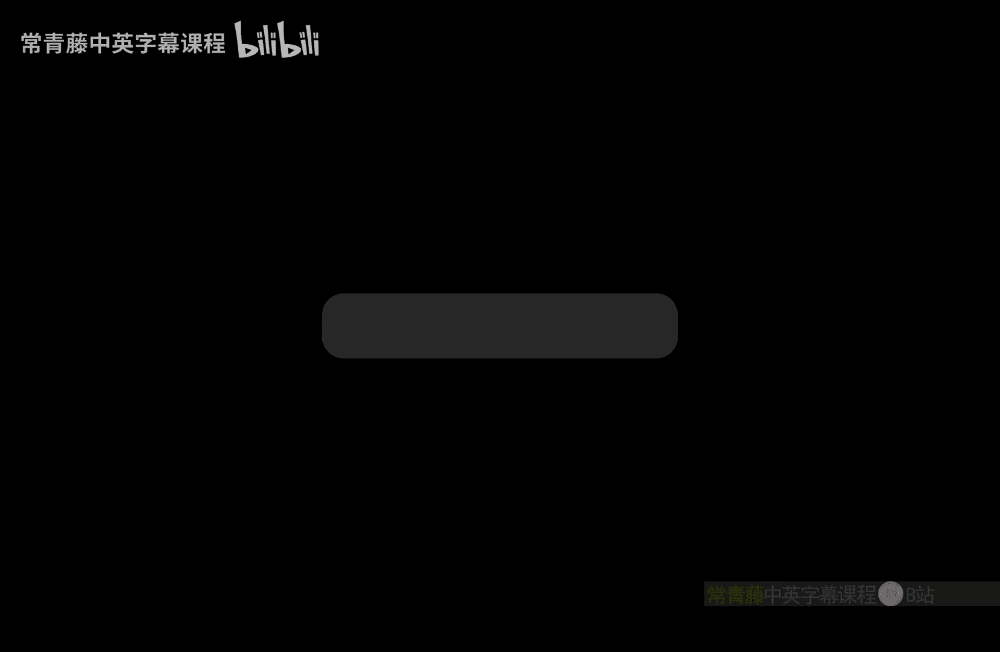
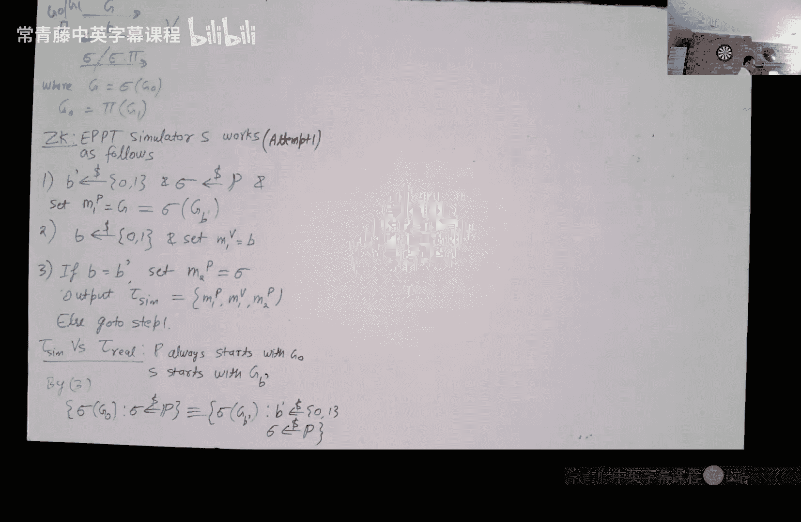

# 卡耐基梅隆大学【中英⚡密码学导论｜15.356 Introduction to Cryptography】 p17 P17 Lecture 17 Zero-Knowledge Proofs I -BV16V6GBYEAA_p17-

Okay， welcome， everyone so。😊，Let's get started today we are going to start a new and very exciting topic which is zero knowledge proofs。

It's a really interesting， very sort of fascinating and counterintuitive concept in cryptography and in fact。

This was one of the things why I decided to do research in cryptography。So。So。

 in zero knowledge proofs， we have a prover and we have a verifier prover is trying to prove some kind of statement to the verifier。

😊，And prover has a secret， maybe sort of a solution or a witness to the statement that it is trying to prove and prove would like to convince the verifier that。

What they are saying is true without necessarily revealing any additional knowledge and we will take some examples。

🤧So。Zion knowledge proofs they were introduced in like 1984 or something like。😊。

36 years ago and since then。They have found a lot of different applications in cryptography。

 they have been very influential。😊，Mathematically， the notion of zero knowledgege proofs is very simple。

😊，But conceptually， it's kind of very deep and。You know， very confusing sometimes。

It takes some offline thinking to really become comfortable with what Xon proofs are and in fact。😊。

When the notion came out， it in some sense even confused the research community for some time。😊。

And it was not immediately accepted。Okay， so let's start with an example。😊。

We have a prover and we have a verifier。😊，And there is a common statement。

 there's a public statement。 Okay， the public statement could be something like。

Let's let's take a mathematical equation。It could be。Y 1 to the power 5， y 2。啊。这个。X to the power5。

 Y square plus。X times y Q plus or maybe。-7 equals 0。So this is some kind of。Multivariate equation。

Okay。And。Proer is s to prove to the verifier that this equation is satisfiable。😊，In other words。

 there are values of x and y such that this equation can be satisfied with these values。😊，So。

 how can the proveer convince the verifier of this one option is proveer can just send the values of x and y to the verifier where I can plug these into the equation and just check for himself right but then proveer is sort of giving away his witness in some sense or his secret。

😊，The question is。Does there exist a protocol？Such that the prover and the verifier。

They talk back and forth。And at the end， the verifier is convinced that the statement is indeed true。

😊，Without the prover revealing any information to the verifier。Okay， and we can take another example。

 like。I am sure you have heard of the threeat。Problem。Which is known to be an NP complete problem。

So in three set you are given something like。😊，Even are。It three啊。In nine。And。A 2 R， a 3 R。If 5。And。

Could be a long formula。Okay。And Proer has a satisfying assignment。

 which is the values of a1 up to AA and proveer is trying to prove to the veryifier that indeed this three set formula is satisfiable。

😊，So Z knowledge proof were introduced。By GMMR。In 1984。GMma stands for gold Dr Mcalli。And wreck off。

Mialli also gave a talk here on Monday。And。Actually， the notion itself， the notion of theon proofs。

 it was invented in。1982 actually rather than 84 so why did the paper get published in 1984 well the paper was rejected four times before it was eventually accepted。

😊，They kept changing the presentation， they kept changing the title of the paper。😊。

Many reviewers just didn't really understand what was going on。

 many people thought that the concept itself doesn't make any sense。😊，Of course。

 later on when it came out with time community really started understanding how important the concept is and this paper was one of the big factors why。

Malli got touring about。It was one of the papers cited in the Turing award。

So now let' us try to define zero knowledge proofs and by the way。

 feel free to stop me and ask questions at any time。

So normally we think of proofs as something which is one shot。

The prover sends the proof to the verifier， the verifier checks and verifier is convinced。😊。

But that is not how the knowledge proofs work the knowledge proofs necessarily require some back and forth interaction between the prover and the verifier。

And。Yeah， so in the definition。A zero knowledge proof。Is。A protocol。

Between the provever and the verifier。Which are。Stateful PPT algorithms。嗯。

And typically in zero knowledge， we have something which is known as a common input。

Let's denote the common input by x。And you can think of common input as the statement。

Which the prove is trying to prove。So here， for example。This can be the common input。

And then there is a private input。To the prover alone， which is the witness。Okay。

So prover is trying to prove。Spy vicious。To prove that。X is in some language L。So， for example。

 in three set this is our x， the language would be just。😊。

The set of every formula which is satisfiable。Okay， so the very。

They does not necessarily have any information about the witness W。Maybe verify has the witness。

 maybe verify it doesn't。Okay， so we have two algorithms。😡，The Pro algorithm works as follows。

 the Pro algorithm takes as input。X， which is the common input， witness， which is the private input。

And the next message of the verifier。And remember that this algorithm maintains some sort of state。

Okay， and the poor outputs。The next message， which is。M I plus one of P。Okay。

 so here superscript P represents that this is the message generated by the prover。Similarly。

 we represents very file messages。And。Proval is the one which starts the protocol without loss of generality and we set。

😊，The fast message。N0 e to be just。🤧But。Okay， so in the beginning provever takes x w and bot as input and then produces the next outgoing prover message。

And then the verifier， of course， only gets x as input。Wherelffi gets the next message of the prover。

🤧嗯。Here， I represents the。Round number。And the verifier outputs。A I。Of P。Sorry。V。Okay， and。

At the end of the protocol。Welfare outputs。Either accept。Or。Reject。

Except means that the verifier is indeed convinced that the statement is true。 reject means that。

Wifi doesn't believe the prove。O。😊，And in addition， let's denote the protocol transcript。到。就比。

Just all the messages exchanged between the prove and the welfare starting with。😊，M1 of P。M one of V。

M two of B。M2 V， and so on。So， basically， all the messages exchanged in the entire protocol from the beginning to the end。

Now this is the syntax of the protocol let's try to define。😊，啊。What a secure noise proof looks like。

RightSo it should satisfy three properties。Normally we are used to two properties first is completeness or correctness then second is the security property。

😊，Here we have three properties， the first is of course completeness and correctness。

 the second property would guarantee security for approval against an honest verifier and the third property would guarantee security against a malicious prove for an honest verifier。

😊，So let's see that in more detail。The first property is as usual， which is。

The completeness property。Comle this property just says that。If everybody is honest。

 if the prove has the right witness。😊，Then at the end， the very file accepts。

So if x is indeed in L and。P has a correct witness。And if。be个嘛咪。你。The protocol， honestly。

V outputs accept。Always， with probability 1。The second property is the property of soundness。

In the soundness property， we envision a dishonest prover。

Trying to convince an honest ver of some false statement。

And we want the prove to be unsuccessful in some sense。So in soundness， if the statement is false。

X is not an L。Then， for any P PT。Prove a peace star。So why do we denote it by p star rather than p？

So P is actually an algorithm which represents the honest screwer algorithm。

P star is any arbitrary PPT algorithm。You can think of it as a PPT adversary A。Yeah。

 we are we are used to denoting the adversary by a。But here yeah， let's call it P star and。

The honest verifier rejects。With probability。At least let's call this probability P。Here P can be。

Called the soundness parameter。Right and ideally what do we want P to be。

We should be very close to one。 So something like one minus。Negligible is fine。

Where n is the security parameter。but we will keep up a definition general for P and we will see the reason for that later on。

😊，嗯。Okay， any questions so far。And then finally， we will have the zero knowledge property。Which is。

 of course， the most interesting and most tricky property to define。So soundness property。

 we were talking about a malicious approval。In Z knowledge。

 we are talking about a malicious verifier。😊，So what do we want in zero knowledge property intuitively。

 we want that。😊，The verifier should not learn the witness。After interacting with the prove。But。

I mean， we cannot really say that the probability of verifyifier outputting the witness is negligible。

😊，That just doesn't make sense because maybe the verifier already knew the witness。

Or maybe the witness was actually easy to compute， could be computed in polyial time。

Right so what we really want to say is that in fact we want to make our statements stronger。

 we want to say that veryifier doesn not learn anything from the prove work period。

About the witness or about anything else， really。😊，So zeroionized property intuition is。Any P。

V star so the star could be the honest welfare file algorithm could be dishonest。

Just any PPT algorithm Vita。Luns， nothing。From。The protocol。Okay。And this is a good intuition but。😊。

What do you mean by learn nothing right we need to be more mathematically precise。So。Let's。

 let's see。Let's go， let's maybe drill down a little bit deeper。What we can say is that。

Anything which。Vi star learns。V star could have computed。On his own。Okay。

 maybe makes a little bit more sense but。😊，Not quite。Let's be even more precise。So there's a public。

P，P T algorithm。Let's call this algorithm S。Which we struck could have。Used。😔，To produce。Essentially。

 the same knowledge。Okay， there is some information which we star learns from the protocol that information can be characterized by this protocol transcript tau。

😊，Now what we are saying is that there exist in fact， a public algorithm S。

Which we star could have used to produce。This tau or maybe a very similar tau。O。

So still all intuition now let's try to be a little more formal。😊，Okay。So。

So here's the formal definition。So there should exist。An expected PP。Algothm。S。It can be PPT。

 it can be expected PPT。😊，Such that。S outputs。A transcript。Just out of thin air just magically。

 let's call this transcriptileu。Same。Such that。The distribution of this transcript tas s。

Is computationally indistinguishable from。The real transcript。Okay。

The real transcript is just when the verifier interacts with a real prove。

 so maybe lets let me call this real here。Now， the question is how does this PPT algorithm simulator s works？

So some things to keep in mind。S。Gets as input。only。The code or the description of Vi star。

And this is the only thing。S doesn't have。The witness W。Okay， and S also gets x。

Which is the statement。Okay， so now you have an algorithm which doesnt have the witness。

And that algorithm is able to produce the same knowledge as。

The welfarefire learns in the real protocol。Now， okay。

 maybe this should be a question to to all of you。 So why does S get。

The code or the description of V star as input。Why should that be the case？

Is it so that it knows how V star can gather knowledge and then like attempt to fool it into。

To like get the computational and distinguishability。嗯。So I you say that again。So it has。

 it gets like a representation of V star so that it knows the types of messages it gets from the actual verifier so that it can attempt to produce traces that are indistinguishable。

や。Yeah， that's one way of viewing it。That it seems necessary。

But maybe a more philosophical reason is that。What was our goal here。

Our goal was to show that we star on his own can produce a transcript like this。😊，And then。

 of course， V star has its own code and own description。😊，So V star has its own code， V star has x。

S as a public algorithm， so we star just on his own could produce this entire transcript。Okay。

 so now。Another question， maybe。一日。So， so when we say that tau same is computationally indistinguishable to tau real right。

 So this distribution like。Like genlia is it like this that this distribution is coming because S can output given V and x multiple things is the distribution coming from that？

😊，Like， how is the distribution coming or will。So P and V are randomized algorithms， actually。

Their PP algorithm， So as part of the protocol like maybe P generates some random numbers。

 P generates some random numbers。So this whole transcript is it's not fixed。ok。Okay。Thank you。

 thank you， so thank you。Okay， so now maybe。Probably the most important question。

So why can't a cheating prover？A cheatating P star。Use s。To convince we。Without having the witness。

This is probably。The most confusing question， when you look at the knowledgege for the first time。

So here we are saying that， you know。There exist a public algorithm s。

 which doesn't even need the witness。And which essentially can output the same transcript。

So maybe is it possible that a cheating P star can just use this algorithm S？And。Yeah。

 convince the welfare， but does P star have the code of the verifier？Well， it's a good question， but。

Everybody has the code of V。Because the code of an honest veryifier is public。Okay。

That the code of P and code of V is known given as part of the protocol description。

And here the answer lies in。Single versus multiple times。The idea is that。

The simulator s has the code of v style can try to interact with v style many many times。

And hence has multiple attempts to convince。We saw on the other hand a cheating prover talks to a live verifier right as soon as you make one mistake the live verifier is going to stop talking to you。

😊，You don't have the code of this liveifier to sort of reset it and start it again。

So let's maybe try with an example。I think I gave this example in the first class when I was just talking about Z knowledge。

Yeah， so this example has nothing to do with cryptography。😊，So let's think about a magician。

 so you are walking on the road and you end up meeting some magician and。😊，That magician claims that。

That they can count the number of hair on your head。Right， so。

How do you verify that the magician is not bluffing？Right， and the idea is that。

You go behind a tree or maybe some closed door， you flip a random coin， if the coin is0。

 you do nothing if the coin is one you take out one hair from your head and then you come to the magician。

and then you ask the magician again what is the number if the number goes down by the correct amount which is either 0 or 1。

 then you are convinced that the magician indeed has some magic powers。

The magician could still cheat with probability half。

 but then you can repeat this protocol many times。😊，来。So if you are doing it live。

 it would be very hard for the magician to。😊，Doji。Right， because。In one attempt or the other。

 the magician might be wrong。Right in fact， even in the first attempt。

 the magician will be wrong with probability half。On the other hand， if you。

So here magician is the prover right on the other hand， if the magician has sort of your entire code。

😊，Then the magician can just make up numbers and see if the code accepts that number or not and then just output that transcript。

😊，Which are quote， in some sense， accepts。Okay， so that that's sort of high level。😊，Idea。

 and I think by。Like even if I have the verifier first code right and if say am the magician like like they are choosing some random number in their code every time。

 how can I make a transcript that like。That works with the random number always so like if they are picking a random number between  one to 10000 I did an experiment then550000 times I know whatever they are going to do so like okay you are saying that I can first ask them the random number and then I can give the transcript with that random number that works。

So it's something like a following。The magician makes up some random guess。Okay， the guess just 01。

If your code accepts that guess。Then the magician is already successful if the code rejects that guess。

😊，Then the magician will try again with a different number。And eventually。

 the magician is successful。Okay， so magician has to just produce one case when it works like the simulator basically。

没有。Yeah， maybe for simplicity， let let's not even think about repeating this protocol many times。😊。

Let's say you just go behind a closed door and then you pick a number between 1100 and you take out that many here from your head。

And then you come back and if the magician correctly guesses the number then you know that at least with probabilityty 199 by 100 that the magician is not lying right so in the real world you catch cheating with probability 99 by 100。

😊，But if the magician has your code magician can just say0， you reject， let us try again one。

 you reject two and then goes up to 100。And then at some point you will accept。😊。

And then the magician outputs that particular transcript。

But but like when when the magician has my code right then then every time Ill pick a random number magician will say 00 maybe that time I took 50 and when magician said 50 I took 49 something like that。

😊，Yeah， I mean， anyway you will succeed in polyial time。Okay。

The probability that you will guess the number is 1 by 100， so just repeat many times。So anyway。

 I think the best way of understanding this is with。A can protocol。So。

 we will take a protocol for the graph isomorphism problem。😊，So the question of graph isomorphism is。

You have two graphs。Let's call them G0 and。zhun。Okay， so you are given to gas。

You have to find out if these graphs are isomorphic or not。😊。

What does isomorphic mean that these graphs are essentially the same except maybe you relabel。😊，这上毛。

So this is vertex 1，2， 3， and 4。1，2，3， and 4。Okay。So are these graphs。Iomorphic。Yeah。The answer is。

 of course， yes， because。😊，I just take g0 and I just rotate it a little bit， right？So。We say g0 is。

Iomorphic。2 g1。If。So this is how we denote。I somorph just put equals and then this I。If there exists。

Upart mutation。Let's denote this experimentm mutationation by pi。Such that。G0 equals。By off。ジ1。Okay。

 and what is pi in this case。Pie is just like。The second vertex in this graph becomes the first vertex in this graph。

The third vertex becomes the second one。Fourth vertex becomes the third one and the first vertex becomes the fourth one。

So， this is sort of your permutation of the vertices and once you permute G1 like this。

 it becomes identical to G0。😊，Now， of course， here we are we were taking small graph。

 but if the graph is large， you know with maybe hundreds or thousands of vertices。😊。

Then given these two graphs， it's very hard to test if theyre isomorphic or not。In fact。

 we don't know of any polyial time algorithm to test graph isomorphism。Okay。

 and another thing to note is that。G0 and G1 can be。Represented as。嗯。Adjacency matrices。其 so here。

The matrix will be 4 by 4。For each graph， if it has if the graph has four vertices。

And pi would just be some sort of。Swaapping of rows in columns right if two becomes one。

That means I need to swap row 2 and row 1 and column 2 and column 1。

So this is what a permutation would mean。Okay， so now what do I mean by  zero nu proof for the graph isomorphism problem？

The common input。X here would be。G0 and G1。Okay， and the witness would be。Bye。😡。

So the two graphs are known to both the prover and the very fire prover in addition is also given the permutation。

And the proveer has to convince the verifier that these two graphs are indeed isomorphic。

And we will try to design as video knowledge proof for this。😊。

And we will make use of the following three properties of。Of graphs。

So let's call these basic facts and。The first one is。If two graphs are not isomorphic。

Then a third graph can be isomorphic to either the first graph or the second graph， but not both。So。

 if。G0 is isomorphic。It's not isomorphic to G1。Then。For every graph G。

Either G is not isomorphic to G0 or。G is not issomorphic， too。G1 cannot be isomorphic to both。

Because then you would end up showing that g0 and G1 are also isomorphic。

Should be a pretty intuitive property。So let's look at the second property。So， suppose。Sigma is。

A random permutation。What do I mean by random permutation so you can randomly permute a graph？😊，By。

 for example， selecting this permutation pi at random。The fast note。Goes to some random node。

The second node goes to another random node among the remaining ones。And so on。

S pi is a random perutation then for any。Other permutation。Let's call it pi， which is an element of。

So， let's say this。speed is the set of every permutation。

So the following two distributions are computationally indistinguishable。

So sigma is sampled at random from。Bye and。We are looking at Im writing in the opposite order。

We are looking at。Sigma of some graph。Let's see， g。Such that。Sigma is sampled randomly from。

All permutations。 So this is actually identical to。Sigma of pi of。G。And here again。Okay。

 and this holds for every fixed perriation。 So here what we are essentially saying is that。😊，If you。

Choose a random perutation。Then it doesn' not matter matter whether you start with G or you start with pi of g where pi is any other perutation。

The graph that you end up with is has identical distribution。😊，Same distribution in both cases。

Right because eventually all the vertices will be mapped with a random vertex。😊。

And now let' us look at the last property and these three key properties would be very helpful for us in designing a the proof。

😊，And the third property really follows from the second property。If we have two isomorphic graphs。

 g0 and G1。Then。Sigma of G0。Actually is identically distributed to sigma of。自云。

And this follows from the second property because g1 is actually the same as pi of g。

If the two graphs are isomorphic。So any questions about these properties？

And now let's look at the theoidized protocol。😊，So your knowledge for。Graph， isomorphism。So。

 remember that。The common input is these two graphs and the private input。

 which is to the prover is this pi。Which is the perutation。Okay。

 and the protocol proceeds in three steps。Step one would be a message from the proveover to the verifier。

Okay케。So， P samples。A random permutation。And。Sense。A graph g， which is equal to。Sigma of g0。

To the very we。Okay， so here let me write down x is。G0 and G1。And w is pi such that。G0 equals pi of。

G1。Vifier message is very simple。So the verifier just samples a random bit。

And just sends this bit to the prove P。Okay， the last message is。And intuitively。

Vifier is standing a challenge。The welfare is asking the prover to show isomorphism of G to either G1 or G0。

So if b equals0， then。B sense呃。食吗？If b equals 1， then P send。

Sigma flight 2 pi and note that you can combine two permutations。Into a single permutation。

So this permutation is just you apply pi first， then you apply sigma。Now。

 what does ver do so this is essentially the end of the protocol the verifier has to decide accept or reject。

So we check the following。So we receive a permutation from the proveer。Okay。

 and maybe let's call this permutation。呃。Let's say phi。So， we get 5hi。And。Check the following。

If b equals 0。Then。G should be equal to phi of。G0。If b equals 1， then g should be equal to。Fre off。

G问。And。If this happens then the verifier accepts， otherwise the verifier the checks。😊。

Now let's try to prove completeness。If B is 0， then。Phi is actually equal to sigma。

Which implies that。G equals。Sigma of0。Okay， and this is correct because that is how G was constructed by the verifier。

If b equals one， then phi equals。Sigma times pi， which。Actually implies that G equals。Sigma times。

 spi times。G0。And why is that？This is because sorry， G1 here， shouldn't read G1， Yeah， exactly。

This is because this is actually the same as。G0。And this is from。Here。

 just the definition of what pi is。Okay， and here the high level idea is。😊。

There are two graphs and then there' is a third graph。At random， the verifier will ask you to show。

Equalence of this third graph to either the first graph or the second graph。😊，Right。

If the prove can do both。Then obviously， the first and the second graph must be isomorphic。

And this follows from this property one anywaym I'm already jumping to soundness here。Okay。

 so any questions about completeness？😊，So let's look at the Saunness property。

So soundless property will rely on。万。The first property here。So， say that。

G0 is in fact not isomorphic to g1， but the prove is trying to cheat。Then。

G is not isomorphic to G0 or。G is not isomorphic 2。自文。Okay。This also means that。

Let me write this in a different way。No。G is not isomorphic to。GB prime。For b prime equals 0 R。

B prime equals 1。And now， if。B equals B prime。The proveer will fail。Right， because。

If b equals b prime， then the prover has to show that g is isomorphic to G of b prime。

Which is just false right you cannot produce a permutation which will show that isomorphism。

Isn't G already isomorphic to G0 and like it will never be issomorphic to G1 like we send a G that is a permutation of G0。

 right？That's a good question， but we are talking about an arbitrary prove P stock。

Which doesn't have to follow the protocol。 in particular， this prover might always。

Construct G from G1， even。Okay， thank you， sir Thank you。 So let's write P star here。 P star here。

So we don't know how G was chosen。Right， but。G is not isomorphic to at least one of these graphs。

 regardless of how you choose it。And then， yeah， then you fail if that graph is the chosen one。

It means that P star fails。😔，With probability， at least half。Okay， but not more than that。

You can succeed in this protocol fairly easily with probability half。

So the protocol does give us some soundness， but it is not ideal。

And we will talk about how to sort of amplify the soundness by repeating this protocol many times at a later point。

Now let's look at the most interesting property of zero knowledge。Okay， let me use the other board。

And let me just write down the protocol here again。We have P and the verifier。

 the prove sense the graph G， the verifier sense the bit B and the prove sense either。Sigma or。Sigma。

 composed with。喂。Where。G is sigma of G 0， and。G0 is pi of。G1。Okay， so this is our protocol。Oh。

We might refer to one of the properties of the problem。嗯。Okay。

 good so we are done with completeness soundness and now let's start to prove。😊。

The zero knowledge property in zero knowledge property we have the prove P and a malicious veryifier vta。

😊，其 so。We need to design a PPT simulator。So it can even be expected PPT。

So the simulator will work as follows and here the basic idea is that。😊，啊。

The simulator will take one of these graphs g0 and G1。Pick one of them at random。

And then permute the chosen graph。Okay， so that's the first step。You select B prime。At random。

And you select。The parametermutation sigma at random。And then you send the graph G equals。Sigma of。

ジービ prime。So the honest proveer always permeates G0。

But the simulator just picks random one and permutees that。Okay， and for the honest proveer。

 it doesnt matter you start with g0 or g1 because honest prover knows the equalence between these two graphs。

😊，Okay， so yeah， I mean。There is no notion of even sending。And。

Set the fast prover message MIP equals this。Next， sample a random。B。

Whi will be the challenge of the verifier we start。And。Set。Im one of we to be。B。Okay， and by the way。

This is just the first attempt， let me clarify that。What if。B happens to be the same as B prime。Then。

 that's great。Simulator succeeded。Then， just send。食吗？😡，Okay。😊，Send sigma equals。Not send， but。Seet。

M2 of P equals。sigma。And then output the transcript t same equals。These three messages， M1p。M1 V。

 and then M2。P。Else our simulator was unucky go to step  one。😊，Okay。

 and the idea is that with probability half this condition。😊。

B because b prime will be satisfied and then the simulator succeeds if not， you just try again。

So in expected polynomial time， your simulator will。Succeed and will terminate。

So let me come back to this attempt one part a little bit later。Let me try to give you a proof。That。

 in fact， maybe it will be a fake proof。that in fact， this simulator works。So。

 what is the difference between the transcript， the simulator outputs？😊，Versus the real transcript。

So let's see So tau same versus。😔，Do子 you。And now I want to use one of these properties。

So what is the difference between Taussi and Taal？😊。

The only difference is how the fast message is constructed。来。啊。The proveover。Be always。

Starts with G0。But S。Starts with。G of B prime。Okay。

So theres a difference in how this graph G is constructed。😊，When you look at the two cases。

Is this difference noticeable？😊，And the answer is no。And this is because of the third property。

The third property says that if two graphs are isomorphic。😊，You want to take a random peration。

It doesn' not matter you take a random perutation of z0 or。G1。So。Byuy property 3。The distribution of。

Is identical to。Sigma of。G B prime。So here B prime is。Random and。

This property says that you start with g0 or you start with G1， this in particular also means that。

You can start with。Any combination of Z0 and G1。Okay， so。Great。

 so that was our first message which looks identical and simulated and real and the second and the third one actually。

😊，The same。Pro and the simulator behave in the same way。If it doesn' not work out， you start。

Fresh from the beginning。

So any questions and。Why is this only attempt one？There is a very subtle problem with this。

like I have a small question that didn't we say that the simulator has V star here we are just doing it for V like any V like like we should do it for all we right like when you say that B is randomly picked。

😊，That Vi star algorithm might do whatever it wants in the code。Yeah， that's a very good point。

So that's completely true。Where did I make a mistake here？So， in particular。Yeah， in the second step。

Okay， so very good points。So， the thing is that your simulator is supposed to work for any V star。😊。

Right and here the way I chose the message of V star was honestly right B so in particular。啊。What if。

We star always picks， let's say。B equals 1。Right， a dishonest whereifier can do whatever it wants。😊。

So it is one to verify in particular can always choose the same bit B。And in that case。

You look at this simulated transcript。It's clearly distinguishable from the real transcript。😊。

Because in simulated transcript。The second message will be。Z is probability half。😊。

In the real transcript， the second message will always be one。So。

 these two distributions are not computationally indistinguishable。バ anyミ。Right so。The same and。

The real are。Easy to distinguish。RightSo the moral of the story is that the simulator cannot be oblivious of how we star works。

😊，Similulator has to use Vi in some way or the other。So how do we fix this problem？

So the simulator has access to the code of Vita， right， it can just invo for the step2。Yeah。Great。

So step one is the same。In particular， choose a random bit B prime and。Start with G of B prime。Okay。

 step two is。Feed。Yra。M1 P， which was equal to。G。Do we start。And。Get。M1 v， which will be equal to B。

Okay， so you don't select a better random。You show your first message to V style and then you let V star decide。

What the challenge be is going to be。Okay， and then this is the same。If b equals b prime。

 then you have succeeded as you try again。AndNot that even if B is not random。😡。

Your B prime is random。So you still succeed in the third step with probability half。Okay， so。

Theres a fact。That B prime is。Random and。Independent of。B， so why is。B prime independent of B。So。

 B prime is random of course that is how we chose B prime， but why is it independent of B？

In particular， maybe。B is always the opposite of B prime。And then the simulator will never succeed。

So here the point is that。V star never gets to C prime。So， we star has。No information。About。Be prime。

 because。Gep perfectly hides。Be blame。And this again， follows from。The third property。

Regardless of you started with g0 or G1。G remains the same and hence。

G has no information about which graph you started from。Okay。

 so with probability have your as simulators to succeeds and。😊，That's great。

This means that your simulator is expected polynomial at time。

And this is the correct simulator for the the knowledge proof。Any questions？Okay， good。So。

 we have managed to construct a protocol for graph isomorphism。

But one of the problems in the protocol is that soundness is only half。So， we need something called。

Soundness amplification。And very naturally， you can just run the protocol， let's say， n times。Okay。

 so。If you run it， let's say n times。Then， yourre。Soundness parameter。 let's call it P。

 It will be1 minus1 by2 to the power n。This is the probability that。😊，啊。

That the proveer manages to cheat in every iteration。So， run n times。And。Except。Only if。All。

Iterations。Except。Okay， and the success probability of achieving prover in any given iteration is half。

 so the overall of success probability is just one by2 to the power end。😊。

Which means that the probability of reject。Is 1 minus1 by2 to the power end。Now。

 there are a few things to keep in mind when you're repeating the protocol many times。So。

 you need to choose。A fresh sigma。Each time。essentially your graph G must be different each time。

If you choose the same graph G twice。Then。The adversarial verifier can ask for isomorphism between G and g0 and then in the second iteration between G and G1 and then the verifier has isomorphism between g0 and G1。

Which is the witness which you are trying to hide in the first place。So on the other hand。

 if you choose a fresh random perutation every time， fresh graph every time。

Then the ver sort of cannot combine the information learned across two different iterations。So。

 that's sort of the。Intuion。But what about the zero knowledge property when you repeat many times。

Does the zero knowledge property still hold？And if so， how can we prove it？

This is not this is not trivial by any means， and we will try to do that in the next class。So。

 when you repeat any zero knowledge protocol。😊，Sequentialally you are in parallel。

 sort of soundness is the easy part you have to worry about zero knowledgege a lot more。Okay。

 so we will continue the Zeionized property of this new repeated protocol next time。

