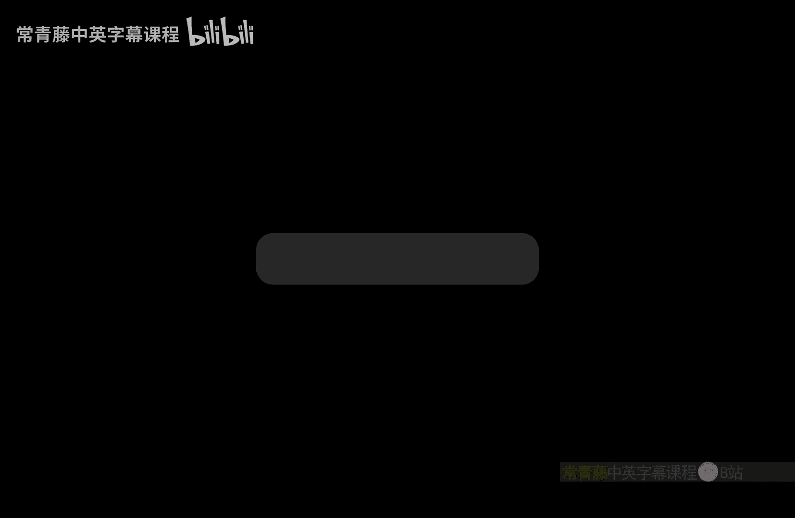
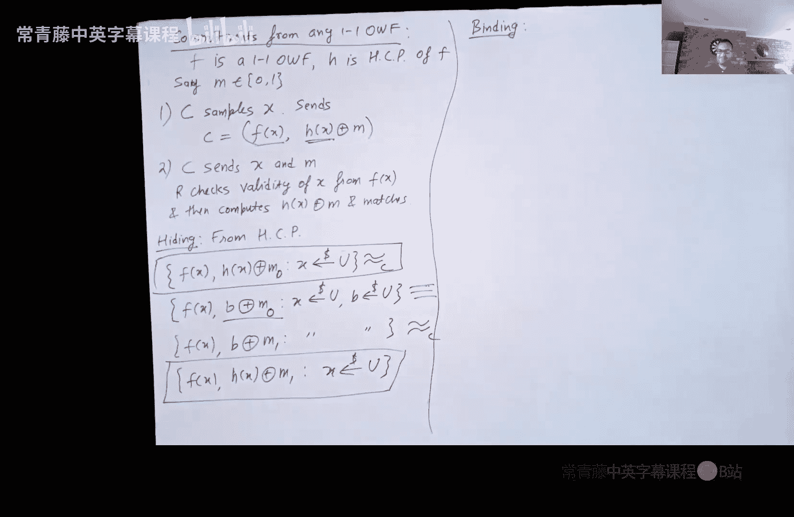

# 卡耐基梅隆大学【中英⚡密码学导论｜15.356 Introduction to Cryptography】 p18 P18 Lecture 18 Commitment Schemes -BV16V6GBYEAA_p18-

Okay， great， so。Welcome everyone， so we will continue on zero knowledgege proofs。😊，So。

 just to remind you last time we looked at zero knowledge proofs for the graph isomorphism problem。

And we had a nice unconditional construction for the X knowledge group， which relied on。😊。

Various properties of the graph graph， isomorphism and problem。🤧So， where we stopped was， we saw。

A three round protocol。Which had soundness parameter half。Which means that。

At least with probability half a cheating prover is guaranteed to fail。

 but with probability half the cheating prover might succeed just by guessing the guess by guessing the challenge of the verifier。

😊，So， let me remind you。What the protocol was。And then we will see how to get a protocol with better soundness parameter。

😊，Okay， so let's try to recall where we were。So we had approval， we had a veryifier。😊，And then。

 there was。Pman input。G0 and G1， which was the description of two graphs。

And then Proer also had the witness， which was spy。Such that。G，0 equals pi of。

G1 where pi is this permutation， right？So， the first step was P would generate a random permutation sigma of the graph。

And then would send a graph G where G equals sigma of g0。

Then the welfare was supposed to send a random bit B。And then Proer would respond back with either。😡。

食ma or。食吗？Composed with pie。Right， so these sorts of。Dcides。

Which isomorphism the welfare is interested in looking at。If b is 0。

 then you have to show that g is isomorphic to g0， otherwise you have to show that g is isomorphic to G1。

And if you have sigma， then you can test that g is isomorphic to g0 just by applying sigma to G0。

Otherwise， you apply sigma times pi to G1。And you can match it with G。

So welfarefire lands one of the isomorphisms， but not both。😊，And how did it prove soundness？😊。

The main idea is that。If。G0 is。Not isomorphic to G1。Then， either。This is not isomorphic to。0 are。

G is not isomorphic， too。二ワ。And then for at least one of the challenges the proveover is going to fail。

So the prove piece starts。Fs。With probability。At least half。So。We have made some progress。

 but obviously half is not something that we want right we want a cheating prove we start to fail with probability very close to one。

😊，Ideally，1 minus negligible。So let's look at sounda simplification。

And a very natural idea for amplifying soundness。😊。

Is that you just repeat the protocol several times。If the proveer succeeds every time。

 then you have good confidence that in fact， prover is not lying。😊，Right。

 so let's say you repeat the protocol k times。And we have to be careful here。

What do I mean when I say repeat K times？So you have to start from the first round and you have to choose。

A new random perutation every time。So what happens if you。don't choose any new sigma every time。

And Xized property is trivially violated。Right， because。If let's say I use the same sigma twice。

Then the verifier can send a challenge corresponding to b equals 0。

 then the verifier can also ask for b equals 1。And then the wave file learns isomorphism between G and G0。

As well as G and G1。It means that now you can compute the permutation between g0 and G1。

So essentially， you learn the witness。So the protocol now looks something like the following。

You send。GI where I is sort of the Ih iteration。The verifier signs B。And the poor response with。

Sigma I R。Sigma i times pi。And you run this far。I equal1，2， k。ok。😊。

And because there is a separate sigma I every time you cannot combine the information。😊。

From different iterations。So， let's call these。Kay iterations。Sometimes you call them case sessions。

And so on。So now my claim is that this simple repeated protocol has。😊，Sound is very close to one。

So what is the probability？所先。G0 is not isomorphic to G1。Then， the probability that。

P star succeeds is half in each iteration。So what is the probability that？T star succeeds。In all。嘅。

Iterations， this probability is。At most one by2 to the power K。Which also means that。

Probability that we rejects。Is at least one minus。1 by two to the party。K。

 which is negligibly close to one。So， this is1 minus。Negligible in K。

And here K can be seen as your security parameter， the larger you set k to be the closer you are going to get to one。

😊，But you can never reach all the way to one there will there will always be some small negligible probability that。

A cheating prove P star might succeed and that is inherent in geo knowledgeology proofs or in most geo knowledgeology proof protocols。

Now， this is fine， but what about now the zero knowledge property？So the last class， we saw that。

A single invocation is zero knowledge。😊，But now we are running the same protocol k times。Maybe。

It is not zero knowledge anymore， right， at least it' is not completely trivial to see。

So let's try to prove that even these ks when put together。And they will be easier knowledge。

So why is the probability less than equal to。This y not equal well it depends on P star， right？

If P star is not so intelligent， the probability of success can even be0。Okay。

 so so to prove that this protocol is zero knowledge。

 we will have to do something slightly different。😊，We need to introduce the idea of rewinding。

So let's recall the previous simulator。So， this is the simulator for a single iteration， right？😊，嗯。

So let's denote the simulator by s。The idea was that S。Samples are random bit be prime。And。嗯。

Invokes the code of the verifier we start and send。G equals。Sigma of So as samples be prime and。

Sigma where sigma is a random permutation。And s d equals sigma of。G of P prime。To we start。

second round as receives。啊，B。From we start。Next， if。B happens to be equal to b prime。Send。

Sigma to v star。Else you restart， you go back to step one。So this was our simulator。😊。

And now the simulator has to go through not just a single iteration， but k iterations， right？😊。

So let's try to modify this for considerationerations。嗯。Let me just write it from scratch。

This is the knowledge for the full protocol。The natural idea is as follows。So， S。🤧Samples。B prime1。

Sigma 1 for the first iteration。And since。石麻湾。G of。B， prime 1。To we start。

The next step is to receive。B 1 from V star， and then finally。If。B1 happens to be B prime of one。

Send Sigma 1。Else you restart So let me call this step 1。11。2 and 1。3。

 So this is as far as the first iteration goes， so let's continue。

Let's look at some intermediate step i。1。I。2 and I。3。So here us is going to sample。B prime of I。

 Sigma， I。Send。😔，Sigma I G of。B prime I to。We start。Then you get B， I， and then。

If B happens to be B prime I。You can proceed to the next round。Sand sigma I。Else， what do you do。

That is a question， so let's say。Else， restart。And go to。1。1。

Just go all the way back to the beginning。Okay， and then similarly。

 eventually maybe the simulator will get back。Well get to the end。So what is the problem with this？

It's exponential time。Yeah， exactly。So here the problem is。😊，In every iteration。

 the simulator will fail with probability half。Right。So simulator can continue。

 there is a lot of iterations。😊，In one or the other， a simulator is going to fail， right？😊。

If the simulator goes all the way back to the step 1。1。

 then the simulator will just keep running and running。😊。

the probability that simulator will go to the end is just one by 2 to the power k。

 which is very little。😊，So the number of trials that you need to get back to the end。

Is something like two to the power key。Which is exponential in cave。

 so that' is not something that we want。Now the question is， how do we fix this problem？

Presumably you could just like jump back by one and go to I minus1。1。Yeah。

 and why can we do that How does the simulator just go back a few steps？

Not all the way to the beginning。because it could have just like reused the same things it chose for those ones。

Yeah， so the idea is。S saves。The snapshot。Of。V star state。

State of this program or state of this veryifier。At every point or maybe at every round。

So a lot of copies， a lot of states， like right？😊，For example， once I get done with i 1。1。

 I immediately save the state of the well after that point。😊。

After this point after this point and so on right so what I can do is I can pick any of these states and start executing that state from that point on。

😊，Right and just imagine you have the quote Vi you are running Vita on your own so you can do whatever you want you can you can save a copy of Vi star at any point in the protocol execution you can go back to that copy and you can start executing executing from this point onward okay so here we will just slightly change our protocol。

You don't restart else。Go to I。1 and。Choose fresh。B， prime 1。B prime I， sorry and sigma I。

And then you try again。And again， with probability half。

 you might fail probability half you might succeed。😊，But。In expectation。

 you just need two trials to get to。The end of this I iteration right so each iteration requires you like in expectation two trials and by linearity of expectation now approximately the number of trials that you will need is like just two times scale。

😊，Okay， so。Yeah， so here is our claim。S is， indeed。Expected。必不的。And by the way。

 this is the very important idea in cryptography。😊，Use everywhere。This is called。That re windding。

Rewinding the。Adversary。So that this might look obvious in retrospect。

 but this is like a really deep， very fundamental idea in cryptography。😊，By reminding the adversary。

 you can do magic。So let me look at the question to be clear as can choose what to add to its transcript so it need not put the transcript communication from failure yes。

 that that' is exactly correct。So as soon as some transcript fails。

 you throw away that part of the transcript， you go back to the previous state。😊。

And then you continue from that point and eventually you will get back to the end of the kth iteration。

😊，And that would give you a transcript which was successful from 1 to k。

from beginning all the way to the end and that is the transcript that the simulator outputs。😊。

And by the way， here's a gender lemma， which。I will not try to prove， but。

It's a very useful fact to keep in mind。Sequential。Repetition of。Any zero knowledge protocol。

Continues to remain zero knowledge。So in describing our simulator。

 we didn't really use any special properties of the。Of the graph isomorphism problem。

Does this work only if the state of V star in every round is of constant size。

 no it can be any polynomial size。Right， because at most how many states we are strong at any given point of time。

It's even if you are stor the state after every round。

How many rounds are there 3 k rounds right so we are storedor 3 k states。

And 3 k times polynomial is still polynomial。So this this reding idea I should stress。

 it is very powerful its used in zero knowledge proofs。😊。

It will be used in secure multipart computation， which will be our next topic essentially any interactive cryptographic protocol。

😊，The security of that probably relies on thewinding in some way or the other。Any other questions？

Okay， good， so so far we have seen zero knowledge proof for the graph isomorphism problem， right？嗯。

So， that' is good， but why is this problem useful at all？Right seems like a random problem and。

Seems like it just had the right properties for us to build a new knowledge proof for it。😊，嗯。

Well what about zeroized proofs for circuit satisfiability T3 set？😊。

Proving solution of mathematical equations and so on。

 so there is just so many things that we want to do right and here comes the big idea。😊。

We can actually design the knowledge proof。F。All of N B。So what we need to do is again。

 let me remind you the definition of NP and N completeness。

An NP complete problem is a problem to which every problem in NP can be reduced to。来。

So what this means is that if you have a zerooid proof for an NP complete problem。

 you actually have a zerooid proof proof for every problem in N。😊。

And we will see this in more detail。So we will build the proof for。GThe graph isomorphism problem。

 Sorry， the graph3 curl problem。So graph isomorphism is not known to be an NP complete problem。😊。

We don't have any polynomial time algorithms。For this problem but in fact there are good reasons to believe that it is not going to be proven to be an NP complete problem anytime soon because there are better algorithms even though they are not problem every time。

 but graph3 callingling it is known to be an NP complete problem a very famous NP complete problem。

What is graph 3 coloring。So let's take any graph。😊，And now you are given three colors。😊，Red， green。

 blue， or maybe let's call the colors。To be maybe just， let's just call them one， two， three。ok。😊。

And your goal is to assign colors to every vertex。Let's say，1，2。3， maybe one again。

You have to color every vertex。😊，Such that you can look at any edge in the graph。😊。

And its endpoint should have different colors。So， for。Every edge。Vti is should。Have different colors。

And if that is the case， we call this to be a valid graph 3 cult。😊，So is this a valid 3 colon？😊。

Clearly not because you look at this edge and the two end points both have the same color。

So let me change this slightly。So Ill put one here and two here。Okay。

 so this turns out to be a valid three thing。In fact， this is even a valid two coloring。

You look at any any edge， it will have colors one and two。

Now let me make the graph a little bit more complex。 what about this graph。So clearly。

 this is not a validalet culting anymore but。😊，What I can do is， I can put。Now， three here。

So I'm using all the three colors。Let's make the graph even more complex。What about this graph？

So clearly， now you look at this edge， it has one in one。

Does there exist a validt3 cominging of this graph。No， because。

Every vertex is connected to every other vertex。And there are four vertices。

This means that you really need four colors。You cannot， you cannot succeed with three colors。

 So this graph does not have a valid three color。So we were lucky that the graph was so small just just imagine I give you some complex graph having let' us say a thousand vertices right you will probably end up spending a lifetime in trying to see this。

Graph has a value three calling or not。So now our problem is prover and the verifier。

 they are both given the graph selfish public。😊，And the proof in addition， is also given a witness。

 which is some well recallcalling of this curve。😊，And the Pro would like to convince the verifier that the graph has a valid 3 coloring without revealing the three coloring itself。

😊，If we do that， then that's great， we will have the knowledge。😊。

F an NP complete problem and we will see later on how to use it for essentially any problem that you want。

Okay。So。嗯。So in the last Zion is proof for the graph isomorphism problem。

 we didn't end up using any cryptography， no encryption， no digital signatures。

 nothing right That is not the case for。Z knowledge for LP。For the G  three causing problem。

 we will need a new cryptographic primitive， which we will call commitment schemes。😊。

Commitment scheme is a very fundamental primitive in cryptography。😊。

Even though we are introducing it in the context of Z knowledgeledge。

 it is used in a lot of different places in cryptography。😊，For example。

 we will use it in the secure multipart computation later on as well。

So what is a commitment scheme at a very high level。😊，A commitment scheme is like a note placed in。

Some locked， safe or a locked box。So here we have a committer and a verifier。😊。

A commit and a receiver。Committer can write。Some value on a small piece of paper。

Let's call this value to be M。Okay。This box is locked and this is sent to the receiver。来。

At this point， we have two properties。😡，One is the hiding property。It says that。R cannot learn M。

At this point， because the box is locked。So， this is very similar to encryption commter could have encrypted and sent it across the receiver。

 the second property which makes it slightly different from encryption is the binding property。😊。

Binding property means that C can't。je。M。It's already inside the box。

 the box has gone to the receiver and at a later point。The committer can send the key。

 let me draw the key here。K， maybe I hope it looks like a key。

And this key will allow the receiver to unlock this box and recover the message am。😊。

RightSo once the box is gone， commuter has no control over what the message is。It's already decided。

 it's gone。And later on， you can。Send the key to reveal the message。苏。

So we need like some electronic equivalent of this this concept。

So let's try to define electronic or cryptographic commitment scheme。😊，结 so。

So this is maybe just the intuition。And now， let's try to。Define it more formally。

And then we will try to construct commitment scheme。Okay， so commitment schemes， we have two parties。

 we have C and R。Committed and receiver。Comitter has。Some input string， which is the message M。And。

There are two phases， which any commitment scheme has。So phase1 is the commit phase。

Or also called as the commitment phase。So， in this phase。See generates a random。S。

 some random number。Computers and sense。C equals。加吗？Ma S。Wecom。Is a polynomial。但。Algothm。

You can even think of Q as some kind of encryption of the message。

The second stage is known as the de commit stage。Or the commitment stage。

So here you can just send m comma S。To are。Are checks。If comm of M comma S。Matches with。The received。

Value。In。Comit phase。If so。Acept M。As the receiver rejects。So this is just the syntax。

How do we define the security of a commitment scheme？So there are two properties。嗯。

So maybe before the security， let's talk about。Completeness。Which is。If both parties are honest。

Are accepts。The message M。Okay， then we have。Hiding。

Hiding just says that at the end of the commit phase。😊。

The receiver has no idea what the message M is。And we will formalize it very similar to encryption by using computational indistinguishability。

😊，So for all M0 and。M1。Commitment of M0 looks very similar to the commitment of M1 looks computationally indishable。

Comm of M0。Comma S， such that。S is sampled at random from the uniform distribution。

This is computationally indistuishable too。Comitment of M1 comma S。

This is almost identical to encryption。😊，Then we have the binding property， which is what。

Separates this notion from encryption schemes。So， essentially， given。讲啱吗。M comma S。M is unique。

So in more detail。If M0 is not equal to。M1。For every S0 and S1。Comalm of M0 S 0。

Cannot be the same as comm of。M1 n。Okay。Any questions， does this make sense？

Because if these two commitments。Were to be the same that means that there exist two different D commitments。

1 to m0 and s 0 another to m1 and s 1。Where M0 and M1 would be different。So that's not what we want。

We want the message to be fixed， to be unique， given this commitment。So now let's try to build。

Coovernment schemes。Attempt1， which。Is bound to fair。

So why not just try to use any encryption scheme to build a commitment scheme？

And here the idea would be that the commiter would send。

The encryption under some key of the message to the receiver。And then later on in the decomit phase。

The committer will just send the encryption， will send the key and the message。

And the receiver can just check。If the Cyphert matches。So in particular。

 maybe let's look at one time pad。So， comm sense M。Xar。Let's say some key K。And then later on。

 commuter sense M and K。22。Is this a valid commitment scheme？It's not binding。你有。

It's not binding at all in fact， given the cipher text， I can really open it to any message。Right。

I can choose my message and prime， and then I can send。M prime and K prime， such that。

C is also equal to m prime x or k prime。So it is not wind at all， like I can open to anything。

Why don't we encrypt the key common message？We are encrypting the message， right using word time pad。

Yeah， I don't know what you mean by bankquet。Isn't one pattern encryption？Enncrypt K comma M， well。

 again， if I use encryption。If let's say I use one time pad for encryption。

 this is not going to be binding。And just that wouldn't work because in one time pad you need like the key to be the same length as the message so if you're encrypting the key with the message。

 the key won't be long enough to encrypt both itself and the message。嗯哼。😊。

So you are thinking about some kind of circular encryption。Okay， so。Yeah。

 so this this is just to demonstrate that commitment scheme is actually indeed different from。😊。

For encryption， but。It's not that different。In particular。

 basically almal encryption is also a commitment scheme。😊，And we call that to be。Algamal commitment。

Okay， so the idea is the following your message M must be the element of a group。

And we need a generator of this group G。And。As the first step。The commits see samples。A and B in。

The order of the group。And。Sense due to the power a。Due to the power B。Right to the next slide。

In sense， C equals。Due to the power A， due to the power B。And。N times due to the power AB。

So this is your commitment stage。😊，How are you open？C stands a comma， B， comma M。O。😊。

And the idea is that。😊，Give one you to the power a。A is unique。

As long as it is coming from this group。Similarly， given G to the power B B is unique。And hence。

 these two values sort of fix digital power AB。And now。This means that this fix is M as well。So。

 our checks。A against。自住場诶。B against you to the power B。And。Then， computes。

M times due to the power A B if A and B are correct。And。Matches with the value。In C。

In the commitment， which is given。So why can't we use this scheme that like we have a key we encrypt the like using one time pad we first apply a PRG on the key and make it the size of key plus message and we encrypt key key concatenation message and then send it to the。

呃，不。So let me finish this， I will come to something like that。Okay， sorry after that。

So let's try to prove hiding and binding it is really simple。So let's jump from here to here。😔。

How do you provide？Just。Simple observation from。DdH。From DDH， you should be able to prove that。

G to the power A G to the power B。M0 times d to power A B， it looks actually。

Computationary distinguishinguishable from Mg to the par。Due to probably M1 times。Do the power a。

This follows from the DDH assumption， in fact the Algamal encryption really uses the same identical argument。

😊，How do we prove binding？A and B are unique。G1 g to the power A and G to the power B。

And this follows from the fact that G is a generator。

Because what is the property of a generator if if you choose？😊，Two different elements from。Z of G。

Then G to the power， these two different elements would give you two different group elements。

And once we are unique， you know。Proers's hands are very tight。Okay， any questions？

So now there was some demand for maybe。Something based on PRGs and things like that。

So that yeah you can build commitment schemes that way as well and the benefit of that is that so far we are relying on the DDH assumption right which is a very specific assumption maybe it will be broken in the future quantum computers can already break DDH assumption if you are able to build quantum computers which is a big if but。

😊，But there are other type of assumptions from which we can build like one day function encryption schemes and so on。

😊，The question is， can we also build commitment schemes from different type of assumptions？Okay。

 so here we will look at。Commitments from。Any one to one one way function。

It cannot be any one will function， it has to be  one to one will function。In fact。

 building commitment schemes， as I defined。😊，From anyone we function， it's a big open problem。

So 1 to1 functions is the best that we can do。And we will use the notion of how hard per is also how you build PRGs。

ok。So。You are given F is a  one to one one way function。Ech is。A hardcore predicate of。嗯，F。

So how do you commit to some message？And for simplicityities， say。Your message is a bit。

And then later on， we will see how to extend how to go to longer strings。So。In the commitment staged。

The comm samples。A random X。And this should be from the domain of the one way function。

And then sense the following commitment。F of x， comma。H of x exhort the message。Okay。

And what is the intuition given f of x？😊，H of x is really uniform。

 it is the hardcore predicate and hence now this is like a one time pad。

But the nice thing is if f is a1 to1 when you function， f of x fixes x entirely。😊。

In the commitment phase， S sense。X and。M。给。Now I can check。The validity of。X from。F of x。

 F of x is something which are already received。And then。Checks。And then。Maybe computes。H of x。

 X star。M。And again， matches that。With the value received in the commitment stage。Okay。

So let's look at hiding and binding properties。How are you providing？Follows from。

The property of hardcore predicates。So， we can see that。F of X， H， X， X， R。M1。

That should be computationally indistinguishable。We access sampleed uniformly？

So this should really be the domain of the one function I am assuming that。The domain is uniform。

This is completelyly indistinguishable from。F of x。B Xr。So， this is M0。M0 there。X is uniform and。

Bes uniform。And now this is like a one time pad。So， in fact。This is identical to。F of X， B， X R。M1。

And this is the same。And this is now computationally distinguishuable to。F of x。Now， X is uniform。

Okay， so essentially this is the commitment。To M0， and this is the commitment to。And one。

And these two commitments are indistinguishable from each other。😊，Okay。

 does the hiding property make sense and questions？Now what about the binding property？

How do we prove binding？

Well， binding just directly follows from the fact that。Give an f of x。X is unique in substance。

They only exist a single value of x， which leads to this particular value of f of x and this this follows from the fact that。

F is 1，2，1。万位方式。And once x is unique， you that fixes edge of x。

And that is sufficient for you to recover the message。Yeah， so Rohan is that。

What you were talking about or did you have some other key in mind？

你 something oh sorry sorry sorry sorry。Sorry， so yeah。

 something on the same line just I was like initially when I message that encrypt K comm I was just saying that we take the concatenation of the key comma the message and we extend the key using the PG and encrypt K commM and then send it to the adversary。

我 make得。But PG does not necessarily have collasant resistance。Yeah， that that part I missed actually。

That part was incorrect， like that part now got clear to me when you did this too。Okay， good。

So this scheme only allows you to encrypt one bit messages。What about encrypting。Long messages。

How do you encrypt long messages， any thoughts？So can you take an encryption。

 can you take a commitment scheme for a single bit message and genetically extend it to a commitment scheme or multiple bit messages？

😊，你外fi。So sorry go on go on match。Sorry， could you use multiple hard code predicates of。M。

One for each。Or you are getting muted for some reason。Yeah。

 but I think I understood what youre saying。Yeah， that makes sense。 So just I mean。

 you don't even need to go into the details of。This encrypt this commitment scheme。Just。

Commit to each bit。Separately。And by the way this this idea works not just for commitment schemes but also for encryption schemes and so on if I give you an encryption scheme which only allows you to encrypt a single bit message how do encrypt a long message well just encrypt it bit by bit right so here again we have the same thing just choose a fresh X for every bit。

😊，And just you know， just commit to every bit separately。From the hiding property。

 every single bit is hidden。😊，And you can have a hybrid argument where you change the message from M0 to M1 bit by bit。

So this would work even if M0 and M1 are long。Okay， so maybe let's。

Let's look at this idea in in slightly more detail so。M0 and M1。A。Long messages， let's say。So。

 you start with。Commitment of。M01， this represents the first bit of M0。

And there's random numbers everywhere。So。S1。Commitment of M0。2 S 2。

And you can do this for any commitment scheme， as I said。Okay케。

So this should be computationally indistinguishable from。Commitment of。

 let's just change the first bit。M11。M1 and the remaining bits are the same。M0，2。S 2。And so on。

 and then you keep going。Eventually you started with M0， eventually you will end up with M1。

And the only difference between this distribution and this distribution。Is just the first commitment。

Which is a commitment to a single bit。And now by the hiding property of this commitment scheme。

 you can argue that。This distribution and this distribution is computationally indistinguishable。

And the binding property also follows you have binding for every single bit and that also means that you have binding overall。

😊，So this is known as the Blum commitment scheme。So this was introduced by Manuel Blum who。

Who has been a professor at CMU， he just recently retired。嗯。

He was also the one who introduced this notion of commitment schemes。

And he introduced commitment schemes in a very different context。

 nothing to do with zero knowledge and so on， in fact， commitment schemes。

 the notion predates the notion of zero knowledge。😊，So。

 he introduced this notion in the context of coin flipping over the telephone。

 which is a very interesting notion。😊，And we will look at that in one of our MPC lectures。

So the problem of coin flipping over the phone or over the internet is as follows。😊。

Suppose you and I cannot meet because of the virus or whatever right， and we need to decide maybe。😊。

Who gets the car or maybe whatever， right we just want to flip a fair coin。So how do you do that。

 well， its completely unclear， right？😊，If we agree that I will flip the coin then I can always flip a coin and I can I can lie about the outcome to to my favor right so can we design a fair coin flipping protocol over the phone over the internet or you can even run the protocol by。

😊，By letters like we each write alert lettered to each other and after after a few letters。😊。

We both have a bit which is guaranteed to be uniform。So a very interesting problem。

 which we will look at later on。Okay， so now given that we only have like less than 15 minutes。

 maybe。😊，We will go to the actual the protocol in the next class。And we will stop here for today。

