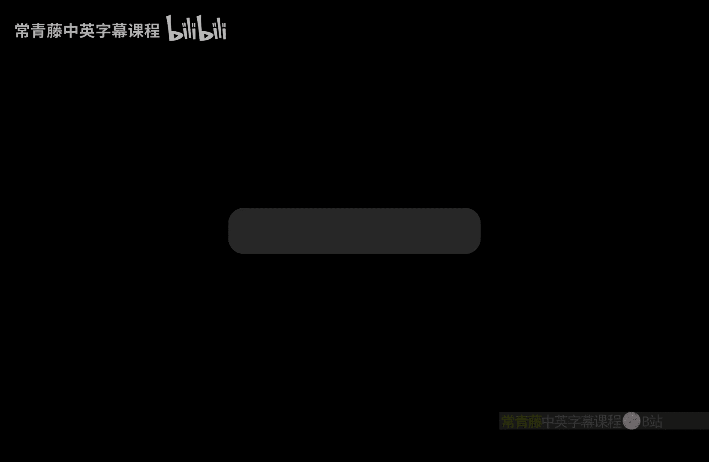
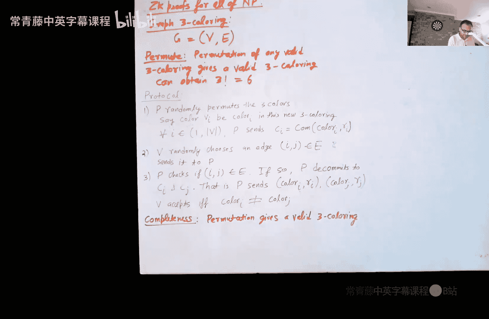
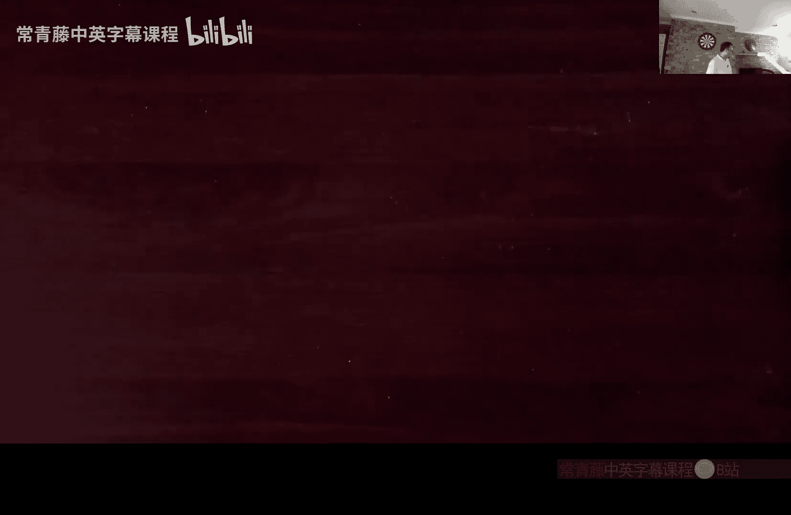
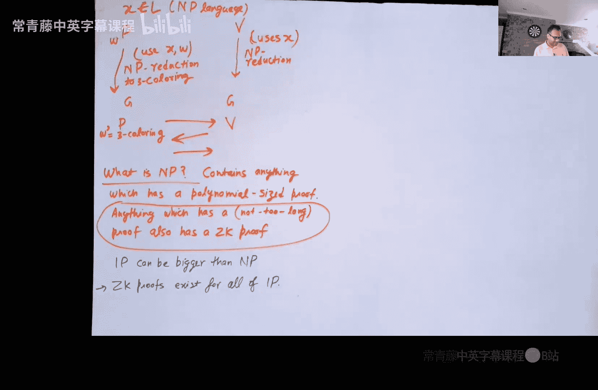
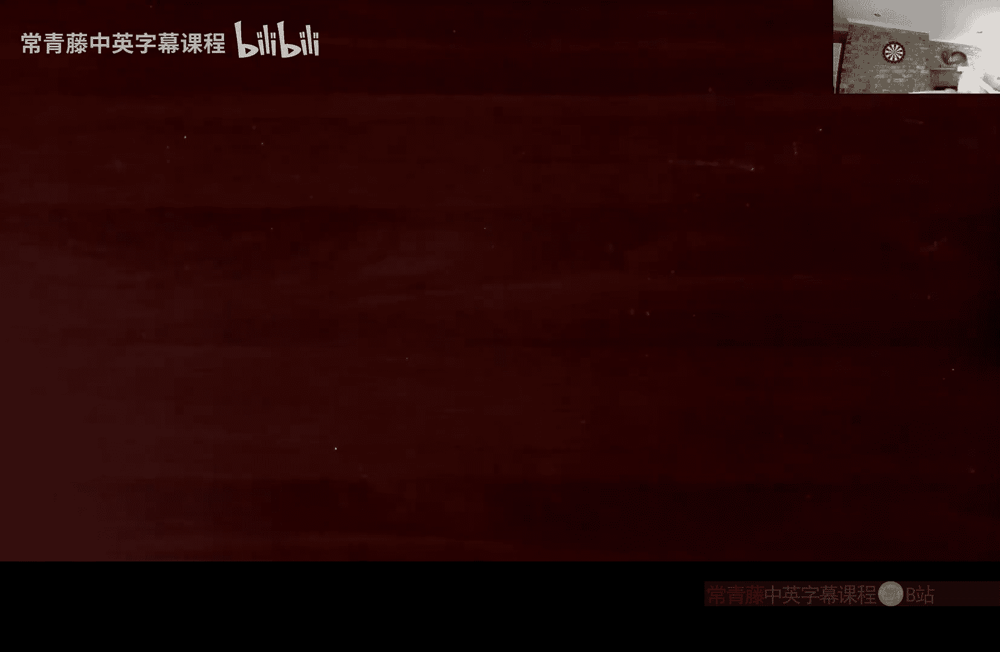
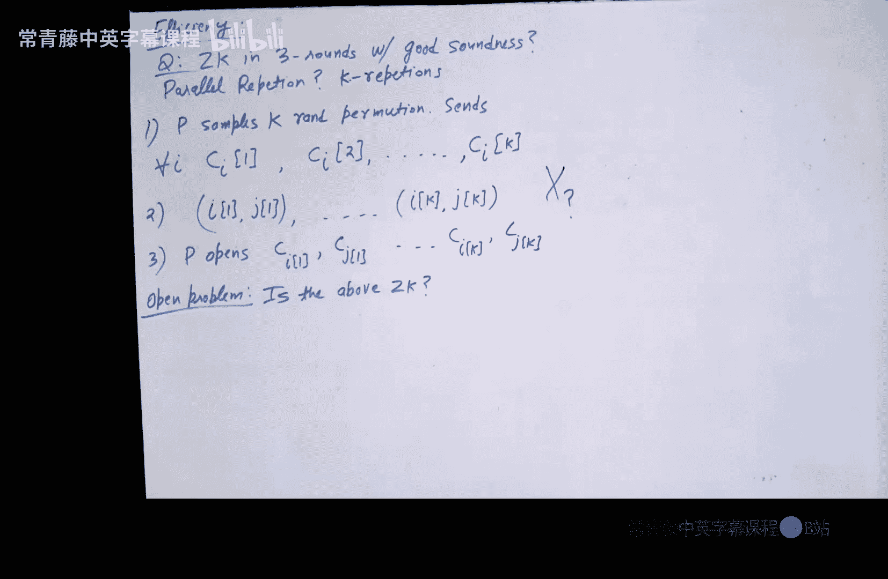

# 卡耐基梅隆大学【中英⚡密码学导论｜15.356 Introduction to Cryptography】 p19 P19 Lecture 19 Zero-Knowledge for all of NP -BV16V6GBYEAA_p19-

Okay， welcome， everyone。So we will continue with zero knowledgege proofs。

So last time we saw saw the notion of commitment schemes which was supposed to help us in building zero knowledge proofs and today we will see exactly how we do that so in particular the topic of today will be。

Zero knowledge proofs。f。All of N。So， you can take any language in NP essentially and we will try to construct a zero knowledge proof for that and the way to do that would be to build zero knowledgege proof for an NP complete problem in particular the graph 3 causing problem。

So in the graph 3 causing problem you are given a graph and you have to color every vertex of the graph in such a way so that。

😊，You look at any edge。The two vertices must have different colors。

So the graph will be represented by。A set of vertices and a set of edges。Okay。

 and we have a proveer and we have a verifier， both of them have the graph。😊。

The description of the graph and only the proveer has the exact three color of the graph。

Now we will rely on an interesting property of graph 3 co。😊，Which is。

You can take any three curling of the graph and you can randomly permute it and that still gives you another valid3 curling of the graph。

😊，And by permutation I mean just like exchanging the colors so if you have red green and blue maybe I swap red and blue then I swap blue and green right if I started with a validale three coloring after this permutation I still end up with the valid3 coloring of the graph right。

😊，So。The property permutation of。Any valid。😔，s咖ling galling。Gives another valid。3 ca。

Right if the if the colors on any edge were different even after you change the name of the colors it would still be different right I am just like I am not doing anything non trivial here。

So。Given any three color， how many valid three curls can you obtain by permuting the colors？嗯。So。

 you can obtain。3 factorial which is6 right I start with the first color and I can map it to either the first color or the second color or the third color so three possibilities so three times for the second color I have to choose among the remaining two colors so three times two times1 which is three factorial so six valid at three colors anyway the exact number of three colors is not that important。

😊，So now let's look at the protocol。😊，So both again。

 remember that both the prover and the verifier have the graph。

And Pror has as witnessed a valid3 calling of the graph。😊，So as the first step。嗯。The prove peep。

Randomly permeates。The three colors。And now that is the three cur in which the proveer would use in the protocol。

😊，Okay。And let's say that。Color on any vertex V。Be represented by。G了爱。In this new curriculum。Now。

 what the prove would do is approval would。Commit to all of the colors。For all the vertices。

So for all I。From one to the number of verrtices。Be sense。C I， which is the commitment to。The color。

 I。And remember that commitment schemes， just like encryption schemes， also require some randomness。

😊，So。Let the randomness be denoted by R。Okay， and again。

 just to remind you commitment schemes have two properties hiding property and the binding property。

😊，诶。From hiding property it follows that even though the verifier has received commitment to all the colors。

 verifier has no idea what the colors are。😊，So at this point。

 veryifier nothing about the three calling of the graph。🤧Now， verify will select。😊，1， agt randomum。

And Verifier will ask the prover to decomit and reveal the coloring on that edge。😊。

And then the ver file will just check that the colors are indeed different。😊，ok。😊，So， we。Randomly。

Choses an edge。And note that the edge is represented by its two vertices。So iconology。

And I comma J must be part of E， which is the set of all edges。And the very fire sense。8。

To the proveer。 So this is the challenge of the verifier。So and in the last step。

The provever fast check。😡，That Ij is indeed an edge。If so。Prover。De commits to。

The colors on vertex V and Vj。So these are two commitments， C and CJ。In other words， that is P sense。

Color I R I。And。col乐机。RG。Okay， if the verifier did not choose a valid edge， then the provers。😊。

Does not respond。Now we accept。If and only if。Color I is not equal to。Cer。Okay。

 so the high level idea is I commit to the entire3 color ring right the property of the  three color ring is that every edge should have different colors on its endpoint。

😊，Pro are just randomly probes。One of the edges and sees that may ensures that the property satisfies for this particular edge。

Okay， and that's the entire protocol。Now let's see， let's try to prove the various properties。

Completeness。Any questions about the protocol？😊，Okay， good。 So completeness is easy to see， right。

 because。😊，呃。Primutation gives。Another validolet3 coloring。😊。

Right and if the three causing which the prove were committed is valid then regardless of which edge the verified decides to check。

 the colors would indeed be different。😊，That just follows from the definition of three coding。

Now， what about soundness？So very roughly， soundness relies on the following fact。

So so in soundness we have a malicious proveer P star which can basically commit to any color on any vertex。

😊，But if no valid 3 color for this graph exists。😊，So in soundness， our first assumption is that。

G is not three colorable。This essentially implies that。😊，There exist at least one edge。

 regardless of how you color the graph， there exist at least one edge which would have the same color。

And if the verifier happens to choose this edge just at random， then the prover fails。

And this follows from the binding property of the commitment scheme in the first round proveer has to make his mind about。

😊，What the colors are going to be。Okay， so lets try to do it a little more formally so the graph g is not three colorable this implies that。

😊，There must exist an edge。Let's call it i prime and J prime。

Whi is the set of which is in the set of edges。Such that。Color， I prime is actually equal to color。

对不。Now， with。Now， what is the probability that this edge is chosen？Probability that I comma J equals。

I5 prime comm G prime。Is。Actually， equal to。The number of edges in the graph。嗯。And。In that case。

The cheating prove piece star。Has to open。Color， I prime and。Color J prime。In the third round。

Right in the third round piece star cannot change his mind about these colors and this follows from the binding property。

Once the commitments are sent， the colors are basically written in stone。And then， we reject。Okay。

 so this essentially means that we is rejecting with probability at least1 by e。

 which is not great but not negligible。😊，Right， so the soundness parameter here is1 by e。

Right that doesnt make us too happy， but as we saw in the last class you can always repeat the protocol a bunch of times in particular here you would need to repeat the protocol more than e times。

😊，In fact， much more than1 times to make sure that the soundness parameter becomes very close to one。

And now finally， we will see the property， the xonology property。😊。

Which is of course the most interesting。うん。So， in zero knowledge again。

 we will consider a simulator which has no idea what the witnesses。

 what a valid 3 curling is and so on。😊，So the simulator will of course try many times。😊。

And intuitively looking at this protocol， you can already see that， you know。

 I try several times and hopefully。😊，The wfi will choose some edge on which。I put different colors。

So let lets look at the simulator in more detail。So S works as follows。So， in the first round。

 the simulator will guess the edge which the verifier is going to ask for。😊，So。S pick。I prime。

 come prime。From。The set of edges at。Random。Okay。Now。S chooses two random colors。To random。

 but different。For these two vertices。 So let's call it color I prime。

And we want to make sure that this is different from color。ジェイプライン。Okay。For all other vertices。So。

 so far I have just told you how to color these two vertices。

For all other vertices doesn't even matter the simulator puts junk。For all other。Vtices。

Color I equals。Just zero， whatever you want it to be。Right。Now， as。Since啊。Commitment to。

All the colors。To the code of the adversary， which is Vi star。Okay。Now， we start。

Gets all these commitments and we start picks。In some arbitrary way， we don't know how。

We start picks iconology。Now the simulator checks if I comma J equals。The guess。

 I prime comma J prime。Okay。If so open。CIM CG。The two commitments。And by construction。

 these two commitments have different and random colors inside。If not。Then that's bad because。

It means simulator is choosing one of the other vertices where we have all put like junk zero。

 which is not even a valid color。So if not oops， but go to。

Step one and simulator has the luxury of trying again。😊，嗯。And very intuitively。😊。

If the simulator succeeds。😡，Then what does the verifier we seeing in this entire protocol？

In the third round， we seeize the opening of two commitments where you have two different random colors。

Which is， of course， also the case in the protocol。

In the first round we also sees a bunch of other commitments they all have zero inside。

 which is very different from what happens in the real protocol。😊。

But then from the hiding of the commitment scheme， restart cannot really distinguish between a commitment to zero from a commitment to a valid color。

😊，Right because these commitments are never opened。

Vi star never gets the opportunity to examine what is inside these commitments。うん。

So that's sort of why。This transcript sort of looks indistinguishable from the transcript of the real protocol。

 but for this construction we will try to do the proof in more detail a little more formally。😊，Okay。

 any questions about the simulator so far？😊，Okay， great。So before we try to prove that。

The simulator indeed produces the right transcript。There's something else which we are missing。

We also have to prove that disc sriminator runs in expected polynomial time。So。

 that will be our first lemma and its not entirely straightforward。So lemma is as runs in。Expected P。

So naively you might think that， hey， the probability of success。Is at least one by e You know。

 we make a guess。 what is the probability that。We guessed the correct edge should be 1 by E。

But that's not entirely accurate。Maybe we star can always pick。And edge。

 which is different from the edge which the simulator picked。If we star can do that。

 then the simulator will sort of。😊，Keep learning indefinitely。So how can we rule that out？Any ideas？

UThe only way for it to do that for V star to guess the edge and choose it every time that S picked it would be for it to gain some information about the commitment or the colors behind the commitment。

Exactly。So the proof relies on。The hiding of the commitment scheme calm。🤧。Okay。

 so towards contradiction。Say that the probability of。嗌讲乜知。Being equal to i prime comma J prime。Is。

 let's say。Less than equal to let's say one by。都以。Okay， we expect it to be 1 by e。

 it can be negligibly smaller than 1 by e。But。Can it be one by 2 e？And we will。

 we will try to rule that out。Yeah。So， we will build。A PT adversary。Let's call this adversary B to。

Break。Hiding off。The commitment scheme。To break hiding of calm。Okay。

 and here maybe I should not do the full proof here B。B takes as input the commitment to。

I prime comm J prime。Where I prime comm J prime is selected at random from the list of total edges。

Okay， if。So， B feeds it to。Then， we runs。So let's say it takes the entire first message。

And commitment to 0 for。The rest。Okay， then B invokes。The star and。Seize。i讲。We chooses。Another edge。

At random， and。Outputs it。As a guess for。I prime common J prime。

So essentially what we are doing is that。B invokes V star and V star gives it an edge。

This gives B some information。That the randomly chosen edge I prime and b prime is very unlikely to beat this edge。

It could be any of the others， right？And then B just chooses any of the other edges。

And here b will be just for simplicity， let us say this probability was 0。😊，Okay케。

Then here b will be correct with probability 1 by e minus1。

Because the edge icon comma J is now ruled out， it must be one of the remaining e minus1 edges。And。

We can guess the edge correctly with probability 1 by e minus1。

Which actually still breaks the hiding of the commitment scheme because the commitment scheme is supposed to give you no information。

😊，Whatsoever。And if it is one by2 e， you can calculate the probability it will not be。😊。

The success priority will not be run by e minus1， but。It will still be noticeably better than 1 by e。

是的。Okay， so。Think I need to erase the protocol， but we will keep the simulator。

 So any questions about。The running time of the simulator。So now let's try to prove that。

The transcript which the simulator produces is indeed。😊。

In distinguishistinguishable form the real transcript。😊，So we need to do something like。Blu发。

Indistinguishability。We need to prove that tower real。

Is actually computationallydistinguishable from Taos slim。Okay， and in the x is for graph。😊。

Iomorphism， we didn't use any kind of cryptography we didn't use。

Any computational assumptions here we do， so that's why computational and distinguishistuishability comes into the picture。

And how do we prove that。These two random variables are computationally indistinguishable。Well。

 we will use a hybrid argument。So， in zero knowledge。

 typically trying to prove indistinguishability requires you to rely on a hybrid argument。😊。

So in the hybrid that's 0。We have the prover P uses。The witness are the three coloring honestly。And。

Runs the protocol or talks to restart。So here the transcript script which you will end up producing this is。

到的 you。Okay， and we will slowly change the way the proveer behaves。And we will arrive at Tawsim。

So in hybrid 1。So let me not call it the prove。 Let's call it。Just， let's call it。S。Okay。

 so in in hybrid0， the simulator is exactly identical to the prover similulator has the witness and everything。

😊，In the next hybrid。Simulator。Pixix。I prime at J prime。At random from the set of all vertices。

And the simulator checks if。I J equals。I prime and J prime。If so。Continue， honestly。

So note that even in this hybrid。The simulator is continuing to use the witness。

In the first round simulator commits to all the validolet colors except now。😊，So。Otherwise。

 as identical。都。H 0。If that is not the case if the guess is wrong。You restart the protocol。嗯。

So simulator from the beginning commits to all the honest colors gets the challenge。

And just checks if the challenge is sort of what I expected， what I thought about in my mind。Right。

 if that is not the case， I don't like it， I restart。On the other hand， if there's a match。

 then I continue。I give you the third round honestly。Okay。

 so this almost seems like simulator is doing something stupid， right？

If the guess I comma J prime is not even being used。To produce any of the messages。

 why is it important， well it is a small change we will change more。Okay， so。This tau real was at 0。

And here our claim is that。H 0 is actually identical to h1。Right。We are。

 we are running the protocol honestly， just for fun we are throwing away。Some， some transcripts。Okay。

 any questions about this hybrid？So the nice thing about hybrid1 is that。

We are guaranteed that the simulator is successful in the last transcript which the simulator actually outputs s simulator new icona J in advance。

😊，So， now in。In hybrid 2 simulator will actually start making use of this knowledge。😊，So， for all。

For。I prime come G prime。Choose color I prime and。Color J prime， honestly。From the witness。

For the remaining vertices or for the rest。Co I is。0。Okay。

 so in hybrid 2 now we are using the witness in a very weak way。😊，We look at the witness。

 we only need two colors。On these two different vertices。

 we don't really need anything else from the witness。

So what is the difference between hybrid 0 and hybrid， hybrid 1 and hybrid 2？

So you look at hybrid 1 versus hybrid 2。Right。Only difference is in。Seeea ice。Which are not opened。

In the third round。Okay。So now we can conclude that hybrid1 is。

Computitionary distinguishinguishable from hybrid 2。Bye。Hing off。The commitment scheme come。Okay。

 in the first round， we already knew now in advance。

Which vertees will not be open and just I just put junk， I just put zero inside those commitments。

And the verifier， we star never gets to see these commitments。Now。

 the question is when you look at hybrid 2， it almost looks like we have stopped using the witness。😊。

Right。We only used the colors on two vertices。Right but if you are randomly permuting the colors。😊。

If you look at colors on any two vertices。Which here an edge。

 these will just be two random different colors。Okay， so。For i prime and G prime。Choose。

Color I prime。Not equal to color。The prime。Addd。Random。We don't have to go to the witness。😡。

The entire three coloring to do that if you only need colors on these two vertices。

And now we can conclude that this hybrid 2 is actually identical to hybrid 3 because。

Because of the random permutation。Right when I take any valid 3 causings， I per it at random。

Then what happens？Then looking at any edge， I just see two different random colors。

Which is also what the simulator is doing。And now hybrid 3 is。Asome。It's identical 200。So。

 we have been able to prove the。The claim that we started with。See， I have a small question。Yeah。

 so so for H2 like we are doing the same thing as H1 and only in the non restart case we are changing it。

 right？In h1 or h2 so like h2 like we are doing this right that if verifier is sending us i i prime comma J prime and if it is same as verifier is sending us i comma and if it is same as i prime J prime then only we are sending it the colors otherwise like we restart you have to do it from the beginning you have to do it in the first。

I mean。You cannot change the colors， you cannot decide the colors。In the third round。

 you have to decide them in the first round No， no that that is fine The colors that you decided for some match and if verifier sense the same image then we provide it Otherwise we restart the verify right exactly。

And and one one other small question， sorry for that。

 So like when we say that h0 and h1 are same like。Even though h1 is like running the verifier multiple times。

 but when it gets the right output， the transcript will be same to Hn because the initial edge is being taken randomly。

 that is the idea。Exactly one way of thinking about it is。😊，I am doing some random experiment。

 I am doing the same experiment like a million times。I output。

The first experiment versus I make up some random number in my head and then I output。That explained。

 there's no difference。Right。Thank you， sir， thank you very much。Any other questions？

And now the soundness of this protocol， of course is very poor。

 you need to repeat the protocol a bunch of times。😊。

The number of times will depend on how many edges you have in the graph。

So this is something which we already saw in the last class。

Is the new protocol the repeated protocol also zero knowledge yes。

And the ideas will be very similar to the ideas for the graph isomorphism problem。 In fact。

 I mentioned a general lema in the last class that。Take an xionized protocol。

 you repeat it sequentially a bunch of times the result is still a xionology protocol。😊。

Okay so that is great so this gives us a zero knowledge protocol for the graph 3 causing problem which has soundness parameter very close to one。

 it has zero knowledge， it has completeness and so。😊。

So in the graph I ismorphism problem like we we were choosing a random permutation but because there are a lot of random permutations in graph we can do that but here the first permutation can only have six values right so how can we repeat it a lot of times。

We don't need to make sure that。All the permutations are different in fact。

 even in the graph isomorphism problem， you don't need to make sure that all permutations are different。

😊，It's just that the permutation must be random。And the point is that maybe it is different。

 maybe it's the same。😊，The cheating verifier doesn' not know when it is different and when it is the same。

If the cheatping verifier knew that， yeah， this permutation is the same as the previous one。😊。

Then the verifier can try combining。Knowledge， try to get a bigger chunk of the coloring。

But if the ver doesn' not know that then its not clear how the w can do anything No but in graph I saw there was a case right if we use the same permutation then and the verifier takes a different bit at this time then it gets to know。

The exact permutation， like because of the like， because we sent pi and sigma pi both。你ick。Yeah。

 so in the graph， isommorph is a problem。😊，Yeah， you know when the permutation is the same versus when it is different。

But here you don't find that all。Oh because it is committed， Okay， okay I mean。

 you just see two random colors。たいたい。Okay， so。Now we rely on the fact that this graph3 curling。

 it iss an NP complete problem。😊，So what does this mean？Now let's take any other problem。

 any other problem， which is an NP。😡，So we have the prover and we have the verifier。😊。

So we have a problem X。Which is。um。So let's say Pro is trying to prove that x is in L and this is。

An N language。And then separately Pror also has the witness for Xs in L。

And this can be any arbitrary and P language。Then what we can do is Per can apply an NP reduction。

To the graph 3 causing problem。And P ends up with。Now， a graph and。

A witness the blue prime where witness is a valid three coloring。Of this graph。Separately。

 verifier on his own can also apply in NP reduction。Without having the witness。

And the ver will end up with the same graph。Okay， so here the NP reduction is applied to。

Use x comma W。And the verifier only uses。X。Are you guaranteed to be able to reduce the witness as well like the reduction is normally defined for reducing the input？

Yeah， for NPp reductions， if you have the solution。

 you continue to have the solution for the next problem。Yeah， in fact。

 that's the whole point which I was trying to make and then the prove and the very。

 they can talk back and forth。Vify is convinced that the graph is indeed3 level。

 which in turn means that x was indeed in l。So one that let the Wifi find the coloring no。

I I was applying to his question。Theres another question for saunness amplification can we start pick multiple edges then just one will the xon knowledge property still hold no it it is completely unclear if you let the verifyifier pick multiple edges then。

The welfarefire can learn some non trivialval information about the coloring that you started with。

So let's say we let the Wifi pick。Two different edges， right。

Then the verify can see if the coloring on these two different edges is the same or is it different？

😊，And that is a fundamental property which the permutation doesn' not destroy。Okay， so this is great。

 and I think this is actually。😊，Maybe one of the most powerful things。

Which cryptography allows you to do。So now the next question is， what is NP actually。

And I would argue that N is actually。Contains。Anything and everything。Which has。

A polynomial time proof。Or a polynomial sized。Proof。So。

 anything which has a proof which is not excessively long。

 it is contained in NP because that proof is exactly the witness。😊。

And that's the witness which you can verify in polynomial time。So very roughly。

 maybe N is the class of all languages。😊，Which are provable with a single witness。

 which is not too long。RightAnd if we have geo knowledgege proof for all of NP。

 that means that essentially we have zero knowledge proof for anything which has a proof。😊，Okay。

 so anything。Essentially， what we have shown is that。Anything which。Has a。

Not too long by not too long， I mean。Not exponential size or not super polynomial size。

 anything which has a not too long proof。Also has a zero knowledge proof。

You can can start with mathematical equations， you can start with circuit satisfiability three set or whatever。

What I showed you already gives the you is proof of all of these things。

Thiss not a slightly misleading claim， given that like zero knowledge proofs are really more like interactive proofs and they can。

Be a much wider class of languages than N。That's good。I was hoping to sort of slide it under the rug。

 but。There are classes outside of NP which have proofs。Even though not a one message proves， in fact。

 this class is called IP。I be and I， I began and。Potentially， be bigger than。N B。So。

 what is the difference between IP and N in NP we insist on a single witness。😊。

And there is no interaction and so on， and this witness should allow you to verify with probability 1 that the statement is correct。

😊，IP is more relaxed IP says that you can talk back and forth just like zeroospos。😊。

We are willing to live with the small soundness and so on。And can you improve things。

And potentially IP is bigger than N P but。Something which we didn't cover in this class is。😊。

Zero knowledge proofs。Exist for。All of I P， in fact。Okay。

 but if you don't care about theory that much， you can think of IM。😊，We are class。

 essentially anything practical that you care about is most likely an N。

Okay， good， so now lets maybe let's do some some practice。So， let's say。

We have a commituter and we have a receiver。Kick commituter sends a commitment to some。

Message M with some randomness。啊。And later on。Commituter wants。To prove。That。

The message that it committed to is。Either let's say five or let's say6。Okay케。

But not three or four or whatever。 and also the committee doesn' not want to reveal。

Which of these exactly is the case。Okay。Keep the exact value。M private。Okay。

So how can we solve this problem？Can we use zero knowledge proofs here？And if so。

 what type of your knowledge and why？Can we use x knowledge for graph three？

So the first thing to think about is is this problem in NP。Right， if so， then。诶 i mean。

We' have already concluded that every problem in N has。As you is proof。Any thoughts？

So you just need to think about the definition of NPN。It's not very hard。I mean。

 the language 56 is definitely an NP。And why what is the witness？You don't even need it with us。

 you can check it in poly no real time。You mean， like。Even without the witness。

 you can check in polymial time like how can the receiver check that？

The message inside is either5 Oh oh， that's fair Okay， well be like I should give the randomness。

Yeah you used and then you could plug it back into the commitment scheme。What is the witness here？

Witness is just m comm R， right？If I give you M。😡，You can make sure that。

This m comma R indeed leads to this commitment and then you can check that M is indeed either five or6。

So if I am willing to reveal my secret， if Im willing to reveal my witness to you。😊。

You can definitely convince the receiver。Whi means that this is a problem in NP。

 which means that I can also convince the receiver using a zeroon knowledge proof for graph 3 causing。

😊，So， this is。Shows the problem。Is in Nb。ok。So it's good to sort of get a sense of when you can use your knowledge and when you cannot。

Now let's let's try something else。 We have an encryptor and we have。Again， a receiver。

The encryptor sense the encryption of。Under some key of the message。M。Okay。Then later on。

 Enor wants to prove。That the message which is inside the cpherex is not equal to 0。

Can we prove this using the proofs。So， here your thought process should be。

 don't worry about the Zeonized property at first。Just try to come up with some proof。

 maybe just giving all your secrets。If you can do that。

 then that means that the problem is indeed in NP and that means that now you can invoke。😊。

These are knowledge after three。So the question is， yeah， can we use the knowledge here？

So what is the witness here？Which the encryptor can send to the receiver。

Let's say I don't care about hiding anything right now。Isn't it the key。Yeah， the witness is， yeah。

Just the key。If I send the key to the receiver， a receiver can decrypt。

 receiver can check for himself that the message is indeed nonze zero。😊，Okay。

 so this is great and we have again shown that。😊，Problem is in NP because。Clearly。

 the witness is not too long。No， but shouldn't we send key command both because if we send a different key。

 then like that encryption can be decrypted to a different message。And like that may not be0。

 but the original message might have been 0。Yeah， I mean。

I'm not even talking about the commitment here。The statement that e wants to prove that m equals 0 m is not equal to 0。

 essentially what I am saying is that。With respect to some key。Okay。

Because the message inside is not even defined。😊，If you don't fix the key。

So E wants to prove that I have some key。😊，Which will decrypt this message to something which is not0。

Okay， good。 Let's now。这个特装。Sper and the verifier， they have a graph。😊，And proveer wants to prove。

That G is。Not three colorable。Can you use。啊。Is your knowledge machinery for this。No。

 because like it's not polynomial time verifiable， like even if I send all the different colors。

 it will take exponential time to verify。Whether that graph is3。Yeah exactly Ka。Sorry。

But if we can do IP， then we can do it。Yeah， but let's forget about IP and that we didn't cover it in the class。

😊，So here it's not clear， right， what is the witness？

Does there even exist a short witness which the prover can send， I mean。

 prover can send potentially one coloring and。What if I can check that that particular curding doesn't work。

But how does the prove prove that， you know all possible colors are invalid？

So here it's not clear forget about zero knowledge， how can you even prove something like that。

 it's completely unclear right so this may not be an NP。I'm not saying that this is not an NP。

 well maybe tomorrow somebody will some come up with something clever。So， may not be。Inland币。

And in fact， these these。These type of things where you want to prove that there does not exist to witness。

This is the class， which is called as Co and。Which is not known to be an NP but anyway。So as of now。

 we are unclear， can we use your knowledge， I don't know。Right。But at least for these type of things。

 which is exactly what you want to do in cryptography， maybe you want to commit it to some data。

 maybe you want to encrypt some data and you want to prove some properties of this data。😊，第一。

For example， maybe I encrypted some data and I want to prove that your information is not inside this data。

😊，Okay， maybe let's even take that as as an example， so we have an encryptor， we have a receiver。😊。

Enncryptence sense the encryption of some。Key and the data。Enncryptor wants to prove。That。

Some particular string， let' us call the string S。Is not in the data。

Maybe I don't have your address your Social Security number in my database。Is this an NP yes。

 I can just give you the key the database is polynomial time the receiver can go through the database and check for himself that。

😊，Their information does not appear in the database。So this is an N and for this。

 you can introduce zero knowledge proofs。

So theion noise proofs are really helpful and。In fact， when we look at secure multipart computation。

Zion knowledgeledge proofs will be like a godsend。Like it's hard to imagine how you can even。

Design such protocols without zero knowledge。So now let's talk about the efficiency， maybe。Right。

Think about the zeros for a graph three it is just completely hopeless right think about a graph which has like a million edges then I need to repeat the whole protocol probably like100 million times or something like that。

😊，There's a question are reductions used in practice for x knowledgege or do most people just try to find a direct x knowledge proof that's a very good question。

Yeah， MP reductions do add a certain level of complexity and inefficiency。So in practice。

 we use some kind of combination of both。We try to find a direct geo knowledgege proof。

 but sometimes the statements are very generic， it is not always possible。

 so sometimes we do use NP reductions as well。In fact， we use the knowledge proofs in blockchains。

There's a system which is known as Zcash。And that the knowledge， its used in practiceus。

 but it's not a direct zero knowledge。It does rely on some sort of MP reductions。Okay， anyway。

 so forget about。Concrete efficiency。 Let's just focus on sound complexity。

How many rounds do we need The question is。Can we have zero knowledge in。3 rounds。Withd。

Good soundness。RightLets just sound this parameter very close to one。😊，Okay。

And what natural approach？😊，Which we can try to take is。Paraallels a petition。So。

 what was sequential of the petitionition， I talked to you for three rounds。😊。

And once that session or once that iteration is finished I start the next one right but why don't we do this in parallel right Why don't we do something like the following so we have the prove。

So as the first message， okay， let me do it。So as the first message。

So let's see the protocol for K reputations。It's candidate protocol。So here， yeah。傻逼。Samples。

Kay random。Putations。And then sense。C， I F1 for all I。

The commitment of all the colors in the first repetition。

The commitment of all the colors in the second repetition。And the commitment of all the colors。

In the gay repition。Okay， so I am sending this huge fast message。😊。

Which is equal to like all the K first messages。Now。

 the verifyfi needs to pick a challenge for all of them。So verify file will send。I湾。夜湾。And then。

Iike jack。Okay。And next。The prove opens。是。I玩。四 g one。Up to see。I get and see。这게。Okay。

So this is this is basically the edge chosen in the first repition。

 you reveal the colors on this edge。And similarly， for all the repetitions。

 this is the edge chosen in the Kth repetition。 Again， you reveal the colors。

Opens is the same as decommitment。Is there any way to make this proof non interactive， yeah。

 we will come to that。For now， we are less ambitious， even three rounds。So does this work。

 that's the question。And unfortunately。I don't know， honestly。

So this is one of the biggest open problems in the study of the knowledgege。The question is。

 is this protocol the knowledgege？And the answer is， unfortunately， it's unclear。

And why is it unclear What is what is the difference between。

Simulating this protocol versus the previous one。Like since there are only six random permutations。

 and like you can choose edges in such a way that。Maybe you get out some information about the actual c drain。

No no， it unfortunately doesn't have to do anything with。

There being only six permutations and in fact， we can even take the graph isomorphism problem。😊。

We had to repeat sequentially and let's say I repeat that in parallel。😊，Even then simulation fail。

The reason for this is。The simulator。Or maybe。At least。Not all simulators。

 but the natural simulator that we can think of。Becomes super polynomial。And the reason for that is。

😊，Rewinding doesn' not work so well。😊，In this setting。 So in particular， let's see how。

The simulator and the verify we star will interact， right， So this is。C i of。1。This。

The senator has to send all the colors。Right now for each of these sessions。

 the simulator has some guess in mind okay so I prime。玩。J prime 1。Up to。I prime 1。

I prime K and J prime K。So these things are not sent， but simulator。

Prepares the messages based on that。Then the verifier senses this challenges， all these challenges。

In all the sessions。And then the sator has to respond right since there are case sessions。😊。

Maybe simulator's guess is correct in some of the sessions， but in many of the sessions。

 simulator guess will be wrong。😊，So now the question is， what does the simulator do at that point？

Simulator can go back and try with a completely different fast message。😊。

But then the set of challenges might change completely。And this is now going to take a while。

 right you have to get all the K guesses correct simultaneously。😊，And， you know。

In any given iteration， your guess is correct with probability1 by size of E。So。Probability that。

All guesses are correct。It's like， roughly。1 by size of E to the power。Kay。Which is really small。

 which is negligible。😊，And you have to run a lot of time。So one natural approach is， okay。

 let's say my guess was correct in the first session。So then why do I need to redo the first session？

So say my guess is correct in the first session， I keep the first session as it is and I just go back and change。

😊，The message in the second session。So can I do something like that？If that is the case。

 then I continue to make progress and eventually I will be successful。😊，So what is wrong with this？

你经唔使佢。Good， good。Whether the verifier is doing computation on just a procession basis。

 it might use information from the later sessions to determine itsque use for the first one， exactly。

So yeah， so the observation is。Changing fast message。Of the second session。Might lead to。

We start changing。All challenges。Of all sessions， right？😊，How can that be the case？

I'll give you an example。The whole challenge of the of the ver， I won。Z1。U도。爱嘅。Jk。嗯。Maybe。

Vify applies a hash function on the whole first message。

You put the whole first message here and verify howh is that。

So even if you change a single bit anywhere， this whole thing is going to change。

And you will just end up getting new， completely fresh random challenge。So， I mean。

 people observed this problem already in like the late 1980s， early 90s。😊，Didn't seem like。

We would be stuck here for like 30 years， but unfortunately， you know，30 years later。

 nobody knows maybe it is zero knowledge， maybe it is not。

And is there an assumed answerr like we tend to just assume that p is not equal to NP。

 it feels to me like this should still be zero knowledge。

 but is that what the crypto community tends to believe， I don't know。Yeah， I think。

There is no consensus， it really depends on who you ask my personal feeling is that this particular protocol is your knowledge。

 but it is not the case that you take any three rounds of your knowledge you repeat it in parallel。

And that remains you。In fact， I even had a paper in like 2018， which。

Gave some counter examples for some of those unized protocols。

Showing that it does not remain your knowledge。Okay。But the good news is。😊。

For this particular strategy。😊，Suppose that the ver is suppose that the honest ver。V。Has to apply。At。

To the first message to。Get the second message。Suppose we even just change the protocol like that。

Of course， a dishonest verify I can do whatever it wants。Then， if。Edge is a random miracle。

The protocol。Becomes。Very nicely。Protocol becomes non interactive。And。Zero knowledge。

Why does the protocol become non interactive？The prover can just compute their hash and so doesn't actually need the verifier Yeah I mean the prover already knows the challenge which the welfare is going to send the hash function edge is public maybe shout 256 or whatever so prove produces the first message。

😊，Proruer can automatically compute the challenge of the verifier by applying the hash function on the first message。

 and then the proveer computes the third message。😊。

So Proer can send the first and the third message to the verifier。

The wherefi can just check the validity。Right so the protocol is non interactive in that case and I will not show you this。

 but protocol also becomes x knowledgeled， but specifically in the random numerical model。😊。

If achieving verifier， we start cheats and for example， does not use this hash function。

And chooses his his challenge in some other way， protocol may not be。

But the nice thing about the setting is that。A cheating verifier does not get the opportunity to pick。

The wrong challenge。Because the challenge is sort of publicly computable。

 you can verify that the challenge is correct。So this gives us。What is known as Niic。

Nsic is non interactive zero knowledge non interactive means that there is a single message from prove to the verifier。

Andlys are very useful。In particular， thinking about the blockchain setting。

Maybe I have some transaction， I want to prove that my transaction has some properties。

My transaction is well formed or whatever。Then。I cannot sort of engage with every single person。

On the planet。Right I cannot go and talk to every miner， convince the minor。

Gaming damage you knowledge proof that this is valid and so on。

If I had an all interactive view knowledge， then I can just attach it to the transaction。😊，And。

Later on now， at any point of time， anybody can come along and verify my zero knowledge。

So nonetective zero knowledge is sort of zero knowledge for every verifier in perpetuity。

Which is very useful。是说。I don't have time to cover Z coin。Which was the precursor to Zc。

Where ZCash is a widely used cryptocurrency now， heres these stands for zeroon knowledge proofs。And。

We have some description of how Ns are used in Z coin。In the lecture notes。

 you can take a look at that。And we will see more applications of physicsss as we move on。20月来了金战的。

Se for a non interactive zero knowledge proof like this problem that we had right with multiple rounds like then like will that get all like Ill just send。

I will just compute set3 k problems and I know what verifier will like random work on all 30 and Ill also have the solution for all 30 will that work。

But the problem now is。Yeah， in the random vertical model。

 it's fine because it just becomes non interactiveive。😊，Yeah。

 like basically I'm asking that for non interactive it doesn't necessarily like we are making one round non interactive。

 but we can make the parallel rounds also non interactive， right？What do you mean， I mean。

 we did make we did go from three rounds to non interpretive even here。No， no。

 but I meant like so like it still was like sending only one instance right like one instance of the zero knowledge like it's like can we make like three k rounds to a single round basically。

No， yeah， in fact， we are taking these cape parallel repetitions and converting to a single round。

OhOkay， okay， so when you said that the first and second message， these are like cap parallel rounds。

 these are cap parallel rounds exactly。Yeah， in fact， otherwise， the protocol is not even sound。

You cannot cannot take a sequential。Repetition and apply a random or to that to convert it into a non interactive museum knowledge。

I mean， if you do that， the protocol will have the un property， but the protocol loses soundness。

It's because a cheating prover can sort of try many things。

 see the challenge which the hash function gives。And can basically forge a proof。So。

 you have to take this whole p as a petition， you have to apply the hash on the entire first message。

O。Okay and and one small question that like we said right like when we disprove the parallel like we did we don't know but like the the problem is that when we change the first message the second session might lead to we start changing all the challenges right like why can't we do something like this that like。

Like so first first session we got some right values right and we change them we change them and we keep the values for the like the ones we did we did not get the correct answers right and then like whatever we star send us this again。

 we pick the correct ones from this and we in the end we construct our own transcript that like for the simulator right Yeah。

 that transcript would not look like a real world transcript。Because again， take the hash example。

 Now you are saying that。You are sort of combining challenges of the welfare from many different transcripts。

 right， but that challenge may never be sent in the real world。

Or you are saying that we won't be able to because maybe the challenge is generated by applying the hash function。

And you know， you can just see that。The transcript。

 which the simulator outputs does not have the correct challenge。Which we start picks。Okay， okay。

 okay， and that's how you can distinguish between them yeah。Okay。Thanks。Kase of we will stop here。

 I am still around for a few more questions。