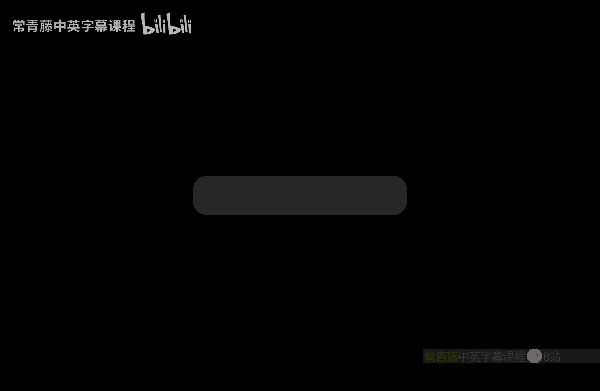
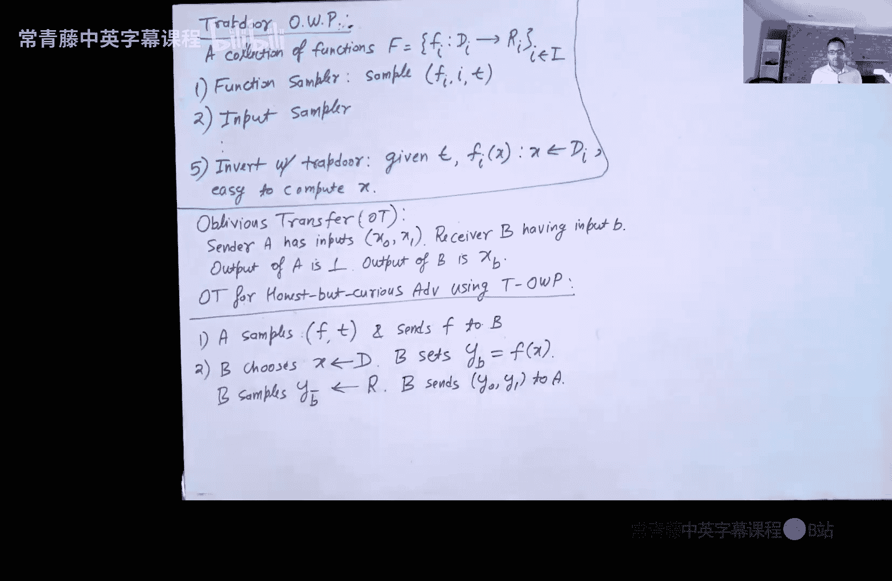
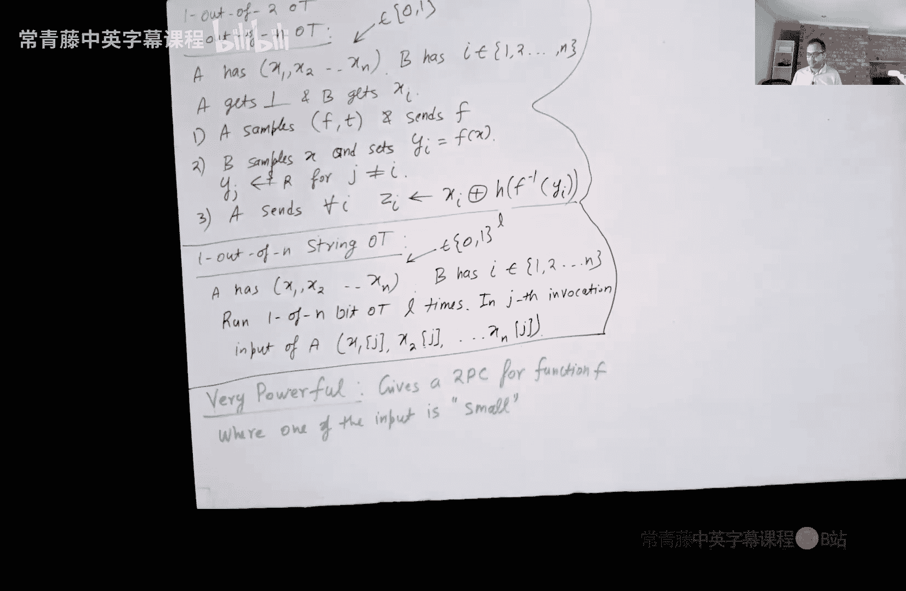

# 卡耐基梅隆大学【中英⚡密码学导论｜15.356 Introduction to Cryptography】 p20 P20 Lecture 20 Secure Computation and Oblivious Transfer -BV16V6GBYEAA_p20-

Okay， great so。😊，Yeah， so we finished with zero knowledgege proofs and today we will start one of the most exciting topics of this course。

 which is secure multipart computation。😊，So， in secure multiparty computation you have multiple parties maybe let' us just stick to two party computation for now。

 so Ill start with the exam example which was given by Andrew Yao who who was the one who invented this notion of secure two party computation。

😊，So the problem is called the Yaoos Millaire problem。😊，So， we imagine like two millionaires。

 maybe they are sitting on the beach， they are talking and they are interested in finding out who is richer without revealing their exact net worth to each other。

😊，Right。So， one option is of course they can go to a trusted third party they can tell their networks to this third party and then this party announces the winner so in cryptography we don't like trusted third parties in cryptography we don't trust anybody except ourselves。

😊，And that's what the millionaires would like to do。So。So millionaires would like to run a protocol。

 a multiran protocol they would like to talk back and forth with each other and at the end of the protocol they learn who is richer。

😊，Essentially you are trying to compute the greater than equal to function right so I have my input x1 you have your input x2 and we are trying to run a protocol which reveals whether or not x1 is greater than or equal to x 2。

😊，Okay， or maybe the protocol can have three outputs if x1 is greater than x2， then the winner is p1。

😊，If x1 is less than x2 then the winner is p2， and then if neither of these is the case。

 then we have a tie。😊，So， the protocol tells you exactly which of these three cases you are in and the key requirement is that。

😊，Neer party should learn the exact input， which is the exact network worth of the other party。😊。

Okay， so this is a very interesting problem。😊，嗯。What is the connection to zero knowledge Okay so in zero knowledge we were interested in designing a protocol。

😊，which only reveals whether or not a given statement is true right so the verifier the only thing that the verifier learns is that the statement is true without learning anything else right so here we are generalizing a little bit further。

😊，So here we specify that。The parties learn exactly the outcome of this function and nothing else。😊。

Okay， so Yao's Millaire problem is just one instance of secure two party computation in general。😊。

In general， you can imagine two parties P1 and P2。Okay。This is called secure two party computation。

Also the shorthand is just 2 PC， multipart computation ismpC。So。

 the private input of p1 is x1 and p2 is x2。There's a public function F。

Both of them know what f is and so on。And they would like to run a protocol。

At the end of the protocol。😊，Both the parties learn f of x1 comma。X2。Okay， and maybe for example。

 the function is the X function。😊，If the function is the x function。

 then give1 x2 and the function output I can already compute x1 and vice versa， that is fine。😊。

That is not an insecure protocol。😊，Our intuitive definition of understanding is that。

Whatever P2 learns or whatever P1 learns from this protocol can also be computed using the function output alone。

And we will try to formalize it a little bit more， but right now at an intuitive level the only thing the protocol reveals is the output and nothing more。

😊，Okay， and this notion was introduced by。Andrew Yao。

I believe it was in 86 and that was for the case of two party computation。😊。

And this was generalized to the case of multiparty competition by Golddch McAley and Victorerson in 1987。

Okay， so it has been over 30 years since this notion came out and。When this notion came out。

People thought that secure two party competition， multipart competition is never going to be practical。

The computers were much slower at that time， the network was slower。😊。

The protocols were less efficient， so it was mainly just sort of an intellectual curiosity type of line of research。

People who were more practically minded， they never really paid attention to this topic。

And all of this changed sometime maybe 10 to 15 years ago。Now。

Secure to party and multipart competition is being used in practice。 There are a lot of companies。

 big tech companies like。Like Google， Facebook， Vi and so on， they are interested。😊。

And they are investing heavily in secure two party and multipart competition。

And one of the reasons for this is sort of the rise of big data， you know， when you have big data。

 you have big data privacy problems。So here you can imagine x1 and x2。

 these are like two different data sets and the parties are trying to compute maybe some sort of machine learning algorithm on these two data sets。

😊，So as an example， think about multiple hospitals。😊，Okay케이。

So maybe there is a clinical trial going on， maybe for the coronavirus vaccine or some treatment or something like that。

😊，And。There are different hospitals who are treating the patients in different ways and they have this huge database。

 what worked and what did not， right？😊，Now， if the hospitals come together and then they combine all this information together right we can have very nice information about what works and what doesn't work right in in medical science。

 in clinical trials and so on， data is really the name of the game。😊。

Data is extremely valuable and in fact。😊，Much of the cost of developing any new drug or any new vaccine is really in collecting all this information in doing the clinical trials。

😊，On the other hand， there are several type of laws like this hipA which you have to comply with and so on。

 which says that you cannot really view。😊，Any personal information patient information to anybody else except with the sort of the written permission of the of the patient right so if I have to go to like1 thousand different patients take their permission that's probably never going to happen。

But the nice thing is secure two party secure multipart competition gives you sort of a framework to solve this problem right different hospitals they can。

😊，execute a protocol with each other right the input or the database of the IEF hospital would be XI right and then maybe they are trying to compute what is the success rate of a particular type of therapy for coronavirus patients right and then that is a function which takes all the databases as input and at the end of the protocol the parties short of just learn the desired function output without learning any content of the database of the other parties or of the other hospitals。

😊，Right。嗯。Secure multipart computation can be used by different nations， for example， to share。

Sensitive information with each other。 So for example， maybe something like text evasion right。

 maybe。😊，Country A is talking to country B and would like to find out if citizens of country A have any bank accounts in country B right so country B is just not going to send the entire database of all the bank accounts to country A。

But A and B can run sort of a secure two party competition protocol。

The input of a would be the list of its citizens or rather maybe the list of suspected citizens who are evading taxes。

 the database of country B would be maybe all the bank accounts held by citizens of country A and then whenever there is a match country A learns the function output。

So we can imagine a lot of different applications。😊，Now the question is， of course。

 this is a very nice notion。😊，How do we formalize it， how do we build it？😊。

And the cryptographic primitives which we have learned so far。

 they will be really helpful in the class today。😊，So first， let me try to define what。

A secure two party competition is supposed to be。So let me just focus on the case of two parties。

 anything which I say can be generalized to the case of multiparty。

 but essentially for the next three lectures I will just focus on two parties。😊，Okay。

 so let's look at the definition。So our definition is heavily inspired by the definition of zero knowledgegg proofs。

😊，So recall that in zero knowledgege proofs。😊，We required the existence of a PPT simulator。

The simulator doesn not get any input simulator doesnt have the witness doesnt have any secret information and yet the simulator is able to produce the entire protocol transcript。

😊，Right and this sort of captures the fact that the protocol transcript has no information。So。

 in secure two party computation， protocol transcript does have some information。😊。

Which is exactly the output of。The protocol， right， So a natural sort of idea would be that。

Simulator takes the output of the protocol and using that alone the simulator will be able to produce the entire protocol transcript。

😊，So that will be our starting intuition。Okay。So。So our protocol is， we have。Two parties， P1 and P2。

With inputs x1 and x2。Okay。And maybe。Let me back up a little bit。And。Talk about the format， first。So。

 the format is that。P1 and P2。Run a protocol。Let's give some name， maybe let's say protocol pi。

With x1 and x2。Respectively。And note that the protocol pi might be randomized。In other words。

 the protocol pi is PPT。Probilistic poly your time。Now we have two requirements。

 so first requirement is of course the completeness requirement。And here for。Some function F。

And by the way， F must be a polynomial time function。Okay， you can think of F as a circuit。

Completeness requirement says that。If P1 and P2。honeston。Then， both of them learn。F of x 1。

 comma x 2。At the end of the protocol。This is very natural。😊。

Now let's try to look at the security requirement。So as I mentioned before， the intuition is。到。

We will require the existence of a PPT simulator。There should exist a PPT。Simulator， which。

Ts as input。The function output。Okay， and。Which takes as input the function output， but not。

But the simulator doesn' not know the input of the honest party。😊，Okay， let' us call the simulator s。

S outputs a protocol transcript。Let's call this T sim。Such that。

T S is computationally indistinguishable from。地点。To realize is the transcript of the real interaction。

 this is very similar to zero knowledge。😊，But there are many questions here。

 which is why this this is just the intuition。First of all。

What does it mean to say the function output？Function output put on what。

The natural interpretation is function output on the inputs x and x2 right。

 but suppose the party P2 is dishonest。😊，So， in that case， P2 might have any arbitrary strategy。

 right？In particular P2 may not even have an explicit input in mind。

 maybe P2 has two different inputs or multiple inputs。

And maybe P2 is running some sort of weird strategy。

 which is some sort of combination of these inputs。I don't know， right just just arbitrary code。

 it's hard to say what input it is using。So this term is not exactly well defined what the function output here means。

So， we need to formalize this definition a little bit further。😊，So this is our final definition。

And we will have two separate definitions， one for the case when P1 is corrupt。

 other for the case when P2 is corrupt。So here the definition is， let's start with the case， say。

P2 is corrupt。So lets dennot it by the party p2 star。Some arbitrary P strategy。Now。

The simulator S is。Given the code of。P2 star。So simulator just has the code of the adversary。S。Has。

Access to an output oracle。Now， S can。qua啲。Let's call the output orac O。S and or on。Any input。

X to star。Of its choices。And。S receives。F of。X 1， comma， X 2。Stop。Okay。

So output To already has the input of the Ho party。😊，Excellent。And then， finally， as。

Output some transcript tau。Let's say sameim。Such that。Dao same is。

Computationally distinguishistishable from tao。Okay， so one way of interpreting this is。

Adversary can learn the function output on exactly one input of his choice。Which is X star here。

 Nothing more from。Any questions about this？And what about the case when P1 star is corrupt？Well。

 that's。The strategy is similar。If P1 star is corrupt， then。

The simulator can query the oracle with any input X1 star。And then get the output。So， S。Gets from。

The oacle。F of x1 star x2。And then the simulator s has to produce the protocol transcript。Okay。

So can you explain once by like the first definition means that like that we can only find out the output of x2 star like I did not understand that。

Okay。So what is the information which the simulator has？All the facilitateac。

Which the simulator receives the only information which the simulator works with is this f of x1 co x 2 star。

And if using this information alone， you can produce the protocol transcript。

 that means that the protocol transcript cannot have any information other than this。😊，So。

 this is very similar to Zion knowledge in Zion knowledge similar to started with nothing and produced the practical transcript。

😊，Which meant that the protocol transcript had no information。

Here the simulator starts with this little piece of information and the simulator produces the protocol transcript。

😊，Which means that the protocol transcript has nothing other than this。哦。Any other questions？

And can shouldn't our simulator also consider the case when both of these are corrupt？No。

 then whose security are you protecting。So the main point of the simulator is to show that the security of the honest party is protected。

😊，That the adversarial party doesn't learn anything about honestors parties。

If all the parties in some protocol are corrupt， we don't care about any of them。😊。

We don't need to show any security for anybody，ok， thank you。So same， for example， in key exchange。

Like we never consider the case when both Alice and Bob are corrupt in Z knowledge。

 we never consider the case when brewwer and Verifier are corrupt So this is a general pattern in cryptography and when we will look at secure multipart computation。

😊，There are n parties and then up to n minus one of them can be corrected。

And then we want to argue that the security of the remaining honest party is still intact。

So that's generally how。Sort of our thinking is。Since I have one last question like like the definition says that S can query the oracle on any input x2 star and receive f1 x1 comm x2 star right but like the only input to s is f of x1 comm x2 star right like what does then that mean exactly like？

So， we want the simulator to be able to choose the input x2 star。

And then get the output corresponding to that input。You cannot expect that。You know。

 you give the simulator。The output of the function F on some input and。

The simulator will be able to produce the protocol transcript because maybe the input which the adversary chooses in the real world is different from that。

😊，Okay， so you are saying the simulator can produce。The transcript for Nh2 star。有。

And the simulator queries the oracle exactly once， not more than once。😊，Okay。

 and like nobody gives x to star， basically the simulators。

Nobody gives x2 star simulator has to look at the code of P2 star in some sense。

And similar has to learn what x2 star is。Okay， thanks。So even though this is a nice。Definition。

 let me put a disclaimer。Herear that。You shouldn't immediately go ahead and start build start building software and so on。

 This is still sort of。Not the best possible definition， there have been stronger definitions。

In the MPC literature， but this is probably the simplest， so this is what we will work with。

Now let's look at a generalization。So far， we only looked at the case where。😊。

All the parties get the same output。Now， what about the case when different parties are to get supposed to learn different things？

😊，From the protocol。 So that's also possible。So in generalization， we have。Two functions， F1 and F2。

Okay。Be one， and。P2。Lan。F1 of x1 go x2。And。F 2 of。X 1， comma x 2。Respectively。

Okay as an example think about the client server setting。

 maybe the client doesn't learn anything and sorry maybe the server doesn't learn anything and only the client learns something from the protocol and in that case one of the functions F1 can just be bought。

😊，It can have zero output。And of course， we can generalize all of this to more than two parties。

 but we will not worry about that right now。😊，So， our goal will be to construct secure two party computation for any function。

😊，For any polynomial time function F。And by the end of the。Of the last lecture。

 the third lecture of the series， we will learn how to do that。嗯。Today。

 we will learn how to un secureure two party computation for simple functions。😊，So。

We will consider two types of adversaries。In cryptography。

 generally we think of adversaries as like arbitrarily bad。😊，They can have any code。

 they just need to be PPT but other than that， they can do whatever they want。😊，But。

Here as a stepping stone to make our life easier， we will consider nicer type of adversaries。😊。

And they are known as honest。But curious。And also known as semionest。Adversaries。And。

Our first goal will only be to construct protocols which are secure against honest but curious adversaries。

 so what are honest but curious adversaries。😊，They follow the protocol instructions。😊，Completely。

you tell them to generate two random numbers， they will honestly generate two random numbers。

 you tell them to add these numbers， they will add these numbers and send you the sum and things like that。

So they don't deviate from the protocol instructions。😊，But， they are curious。

They are curious about what your input is。Right， so if the protocol just。😊。

Sense the input of one party to the other party， these adversaries are not going to close their eyes。

😊，Right in that case， they do learn your input。So these adversaries。Jo。A good random tape。

And follow all。Protocol。Instructions。But they can analyze the information。Which they。Learned。Okay。

 one way of thinking about it is that maybe during the protocol。

 the adversaries are completely honest。😊，And then after the protocol terminated。

 the adversaries became completely corrupted。😊，And then they could take the entire protocol transcript Dickens run any arbitrary computation on it to learn something about the input of the honest parties。

😊，And。We will mainly try to construct。Protocols for these type of adversaries and then later on we will see how in sort of a magical way you can use zero knowledge proofs。

😊，To also get security against。Arbitr arbitrarily malicious adversaries。

Let me call these fully malicious adversaries。These type of adversaries can use bad randomness。

You tell them to flip a random coin。They use some arbitrary non random string。They can。And。

Arbitrary messages。The only restriction is that。They have to be probabilistic polynomial time。Okay。

 so for now， let's focus our attention on。Dishonors but curious。Let's assume that。

Other type of adversies don't even exist right now。Okay， great。So， we are ready to。😊。

Get into our first secure two party competition protocol。

And we will use Traor one way functions or one way permutations。Trarap door one way permutations and。

If you remember， we have already seen these objects。

And we also saw how to build trapdo perutations using RSA。Okay， so let me remind you what they are。

A trap door1 permutation is basically just a1 way permutation。😊。

Except that there is also a trapdo T if you have that trapor。

 you can invert the one with ferutation in polymer。So。

To recall maybe the the relevant part of the definition。So here we have a collection or a family of。

Functions， F。If we have the IAT。Member of the family going from the domain to the range。

And I is in some。faamily爱。So， this is a family of。Trap door when permitutations if the following properties is hold。

So first， we needed a function sampler。So this is a poly you at the time algorithm which allows you to。

三包。😔，嗯嗯嗯。F I， I and some Prado T。Okay， as an example in RSA。

 the trapor is the factoring of the number and which you choose。😊，And then there is an input sampler。

Input sampler allows you to sample。From this domain D。

Okay the third property is hard to invert right if I give you my function f if I give you the output on some random input。

😊，It's hard for any PPT adversary to be able to invert it。And then， finally， the。

Perhaps the most interesting property is。The property of。Inward with。Trabdo。Okay， so given。第。😊。

And given F I of x。Such that。Access sample from D。It's actually easy to compute。The inputex。

And remember we are talking about permutations， so given the function output。

 there is only one possible input。😊，So we will use trap door when we permitutations to construct what is known as。

Olivious transfer。Olivious transfer is a secure two party competition protocol for a special function F。

😊，And I will define the function as follows。So we have。In oblious transfer， we have a sender。

Let's call the sender to be Alice。And then we have a receiver。😊，So， sender has。Two different inputs。

 Let's call these inputs x 0 comma。X1。And then we have a receiver。Re see what is Bob。Having input B。

Okay。A doesn't learn anything from this protocol。 The output of a is bo。Output of b is x sub b。

So what is going on， I am the sender， I have two strings。😊。

You are allowed to pick and learn any one of them。😡。

You don't learn the other string and I don't learn which string you chose。Okay。So。

 the bit B is hidden from the send array。And the bit Xb bar is hidden from the receiver B。

Okay is the functionality clear？😊，And we will try to design a secure two party computation protocol for this。

方程。Okay， so oblious transfer is also just denoted as Ot。

OT is the most fundamental functionality for secure2 party competition。

And now we will see how to build O T for。Honest， but curious adversaries。And we will use。Trarap door。

 one way permutations。And we will also end up using hard coordinate bits。

It is the one way for mutation， so obviously it has a hard core bit associated with it。

So our protocol will run in three downs。So， in the first round。The send a。Samples some function。

 let's just denote it as F。And it gets the trapdo T。And sense F to B。Okay。

Alice keeps the trap door as a secret。说。It did not use the input at this stage。

The input is x0 comm x1。Now， the receiver B chooses。X from the domain。Of the function。F。And。Hm。

B sets。Y of B。To be F of x。Be samples。Y of B bar。From the range， So just。

You can think of it as a random group element for the case of RSA。😊，Now， B sense these two strings。

Y 0， y 1，2。哎。So， here what is going on。😊。

Bs。2 strings。Such that it knows the trap door。Or it knows the pre image of exactly one of them。

So a receives these true strings y 0 and y 1 a has no idea whose pre image is known to be and。😊。

Which string was random from the beginning。So anyway。

 a has the trap door a in words both of these strings。け a。Computute and sense。Z I equals， let's see。

X， I。Xar。The hardco predicate of。F inverse of。喂。😔，系い。For all。I in0 n1。So， essentially。

A recovers the pre image of。Both of these strings。It has the trap door。

 it covers the pre image of both of these strings。And in some sense。

 a encrypts the input bits using these two pre images。And I should mention here， that。

These are really just bits。Okay， so this represents the pre image of。hy i。

And this is the hardco bit of the Primage。😊，And you are just using one time pad now to encrypt Xi。

And。That finishes the protocol， how does B recover the output？B。Computs edge of。X。And。Recovers。X。

 B as。Z， B， Xr。H of x。So B only has one of the pre images。

And we can compute the hardcore preddicate of that one and recover just one of the two bits。

B doesn not have the other pre imageage B cannot invert the one with permutation enhance。

B cannot compute the other bit x P。The hard core bit is essentially uniform。7。Yeah。

 so in f inverse Y I excite self and like and we going into like circles then like we are using the hard code prediiccate of x to hide x。

嗯。So the point is， okay， let me give some more explanation here。

So maybe let's take an example to say。B was equal to 0。I guess of then。B has。Y 0。

 which is equal to f of。0。Y 1 is。Sorry， F of x。Let me call it x0。Y1 is uniform。And say。Y1 equals。

F of x1。So， here。X0 is known。To be。But not X1。So remember that be honest but curious。

Beyond only has one of the prims。Now， B gets。X0， X R。Ege of x0。And X 1 X edge of。X1。So。

 clearly b has x 0， so B can compute this hard core predicate， B can recover。嗯。

 am I overloading notation？Yeah， so I should not x is the input。

 so I should call it something else let me call it。A then。Well here it's fine。

 but let me change to r anywhere everywhere。So let's look at this value。Yhy I and X。Unrelated。Yeah。

 that's true。So let's look at this value here。You only have B only has。F of R1。

And we have a guarantee that given f of r1 hard core bit of r1 is supposed to be uniform。😊。

And hence this is a one time pad for the receiver B。Does that make sense？Yes。

 yes and hour and so thank you， thank you very much。Anyway。

 we haven't even looked at the security proof yet。😊，Any questions？

So what happens if B is fully malicious if B can deiate from the protocol？😊。

Is there a strategy for B to learn？Both the bits。Yeah， if like B B like samples x1， R1 and not y1。

 then like we can compute h of R1 and then find out。Yeah， exactly good point。Yeah。

 so it's easy for PB to pick。😊，Two strings y 0 and y 1 such that B knows the preage of both of them。

And if that is the case， we can learn both the bits。

So we are in some sense trusting B to be nice to us follow the protocol and only know the preage of one of the two random strings which he sent。

Okay， that's fine。 that's good enough for us。😊，We will only try to prove that this is secure against honest but curious adversaries。

So completeness here is easy to see and let's try to argue。😊，The security。So。

 we will consider two cases。😊，Case 1 when a is corrupt and case 2 when b is corrupt and we will have to construct two different simulators。

😊，So， case1 is。It is corrupt and in that case we will call it a star。

So the simulator works as follows。Step 1。The simulator runs。That was real star。And S receives。F。

From a star。As the second step。S， just send。Y 0 and y 1。Where。Y 0 y1。

 they are both sampled from the range。So， a staris is not even going to notice right a star just expects two random strings from the range and which is exactly what the sender sends。

Or the simulator。So， so note that。S。Doesn't have。B， right。

So S cannot follow the second step of the protocol honestly。And then， a star。Response。

S just outputs the whole transcript tow him。So there's no rewinding nothing。

Not trying multiple times。This protocol， the WW transfer protocol as we discussed。

It unconditionally hides the bit B。So the military doesn't have to do any funny business。

And note that the simulator S。Did not even use the oracle。And in fact。

It doesn' not even make sense for the simulator to use the oracle in this case because the adversary a star receives no output in the protocols。

Now let' us look at the second and the more interesting case where。The receiver B star is。から。

So now simulator has to start the protocol。Okay， and here。S。

The first message is honest as just samples。F and T。And send F to。B star。Okay。😊。

And remember that B star is semi honest。So be style response。😔，Vd。😔，Y 0 and y 1。

And here here is the key point S。Observes。The input B from。The code of。Be star。So B star is honest。

 it's the honest code。And when I look at the honest code I can see I can see which input isn't built in dishonest code if it was a dishonest code maybe it' is completely obfuscated written in some programming language which I don't understand so maybe that's a problem but dealing with honest but curious adversaries is much simpler。

😊，So now the simulator S has the input B of。The adversary。But note that s doesnt have x 0 and x1。

 which is the input of the honest parties。And now， S。Ss B to。The oracle。And receives。X， B。

Which is the legitimate output for the adversary B star。😊。

But note that the simulator doesn not get the other input。Which is Xb bart。

So how does the simulator compute this third message？And the idea is。As follows so。

Similulator sets Z， B to be。X， B， X， R。Ech of。F inverse of y B。K and simulator sets。ZB par。

To be some。Let me say some random bit R。Exile。Ege of。F and verse of。W明白。😔。

So here the simulator used the correct input。Here Im later used some random input。

But now the idea is that。😊，The adversary B star is not going to be able to distinguish between。

The case where r was used from the case where the legitimate Xb bar was being used。

And this is because of the property of the hard code。

Thever we star is not going to be able to decrypt this one time pad。So you can encrypt any message。

 even if you don't know the message， it's not going to matter。So this is essentially the end of our。

Security analysis， and。I will not go over the hybrid argument but。In the hybrid argument。

 so what is the difference between the real transcript and the simulator transcript？

The only difference between real and sd is just in how this message is constructed。

In the real transcript， this message has the correct correct bit of the sender here we are putting a random bit。

But anyway。Hard Corbit says that。It's indistinguishable from a random bit anyway。Okay， any questions？

So one small question for case one right like in our transcript。

Don't we need to output the like functions like which output of a which is nothing like or the transcript will only have the messages。

No， the transcript will only have the messages。😊，Not the final output also like that like final the final output of a star is just nothing that is fine。

 but for the simulator shouldn't the simulator also output。The thing that like it had to know。

Ex mevis。No， so the idea here is that。You are looking at what a star learns。

So you only have to simulate the view of A star。Okay， so basically。

 like we don't have to output our side。Yeah。Okay， and here this simulator shows that you can simulate the view of a star given nothing。

Which means that the protocol is zero knowledge to a。the output of a star in this protocol is bought。

Thank you sir thank you。

So what we learned so far is known as。1 out of 20。In one out of two way。

 OT the sender has two strengths， the receiver learns one of them。But there is a generalization。

 which is known as。😊，1 out of n。Oblious transfer one out of NT。In one out of NT。

 the center has n possible bits。😊，Let's call the x1 to xn and the receiver has an index from 1 to n and let's call this index I and the receiver is only supposed to learn Xi and nothing else。

😊，So can we construct one out of N Ot？Using same or maybe similar ideas。So。Here a has。X 1。

 x 2 up to X， N。The input of B is。I from。嗯。The output of a is bought as as before。😊，And Bla X I。

So any ideas on how to construct one out of NT？So can we do something like this that like we represent I as a end bit message and。

Like zeros and one we learn each of them through separate rounds in the protocol。Well。

 the the receiver be only a single bit， right。Which is exciting。So all of these are still bits。So。

This is a relatively minor change in our previous protocol so as before。😊，Is samples。

F and the trap door， and。Sense the trap send the function f to B。So in one out of 2 or0。

We are supposed to choose two strings and know the pre image of only one of them。

And now we will just ask we to choose n different strings。😊，But only know the pmage of one of them。

So， be samples。X and。Sas why I to be。F of x。或者。Is sampled at random from the range if。

J is not equal to I。And all these ys are sent across。And。A and for all I。Z I， which is defined as。

X I X， R。Edge of F inverse of let's see X。喂イはイ。Okay， so if you know the pre image of Y I， you can。

the cover X。And B only has one of the pre images， so B only learns one of the bits。

The remaining and minus-1 bits are hidden in some sense。So just one more thing。

 one more generalization， and we will see something。😊，Really nice。

So so far we have only dealt with bit otis。Let's try to go to string Ot where。It has。X 1。

 x 2 up to x， N where。These are elements of。0，1 to the power， let's say some。心机。let me。

Yet we call itarrow。Okay， B still has the same I。From1 to1。So。

 how can we construct a1 out of n string ot？And here， basically the idea。😊。

What Rohan was pointing out earlier so。嗯。So， run。1 out of n。Bit oti。L times。So this is very simple。

 right？When you run it for the first time。😊，The receiver learns the first bit of X。

 then the receiver learns the second bit of X and so on。结受。In jail。Invocation。Input of a will be。

The Jth bit of x1。The Jth bit of x2 and。So on the J bit of x n。

The input of B remains the same in all invocations。So， in the J10vocation。

B lands the Jeth bit of X I。Okay great， so we have constructed one out of n string oblious transfer。

😊，The center has n strings， the receiver learns exactly one of them。The chosen one。

And now let me try to argue that this is。Really powerful。

I have already constructed a secure two party computation。😊，For most functions。In particular。

This already gives。A secure two party competition for。Functions F where。One of the inputs is。Small。

By a small， I mean it only has a polynomial number of possibilities。

Okay， as an example， say。It has。X1。And X1 can be arbitrarily long。And then， B has。X2。

X2 is not very long x2 is let's say either one or 2。Up to n。

And you can take any arbitrary function F。Now， the secure two party competition protocol is as follows。

 so2 PC。Protocol to get。F of x1 co x。嗯。So， part B1。Or Alice will act as the send。

Bob will act as the receiver。so。The send a sets。So since I'm using x1 and x2 here。

Let me not use or maybe let me change the inputs here。Let me call the inputs a1 and a2。

And you are trying to compute f of A1 comm。So a sets X I to B。F of。一文高吗？I。For all， I。Okay。

 so a starts with some input a1。And a has to run an oblious transfer。

So a computes the inputs for W transfer protocol as follows X is f of a1 comma I。And。Be sets。

I to be exactly equal to a2。Okay。😊，A and B run。1 out of n。String ob obvious transfer。安。X 1。

 x 2 up to X， N。And。I。This is the input of A and this is the input of B。😊，At the end of the protocol。

 B learns。X， I。Okay。Now， what is Xi？😊，X I is actually supposed to be equal to f of。A1 comma I。

 which is actually supposed to be equal able which is supposed to be equal to f of a1 comma8。

So B have b has received the function output。😊，On the inputs even Command2。O。So at a very high level。

 the intuition is that。😊，If one of the inputs is small。😡，Let's say， only n possibilities。

Then once you fix a 1。There are only n possibilities for the output。Okay， so A already knows， hey。

 these are the impossibilities output is going to be one of them。😊，I don't know your exact input。

 but I know that。😊，The output is from this list of n input。Okay。

 so then I just prepare this list of whole and possible outputs。

And then you download the correct one。Using obligous transfer。

And I as the center have no idea which output you download。So all other outputs are hidden。

 which means that。You the only thing that the receiver learns is just the function output。

 nothing nothing else about my input。And the center doesn't turn anything in the protocol at all。

So now let's come back to the Yao's millionaire problem。And we have already solved this problem。

The only assumption is we have to assume that。😊，The net worth of at least one of the millionaires is polynomial。

Well， of course， you know it in fact， your networks is a constant。It's never going to be more than。

 let's say，2 trillion or even 1 trillion， right？Even the richest person in the world is worth like $1$50 billion。

 So we have an upper bound on on the network。And then we can construct this huge list。

Which will have， let us say， one trill element still polymial time， though not not very。

 very efficient but。😊，Plynomial time right so we have built a sticker two party competition for the Ya millionaire problem。

One caveat is that here。Only B learns the output。What if both parties need to learn the output？

I think they can do the same thing because both of them。

 their networks will be bounded so they can do the same protocol in reverse again right the answer will be same。

Yeah， you can do that or an even easier option is because we are assuming all this， but curious。😊。

We can just ask B to send the output to it。At the end。

And we are anyway assuming that B is not going to lie。Okay。

 so we have secure two party competition for。For the case where at least one of the inputs is small。

 So here I consider the possibility where。The input is from this list。

But you can take any polymial size list。And now there are many open questions。

Which we look at in the future lectures。 So what about， for example。Maicious adversaries。

That will be the topic of the next class。 What about。More general functions。

Where both of the inputs can be very long so as an example like imative to huge databases。

And you are trying to， maybe。RR some sort of machine learning machine learning algorithm on these two databases。

 so surely you know you cannot enumerate all the possibilities for these databases。

That will be exponential。So yeah， so we will look at both of these problems in the future lectures。

