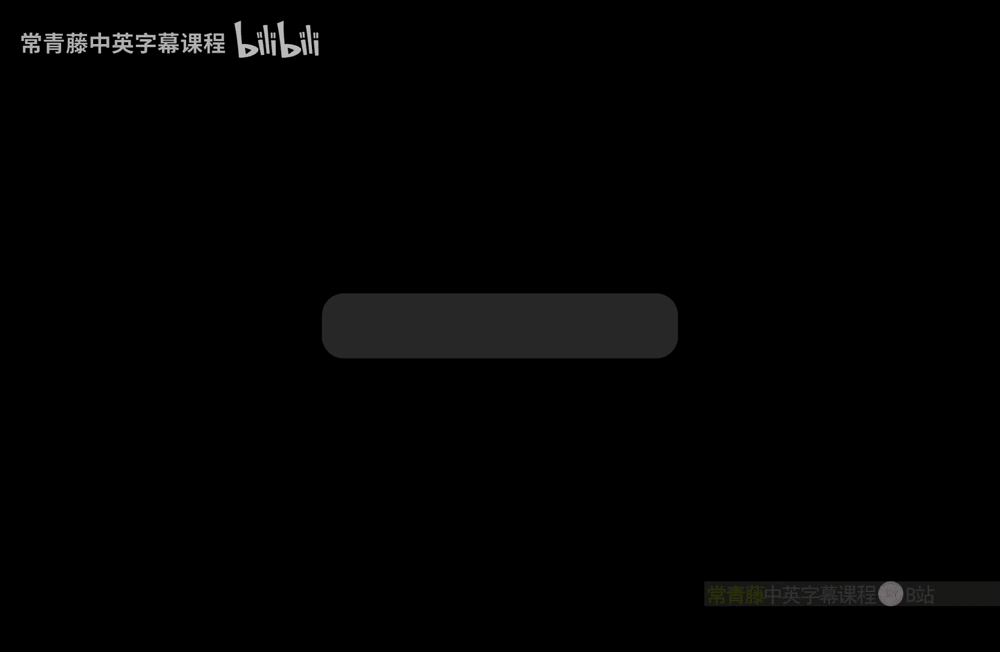
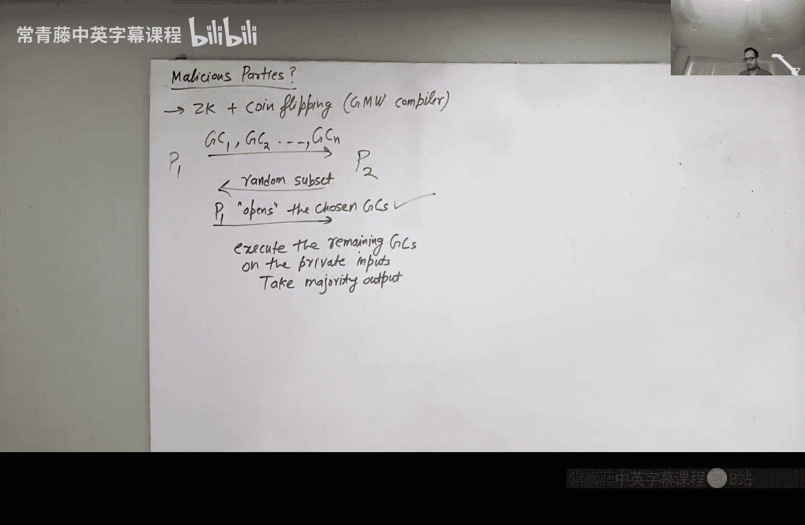

# 卡耐基梅隆大学【中英⚡密码学导论｜15.356 Introduction to Cryptography】 p22 P22 Lecture 22 Yao Garbled Circuits -BV16V6GBYEAA_p22-

Okay， great。 welcome everyone。 Let's get started。😊。

So today is essentially our last lecture in which we will cover new content Today is the third lecture on secure multipart computation and we will cover what is known as Yao' gar circuits。

😊，And next week， we will mostly focus on like， maybe some homework problems， office hours and so on。

So recall that what have we seen so far in in secure multipart computation so we have seen a protocol which works as long as one of the inputs is small right and that was a protocol for the semiist setting and。

😊，Last time we also saw how to use coin flipping and x knowledge proofs to go to the fully malicious setting as well。

 but what if you know both inputs are large as an example let's say I have a database you have a database and maybe we are trying to you know run some machine learning algorithm on our joint data。

😊，Right， so in that case， of course， the database might be larger。

 Both the databases might be large and。It may not be possible to sort of exhaustively list all possible outputs so in that case Yao's garbel circuits will help you right so so Yao's garbel circuit as the name suggests it was proposed by Andrew Yao who also introduced the notion of secure twopart competition in that paper and then later on the construction was sort of generalized to the case of multipart。

So for now， you know， we will stick to the case of two parties。

So we have we have two parties p1 and p2， lets say having inputs x1 and x2 and they are trying to run some kind of protocol。

At the end of which they will learn f of x1 comma x2 so that's sort of the problem that we want to solve today right and the protocol should be such that it doesn' not reveal anything except the output F of x1 comma x2 and for now lets stick to the semi honest setting。

We will assume both the parties are curious， but they are honest。

 they follow the protocol instructions exactly as they are told and later on we will see how to use for example。

 like again geo knowledgege proofs and coin flipping to go to the malicious setting， but yeah。😊。

Let's just have semionous adversaries in mind right now。Okay， and。So。

 rather than describing the whole protocol， let me describe the key component which is the ga circuit protocol right so normally how do you how might we compute this function f。

😊，If you don't need any kind of security， maybe P1 sends the input x1 to p2 right P2 will evaluate the whole circuit on these inputs x 1 and x2 and then compute the output。

Right， but here the problem， of course， is that P2 learns the input x1。

Which is something that we don't want。So how can P2 evaluate or execute the circuit？😊。

Without learning x 1。So maybe what we need to do is we need to sort of。

Execute the circuit in an encrypted way or in a garbled way。 right， So that's。

 that's where the name garel circuit comes from。Okay， so we will make some。

 maybe some simplifying assumptions。So， let's say we have。We have given a circuit。

Maybe let's denote the circuit by C。For the function F。Right。The circuit has。Only Nand gates。

So note that9 gates are universal gates。Given a N gate， you can construct any other gate。

 including and gate， R gate， not gate。And， you know， whatever。

So any circuit can be represented as a circuit consisting only of9 gates for simplicity。

 that is what we will do。And we will assume that the circuit is polynomial sized。

 It has a polynomial number of virus， polynomial number of。Of gamess。

So let's try to draw maybe some samples circuit。All these unknownname gates。

So there are many viruss in the circuit。Okay， and Im just giving you a high level overview of the whole construction right now。

 we will go into more formal details。😊，So。So， in gabel circuits。

 there is a person who prepares the gabel circuit。😊。

And then there' is a person who evaluates the go circuit， okay。😊，做比方。

Is the sender of the Geber circuit。P 2 is。The receiver。Or。The evaluator。Now， as the first step。

 let's look at everywhere in the circuit。 And what we will do is we will generate two keys for everywhere。

 two random keys。😊，So far。Each wire W。Pick two keys。 Let's call them。KW 0， and。KW1。Okay。

 and these are keys for encryption scheme， like for， for a yes or for for whatever， right。🤧嗯。

And then， next。呃。So what do these keys represent？Whenever you are evaluating a circuit， right。

 you start with some input， you go through the whole circuit。😊。

Every wire will either turn out to be 0 or will turn out to be 1 right So here kw0 represents the value on that wire being 0 kw1 represents the value on that wire being 1。

😊，Okay， so the receiver。We learn。Exactly one。G发。😔，Each input。Whyre。I am not telling you how so far。

So， using that， let me denote the receiver as R。😊，Using that， R can go through。The whole circuit。

 and。Learn。One key far。Each。Wre。Each intermediate wire。

 so you start with one key for each input wire somehow that allows you to sort of compute one key for each intermediate wire and then one key for each output wire。

So， hence are gets。玩具。快。Each output。Wire。Which allows him to。Get the output。

So r learns only the output and the output alone r doesn't learn the input。

So that's sort of the high level mechanism which we are interested in sort of implementing。

And now let's see how we do that。😊，Okay， so。The garbage circuit consists。Of the following components。

The first part is。For each Y W。嗯。Sender pics。KW 0， and。GW one。给。😊，Next。And this is for everyone。

 input wire， intermediate wire， output wire。😊，Next is what is known as encrypted gate tables。So。

So suppose sender gets one key for each input wire。来。Next。

 we would like to to let the sender learn the relevant key for this wire。For the next way。

And how does the send do that how does the receiver do that So receiver has two keys here and we want receiver to learn the right key for the intermediate wire。

😊，So encrypted gate tables allow you to do that so。Okay， so let's。

 let's write the truth table for the Nand function。So the input could be 0，0，0，1，1，0 or1，1。Right。

 so this is， let's say I， this is Y number J， and let's call this L Y number L。

 So I and J are the input Y L is the output Y。 So what is 0，0 and of 0，0 is 0 sub 1。And。

All the rest are。Sorry。So end of0 comm 1 is also zeros of one。1，1， and 0。

And this is for the following gate。This is wire number I， this is wire number J。

 this is wire number L。So， give one case。I 0。嘅只。0。And。I should learn。KL。嗯。G1。O。So。

If the two inputs are 0 and 0， the output is 1 and hence you should learn KL1。And so on。

So how how do we ensure this？There's a question， what do subscripts of。K I and k the。

Mean superscripts。So， we have。So this is the value on the IFifier。And this is the value on the G2。

So there are two possible values， either0 or 1， and hence we have two keys。😊，So for this。

 we will simply use encryption。Right using encryption。

 we will make sure that if you have KI 0 and Kj 0， you get KL1。

So the gate table looks something like the following。Enncryption under。K I 0。

 and we will use double encryption。Enncption under Kj is 0。off。Okay， this is the key。

 Let me write the key as an input， okay。So嘅 I。Zero commara。 What is the message that you encrypt。

The message is another cipher textex。Cage is 0， and。嘅 one。Okay케이。Let me write down the whole。对吧。

So each encrypted gate table will have four entries。So， this is K of 1。And what should this be？Here。

What should I encrypt。If the receiver has these two keys。Which case should the receiver learn？

So here we need to look at this table of the na gate， so this is still1 KL1。嗯。Ks 0， and。

This would still be kill one。So this is the key and this is the message that you learn if you have this key。

嘅湾。G you one and。Okay， so this is。The gate。Table for。The gate represented by I J and L。

Each gate is represented by。Three wires， two input wires and one output wire。来。Any questions？

The last one should be good。 Thank you。So if you have two keys。😊。

Depending upon which two keys you have， you get exactly one。Output wki。Any questions？

So now observe the following。That if the receiver gets。One key for each input wire。

And the receiver gets all these encrypted gate tables。😊。

The receiver can learn the keys for the output wires。😊，Corresponding to the right value。

But how does the receiver get the actual output？😊，Right， the receiver can get the keys。

 but what do the keys correspond to？So， the last component in a gaber circuit is what is known as output decoding table。

😊，So normally， when you get some key， you don't know what it corresponds to。Does it correspond to0。

 or does it correspond to 1， I don't know。Right。But I need to learn the output。

So that's why the receiver is also given this output decoding table。Which just does the following。

For each。Output wire。The table consists of just the following。For each output via W。

The table is kw 0。Corresponds to 0 and K W 1 corresponds to1。And what does the gar circuit？

Or what does the receiver get。All encrypted。Get tables。All output decoding tables。And。Only one key。

For each。Input。Why。The receiver doesn't get both the keys for the input wire。

So receiver starts with one key for each input wire， receiver evaluates。

 goes through the whole garboard circuit。For each intermediate wire。

 the receiver learns exactly one key for each wire。

 so receiver gets the keys corresponding to the output wires。And then the receiver just looks up。

What the output is supposed to be given the output decoding table。So that's the whole idea。

Now the question is。How does。The receiver get only one key for each input wire。

Because the sender of course does not know receivers input， so how does that work。

That's the question。So any， any clarifications， any questions so far？Okay， so let's continue。

 I'll try to use this this board。Yeah。So now let me describe to you the whole protocol。

For two party computation using global circuits。As the first step。P1 prepares。The whole gar circuit。

What do I mean by whole garbageboard circuit Pon picks all the wire keys。Two keys for each wire。

 P1 prepares the encrypted gate table， P1 prepares the output decoding table。

Pon is not sending anything to P2 yet。And note that。There are wire keys。Gooddesponding。To input x 1。

Okay。P1 cents all those。To p2。Okay， so there are some input wire in the circuit which are for the input X 1。

Input X1 is known to P1。So P1 sends one of the two keys。Corresponding to what x1 is。Now。

 what about x2？😊，How does P1 send the wire keys corresponding to x2。Here， we will use。

Oblivious transfer。For x 2。好。嗯。So let's， let's think about the first beta x2。For。Each bit of。X，2。嗯。

P 2 x as。The centerer of。Doubly West transfer。 So we are using one out of two string w transfer。So。

Say， this is the。This is the wire index W。So P1 prepares kw0。And。😊，KW 1。And this is。P1 input。

Pto's input is。X 21。The first bit of x 2。And。What does P 2 learn， P 2 learns。KW x 2。one。Okay。

 so P1 doesn not learn P2's input。But P2 learns exactly one of the two keys。

Corresponding to what his input is。And then you repeat。For all bits。Of。X2。

So shouldn't be P1 learns kw x2 of 1。No，闭读。P2 is the okay， O circuit。 P1 prepares the go circuit。

So at the end of this step。P2 has exactly one key for each input wire。

So P2 is ready to start evaluating the gar circuit and at this stage。ビーワンセンス。All。Get tables， and。

Output decoding table。Right， so。So using this P 2 can learn the output。P 2 gets the output。

So this is a slightly over simplified version And there， there's a couple of problems， which I' am。

I am sort of hiding under the rug， which we will talk about。But this is sort of the basic mechanism。

 the good， the basic starting point。Any questions？So like at the end。

 p2 will just transfer f of x1 co x2 to p1。Yeah， let's say only P2 needs to get the output just for simplicity。

If both parties need the output， then the second party can send the output to the first party。

So how do we argue that。P2 doesn't learn， for example， P1 input。

So it seems that it's easy to argue that P1 is not learning anything， right。

Because P1 prepares the garbage circuit P1 sends everything P1 doesnt really receive any messages from P2 except for messages in obly various transfer。

来。But believe， where transfer any center doesn't get anything， right。

 So this whole protocol is essentially your knowledge for P。But what about P2。Right。

 given these encrypted gate tables， given all the keys。😊，Maybe P can figure out。P was P1 input。

So what is the issue here。The issue is this gate table。Right。So suppose， you know。

 let's take an example here。Yeah。Suppose this is a gate。I and J are the input wires。

 and I and J correspond to。They input x1。来。Now， Pto is not supposed to the next one。But。

P 2 has these two keys， P2 looks at the gate table and starts decrypting these four entries。

Suppose P2 is successful in decrypting the first entry。What does P 2 learn。

If P2 is successful in decrypting the first entry， then。P2 learns that。Value on I comma J is0。

 comma 0。And hence， the value on L is1。Right， so this is the first problem。

P2 should not learn whether the given key corresponds to 0 or 1。Right。

 so that's something we need to make sure。Peter shouldn't。Yeah。What bit。The key correspond。2。

Petto should just， just learn a bit。 Sorry， Pi two should just learn a key and shouldn't be clear。

 does it correspond to 0 or one。There's a couple of questions。In part 2。

 it says that P2 x as the sender。哦。P1 is acting as the center。We do access the receiver。

So these are send us input。Two keys。And P2 is the receiver。 P2's input is this bit B。

I think he knows the whole garbage circuit so it could choose the input。

According to X1 and send to P2， Yeah， that's right。

So P1 prepares the whole garbage circuit and P1 has x1。

 so P1 can send the keys corresponding to x1 to p2 directly。

The problem only comes when we are looking at x2。Because x2 is unknown to P1。

And here you get the keys using oblious transfer and obli transfer really fits in very nicely here because there are two keys for every wire and you are supposed to get only one of them。

😊，RightThis is exactly what ob transfer sort of allows you to do。So how do we fix this problem？Right。

 P2 gets some keys。 P2 should't learn the mapping between the key and the bit。Except for the output。

So any ideas on how we can fix this problem？So what about randomly peruting this table。

This is my sign for random permutation。Here the problem was that the first entry corresponds to the input being 00。

 second entry is 01 and so on。 So what whatever if just we just like shuffle the table。

Does that solve the problem？Okay， there is。There is a thought that yes should solve the problem。

 any other thoughts？So if you shuffle the table， now I have two keys， right？

I have no idea which of these four entries I should be decrypting。I can try to decrypt all four。

 I will probably get some junk。One of the entries will be decrypted successfully and I will get the right key。

😊，For the other entries， I'll probably get some， some random looking number。 So how do I know。

Which of the four entries。I should decrypt。🤧嗯。So this problem is actually not very hard to solve。

I try to decrypt all the four entries。😊，We just need a mechanism to make sure that。

I know which of the decpts is correct。来。So， to do that。We sort of make the message identifiable。

So what we should do here is。Just maybe append or concatennate a bunch of。Zeros。都在 messagess。

So now this is our new gate table， the entries are randomly peruted。😊，And。I have two keys。

 I try to decrypt all the four entries。One of them I I will decrypt successfully。

 and I will see a bunch of zeros。Then I know that， yeah， this is the one which does make sense。

 For the rest， I am probably going to get some garbage。And definitely not a bunch of zeros。So。

 this solution works。And this is essentially a complete solution for the Ya garbage circuit。

But like there is always a possibility that you get some zeros with some other garbage value， right。

Yeah， the possibility of that we would have to argue is negligible assuming that the number of zeroes which you put is large enough。

😊，No no but but the point is that like the cryptography violation like the security violation can be probabilistic but this would lead to a correctness violation with like this will be probabilistically correct only then like thats yeah that is a very good observation and that is true。

😊，So this construction， which I describe right now， it's yeah， it does have some correctness error。

And there is another construction， not very hard， which。

Which is maybe you know slightly more complex， which which solves this problem。Thank you sir。

Just to give you a very brief idea of。What the other construction looks like。嗯。

In the other construction。You randomlyshuffle the table。嗯。But when you encrypt the keys。

 you also sort of encrypt some sort of。Identifier。Which allows you to pick one of these four entries。

That's a very high level idea。Okay。Okay， good。So note that this protocol only has security against semi honest adversaries。

What if P1 is malicious。It's very easy for P1 to send a wrong gar circuit。For some other function。

 maybe。 and， you know。You end up accepting the wrong output。That's one of the problems。 Yeah。

 actually， that is really the main problem here。So how do we solve this this issue？The idea is。

 again， we will just use zero knowledge proof。So what about malicious parties？And again。

 use zero knowledge plus。Coin flipping。 we have already looked at。The GMW。关闭啦。

With the zeros approach， can't we just detect that two of the messages have zeros concatenated and zero the entire process？

That' is also a good suggestion， but in that case the running time of your protocol becomes expected polynomial time。

😊，Rather than just following other time。O。So， now。Even if the probability is negligible， yeah。😊，Yeah。

 because there is no。And like because there's no like fixed upper bound here。So。

 you can only sort of。Analyze the average running time the protocol or the expected running time for protocol I cannot really say that hey this is this is a polynomial bound and I am pretty sure that the protocol will stop within that there is always some small negligible probability that protocol will go beyond that。

Right， so。This Yas garbageberg circuit， this is actually really the first secure two party competition protocol which was ever proposed and very interestingly this this is still the most efficient secure two party competition protocol。

 at least for semiionist parties。😊，The protocol is just so simple you need just based on the size of the circuit。

 of course， you need to prepare a bunch of encryptions。Encryion， a bunch of encryptions like。

4 encryptions per gate。 and you dont need even you don't even need public key encryption here。

Just private encryption， which can be A yes is good enough。And AE S is very fast。

 especially when you do it in hardware， you can encrypt like gigabytes of messages per second。😊。

And then you need bunch of oblious transfers， which only depend upon how large your input is。

And again， that's also not something which is which is slow。 right。

 So the only problem is when you go to malicious parties。 Sure。

 we can use your knowledge and we can use coin flipping。But think about zero knowledge， right， so。

Think about this whole sort of message。Which P1 is sending。For the whole circuit。

 P1 is preparing like a gable circuit and P1 needs to prove that this this garble circuit is constructed correctly。

😊，So just imagine taking this whole computation。😊，And converting it into an instance of graph 3 coding problem。

That is going to be hopeless， right， It will be polynomial time。 but you know， I don't know。

 Maybe it will take like。Hours， if not date。Can we do something more efficient yeah？

There have been like。If not 100， maybe like dozens of papers。Onです。And the very， very basic idea is。

 is is something like the following。I will not go into like full details， but。

Even before using the inputs。P1 prepares many govern circuits。So garbage circuit 1。

 garbage circuit 2 up to。Garl circuit。And。What do I mean by go circuit just the gate tables and the output decoding table？

Nothing related to the input。And now the concern that P2 has is what if。😊。

Some or maybe all of these gaer circuits are constructed incorrectly to sort of force a wrong output on P2。

So then P2 chooses， let's say。嗯。A random subset of these gobel circuits。

 Let's say half of these gobel circuits。And P1。オpens。The chosen go circuits。What do I mean by opens？

P1 reveals the whole randomness。Both the keys。All the internal randomness。

And then P2 can verify if the ga circuit is constructed correctly。In particular。

 P2 can verify that this this gate table indeed corresponds to the Nand gate。

And the whole whole logic of the Gal circuit is correct。

And then P2 has some confidence in the remaining garbage circuit。😊。

If all these chosen Bible circuits were honest， then。Execute the remaining ga circuits。

On the private inputs。Maybe a small number of them would be。Would be bad， would be malicious。

But then you can take the majority of the。Take majority output。

You see the output of all of them well， you know that maybe like a couple of them might give you wrong output。

 but majority of them will give you the correct output。😊，And then， you just。You just take the output。

 which is given by a majority of them。This is because if a majority of these garbageboard circuits were dishonest。

😊，When you choose a random subset with very high probability。

 you will detect that some gos circuit on。So just on this idea alone。

 there have been like dozens of papers on really like optimizing all the different parameters and。

And making sure that you get an efficient construction。

So now let's look at the multiparty setting。And again， we'll go back to the semionest setting。

So here we have parties P1， having input X 1。P2 has input X 2。And so on， and then we have PN。

Having input X n and the parties are interested in evaluating the function f of x1。X 2 up to。X， and。

And here is the high level idea。So， as the first step。P1 prepares。

The garbageber circuit for the function。Or for the circuit。Now， the next step is。比 oneセ。Wre keys。

Corresponding to x1。To let's say P and。So， we need to pick one party who will do the whole evaluation of the gar circuit so P1 is the is the creator of the gar circuit PN will be the evaluator of the gar circuit。

So what do we do with with the remaining parties。So， P2 to P N。

Execute one out of two oblious transfers。With。比 one。To learn。Wre keys corresponding to。

Inputs x2 to x n。Respectively。Right so， for example， p2 will start p2 has x2。

 so p2 will run the oblious transfer。With P1 and get and then get the keys corresponding to x2。

And by the way， here I should mention p1 sense while keys corresponding to x x1 to pN privately。

We are assuming that every pair of parties can talk privately。And then。P图图。PN -1。Send。Wre keys。

Goodponding。X 2 to x， and -1。To。B案。Okay， so all the parties in the middle P 22 P and minus1。

They got wire keys corresponding to their inputs。And then they all send all these wire keys to PM。

And again， this is done privately。In particular， P1 doesn't learn what these guys are sending to PM。

Now， beyond。Next。比1 sense。嗯。G tables， and。Output decoding table。Do be end。

So now PMN has everything necessary to evaluate the gar circuit。😊，PN has all the wireal keys。

For all the input wires。And PN gets the gate tables， the output decoding table。

 so PN can sort of go through the whole circuit。And。PN now gets the function output。F of x 1。

 X 2 up to X， N。And then PN can announce this function output to all other parties if required。So。

 good。Now， now let's look at every individual party。😊，What do they learn？So what does P1 learn。Well。

 P1 really learns nothing， right Pon is the center of the garbageboard circuit。

And P1 x the X as the send in every oblious transfer。

 So P1 doesn't really learn anything in the protocol。Let's look at P2 to PN-1。Okay。

 let me write it down P1。L nothing really。P 2，2， P， and-1。 What do they learn。One random key。发。

Each of their。Input。Bits。And then this， that these random keys are sent to。To be。

That so P2 to P and -1， they are also not learning any useful information。

 just learning a random string。What does P1 learn？Bn。嗯。1， via key for。Each input wire。

And then PN can start sort of evaluating the circuit。Which means that PM can then decrypt。

And recover。1， y key for。Every wire in the circuit。But PM has no idea what this Viki corresponds to。

Does it correspond to 0， maybe it corresponds to 1， I don't know， right？

So this is not useful information。 PM is just learning a bunch of random numbers until this point。

Then， PM。Decordes the output。Given the output decoding table。

And that's really the only useful information， which PM is learning。

So PM only learns the output and nothing else。 So that's fine。Of course。

 PMN was supposed to learn just the output。So this is just a very high level intuition。

 the actual formal proof of the garble circuit construction， it's pretty long。

 this is not something that we will cover in the course。Okay， any questions。So， here。

It's good to be aware of the limitation of this construction。What if P1 and。been。管理物的。What happens？

Can they learn the input of any other party or。Can they break the security in any other way。And why。

So there are multiple yes in the chat， but。不top。Yeah， PM can send the keys。To P1， Yeah。

 and learn the input of P2 to P and minus1。 Yeah， very good。So， for example。

 let's look at the party P2， right。Party P2 got the wire key corresponding to。His input ex true。

And that was sent to PM。So PMN doesn' not know what this vi correspond to， which bit。

But P1 knows right because P1 is the party who constructed the whole ga circuit。

Even one exactly knows which bio corresponds to which bit。Together。

 PN and P1 can decode the input X 2， can decode the input X 3 and so on。So if these parties collude。

 they can。Learn the input of。Every other party。And by the way。

 this is a problem even in the semi honestest setting。

These parties don't need to deviate from the protocol。Right。They can be honest。

Pout the protocol and sort of look at their random strengths。

 which they have recorded in the protocol and then can figure out all the inputs。😊。

So that's not secure and deal with each other。And yeah， in that case。

 we need to use something different。 This is not something which we will cover。

 but there's a protocol， which is known as the。GMW protocol。 Well， really。

 there are like hundreds of protocols。The protocol which we are covering in the class they are really from the 80s。

They are more advanced。MPC protocols。So we do have secure multipart computation protocols for any function。

Which are secure， even if n-1 parties can be corrupted and can collllude with each other。

So this is a very strong sort of security。And we do have protocols for these。Okay， good。

 So since we have some time left。Let me briefly touch a few topics which we didn't cover in the class。

AnyAny final questions about MPC？So there is a question。 I don't quite understand the。

Construction for， do you mean Maicious parties or multiple parties？Why does it help to send。

Multiple go circuits。 So you are talking about。You're talking about this construction。Yeah。

 so what is the problem for malicious parties？😊，The key problem is what if P1 is malicious。

If P1 is malicious， P1 can prepare a wrong ga circuit， which can give you the wrong output。Right。

 this is really a problem with correctness。 It's not a problem with learning the input or it's not a problem with the security as such。

So you can， yeah， you can prove that one garbage circuit is fine， but。

We were trying to get a more efficient construction。

We are trying to avoid the use of zero knowledge proofs。

Because zero knowledge proofs will require NP reduction like converting the whole computation to an instance of graph three causing。

 and that's not something that we want to do。So this construction doesn't require any NP reduction。

It's known as it's known as cut and choose paste construction。

 P U prepares multiple garbage circuits。 P2 inspects a few of them。And if they all pass the test。

 P2 automatically assumes that， yeah， most of the rest are fine as well。

This is something which we use in real life all the time， of course。

So P1 opening the chosen garbage circuit doesnt involve the proof， Yes， it doesnt involve un proof。

What does opening the gabel circuit mean？P1 will send all the wire keys。

Both while keys for every input wire。So P1 essentially discloses the whole randomness。

Which was used in constructing the garble circuit。Because here we don't need to hide anything。

We will not use these chosen go circuits。 We have not started using the private input yet。

So P1 reveal is the whole randomness P2 goes through and P2 makes sure that gar circuit was constructed correctly。

We don't need your knowledge here because there is nothing to hide at this point。Okay， good。

 So one of the very important， important topics。 And there are like semester long courses just on this topic alone is known as fully homomorphic encryption。

So the example that I like to give is maybe there's a server。Which is very powerful。

 Maybe think about a cloud， right， And then there is a client。😊，So client has maybe some data。

So let's call this data x。So maybe client wants to do some expensive computation on this data。

So there's a function F。 Maybe it takes a few hours。 clientient wants to compute F of X， maybe。

 you know， some some genome sequencing or something。 you can imagine some expensive competition。

 So client is interested in hiring the server。 So client goes to the server。

 client says I have this data。 I need some competition F done on it。😊，来。The server says， yeah。

 that's fine。This competition will be like 100 dollars。Cllan says， yeah， that's fine。The price is O。

 Service is O。 I am ready。 Please send me your infoex。😊，And client says sorry， my input is private。

 it confidential， I cannot give it to you。😊，And then and then server might just just say that you are stupid。

 you know， how can I compute on your data unless you send the data to me。Okay， so in this case。

 it turns out that client is actually not that stupid。 There is something that you can do。😊。

What you can do is。Client can just send some kind of encryption of the data to the server。

Ser can do computation on this encrypted data。Without equiryptpping the data。

 and server can send encryption of F of x to the client。

When client has the secret key client can decrypt and recover the output of effects。😊，So this is。

 this can also be seen as。comping on。Enncrypted。Data。

And it turns out fully homomorph encryption allows you to do arbitrary computational and encrypted data like maybe you have a Python program which you want to run on some data。

 you can take the data in the encrypted format， run the whole arbitrarily powerful program on it。😊。

So that's something， something， you know， almost seems like should be impossible。

So fully homomorphic encryption allows you to do that it was introduced by Craig Gentry。In 2009。

 so not something which is relatively recent。The problem of fully homommorphic encryption was around since the 70s or the 80s。

 but actually building a fully homommorphic encryption was an open problem for the longest time for like three decades。

😊，And then Craig Gentry actually was a PhD student at Stanford and he was taking a class on cryptography by Dan Bonet and this was a problem which was mentioned as an open problem in that class。

😊，And the professor Bnet， basically promised， like。

An immediate PhD to anybody who would solve the problem and Gen probably thought that that is the easiest way to get a PhD and gently solve the problem and did get a PhD from Stanford and that was a huge breakthrough in the area。

And fullyhomomorphic encryption uses something which is known as lattice based cryptography。And。

It shouldn't look that surprising or。Or that magical。

 because we have seen some kind of homomorphic encryption， at least， right， we have seen that。

 for example， Algamal is already multiplicatively homomorphic。😊。

You can take an take something encrypted under algaal you can you can take two ciphert and compute the multiplication of these or you can take a single cipher text and you can multiply the message with some kind of constant。

If you know what the constant is。So yeah， so the multiplication gates are fine and what does some arbitrary computation consist of。

😊，Consists of some multiplication gates， maybe some addition gates， right。

 So if you can do multiplication in addition。In a single encryption system。

You are already very close to fully homomorphic encryption。😊。

So that was sort of the idea and since Gen proposed a construction in 2009 there have been several improvements this is still a very active area of research in cryptography。

And as you can imagine， this this is something which is very useful for cloud computing right。

 So maybe you don't trust the cloud， but you do want the cloud to do something for you。😊。

And in that case， you can dump your data in the encrypted format。

Cloud doesn't learn anything confidential， but cloud can still do anything that you want on this data。

Another。Problem。Is sort of the very opposite of this。

Fully homomorphic encryption allows you to do arbitrary computations。😊。

There's something known as non malleable。Encryption。Or you can even have non malleable commitments。

So to motivate the problem， think about an auction right So we have a seller。

 let's say Alice is selling maybe a phone。Here， not a very good picture， but it is fine。

And then we have Bob。Who is interested in bidding on the phone。

And let's say we are interested in sealed auctions。So everybody will and Alice has has， let's say。

 a public key。So everybody will submit their bid to Alice encrypted under this public key。

 let's say Bob wants to bid maybe I don't know， let's say M。Amazon number。

 maybe like 1 hundred0 dollars， right， And then we have this adversary Trudy。

Trudy wants to bid just a little bit more than Bob and win the auction。So。

 Trudy of course cannot decrypt this message Trudy does not have the secret key only Alices does。

 but maybe Trudy can take this cipherex and then maybe do some kind of computation on this cipher text。

😊，And then prepare another Cypherex c prime， which is exactly。😊，An encryption of maybe M plus  one。

Right， or maybe 1。01 times m。And。If you have。Some sort of homoic encryption。

 This is definitely possible。In Algamal， for example， I can take this cipher text。

 I can multiply the message by let' us say 101 divided by 00。

And then what I am likely to end up getting is something which is just slightly higher than I。😊。

Maybe not M plus one， some M， which is slightly high。 So。

 so definitely algamal encryption is not good。 Almal commitment is also not good。

So what you really need here is what is known as non malleable commitment or non malleable encryption。

 So given。😊，And Christian of P， K comma M。Should be。Har do。Compute。Encryption of。ピーケコエ prime。fi。

An am Brian。Which is。Related to。M。Right， related。 I'm not defining what related means， right。 So。

 of course， it's a public encryption that you can take a completely fresh message and prime and you can encrypt it。

But what I want is if I am encrypting some message am。

Your Cyphertex should be independent of mycipherex。And if you have that。

 then we can solve the problem of auctions。And there has been a lot of research。

Turns out to be not that easy。 It's probably easier to design encryption schemes with some algebraic structure。

 which allows you to do some computation。But if you want to block all computation。You know。

 given some cpherex cannot compute any other the Cypherex， that turns out to be very hard。So yeah。

 there has been a lot of work probably again， dozens of research papers on。Non valuablele encryption。

 non valuablele commitments and so on。So， this might be a stupid question。

 but like isnt one time pad although one time pad we cant use， but is one time pad non malle？No。

 not at all。 In one time pair， for example， I take the cipher text。 I flip a bit。😊。

And that flips the corresponding bit of the message。茉嚟。Okay you are saying that。Yeah sorry yeah。

 that gives you a message。 I prime。Which is very related to M right M prime and M would be the same except they will def in exactly one bit。

😊，If you flip the first bit of the cipher textext， environment M will be the same except in the first bit。

Okay， what is。Let's talk about。Program offuscation， again， a very exciting topic。

So program offuscation is a very old problem in computer science。

And the problem is that maybe there is a software vendor。Let's call this vendor V。

 And then there's a user U。Right， so maybe the software vendor has some sort of。Pro로グ 비。

And the vendor would like to send this program to the user。But。

Users should not be able to reverse engineer this program。

User should be able to run this program on any input of his choice but should not learn anything else except the output right So send maybe some some sort of obfuscated version of the program P。

You can learn。P of x for。N E X。And maybe even for multiple inputs。But。Nothing more than that。

So it's a very natural problem， its a very hard problem。😊，In fact， in in。

There was a paper of Barak Eel。This was in 2001。Which showed that。Program of fuscation is impossible。

 In particular， this sort of intuition， which I am talking about。That sort of。

Giving the program to you is is similar to giving an oracle。You can query the oracle。

 you can get the response， but nothing about the code。

 So this type of this type of definition is impossible to realize unconditionally。

So that was very negative。 And in fact， you know， we didn't really have any good positive result on program ofscation for a long time。

 but then maybe like。Like seven years ago in 2013， there was a new and weaker definition。

So people realize that we shouldn't be that ambitious。Right。Inherently， something will be leaked。

 but can we sort of minimize what is leaked。So people sort of weakened the definition of program ofovscationcation。

 and then people were able to build program ofovscation。😊。

The the current program of fasciscation schemes， they are very inefficient。

 so there is a lot more work that is required， but it is also a very fast moving and very exciting area of cryptography。

😊，And again， lattice where cryptography plays an important role。😊，Let me look at the questions。

Can encrypting two times give some form of non malleability for simple encryption schemes。嗯。Yeah。

 I'm not sure how does encrypting twice work。I mean like， for example。

 if I encrypt the same message twice in Algamal， I can multiply both the cpher text by hundred and1 by divided by 00。

No， I mean， encrypting save， just like in gar circuits， we encrypted the encrypted value。Okay。

 not really。 like， yeah， that's a good， good start。 but turns out to be very difficult to prove that。

You cannot do anything。O。Yeah， I don't have a good answer like I cannot give you an argument and you will be immediately convinced that yeah encrypting twice doesn't work so most of the time it's like a lot of manual work but generally like people find some algebraic property which you can exploit and that allows you to sort of change the message inside。

Okay， so we will stop here for today and I am still around for questions。Thank you， Profes。

