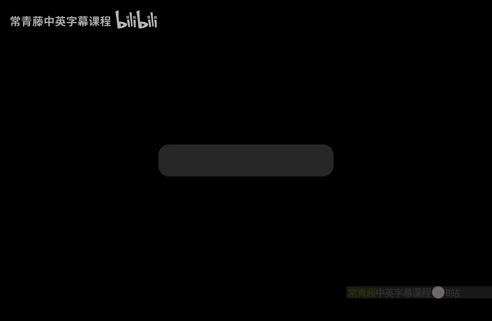
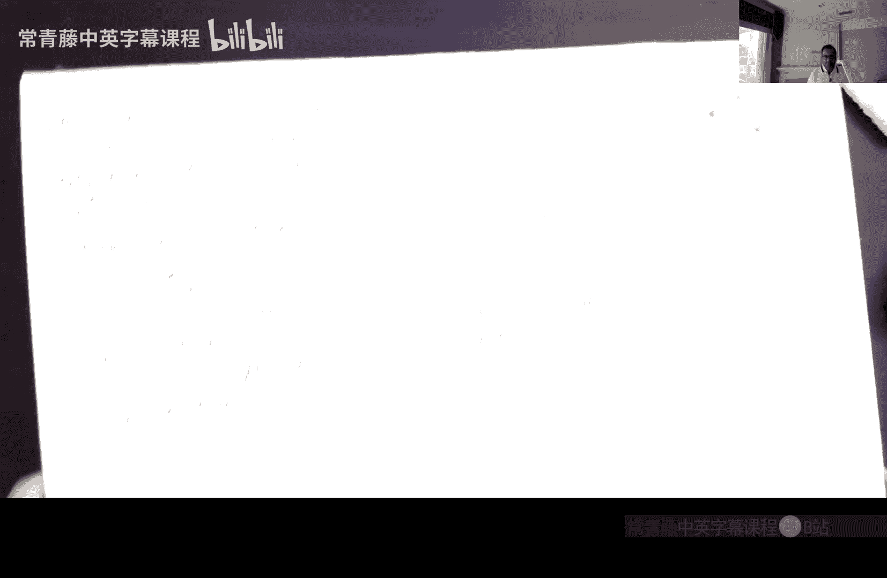

# 卡耐基梅隆大学【中英⚡密码学导论｜15.356 Introduction to Cryptography】 p23 P23 Lecture 23 Homework Solutions -BV16V6GBYEAA_p23-

오케이， hi， everyone。So yeah， so today， as you know it' is our last class and we will mostly discuss homework5 and homework4。

😊，啊。So let's start with the last homework， the homework5。

 which I guess all of you have just submitted。Okay， so let's start with the with the first problem。

 which is probably one of the simpler ones。So， in problem one， you are given two commitment schemes。

And they are possible it defective in the sense that。

Maybe hiding doesn't hold or maybe binding doesn't hold。Okay， and。

The first part says that you are given two commitment schemes and both satisfy the binding property。

But only one of them satisfies the hiding property。So， let's call them。Com1 and gone2。So problem 1。1。

 So we have。Comalm 1， and we have。Comalm two， right， both of them are hiding， but only one of。

Both of them are hiding， only one of them is binding。Sorry， the first one is both are binding。

And only one of them satisfies the hiding property。

 So now given a message M that you want to commit to。So。

 here the idea is we will use just a two out of two secret sharing scheme。😊。

So we will divide our message into two parts。M0 and M1。Give an M， and we will use。Do of two。

Secret sharing schemes。So， what this means is that even if one of the shares is leaked。

 you have no information about the actual message。😊，Right。And then， you are。

Commitment of the message M is specified as follows。

 So Com is the final commitment scheme which we are building， which is supposed to be secure。

 So this is just co one of。M0。Concatenated with。广 do of。M what。Right。And both are binding。so。

What about the binding property。This follows from the fact that co 1 and co 2， they are both binding。

If they are both binding， that means that m0 and M1 are unique， it is fixed。

 which in turn means that m is also unique。How does hiding work？😊，数。

Hiding is based on the following fact。😊，啊。At least one of these commitment schemes is hiding。Right。

 so at least。1 off。M zero gama m1。Is。Hit them， in some sense。And if that is the case， then。🤧And。

2 out of two secret sharing scheme also implies that。😊，The message is implies that M is。hidden。Okay。

sit。😔，A small bush in this one yeah。Can we use comb of like the composition of comms？You mean刚 of。

Con to M。 Yes， Yeah， that should also be fine， I think。than you。Now， in 1。2。

 both commitment schemes satisfy the hiding property。

 but only one of them satisfy the binding property。So this is， this is easier。 This is just。

You just commit to the same message twice。So this is defined as。Come one of them， and。Com 2 of M。

So you commit to the same message twice and when you are decommiing or when you are opening。

 you have to open to both of them。😊，And the receiverva checks if these two messages are the same and only then the opening is accepted。

 right？So because one of them is binding。😊，诶。That means that the message M is already fixed。

 its unique after the commitment stage。So， binding is。

Follows from the fact that at least one is binding。

And this means that this means that you can only change your message in the other one。

But that's not going to help you。 You have to change the message in both， because。

The message inside both is supposed to be the same。

And hiding relies on the fact that both are hiding。Right。Now， let's move on to question。1。3。

And there were many questions， many students were confused about this。Hint maybe was not so clear so。

Here first observe that the question says that。You are only allowed to use the given to commitment schemes as a building block。

You are not allowed to use any further unproven cryptographic assumptions。Okay。So， let's see in 1。3。

 one is hiding and one is binding。And first， my claim is that if you are given one scheme which is hiding。

 if you are given another scheme which is binding。😊。

You are essentially given nothing as far as cryptography is concerned because。

What is a binding commitment scheme？😡，can how can I construct a binding commitment scheme if I don't need the hiding property？

😊，Yeahや。Just， just send the message him。So， comm send。The message am in clear to the receiver。

And this is clearly a binding commitment scheme。😊，But it's not hiding。😊。

How do I build a hiding commitment scheme which is not binding？你 Iad。s。Menttime pad。

If your or is the randomness， well， sure， but I mean， why not just send bot， just send randomness。

Just don't talk， right？you don't talk when obviously your secret is hidden， that's all we need。Yeah。

 constant function is fine。So neither of these required any cryptographic assumptions。😊。

We didnt need to assume factoring， we didn't need to assume one way functions and so on。

On the other hand。诶。Commitment schemes imply a one way function。So。You are given in the hint。That。

Any good commitment scheme， both hiding and binding。Implies a one way。Function。

And this is easy to see because。😊，诶。Given the commitment to some value， let's say the message and。

So remember that a commitment scheme has has two inputs first is the message and other is the randomness。

And art。Given this。If you could recover M and R。Or any equalent of MNR。

 then you have broken the hiding property。Right。So。So。

 any good commitment scheme implies a one way function and that follows from the hiding property and。

😊，This means that。Given these two commitment schemes alone。

Without unproven cryptographic assumptions， you will not be able to build a new commitment scheme。😊。

Unless you yourself prove that one functions exist。So， this means that。You need。

When we functions for。Building calm。This means that。Either need。😔，And prove one。😔。

Cryptographic assumptions。Or。What is what is the option if you don't want to use and provenve encrypt crypttoographic assumptions？

😊，The only other option that you have is to prove that these assumptions are actually true。😊，O proof。

嗯。Prove one way functions。Unconditionally。Exist。Which in particular requires proving that p is not equal to Nmb。

Right so I mean， realistically your only hope is to rely on。😊，Unproven cryptographic assumptions。

 if you want to build commitment schemes and。I can make the same statement about encryption。

 digital signatures。Almost everything that we saw in the class。

 maybe with the possible exception of one time pad and secret sharing。

 almost everything else required unproven cryptography， one way functions at the very least。😊，Okay。

 so。Let's move on to the second problem。Yeah， this， the second problem requires you to build。

As the now is proof。And this is for what is known as the vertex cover problem。Okay。

 the problem is defined as follows， so you are given a graph。😊，So， you are given second problem。

 you are given a graph G， the graph consists of vertices and edges。

Most of the time graph will be represented as a matrix if there are n vertices。

 then you are looking at a matrix of n by n。And you are given。Positive integer bound B。Okay케이。

Now the question is。Does there exist to set a subset of vertices？😡，Of size at most B。

Such that this subset covers all the edges。In some sense。So look at any edge。

 at least one of the end points will be inside this set s and maybe I should take an example。😊。

So let's look at the star graph。So here we have a node in the middle and basically。

Every other node is connected to that node and that is the whole graph， nothing else。😊，So。

 what is what is a vertex cover in this graph？So， here we can have a very simple vertex cover。

 which is just this verex in the middle。So， we have a vertex cover of size 1 and why is this a vertex cover because you look at any edge in this graph。

😊，And one of the end points。Is。This vertex， which is inside our vertex cover。What if I add another？

Edge here then this is no longer the vertex cover because you look at this edge。You know。

 no longer this this edge which I added。It doesn't have any endpoints in the vertex cover。

 so we need to expand and maybe have this one as well。So。

G on a graph finding the minimum vertex cover， the minimum sized vertex cover is not to be an NP complete problem。

😊，🤧。And yeah， and let's say the prover does have the vertex cover。😊，Of size， less than B。

And now the goal is to design as your knowledge proof using which the proveer can prove to the verifier that。

There exist a vertex cover of size b。while hiding the vertex coverant and any other knowledge。So。

 how does the protocol work so let me just say in the beginning that there are multiple protocols here and maybe I will present to you what I think is probably the most natural but。

😊，It doesn't mean that every other solution is wrong。Okay， so。

Whenever you are dealing with graphs and you are thinking about zero knowledge。

 permuting the graph is always a very useful operation。😊，Right so this is what we will start with。😊。

So we have a prover and we have the verifier。😊，As the first step。The prover pers， so this is step 1。

Proer permeates G。To。Get， let's say， G prime， which is equal to。Pi of g。

So pi is a random permutation what is a random permutation well I am just renaming all the vertices right so vertex 1 becomes vertex 3 maybe vertex 2 becomes vertex 9 and so on just at random。

😊，And this sort of gives me a new graph。😊，Prover commits。To the whole graph G prime。

And what do I mean when I say commit to the graph G prime？

So let me denote the size of the vertices by n。So the graph has n vertices。

So this commit to G prime means。啊。In other words。呃。Commit to。N square values。

So this is an n by n matrix where。😊，Icom机。The value icona J is1 if and only if。Vartex I and。

Fortex J R。Connected。this is this matrix representation is the most common representation for graphs。

So prover of course， every value is hidden at this point， prover has no idea what is being committed。

😊，Some graph right approve just simply sorry the verifier Im talking about the verifier the verifier has no idea what is being committed the verifier just sends a challenge bit lets call it challenge which is equal to either zero or one。

If the challenge is zero。Then you need to show the prover that G prime is indeed a perutation of G。

So I didn't commit to something completely different， right， So if C equals0 send。

The parameteritation pi。Open。All the commitments。So， reveal the entire of G prime。

 send the permutation pi and the perover is supposed to verify that G prime is indeed isomorphic to G。

😊，So， note that in this case， the proveer never used the witness。😊，Which is the vertex cover。Now， if。

The challenge equals 1， then the verifiers is willing to believe that graph g prime is the right one。

 but you need to show that G prime has a small enough vertex cover。😊，Okay， so let's， let's say if。

 if C H equals one， then。Open all。Edges。嗯。Sort of outside。The vertex cover。

And Ill explain in more detail what I mean here。 So okay。

 so let's see lets denote the vertex cover by something。So， let's say。

The vertex cover is some set s of vertices and the size of this vertex cover is。B。

Could be less than B， but。Let's pick B vertices。So， in other words。What I mean here is that。

You send the set S。嗯。She。So， you look at。All vertices。Outside the set S。And。Let's denote it by。

Sa we prime。Mus S。Open all edges。Vd。Both end points。In。The prime minus S。

So all entries of the matrix。😡，correspondingorresponding to v prime minus s so v prime minus s。

 these are all the vertices outside the vertex cover。And we check。If all。Entries are。0。Okay。

 there there is not supposed to be an edge which is completely outside the vertex cover。😊，So。

 outside the vertex cover， basically the proveer reveals all the entries。😊，And the Wifi checks。

 all of these are 0。Right。Okay， so now let' us try to describe a simulator and this is the whole protocol。

😊，Of course， you can cheat here with probability half but。As usual， you can repeat it sequentially。

How is the verifier checking the C has size less than bound B？Well。

 the ver looks at how many entries of the matrix are revealed。But the metrics just。

The verifier knows what B is。The wifi knows。What we is。But this is the peruted graph， right like。

But the peri graph is supposed to have the same number of verrtices。So， in other words。

 let' us look at this matrix。Which has size n by n。And。I am pointing to certain rows of the matrix。

And certain columns。And I am revealing all of them。And here the number of rows which are revealed。

Should be。Should be at least be。So， essentially， it should be。Not B。And minus。いや嗯。Size of v minus。B。

And you need to reveal size of B v minus b。Dmes。Size of v minus B。Entries。

So you need to select v minus b rows， v minus b columns。

That would select these many entries and the pool is supposed to reveal supposed to open all those commitments。

But like a dishonest prover might reveal less。Well， the verifier can count how many。Commitments more。

 more， more， more more。lake。Well more is fine right it's not clear how more helps are dishonest okay and one one small question is when C is equal to0 right like challenge zero you opened another matrix right but this like checking one matrix is isomorphic to another matrix is like。

So that's why you also send this perutation pi。Okay O sorry sorry。 Okay， thank you。Okay， good， so。

So now let's look at the simulator。Oundness is clear， right， completeness is clear。😊。

The simulator is very simple。😊，So， simulator will guess the challenge of the verifier。😊，And。

Based on that， the simulator either commits to。A G prime which is isomorphic to G。

Or the simulator can commit to an empty graph without any edges。😊，Okay， so simulator picks。CH prime。

 which is a guess for the challenge CH。If C prime is 0。Commit to a graph。G prime， which is pi of。

我た会有りなと。Else。Comit to and。Empty graph， what is an empty graph。S is0 without。嗯。嗯。Okay， the ver sense。

😊，We star sense。C h。So if C prime is different from C， then you rewind。As you can proceed。

RightSo if C prime and C are the same， then clearly the simulatory is going to be successful。😊。

And why because， you know， if if C is0， then。The simulator did indeed commit to a graph which is the permutation。

And。If the if CH is one。Then basically my graph had no edges at all and hence revealing these many entries and the Wifi checking that there are no edges that is not going to be a problem。

😊，Okay， so we have a good s and there is a question here。😊。

Do we need to commit to the permutation well I don't think committing to the permutation is necessary if you want you can do it but。

嗯。You know， it's not clear what the proveer can gain by changing the permutation later on。Well。

 just that it's inV intermediate， the verifier has to be has enough。So let already say that again。😊。

Just that the problem of checking the isomorphism would be hard for the verifier to do in polynomial time。

So you don't need to commit to the parameterutation。

 you can just send the parameterutation in the third round。But the question was。

 do we need to come that' way they could just as well yeah。

 they could just send the permutation that actually makes sense。😊，Yeah。

So the soundness of the protocol is half right。Yeah， the soundness of the vertical is tough。Thank。

And this is actually better than graph3 coding。😊，Sound as the protocol for graph 3 causing was much worse。

 depends on the size of the graph。So， in some sense， this is actually a better protocol。😊。

For zero knowledge for NP compared to the one which we discuss in the class。

And I don't have time to go through the hybrid argument in detail。But。

The basic idea is you look at both cases， challenge 0 and challenge 1。

And you try to argue that real and the simulated transcripts look indistinguishable。来。So。

 if challenge is 0， then real in and the simulated transcript， they are actually identical。

Because in both cases。呃。The verifier gets the commitment of a graph G。

 which is in random permutation of the original graph。😊，And the well file lines。

 the random permutation and the entire graph， So there is no difference。But now， for the。

C at equals one。 There is some difference， right。Because in C equals 1。

 all the entries which are being committed are 0。As far as the simulator is concerned。

Whereas the actual prover will not commit to an all0 graph。But now the point is you know。

 you have the hiding of the commitment scheme and then the only edges which are being opened。

 they are zero both in simulated as well as in the real transcript。😊。

So that's sort of the rough sketch。So could you go over the soundness calculation yeah？

So let's look at soundness。So， in soundness we are assuming that the statement is false。

 which means that there is no vertex cover of size b。Okay。So， now。The honest prove piece star has。

Two choices。Case1 and Im doing it a little bit informally。Case  one is。Gpri。Is not。Iommorphic 2 G。

Okay， then。We rejects if。C h equals 0。So， in the first step。

 the dishonest prover is supposed to commit to a graph G prime。This graph could be anything right。

 but there are only two possibilities either this graph G prime is is not isomorphic to G and in that case the wifi rejects if the challenge is 0。

😊，Because if the challenge is zero， you need to show isomorphism。Case 2 G prime is actually。

Isomorphic。To G， which means that。The the first message was honest。And in that case。

The wifi will eject。If the challenge is one， because if the challenge is one。

 you actually need to show our tax cover。😊，You do need to show that there are。

There are all these edges。And。There are all these vertees and basically。

No edgeure is left outside the vertex curve。Okay， so regardless of what strategy the cheating prove follows。

The welfare continues to reject with probability at least half。Any questions？Like in the second case。

 there is still a negligible probability right that the P star like just somehow guesses the。Right。

A lake。V verex cover。But there's a very negative。Well， there does not exist。

Any vertex cover which is of this size， it's not about whether it's easy to compute or hard to compute。

In soundness we are considering the case when the statement is just false。Okay。

 we are saying there won't exist any。 Okay， thank you， Thank you， Thank you。

So now let's look at problem  three and4 well。3 and four are not that different。😊，So in problem 3。嗯。

You are given sort of a hard language。So let LBA language which is not decable in expected PP。

So no efficient algorithm。That on input x with probability 3 by 4 outputs 1。If x is L and0 otherwise。

 So， you know， the way to interpret it is。E has。No expected P。Algotm。嗯。

Which gives you the correct answer， which works。😊，With probability， at least。3 by4。So。

 this is your starting point and you have to show that there cannot exist a non interactive geo knowledgege proof system。

😊，What is a non interactive allproof system prover just sends a single message to the verifier。

So now I will solve this problem with contradict using contradiction。So， give one a na。System for L。

Consider the following EPT。Al过哎。So I'll build an algorithm which can solve this this problem L。

So this algorithm works as follows。So given the instance x。Right。A invos。The simulator S far。

Thenysic system。Say as outputs。Some proof。Let's call this proof this P。

Now run the verifier v on this proof piece。If we。Excepts。X is an L。Ese。X is not an L。

So this is my candidate algorithm。And now I have to show that this algorithm works correctly for deciding the language。

😊，First of all， observe that this algorithm is indeed expected PPT because。

This algorithm is just invoking the simulator， which is expected PPT。And。

Then this algorithm is invoking the verifier， which is polynomial time。😀え。😊，So， a is。Expected P。

Does a verifier for the na system is always polynnommal time or it can be EPPT also， right？嗯。

Mean generally is polynomial time， but sure， even if depends on the exact definition。

I think in zero knowledge we defined our verifier to be just polynomial time。But like we。

 we always pick some random element right so doesn't that make it keep it。😔，Okay， okay， sorry， sorry。

啊呀，O。But it's not expected P its PP。Okay， thank you。So now let's consider two cases。Suppose X andl。

Let's consider let's call it case1。So， I will consider two cases x in L and x is not in L and I will show that my algorithm a works。

😊，Correctly in both cases， mostly correctly。If x is in L， then。The simulator S outputs。诶。

Some proof pie。Which is accepted by the verifier v。With probability。At least one minus。Negligible。

Why is this the case？We have a computationally and distinguishable transcript to a real transcript。

Yeah， if x is an L。Then。If the ver interacts with the honest proveer。

 the verifier will always accept。With probability 1 and hence if the ver interacts with the simulator。

 the verifier must also accept with probability very close to one。

This follows from the Xon knowledge property。Or maybe this father's from。The indistinguishability。

off。Realland。Similarレ。Okay， so if x is in n， well our algorithm is doing very well。😊。

Our algorithm is actually saying x is and L with probability 1 minus 1 equal。😊。

What effects is not enough？And here we are hoping to rely on the soundness property。

Then my claim is that。If that is the case， then the simulator outputs。R。Accepted by V。

With only negligible。Probability and why is this the case？This actually follows from。Soundness。

And this is where we are using the fact that the proof system is one now， so soundness L。😊。

A cheating prove piece star can。Use s。Do。Get。😔，R and。Convicnce the welfare we。With。😔，Noticeable。😔。

Probability。If x is not an L， then the simulator better not produce a valid proof。😊，Otherwise。

 you can use the simulator to cheat basically。So what is the importance of the last step in the algorithm that you wrote like why do we need to run v again？

Why do we need to run V？😔，Like basically， we we run V on the proof message， right？Oh， you mean this？

Yes， yeah， basically I am trying to say that the last round of the simulator with the V with using which it generates that transcript。

 right？It is very same to running V on P again， because like。

Even if x does not belong to L the simulator。Will。Like simulator also cannot do anything because it is a na system。

No， but the simulator outputs some proof right， how do you know if the proof is valid or not？😊。

Proof is valid meaning。I mean。So the simulator out might even output some junk if x is not in L。

 right？Okay then then what so what is the algorithm that you are proposing if you don't run v yes so like basically there will be a output message of the verifier like we invoke the simulator with the honest verifier there will be like the output message of the verifier also and then so if simulator uses some junk in the first na message the verifier will output reject。

InOkay， yeah， we are， we are saying the same thing。 So you are saying that。

Simulator already feed the proof to the welfare end。😊，Gives the output。

Something like that yes basically like I'm asking a bigger question here like that in a na system like the simulator itself cannot make an x not belonging to L being accepted by the verify file。

 which it can do in a non natic system。嗯哼。Yeah。Yeah。

 there is no difference between what we are doing and between what you have in mind。

Thanks I am just saying that the simulator outputs something and you need to feed to the verifier and see except。

Okay， thanks。So note that as we defined。😊，The simulator only gives you a protocol transcript。

Similulator is not supposed to give you。What the very far outputs。 So that's why。We are doing this。

Isn't that part of the transcript？Transscript is just all the public messages between the prover and the verifier。

😊，And at the end， the WiF output is supposed to be a private output。

Like the welfare doesnt need to go back to the prover and say， hey， I rejected or hey I accept it。

What what to do with the accept project bit thats up to the verifier。It's not part of the definition。

Thank you sir thank you。Okay， good。 So yeah， this is， I mean。

 this essentially proves that our algorithm made is sort of。😊。

Giving you the correct answer except with negligible probability。😊，In fact。

 much better than the three， fourth probability， which the question is asking you to do。

I have two questions here。 Yeah， so firstly， why does the soundness argument not work if it's interactive proof。

Good， if it is an interactive proof， then。😊，P star does not have the luxury of running the simulator S。

Oh yeah， yeah， right because the simulator might rewind。

They very fire and in real life know you cannot red your。😊，Pre。

 you cannot red the party that you are talking to。Right， correct。

And second question at a very high level， you know， forget about this question。

 if you just want the intuition， why can't we have a one round zero knowledge proof？😊，Well。

 in one node， zero knowledge proof， it is not clear how the simulator is going to work。

Normally our simulator reminds the verifier and that sort of compensates for the fact that the simulator does not have the witness。

😊，In non interactive zero knowledge， well there is no extra power which the simulator has over overach cheat prove。

😊，对。O。And second question is， so P star is supposed to be PPT and over here it is using S。

 which is EPPT。And that should not be allowed， right？For the sake of the soundness argument。

 okay yeah so this is a good question， but any EP algorithm can be truncated and you can convert it to PPT。

With just some small change in success probability。Okay， okay。Thank you。

So I am sorry if this is a very stupid question， but can you please clarify the difference between EPPT and PPT once。

 please？😊，Okay， good， so think about sweepping a coin。😊，So I keep flipping a coin until I get heads。

Right。So this is not a PPT algorithm。Because。Whatever upper bound you specify there is always some non zero probability that I might exceed that。

If I am very lucky， I do it a billion times and I keep getting tails and I don't term it。😊。

But this is in expectation， this is polynomial。So， this is EPPT because in expectation。

 I just need like two trials。Okay， thank you， said thank you everyone。

And that is why the simulators that we are building they always EppPT because they have to guess the challenge of the verifier。

😊，So PPT is just a polynommal time algorithm that does a random experiment also， exactly。Okay。

 thank you， thank you very much。Any other questions about three？So once we have solve three， then。

4our is like， almost like free。So。Now we are not asking for non interactive or anything like that。😊。

We are asking for deterministic zeroology。But， not that。If V is。Deterministic。Then。It implies that。

P can compute。Messages of。We。On its own。Which also means that。嗯。That we can。Conver it to。

A non interactive zero knowledge。System。So， the interaction。Only makes sense if。

I dont know your message right if you are deterministic algorithm is anyway always public。😊。

Then I am talking to a deterministic party whose algorithm a I know。

 then I can already sort of anticipate what message you will send to me， right？😊。

And then I can already calculate the reply and again I can anticipate your next message I can calculate the reply so I can compute the entire transcript on my own if I am the prove。

😊，And then I just send you the whole transcript。And then you can compute your messages。

 you can make sure that your messages are computed correctly and then you can go through the whole transcript and then you can accept a reject。

😊，And in problem three， we already ruled out heistic systems。

So building and it determins your knowledge is in some sense even harder than。Building a。ネザック。

So let's move on to problem5。Okay。So， problem 5 introduced the notion of witness and distinguishability is which is a very popular notion which is used in cryptography。

So normally in zero knowledge， we sort of。We want to make sure that prove learn is absolutely nothing sorry the welfare lens is absolutely nothing from the prove。

The whole interaction can be computed by the verifier on his own。

In witness and distinguishtinguability。😊，Maybe there are like two possible witnesses。

Proruer wants to hide which of these two witnesses they are using。

And the question asks for building a three round witness and distinguishable proof system with soundness parameter very close to one。

And note that we don't have anything like that for zero knowledge because for zero knowledge you only get sound as half and then you need to repeat sequentially。

😊，And then there was a class in which I explained why parallel and rep petition does not work for your knowledge。

This is because if there are too many parallel sessions。

 then the simulator has to guess too much at a time。So。

 thankfully for witness and distinguishuability， you can do it one session at a time。😊，So。

 there are sort of two transcripts。😊，Tau 0 is。Genrated using the first witness。

And what are the witnesses， W Z and what W1。Tau 1 is generated。Using double one。

And my goal is to prove that tau 0 is computationally distinguishtinguishable from tau 1。

And my protocol is going to be just。😊，App parallel repetition of the graph 3 called protocol。

So let's look at the first hybrid。This is the same as tau 0。So let's say I have N sessions。

Which means I am taking the protocol and I am repeating it in parallel n times。😊，And again。

 just to remind you Pa repetition we have already talked about。

Paalals repetition in one of our classes。It's just that the proveer sends the first round message of all the Ncess。

At the same time， then the verifier gives the challenge for all the ins again。

In one go and then the prover response in all the n sessions。At one go。So just just three。

 three messages。Total in the protocol。So in hybrid1。Jing。😔，The witness。Used in。Session 1 from。W，0，2。

W1。Okay， and we will continue。In hybrid I。j。😔，Witness。In session。I。From。0 to w。1。

And then hybrid n will be your transcript。大晚。So you have n parallel sessions。

You start with w 0 in all of them and then you so slowly change it to w 1。And let's try to prove。

 for example。Start to have a claim。My claim is hybrid 0 is computational and distinguishuishable from hybrid 1。

And now the idea is that。😊，呃。The only change between hybrid 0 and hybrid 1 is in a single session。😊。

结束。So there are multiple options here。😊，Either you can just rely on the fact that witness and distinguishuability is implied by the zero knowledge property。

😊，And if you look at a single session， we already proved that the round3 round graph 3 c protocol is zero knowledge。

Another option is we can try to do it more explicitly and maybe that will be helpful。

Maybe let's try to do it a little more explicitly how much time do I have okay。Do have 20 minutes。

Okay， so say。Say there exist to PPT adversary， which can actually distinguish。Then， we will build。😔。

Another algorithm B。To break。0ero knowledge in。Session fun。So， B has。W 0 and W 1。So， B runs。第 a。

Session 1 comes from。The challenger。TheChall prover。To， to n are。Run by be。😔，Using the witness。W1。

And then。If。It distinguishes。B can break the witness in distinguishability in。session云。

Wwhich violates the zero knowledge property sir， but the verifier that the a uses and the B uses are different right B is using a single session verifier and like constructing a transcript。

😊，You was combining n of those right but the very fat that a is using it has all the n things together and then it can maybe do things that like it can see one and the nN transcript together like yeah so the point the point here which maybe is the key point。

😊，Is that the remaining sessions？They are run internally by B。So， in those sessions。

 B is acting as the prover and a is acting as the verifier and B can just run those sessions honestly using the witness w 0。

😊，Because in those sessions anyway， there is no change between H0 and H1。

And note that even if you have the witness， you are not supposed to be able to。Guess。

Which witness the prover is using？I'm just trying to say that the distinguisher a right like it is using a verifier thats like a parallel verifier and B is using a verifier that is a single session verifier so when B constructs the transcript to be fit to a right that is a transcript that is a bit different than what the original verifier could have so what is the difference the difference is that session two to session9 are missing。

No， no， no， no， no， the what I am trying to say that the difference is that using like when B runs it。

 B cannot。Take information within sessions and combine them to do something。

 but when as verified as it， it can take information within sessions and try to find out something。

That is the I mean which means that session2 and n are missing right that's the main difference。

Session2 and and machine so。Okay， let's let me draw a picture here。So。

 here is our algorithm B which we are designing and here is our challenge prove and here is the algorithm a。

So， the prove sense。A single message in session 1。To be。And now， B has to give。

Messages from n sessions to a。Right。对。Now， what what does be put here because he is not getting this from the challenger。

So， these2 to n。These are honest sessions。Using double1。Using double 0 as the witness。Yes。

 that is correct but I am saying that2 to n are individual sessions。

 but what a requires are that  one to n should be given together because we are giving them together to a we are sending all the messages together to a。

And then a responds back， a might take all of these messages， maybe hash the challenge。

A response with all the challenges。And then only this challenge。Is now forwarded to the challenger。

The remaining challenges。There is no reding they are answered honestly by B using the witness w0。

And here we get。The response， which。We will include。So these messages are all computed by the。

Directly use by using knowledge of the witness W0。Okay， does this make sense？

I probably will ask after the class once。Okay， sure。Okay， so yeah， this is hybrid 0 and hybrid1 and。

The idea for hybrid I and J is the same and note that there is only a polynomial number of hybrids。

 just n sessions。So， this allows us to show that these two transcripts are computationally indistinguishable。

Okay， so given that I only have 10 minutes， problem 6 was probably the easiest。

Let me try to give you a very brief idea。So in part one。

You are given a one out of four string oblious transfer and you are supposed to build a one out of two string oblious transfer。

So， this was almost entirely trivial the parties are semi honest right so you you are supposed to use one out of four string ob transfer in a black box way so we have the sender and we have the receiver。

😊，说。Sender， let's say， has two inputs。A 0 and a1， the receiver has a bit B。So。

 what the center will do center will prepare a0 a1。And in the other two places。

 the center will just put  zero。Okay， and the receiver will either ask for this bit or this bit。

So essentially， we use one out of four oblious transfer。 We just don't use the。

The position 3 and position 4 in any。Meaningful。And next。

 you are given a one out of four string oblious transfer。Which supports send inputs of n bits。

You have to build another protocol which supports standard inputs of much larger length。

And how do you do that？This 6。1，6。2。So first of all， you sample four seeds。So you have the sender。

 sender samples。As 1， as 2， as 3。S4，4 random， completely random seats。And。The receiver may be。

Download one of them depending upon which message the receiver needs。And then send publicly send。

And1 X。G of S1。Up to M4 Xr。G of S 4。Right so forget about the Ot if you look at this message alone。😊。

receiverceiver has no idea about any of the messages because PRG sort of acts as a one time padd。

On the other hand， if you get one of the seats， then you can compute， lets say if you get S3。

 you can compute G of S3。😊，Which would allow you to recover M3。Okay， so if you only get one seat。

 you only get one message。And here you can use a PRG which has stretch。0，1。Which is like this。Okay。

 any questions？So now， let me look at the。The third homework。Yeah， the homework4。So， in question one。

Homework 4。And let's look at the first problem。So in the first problem you have several strings。

 you can also think of them as several messages。And you encrypt all of them individually。

 you store them on the server。😊，And you need to retrieve。Sumation C I。S I。Where I is in some set a。

Right so you you get some set a which you are interested in and you have this constants C and you want to。

Obtain submission C Xs SI， So some linear combination of the messages。

 thats what you are interested in。In addition， you are given the fact that。All these Cs。

 all these Ss are pretty small。So。说。C I I， they are all small integers。

N can be assumed to be constant as well。So， here we will use a very simple variant of algamal。😊。

Key generation remains the same。So secret key is x。And the public key is G to the power X。

How do I encrypt some message？Inncryption under the public key of some message， let's call it S。So。

 this is defined to be G to the power R where r is an random number。And due to the power xr。Times。

In Algamal， you had S。😡，Here。We will put G to the power S。Okay， now how do you decrypt this？😊。

Any thoughts on。How the direction will work。We're told members that's for， right？Sorry。

We were told all the numbers as were small in this problem right yeah so that we could just like root for a multiplying GEG squared G cubed until we got it exactly yeah。

So， the decryption process as usual， you will fast recover。😊，Due to the power less。

Right just using alal descriptionption。😊，And then。You recover S by。Just brute force。S is small。

 S is a constant。😊，Conscerant number of explanationons， that's all you need。

You compute G2 power and1 due to power2， just match it with G2 powers。Now。

 why is this scheme good enough for us， so let's see。So， you are。You are given a set a。

You are given all the ciphert in this set and then you are given these little constants C。Okay。

 compute。Another Cyphertex C， which is。The product of。All the C。Firstast component， comma。

Product of all C I。Second component。So， I am denoting it as。Ccipherex has two components。And。

I is in a。And I need to raise it to the power small C as well。So now let's look at this expression。

So， this is equal to。Due to the power。Submission。C I I。讲嘛。Due to the power。Submission， CIS I times。

Due to power summation。是 a。啊 I。X。And again， the summation is over8。Okay。

 and let's call this value to be。Some capital R。So this is just。G2 power capital R。干吗？

Due to the power summation。CISI times due to the power capital law。So。

 this is just an ordinary ciphert in our system and again we can just use the decryption procedure to decrypt it。

😊，This value is also guaranteed to be small。Constant times constant is always a constant。

Now let's look at problem2。And problem two and problem  three in this homework。

 they are very similar。😊，So in problem two， you have to design a solution for secure voting schemes。

So， you have。And voters。And you have。K servers。And the protocol is as follows。

 so each voter has a vote。😊，V。So， what。I has。Avo V I。Which could either be0 or 1。Okay。

 so let's say we are voting for some ordinance， pass or fail。Now。

 each voter is supposed to send a single message to each server。And after that。

 the servers are supposed to be able to combine all the messages。😊。

And learn exactly the sum of all words， but not any individual word。😊，So how do we do this？😊。

First step is to choose。A large prime。P， and P should be。Greater than n。Next， you use。

Addditive secret sharing。So you take the vote v and you split it into。We are two up to。The eye of。

Okay。Such that submission。V I of。Z。Equals V。Maud。毕。Okay。

 so this is this is a little bit different from X secret sharing。

 You cannot use extra secret sharing here。😊，Because you need to learn the sum of all votes。

And using exhaust secret sharing， you will end up getting only a single bit。So we I。J is。Sent to。

Sver。So， this is the voting procedure， each voter is doing this。😊，Now， next。

 when the voting is finished， right？Surj will。Compute。Sation。V I J for all I。

The shares received from all the voters。And let's call this。😔，理解。Okay， so。Now。

 server J will broadcast V J is。Roadcast。Then， it's our。Comps。Sumation VJ。For al G。

And this is called V， and this will be the sum of all the votes。😊，So what is V here？

So note that V is actually equal to。Submission， submission。

And this is just the sum of all the votes might be this is equal to。😊，Actually， submission。😔，The I。

 I。Marby。😔，Okay， so just just some model arithmetic。Its necessary here。

And how do we solve the third problem？We just use Shami secret sharing as opposed to。

As opposed to this sative secret sharing。😊，And rather than sumvation。

 we will have the reconstruction of Shamy secret sharing， which would be polynomial interpolation。😊。

Okay， and I think problem 4 and 5。成bo啊。Problem  four was about green Bitcoin。

So here the person who mines the current block。We will pick the problem for the next block。

And that's clearly bad because。A dishonest miner can pick a problem whose solution it already knows。

And then I can just take over the whole blockchain。All future problems will be determined by me。

 I already know the solution so I will be the first to solve them。Okay so I'll stop here for now。

 Im still happy to answer more questions if there are。

