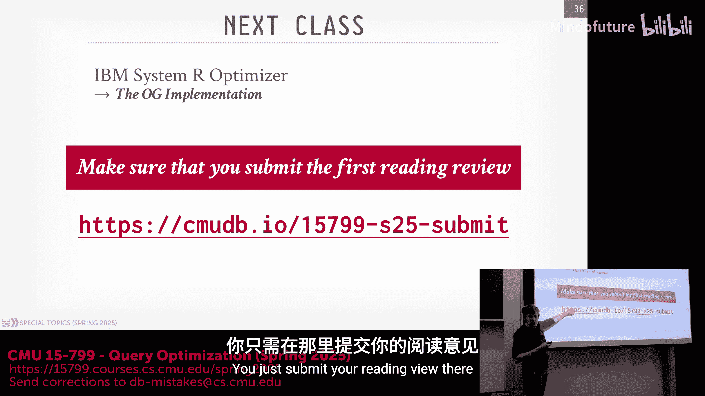
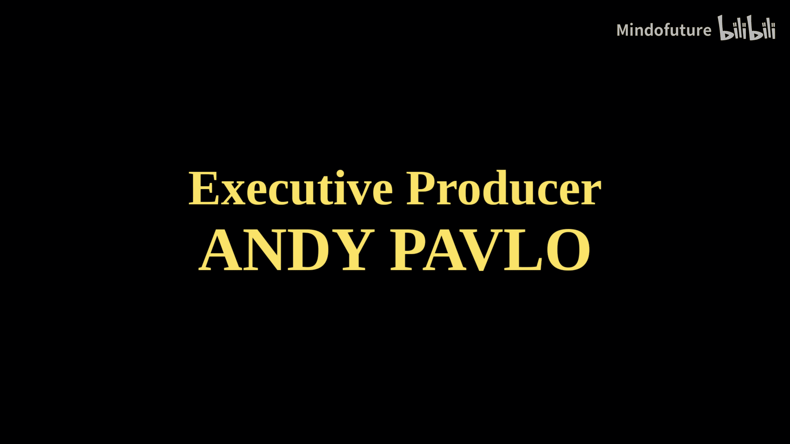

# 【卡内基梅隆---中英】数据库专题：查询优化-CMU-15-799--(2025-年春季)-p01-P01-#01---SQL-Optimization-Background-(CMU-Optimize!)--BV1wDE9z9EfK_p1-

あ。🎼おって見せ。🎼A journey drove that Taas carry up the message。

This course is filmed on location at Carmicgie Mellon University in front of a life studio audiences。

🎼哎呀老本听会。And so todays this semester's topic is immuno be query optimization so instead of teaching 721。

 which if you have the architecture of database systems。

 this is really about how to build a query optimizer which I would argue is going to be the most important part of a database system So the goal of this of the semester is that you're gonna to learn the modern practices and the ways to actually go ahead and implement database query optimizer and the goal for you guys that the outcome would be that like okay you could sit down from scratch if you really wanted to you were crazy and you could build a query optimizer from scratch or modify an existing one and as part of that since doing databases is very important to make sure that the codeVId writing is obviously correct because it doesn't help us if our queries run fast but it produces the wrong answer and as part of that we're also going to do a lot of work and documentation and testing these are soft skills you need to have in system development。

So this semester we're going to cover both the foundational materials for inquiry optimizers。

 so next class we're going to cover the OG， the original query optimizer paper from 1979 from IBM。

 but then as we go along we'll build upon those foundations and start talking about the modern practice modernmaticians。

😡，All right， so。You're already here， so I mean they don't need to convince you。

 but why should you take this course？😡，There's more databases than ever。

 there's more money in databases than ever you know Larry Elsson just became the third richest person in the world and he bought a quarterback from University of Michigan for $12 million which is like a fraction of his net worth right so a lot of money in databases everybody has database problems humans are not humans are not scalable and the query optimization is going to be the key thing that's going to separate one system versus another like we'll talk about snowflake and another systems throughout the semester but the basic architecture of snowflake was invented in 2013 and pretty much every database system that does analytics is predicated on that same architecture。

😡，We covered a lot of these key things in the interclass last semester。

 So the thing that's really to set make one system better than another is to be the query optimizer right If you can't generate a good query plan to run the most efficient way。

 then who cares how fast your engine is if it's going to do the stupidest thing。

RightSo for my perspective in research， the problem is very， very hard。

 I'm going keep saying this throughout the entire semester query optimization is an unsolved problem and I find it really fascinating because I don't know anything about it and in industry again。

 people will pay you a lot of money you can do this well the one thing as I've at CMU for almost is 10 years now or 10 years now when the data is coming to email me。

 they always say， oh yeah， by the way， do you have anybody any student that's working with career optimization because it's really hard to find people with experience that work on these things。

So again， I realized this is 799 I'm not 721， but I just want to show you here's some of the photos of the students have taken 721 and 799 over the years and all the various places that they've ended up and actually' say his name but this person here he's still here and he's going to a new new database called SDB right So again we cover databs will cover Oracle will cover and snowflake and so like all these people have query Op problems and all these people are basically running query optimize from scratch and want people would work on this stuff。

So the background you can need for this course is I'm assume that you've taken an introduction to database systems。

 keyword there is in systems， not just like I've seen other schools。

 database classes are not very good， but if you've taken 1545， 645 or a one that's similar。

 then you would have a subsequent background， so we're going to plow right ahead。

 start talking about SQL relation algebra system implementation storage models， processing models。

 all the things we covered in the inter class， we're going to assume you already know these things we're not take time out to explain them。

So this is also not an ML course， so occasionally as we go along there'll be algorithm will be ML techniques we won't be anything in LLM so I don't think that's still a little early for that but there'll be some techniques only based on using machine learning so we're not going to cover anything like hey here's like the machine learning algorithm they're using this and explain improvement that actually why it works right we just use whatever works if it makes our datas go faster then that's all we care about right？

😡，So I've posted this right before class today， the course website is up。

 it's not complete but the syllabus is there， so all the things we'll cover in the logistics discussion right now。

 all that's available on the course webpage and then of course I'm going to say this multiple times right？

😡，CMU makes a big deal about academicmic honesty。 I make a big deal。

 So please make sure you follow the policies， including for AI， using AI for certain things。

 as we'll cover。 And if you're not sure whether something is okay to do， please just email me。

Because I'd rather have a discussion like， hey that's a good idea that's crazy。

 don't do that then doing something stupid and we have to report you later。All right。

 my office hours will be on Wednesdays after class are 330 in my office or if you can't make that by appointment。

 and then we can talk about whatever you want related to the class just how to get database jobs。

 you know the projects that you're working on， I can talk offline about what's going with Mushu in Chicago。

 I don't want see anything publicly here，'s still not good。

 but anyway if you want to tell what they saying come to my office hours。

We have one TA for the course over there， Wan Shan Lim。

 he's the number one ranked database student at Carnegie Mel University das PG student。

 he is smarter than I am， doesn't know yet he'll graduate and then figure it out he's also a certified chicken farmer so if you have any questions about chickens。

He hates chickens the passion， by the way， so Wayne's helping throughout this semester and he'll post his office hours and he'll be posting on Piazza as well。

 okay。All right so the breakdown for your grade is going to be combination in the following。

 so it's to me you're reading having course， so we'll cover in the second but look every class there'll be a reading assignment and for some classes alone as it's not the textbook。

 which we'll cover in a second， you'll have to write a review for this and the standard of like here's the overview of what the paper is about。

 three good ideas， three bad ideas and then what workload are the using the guide with。

We also have going assign everyone to do write lecture notes for every class except for this one and when we do presentations so the idea is I'll post a spreadsheet。

 put your Android ID and a date if you want to swap， I don't care。

 I'm just going to to randomly assign things The idea is that you would take condsense down the discussion we have in the notes or sorry in the lectures and condense it down into symmetry to the notes we had in 445 there'll be two projects are cover a second and there'll be a final exam the last day of class。

Again， so the read assignmentigns that when we post the schedule tonight you'll see that for every single lecture there'll being a list of readings and then one to be marked with this sort of Cr icon and that's the primary reading that's the one obviously going to cover in the lecture and focus on but if you want to go beyond what the signed reading is there'll be additional papers as well so you' have to write a synopsis you got to submit it before class starts there'll be a Google form at this URL there'll be active tonight and you select the date just copy and paste the text field or you' write up and put it in there you're allowed to miss one review per semester and then the system will keep track of that and then anytime we do an assignment signed reading for this textbook that I post on Piazza from Microsoft for this one it's basically the survey of existing techniques not really proposing new ideas so it doesn't really make sense to do pros and cons of what they're talking about。

Now， I didn didn't mention this too much on Piazza。

 but the reason why this book is a big deal is because。😡，For years。

 Microsoft has always sort of had what is considered an industry， the best query optimizer。

That's at least widely used the Germans have an umbr is also very。

 very good and we read a lot of paper from the Germans as well like the Germans approach is going to be a bottoms up we'll cover in a second the Microsoft one is top down and there hasn't been a good explanation of how to do a top down career optimization until that book came out in December。

m and then you know normally get have to pay for the book。

 but I guess Microsoft bought it who gives it away for free so you can download it without paying them which is fantastic right Microsoft has enough money。

😡，So again， you use this Google form and then you submit it review and the first review will start on Wednesday's class。

😡，And again， please use your own writing， especially for the paper going to read next class it's from 1979 it's a very。

 very famous paper， there's a ton of write ups about it， please don't copy and paste。

 write things in your own words right this is an upper levell class you get the most out of it by doing the reading yourselfelves and doing the writing yourself trying to cheat through me cheat on these things is really cheating yourself。

😡，哎。So again， we'll have to follow this senior academic policy for academic integrity。

The lecture notes， as I said， again， every student will be assigned at least one lecture and then the idea is that you just watch the video or you pay into a class and understand the papers。

 at least covered and you just to den down what was talked about in the class and this meant for both you in your understanding of the course for the other students taking them in the class and then you put things out the internet for free。

 people can follow along and follow the notes as well。😡，So for this one。

 if you want to take the the the。The transcript of the lecture and throw that through ChaGPT and have it summarize it by all means do that that's great fantastic right So when you do that just when you submit the pull request on GiHub you say like this is how I did that so others shouldn' sayy hey how do I do what you did to summarize this they can follow your steps And again this is it's gonna out with your name on it so if ChattPT starts hallucinating and says Andy and helped it invade Germany in 1943 or something crazy like that but't you're responsible for that so don make sure you pay attention what's that 44 yes thank you off by one。

😊，The final exam will be a long term examination， and that's gonna be in class rather than the take home we did before。

 And I'll post more details of what this be about。 But basically， it'll be a。

Not so much as you regurgitating ideas about all the things we talked about throughout the entire semester。

 but it's a way to sort of synthesize the thoughts and different topics we've talked about and apply it to new settings。

😡，And that's best being done as an essay rather than long form questions rather than multiple choice。

That'll be in the last day of class。So there's two projects as well。

 so the first one we'll open this online next week but the idea is that you'll start playing around with an existing query optimizer as a service Cal siteite is probably going to be the one we're going to target because this iss the most popular one。

 there's not any。😡，Giving you an idea how hard this is。

 like there's not very many query optimizers as a services out there， right there's three， maybe。

And one of was written in 191998。 so the idea is that we'll give you a bunch of queries。

 give you a bunch of steps and rules and you start play around this and see whether you can make queries run faster in inductDB。

 Yes D plus plus sorry plus plus。It's from Miss Carl。It doesn't compile more exact income。 Yeah。

 say his question is like what's the third one。 So there's there's calcite from Apache that's probably the most widely used one。

 There's orca from Green plum that's only used by green plum。

 I don't know anybody else that uses that。 And then plus plus is out of。In University of Wisconsin。

 was somebody's it was Jgnesssha's office made PC thesis。

There might be another one that I thank you about。对。

Yeah again the idea here just to get you understand what kind of transformations you can do。

 what the experiences are using something like calcite and this will be done individually and the goal is like have it。

You playve with Calalcite， try to give it to optimize a query that does as good or better than the DBs query optimizeimizing。

😡，They don't give you crap actually pretty good too。

And the last project or Project two will be about a half a semester long a sort of a larger project with a group of people and this somewhere are open endeded like you propose something because it's upper level graduate course you propose something you want to work on within reason within the scope of the class and then the idea is that everybody works in these things and you present it and there'll be a status update so you would propose what you want to work on after the spring break。

 do a status update a month later and then whenever our allotted time for the final exam during exams week or finals week that'll be when we actually do the final presentations and then if it's in the morning we'll get bagels if it's in the afternoon we'll get pizza but everybody gets a dig for sure。

That's my guarantee。Okay， and again， so please don't plagiarize。

 I post this because if anything comes up， I pointed the video when we go talk to Warner Hall and here's proof that I told you guys not to plagiarize okay。

right any questions about the projects， reading assignments or the note taking or the final exam。Yes。

The question is what sorry？透干嘛的。Can you copy sourcea from other projects？Yeah。

 it depends what you're doing right like yes。Like if someone has a string copy function。

 you want to use that， sure I don't care。again， within reason。

this is EM you you're all very smart so like if you come to me and say hey look here's my query appr as a server it's called malcite right and it's clearly copied from calcite then don't do that right but if you use bits and pieces of calcite and extended to do something interesting that's fill up into the class absolutely go ahead right。

😡，Any other questions？I mean， there's a chair here。It's not as fancy as the other ones。这个个哎。

All right and the last quick money I want to give to is that for the last two years in the exact same week。

 the end of March， beginning of April， my daughter brings home my biological daughter brings home a stomach virus from the CM preschool and I've gotten diarrhea almost exactly the same time every year And so this is probably gonna happen again So I want to tell everyone a warning like like I may have to cancel class at the end of March。

 not because I want to because is awful right So if that happens we' just the lecture schedule。

 maybe we drop the Microsoft one， but like all the due dates for the projects and the reading assignments and all that'll still be the same and I can't not stress this enough if you want to do databases do not have children before you graduate it is。

It's expensive and time consuming， it's at least 30 hours a week。All right。

 so the other thing we're going to do this semester going beyond the course is that were to run a new seminar series starting in beginning of February on query optimization and alternatives to SQL。

😡，So SQL' has been around since 1974， there's been many attempts to kill it off or replace with something else。

 all of them have failed， people are trying again now。

 Google has a paper came out last year called PipeSQL where they tend a SQL to include pipes。

 the Germans have a replacement for SQL， Google has one another one for I think it's called Meloy。

 where there's a bunch of these things their replacers to SQL or either or they pile down into SQL。

 so we're going to have a combination of those guys giving talks as well as data vendorers come and talk about their pre-opomizerers。

😡，I think Maria Deby is putting on a new career optimizer and they want to give a talk about this as well so well you know this is optional but if you we want to go beyond the stuff we talk about in the course。

 obviously anything that's presented in one of these presentations when these seminar talks wouldn't be on the final exam or anything like that this is just exposing you to more of what is happening in industry okay。

😡，And we'll post details about later so the last thing I want also say too is if you took 445， 645。

 there's a lecture on query optimization and I preface that lecture by saying that query optimization is the part of database systems that I feel like I know the least about and actually theres。

It's one of the two parts The first one is incremental view maintenance。

 You have like a materialized view。 how do you apply an update to a base table and not have to recoute the entire view I know roughly how to do that。

 but I don't know all the corner cases and I wouldnt not say I wouldn't know how to sit down a better from scratch but queer optimization is the other one that I know the least about because as we go along it's gonna be it's very。

 very difficult and very challenging So if you find error in the lectures either call me out as I'm talking or if you're watching this later on YouTube and you find a mistake there's a email there that'll go to me if you find a mistakes let me know and we'll correct it okay。

😡，All right， so that said， let's get into a quick introduction to what the course material is going to be。

 the course is going to be about， and then that'll segue us into next class when we actually talk about early implementation of query optimizes and then we'll build upon that to see more complex approaches。

😡，So be sort of obvious anyone again， who's taken a data class we need to do why we need a query a。

 why we need careerpt。😡，So query languages like SQL are declarative。

 meaning the application of the user is telling the database system what answer they want to get return or what answer they want the data system to compute on their data。

😡，And they don't specify anything about how they actually want to。

How to actually go ahead and compute it。Right so like a procedural query would be hey run you here's my for loop and then here's my if calls for my filter that would be telling exactly the algorithm you want the data system to use execute that query so instead in a decative language LiveSQL。

 you just say hey， I want this answer I don't know you care but you're not really you care in the y because obviously if it's crappy it's slow。

 but like you're not saying I want this thing to be done exactly this way。

 you're just saying here's my query， please go execute it in the most efficient way that you think is possible。

😡，And so the magic of a database systems， a relational database systems that support SQL is that they're going to try to find a correct execution plan for your given query。

😡，potentially without any prior knowledge about you know having seen this query before。

 and it's going to try to find the one that has the best cost。

Now costst is going to be something relative that we'll discuss through the semester。

 but the key thing Coer is going to be correct， like who cares if our query reads from Devb Bellll and produces no results。

 it's to me super fast， but obviously it's going to be wrong。😡。

So we want to understand the semantics of what queries actually are trying to do as specify through SQL and then try to find the best alternative choice for running the query in a efficient way。

😡，So this is basically like this sentence here， this is what this course is entirely about。

 how to do this。😡，And do this quickly and do this efficiently and obviously do this correctly。

So the cost IO again we'll cover this in a second， but it's not going to be something that's tied to the real world typically。

 it's not going to be like a wall clock time or a number of seconds。

 it's going to be some internal metric that a system is going to use。

 that's going to be a proxy for saying this query plan is more efficient than another。😡。

But take say we take this query and we want to talk about what the query monitor can actually start doing to improve performance and why。

😡，h， why you want to create to figure these things out for you because the performance gains you can get are actually quite significant。

So to say that we have two tables in our database， we have departments and employees and we're trying to find all the distinct employee needs。

 names of employees that are working in the toy department。

 so in our catalog we'll keep track of what indexes we have。

 whether they're clustered or uncllustered and a rough approximation for the number of records we have and how many pages we have。

We'll also see later on that there actually can be additional metadata or summars of what's in these tables or what's in our database that we're going to use to trying to figure out the cardinality estimations or selectivity of prediicates so not just keeping track of I have 500 records。

 we're also going to keep track of like okay for these four attributes。

Here's the distribution of values that I have， like in a histogram or something like that。

So if we take a naive or almost a literal translation of the SQL query that we're given and convert it into a relational algebra plan。

 a relation algebra tree， we would end up something like this right at the bottom we have our scans on employees in department and then we're doing our Cartesian product on them。

 which is the worst thing we're going to do， but in base relation algebra， that' that's what。😡。

That's what you do right and we want to fix that later on so say we have some basic numbers we're using from our catalog right that we're going to do 50 plus 50。

000 reads and then we're going to write out a million rights。

 do a million rights out the disk to do a temp file assuming that's the match after the Cartesian product then in the next stage we're going to read all those rights back in。

 and then do our filter or to do the join， write that back out。

 then do another filter and department name， write that out and then do our final projection for our final result。

😡，Right， so again。In this case here， for this sort an is like exact or little translation of the SQL query into relation algebra。

 for this example here for this database， this query would produce or take two million IOs。

And say IOs is going to be our cost metric to determine whether one query plan is a better than another or what the cost next student query is right how much diskIO did I do？

😡，Well， there's bunch optimization we can do since we know how to speed things up from the intra database class。

 we know that we never want to do a cartesian product instead we want to do an inter joinin。

And you're basically pushing down the filter to match from one table to another inside of the joint operator。

😡，And now we can also be smart and say， oh， we're going to do a pageness a loop or blockness a loop join。

😡，And then that reduces the amount of we don't read the data in。

 but now it reduces the number of rights down to 2000。

Then we do our additional filter and then our projection。 and now we got it down to 54000 iOs。

So the query optimizer's job to recognize going back here that。This carteia product is a bad idea。

 it's going to be slow， and so go ahead and substitute it with an inner join。😡，And then again。

 it produces the same result， so it's semantically equivalent， but it's much， much more efficient。😡。

But there's other optimization we can do， right？down here。

 we spent so much time talking about the different join algorithms in the interclass。Well。

 we know that a page S loop joint may not be the most efficient thing。 Instead。

 maybe you want to do a short joint。Right。And now we go down to 554，00 IOs to about 007100 IOs。Again。

 but just swapping the joint algorithm we used。For that inner join from one algorithm to another。

 essentially we're changing with the physical operator we're using to executeude the join。😡。

We reduced the IO quite significantly。And again， we can go further this we can do additional optimizations。

 say in this case here we were using the materialization query processing model。

 so at every single stage we're letting the operator run to entirety。

 writing out all its output to a file， and then when that operator is complete。

 then we move on to the next one。😡，so this is the worst case scenario for some queries because we're not doing any pipelineing at all。

 we're executing one operator after another just writing everything out。😡，Well。

 if we switch this to a vectorization model， then we can take advantage of pipelining where now we don't have to write things out the disk。

 we just pass a vector of tuples going up and now weve reduced our IO by half。😡。

Now in most of these systems you' not the Cot browser is not going say oh。

 I'm going use a materialilization model to switch it to vectorization。

 but it was showing you that like again， if you change what physical operator you're using or the overall strategy of how you can actually these query plans and something the optimizer can figure out for you。

 you can get a pretty significant reduction in IOs。Again， there's more we can do。😡，Well。

 when we talked about joint algorithms， we made a big deal deciding what was going to be at the inner table versus the outer table。

😡，So we could swap these and that might change things and then of course we have this filter up here on the department name that we're doing after we join。

We know that's inefficient or wasteful because now we're joining all pupils in employees and the department。

 and then we just filled out the ones that are in the toy department。😡，But if we push down that。

If we push down the filter below the join now reduces the or joins we have to do because the or join two we have to consider。

 the joins always mean the most sense thing。So if we just again swap the order of this。

 move that down。😡，Right， and then， then run a cray plan。RightNow we're getting it to about 37 IOs。

 So we went from 2 million from the naive， the naive case， down to 37。

This is why pre optimizes are super important， and this is a trivial example。

 like you could write some ifN else rules to figure this out。

 but when you start having dozens of tables or even hundreds of tables，😡，And you know。

 with CTEs and nest queries and all these other nasty things you can do in SQL。

 then this becomes really hard to do。try and to figure out how to move things around。

Without producing incorrect correctrect results。So the overall architecture。

 the thing that we care about in our Navy system or the pipeline of how queer is going to come to us and what we're going to do this semester。

 is that seG and our application is running some user code， JavaScript， PhP， Python doesn't matter。😡。

They're going to send us a SQL query。😡，First thing that's going to hit in the database system is the parser。

And this is going to be looking at the grammar of the SQL dialect that's supporting。

 and it's going to break up the SQL query into tokens and usually represented it as an abstract section dragt。

But it literally is just the string tokens like select from table and like so forth。

So now in the next phase， we take that abstract syntax tree。

 we pass this into what's called the binder。Sometimes called ther but and this is the thing that they're responsible for looking at the tokens in the abstract syntry and then mapping them to actual database objects so like for a given name of a table。

 what's an internal identifier or object ID that tells me here's the actual table that they're referring to or if they're referring to a table that doesn't exist the binder to throw an at。

So every database system is going to maintain this thing what we'll call the system catalog。

 or catalog， it's the database about the databases， the metadata about what tables you have。

 what column they have， what their types are， any additional views。

 whether they're materialized or virtual views， triggers and all additional things when you call createate something in your database。

 it lands in the system catalog。😡，And the binder is going to produce what now a logical plan。

 it's almost like almost an exact translation of the sort of annotated syntax tree of and converting it to like a relational algebra version of it but it doesn't say exactly how to executeude anything it just says I have these table I want to scan it I'm not saying how to scan it I'm just saying I want to scan it I want to join those two tables。

 I'm not saying how to join them I do want to join them that's the logical plan that then goes into our query Opr。

Who can then also leverage information that's in the catalog for like what the schema looks like。

Um to make decisions about how to you know， whether uh join one table a certain way versus another or how to scan a table。

And then there this other thing we'll call a cost model。

 and typically it's embedded inside the optimizer， not always a standal component。

 but this thing is responsible for getting the statistical information about what's in your database。

 like how many tus you have， what the distribution of values look like。😡。

Using some internal formulas to then figure out for given operations or operators that are in your query plan。

 what's the expected cost of them？😡，And being vague what cost is。

 but we saw an example over just before about re' using IOs。😡。

They determined whether one query plan was better than another。

The optimizer then crunches on this for a while， and then it spits out a physical plan。Again。

 that's defining exactly how to execute the query。And then it goes off and gets executed。Right。

So the thing we care about this semester is this piece， the optimizer， the cost model。

 and the cost model。😡，You know the binder just sort of engineering， not it's boring code。

 but it's important， but just don't really do any optimizations there。

 and then you know we can talk a little about how to get the schema information and statistical information in the catalog。

😡，Again， just repeat what I just said， but like the idea is that we're going to take a logical query plan that's going to come from the binder。

😡，And then we want to convert this into a physical execution plan。😡，And our optimizer。

 we want to design it such that we can consider a large space of possible query plans we can execute that are semantically equivalent to the logical plan we were originally given。

😡，And then we want to be able to have a cost model that can determine whether one plan is better than another。

without actually having to run it。😡，Because obviously， if you could run。

 you want to know whether our query plan is fast and you have to run it。😡。

And that defeats the whole purpose of trying to figure out what's fast before you run it。

Now there'll be one query optimizationizer we'll cover it the end of the semester that does actually just go aheads and runs it。

😡，I say guess what it is， yes， it is Mga be。So what they do is basically say。

 all right I don't know what they do just run them all whenever comes back。

 that's one they pick next time。哎。And the paper just came out in December that the number one researcher in Australia said it to me they just wrote it。

 and lo and behold， it doesn't actually work。In Mongotyb， but we'll cover that later on。

Because they don't have a como， they don't have a career appr。All right， so again。

 the idea is that we want to be able to determine whether one query plan is better than another。

 but actually I'm going to run it and then we want to be on efficientlyicly search the solution space of possible plans we can have to narrow down a land on the one that has the lowest calls and then we have a bunch of different ways we can do this。

😡，That will cover throughout the semester。 and some of the cool things you can also do is like。

Reuse information you've seen from running other queries and help you make better decisions in the future。

 or instead of generating a new query pump from scratch， like all at once。

 maybe use bits and pieces of other query plans that've run before and you stitch them together to make a better query plan。

😡，Right and the fascinating thing about all this is that again， through SQL because it's declarative。

 you can just keep refactoring， improving your query optimizer making it better and better and they don't have to go change into their application code because it's just SQL。

 they upgrade to a new version， ideally the query plans get even better。😡。

Doesn't always happen and we'll talk about how to handle that but like again。

 instead of having to say， oh， here's this new API for your procedural query plan。

 you have to call it， you want to get all the new improvements of our new data system。

 the query engine， the SQL the query App is going to do that all for you without changing application code。

That's a very powerful idea。And it wasn't obvious in the early days of the database in the 1970s that you could actually do this。

O。And we've already covered this before， I just want to say it again。

 we're make a big deal about logical query plans and logical operators and physical operators。

The logical is a way to express at a high level what you actually want to do like I want to join table A and table B。

 but you're not specifying what actually joint algorithm you want to use。

 whereas the physical operator actually specifies what algorithm you want to use because the data system has to actually support it and actually run it for you。

😡，Right。And the。We'll see how we do all these transformations。

 we'll spend a whole class on doing transformations。

 we'll be able to go from logical to logical operators， sometimes like join A and B。

 bilogical operator， we can convert that to join B， join BA。😡，It's a logical logical transformation。

 but then you can also go from logical to physical， so join AB would be a logical operator。

 but then hash join AB would be the physical operator。😡，And you don't go back the other way。

 so you can go logical， logical， logical， physical。

 but you wouldn't go physical back to logical because basically you're losing all the information you've gained from deciding how to join it。

We'll also see this too， there there't always be a one to one mapping between logical and physical。

 meaning if I have a logical operator， I may actually break it up into two physical or two or more physical operators。

 or I may have multiple logical operators and I may call less them into a single physical operator。😡。

If I want to do a。Join， join a table and then do an orderbi on it。

 well if I do it a certain merge join， I can take the logical orderbi the logical join and condense that into a single physical merge join。

So again， we'll see one of these transmission tricks as we go along。

So this is the rough outline of what we're going to cover throughout the semester。

 so we're going to spend the first quarter to third of the course talking about the actual implementation of the query optimizeizer。

 like the search algorithms we're going to use to enumerate different query plans and build up the plan to produce something we can actually execute and the different kind of rules we can apply to change things。

 they we talk about how to make this parallel and these things run the search for a single query across multiple nodes or multiple cores or even multiple nodes。

😡，Then we'll talk about how we rely on the statistics to summarize what that's in our data and use that to make estimations about how many two bullets an operators is going to produce because that's oftentimes going to be the thing we care about the most。

 because I want to do the most selective joins at the bottom of the quaground as soon as possible rather than later because it produces as much of was of work。

😡，The LLC also do the tricky problem how to handle parameterization。

 meaning what if I have a query where instead of having actual constant values like like ID equals one。

 two， three， I have ID equals。Dollar sign one， because that's an input parameter something's going to give me later on。

 how do I do query planning on that if I don't have the full query yet？😡，RightThat's hard。

Then we'll see how to take feedback from when queries runs and feed that back into the system and improve additional query optimization。

 how to actually also then adapt queries while they're running or while we're doing planning。

 if we see multiple iterations of the same query， how we adapt that to go better and then the end of the semester we'll spend time reading papers from actual real world implications of query apps there's not just the Microsoft book will cover what Microsoft does or we' re OrRCca。

 Calalcite there's another Microsoft one and then MSQL single store and MongoDb。Okay。So again。

 the next class and we're going to really start hammering on this。

 because this is going to be sort of set up everything we need to know about how we want to actually build the preup。

😡，And at a high level， there's basically two approaches。😡。

First is just to use heuristics of rules and just sort of like hard coded if thenL statements。

 if you will， that say， if I see this pattern in my query plan，😡，Go ahead and this transformation。

Like if I have my Cartesian product and then a join clause in a filter above it。

 I could have an ifN else clause that says if I see that pattern just collapse that down into an inner join。

Same operator， right？And so some database systems and lot of when you see a first database system coming out。

 this is probably all they're going to have。😡，Right because the bill。

 this one is very tricky that's why this whole course exists， like like to do this。

 this will maybe get you up and running very quickly。

 but obviously in long term this is going to be a problem that。Right。This is what Oracle did。

 No offense。 This is what Oracle did for almost 20 years。 right。

 They didn't have a cost base search until like the early 90s。

And what they would say is oh you know we have what call a semantic optimizer so they couldn't figure out the join order of tables an a query based on costs。

 they just said， oh， it's the order that they showed up in the SQL string。

 that's the order we're gonna to pick and they call that in the semantic optimizeizer and they somehow Larry Elsson said that was better it was all B but they eventually did this and theres is much better now but like when most systems get first built the first time this is all they have。

😡，All the No SQL guys from the last decade， they made a big deal not supporting SQL。

A lot of it because they didn didn' want to theyt want to build this thing。

 They didn't want to have a query optimizer。 They just said， okay。

 I'll give you a really simple a query API where you tell me exactly what you want me to go look up and how to get it。

Right。And then after the fact theyve all the SQL systems， including Mongo， have since added SQL。

 and they've had to build something like this。Sorry。

 they had built something like this except for again from Mongo， but we'll cover that later。

So this the idea is here is like you do some initial transformations that are quick and easy to do and it's either if the system only has a herest optimizer then that's it that's all you get like here's my query plan going run it like this is the optimizer in other systems they'll do this to help prune out things you know they're going be useless in this like I'm almost always going to want to do a predicate pushdown So why do an expensive search transformation for this in costbased search just do it as a quick fNL statement apply the rule and then go ahead and then do the search。

😡，So the cost may search again is something like。Again like a think of like a classic search algorithm that's going to try to find something with a minimal cost and it you know ways of prune past and branches if you know things are not going to be helpful or not right so the idea is that we're going spend a lot of time how to do this efficiently we。

We also want to understand how to do this， because if you do this correctly。

 then it makes this go faster。Posgres does a combination of both but there's really hacky because there's a bunch of ifNL statements that make you have to make sure that the query plans end up in the right form before you feed it into this and then after you do this then there's a bunch of if thisNL statements to fix the query plan to put it back in the form they can actually execute it。

😡，The Postgre query avenue for much of the little Postgres， it's not a good implementation。

And we'll cover that later。The two big things that we're going to care about in the Ti semester。

 and you'll see this already on the schedule is this dichotomy between top down versus bottom up search algorithms or optimization implementation。

😡，So bottom up implementation optimization would be you start with nothing in your query plan。😡。

And you start literallyly adding physical operators to it to get you to your end goal or the final result that you would want for the query。

😡，So if I'm joining ABC， I would start with not joining any of them all and then figure out whether I want to join AB first or BC first or whatever。

 and then once I figure out that level， then I go to the next one and add add the next joint operator I would need。

😡，You're sort of building things up as you go along。

The other approach is can be top down optimization and with this one is you start with the outcome that you want like here's my final result of joining AB and C and then you now traverse down and do transformations to add back in the operators you need to get to that result that you want。

😡，They realized me standing here in front of a PowerPoint slide and making hand gestures that don't mean anything。

 this make more sense next class， but this is going to be the big thing I're going to spend this time during the semester because。

😡，The the Germans and the IVM paper to be next class and a lot of other systems are going to do this approach。

 The Microsoft book and some few other systems like like Orca are going to do this one。

And the guy that invented this one， think volcano cascades。

 he said if he had to do it all over again， you start with this， and then you do this。

You actually want both。😡，So we'll spend a lot of time talking about what this means and what are the implications for the efficiency of the algorithm。

 how to do costing， and the complexity of the different approaches。😡，That's again， going back here。

 so the paper you're going to be in that class will be the bottoms up approach。

 dynamic programming or the vote dynamic programming will be bottoms up approach。

 is the original one from IBM。😡，Then after that， we'll read Starburst。

 which is the fall work from IBM that built upon the system R optimizer。

We also need to understand what the objective function is for our query optimization like we sort of showed IOs that's usually a good proxy or a placeholder for something that's going to correspond to response time or latency of a query。

 but not always and so there's bunch of different things we have to consider when in some systems where you could ideally plug and say I want to minimize this or want to maximize this objective function that metric and the search algorithm essentially is the same but now you have a different calculation to determine whether making the query plan better or not as you do transformations as you do the evaluation of different options that are out there。

😡，And as I said before， we can't just go ahead and run the query， something Mongo does。

 like you can't just go run the query， see whether it's a good idea or not。

 because if you're considering thousands or tens of thousands of query plans，😡。

And the queries could take seconds or minutes to run， this is just not feasible。😡。

So if we're going to rely on a cost model that's going to use help us determine whether we think one query plan is better than another。

😡，And it'll come out to being like a single number。

 where we can say is this number less than this or this number to determine whether one's better than another？

😡，But we can't take any calculation or per estimate we get from our cost model from our database system and then apply that to another system。

 So Postgs has its own cost model。 It produces a number to say this is the expected cost of a query。

 I can't take that number and go compared against MyQl's number because it can be completely different。

😡，It's just internally for us to determine whether one's better than another。

And then we'll see some examples later on where in some systems they'll keep the best query plan and the second best query plan。

And then for their own internal testing， they'll run both of them。

Multle times and see whether the cost model is actually accurate or not。

If your cost model says is one great plan better than another。

 when you actually run it in the real system， ideally you want to know that's actually true。

So we'll talk a little bit about how to test that and figure that out。All right。

 the last thing I want to talk about is just somebody came back in your mind。

 but we're not going to touch too much on this during the semester is that。

And all my examples so far， and most of the papers。

 almost all the papers are going to read this semester。

 it's all about optimizing a single query now you may。😡。

See that same query multiple times over and over again。

 and there's some optimizations or we can leverage the knowledge we gain from one iteration that query to the next。

😡，But in general， the automation search algorithm is looking at one query。😡。

And you assume that it's running isolation of other queries， not always true。

 but that's typically how these things work， right？

There is a line of research done what's called multi queryit optimization or MQO。

 where you're given a batch of queries that you know if the application is going to want to execute at the same time。

 either simultaneously or one after another， and the goal here is to then figure out， okay。

 what is the globally optimal query plan for all the queries that's going to have the lowest cost for me and giving me the best performance？

😡，And depending on the execution model of the queries。

 meaning are they running simultaneously or one after another。

 in some cases you actually could combine the queries。

Instead of running two separate queries that run the schemes scan on the same table。

 just do one query。And the data could then split out the results according to who actually needs them。

 so you can do like result sharing and scanning or scan sharing as well。

So this is way more complicated， obviously the search base is way larger。😡，As far as I know。

 no commercial system actually does this。 This is only in， in research。

But it doesn't mean like you know doesn't always have to be the case so this might be like a Project two idea like we could play around some ideas about like actually how to apply calcide or orca our own system to solve this。

而。All right， so this is really all I want to cover for today。

 Hopefully I keep saying this over and over again that this is。This is super， super hard。

 it's proven to be Encompte for the overall query plan， I think choosing Jo owner is NP hard， right。

My one example before where I showed like if I picked the worst query plan。

 I was doing two million IOs and I picked the best query plan， I think it was down to 37。

That's actually super common in the real world where like if you get the joint owner， correct？

Like we're talking orders of magnitude faster， like 10，000，100。

00 x faster if you get the joint owner correct。Now obviously， if you get it wrong。

 then you pay the pen， queries can take days。Well， that's common in the modern era。

 but in the old days and even in the 200s， it's not uncommon like queries would take a week to run。

Before column stores， right， so picking getting the right query plan。

 the best query plan is super important。Despite the name being a query optimizer and the course of being about query optimization。

 we're almost never going to find the optimal plan。😡，It's just certain impossible。And in some cases。

 in like Lakehouse systems or in the cloud， you may not have any statistics for your data because you've never seen the data before。

 like someone who plopped a bunch of parquet files or CSVs in S3， you don't know what's in them。

 but they're asking to run queries on them， how do you do query planning in that world？

And that's where the addivity stuff that we'll see later on can help mitigate like I'll make a good best effort。

 but if I get it wrong maybe I'll try to adjust myself as I run or have triggers in my query plan that the optimizers can put in place to say if I'm assuming the data looks like this。

 if it doesn't look at this， break out and let me know so we can run the optimizer again。😡，Again。

 we're almost never going to be able to find the optimal plan。

 and so we're going to have to use a bunch of techniques that we will cover that semester to try to guess what the real plan cost is and then try to minimize the amount of compute time we're spending in a search。

😡，Okay。😊，Any questions？Yes。Way back up， he said the cascades guy。

 He he wanted to pop down first and then borrow him up。He， what you mean by that So his question is。

And go back。And that let to work， Okay， go back here。

Not next class next class system are next next class next week， Wednesday， because Monday we're off。

 that'll be starbursst。 And then the following week。

 we're gonna read the volcano paper and the cascades paper。

 And so the the same dude this guy Gertz Gry invented both of them。 So when so in 2000。😊，18。

 he won the Test Time Award at Sigma。And he got on stage and mean he's done so many things。

 it's hard to cover everything， but he was talking about how， he invented a cascades。

 he got hired by Microsoft to go implement cascades and SQL server， and he basically said。

 if I had to do it all over again， he would start with cascades to do the initial transformations of the query plan。

But everything except for join order。Then when you want to do join order， you do the German style。

 the hyper style dynamic programming， which we'll cover with the hypergrass later on。

 you do that just to depict pick the join order。都不知可应该。Yeah， the joint ordering algorithm。

Doing more background on them。第。I like the cascades approach and you'll see this in the Microsoft paper because me it logically makes sense that you can define these rules that it's a single unified search base that just kind of throw all the rules in。

 you have a way to set priorities to explore certain parts of the query plan or do certain transformations earlier rather than later to try to converge to a optimal query plan as quickly as possible So I like that model。

 but it is at least my understanding is it's inefficient to your join ordering because you're kind of doing the same。

You're kind of doing the same transformation over again and the search base explodes。

In the case of the joint ordering algorithm we'll see from the Germans。

 it's just doing joint ordering。 So you've already done the transformations to do Preica push and and all the the things that get it roughly into the right shape you want where you know that there's rules that you always want to apply。

 then they kick off the。😡，Then they kick off the Jo search algorithm that's doing a bottoms up approach。

 and that's like super efficient。But we'll see we'll see we'll read that paper。

 we'll read the following paper they have with this。

 and then there's a a rough the I'm not saying it's as good as the German load。

 but there's a top down approach due joint ordering that we'll cover as well。

That goes beyond cascades I say also say tune the cascades paper I'm not going to have you guys read it。

 this is why the Microsoft textbook is a big deal because this paper is useless or not useless。

 but like it's not as bad as the Paxos paper from Leslie Laport。

Right we're like you can't actually do anything with it。

 but like it makes a big deal about being object oriented because that was the hot thing in like 93。

 94 right so it makes a big like so you read the paper and like，😡。

You can't actually implement anything of it。😡，So then the only other sort of good explanation of what Cascades is actually doing because Microsoft didn't publicly talk about what they have they would write papers about how to do the un nestesting and different aspects of the optimizer。

 but they never had a good description of here's the end to end implementation of it until this book came out。

😡，So the only other good explanation of what Cascades was was this guy's master's thesis from like 1998 at Portland State University that there's one chapter it describes。

 here's what Cascade said， but even that's like not fantastic。😡。

Whereas like there's a lot of papers that't talk about how to do this。

I forget the point I was going to make Yeah， so he wrote the Cas me。

 but you can't read it or you can't read it。You can't take it and actually build anything。

 the Microsoft book actually is useful for that。😡，It's fantastic。OK是这样子。All right嗯。So。Again。

 so next class on Wednesday， we're going to talk about the systemR optimizer like we again the original implementation。

 we' actually spend a little time also talking about the even early optimizers from Ingress。

 I don't think there's。All I know about the Oracle I've already told you where like they lied and said oh it's great because the order of thequeries that the order the tables may appear in the SQL statement。

 the string， that's the order they would choose， I think that's the only paper they really had for the crapr until they rewrote it in the 90s we'll talk about some of the early optimizers as well and then for the system R and then this will go live tonight but there'll be a Google form again。

 you just submit your reading view there okay。

This is like that wood grain touch。🎼My dogs one together。🎼他慢的 one。No me dash rises as you speak。

 if you don't react through your mind with this sweet disip， don be straight punch line like a re。

🎼the cr with the bullsh， I keep the cailla for the long。

 I got the remedy for beaches when the star shit surround sound like a。😊。

🎼It a fake me is a shit Nick never you the fuck you don't if it did you please。

