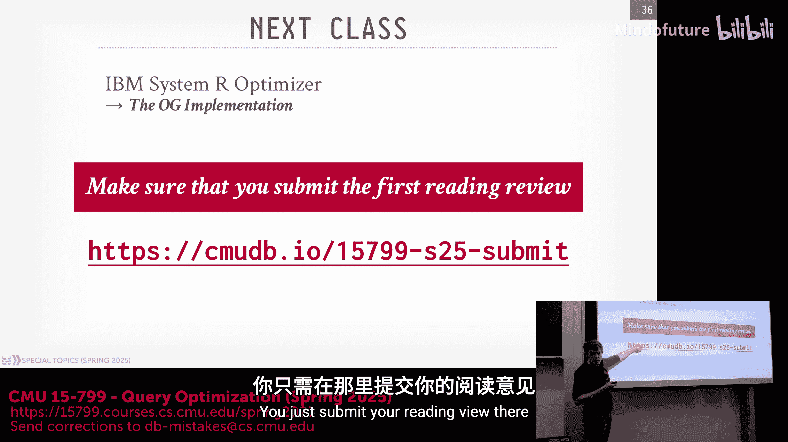

# 数据库查询优化：01：课程介绍与背景知识

在本节课中，我们将学习数据库查询优化的基本概念、课程目标以及为什么查询优化是数据库系统中至关重要且极具挑战性的部分。我们还将概述本学期的课程安排和评估方式。

## 课程概述与目标

本课程的主题是查询优化。与教授数据库系统架构的课程不同，本课程的核心在于如何构建一个查询优化器。查询优化器可以说是数据库系统中最关键的部分。

本学期的目标是让你学习现代实践和方法，从而能够实际实现数据库查询优化器。最终，你将有能力从零开始构建一个查询优化器，或者修改现有的优化器。由于数据库系统的正确性至关重要，我们也将投入大量精力在文档编写和测试上，这些都是系统开发中必需的软技能。

本学期我们将涵盖查询优化器的基础材料。下一节课，我们将讨论1979年IBM发表的原始查询优化器论文。之后，我们将在此基础上，探讨现代实践和数学方法。

## 为什么学习查询优化

如今，数据库比以往任何时候都多，数据库领域的资金也空前充裕。查询优化是区分不同系统的关键因素。如果一个系统无法生成高效的查询计划，那么无论其执行引擎多快，如果它执行的是最愚蠢的操作，也毫无意义。

从研究角度看，查询优化是一个非常困难的问题。在整个学期中，我会反复强调：**查询优化是一个尚未解决的问题**。在工业界，擅长此道的人能获得丰厚的报酬。在卡内基梅隆大学的近十年里，我收到的招聘邮件中，对方总会询问是否有学生在研究查询优化，因为很难找到有相关经验的人。

## 预备知识

本课程假设你已经学习过数据库系统导论，重点是“系统”层面。如果你上过类似1545或645的课程，那么你就具备了所需的背景知识。我们将直接深入，讨论SQL、关系代数、系统实现、存储模型和处理模型等概念。我们假设你已经了解这些内容，不会花时间重新解释。

本课程也不是机器学习课程。虽然我们会涉及一些基于机器学习的算法和技术，但不会深入讲解机器学习算法本身。我们只关心那些能让数据库运行更快的技术。

## 课程安排与评分

课程网站已经上线，教学大纲已发布。所有课程物流信息都可在网站上找到。

卡内基梅隆大学非常重视学术诚信，我也同样重视。请务必遵守相关政策，包括关于使用人工智能的规定。如果不确定某件事是否允许，请发邮件询问我。

我的办公时间是周三下课后3:30，地点在我的办公室，或者通过预约。助教Wan Shan Lim也会提供办公时间，并在Piazza上发布信息。

你的最终成绩将由以下几部分构成：
*   **阅读作业与总结**：每次课都有指定的阅读材料（主要是论文，有时是教科书章节）。你需要提交阅读总结，概述论文内容，列出三个好的想法、三个不好的想法，以及论文使用了什么工作负载进行评估。你每学期可以缺席一次总结提交。
*   **课堂笔记整理**：每位学生将被分配至少一次课的笔记整理任务。你需要将课堂讨论浓缩成结构化的笔记。
*   **项目**：共有两个项目。
*   **期末考试**：最后一次课进行，将是长篇论述形式，旨在综合整个学期讨论的不同主题，并将其应用到新场景中。

以下是两个项目的简要介绍：

**项目一**：你将开始使用一个现有的“查询优化器即服务”工具，很可能是Apache Calcite。我们会给你一组查询、步骤和规则，让你尝试优化查询，使其在InductDB中运行得更快。这个项目旨在让你理解可以进行哪些转换，以及使用Calcite等工具的经验。该项目个人独立完成。

**项目二**：这是一个为期约半学期的小组项目，相对开放。你需要提出一个与本课程范围相关的、你想研究的课题。在春假后提交提案，一个月后进行进度更新，并在期末考试周进行最终演示。

请务必不要抄袭。如果对项目、阅读作业、笔记整理或期末考试有任何疑问，请随时提问。

## 查询优化简介

现在，让我们快速介绍本课程的核心内容，这将为我们下一节课讨论查询优化器的早期实现做好铺垫。

### 为什么需要查询优化器？

像SQL这样的查询语言是**声明式**的。这意味着应用程序或用户告诉数据库系统他们想要得到什么答案，或者希望系统对他们的数据执行什么计算，而**不指定**具体如何计算。

数据库系统的魔力在于，它们会尝试为给定的查询找到一个**正确**的执行计划（可能在没有先验知识的情况下），并且会尝试找到**成本最低**的那个计划。这里的“成本”是一个相对概念，我们将在整个学期中讨论。关键是计划必须正确。

我们需要理解SQL所指定的查询语义，然后尝试找到以高效方式运行查询的最佳替代方案。这就是本课程的全部内容：如何快速、高效且正确地做到这一点。

成本通常以I/O操作数等内部指标来衡量，作为实际执行时间的代理，用于比较不同查询计划的效率。

### 优化的重要性

通过一个简单的例子，我们可以看到查询优化器能带来的性能提升有多么显著。

假设数据库中有两个表：`departments` 和 `employees`。我们想找出在“玩具”部门工作的所有不重复的员工姓名。

如果我们采用一种近乎字面翻译的方式将SQL转换为关系代数计划，可能会得到一个包含笛卡尔积的低效计划。根据示例中的目录统计信息（如表大小、索引），这种“朴素”计划可能需要执行**200万次I/O操作**。

然而，通过一系列优化，我们可以显著减少I/O：
1.  **用内连接替换笛卡尔积**：将笛卡尔积和其上的过滤条件合并为一个内连接操作。
2.  **选择更高效的连接算法**：例如，从页嵌套循环连接切换到排序合并连接。
3.  **利用流水线处理模型**：从物化模型切换到向量化模型，避免中间结果的磁盘写入。
4.  **调整连接顺序和谓词下推**：将过滤条件尽可能下推到连接操作之下，减少需要处理的数据量。

经过这些优化，同样的查询可能只需要**37次I/O操作**。从200万到37，这就是查询优化器至关重要的原因。这还是一个简单的例子。当查询涉及数十甚至数百张表，并包含CTE（公共表表达式）和嵌套查询等复杂结构时，手动找出最优计划变得极其困难。

### 查询处理架构

在一个典型的数据库系统中，查询处理的流水线如下：
1.  **解析器**：接收SQL查询字符串，根据SQL方言的语法将其解析为抽象语法树。
2.  **绑定器**：将抽象语法树中的标记（如表名、列名）映射到数据库中的实际对象（如表ID、列ID），并检查其存在性。它会产生一个**逻辑计划**。逻辑计划描述了要执行的操作（如扫描表、连接表），但**不指定**具体如何执行（如使用哪种扫描方式或连接算法）。
3.  **查询优化器**：接收逻辑计划，并利用系统目录中的信息（如模式、统计信息）和**成本模型**，在大量语义等效的可能执行计划中搜索，试图找到成本最低的那个。成本模型使用统计信息来估算每个操作符的预期成本。
4.  **执行引擎**：优化器输出一个**物理计划**，该计划明确定义了如何执行查询。然后由执行引擎运行该计划。

本课程关注的核心就是**查询优化器**和**成本模型**。

### 逻辑计划与物理计划

我们需要区分逻辑操作符和物理操作符：
*   **逻辑操作符**：高层次地表达你想要做什么（例如，“连接表A和表B”）。
*   **物理操作符**：指定用于执行该操作的具体算法（例如，“使用哈希连接算法连接表A和表B”）。

优化过程中的转换可以是：
*   **逻辑到逻辑**：例如，将 `JOIN(A, B)` 转换为 `JOIN(B, A)`。
*   **逻辑到物理**：例如，将逻辑操作符 `JOIN(A, B)` 转换为物理操作符 `HASH_JOIN(A, B)`。

转换通常是单向的（逻辑->逻辑->物理），并且不一定是一对一的。多个逻辑操作符可能被合并为一个物理操作符，反之亦然。

### 优化器实现方法概览

在高层次上，构建查询优化器主要有两种方法：

1.  **基于启发式规则的方法**：使用一组硬编码的“如果-那么”规则。例如，如果看到“笛卡尔积后紧跟一个过滤条件”的模式，就将其转换为内连接。许多早期的数据库系统和一些简单系统只使用这种方法。它的优点是实现简单快速，但长期来看不够灵活和强大。

2.  **基于成本的搜索方法**：使用经典的搜索算法（如动态规划）在可能的计划空间中寻找成本最低的计划。优化器会尝试大量语义等效的计划，并使用成本模型来估算每个计划的成本，而无需实际运行它们。这是现代数据库系统的核心。

许多系统结合使用这两种方法：先应用一些快速的启发式规则进行初步优化和剪枝，然后再进行更耗时的基于成本的搜索。

本学期我们将重点讨论两种主要的搜索算法实现方式：
*   **自底向上优化**：从空计划开始，逐步添加物理操作符来构建最终计划。例如，在连接A、B、C三张表时，先决定是连接A和B，还是B和C，然后在此基础上添加下一个连接。
*   **自顶向下优化**：从期望的最终结果（如连接A、B、C）开始，向下遍历，通过转换添加所需的操作符。

这两种方法各有优劣，我们将花费大量时间讨论它们的含义、算法效率、成本计算以及复杂性。下一节课要读的IBM System R论文采用的是自底向上的动态规划方法。

### 其他重要概念

*   **目标函数**：成本模型计算出的“成本”数字。它通常是查询延迟或响应时间的代理。不同系统的成本模型内部计算方式不同，因此它们的成本数字不能直接跨系统比较。
*   **多查询优化**：同时优化一批查询，寻找全局最优计划，可能涉及查询合并或结果共享。这比单查询优化复杂得多，目前主要处于研究阶段。
*   **挑战与现状**：尽管名为“优化器”，但我们几乎**永远找不到真正最优的计划**，这在计算上是不可行的。特别是在数据湖或云环境中，可能根本没有数据的统计信息。因此，我们需要使用各种技术来估算成本，并尽量减少搜索本身的计算时间。自适应查询处理等技术可以在运行时进行调整。

## 总结

本节课我们一起学习了数据库查询优化的核心地位与挑战。我们了解到，查询优化器通过将声明式的SQL转换为高效的物理执行计划，能够带来数量级的性能提升。课程将涵盖从经典的自底向上动态规划方法到现代的自顶向下优化框架，以及成本模型、统计信息利用和自适应优化等关键主题。查询优化是一个复杂且尚未完全解决的领域，但掌握它对于构建高性能数据库系统至关重要。

下一节课，我们将深入探讨查询优化器的早期经典实现——IBM System R优化器，开启我们的具体技术学习之旅。

