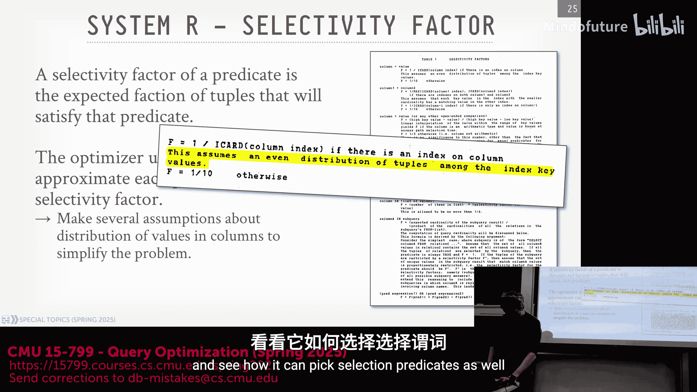
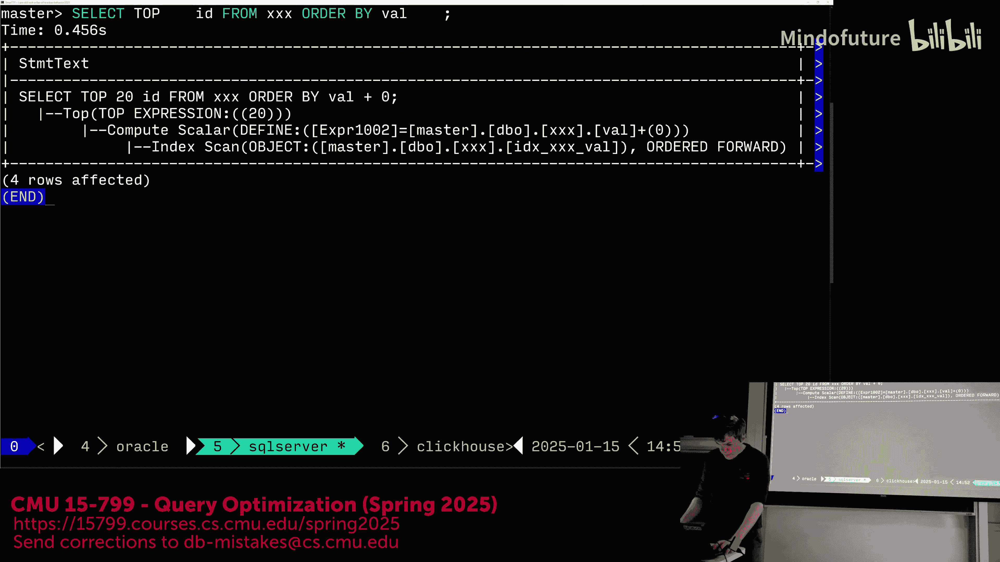
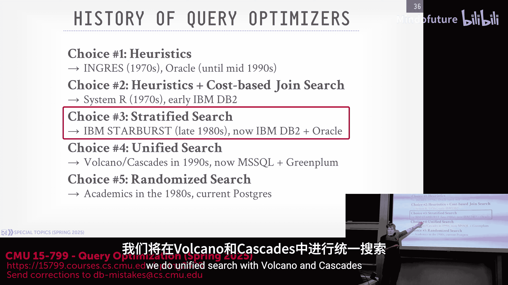
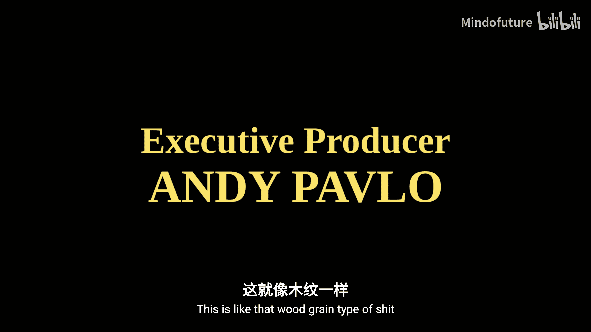
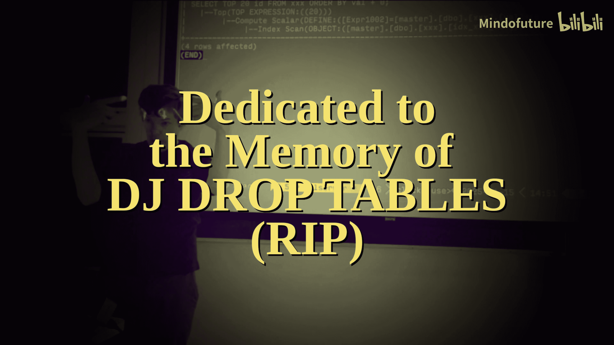

# 【卡内基梅隆---中英】数据库专题：查询优化-CMU-15-799--(2025-年春季)-p02-P02-#02---History-of-Query-Optimizers-ft.-IBM-System-R-(CMU-Optimize!)--BV1wDE9z9EfK_p2-

あ。🎼おって見せ。🎼A journey drove that Taas carry up the message。

This course is filmed on location at Carmicgie Mellon University in front of a life studio audiences。

All right， today we're going to make up。S up from the very beginning ofque apprs discussing the first implementations that happened way back in the and the 1970 S。

 And in particular， the paper we're going to focus most on is one to had you guys read on system R。

 which I think is。I haven't read in a while and forgot how amazingly good it is。Because like， again。

 even though it's written in 1970s， you can still understand what you're talking about， right。

 Some of the stuff in the papers in 970 S are get a little dicey to talk about things that don't existed anymore like。

Old machine things that nobody cares about right。 And then you can take that paper。

 brilliantly written， cleanly written， and you can take that and reimplement it today。

 can't say the same thing about a lot a lot of systems papers back of the day。 But that's a good one。

 And again， it's thes the foundation for everything we talk about this semester。All right。

 so last class we talked about course objectives and expectations。

 I will be sending out on piazza the note taking schedule tonight。

 so therell be no assigned note takeker in this class today and then。😊。

And then therell be a spreadsheet， we put your Android ID and everything in and then we'll get everyone credits on Amazon sort run experiments and projects as well if you're on the wait list we'll process that after this class today。

 I think there's about four or five spots left so we'll pick people off of that。

then we spend time talking about briefly like why career optimization is an important and hard problem and then today's class and going forward is really about how do you actually build the optimizeim mods to solve it。

So we're going to first talk about the high level background of what was going on in the 1970s other than cocaine in databases that led us to having to build something like that they did in the system R paper and then we'll see an initial approach that was done in a precursor or a postgrows called InGgress and the technique they did。

 which is like stupid least clever and the work for the time what they were dealing with。

 but then we'll still again see how they apply sort of the heuristics。

 even though the way Ingress can do joint ordering is not how you'd want to do it today。

 the logical transformation as they're going apply the rules are going to be the bedrock for how we to do modern preization。

 and then we'll go from there and talk about how to incorporate the costbased search from the system R paper。

😡，🤧So。In the late 1960s we covered this in the intro class but in the late 1960s。

 that's where sort of actually in just 1960s in general。

 that's when people started building the first general purpose database systems。

 the first one I think was developed by GE for think IDS that was developed for a logging company up in Seattle and then they said。

 oh， this is actually useful for other people and they sort of maybe more general purpose。

 of course there was IMSS that IBM built to keep track of all the parts for the Apollo Moon missions as well。

 but the way people interact with database systems back in the day was very much writing procedural code。

Where you specify exactly what you want the database system to do to run your query and compute your answer。

😡，And the， the leading idea， the leading。する。I guess standard if you will。

 was this thing called Kodail and this came out to the Cobalt movement and there's this paper from 1973 by Charles Baughman who won the touring Award like one of the first touring Award like the second or third one back in 1973 on his work on codeosil on his early work in databases and in his paper that he wrote as part of getting the Turing Award。

 it's as famous to called the programmer as Navigator and it's exactly as you would think it sounds like he goes on about Copernicus and beginninggine and Galileo ignore all that but in later pages he talks about how he envisions a programmer would be interacting with the database system and treating him as like a navigator and he lists like here's a bunch here's six or sorry seven different options that he of course it's always sexist back then but how he the programmer could could navigate of the database system he can start the G database and find sequentialial scan have an index do by lookups right。

 so he's listing all the choices a programmer would have to make。Write a query。

 encode ail to compute some answer that they want。😡，Right。

And there's this little blurb here that says the synergistic usage of the entire collection of these different options gives the program great and expanded powers to come and go within a large database。

 right And so when you really think about like，😊，You know。

 think of how many different programmers throughout today， what are jobscript programmers。

 do you really want them making decisions on the best way to navigate or find data in a database system。

 right and so。😡，I had chatTBT write this query for me in Codail， I don't know what's right。

 I can't run Cobal so I don't assume it is， but this is basically the program you would write in Codail to go do a lookup across three tables to get all the name of the artists that would appear on a mixta album that we put out for DGmusshu last year to get all this those artists across three tables。

 youd had the right bunch of code and you see much of these nested for loops doing these lookups to find the things you want。

😡，And so basically we're explicitly defining the join order in this program of how we want to interact with the database as Charles Baughman wants you to do。

 but of course when you write this code， you're making a bunch of assumptions about what's in the database at this time。

 therefore you're using that and decide going back here。

 which of these seven options is the best way to go， but then as we all know。

 data changes and evolve over time you fields gets added new data gets added， values may change。

 and so what was a good idea when you first wrote this code or ChattPT wrote this code may not be a good idea in the future。

 but now that program that execution plan is hardcoded in this application。😡，So if the data changes。

 assumption changes， anything changes that would violate those assumptions。

 you have to go back and rewrite all this。😡，And Gold lucks having won having time to do that。

 And then assuming that the person who wrote this program you know， just before she hadGBT。

 But person who wrote this program is still around you， even figure， oh yeah。

 this is why I did it this way。😡，If you hate debugging people's sort of regular procedural code。

 imagine' going to debug their query code， it'd be terrible。😡。

And so the great idea of the relation model basically distills down what that program was in all those various steps in those loops into a declarative form to say。

 hey， here's the answer I want， give me to the artist' names by joining these three relations together。

We're not specifying what order we apply to any predcateates。

 we're not specify order we do any joins。😡，The database systems in going be in a position to make the best decision about how to execute this ideally。

 that's what this class is about。😡，And so then as the data evolves， the query plan can evolve。

Without going have to go back and change any application code。

So we categoral model in the interclass and we made a big deal about having these three tenants that there's this independence between the physical layer and the logical layer of the data。

 there's one of these integrity constraints to make sure that people don't insert stupid things or break our data insert things that shouldn't be in there right but the big one is about how we're actually interacting with the database。

😡，Again， the original relational model paper that he wrote Ted Cod wrote in 769。

 SQL with' an event yet， this is all just relates to algorithm notation。😡。

SQL came around in 74 from the IBM people later on。

 TedCO then proposed his own query language called Alpha that no one ever did。

 but like the Berkeley guys， theymenquel， which is again， based on algebra of this paper。

 but the core idea is still the same but there's this high- levell declarative language or API we're going to use to access the database system and therefore the database system is going to be in the best position to decide how to run that query。

😡，哎。So the。There was sort of four main early implementation of the relational model， the very。

 very first one， as far as I know， was this thing called Peter Lee relationlational test vehicle that was done at IBM in the UK。

😡，And that one was an early prototype that the guys that worked on then the SQL worked on that project didn't really go anywhere。

 It didn't commercialize。 It was a proof of concept。

 But then they went and moved to San Jose at the IBM Research lab there。

 And that's when they started getting serious about buildinging relation data system。

 that's where system are came at。はい。As I mentioned before。

 filmbreaker was at Berkeley and he took Ted Co's paper and started building this thing called Ingresss。

 if everyone knew why Postgress it called Postgress because it's Post Ingress。

 it's the second system after Ingress。And he didn't do SQL， he didquell， Larry Esson。

 the third richest person in the world and now he's on the sixth marriage as of last year or a couple years ago so he read all the IBM paper thought this was a great idea。

 thought SQL was a good idea and just basically implemented the same thing and then became what he is today and then there was another research system out of Sweden called MIr that still this today is now called MIr SQL but that was an early SQLbased relational database system So all these guys eventually had to build query optimizes because again。

 Ted Codd's paper says that you want to have a declaredative language。

 you went the distance to figure out the best way to execute it for you and therefore you need a query optimize。

Now I couldn't figure out what MiMer did， I think it was heuristic base， similar to Ingresss。

 Oracle was going to be heuristic base for a long time to the '90s。

 as we said last class we'll see you again in a second， but system R out of the gate， they said no。

 we're going to do a cost based search a query optimizeizer。😡，U。And try to make the best choice。

So this is a rough overview of all the different design choices you could have when building an optimizer and we're going to cover all of these。

 except for maybe the last one here， I talked briefly about it throughout the rest of the semester。

 but we want to start at the very beginning of these heuristics because that's going to be these sort of hard-coded rules that we would have in our optimized implementation to determine when we see certain patterns in our query plan and what transformations we should apply to end up with a good query plan。

😡，But importantly， they're not going to be based on any cost estimates。

 the way system R was that came later in late 1970s， the system R。

 and pretty much every data system that has some kind of cost based search it's going to be based on the system R paper。

😡，Next class we'll see the Starbrss paper and then that'll lead us into the cascades paper the lines are going to get blurry between stratified and unified search right because like。

😡，Cascades in Microsoft is a unified search but they do in stages as if its a stratified search so I'm less concerned about this distinction here。

 but this is what the literature it describes it we' care more about whether it's bottoms up or tops down that's going to have bigger implication for implementation and then randomized search to be like simulated and nearing sorry simulated kneeling the genetic algorithm that's in Postgres that doesn't work again there's some prototypes to do this Postgres is the only one that actually does it and then we can talk about the neural network stuff AI machine learning stuff as we go along as well。

😡，All right， so let's start beginning。 Let's talk about like what was the first query appr that they built in in the initial prototypes。

So the basic idea is that we're going to have hard coded logic in our database system that looks for patterns in our query plan。

😡，Right think of like I'm operating a the logical plan that's coming out of the binder and I'm converting those logical operators into physical operators so I have these ifNL statements that says if I see this logic operator maybe followed by this logic operator。

 then therefore I can do some kind of transformation。😡。

It's basically how Postg works today if you're looking at the Postg sub plan code。

 it literallys a bunch of FN else that they're just applying these kind of rules。Right。And again。

 the， the reason why this is going to work。Reasonally well is that we can apply domain knowledge we have about database systems to know that there are certain things are almost always going want to do。

 And therefore， if you see the pattern in your query plan that matches that rule。

 go ahead and actually do it like pushing down the most selective filters first do predi push down。

 that's almost always a good idea So do that all your scans before you do any joins。

 that's usually a good idea。 pre push down so for joint ordering。

 you could do really simple rules based on like just how big you think the tables are is that really cost base sort of but not really nothing it wasn't really it's not really that sophisticated where driving selectivity estimates out of operative or predicates like we'll see that later on in system R。

And I said， this is what Ingress did in the first imation and they I'll say in a second of how they do a joint ordering。

 this is what Oracle did up until like the 1990s and they claimed how great it was。

 but they obviously got rid of that and switch over to system R。

 and the Mongo still does this today and again most new data systems you see when it get announced。😡。

Almost always are going to do something like this because again。

 building query optimizeizer is one of the hardest parts。Again。

 back in the day in the 1970s when they were building this。TheDaabaseses weren't that big。

 You read some of those papers。 I don't know the system paper didn't mention。

 but like some of the other ingress papers， they talk about， hey。

 wouldn't be great if we could have a table of 100s。

 That would be amazing right the table the size of the databases were quite small so in the complexity。

 the queries are not as sophisticated as they are today so you could get pretty far with this even today。

 you can get pretty far with this。😊，AllSo the key thing we're going to leverage the why we can do these transformations is that we're going to rely on the equiimency rules within relational algebra。

😡，And we're not going to go through all of them right now， but we' talk the main ones。

 but the basic idea is that there are known rules and transformations that you can apply that will guarantee that the outcome or the resulting in Gal algebra expression you generate from modifying an existing one are equivalent meaning they're going to produce the same answer。

😡，And because we have all these rules we can use in La algebra。

 therefore we have some soundness or understanding of what transformations we can make and when can we make them that doesn't prevent you from writing bad code and actually doing the transformation incorrectly。

 but at least from a logical standpoint， we know that the transformations are going to be correct。😡。

Right and this is how， again a hereific optimizer can be able to do to figure out what's a good decision or transformation to make without having a cost model。

 like predi pushdown is almost always you know， from most part pre pushdown is always been a good idea。

 therefore do it， and because I know my relation ofes will guarantee that the outcome is still correct。

 I can go ahead and do that。😡，So the two ones we're going to care about in this class today are for selections and joints。

And I've already said this multiple times basically the idea is like we know that we can move around the predicates in our selection operators or scan operators on relations and that it'ss still going to be correct。

 so we have a predicate with a bunch of conjunction clauses like a bunch of ans together。😡。

I can just break them up on the ends and have separate individual selection operators that I'm just daisy chained together and they're still going to produce the correct answer。

😡，And this is going to allow me to start moving prediates around that maybe as they were written initially。

 there's all together in the wear clauses， but if I can break them up。

 I can move them down different branches of the query plan to push them below joins or push them below certain operators。

😡，We can also apply the same technique for our expressions or our predius to simplify them further。😡。

So some tricks to be like if you have something like where x equals y and y equals three。

 it's way faster to do evaluation on a variable of a memory location and a constant versus like two different memory locations and have to make sure that they're all synchronized so if I recognize I have something like this。

 I can just convert the Y variable in my first predicate just be x equals3 I can put the constant in there。

I can do other simplifications like x x equals1 plus1。

 some systems can easily just convert that to two so that if I'm scanning a billion tuupples。

 I'm not doing one plus1 plus one over and over again， even though that'll be in CP registers。

 it'll be fast， it's unnecessary work and don't do that。😡。

And then this is harder to do and a lot of systems don't do this is if you recognize that you're passing in a constant where you're applying a function do some kind of transformation。

 and forget this date here， extract out the year and then do my comparison on this attribute。😡。

If I have a billion two bolts， instead of me invoking the year function over and over again at the same constant。

 do it once then substitute the value in， and that speed things up。😡。

These other games you can play like moving the if the year clause is maybe on the variable。

 you can rewrite the expression to put it on the other side all right that's more difficult to do。

 but some systems can do that。😡，And then the other one are joins and the two big properties we want to care about is comm and associivity。

 comm just says that we can swap the order of relations in our join operator and of course it's guaranteedably to correct and you can do this for inner joins。

 outer joins are more tricky we'll cover that later。😡，And soivity basically says， I can。

 I can can do the swapping again and maybe join the the first to swap that out。

 maybe join the the first second and the third first。

 I can change the order in which I'm doing the joints and everything still works out。

And the challenge is going to be， especially joins。

 because we have we can swap things out in these different orders。

 that the number of possible join orderings we' going to have is going to explode。😡。

Now we're going to simplify things in system R and most systems of that one。

 we're only going to look at binary joins， so just joining two tables at a time if you have to do multipleway joins。

😡，Then the number join energy you have can explode but most systems can't do multiway joins and then you can have to deal with okay when the order you want to actually do the join so I think it's been proven that again picking the right join order is empty hard because the number apost join you can have for an endway join is what's called a Caillac number like you know number is really big but it actually has a name of it right。

😡，So it's going to be too expensive for us to consider all possible choices and then that's why we'll see this in system R。

 they'll make some assumptions to reduce this down and in other systems。

 they'll do other tricks as well。So this is me somewhat。Rundant over what we the last class。

 but now that we understand like the outvert equivalencies we don apply to do our transformations。

 we can see how we can apply these transformations for a given query plan as we go along。😡。

So the first thing for a given query like this again we want to find all the artists that appear on the tribute album so if I just take the SQL query。

 run it through my binder that then generates a logical plan。

 it's going to end up looking like this where again I have my scans of my tables when I'm not supposed to find the access access path I'm using I'm doing the Cartesian product to do the join and then I just have this big fat filter up here that is taking whatever was in my wearca and applying it all at once。

😡，So again， because we can want to do that to break up the。

The the conjunction clause is in our in our aware clause， we can break up to individual ones。

 So now we basically introduce a bunch of new filter operators that each only have one predicate inside of it。

I'm not determining the order here because I can't because there's no cost model and I can't determine this select。

 so I'm just going in the order in which they appear in the SQL statement。😡。

Then now that I have these individual filters or individual predicates。

 I know I want to do predicate pushdown， I to I can apply transformation rules where if I recognize that I have a filter clause that's referencing just one attribute。

 like attribute dot name equals something， then I want to push that predicate down to where to be right above wherever the scan is for for that relation so I can move down the lookup on album name down here and I can put the joint predicate here or sorry put the predicate for the joint right above the Carhesian product here。

😡，Again， I can just do that by looking for going back here， identifying that if I see a predicate。

 and then I have a rule to go find me the where I'm doing the scan on that table or the join that being referenced in the predicate and putting it to be right above that logical operator。

😡，Now I to do another simple rule that says， if I have a predicate followed by a Cartesian product。

And the predicate has is referencing both sides of my both relations in my join。

 Then I can just convert， collapse down and convert the predicate and the Cartesian product into an inner join。

Right。And then at the end， I can do， if I see I have additional attributes that I'm passing up that I don't need。

 then I can just do a projection push down and add a projection so that I'm figuring things out as I'm going up。

 again depending on the implementation of the system， whether or not it's a column or a row store。

 whether it's single node or distributed， you may not want to do this。

 if your table is really wide to make sense， if it's not that wide doesn't make sense because you're extra copying。

But again， like。I don't need to look at the cost money。

 I don't need to look at any statistics to determine to any of these operations。

 it's just sort of hard code in the system if I see this， then do that。😡，All right。

 so then so this will give us a reasonably optimized query。

 but of course then depending on how big these relations are。

 you know I may actually want to do a join in a different order that I'm specifying here right my from calls I from artist appears album and so the join basically is just going the order that they appear in the SQLs data。

😡，But again， that may not be the optimal thing。So if I don't have any statistics。😡。

How am I going to figure out that right Jo order？Well。

 the way Ingress did it was they would just literally run every query， they would literally just。

Run the query over and again in multiple steps and just mass the results together。

 It wouldn't end up being the right order， but at least it was allow you to be able to do joins because the first version of Ingresss in the 1970s couldn't do joints。

😡，So say we had that same query before， but now we're going add this order by clause from the artist ID。

😡，So the very first thing we need to do is take this query and we're going to break it up into what we'll call single value queries or single relation queries。

😡，So in the first case here， I'm doing my look up on the album table and doing a look up on the Mushu Trit。

 I I'm going to take the output of that first query， write that into a temp table。😡。

Then now I'm going to substitute where I have the album table in the initial query。

 I'm going to replace it with the reference to this temp table。😡。

Then I'm going to do that recursly again， I'm going to take now where it was this three relation query。

 and I'm going to break it up into new queries that are each accessing just one real relation。

 so peer an artist and doing the join against the temp table that was materialized by the previous query。

😡，now that I have this， I can actually just run the query， so I'll run the first query。

 take the output of it， and then feed that into the second query， run that query。

 take the output of that and then feed that into the next query so the first query runs to get Al 99 as the value then I just substitute that in for the Al might I'm doing my lookup well now now it's a single relation query。

😡，I'm going to go there and do the same thing now now I get two values here。

 so I'm going to run this query twice with two different values， and then I post my result。😡。

So they can't consider the join order and if you're going to run joins this way。

 the only logic they would have is they would recognize that the entry point into the relations。

 if you will， is the one where you have a predicate on something。😡。

Because otherwise you're doing a carteian product against everyone else。

 so because I know Im to do a look up first on get the album name here。😡。

It then gives me the almighty that I can then inject into the additional  queryries to prove my result。

So let's say， so it's it's。Well， I'm shown this at the SL level。

 but they would actually do this at the logical plans again using ifN L。

 but I don't want to show code for this。 And so again。

 it seems kind of crazy you want to do this way。 but if you start doing。

One of the things we're able to do now is instead of trying to do all the logical transformations on the three table join query at the very beginning。

 if I decompose it up into now these single query or single relation queries。

 then I can do all the transformations to produce a reasonably optimal plan for just this one query now globally it may not be optimal。

 but for each individual one， it'll be close enough。😡，So again， you。

I don't think any other system actually would do it this way now today， right， because it's just。

It's just so inexpensive， but you'll see remnants of this like you'll see in like my SQL。

 for example。😡，For sometimes for a nested query， though actually the optimizer will say， okay。

 I see a nested query here， let me actually just stop the optimization process， go execute it。😡。

So recursory call itself to get a new query plan for so that inner query。

 run that and get the result and then inject it back into itself。😡，Right。

In system R does the same thing， too。 that's the last section of the paper that they talk about。

To do join operations like this， it seems crazy。 but there's other like。

Sysems actually applied the same technique for NSAqueries set。😡，That's not the right way to do it。

 and we'll you have the right way to do it later on。 But I think again， it's。

It's a clever idea and they're working under their constraints that they had at the time。All right。

 so any questions about this？Again， the key thing here is what they're doing is that there's。

In the implementation， there's ifNL statements that are looking for。😡，Patterns in the query plan。

 and if it recognizes them， then it calls some subroutine a sub some function to go ahead and do some kind of transformation either from a logical to logical。

 but oftentimes mostly logical to physical。So。It works reasonably well for simple queries and actually it's going to be pretty fast right select star from table where IDd equals 1。

2，3， assuming I have a primary key on ID this can work just fine because there really is any other optimization you want to do other than just picking the primary key index。

😡，So if you don't have to fire up a whole cost base search algorithm。

 then this would going to be quite nice。哎。And again， that's why most systems they first come out。

 they do this because you can get something up to running pretty quickly。

The challengell is going to be and this week a constant theme from the entire Me as well is that it's going to rely on much magic constants to determine whether something is going to be a good idea or not and in most cases they're not even going to have this they're going say。

 Im is always going to want to do it。😡，Because they can't sort of look multiple steps ahead and say。

 if I do this， what are the implications of it， it is always do it。😡。

And then certainly won't you start doing more complex things。

You end up with a bunch of spaghetti code that's looking for bunch if the analyses statements that are looking for certain patterns。

 and now implicitly in your code， the order when you apply to those transformations is the order in which they appear in the code。

😡，And that may not always produce the best result， because you may want to have more dynamic priorities to determine in the order which you want to apply transformations。

System Rs not going to be able to handle that， but we'll see that later with cascades how they do handle that。

So this is I always like to bring this up。 I mentioned this last class about Oracle so this is from the semiauthorized biography of Larry Esson that came out in the 90s。

 but they interviewed Stonebreaker and Snowmakerer has some choice words for Oracle and Larry Esson but we could ignore all that but in particular they talk about the query optimizer he says that back in the day Oracle had a really stupid optimizer and their joint order would be the order that they appeareded in the SQL statement as I said before but since Larry Esson was an amazing marker and still is today。

 he would go out and say， oh no no， we don't have the other people have a semantic optimizer like a call space one you don't want that but you really want to synta optimizer where you're inviting the intent of the programmer because they wanted the join order that way because that's the way they wrote the SQL query and that's the best way to do it and it worked until they realized that the。

They weren't able to cash the checks they the marketing could not keep up with or the engineering could not keep up with the marketing。

 and then they threw it all away in the '90s when Orle homes went bankrupt and then fixed it all and they ambitious switched to the system approach we're talking about now。

😡，I highly recommend the biography， it is hilarious。And then the actually the the。

The computational Bi department here， they renamed it two years ago。

 what is the name of the comp bio program here now know？Ray Lane， who is Ray Lane。

 Ray Lane was this former CEOO oracle that Larry Esslenhot hired to go fix the company in the late 90s or early 90s right and so he came and came to CM you and I could talk him like hey in the biography how much of this is real and he's like it's real but Larry made sure that he got all the things he wanted to get in there to get in there and all things he didn't want to get in there are not in there but it's still even that still very entertainingat I highly recommend that。

O。All right， so that's the here is a big optimizer and again。

 the idea of using heuristics to guide this towards a better query plan。😡，At face value。

 it's not a bad idea， and actually you are't going to want to do that。😡。

Buthi is the key thing to get out of it， the way it's implemented in these early systems and some other systems like Postgress through procedural code that is like if then else。

 that's not the way to do it。😡，You want to have a higher level abstraction。 You want something to be。

I don't use the word declare no， but like you want to have a。

You want to be able to define the rules and。The have your optimizer determine on its own in which order wants to apply them if it identifies a match。

 and that'll get us down into the subsequent choices here。😡，Okay。

 so I think the InGgress paper came out in '76，77， and so at the time again。

 this is how pretty much everybody was doing query optimization。

 and then we come over to the paper you guys read， which was sort the groundbreaking work on how to do cost based query optimization base out of systemR。

😡，So the basic idea is that they're still going to do that initial phase we saw in the HiSick phase approach。

 and as far as they know in the case of systemR， it was also a bunch of FNL statements as well。

 similar to what N did。😡，The key thing is that then when they want to start converting the serological plan into a physical plan in particular。

 figure out the join order for the relations in the query。

 that's when they're going to use a dynamic programming algorithm or a cost based search to determine right way to do this。

😡，And so again， the background of the SR project was like 15 people all brand new PhDs at IBM。

 they said， hey， here's the TEDCOd paper， go actually build it and what's amazing about is they had everybody had a PhD in computer science or mathematics and they all sort of carved off one little piece of the system。

 like one person two guys worked on inventing SQL， Boyce and Cod did that or Chamberlain as well。

 because Boy died， Boyce died in '73。😡，74， but it was Chaber Don Chaman created。Qu create a SQL。

 somebody else worked on the cogen engine， the storage layer， and so one person Pat Sellinger。

 she worked on the query optimizer。She's bridge， she did her undergrad and did her Ph and appliedly mathematics at Harvard and this is like sort of groundbreaking work and when was sort of controversial at the time。

 maybe not so much when the paper came out， but like when they were building this thing is the same argument people are making in the early days of Uni about high level programming languages like see how the idea that you're going to rely on a compiler to then generate assembly code or machine code that would be ever be as efficient of what a human could write themselves。

 that's the same argument like the code ofto guys were making back in the day as well that there's no way a database system is going to be able to generate an optimal query plan that does as good or better than what a human could ever generate in。

You know in writing queries in Cotiil， and so Pat Salinger basically said，" no， no。

 like here's how you can do it。Right。So that's why sometimes you'll see in the older systems。

 actually snowflake calls it this as well， instead of calling the cruatomizer。

 like I'm calling this semester， they'll call it a compiler。😡。

Because that's a remnant of the 1970s about this idea of the compiling high level languages to lower languages。

 to they had the same concept in SQL。So again， this would be system R。

 the first version of DB2 is going to inherit this work， we'll cover that next class。

 but then they'll get rid of that and switch over to Starbuurst。

 which you guys read next read for next class as well。😡。

This is also confusing because there's four versions of DV2， we'll cover that as well in next class。

 some of them use systems are some of them don't， and like I said most opensource systems that are out today are going to be using this technique and again the paper itself is very well written。

 you could take an action sit down and actually implement it。😡。

All right so the we've already covered this before， but the core idea is again。

 we want to convert the logic operators into physical operators and the big thing that they're going to have to do is figure out。

😡，WhatWhat join algorithm they're going to use， what order that they want to apply the joins。

 and then in what cases are they going to have to spill a disk and materialize temp tables sort of going from one operator to the next。

😡，And to do all this， again， they're going to rely on a cost model to estimate what the expected amount of work the data systems got to do for the physical operators in the query plan。

😡，So the way they're going to break the problem up is that the first going to break the query into what they call blocks。

😡，And we'll see this idea again in Starbursst next week。

 but they're going to break it up to what they call a block。

 which sort of represents these select clauses with a from on a single relation and then or one more relations and then some kind of wear clauses。

You know also have aggregates and group there as well。

 so it means if you have nest queries they're treated as separate query blocks。

 you're going to optimize separately。And so the first one。

 all the the heuristics we saw before to generate the。

For all each of the large operators in a query block。

 they' go generate the physical operators for them。😡。

And then including generating all the possible joint algorithms you could use the physical operators and all the access paths。

 and then they're going to do a simple greedy search to figure out the access path to use for every single relation。

 and then the dynamic programming search to find the best joy ordering。😡，哎。

So the first thing you I got to deal with is what if the query block only contains one relation？

Right and I think this is where the term come from from Serio， I think they invented it。

 but I might be wrong， I think's one of the early favorites that talks about it。

 but they mentioned how like in case this case here， if if you identify that the query is serable。

 meaning the where clause specifies attributes that you can then use new lookups on index data structures。

 then you can then examine all the possible indexes that，😡。

Could be satisfied by those predicates and then you use the cost model to determine which one's going to have the lowest cost right so Sgeible just means search argument able again thinking like select star from table where IDd equals 13 and you have a primary key and ID that's a Sgeable query because you have the ID value。

😡，And you can do the quality lookup on the index to go find the data that you're looking for， right？

So if you take this example here that doesn't match the predicate， it assume it's the same， right？

I have this predicate here on the value， so I can either do a sequential scan。

 which I think the paper calls a segment scan， but same idea。

 I do a sequential scan on the table itself or I can do a lookup on the index to go find the data that I'm looking for。

😡，Right。And he' sort of thinking like， again， you're at this stage here。

 you're just trying to determine should I do a lookup on the index or should I do a lookup on a sequential scan？

And they're going to rely on this internal cost model to determine is one of those choices or for all mypost indexes。

 are NM actually going to be better for me than doing the sequential scam？

And the way they're going to compute this cost is through this really simple cost function that they have。

 whereas this cost equals the number of page fetches。

 which is the amount of IO I expect to do time plus some weighted weighted factor of what they called RSI calls。

 which that's just a proxy to represent the amount of CPU work we're going to do because as the paper says in their valuation of the system。

 they find most of the time is being spent on this。😡，Basically， the。

 the execution layer doing the lookup on that。 So that's a good way to determine whether the。

 you know， how much cheaper you're gonna to do。 And obviously， depending on what the hardware is。

 you could， you could change this W weight so that you're more。

If the CPU is more expensive than the IOs， then you change that weight。

 if it's less expensive than the IO， then you change it accordingly， right？😡。

And that that basic idea of comparing storage iOs or iOos versus CPU。

 that's pretty much of all systems used today。 Yeah， you can throw a network。

 but that's's basically more IO。 There's more sophisticated things you can do。

 but I mean this is what basically Postbs does。If you go look at the Postgs documentation。

 this is from an older version because it's simplified。

 but you can see basically there's a random Pageite cost and you set that to be relative to the scan cost for a single page。

 but then there's some CPU costs like CPU tuupple costs index tuupple costs and these are all relative to the again the sequential scan cost。

 so if your CPU is slow and your di is really fast。

 you jack these things up to account for that in your cost model。😡，And it works really well。

This is Postcast Vi E。You go to per when it relatess  when 17。There's like six more of these。Right。

Again， so it's like this， I don't want going down too much of tangent， but like this is。

 they're assuming that a human， an operator， administrator。

Understands the relative tradeoffs between Io and CPU。

 and we go ahead and set these things accordingly。Most do not set these things correlated。

 just use whatever the default is right so in this case here the default is that the random page cost in random IO for reading a page is sorry the sequential cost is four times more expensive than the random cost yes。

啊，对对以对。Yeah， you think thatre right？For a startup too， right， yeah， yeah。嗯。it works， you know。

It right。Is the。Did the algorithm work， does the machine learning work， yes， did the business work？😡。

Sort of。Not to the extent that we wanted， but of course other factors happened。

 but we can take that one offline right， but again， the main thing I want point out is like again。

 1979， she's basically saying it's paid fetches plus CPU boom， you 2025。

 it's the same thing becauses the fundamental cost of doing work in a database system。😡，Now。

 Postgs for great as is。 This is actually pretty primitive。 We'll see in the commercial systems。

Their cost factors are way more complicated。Like Db2， when you turn it on。

 it'll run basically much micro benchmarkchs to get these values for you。including network IO。

 and then they figure that out on the fly as things go。呵。

All right actually going back here so the way they're going to then determine， all right。

 well how much， how many pagere am I going do， much am I going to do are going to be based on these formulas that they provide that talk with the different use cases like am I doing a quality predicate on a unique index and I need to get one thing okay here's the cost for that if it's a cluster index or sequential scan they have different formulas or all of these。

😡，And the way these formulas are going to work is based on what they call the selectivity factor。

 which is just going to be the probability that a certain tuple or a tuple in your cable。

 your index as you're scanning， is going to be satisfied by a predicate。

 and therefore the emit as output of an operator。😡。

And then the cu cost of all those outputs going from one up to the next is going to determine what is the total cost of the quaplan？

😡，So the selectivity factor， as I said， it's going to be。

 it's based on what the predica is going to be and they provide you know in the paper this whole page of here's all the different formulas that one could use to derive the expected number of tus that we scanned and emitted as part of an operator or a predicate based on statistics you collect from the data。

 remember to the catalogs maintained internal turn information about here's what my data looks like。

😡，The data when it gets bulk loaded or if you're in Postgress。

 when you're on the vacuum that's basically on scan and updates these things。

 you can explicitly call analyze to update the statistics。

 but everything single data center is going do in cost based search。

 it's got to maintain some information about this。Now this seems fantastic right because now I can say I have these analytical formulas that I can apply on data I've collected about my data。

 I look at my predius and I understand how they fit into these formulas that determines。

 I can use that to determine how much work I think I'm going to have to do。😡。

ButWhere the challenge is going to be is that there's a much assumptions you have to make。😡。

About the， about what the data is going to look like， because you the summarizations you have。

 the statistics you've collected are not going never going to be perfect perfect about， you know。

 perfectly represent within the data。😡，So in particular， for this simple thing。

 like something equals something， they have this little disclaimer here。

 this assumes an even distribution of twos among the index key values。😡。

We know not that's never going to work out in the real world right just think of like where people live in the US on zip codes。

 there's way more people living in LA County than anywhere in Montana right and so if you try to do a lookup of people on a given zip code you know that distribution is not going to be uniform。

😡，So you know I'm pointing out this one because it's the most obvious one。

 and I think this one here F equals one over 10， if you don't have any statistics。

 it's just this it's a hard good bite you laugh but like。You see this time in other systems， right。

it's better than returning nothing so yeah so even though these formulas are sort of again the textbook definition of how you would actually implement a cost base a cost model in a do system。

 it's going to rely on these substance that simplify the problem that aren't going to work out in the real world。

😡，All right， so I want to give a quick demo of。postgres and see。

How I can pick selection preds as well。So I have a really simple table。😊，Can we see that。

 Is that okay？Yeah， okay。So I really threw a table here。That just has two columns。

It has an ID which is just incrementing by one， and then I have a random value。哎。So。

I've created an index on it。😡，And we can see how well Postgres is going to be able to pick out and what when can it use the index versus having to do a sequential scan。

 and I think there's 10 million tubs。😡，食。But yeah， so there's 10 million tus right and the values。

 the value field is completely random。😊，So again， we can put explain in front of our query plan or our SQL statement and we see what Post is going to want to do for the query plan here right so in this case here I'm doing select ID from XXX where the value is basically in between some range。

😊，And then Postgreds can recognize it， oh okay， that I have an index the sge query that I can recognize I can use for this where cause。

 I can use this index， you can more the reche stop here。

 but the key thing is that it picked out the index。

 decided to do the index scan that it should to do this run as fast as possible。😡，Okay。

 so what if I do something like give me just the。Give me the 10 most or the top 20。

Tt 20 value is within my table。Again， same thing， postG can recognize that， oh。

 if I can use the index to scan to one side of it and just iterate over the leaf pages and get the 2 twos I need。

 that's going to be way cheaper than doing special scan， so it chooses that。Problem is， again。

 like this seems again， for basic things， this is fine。

But Postgress is not going to be very smart and understand and be able to do anything in for queries where the。

The attributes that you're trying to order buy on。Are not just referencing the column by itself right So again。

 the value is just an integer。😡，But if I do something like this， if I play。Order by value plus 0。

It's the identity， it's the same thing， what happens？😡。

Posscript freaks out because it's trying do really simple rules identify that， oh。

 I should you I see my column and my order by clause and I have an index on that column to go ahead and use it soon as I throw an expression which is meaningless。

 the plus zero is useless， it doesn't pick the index and it falls back to a sequential scan。😡。

Right so what I'm trying to say here is it's not just simple pattern matching to say， oh。

 if I see my column in the order by clauses or whatever or the wear clause。

 let me go ahead and just use it right the query optimize needs even more complicated more sophisticated I understand it actually basically evaluate sometimes what in these different clauses and either wear clause the predicates even before running to query to determine what's the right thing to do right I show my simple example before like know converts like x equals one plus one and you can rewrite that to two Sure that's fine you can do that in some cases but what if there was like a function in there。

😡，just return one， could it do that substitution？Postcus probably couldn't。Al right， so don't。

 I don't want to like dunk on Postgres entirely， but like we try the same thing in。Inductee B。嗯。

So here's the first query again， ID equals greater than 123 less than 456， right。

 it picks out the index fine， that's good。But now if I try the one with the orderbi clauses。

 I'll have the limit to 20。And for whatever reason， it doesn't do the sequential scam， I'm sorry。

 it doesn't do the NX hand does the sequential scam。

And then if I do the same trip before where I put the plus zero。

Or I've tried playing around with like trying to make it sending descending。

It doesn't seem to want to pick the index。And I do that and nothing happens there as well。All right。

 so let me show one system that so that can do sort of this partial evaluation of the of the。

Of the search arguments for the clauses to figure out what indexes are the best access path to used。

😡，Is actually SQL server can do this。Quickhouse。All right， so in SL server to get。U。

You don't run explain， you have to run this show plan all on。😡。

You turn that on and then now you'll start seeing stuff。So let's do the first query。

With the between clauses。And you see that。Keepids going away or there。 It doesn't。

s really the main thing again if they were to do the index scan， what they call an index seek。😡。

But now if I do that the top 20。All right， again to have a limit clause in TSQL or SQL standard to put the top function to the front right the keyating here it picks up the index uses that that you can tell you the name the index is using that's all fantastic that's fine so let's do the thing that Postgres choked on。

And run I can't read that。And see if I can highlight it。Yeah， there's a plus zero in there。

And lo behold again， it' to be able to compute the scalar define and still use the index。😡。

Right so again， the main takeaway for this was just saying like picking know for the surgical query is is it it enough just to do simple string matching on column name。

 you know， and in my index， fantastic use that， there's little bit more work we have to do now whether that just happens in the binder or in the query outmer itself。

 it depends on the abilitation， whereas again it's a little bit more work to do to actually pull out the right index that you want。

😡。

Okay。I I didn't try My SQL but S case， and I couldn't get clickhouse to pick an index for me or you always use the index I' always wanted to do a special can because I think it's only 10 million records and I suspect DBs is doing the same thing like。

 oh， I can rent through 10 million records because you no problem。O。All right。

Related to this for the order by clause as well is this notion of interesting orders。

And just means that it's the required order you would need to produce the correct result of the query。

😡，And so they talk about how when they do an examination of a block。

 they identify what is the required order output either defined by an order by clause or a group by clause。

😡，The reason why they also include the group by clause is because again， this is 1978， 1979。

 hash aggregations weren't invented yet right so the only way you can do aggregations is through sorting right like hash join I thing that was 83。

884。Right I think I think there's other papers that went like we tried hashing and didn't work so the only did sorting right so you got to have things in the right sort so you need to look at order by clause in the group by clause and then you keep track of for each query block what this required orderings are。

 So then now when you when you try to figure out what's the best access method。

 either index scan or sequential scan for a。😡，Or a given relation。You。

 if if the query block requires the sort attribute to be sorted。😡。

You keep track of both the best access path that gives you the result in the sort order you want。😡。

And one that doesn't and then you do a simple calculation。

 say for the one that doesn't produce the sort order that I want。

 if I add a sort clause to the sort operator to it。😡。

Is that cost going to still be better or worse than the one that produces in the crack sword order？😡。

There there's sort of like a hack tack on that they recognize that things need to be sorted to produce the right result。

 so just add this extra step at the end to make sure am I coming out correctly or not？😡。

And then we're see the same thing when they do joints。All right， so now if the do joins。

 the join ordering， it's basically a three step approach where you're going to first do for every single relation you're accessing。

 pick the best access method。😡，And then do basically all possible combinations of。

 of that of joining all possible relations you have in a queryve block。

And then you sort of sort of itly build up the query plan by then joining the next relation。

 the next relation， so forth until you end up with the result that you would want。😡。

The we made the distinction between the bottoms up versus top down and this is the bottom up approach where you're adding the join order。

 the joint operators incrementally going up until you join all the things you need to join。

 and then that allows you to identify the one that has the lowest cost。😡，是。

And so just like before where we were applying domain knowledge in our heuristics to find good query plans。

 they're basically going to do the same thing to prune the search base because again it's an MP hard problem if to get the joint order。

 so I don't want to examine everything， so they do some basic hereists to throw out things that they pretty sure they're never going to need。

😡，You're almost never going to eat a Cartesian products or delay them or don't look at them at all。

 and they're only going to look also like left deep trees。😡。

So that even though maybe the true optimal plan is a bushy joins。

TheyBecause the end of the harvest is so simple and the problem so hard。

 they're going to only get lefty。😡，Right deep trees are equivalent to this。

 there's no distinction there， right so they only look at the left deep trees。是。All right。

 so step one is do what we did before where we have a single relation or just figure out whats the best access path that we're going to use for that。

😡，And again， by looking at what do the interesting order are。

 we would need what indexes I have is doing the basic cost calculations we have。

Then now we're going to nuerate all the joint earnings for from the one ratio of plans to produce the using their best access path in step one to figure out for。

😡，For two relations， what's the cost of joining them？😡。

And then you pick the best one for each that level， and then you consider okay。

 now if I add more joins to it， what's the cost of those and you just keep repeating this over and over again until you end up with the final result。

😡，And what's going to be different about this approach than the top down approach。

 we'll see later on， is where we have to maintain this memo table to keep track of the things we've tried before。

 we don't need to maintain any history when we do this approach because implicitly the path that we've followed along to get to some level in the search tree。

😡，Is going to tell us what the history was that we care about。Whereas again， in the cascades。

 top down approach， it's everything we've ever done before because we want to avoid doing repetitive work。

Al right so let's see sort of a two step visualization of this same card we have before right first step is choose the best access path for each table and again I would look at my catalog。

 use those formulas we had in the paper to determine what the best access path for each individual table in this case here for artists and peers we do a special scan for album we do the look up on the name because we have that as a predicate there。

😊，Now we're going to new all possible joins because this is PowerPoint。

 it's not going to fit to do all of them， but I've just assumed this thing just in all possible combinations that potentially have。

😡，And then now we're going to determine for two tables， what's the best one。

 and then add another table and then keep building that up to our final result。😡。

So this is a dynamic approaching dynamic probing approach， again， it's a sort of dividing conqueror。

 breaking the problem up into smaller steps， solving the first step before we move on to the next one。

 and we don't have to backtrack in this case。So again。

 we start at the very beginning with the bottom， we say we have three relations。

 we don't know how we're going to join them we say we know we' were going to want to join them。😡。

So the edges emanating out of sort of the logical operator。

 we're going to point to these physical operators that are going to say what joint algorithm I'm going to want to use and in what order I want to apply the join I'm showing what know the preddiicates would be here and again。

 think of this thing going all the way out on the slide here because they make it fit and be readable PowerPoint I'm truncating them。

😡，So then now at this level here， for each of these logical operators after doing the join。

 right either during appears an album， album appears， artist appears an album and so forth， right？😡。

I'm going to choose the path that has the lowest cost。

So say it's the nest loop join for all these and that one's the merge joint， right？

And then now for each of these log operatorsopators， I'm going say， okay， well。

 let me go now do the last drawing I need to do for the remaining relation。😡，Do the same thing。

 do all possible permutations of them， all possible permutations of the join algorithm that my systemss going to support and again in the paper they talk about we only have Nealu join and mergeRS join because hash join wasn't a thing yet。

 at least not the system R and then same thing here at this point now for each of these is logic operator to the final result。

 I'll pick the w of the lowest path。And now I just do a back checkrack and sum it up and say， okay。

 from getting one path the next， which one is from the top to the bottom。

 which one has the lowest cost？And that's going to be the optimal join ordering for this relation。

 the optimal physical plan for this query。Yeah， in this case here。

 remember that my query had an order by clause on artist ID but the logical plans don't have any notion of sorting properties the physical data so again they're going to do that same trick before where they keep track of what' the best plan I had where it is guaranteed to be in not sorted and sorted and they see whether for the unsorted one if I add the sort clause is that going be better than the sort of one and if yes I choose that otherwise I choose the one that's already sorted。

😡，哎。Now and we'll see this further in next week。Not having keeping track of what the physical properties are in our query plan as we're doing planning。

 or sorting is one thing， but there may be other things that we don want care about too。

 especially if you go in a environment where things are actually physics is located。😡。

That would be challenging and then again we'll see how the cascades and volcano sorry the cascades approach is going to handle that。

So I said this last class and this is the key distinction we're gonna care about most of this entire semester is it going to be bottoms up or top down and so what I just showed you is the bottom up approach right you start with nothing I know I want to join three tables I don't know how I'm going to join them and I don't know what order I'm going to join them and I itly add pieces or generate new physical operators and I put into my query plan to get to my final result。

😡，The cascades approach we'll see in two weeks， that's going to be top down or transformative where you start with the fine result and you make permutations to the query plan to add the physical operator you need to get you to that result。

😡，Right。So it's like sort permuting an existing plant。

And then in the additional readings we're going to have in the lectures going forward and we'll spend one day we'll be here's the top bound approach and next day here's the bottom line yes how can you do something。

😡，So question， how could you handle bushy plans and to a bottom up？Going back here。啊。

You would just add more。Yeah， just add more， add reverse。哎。

So for this one it's three tables so it's always going to be lets say there's four right so say I joined Artisan album and then I have appears peers and then the fourth table so then I could swap that and then have or sorry and have the physical operators that I'm going consider coming out of the next logical operator would be just joining those two tables by themselves。

😡，对。Yes。Yes， and just makes it wider。Yeah， yeah， that would be。For three tables， it ist make sense。

By bushy joins again， just means that like。left you join I'll do two table joins and then the output of that join is then joined with another table right and I always do that I'm always taking the output of one joint and then join with another table in a bushy join you could take two tables over here。

 join them， take another two tables， join them and then you do a join between the two joint outputs。

😡，And in some cases， that's better to do。Back in the 1970s they didn't want to do that because the hardware was so slow because what would happen is I do if I do a bushy join。

 I do the first join， I got to write that out the disk now because I need to make space for do my next join right so Id swap all that out the disk then I do the next join for these other two tables and then now I got to fetch in the first join output to then join with the second join output。

😡，Whereas if you only do left deep， then you can do pipeline。In back in the day。

 often thetimes that is the better approach。But not always。O。

But the last one I bring up is nester queries。 And again。

 this would be very similar to the the ingress thing I talked before。

 And I should preface to say like。Don't do this Like this is not the way to do it。

 This is what my SQL。Still does sometimes， but this is the wrong way to do it and we'll see how to do it through join rewriting from the German way later on。

 and we'll spend a whole lecture on it， but basically they would treat the nest queries at all separate queries like with a separate query block and they would。

😡，SyR would then identify the dependency between the query blocks where one query was being fed into another query。

 and then what they would do is they would extract it out the nestA query。

 run that through its optimizer， so do all the things with pick access path if it's doing a do the join selection as well and actually literally just run this。

😡，Right so pause the query planning on on the outer query， run the inner query， produce from result。

 and then either substitute it back into the outer query where it's actually being referenced or in some cases if it was a。

😡，If it was like a multi value query， then just put that as a temp table and then do a joint against that。

Right。And again， it's。This paper is one of the earliest papers to discuss execution strategies for nest queries。

 which is basically was an unsolved problem for 40 years until the Germans came along and handle it。

 but the paper they wrote that will read doesn't handle everything of the new paper coming out literally a month now supposedly handle all possible co cases you have nest queries but' was only bringing this up to say like。

Again， they were sort of breaking a complex query up into smaller pieces and then running them separately。

 very similar to the weight what we saw in InGgress。Okay。

 so the advantages of of the system our style of a Heuristic plus cost base search is that you can find a pretty good plan。

😡，In a reasonable amount of time without having to do an exhaustive search。

I think in the back of the paper， they mentioned， oh。

 we can generate a query plan for a query with eight tables in seconds。😡。

So think of like milliseconds now。Because the challenge is going to be they had the same problem of the way they would implement those heuristics to bunch of FNL statements in procedural code。

 that's going be a mess to maintain because it's going to be end up being a much of spaghetti code and we'll see if the Starbus approach of actually declaring grammars in some cases of how to define the rules and then compiling those grammars into requiring those rules into actually within procedural code that we could run。

 but then the developers don't have to worried about the procedural code。

 they sort in the same way they reason about SQL at a high level。

 they could read about the rules at a higher level as well。As we said before。

 left tape trees may not always be optimal， but that was that they made that choice to simplify the problem and the。

The physical properties are basically ignored entirely in the the search algorithm。

 and they had these sort of stopgap approaches that checked the order of data after the fact to make sure things are actually still okay。

😡，Which is not ideal。Okay。So like I said， his paper is over 40 years old。Pat Salinger。

 she got to the highest rank， you'd get IBM， IBM research a technical fellow。 And again。

 super influential， super still relevant today。 And if you're building your system。

 like that paper right here would be the thing I I start with。

 If you want to build a new query app in this style。 We're not doing that。

 we're doing something different， but like。😊，If you don't take this course then you just read that paper and implement that's probably good enough。

 but again， a lot of those simplifying assumptions in this cost model are going to cause a lot of problems to rise us later on and you know in particular we'll see papers where like。

😡，Because of those uniformity or the uniform assumptions and other aspects about the。

The independence of those predicates。A lot of data all data systems are going to underestimate the outsize output of those joint operators。

😡，And if you're making bad guess of what your data looks like at some lower part in the query plan。

 that's just gonna to get fed up to other operators where then going to have their own faulty calculations of faulty estimates。

 and the problems gets worse and worse and even if your joint algorithm could exhaustly search sorry。

 your query address could exhaustly search all possible joint orderings。

If you're making a decision to offer the bad statistics and bad calculations。

 then it doesn't matter you're probably going to pick a bad joint order。RightBut again。

 we'll see how to handle that as we go along。All right， so that's it for today。

 I still need to sign the IBM， what paper to read for Wednesday to the class。

 Mondays a holiday I'll take care of that tonight， but the Starburst optimizer is going to be again the next generation query optimizer that IBM built after they built the system R1。

 as I said the first implementation of the basic idea of the system implementation for the queryr that showed up in the first release of DV2。

But then the IBM research team went ahead and built this starbs thing， which still exists today。Okay。

And so that's going to take us to the next phase of our timeline of starting too much stratified search。

So that'll be next week and then the following week is when we do unified search with volcano and cascades。

Okay。Any questions？All right， again， this is hard， this paper is the easiest one I'm going to read all semester。

😡，So if you're like， what's going on， then we should talk whether this makes sense or？

IThe paper is fantastic， it's a very similar to work， it's a delight to read。😡，The Star Wars paper。

Not so much。Cascades because we have the book， that's actually understandable now。

 but then the subsequent papers after that， again will be based on basically those two key ideas。

🎼You'll go it up brown of fact。

🎼This is like that wood rain touch。🎼I one out joke。🎼慢慢的我努。

The me dash rises and huge speak if you don't risk through your mind with this disip。

 no straight punch line like a reverse。theshit I keep the cab for the long trip I got the remedy for beaches the sound like a me' if。

