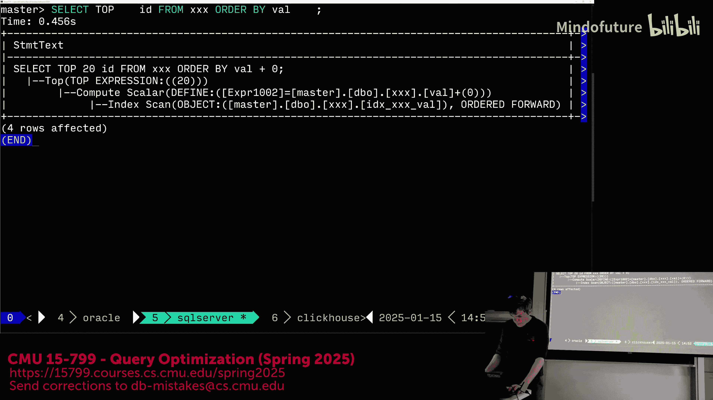
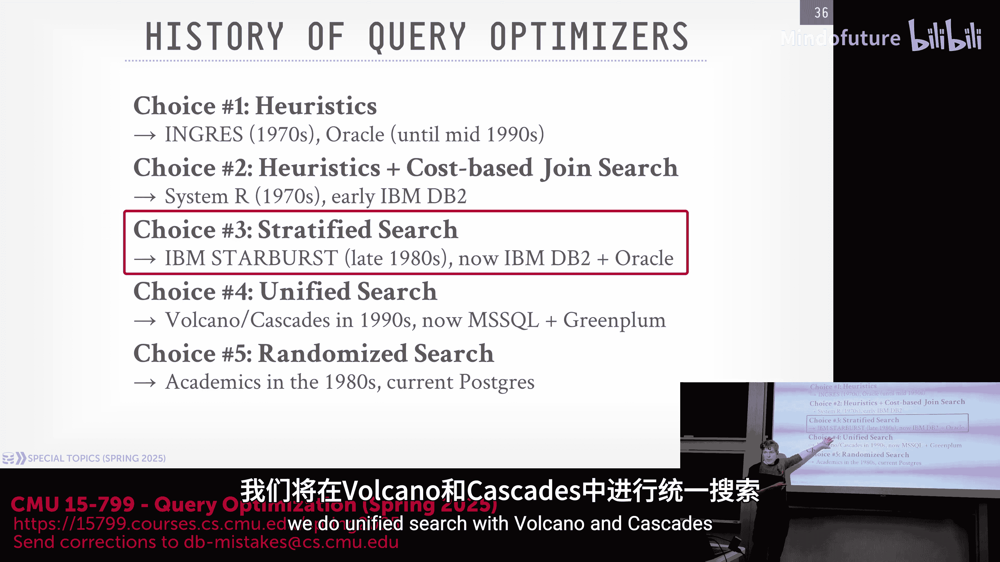

# 数据库查询优化：02：查询优化器历史与IBM System R 🗃️

在本节课中，我们将从查询优化器的起源开始，探讨20世纪70年代早期的实现，特别是聚焦于IBM System R这篇具有开创性意义的论文。我们将了解从启发式优化到基于成本搜索的演变过程，并理解这些早期思想如何为现代查询优化器奠定了基础。

## 背景：关系模型与声明式查询的兴起

上一节我们介绍了课程目标和查询优化的重要性，本节中我们来看看查询优化器诞生的历史背景。

在20世纪60年代末至70年代初，人们开始构建最早的通用数据库系统。当时，用户与数据库交互的方式主要是编写过程式代码（如CODASYL），程序员需要明确指定数据库应如何执行查询以获取答案。这要求程序员做出大量底层决策，例如选择扫描方式和使用哪个索引。

然而，数据会随时间变化和演进。最初编写时有效的执行计划，在数据分布或规模改变后可能变得低效。由于执行计划被硬编码在应用程序中，任何优化都需要重写代码，这带来了巨大的维护负担。

关系模型的伟大思想在于，它将那些复杂的程序步骤提炼成一种声明式的形式。用户只需声明“我想要什么答案”（例如，通过连接三个关系来获取艺术家姓名），而无需指定谓词的应用顺序或连接顺序。这样，数据库系统就处于做出最佳执行决策的理想位置，并且随着数据的演进，查询计划也可以随之演进，而无需更改任何应用程序代码。

早期主要有四个关系模型的实现：
*   IBM英国实验室的“Peterlee关系测试载体”，是一个早期原型。
*   IBM圣何塞研究实验室的**System R**，这是第一个严肃构建的关系数据系统。
*   加州大学伯克利分校的**Ingres**（后来发展为Postgres）。
*   Larry Ellison阅读IBM论文后创建的**Oracle**。

所有这些系统最终都需要构建查询优化器，因为声明式语言要求系统自行找出最佳执行方式。

## 查询优化器的设计选择概览 🧭

以下是构建优化器时可能的不同设计选择，我们将在课程中涵盖大部分内容：

*   **启发式优化**：基于硬编码规则和模式匹配进行转换，不考虑成本估算。Ingres和早期的Oracle采用此法。
*   **基于成本的搜索**：使用成本模型估算不同计划的代价，并搜索最佳计划。**System R** 是开创者，其方法成为后续几乎所有数据库系统的基础。
*   **分层搜索 vs. 统一搜索**：System R采用分层（先逻辑转换，后物理计划生成）。Cascades等系统采用更统一的搜索，但界限可能模糊。
*   **自底向上 vs. 自顶向下**：System R使用自底向上的动态规划。Cascades使用自顶向下的转换式搜索。这对实现有重大影响。
*   **随机化搜索**：如模拟退火、遗传算法（PostgreSQL中有原型实现）。
*   **AI/机器学习方法**：使用神经网络等技术进行优化。

接下来，让我们从最初的启发式优化器开始。

## 启发式优化器：基于规则的转换 🔧

早期查询优化器的基本思想是在数据库系统中硬编码一些逻辑，用于查找查询计划中的特定模式，并应用转换规则。

其实现方式可以想象为一系列 `if-then-else` 语句：如果看到逻辑运算符A后面跟着逻辑运算符B，那么就执行某种转换。这种方法之所以能工作得相当好，是因为我们可以应用关于数据库系统的领域知识，知道某些操作几乎总是有益的（例如，优先执行选择性最高的过滤条件、谓词下推）。

Ingres最早采用了这种方法，Oracle直到20世纪90年代也一直使用它，MongoDB等许多现代新兴数据库系统初期也常采用此法，因为构建一个完整的基于成本的优化器非常复杂。

我们能够进行这些转换的关键在于，我们依赖**关系代数中的等价规则**。这些规则保证了在修改现有表达式后，所生成的新关系代数表达式是等价的，即会产生相同的答案。这为我们的转换提供了正确性保障。

我们主要关注选择和连接的两种规则：
1.  **选择操作的等价规则**：我们可以将包含多个`AND`条件的谓词拆分成多个独立的选择操作符，并移动它们的位置（谓词下推）。我们还可以简化谓词表达式（例如，将 `x = y AND y = 3` 重写为 `x = 3 AND y = 3`）。
2.  **连接操作的等价规则**：主要是**交换律**（可以交换连接中关系的顺序）和**结合律**（可以改变连接操作的组合顺序）。这些规则导致了连接顺序组合的爆炸式增长（n个表的连接顺序数是卡特兰数），使得找到最优连接顺序成为一个NP难问题。

### 应用启发式转换：一个示例

以下是如何对一个查询应用启发式规则：

1.  **初始逻辑计划**：SQL查询经过绑定器后，生成初始逻辑计划，通常包含表扫描、笛卡尔积和将所有WHERE条件放在顶部的单个过滤操作符。
2.  **拆分谓词**：利用等价规则，将顶部的复合过滤条件拆分为多个独立的过滤操作符。
3.  **谓词下推**：识别出只引用单个表属性的谓词，并将其下推到该表的扫描操作符之上。将连接条件（引用两个表的谓词）下推到笛卡尔积之上。
4.  **转换笛卡尔积为连接**：如果一个过滤谓词紧随笛卡尔积之后，并且该谓词引用了连接的两边，那么可以将这个过滤谓词和笛卡尔积合并转换成一个内连接操作符。
5.  **投影下推**：如果发现向上传递了不需要的属性，可以添加投影操作符来提前过滤掉它们（具体是否进行取决于系统实现，如列存/行存）。

所有这些操作都无需查看成本模型或统计信息，仅仅是“如果看到模式X，就执行操作Y”的硬编码规则。

### Ingres处理连接排序的独特方法

那么，如果没有统计信息，如何决定连接顺序呢？Ingres采用了一种独特的方法：它通过将多表查询分解为一系列**单关系查询**来执行连接。

以下是其步骤：
1.  **分解查询**：将原始的多表连接查询，分解成多个只访问一个关系（或一个临时结果）的查询。
2.  **物化临时结果**：执行第一个查询（通常从具有直接谓词的表开始），将其结果写入临时表。
3.  **查询重写与迭代执行**：在原始查询中，用对临时表的引用替换原表。然后递归地将新查询再次分解为单关系查询，并执行下一个。如此反复，直到所有连接完成。
4.  **处理多值**：如果中间结果包含多个值，则可能需要对下一个查询执行多次。

这种方法在今天看来效率不高，但其思想——将复杂查询分解、优化并执行子部分——在某些情况下仍有体现（例如，MySQL有时会这样处理嵌套子查询）。

### 启发式优化的优缺点

**优点**：
*   对于简单查询非常快。
*   实现相对简单，能让新系统快速运行起来。
*   利用领域知识，对常见模式效果良好。

**挑战与缺点**：
*   严重依赖“魔法常数”或“总是这样做”的规则，无法前瞻性地评估转换的后果。
*   随着规则增多，代码会变成一堆寻找特定模式的 `if-then-else` 语句（“面条代码”），难以维护。
*   规则的应用顺序隐含在代码顺序中，这可能无法产生最佳计划。
*   无法处理复杂查询的最优连接顺序选择。

Oracle早期曾为其“语法优化器”（即按照SQL中表的出现顺序进行连接）进行市场宣传，但最终在90年代放弃了它，转向了System R风格的优化器。

**核心启示**：使用启发式规则引导查询计划优化本身不是坏主意，但像早期系统那样用过程式 `if-then-else` 代码来实现并非良策。我们需要更高级的抽象，能够声明式地定义规则，并由优化器自行决定在识别匹配时以何种顺序应用它们。

## System R：基于成本的查询优化器 🚀

接下来，我们进入本节课的核心：IBM System R的基于成本查询优化器。这篇1979年的论文奠定了现代查询优化器的基础。

System R优化器仍然包含一个初始的启发式阶段（类似于Ingres，可能也是一堆 `if-then-else`）。关键创新在于，当需要将逻辑计划转换为物理计划（特别是确定连接顺序）时，它使用了一个**动态规划算法**进行**基于成本的搜索**。

### 核心架构：查询块与分层优化

System R将查询分解为**查询块**（Query Block）。一个查询块通常对应一个SELECT-FROM-WHERE结构，可能包含GROUP BY或ORDER BY。嵌套子查询会被视为独立的查询块进行优化。

优化过程分为两步：
1.  **为每个查询块内的单个关系选择最佳访问路径**：对于每个表，考虑所有可能的索引和全表扫描，使用成本模型选择代价最低的访问方式。
2.  **为整个查询块确定最佳连接顺序**：使用动态规划，自底向上地枚举所有可能的连接顺序和连接算法，选择总成本最低的计划。

### 成本模型：IO与CPU的权衡

System R使用一个简单的成本公式：**Cost = (# of page fetches) + W * (# of RSI calls)**。
*   `# of page fetches`：预期的IO页面读取数。
*   `RSI calls`：一个代表CPU工作量的代理指标。
*   `W`：一个权重因子，用于平衡IO和CPU的相对成本。

这个基本思想——比较存储IO（或网络IO）与CPU成本——至今仍被大多数系统使用（例如PostgreSQL的 `random_page_cost`, `cpu_tuple_cost` 等配置参数）。

### 选择性估计与统计信息

成本估算的核心是**选择性因子**，它表示一个元组满足给定谓词的概率。System R论文提供了一页公式，用于基于数据统计信息（如不同值数量、最大值/最小值）来估算各种谓词的选择性。

然而，这里存在一个关键挑战：这些公式依赖于**强假设**，例如数据均匀分布、谓词之间相互独立。在现实世界中，这些假设常常不成立（例如邮政编码的人口分布），导致估计错误。错误的估计会向上传播，使得即使搜索了所有连接顺序，也可能因为基于错误成本而选择了一个糟糕的计划。

### 处理“有趣的排序”

System R引入了**有趣的排序**概念，即查询所需的输出顺序（由ORDER BY或GROUP BY引起，因为当时GROUP BY也需排序）。在优化过程中，系统会为每个关系保留两条信息：
1.  能产生所需排序的最佳计划及其成本。
2.  不能产生所需排序的最佳计划及其成本。
然后比较：`成本(无序计划) + 排序成本` 与 `成本(有序计划)`，选择总成本更低的方案。这是一种在优化后期处理排序需求的“补丁”式方法。

### 连接排序算法：自底向上的动态规划

以下是System R确定连接顺序的步骤：
1.  **步骤1 - 最佳单表访问路径**：为查询中涉及的每个单独的表，找到成本最低的访问路径（考虑索引和排序需求）。
2.  **步骤2 - 枚举并递推**：
    *   基于步骤1的结果，枚举所有连接两个表的方式（连接算法、顺序），为每对表保留成本最低的计划。
    *   然后，基于已有的两表连接最佳计划，枚举添加第三个表的所有可能方式，并为每个三表集合保留成本最低的计划。
    *   以此类推，直到构建出包含所有表的最佳计划。
3.  **剪枝策略**：为了应对搜索空间爆炸，System R应用了启发式剪枝：
    *   忽略笛卡尔积。
    *   只考虑**左深连接树**，而不考虑布什连接树。这在当时硬件条件下（内存小，流水线执行重要）通常是合理的选择。

**自底向上 vs. 自顶向下**：这是整个课程的关键区别。System R是**自底向上**的：从零开始，逐步添加连接和物理操作符，直到构建出完整计划。而后续的Cascades优化器采用**自顶向下**的转换方式：从完整的逻辑计划开始，不断应用规则进行转换，直至得到物理计划。

### 处理嵌套子查询

System R处理嵌套子查询的方式与Ingres类似：将其视为独立的查询块，识别依赖关系，然后**先优化并执行子查询**，将其结果物化到临时表中，再将其代入外层查询进行优化。这种方法（有时被称为“物化”或“执行-代入”）并非最优，我们将在后续课程中学习更先进的子查询重写技术。

### System R的贡献与局限

**优势**：
*   能够在合理时间内找到相当好的查询计划，而无需穷举搜索。
*   奠定了基于成本优化的基础框架，影响深远。

**局限**：
*   启发式规则部分仍用过程式代码实现，难以维护。
*   只考虑左深连接树，可能错过更优的布什连接计划。
*   物理属性（如数据分布、分区）在搜索算法中被很大程度上忽略，仅通过事后检查来处理排序需求。
*   成本模型中的简化假设（均匀分布、独立谓词）可能导致严重的估计错误。

尽管如此，System R论文是一篇里程碑式的著作，其核心思想至今仍然相关。如果你想构建一个新型查询优化器，从这篇论文入手是一个绝佳的起点。

## 总结与展望 📚

本节课中，我们一起学习了查询优化器的早期历史。我们从20世纪70年代的关系模型和声明式查询需求讲起，探讨了最早的启发式优化器（如Ingres）如何基于硬编码规则和关系代数等价式进行查询转换。接着，我们深入研究了IBM System R这篇开创性论文，它首次引入了基于成本的搜索和动态规划算法来解决连接排序问题，并建立了基本的成本模型框架。

我们看到了从过程式、基于规则的优化，向声明式、基于成本的搜索的演变。同时，也指出了早期方法的局限性，如规则实现的复杂性、成本估计的假设问题以及搜索空间的剪枝策略。

这些早期思想为后续发展奠定了基础。在下节课中，我们将进入下一个阶段，学习IBM在System R之后构建的**Starburst优化器**，它将我们引向更分层、基于规则的优化器架构。再之后，我们将探讨**Cascades框架**，它代表了统一、自顶向下的查询优化范式。