# 【卡内基梅隆---中英】数据库专题：查询优化-CMU-15-799--(2025-年春季)-p03-P03-#03---IBM-Starburst-Query-Rewriter-+-Optimizer-(CMU-Optimize!)--BV1wDE9z9EfK_p3-

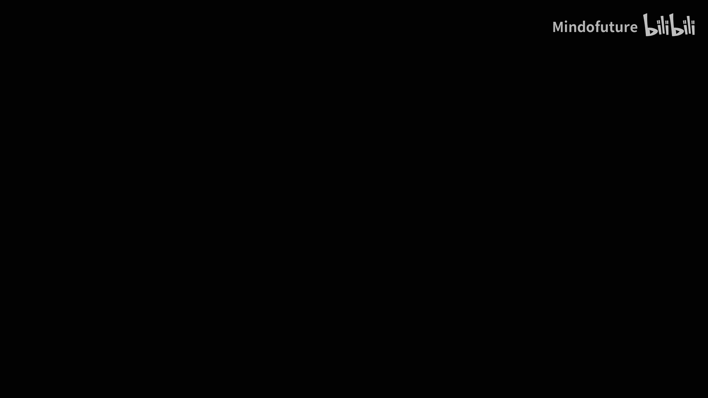

あ。🎼おって見せ。🎼A journey drove that Taas carry up the message。

This course is filmed on location at Carmicgie Mellon University in front of a life studio audiences。

一个上来个。picking up where we left up last class I'm talking about with the first query optimizer from IBM then now we're going to get it into the second one from IBM or the first Starbust and again you just start to see how the sophistication of the complexity of these optimizers is increasing were're jumping 10 years ahead into the 1980s still before most of you were born but the optimizer started to do a lot more things before we get to that though I do want to go over some mistakes that come up that people emailed about So the first one the mistake I made last class was that。

I say Charles Bachman was like the third or fourth。

 the second or third person that won the attorney Award， that's incorrect。

 he's actually the eighth person， so the Tony Award started in 1966 and so Bchman won in '73 so he was eighth person does anybody know who were the first person won the Tony Award was。

Purs， wheres pers from？CMU， he did his undergrad here and then he did his PhC， I think at MIT。

 and they came back as faculty and he won the first touring award in  or '66。

And then the other thing was that a German emailed me and was correctly pointed out that my definition of the complexity of the number of join orders you possibly have was off。

 I just said it was a cattle number， but it's really it's really where you have n tables。

 you want to join in a single query。 you just doing binary joins。 then it's n minus-1 factorial。

 And then this cat number is is another factorial that's really big as well。

 So it's the multiplying these two together， gives you the total number of。

Of possible join orders you could have， again， just doing binary joints or diadicds this this still a huge number right and so there's no it's not feasible for us to actually consider all possible join ordering。

😡，Right， and again， if I make any mistakes， send this email and you'll send weird things。

 people are starting sending weird things and that's not great， okay。As I said， last class。

 we talked about systemR， and we said it was the first cost based query optimizeizer and that how it was using dynamic programming to choose the optimal join ordering for queries and that optimalimum ordering was estimated through a cost model that was derived from statistics that were generated from examining the tables。

😡，RightThe key thing to point out and what we're going to see different in Starbus today and in going forward in other career optimizer implementations is that system R。

 because it was sort of the first one and it was running on primitive hardware certainly even to the 1980s relative to 1980s it was very primitive。

 but the one that they think they did is simplifyimplified the problem was，😡。

They would first select the access method they were going to use for a table。

 and then they tried to figure out the join order。😡，But as you note， again， from the interclass。

 oftentimes the join order will be what is the best join order to use is going to be influence on what the access method actually is。

😡，If you have an index on a table， if you pick a sequential scan。

 then you may not be able to use that index to do like a nested loop joint。😡。

RightOr if you want to do assortment merge join， if you don't select the table in a sorted order。

 then you can't use， you know the merge join operator right So what the Stars paper will point out and we'll see in future optimizes is that the better thing to do is when or the right thing to do is that you want to select the access method at the same time you're actually selecting the joint method。

Right。And so that'll sort of set up how we're going to do more complex things， you。

 looking at all the rules that are in Str today。All right。

 so well let's go back in time and talk about well was going on in sort the world of databases in the late 1980s。

 mid-1980s that set us up to why there needed to be something like Starbursst。

So there was two big trends in the late 1980s， one was object orient databases and the other one was called active databases。

😡，So object or databases are basically a database where the data model I think they're actually storing is like an object like in Java。

 Python， CA Floss， whatever you want and the idea was that you're writing your application in object ornaient code because that was the hot thing like small talk came out that was a hot thing CA fls was a little bit later like object Orin was the big was the big fad at the time and the idea was instead of having a relational database that organized everything as tables and relations。

😡，You want something that storage your program data natively so you just take your application code where you're writing against objects and then just have like a save function that then sucks that out and puts that directly into the data system in that native form So now when you want to go bring that state back into the application code。

 it's not doing a bunch of joins across a bunch of different tables。

 just going grabbing that single object。😡，Right so there was a bunch of database systems built at this time and part of it was because there was new applications coming along that didn't look like the traditional business applications of collection databases from the late 1970s。

 early 1980s or even the 1970s entirely， things werent always in a tabular form。😡，The other trend。

 less well known as object going databases were these things called active databases。😡。

The basic idea there was the database was going to be this living being that could react to changes in either internally in its own data or outside things that would occur。

 and it could update and modify its own contents。😡，You know， automatically。

It's basically just triggers， right if you want like if someone updates to this table。

 you'd fire trigger the then to do something based on that event。😡，But again。

 triggers are super common now in 1980s， that was a new idea。

And then we'll see in a second why this is sort of related to Starburst because they're in at least an the initial version of the query appr。

 they' were going to put everything in the database system and sort of almost the same way you would use the same rules to do queryta。

 you could then use them for doing triggers on data and so forth。😡。

But the one we care about the most is is this object going databases。

 right This was considered a real threat to relational databases because， you know， the。

The relation model sort of said like you have these scalar types in these tables。

 you can't have an array， you can't have nest of objects in your data。

 and then if anybody came along and said I have this new data type that isn't in the SQL standard or isn't in your relational database you'd have to go rewrite the entire thing where if people wanted to be able to write all these complex types and application code and have the data systems sort that natively。

So。People recognize that you wanted to be able to easily extend your database system to support new applications to new things and to make them sort of more competitive with these object one databases。

 This is why technically Postgres in Stoneberg's original papers。

 they're not called a relational database system。 They're an object relational database system。

 It just means that it's the relational model that can have extensible types and operators and other things。

So。roround the sort of same time here， going back now for crew optimizeizerrs。

 we talked about this sort of history here。😡，Now we're entering this phase here where after we sort of built the first ones in system R in Ingress and other early ones。

 people recognize that， okay， I want to have an extensible data system before object relation consider term。

 like people knew they wanted't be able to extend their data system without having to rewrite the entire thing。

😡，Right， I always give this one example that that Stmakerer always brings up like part of the motivation of making progress be extensible was when they were selling ingress。

 Ingresss had a built in data type or or sorry date type。

And it was based on the Gregorian calendar calendar reus。

 but then when they try to sell the database system to all the banks， all the banks are like， great。

 we need a date type to compute interest， but we run on the Julian calendar。

Which is the number of days since Ju are were they did they killed or born one of the two right because that's how they would compute interest because you'd always had 30 30 day months and so since the in order to add that new date type to the data they had to go make a bunch of changes to the system。

And so Pro， the idea was you'd have this core relational database system that had this base functionality you' would expect with certain data types。

 operators and functions， but then if someone wanted to add new functionality to it like a Julia calendar date type。

 they could implementent against an API and link that in without having to write the entire thing。

Right。And so as part of that， people recognize， okay， well。

 it's not just having these new date type or new operators to process them。

 you also the query after optimize needs to be somehow aware of what these things you're adding to it are so that you can choose the optimal plan。

So as part of that， that's what sort of fed into these movements where people wanted the way to easily add new things to a query optimizer without having to rewrite everything from scratch。

😡，And so these two sort of trends are categorized that we'll call optimizer generators。😡。

And so the idea of an optimizer generator is that instead of having a。

Everything that you could possibly do in your data system baked into the optimizer itself that you would have this sort of separate framework where you could define what the optimizer should be do under different conditions and under different kind of operators and different data types。

😡，And then you would have a way to then either compile or inject that optimization rules you've constructed into your data without having to rewrite everything。

So the starboard paper kind of these paper I had you guys read doesn't really talk about it in terms of being an operator opera optimizer generator。

 the volcano paper you'll read next class and certainly cascades after that this is definitely more heavy heavily biased for being an optimizer generator。

 but the high level idea is still the same that you want to be able to have people add new things to your optimizer to your data system and have the optimize to be aware of these things without having to rewrite everything right？

😡，And so a big thing that we're going to see in StarBst today and in the optimizers next week is basically how they're going to define how will have these patterns to match certain characteristics or aspects of a query plan。

 and then the transformation or change or modification you would then want to make to it。😡，Right。

And the idea is that you could do all these transformations and this pattern matching separate from how you're actually going to do the search to find an optimal query plan。

😡，That someone could just define here if I see this。

 then make this change and I don't care how you're actually going to go ahead and execute that。😡。

Is that clear。So the optimize generator is considered the right way to build these things。

 and we'll see more examples of that as we go along。In the case of system R。

 system R was like everything that all the logic was so hard coded in。

 I don't think it was written in C was assembly， but all the logic to do all the transformations and the search and all of that was intertwined in the single code base。

😡，Whereas if you go with this approach， you could have one team build all the optimization rules and another team is focusing on the engine to go or the search engine to go ahead and apply them。

😡，So related to again， the breakup between the Unified search and the stratify search。

 basically the two different approaches you could build an optimizer。😡。

Is going to be how you're going to consider what rules apply。

When you're doing court optimizationization。And so the stratified search we'll see today in Starbrst。

 the idea is that the query optimization is going be done in multiple stages。

Where some transformations occur in the very beginning and those， you know。

 actually don't need a cost model， right， you just kind of check and see。

 does the query plan look like this。 If yes， I know I can go ahead and make this change。Um。

 and then the other approach is going to be from a unified approach from volcanoics testscades。

 where you're kind of throwing all the transformations and everything you could do all in the mix altogether。

And then you just let the search engine try to figure that out。

Roughly also means are you doing top down versus bottom up but not not entirely right And as I said。

 I think in the first class， the lines between these are very， very。

 very blurry right you'll see Stars today they're going to have a explicit first stage doing the rewriting and then they do the call base search。

In the unified search， at least in cascades， the very beginning they talk about， oh。

 it's gonna be one single search， no no separate stages all at once。

 you should not figure things out， but in case a SQL server the paper talks about they do things in stages where they say I only want to do these transformations。

 if it's an easyqueer do these first set one， first set of transformations。

 if I think I need to do more then here's another sort of set of transformations I can do。Yes。

 I think cockroach is also a big kind of piece so'。Yeah， it's cascades。

 but they have a separate rewrite stage， yeah。All right。

 so this is just repeating what it has said the if I can't click the stratified search again。

 the idea is that there are going to be a bunch of rules that we can do rewriting on the logical query plan where we only need to check whether the rule should be applied。

😡，And if the rules are implemented correctly， assuming that they are。

 of course there's only to be bugs， that's independent of what we're talking about today。

 that if the rule is allowed to be applied， then the outcome will be a valid plan。

 So if you start with a valid query plan， some rule gets fired based on some condition。

 the output for that transformation will still also still be valid。😡。

And the idea here is that you want to sort of nudge the query plan in a direction that's more amenable for the cost base search。

😡，Again， we'll see this again in in Starburst today。 But the idea for them was。

Sometimes queries show up and they're written in such a way。

 the SQL queryer itself is written in such a way that the optimizer can easily figure out。

 here's a bunch of different alternative plans I could choose to execute it。😡。

Nest a queries that it's going to be the big problem that they try to overcome right so like if you don't unnest a nested query then it's almost like this procedural query plan like here's you got to run the nestA query first。

 then you run the outer query， whereas if you can unnest it， replace it as a join。

 then now you can start to do all your joint enumerations and try different orderings of things。

 try to find the best plan。But the key thing is that the initial stage here。

 we don't need a cost model， we know it's all about on the logic， does the rule match if yes。

 go ahead and play it。😡，And then Uniified search I。

 I don't want say too much because we'll talk about this all next week。

 But the idea is that you have all your transformation rules， some of them could be cost based。

 some of them may not be cost based， but the the。you're just throwing them all together and letting the search engine figure out what's the right order to execute and evaluate them and apply changes。

😡，This is going to be very heavyweight more so than the rewrite stuff we'll see today and so and then you may end up doing redundant computations over and over again。

 so they're going use basically an internal memo table。

 an internal state to keep track of have I made this transformation before for this query if yes。

 don't apply it again。Again， the Unified search we'll cover more next week。😡，All right。

 so I want to talk about the just quick intro to what Starburst is or was actually is because it's still round just not called StarBrst anymore。

 I want to give a one slide or two slide explanation of what relational calculus is because that's how they're going to represent the query plans at least in in the rewriting phase in StarBrst so then we'll talk about what the rewrite rules look like and then we'll talk about how they're do plan enumeration。

😊，来。All right， so most of this should be done for a lot of people here but you know IBM is building a lot of data systems for a long time actually I'm missing IMSS that would be 1968 so that would be above that I'm pretty sure that was the first system they built at released least for databases right we called about system R last class there was another project after system R called R star who heres heard R star。

It was the distributed version of system R right There was a distributed version of ingrass called muffin。

 which I think it stands for like multius or something and then I asked Mike one time as like what does it really it was like it's multigrass' like all right。

 but it doesn't say that in the paper so。😡，All right， so sorry system R and R star。

 these are all research projects at theid research group at IBM。😡。

SQL DS is the first commercial relation dating system that IBM put out， who hears her to SQLDS。

 still around。Nobody right， So but that has bits and pieces of system R。And then the big。

 big one that they put out was DB2 in 1983 that was use some bits and pieces of system are。

 a lot of the system was rewritten from scratch。 There was another project called EagleL where they' were trying to put a relational DNA interface on top of IMSS。

 which is not a relation data system and that apparently failed IMS is still around I think now they support SQL。

 but in the 80s they try to grasp SQL on top of it that didn't work。

 And then Starburst was the other big project that they were putting together in in 1985 and as I said last class and I'll say again at the end of this class。

This starrs exists today just now it's in the Linux， UniX and Windows version of DV2。

 not the mainframe versions， but again it's called LUW， DV2 or something okay。

So Starbursst was a major project that was being built at IBM Research after R star。

 and the big thing that they were trying to target was。

Making the system be extensible so be able to add new workloads， add new data types。

 add new operators without having to rewrite everything。😡。

And the key part of that is again as I said， it's great to add all these new functionalities。

 but if it's seen as an opaque box or a black box to the query optimizer you're screwed because I don't know what to do with it。

 We'll see this problem later on the semester with UDFs user find functions where most systems now again UDF shows up they're like I don't know what's inside of that。

 I don' I can't make any cardinality estimates about a selectivity or even what it's going to do because it can't see inside of it。

Microsoft has a way to fix that， we have a better version of that we'll cover that land semester。

 but again the idea is like in order if you want to add these things you have to tell the optimizeizer here's what I'm adding here's what's going to do based on the properties that you care about in your query plan。

😡，So this again， this is the same motivation as Postgress。

 but I don't think Postgress didn't do the integration with the queryery optimizer in the way that Starrst did and so I actually found a video of a promo video from 1990 of Starbus I want to play this down。

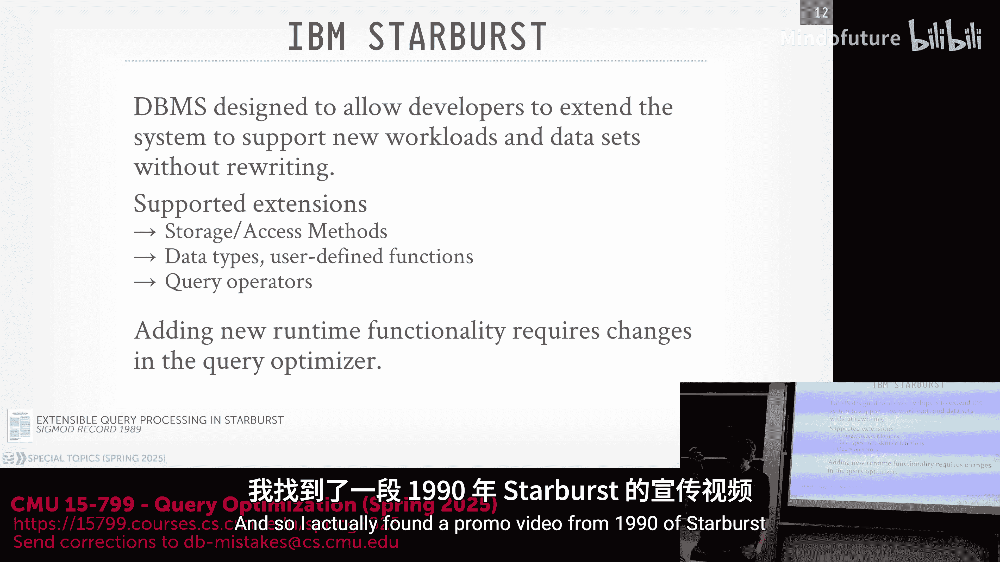

It starts with this weird ominous music。嗯。🎼え。And the injured's really long。

 so youll fast forward to through bunch of this。The angel was like a minute long and I was like。

 I can't play this。🎼。

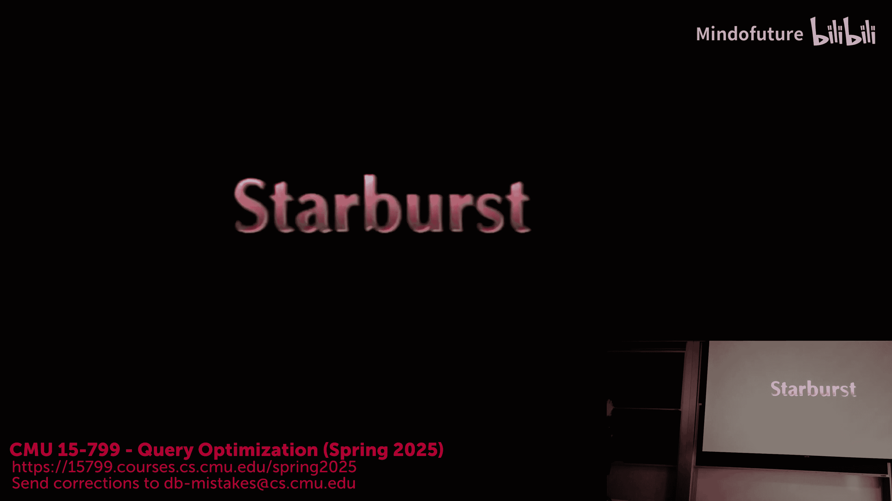

Information， we accumulate it， analyze it， and store it away。

And every year that passes means that much more information to be processed。

Access to this explosion of knowledge comes from database systems。Given a query。

 a database system will sift through vast amounts of raw data in order to take requested information for the user。

But new information may not always fit within the model that today's systems can use。

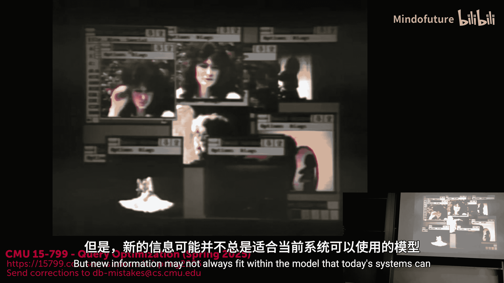

What we do know about this information explosion is that we need to find ways to make databases。

s first you guys。 We need solutions that will work for the needs of tomorrow。

 as well as the needs of today。 The Starbust project here at the Almiden Research Center is our answer to this problem。

Starburst is an extensible database system。 That is new types of data。

 and the access methods for retrieving these types can be defined directly in starburst。For the user。

 this means that the addition of new types to database。 That's the guy that ran the query operations。

 That's Gu Loman。All right， well， that's were do all this， right？And some example we're like， hey。

 you want to find all the campsites in Santa Clara？

And then you basically introduce a new new index type that you didn' have before。

 and you have to exposed that to the co optimizeomizer of how to do it。

 you still write everything and defined two different indices into the parks table。

 an index to all parks having campsites and a second index to all parks in Santa Clara County。

🎼The query optimizer is able to tell that the index to parks with campsites would cause more rows to be examined。

🎼Then the index to parks in Santa Clara County。🎼Therefore。

 the optimizer chooses to access the data and answer the query using the index to parks in Santa Clara County。

How did the optimizer know about the strategy using our new spatial index and what it could do。

Starber specified this information through a powerful set of optimization rules。

 So that's going to be as data to the rules。 Those are the star rules tell the optimizer what execution strategies are available and what they cost。

Starbursst's rule based approach to query optimization is tremendously powerful and flexible。

 So these are the stars and no rule the law can be applied to any table。Each rule is invoked by name。

 so the optimizer can quickly determine which rules apply。

The optimizer can explain to the user why it chose a certain strategy by simply listing the rules it used to construct that strategy。

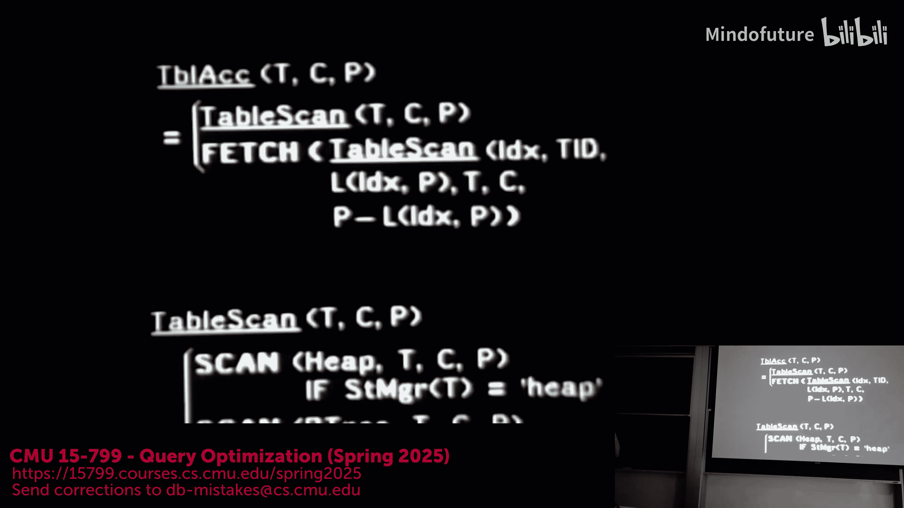

And best of all， since the rules are input as data to the optimizer。

 the user can instruct the optimizer to change old strategies or define new ones without having to change the optimizer itself。

'll cover that a second Herber's extensibility allows us to support new applications with new demands for new types of data and new operations。

Achieving extensibility is technically challenging because of the need to ensure good performance and data integrity。

🎼Rule based optimization and recovery are just two of the research issues that we are addressing in Star Wars。

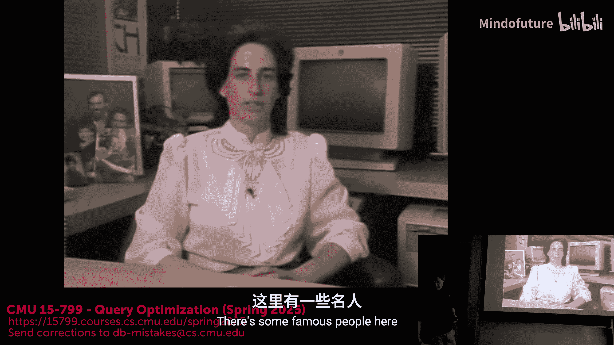

🎼完后了。So。

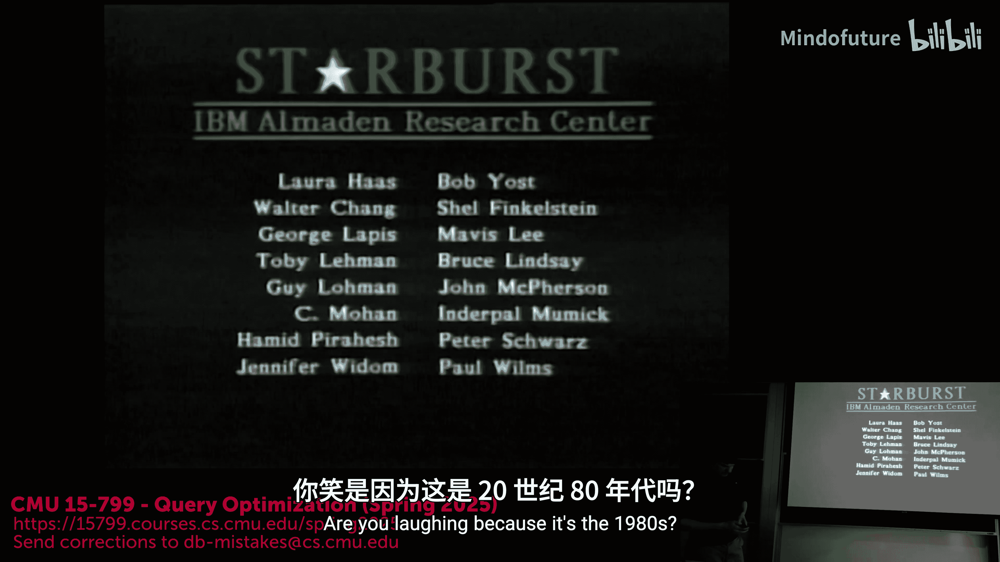

🎼I can't pause them。 There's some famous people here， Oh no。Are you allowed because's the 1980s？

I don't why it。I hold， that's Jennifer Whitham， and mean who she is？She's the dean at Stanford。

 right， and the paper you guys read that the oh the're not doing that。 the author， she's the dean of。

 of Umass Amhert， sorry of in computer science now。

Right， there's a bunch of other things with a guy that and then As he was on that list as well。

 All right， so I think you brought this up yesterday but like oh。

 it's called Starburst because they're bursting stars I guess they' going through a bunch of stars that's I mean like it seems reasonable right But then you didn't know about R star So I was like is it what's the meaning of the name So I emailed the author she's the dean at UMass she said name this is last night that so I didn't ask chattBt。

 I used perplexity and they got it right。 that basically the name was really meant to be they were trying to build something based on R star and they pivoted to this extensibility thing and the idea was like they blow up the bits and pieces of it and then that became Starbut right the video said that the stars have cost in them。

There is no better than the papers。We'll get that in a second， yes， that's in there。

 so this is the best paper。Of all the Stars papers that I picked for。

 there's one called a Star born or something that that you can't find anywhere。

s like like it's listed on the idea on site。 That's supposed to be the overview of Starburss。 That's。

 I can't find that。 that the 1 I send you guys is the only one that covers the rewriting and the。

 and the cost space optimization。 So that's why I had you guys read that。

 There's other ones where they， they just do rewriting。

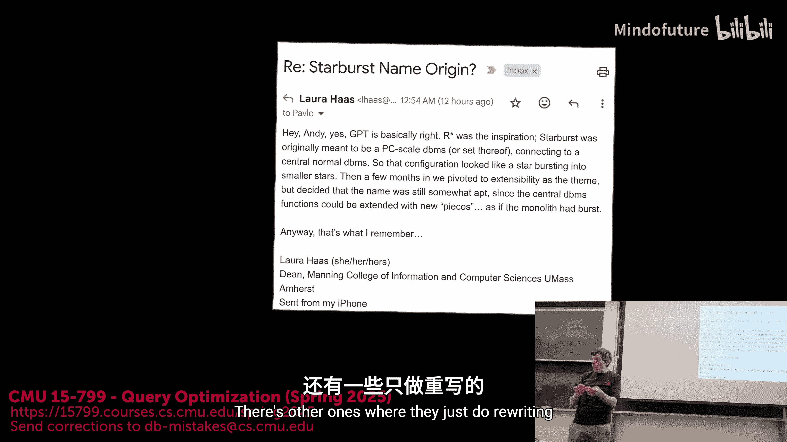

And then the guy I emailed one of the other guy caught。

 the guy in the green shirt that was typing and he sent me his slides this morning。

 I actually used bits and pieces of it， but he had like a sort of full overview of everything that Stars to do in the Que was。

All right， so here's the pipeline。This going start to look more advanced than what we saw in system R and a sort of general overview right we still have a parser and a binder because we have to do evaluation to make sure that any names or tables actually match something in the catalog but they're going to take the logical plan that comes out of this the parsing and the validation and they're going store this in a graph model called the query graph model。

😡，And we'll go over what that is in a second。 And then now the the queryograph model sort of think this is like the。

It's a logical representation of the query plan in tual relational calculus。

Wwhichch we'll cover in few slides。So this is the logical plan but then now the binder says。

 okay I'm done， tells the query writer to pick it up， sucks in the queryograph model。

 apply a bunch of these rewrite rules that we'll cover and then can come up for fine versions of the queryograph model and again the output of this。

 the first stage has always be a query plan， a querygraph model and any rewriting you do subsequently will always produce a valid one。

😡，Then you hand this off now to the control to the plan optimizer， then takes this in。

 applies additional rewrite rules that these are the stars to then generate a physical plan。😡。

There's additional refinement step， which doesn't really paper talk about。

 we'll see this in the Microsoft one， sometimes like if you know you need to go distributed。

 then you start off with a single node plan and then refinement can then break it apart or do multi nodeode。

😡，Right。And this is sort of showing one pass in， but you're actually taking the queryograph model and generating a bunch of different alternatives based on the stars and the lollipops and then that does the costing to figure out which one's the best one and then once this is all done then you have a physical plan that you can actually execute。

本来。So we're going to talk about most about this and this， the paper doesn't talk about what this is。

 and we'll have to define what this is as well and then the thing at the top okay。😡，All right， so。

Before we get to that， we got to explain what the hell relational callus right So we made a big big deal of the beginning semester and I make a big big deal in the inter class about how you always want to be using a declarative language when you  query your database instead of a procedural one。

 I showed that an example of like here's what code cell looks like according to JDBT and then here's what a SQL query is how much better it is You definitely always want to be using a declarative language。

😊，However。When we talk about query plans and we always talk about in terms of like， oh。

 here here's the SQL query and look， I've converted it into relation algebra and then I can take that relation algebra and convert that into a logical query plan。

But laser algebra is procedural。it's defining the order in which you apply things like I am joining table A with table B。

 depending on on what side I'm on that join operator relation relation algebra。

 that's going to determine the order that the things going apply。😡，Likewise。

 if I have a new predicate pushdown， I' got to move the filter operator to the inside of my selectx。

So Starbst instead up doing representing the query plans as relational algebra。

 which again determines the order that things occur。

 they're going to be a little bit higher level or more higher level and represent things in  relational calculus。

😡，I don't teach relational calculus in the interclass anymore because you don't really need to know it unless you're doing query optimization。

Guess what， you're doing credit optimization。But it's not that hard， okay？

The basic idea is that it's a higher level a nonprocedural language where the calculus is basically forming tus based on some predicate。

So the basic form of a capitalist query， this is like the most water down version is that you're going to find some tuple T that's going to come from some predicate P on that T。

And that' again， that's just like the qualifier to say if a tuple from some input。

 which I haven't defined， matches this predicate， then I can put it as part of my output of my tuple。

😡，So t is just a tuupple variable if you have a square bracket that's how you identify or reference the attributes of columns in a tu four wordss coming from and then you say a tuple is in relation R means that basically it's coming from some source relation and the P is just going to be a formula similar to what weve before right based on predicate clus like predi clus it's just all the conjunction clause oral clauses all the where clause predicates that we've talked about before。

😡，There's also domain relational calculus， which is basically the same thing except instead defining like。

 oh， here's a T from a tubple from a relation， and then you explicitly build the tuple by putting the attributes you want in it in domain relational calculus。

 you basically define T as being like here's the attributes that I want explicitly。

They're basically the same， it doesn't matter for us。All right。

 so let's see a query where in Tra Pacus where you're going to get the ID and the salary for all the employees whose salary in some employee's relation is greater than 50。

000。So the way you write this relation of cculus is basically here's my TL T that's going be part of my output and the exists。

 so there exists a TL S in some employee's relation and I'm then defining the predicate that I care about or sorry and the attributes that I care about that It want to populateulating T so I say there's some T here。

 there's an ID attribute and oh it comes from S is ID attribute likewise there's a T there's a salary attribute in TL T。

😡，And it's going to come from the salary attribute。

And then we have our conjunction clause to say we' salaries greater than 50，000。

 so for all the Ts S in relation employees。Only match the ones where the salary attribute is greater than 50。

00。啊在。And then here's the equivalent relational algebra， is one variation of it。Again。

 the thing the pointing out here is I have the projection here， then the filter， I can swap these。

 like I can do the projection first， then do the filter。😡，And that's still equivalent to this。

 but in relational calculus。These clauses inside of this， the order doesn't matter。😡。

Because it's a higher level logic here to saying these things have to be satisfied in order for a two to come out of this query。

😡，Any questions？Yes， backward E exists it's essential， yes。

 the other one is is universal all upside down a。You do that for like nest queries and join and things like that。

Is it？It's all it's all you need to do for relation cculus for the semester。 I'm fairly sure certain。

 right， Allright， so what can we do with this， Okay， well， again， if we。

 if we want a way to represent a query。😊，In some some abstract form that doesn't。

Define the order that we're going to apply things right we could base that on relational calculus and use that as as the for our representation。

 of course we don't want to be doing know query optimization or rewriting on this because this is too high level we need something that has a bit more neat on it that can describe here's the actual properties of the data we care about and then allow me to manipulate things accordingly。

😡，So this is what they're going to do in their choreograph model。😡。

So it's going to be an internal representation of a query。啊。

And then that they can then do pattern matching on the structure of that graph。😡。

To then identify when they can do rewriting to move things around。

You can start think of the querygraph model as like the in every database of what's inside the query。

😡，So then you can do lookups in that in every database and say。

 do I have this structure or do I see this pattern if yes， then go ahead and do some change。😡。

And that harkkenens back to that active database stuff we talked at the beginning。

So the querygraph model is going to describe the input and output of tables and the relationship within a query。

 and they'll be sort of put together in a box to sort of organize things。😡。

And every box is going to be going to represent or contain the body that has all the quantifiers that perform some operation on some inputs and going back to my relational calculus back here。

 sorry， the quantifier is basically this。😡，There exists a tuple such that it has there exists a Tple T such that there's a T S that has these properties that get satisfied。

So the body is going to find that piece and then the head is going to be all these these boxes in our querygraph model are going to denote or keep track of the metadata about the output of that query box。

😡，And the various properties about it。Being all hand wby doesn't mean anything。

 so let's actually look at an example here。So there's a query we do get the suppliers and parts information for which the supplier's price is less than all the other suppliers。

 so it's a nestA query where we have the outer query doing a joint on inventory and quotation table and then we have this nasty nestA query with the all the all predicate that's going to go get the the price of the part that they're trying to look look up on so this is basically saying for any part in inventory it's part of Q1 for that price。

😡，If it's less than all other prices， meaning it's the lowest price。

 then the predicate would get satisfied。So the choreograph model is going to look like this。

And we'll go through it dip by bit。So the first thing is that we have the stored tables。

 and you have the tables that are actually in our database， the user defined tables。

 these are represented down below and they're basically just empty boxes。

 There's the name of the table and then there's some output columns that like going come out of it and that's it but you could add additional properties like if it was already sorted on the cluster you put that in there as well。

😡，Then now you would have these query boxes that correspond to the two queries that are in a query plan。

 so in the initial form or the initial version of a query graph model for a new query that shows up。

 every nested query would be treated as its own box in the outer queries obviously treated as the box so these are the two select statements that we have。

😡，And then within that， we have these vertices that represent basically the iterators。

 the things that are doing some operation on a s of tus coming in。😡。

And the two forms of the iterators are the set Formers。

 the things that are creating new outputs from base tables。😡。

Or it could be a quantifier that is something that's being generated as from being derived another query box。

😡，Right so this select here is doing the scan on the quotation table。

 so therefore it is a set former， these two guys here are both looking at inventory and quotations so they're both set Form。

 but this one here Q4 is being derived from the output of the second box here。

 so therefore that's why it's a quantifier。Yes， the way you think about this one you can do by execution material execution in your action engine because if you absolutely that has to be necessarily you're like way ahead。

 no， like there' there's no notion of materialize anything here。

 it's just saying like here's how here's the logic of how this query want to operate。

 but the correct result。Right？I mean， the answer is yes。 when we convert these into。

To for stars and then get down the lollipops， then you can reason about those properties yes。

 but not here。Yes。😊，虽以能文 a个。Ma。His question is， can I say anything about the order in which these things are be executedd。

 not this level to know？Right。Nothing。😡，there is no notion of order of operations in relational cculus。

It's just like， like if I execute this， I don't know how， but if I do it。

 then I will produce the correctep result as required by the query I was given。😡。

That's the way to think about this。あかします。Okay。Then now they have these qualifiers。

 these are basically sort of like the predates， they're represented by these rectangles that sit along the edges between them。

And then we have and for the output of each box it's going to say here's here's the column。

 the name of the attributes coming out of me and then below that you would have like where did it come from right so this box is producing a single attribute called price and this is just saying that this price is being derived from whatever Q3 is reading from or generating data from it'll have a price attribute you can have like the data type in there as well。

😡，The other thing that I don't think is very clear in the paper I saw you guys。

 I think they just they talk about in the head these distinct flags。

 but they don't talk about what's actually inside the body as well。

 and then I'll come up in a second， but the they want to keep track also of。

Is the output of a box going to be distinct or not？And this has to do again。

 of determining when you're allowed to merge boxes together。

And are you guaranteeing the properties of just uniqueness？

To ensure that the result is going to be correct。So。

It's sort of easy to understand within a box saying like， yes， the output here。

 be is it going to be distinct yes or no？But then they had this inner part here right so the select is saying here's the operation that I'm actually doing this will be equivalent to like almost like a lollipop。

 but it's really a star at this level and then you can also say things like，😡，Am I going to。

Enforce whether things are going to be distinct or not or can I provide a hint to anybody that is reading from me。

Is my data going to be distinct or not？Because maybe my box is not the one that's going to enforce distinctness。

 but it's coming from below me because the thing I'm reading from。

So this is saying distinct equal permit， so that means that you're allowed to these boxes allowed to produce duplicates。

嗯。They may or may not be， but they're not doing any explicit checking here。 whereasas and up above。

 now we have distinct equals in force。 So that's saying that there will be something we're going to do to guarantee that whatever comes out of this box。

 no matter how what is being fed into it。That for the attributes that are coming。

 they're finding their head as our output， those will be distinct。Zcl。Okay。All right。

 so if you got this choreograph model。What can we actually do with it right well as I said the initial query graph is going to come out for any query is guaranteed it can be valid because there's almost like a little translation of what was in the SQL query interrelational calculus as defined in the querygraph model right？

😡，But the。You know， in order the first version of this。

 we'll help to split all the nest queries that we have so that every select is going to be in a box by itself。

 right。But then the challenge is going to be that when we start doing query optimization。

 the cost base rules that the application of the cost base changes or transformations。😡。

In the second phase。Now， if our nest  querys are split across a a bunch of boxes。

 now we've got to write rules that can look across a bunch of boxes。

And that becomes very tricky because you have to try to handle all possible cornerary cases of the boxes。

And the dirty secret and I'm。Foreshading what we'll talk about later on。

 but if you' taken in 7 and 21， you know， the answer is that nobody except for the Germans handle all possible nesttic queries。

 Even DB2 doesn't do this。 for much they tout how great they are in this paper。

 they're not going to do it correctly either。They bash an oracle in one of them。

 They're better than Oracle， but they're not as good as Microsoft。

But the isn't as good as the Germans。We'll cover that later on as well because of our paper。

To make sure that they match the Germaners。啊。And we have it。We'll cover it later。

But basically I'm trying to say is like they want to get rid of all the NSA queries before they get to the plan based optimization so in this what they're going to try to do is now take a querygraph model and then find any in any query model that has multiple select boxes。

 try to mese them together so that you have a single select box so now you can reason about that box。

😡，Without looking at other boxes。AndNow because now you can do all the join order stuff and en nuerations and all the other prediup push and all the optimization we talked about before。

 now you can do that within the single box because they can't do it across multiple boxes。

So this is what the rewriter is going to do。Again， under stratified search。

 there's multiple phases marginal stages。This is the first stage you're going to hit after generate the queryreograph model to sort of apply heuristics and rules to rewrite the queryograph model into another queryreograph model that is more amenable to the call based optimization。

😡，Da probably something that we're to see later on。And as I said。

 the idea is that if queer comes along with a bunch of nestA subqueries inside them。😡。

You want to be able to collapse that down because if the since the cost base。

Oimize the costmate search optimizer that search algorithm。

It's not going to be able to reason across multiple boxes， it will end up basically producing a。

 it's almost like implicitly defining the order in which operators have to get applied。😡。

If you don't do this un nestesting。So that's the big goal is that they want to be able to rewrite it to get in a form that could be better for the cost space search。

 and's basically by applying transformations that we know is always going to be a good idea without ever referring to a cost model。

😡，Because that's an expensive lookup to go derive some cost assessment what you think the plan is going or what the query is going to do。

Alright， so this is cool。 It seems like a good idea。 So what do these rules actually look like。

 So there gonna be high level specifications of， of， of what are valid。😊。

Or legal choreograph model representations and alternatives for any one choreograph model。

So each rule is going to be defined in terms of the matching condition。

 like what has to be satisfied as true in micro choreograph model form then me to apply some action function that then goes ahead to makes the change。

😡，是啊。So。They make a big deal。 it's not clear in some of the much papers。 They talk about oh。

 it it's a high level declarative language， but then other papers they say oh it's in C。

 then later on they say， oh， it's in C++ right And then in the volcano or certainly in cascades later on。

 they're going to make a big deal about having a DSL we're going define find these rules and not something and something that isn't C or C++。

but that doesn't always work out either because sometimes you really do need to have you know low little access to the query plan to make changes like cockroach does the same thing they they try to define a DSL when they they can fall back to go if they need to Okay。

 we'll worry about that later， but just know in this means in the initial version of this。

As far as I can tell， everything's in seat， right？And then one of the cool things they can do is that they'll keep track of all the rewrite rules that they apply。

During this rewrite phase， and so then when when you're like a say the database developer or even the end user。

 when you want to go look at why did my database system generate this query plan。

 you could go back and look at， here's all the rules that been applied to get me to the rewritten form here。

😡，Now， that entirely useful for an end user or an application developerer， probably not。

Because it's going to be bunch of these rule names that we'll see in a second。

 like it's not going to end what any of those things mean。

 but it's certainly be useful for the person building the query optimizer to understand or it has to debug it why the query optimizer made certain choices。

Because then it's less of a mystery。So they're going to have rules for doing manipulations。

 they'll have the ability to apply rules aside of rules。

 they can also control the order in which rules get applied。😡，So you think of like。

 if I know that some rule is。Usually doesn't matter。 you're going to make a big difference。

 maybe I'll give that a lower priority than a rule that like pre push on what you're always going to want to do or un nestesting where you're always want to do those things。

We'll see this again in cascades， they have a notion of ordering priorities as well。

And then they have to be able to guarantee that the rules are eventually terminate。

And we'll talk about how they handle that later on。It's basically they set it like a。

You need to go but what's the wall clock， how long have have I been rewriting in other times you say。

 if I apply 100 transformation rules， then I' go ahead and once I do 10， then I'm done。

 so then they also have this rule engine as well。😡，嗯。And again， the idea is that you you can。

 you can control how the rules are applied Are the designed sequential order or the priorities。

 They talk about how you can have the ability to。Provide a probability distribution so that when you flip a coin。

 what's the likelihood that one sort of category， a class of rules will get applied versus another。

 I don't see that being feasible for anybody， but at least they expose these things。

I think as I said， you're given some budget， the system is given some budget for how long they're allowed to search or how many transformations or rules that they're allowed to consider apply。

 and then when that's done， the processing just stops and because we have this guarantee that any transformation that a rule does in the rewrite phase。

The input is a valid choreograph model， and the output has to be a valid gray graph model。

 That means we can terminate at any moment of the rewriting phase and will be guaranteed to have a choreograph model that we actually could then convert and run。

R right in its entirety。Right。We're not going to be able to do that in cascades because if you terminate early without actually getting down to all the leaves of the search tree。

 the query is not fully formed。And again， slightly different problem because they're just doing heres a big rule writing。

 but that's important thing to understand like they can shut this thing off anytime when the query shows up and everything works okay。

😡，So rather than showing again how they manipulate the querygraph mono can do in in terms of SQL。

 but say we have a select query here that is accessing some view that we define so you know you can define a view do some look like this and then you have a query that's going to do a join against that view as if it was a real table。

😊，The naive thing is basically take where we see the view being accessed。

 treat that as like a macro where you just fill in whatever the view definition actually was。

 so now we're kind of stuck with this nestA query here and we want to figure out how can we we want to apply a rule that can then allow us to merge the query box of the outer query select and the inner query select。

😡，So this is an example of what the rule would actually look like in basically pseudocode。😡。

But it basically says if I'm in a select box right so as as I'm traversing the graph model。

 then if I would define the when select box I'm in as the upper one and it has a quantifier that is doing a set form meaning it it's reading against。

😡，A reading against a base table。And I'm doing a range over it my sort of the inner query that I'm sorry。

 the query the。The table I'm referencing in my lower box is also doing sorry is also select。

 and they're doing a。There's no other selectck boxes accessing the lower box。

 I think I have two boxes， there's one edge going into the lower box。😡。

Then I went to these additional checks here based on the properties I talked about before where like if my output needs to be distinct and or I can allow things not to be distinct or the other guy down below me is not going to enforce it that is distinct if if either one of these are satisfied then I know it's okay for me to then merge the two select boxes so that the inner query is then access together in the same level in the same query box as the first query here。

 but then there's some additional logic here so this is the action that gets applied and you do the merge me to do boxes。

 but then you have to clean up these properties to know that like okay what the lower guy was telling me that they were enforcing things to be distinct and' I'm not checking that then I'll make sure that I'm enforcing that things are distinct for that my output ends being distinct。

😡，I should have shown every rewritten query， but they basically end up with a query where it's a join instead of anessA query here。

😡，Sos prettynarly， right， this is a lot a lot you got to figure out like， okay。

 if something's reading something and they're distinct or not distinct and are they accessing things in terms of directly from a derived table or store table。

 right。LikeThis is the easiest sample I could sort of come up with from the papers， but like。

It obviously gets way more complex。And so this brings up also the question of like， okay， well。

 how feasible is to think that someone's going to be able to extend the query optimizeizer that isn't an employee at IBM or whoever is put in the database system。

postgs doesn't allow you to do these things things。 They have rewrite rules。

 but they're really to just inject views into into the the query。

 They don't try to do any additional manipulation to。To。To to optimize it further。

So this is roughly what these rewrites are going to look like。

 which are going to be different than the rules we'll see for the stars and the glue and the lollipops when we actually do the cost speed optimization。

So again， the idea is that we will start with the initial queryreograph model the。

We'll do the rule engine want see which one of these matches when they do match。

 then you apply the change and then you just go back again and check to see now in my new choreograph model that since I've modified it from this rule here。

 is there any other rules I need to apply and to keep doing that over and over again and to either run out of time or there's no more rules to apply？

😡，Okay， so then now we end up now that we finish the rewriting phase now we have a choreograph model that is validin now we actually have to convert that to something we can execute in our data system again。

 the choreograph model doesn't say anything about the order in which things are going to be applied it's a logical plan。

😡，Does doesn't tell you what joint algorithm to use， what index isre going to use。

 what table is going to use， right Weve got to figure that out now。😡。

So now they're going to do more rules where they're going to transform the high levelvel constructs that are operations that are in our choreograph model。

 which they call the non-terminal operations like the high levelvel ones。

 and we' to convert that into the terminal constructs。

 the lollipops that define how you're actually going to be able to then execute the query plan。😡。

And what's interesting about these rules is that unlike in if you're parsing a grammar file。

 youre trying to parse SQL where you're really trying to for a given SQL string。

 you're trying to find here's the exact unique tokens that are within my SQL string in this world。

 a rule may actually produce multiple outputs because there's multiple alternatives you could choose I have something that says access to this table。

 well I could have a bunch of different access methods like based on indexes or special scans or whatever that will emanate from applying that rule to say here's the different choices that I can apply。

😡，So rather than in system R where they're basically saying like， all right。

 give me all the possible cables I can have for my join order。

 and then for each one I'm just going to itly say here's the possible join join method and join order I can have。

😡，It's all based on these rules so that it'll be it's sort of guiding the search in a more intelligent way to say。

 here's the possibilities I actually that are bound for me beyond us the join owner。

So the grammar file again， it's going to be basically very similar to what we saw before where you have these conditionals that you want to check to see whether to get satisfied and if they do。

 then you go ahead and apply the change。And again， the idea is that the choreograph model can be translated into the stars。

 the high level concepts， and then we want to convert those convert those stars and there other stars which then can convert into other stars and so forth recursively。

 or eventually we'll find out end up with the star， they then converts into a little lollipop。

 And once our query plan is entirely comprised of lollipops。

Then that's something we can actually execute or interpret in our engine。Right。

All right so again what is theipop loipop is just a database operator that we actually can execute。

 it's an extension relational algebra that includes additional functionality that isn't fine in the initial relational algebra。

 or at least the original relation algebra you actually needed to actually run something right in relational algebra at least the initial definition of it did include a sort operator。

😊，But obviously we need sort， we care about that。They didn't the Vi Out didn't have a sort of operator to do。

Accessing tables from some location。I guess you could say the select operator sort of that。

 but it didn't have an explicit operation to store something into an operator。I started into a table。

So the access is basically converted the store tables into streams。

 and then the store is converting the streams into store tables。

And this ship is basically to send things over the network if you're doing a distributed system。

So each lollipop is can take one or more tables as inputs and always produce a single table as its output。

😡，So that is an interesting limitation， right because in some cases in some some we won't go too much this semester。

 but like in some systems， you actually want to have one operator generate multiple outputs。

Like if you know that if some sub queryry or some portion of the query plan is going to be used by other parts of the query。

 you may want to have an operator to produce multiple streams coming out of it。😡，嗯。

And so they can't handle that。So the lollipop would be something highly level like again like or not highly level like like I want to do a join。

 I want to do a sort， I want to do a ship， and then rather than having different physical operators that represent the different implementations of how you do a join。

 for example， that you wouldn't have a hash join lollipop or sortmers join lollipop。

 you have single you have a single join lollipop and then the input parameter into that lollipop specifies what the as they say flavor of that lollipop is。

So you would have an input parameter to a join lollipop。

 say I'm going to do a hash join or I'm going to do a servers join。😡。

And that's different than what we'll see again， in Cascades。

 where they'll have explicit operators for the different joint implementations and so forth。Right。

In the case of system R again， system R just kept a just here's the sequence of operators I actually want to do on these tables and then the。

The things you actually did on them was sort of implicit as part of that， meaning like。诶。Like again。

 you would say the opera would be do a hash join。And that would then you would scan some table。

 do a hash join with another table， you were sort of defining explicitly here's the steps I want to do。

 these lollipops are still a little bit more high level than that。All right。

 so then you have these things called stars。Where again。

 these are just going to be the declarations of the high level operation that I actually want to do。

And then it's going to have a bunch of rules that allows us to rewrite stars in other stars or stars in the lollipops so that we end up eventually converging on a query plan again。

 comprised entirely of lollipops。And so they make a big deal about how a star just a named object。

 we saw that in the video where they were like， oh。

 here's the table scan and there was sort of this bracket and the bunch of these alternatives below that。

 those were the stars here's saying the table access is the star。

 and I can rewrite that into either Bre lookup， R tree lookup or s scan lollipop。😡，The idea again。

 we're defining how we build these high level constructs from these period operations rather than going from a high level operation and explicitly then converting it like a logical operator and explicitly converting it to a physical operator。

 which is what we'll see again in Cascades in Volcano next week。

The other thing that they're going to do that system already didn't do is now have a notion of explicit properties in our query plan。

 We kind of already saw this in the queryograph model where they're like， oh。

 the keeping track whether things are distinct or not。 But now in our query plan。

 we're going to keep track of things like。The what's the cardinality of a predicate or filter operation like you can't actually keep track of those things in the query plan itself。

 it's being derived from the query's cr mergers cost model because that's to look at the statistics and guess what estimate the estimate is going to be。

 but all of that now is going to be better directly inside the query plan。Remember from system R。

 they had this notion of sorts or interesting orders。😡。

And that was like a thing on the side that they would keep track of like， okay well。

 yeah I guess kind of need to care about the sort order， but it wasn't embedded in the query plan。

 it was sort of like on the side auxiliary thing， but now we're introducing properties that first class entities in our query plan so that if we were try to start reason about what transformation we can make。

 if we know that a query plan sorry transformation would affect the。😡，You know。

 a sort order property in a certain way， then we have to then go ahead and patch that up。

So what they're going to do in Starbust is they're going to have these things called glues where basically they're special stars they add in to make sure like。

 hey， this thing doesn't look like the way I expect it look like go ahead and change the query plan to introduce a lollipop that will guarantee a property that I care about。

Again， it's sort of like system are patching things up。

 but they're doing this in again a more systematic way rather than again hack near the end。😡。

And again， I keep bringing up cascades， but in cascades。

 it's going to be different where they're going to have these enforcer rules to say you can't do this transformation if it violates the property that I care about。

So they're kind of almost there， but they have the glues to go ahead and fix this up right so this is what I just said so these are special stars to keep track of the cheapest plan satisfying the required properties for a query basically it's a formal definition of what systemA was doing。

But then they go back and see， okay， well， if my property requirements are not being met as defined in the glue stars。

 then I go ahead and the glue， the glue star will get rewritten into a lollipop but then does the sort or whatever it is that actually would need。

Or if the property is， there is no， there are no properties or the property that I。😡。

That I care about is actually being satisfied then the glue just gets rewritten to a no op and discarded。

If going back here， the other important thing that's me different than in cascades。

 of volcano is at the execution cost。Of a query plant or an operator within a plant tree is actually embedded as a property as well。

I'm not saying this is good or bad。 I'm saying this can be different than what volcano is going to do or cascade is gonna do。

 Cascades is gonna have the the cost being on the thing of the side。 Like what's the， the。

 what's the cost of the best query plant I've ever seen。

But it's not embedded inside of the query plan itself。

 They're going to keep track of these things on the memo table。

Andll be pros and concept for both of these， but that's another big distinction here is that execution costs this another property so if you now want to say what's the cumulative cost of this query plan。

 well as you're converting the stars and their lollipops and they're each going to have their own cost。

😡，You then just add some up with those costs going from one upper to the next。

Doesn't always work right and there's a lot of assumptions that they're going to make which we talked about before。

 where these calculations get way off， but we'll cover that in a few weeks when we talk about cost estimates。

All right， so I was going to put together an example of what these how to apply these stars。

 then the guy and the guy N Gu who worked on the worked on and helped build the Star Wars Career appizer。

 he sent me his slides this morning from a talking game at Microsoftsoft last week。I mean。

 the the fonts are all funky， but that's okay。 The， The material is what matters。

 So this is his example of what the。What the transformation process looks like or the query optimization process looked like of rewriting the stars in glue in DB2。

 and this is derived in this paper he wrote from 1988。Al so again。

 the rules is specify by bunch of alternatives like a grammar and each alternative term is can to specify a nesting of other rules or lollipops。

 so you would start at the very high level so the green is going to be the rule names which again going to be the stars and you would say okay I have an access route on table T and I can either rewrite that into a scan lollipop or I rewrite that into another star that knows how to access that table but against some index。

Right。And then this can get exploited further and say， OK， well。

 here's all the different ways I can access indexes。

Do I do a much of access multiple indexes and and the results together or them together like the different versions of these things this is all DB2 specific but。

But each of these then each of these stars can then get converted into the lollipops that would be used and then execute their corresponding operations。

Right。And then so then these can then all be converted now down into the either I have explicit indexes that I would need or I can go ahead and actually go ahead and create the index that I want So this idea here is like say for this one here what's an easy one I do a fetch on some I do a fetch from some tus as I'm scanning it but then the star of index scan gets rewritten into a lollipop called fetch and then another star called index scan then I got to apply rule that and rewrites that they actually then do the index scan on an explicit index that I want。

They do the same thing for Jo owner。 I'm not going to go through all the animations here。

 But like again， at the very the very top， you say I'm going to join a。To relations or。

Table S and table table L， right？Based on some some quantifiers。

 And then I can then do apply rules that could switch the join order， right。

 I can then have different choices of how I'm going then do the the join。

 then this get exploded by applying the rules to rewrite again。

 this join choices star into a nest loop join merge join or a hash join And each of those then get recursively。

Rules have personally applied on them to then convert down to how you're actually then going to physically executeute the query plant。

So again， the rules are defining have， if I see this pattern in my query plan tree， either on a star。

Then I can go ahead and rewrite that into either a star or set of stars and some lollipops。

 There's not going to be rules to do from lollipop to lollipop。 I don't think there is。

So this note here he wrote。This is basically what I was saying in the beginning where in that video they showed。

 oh， all the rules are entered into the database， just as data， and then the like an active database。

 and then you're checking within the database itself。

 do any my query plans match the rules that are specified in the database？😡。

They got rid of that and then when they actually put this in production。

 they're basically now compiling the rules， so I don't know again whether it's a DSL or one of the paper states in C+ laws。

 I think it's in C laws so these rules they find in procedural code that then get compiled and then there's some rule engine that can quickly apply them and see whether you have any matches。

😡，generate rewrite quickly。O。So how long does this go right Well if you said before you can just look at say how long am I running in the wall clock time right in Postgs this is basically how it works Postgs you can set a timeout for how long create measures about to run and then once it's done then it does the final cleanup refinement and you're given whatever the best query plan that it had。

You say a cost threshold， so as I'm doing my transformations I'm going to keep track of the best query plan I've seen before and if I somehow know what my the upper bound is or what I care about if I'm within 10% of that or if I have a query plan that I haven't seen any I haven't seen any improvement in the last1 thousand iterations or transformations that I' applied。

 then just take whatever the last one is because I'm unlikely to find a newer one。Most systems don't。

 I don't think any system actually does that in the real world， but some papers on it。

That only could be like if you know that you've gotten all the possible you look at possibly everything。

 then you just stop like if it's two tables your or joining two tables in your query。😡。

You can explore those two choices pretty quickly。And then the last one is what DB2 does。

 our Starbst does， and what Microsoft does， where you just say。

 I'm going to apply a certain number of transformations and once I reach that limit no matter how long it actually takes。

 then I just stop。And we'll come to tomorrow next week。

 but the Microsoft guys what they talk about is which and never ever thought about。

 which makes sense is that。The reason why you want to do this one is because no matter what the load of the system actually is。

You'll be guaranteed， at least that you're the。The query will always be able produce the the。

Find what would be the best query plan。Whether the system was loaded or unloaded。

 meaning like if the system is completely idle， and I'm going to do 1 thousand rule transformations。

 then I'll find some query plan， but if the system is taxed or thashing disk is very slow。

 then although it may take me 10 times as longer to generate that query plan。

 it'll still be the same query plan as when I was unloaded。😡，Yes。

 wouldn't that also still be true with like like， I guess ready to send that the number。

Where you just keep going until there's knowledge。诶。So right same it is and he's crack， yes。

 if you you're doing gradient in of this。Nobody does。

 then you basically say one I' level out then I stop， yes。But nobody does。There the。There was some。

 you know， there was a research paper we're not going to cover on doing like simulated kneeling。

 there's some systems that can do like try to use like you know。

 neural nets to try to find better qua lenss， but nobody printers this one either you do the first one or this one。

And the commercial guys do do this one because it's better。是。嗯。My sequel， they try to。

Sort of related my SQL will do like。How deep do you actually want to go in the query plan so you can say like。

You can say how like how much you want' to actually explore we say okay I've done enough so you can go all the way down you go some part down but we're not going talk about that let's finish up So as far as I know Starbus is one of the first queryrs that represent a query plans in this higher level form in two correlational calculus and then to allow them to to have rewrite rules that can just operate on what the query wants to do rather than the operation ordering within the query itself before you get into a query plan that testifies I'm going to do this followed by this followed by this。

 you want to operate on something that's higher level so that you can move things and manipulate things no matter know。

No matter maybe the， the exact forms of certain things。

There's a lot of other interesting aspects of Starbrst and DB2 optimized that we'll discuss later。😡。

We'll see methods how they can take feedback from a query actually runs and observe that their cost model estimates are way off and try to use the actual the behavior they see to update their statistics。

 and there'll be paper we read about these links later on as well。😡。

And as I said at the end of last class， there's this great blog article written by the data center。

 God at Amazon， James Hamilton， because he used to work on DB2 and this blog article they talk about how the Starburst system we've been talking about in that video you saw as well。

 like that was just a research prototype when IBM tried to build a DB2 version of DB2 to run on OS2。

 like their operating system， the performance was terrible。

And then the IBM research team got the Toronto team in was building that version of DB2。

 got them to actually use Starburst and Starbrst exists today in the Atlantic and Unix Windowss version of DB2 and James Hamilton was part of that team that port of that。

Okay， so that's it for today next class we now we're going to talk about these unified core optimizes。

 So again， scarbrst was a stratified one。We'll talk about Exodus。

 which is the very first queryatomizer generator that Cos Gry built。

 volcano is the one that's more important though and that's what calites it would be mostly based upon。

 so we'll talk about how these early generators work and then that'll lead us into the cascade's work later on。

 which is in the textbook as the second chapter。

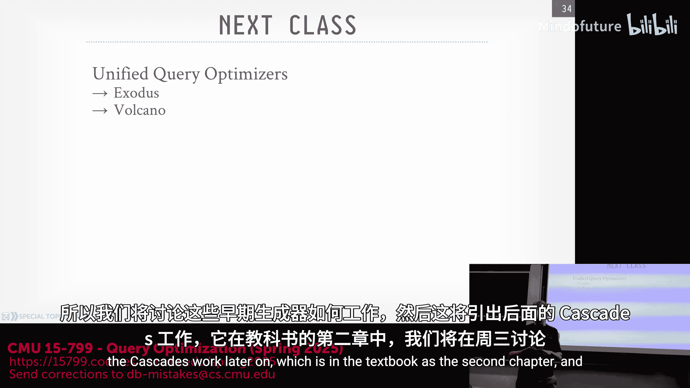

And we'll cover that on Wednesday。

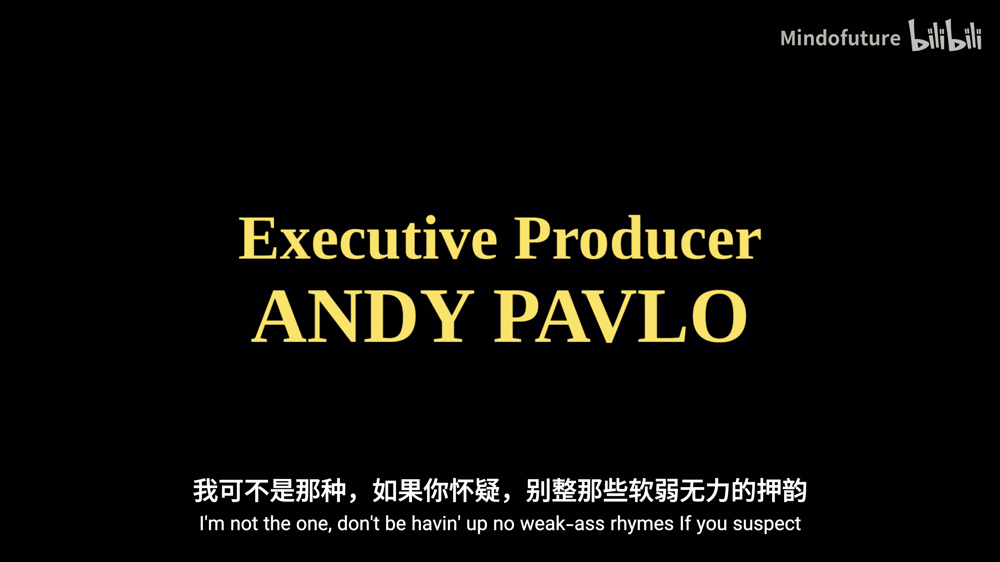

🎼I that that would brain in touch。🎼I don one。🎼IAnother one。

The me arrives is huge space if we don't risk through your mind wait this disappear straight punch line like a。

🎼to the creep with the bullshit， I keep the cattle equipped for the long trip。

 I got the remedy for beaches when the star shit surround sound like a foot。😊。

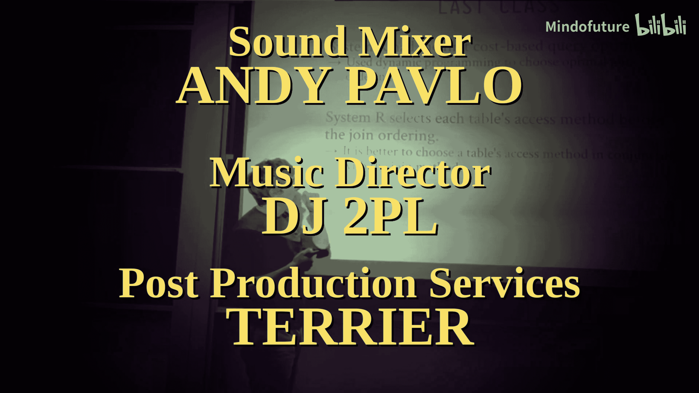

🎼It's a big me a never fuck you don't if did。🎼どシ。