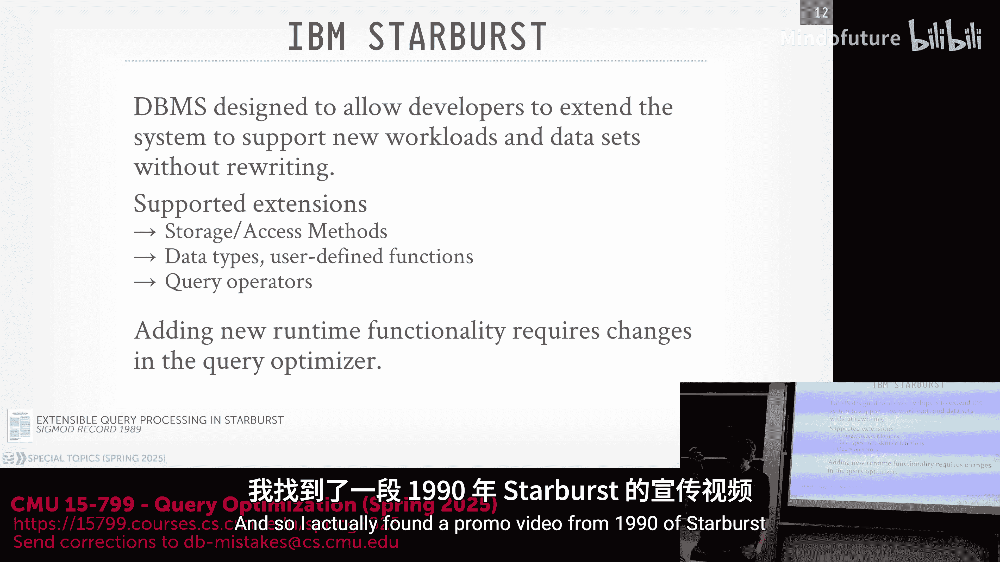
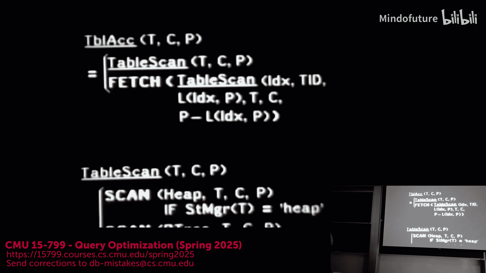
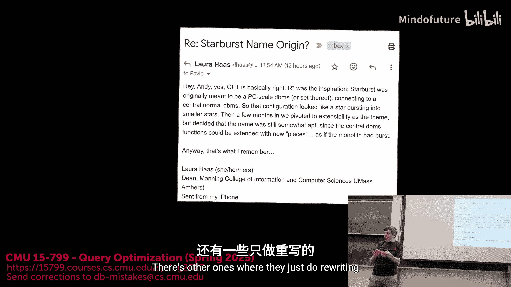
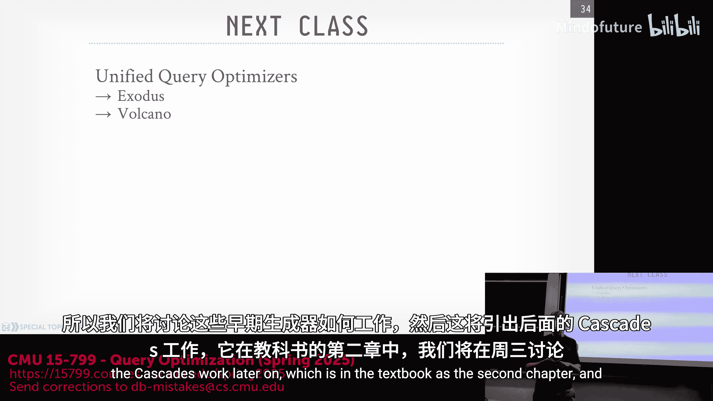

# 数据库查询优化：03：IBM Starburst 查询重写器与优化器


## 概述

在本节课中，我们将学习IBM Starburst查询优化器。我们将了解其作为“优化器生成器”的设计理念，探索其将查询表示为高级关系演算的“查询图模型”，并详细解析其分阶段（分层）的优化策略：先进行基于规则的查询重写，再进行基于成本的计划枚举。

---

## 背景与动机

上一节我们介绍了System R，它是第一个基于成本的查询优化器。本节中，我们来看看IBM在1980年代开发的Starburst优化器，其复杂性和先进性有了显著提升。

在1980年代中后期，数据库领域出现了两大趋势：
1.  **面向对象数据库**：旨在原生存储应用程序中的对象，以应对非表格形式的新应用需求。
2.  **主动数据库**：支持触发器，使数据库能对数据变化做出反应。

这些趋势促使人们希望数据库系统能够**易于扩展**，以支持新的数据类型和操作符，同时保持竞争力。这就要求查询优化器也必须能够感知这些新增的功能，而无需重写整个优化器。由此催生了**优化器生成器**的概念。

优化器生成器的核心思想是：将优化器的核心框架与具体的优化规则分离开来。开发者可以定义规则（例如：如果查询计划符合某种模式，则进行某种转换），然后由框架负责应用这些规则来寻找最优计划。这允许一个团队专注于规则开发，另一个团队专注于搜索引擎。

---

## 分层搜索 vs. 统一搜索



在构建优化器时，主要有两种处理优化规则的方式：


**分层搜索**（Starburst采用的方法）：
*   查询优化被分为多个阶段。
*   首先进行**查询重写**阶段，应用一系列基于启发式的规则来转换查询的逻辑表示。此阶段**无需成本模型**，仅基于逻辑等价性。
*   目标是将查询（特别是嵌套查询）转换为更易于后续基于成本优化的形式（例如，将嵌套子查询转换为连接）。
*   重写完成后，进入**计划优化**阶段，进行基于成本的搜索，生成物理执行计划。




**统一搜索**（将在后续课程中介绍）：
*   将所有转换规则（包括基于成本的和基于启发式的）混合在一起。
*   由一个统一的搜索引擎在单次搜索过程中决定何时以及如何应用这些规则。
*   通常更重量级，但可能更灵活。


Starburst采用了分层搜索策略，其优化管道如下图所示：




---

## 查询图模型与关系演算

为了进行有效的重写，Starburst引入了一种称为**查询图模型**的内部查询表示法。它基于**关系演算**，而非关系代数。

关系代数是指定操作顺序的**过程性**语言。而关系演算是更**声明性**的逻辑语言，它描述所需的元组应满足的条件，而不指定求值顺序。

一个基本的关系演算表达式形式为：`{ t | P(t) }`，表示“所有满足谓词P的元组t的集合”。

例如，查询“工资大于50000的员工的ID和薪水”可以表示为：
```
{ t | ∃ s ∈ Employees ( t.id = s.id ∧ t.salary = s.salary ∧ s.salary > 50000 ) }
```

**查询图模型**将这种关系演算表达式图形化。它由“盒子”组成，每个盒子代表一个查询块（如SELECT语句）。盒子内包含：
*   **体**：描述操作的量化符（如存在量词∃）。
*   **头**：描述输出列的元数据及其属性（例如，是否保证结果唯一`DISTINCT`）。

通过这种高级的、非过程性的表示，优化器可以更容易地识别模式并进行逻辑转换，而不受初始操作顺序的束缚。

---

## 查询重写阶段

查询重写是Starburst优化器的第一个主要阶段。其目标是应用一系列**重写规则**，将初始的查询图模型转换为一个更优、更“平坦”的模型，特别是消除嵌套子查询。

每个重写规则包含两部分：
1.  **匹配条件**：一个检查查询图模型中是否存在特定模式的函数。
2.  **动作函数**：如果模式匹配，则执行转换的函数。

规则保证：只要输入是有效的查询图模型，应用规则后输出仍然是有效的查询图模型。这意味着重写过程可以在任何时刻安全终止。

以下是重写规则的一个简化示例，用于将视图引用合并到外层查询中：
```pseudocode
规则：合并Select盒子
条件：
    - 存在一个上层Select盒子(U)
    - U包含一个量词(Q)，该量词基于一个集合构造器（读取基表或视图）
    - Q引用的目标是一个下层Select盒子(L)
    - L只有一个引用者（即只有Q引用它）
    - 满足关于DISTINCT属性的某些条件（例如，U不要求DISTINCT，或L保证DISTINCT）
动作：
    - 将L合并到U中
    - 调整输出属性的DISTINCT标志
```

通过不断应用此类规则，优化器可以将复杂的嵌套查询“展平”为单个查询块，为后续的基于成本优化做好准备。

---

## 计划优化阶段：从“星”到“棒棒糖”

重写阶段结束后，我们得到一个优化后的查询图模型。接下来需要将其转换为可执行的物理计划。Starburst使用**“星”**和**“棒棒糖”** 的概念来完成这一转换。

*   **棒棒糖**：代表一个可执行的物理操作符（如`TableScan`, `HashJoin`, `Sort`）。一个棒棒糖接受一个或多个输入表，产生一个输出表。
*   **星**：代表一个高级的逻辑或物理操作抽象。它通过**规则**被重写为一个或多个更具体的“星”或最终的“棒棒糖”。

这个过程类似于语法解析，但关键区别在于：一个“星”可能被重写为**多个**备选方案（例如，`Join`星可以重写为`NestedLoopJoin`棒棒糖或`HashJoin`棒棒糖），从而创建不同的计划候选。

此外，Starburst引入了**“胶水”** 星的概念。它用于管理和强制执行计划所需的**属性**（例如，数据必须按某个键排序）。如果下层输入不满足“胶水”星要求的属性，“胶水”星会重写为一个能强制执行该属性的棒棒糖（如`Sort`）；如果已满足，则“胶水”星被重写为空操作并丢弃。

执行**成本**也被建模为计划树的一个属性，在规则应用过程中进行累加计算。

---

## 搜索终止与总结

优化器需要决定何时停止搜索。Starburst及后续的DB2采用了基于**转换次数限制**的策略：无论系统负载如何，优化器在应用了预定数量的规则转换后即停止，并选择当前找到的最佳计划。这保证了计划生成时间的可预测性。

**本节课中我们一起学习了：**
1.  IBM Starburst作为“优化器生成器”的背景和动机。
2.  其**分层搜索**架构：先进行基于规则的**查询重写**，再进行基于成本的**计划优化**。
3.  使用**关系演算**和**查询图模型**进行高级、声明性的查询表示。
4.  通过定义**重写规则**来转换查询图模型，特别是消除嵌套子查询。
5.  在计划优化阶段，使用**“星”**、**“棒棒糖”** 和**“胶水”** 规则，将逻辑表示转换为物理执行计划，同时管理计划属性和成本。




Starburst的设计理念对现代查询优化器产生了深远影响，其分阶段处理、基于规则的框架为数据库系统的可扩展性奠定了基础。下一节课，我们将探讨采用**统一搜索**策略的优化器生成器，如Volcano和Cascades框架。