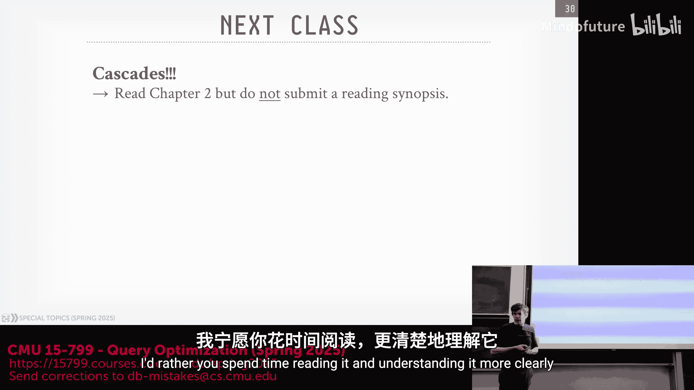
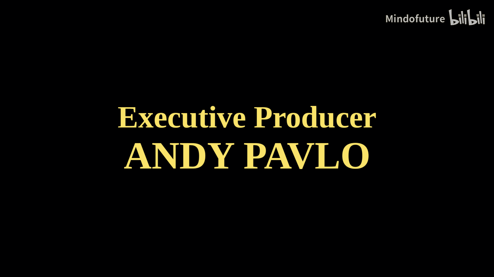

# 【卡内基梅隆---中英】数据库专题：查询优化-CMU-15-799--(2025-年春季)-p04-P04-#04---EXODUS-+-Volcano-Query-Optimizer-Generators-(CMU-Optimize!)--BV1wDE9z9EfK_p4-

あ。🎼おって見せ。🎼A journey drove that Taas carry up the message。

This course is filmed on location at Carmicgie Mellon University in front of a life studio audiences。

Every got notification that Project one has been posted。

 we did a quick upgrade update of the data set this morning。

 so if you just renamed it directly as the typo and then I would try to cover Project one at the end of next class Wednesday just a quick synopsis of what's expected what's involved。

 but the write up should be pretty thorough and you should be able to get up and running fairly quickly and you'll smit your assignment on gradecope。

And then if you haven't yet， please put your GitHub handle in that spreadsheet I posted on Piazza and also put in your AW account into that as well。

 and then we will have then submitted to Amazon to get $100 for everyone to use for all your projects。

 okay。Used me to give you like 100 bucks in the last like two years。

 I think think if you don't use it， they take it away for like six months。

're getting they're getting smarter about it。 So any question about Project1 or anything about the synopsis anything else that so far in the class。

Okay。But so today we're going to be continuing our discussion on the foundations and and the beginnings of query optimizes。

 And in particular， we're going to look about look at query optimized generators。

 sort of like these toolkits that are designed to be explicitly。😊，You're not a full database system。

 but that's something you could you could build and configure and tweak depending for your your target system。

 and then you can integrate it with whatever database system you're actually building。

 So before we do that， we going to get through some corrections。Actually， well， first ones done。

First one is not so much a correction。 I got this creepy email from somebody last week。

 who says that。They want me to move in with them。Because their marriage is falling apart。

 And somehow， I'm gonna figure that out。 I don't know who the fuck this is。 This is bizarre。

We're not doing that。There was a real one though， this is from somebody who pointed out that I had a typo in last class in particular on this slide here when we were showing the queryreograph model in Starbursst。

 and I said T1 dot price is less equal to all speak Q2 dot price because it's coming down from over here。

哎い。So anyway， minor typo， but we'll fix that in the slides。But again， I'm。

I've gotten some weird emails。 that one。 that's a new one。 Okay， al right， so last class。

 we were discussing Starbs。And in particular， we were looking at this。

Although what is now known as a stratified search approach。

 even though the paper didn't refer to it as that， but the idea that there was going to be these two distinct phases in your query optimizer。

 the first was the rewriting where you're transforming the queryograph model to another queryograph model and the idea here is that you're applying transformations or rules to optimize the query where you don't need a cost model where you know exactly this is something I'm going to want to do。

😡，Right， and some of this was designed for one of the big ideas was to。

Get sub nested queries that maybe in separate query boxes。

 get them into the same query box as maybe like the root of of the querygraph model。

 So that way you can do a bunch of joins and not worry about doing a bunch of。

Extra work on invoking nest queries over and again for， for for every tu in the outer table。 right。

 But again， the key thing with the rewriting was it was all， it was all just based on heuristics。

And then that was the idea to get us into a choreograph model form or representation that could then be gone through the plan enumeration process where we would convert the QGM into these stars with these rules that can convert the operator from a one star operator to another star operatorter or star operatorter to a lollipop and you kept applying those rules and newvering all the possible choices you could have in your query plant。

 and then eventually at some point you run out a time。

 or you exhaustedted the search and everything and then you end up with the final plan you and actually rot。

So the big thing were to point out too as well， in addition to having these two phases。

 which we'll see in volcano doesn't have this phase and they call out the StarBs in particular and say that's not a good idea。

 and we'll cover why then they introduce this idea that the properties now are going to be first-class components in the query plans and the rules where the rules can be aware of whether or not a transformation is going to change the query plan in such a way that it would not be able to satisfy a property that's required by something above in the query plan the order is the one that we keep seeing over and over again if you know that that the input of some operator requires the data to be sorted as you're applying these rules and StarBs and you're transforming the data that violates that property it doesn't satisfy that property。

 then that's an invalid transformation and you don't do it。Again。

 contrasting this with their earlier one in the system are it was。

Keep track of the orders that I would care about and then still run through the career acquisition process。

😡，But not invalidate or throw away different choices because it didn't satisfy the sort property and then go back later on and say。

 okay， well if the best plan I've seen so far doesn't satisfy the sort property I need。

 if I tackle on a sort at the end， what is that cost and is that better than another plan that did maintain that property？

😡，So now we're going to get rid of all those sort of hacks， Exodus will still do hacky。

 but volcano will try to treat this again as a first class property。😡。

Or the properties of the first class components？Right， so we。

Describe this in the beginning of the semester。 but we just bring up again because this is what everything is gonna to be today is going be about is again。

 this idea that the query optimizer is such a difficult piece of a database assessment to actually implement the hardest thing you。

 you could possibly implement that。every time someone wants to make a new system。

 if they had to reimplement the query optimize over and over again。

 then that's going to be it sort of increases the bear of entry to build a new database system。😡。

And the idea of an optimizer generator is that you abstract away the functionality of the optimizer。

😡，Provide an API so that someone implementing a new data system could implement the necessary inputs to some optimizer generator。

 and then that thing when we run on the side as a set of service。

 can integrate with your existing system so you don't have to reimple the wheel right。😡，We'll see。

Let's see the two most famous standalone or modular query optimizers are going to be calcite and Orca。

 They're technically not gonna to be optimized generators as defined the volcano paper because that was all about you write these rules and will'll convert them into procedural code and then we'll compile that for you。

 and then you link that into your database system。 Those guys。

 you you just implement their API and Java that gets compiled。

 So whether or not that's the same or not because you're not doing the translation。

 it doesn't matter。 But the idea again like you're gonna have the separate thing that can generate a optimizer and optimized optimizer for your database system。

 no no matter what the data model is， is really key to what these guys are trying to do here。

And a big part of that is going to be also then the separating with the transformation rules from the logic operators and for the logic operators and the physical operators。

 like having these be sort of separate concepts in our system rather than trying to intermingle everything all at once。

 We saw that little bit starbus the way they differentiated between stars and lollipops。

 And we'll see that again today with exodus volcano， right。And then the idea again。

 is that the mechanism we're going to use to figure out what rules we can apply to what operators that's going to be independent from the search strategy。

😡，So that if someone wanted to replace whatever the branch bound search you're implementing to figure out that's query plan。

 you could do that without having to rewrite everything。

The first version Exus we'll see in a second didn't do that， and they had to throw it all away。Al。

 so we're gonna talk， talk about Exodus first， because a lot。

 a lot of the core ideas will be carried over into volcano， but I。

 I love that volcano paper you guys read because。😊。

They talk about all the mistakes they made in their own previous system。

 as well as comparing contrasting with another system like IBM。So it's to me that of all the。

Of all the papers that this guy Gr Gry had written on his three pre optimizeims。

 Exodus volcano and Cascades， the best one that he wrote is the volcano one。Because again。

 it's like the system are what you could take that and actually reimplement maybe not all。

 like a lot of it。So I sort of said before or just now。

 like Gertz Grffy is a very famous database researcher。

 he's worked on three query optimizes in the 1980s and 1990s。

 and so he really pushed his idea of an optimizer generator for almost a decade over a decade and he sort of again laid the foundation for how we want to build these systems to that。

So the Exodus optimizer was part of this larger system that was being built at the University of Wisconsin called Exodus and similar to what Starbst was at IBM。

 it was meant to be this extensible database system project because that was the hot things as I said in the 191980s in response to the object oriented databases that were coming out around the time that we're trying to say。

 oh you want to do more complex things in your application code than you could do in the relational model therefore you need an object ored database and so all of these toolkits and these extensiontensible systems were really meant to show。

 oh no， you can actually do all the things you would want to do on objects in the side of a relational database system and a big part of that and again is having to provide a query optimizer that you could extend。

Right for those you don't know Wisconsin is usually one of the premier database universities in the world。

 that guy David Dewitt was Jgnesssh's Ph advisor， obviously he was Grray's PhD advisor。

 he's like probably the second famous database researcher in the world after like Stonebrier if you see that Dewitt Hogan mad。

 but he hasn't won the 20 War。All right，So again， what exodus is going to do。Again。

 have this idea that you're going to separate the logic we're going to implement in our query appomizer to do the transformations from a logical plan that's coming out of our parsel and binder and then produce a physical execution plan that we actually can run。

 we're going to keep those things separate as well as the data structures we're going to use on the inside to maintain all these things。

😡，and we're going to avoid exhaustive search in the way that system R had was doing。

 not by throwing away plans that we maybe don't want to look at。

 like bushy joint trees but by using sort of dynamic approach and a branch bound pruning to identify have we seen this path in a tree before。

 although Exodus is not going to do a good job at that， volcano will do better。

 and if I traverse down a tree is never going be better than the best coier plant I've seen so far。😡。

And you try to avoid those unnecessary computations。

One of the cool things that Exodus is going to do that volcano isn't going to do Cascades doesn't do。

 but we'll see later in the semester， and I'll show you what Exodus does that they're going to try to learn。

And the the。The ordering of。How to apply the rules and the effect that a rule may have on the cost model from past experiences。

Meaning like if I run the query optimizer for this one query and if I see it makes certain changes that for certain rules。

 apply certain changes that are beneficial more quickly or early in or if I see rule transformations that are beneficial my query plan。

 I'll try to prioritize them the next time I run the query optimizer because they might I might be learning that those things are going to be a good idea or not。

😡，Yes， so are they learning in a sense like are we already putting that， you learn this。

 like you put it as like a road or anything， it or is it learning automatically where like the starts are right？

His question is like， how are they doing this。 We'll see in a second。 But you're basically asking。

 is it a rule that you would have that'd say， go learn this。 No no， this is like， it's。

 it's the search strategies， the thing that're gonna have on the inside that you don't have to modify in the query plan。

 You don't。 It's not additional rules。 It's like the idea that you you have a。

We have a cost function to say， here here's the cost of executing this query operator。

 this fiscal operator， I can learn how much better that's actually going to make me。

It's all done the query optimization。 So it's actually not going to be when I actually ran it。

 did it actually make a difference。 We'll see that later in the semester where you do they do try to go learn。

 I tried this rule in the query plan during the optimizer。

 and I got this benefit this expected benefit when I ran it for real。

 did I actually get that benefit， yes or no， and you have a feedback loop to say。

 is this good or not， This is just like on the inside and the system itself。

 So finger of closed systems， You're not actually running the query， you're just saying。

 if I apply this transformation according to my objective function to my cost model。😡。

Am I gonna to get a benefit of that， If yes， try to do， try to do more more quickly in the future。

Okay， and then just like in。In Starbst and in Systemmar， they're going to do a bottom up approach。

 another way to frame this is also forward chaining because it was the '80s。

 but we'll explain the differentiation between forward chain and backward traininging between volcano and Exodus later on。

All right so I'm actually glad you're here， initial implementation of the first query optimizer they were built part of Exodus。

 they knew they were going to do rules because it was the 80s and people were being experimental。

 they thought they would just use a esotero programming language that was based on logic programming again the first- class concept that they're promoting and just define all the rules in that programming language。

 which then would have its own runtime that can do the pattern matching and staiation of rules and the application of them an expansion of the different sort of facts。

 if you will in the query plan automatically。So theys like， all right， well this's the80s。

 Let's do this。 So they pick prologue。 but then they talk about how they end up throwing it all away and rewriting everything in C because they found that the the。

The languages runtime has this zone built in search algorithm， doing depth for search。

 you can't really change that and manipulate its behavior at runtime based on the results of the rules as you're applying them。

 sort of like you told prologue like here's all the rules that I have。

 things aren't going to get changed， just go。😡，Right and then furthermore。

 I think they had their own implementation of the prologue interpreter again。

 it's the 80s before the Internet where there was widely available ones。

 And that thing was just too slow for them they threw this first implementation away and it switchedes C。

So what's the lesson here。Don't use es。 Don't use esoteric languages。What's that？Well。

 they didn't have their own language， prologue and loop are things that existed before。かべ。Oh， well。

 I mean。Yeah， assistant people。 that's okay， right would。

I would think that I would argue that the it's the。Like you could， supposedly take that language。

 prolo and you could then recompil it into something useful like C， right， But they didn't do that。

 They， They switched everything to C。 They actually invented their own probing language for the actual implementation of the system called E。

 which I think was based on。I think it's based on C。I think loop， where did loop come from， Los。

 was this Dennis Rie， I'm looking at you。 sorry， One of these。

 I think Lo might have been implemented by Dennis Ritchie。

 the guide invented C or the they based what they were doing on E based on Dennis Richie's early language or something。

 whatever like they did in prologue was a bad idea。 Again， it was the 80s。

 people were doing a bunch of experimental stuff。 What was they many know what the first programming language Postpas was written in。

 said it before in classes。What if what have post guys written in now。See， what was it written first？

No， basic。Think the 80s。that's the 60s。That's early '80s。Lisp。Right。So then what they have to do。

 they they had to write their own converter the transpier to convert the list into C and then actually compile that And run the system。

 in the 80 people were doing Wall， they were trying to build CPU that could just run list directly on the hardware。

 Like people were trying to also the weird stuff in Berkeley。 So that was a mistake。

 They ripped all that list stuff stuff out and re everything in C。

 And that' that's what the code base we have today。Right。Anyway， I'm not here to bag on prologue。

 There is data log， which we're not gonna cover in this class。

 That's a more useful version of prolo for databases。

 But most people don't write write that kind of stuff。All right。

 so here's what the pipelines is going look like。😡，So how this database system implementer。

 the person that's trying to integrate the Exodus query optimizer or volcanos query optimizer in their system。

 So in the case of Exodus， they have to provide a model description file。

 and then see functions that implement the different operators that you're telling telling the optimizer that your system is going to support I think they come as obviously some built in ones like scans and joins and so forth。

 But if you want in something beyond what the sort of basic relational algebra constructs that they had or operators that they had。

 you would provide those as well。And then you feed this into the optimizer generator who's going to then crunch on that。

 spit out a bunch of C code， which then just invokes GCC or whatever your favorite compiler and linker is。

 you produces a shared object file that you then would link into your database system。😡。

they would call this sort of the database system and generation time。

 so this would be done as part of the compilation process of building the actual software of the database system。

😡，And then when it's actually deployed， the SQL query shows up。

 we run through the parser in the binder just as we did before， this produces a logical plan。

 which we then feed into the query optimizeizer， does all the stuff that we're to talk about now。

 and then it spits out a physical plan。😡，Right。So again， the idea is that。

Instead of writing a query optimizeizer from scratch and having it deeply ingrained or embedded in the database system。

😡，It's a standalone shared object that you didn' link in。

It provides you the function and then that avoids the。You know。

 every single data system have to reimple their own query optimizeomizer， which。

Even though this was written in 1987， it's still pretty much true today， right？

I said this would be again， the pre execution time。

Calcite and Orca will see attempts to try to provide something like this。😡，But people。You know。

 people are。There's very few systems that are using calcite in its entirety。

 and the people using Orca are pym people writing orura， so it's not really widely adopted。Okay。

 so what's in this model description file。 So we have the operator definitions。

 you have to tell it the you know here's the number of arguments。

 here's the name the operator I'm doing and any additional properties and expectations I would have that required for that operator to process data。

 then you have the access method definitions like what kind of indexes are available you know is the data coming out sort of or not。

Then you have rules for transforming the query plans and then additional rules for mapping which operators can access which of the access methods that are defable above so this again this is metadata telling the optimizer in a structured form of what the C code you've implemented that you're providing it。

 what arguments are going to require what their data types are and so forth。😡，Right， thinking like。

 this is like before annotations in Python or whatever Java， whatever your programming language is。

And then now we want to talk about what the rules are going provide so they they make a explicit differentiate between transformation rules and implementation rules。

 and you can sort of think of this again like in the context of starburst。

 there was stars are were really sort of a higher level class of an operator doing through high level function。

 but then there would be a rule that could then convert that star into another star or star into a lollipop and a bunch of other stars。

 but they is always sort of called them rules or transformation rules in Exodus a volcano。

 they're gonna to make a distinction between the transformation rules and the implementation rules。

 I should also say the paper can be quite confusing sometimes and the textbook for the next chapter' read on Wednesday and cascades。

 it clean up that a little bit part of the reason I'm not having you guys read the original cascades papers because。

You know they refer to， oh， I'm going to do a transformation。

 but that transformation was based on an implementation rule。

 and then there'll be expressions we'll cover in a second。They're running it's hard to say。

The number of terms that they have that have get overloaded for what they're trying to do in the concept of a query optimizeizer can get quite confusing。

So again， even though if you read the paper， it'll say， oh yeah。

 when we apply this implementation rule， it does a transformation。😡。

That's different than what they mean by a transformation rule。All right。

 so transformation rule is going to be a way to map a logical operator to another logical operator。

 and then they'll have additional hints in the definition of the transformation that would show up in the model description file that can give warnings about whether this thing could get stuck in an infinite loop。

😡，And this explanationation points are trying to say that if I do this commutivity changing the join order of AB to BA。

 I don't want to then apply the same rule to go back from BA to AB。

 so they just have a little flag here that says， okay， when you apply this rule。

 don't try to apply it again on the output that you just generated。😡。

And then the implementation rules again， are just mapping from one or more logical operators to one or more physical operators。

 and so this is going to be a key distinction in Exodus comparative volcano。😡。

This is more aligned with sort of what Starbust is doing。

 I think Stars are more convoluted than this in some ways， but。What they're saying here is that。

in Exodus， they would actually recommend that engineers or the people actually building the distance of the implementers that they would manually combine rules if you knew that they were always going to be sort of executed in sort of successive order like if you always going to know you're gonna move move a filter below a join and then do some other transformation right after that because that's the plan that you want。

 they would say， well don't implement them as separate separate rules。

 combine them together in your code so theyre a single rule。😡，And that way。

 the search process is more efficient because it's not spending time applying the rule then looking up in the table to see what's the next rule applied。

 and then go ahead and applying it again。😡，Volcano is not going to do that。

  Volcano is going to say it's better to learn that these things should be composed together one after another and not try to combine them because that just increases the complexity of the implementation。

 it makes it harder to reason about the changes that you're making in the app。😡，So again， starbursst。

Sarbs who claimed they wanted this too， they wanted all the rules to be independent。

 but is a little more complicated than what volcano is going to do。

The other thing they're going to also be able to do is support bidirectional rules。

 meaning you could have sort of a logical physical transformation and then also go back in the other direction potentially and go back from physical to logical。

Volcanoes are not going to do that。Right。All right。

 so the search algorithm is pretty straightforward in Exodus。

And the way they're going to figure out what's the next rule to apply。

 and this is basically reimplementing sort the runtime that would be in probo to figure out what's the next rule apply。

 that is going to maintain this priority queue called open has some term from AI from the 1980s and that's what refer to that。

 But they have this priority queue called open but that's going to have all the transformations that it can apply next。

 and this is just going to be a list of references to the transformations that are going to live in this thing called the mesh and it's just a hash table that's keeping track of all the transformation that it's applied it's going to keep track of all the logical and physical operators that they're going to have already performed。

 and then the transformation rules are basically doing references to those operators and then the system basically looks up in the meSsh finds that those references and then does the transformation or if they don't exist they go ahead and apply them。

So it's a really simple level， look while there's more transformations to perform。

 you select the first one from the queue， apply all their transformation rules based for the things that exist in the mesh。

😡，And then you you do the transformation rules， then you do the implementation rules。

 to cover all the logical operators that you've generated from the second step here。

 now you're going to immediately convert them to physical operators and do the cost analysis to figure out which one is actually the best one to pursue。

😡，So they're going to be eagerly。 They're eagerly going to consider and evaluate all the physical operators immediately after doing a logical transformation。

😊，Volcano is going to do a little bit of that as well。 Cascades is not going do that。

 Cascades is going to eagerly apply the transformation or converting things to the physical physical operator operators as it does with the traver。

 not rather than blowing up the search base right away。😊，So the key thing they'm going to do。

 though's actually kind of interesting as well， is that they're going to。

At the beginning of each round， they're going to take a transformation rule。

 and they're going to try to estimate what is is what is what is the improvement that I'm going to get upon doing this transformation。

 and then they're going to prioritize。😡，Then based on which one is going to have。

 think is's gonna to have the biggest win。 And they call this the expected cost factor。

So the open R is a priority queue where there's something else that's keeping track of the priorities as you want to apply them。

And then as I do the transformations， I want to be able to look at them and figure out。

 sorry the ordering in the priority Q is going to be based on this expected cost factor that's going to say here's the thing I think is's going to make the biggest benefit or provide the biggest benefit to the overall cost of this query plan。

 go ahead and apply that first。😡，So the way to sort of think about this is like if my total cost of my query plan right now is some value C。

😡，Then the expected cost of a transformation is going to be this F that's going to say here's the effect of applying this transformation to my query plan and how that's going to affect the cost。

 so the idea is that if this F is less than one， then you know you think it's going to have a bigger benefit for you and the closer it is the zero。

 the better。😡，Right， for neutral rules， like， I mean， Jo community isn't necessarily one， but like。

Certain what would be a neutral rule here。Like maybe projections don't matter that much in your individual system and you did a projection push down。

 you have that would be considered like a neutral rule。

So rather than just going to the cost model always and say， okay。

 what's the benefit I'm going to get for this transformation？😡。

They're going to try to learn what that benefit is going to be and apply this what they call a propagation adjustment。

And the idea here is again， I want to keep track of the last end number of times I've applied this transformation rule and what benefit did I actually get from it？

😡，And they have a bunch of different formulas that different ways you could calculate this where one could be just take the sliding average across the last K number of transformations or attempts or time to apply this transformation could just be all of them。

 but now you start keeping track of the history of everything that becomes in the 1980s that become very expensive。

They basically say it doesn't really make that big of a difference。

 but they thought that this was a good idea that you want to keep track and learn when I apply this transformation how much benefit did it actually get in the future。

 and that can guide whether you make sense to apply the same thing again。😡。

They don't go into details how they consider things like what if the data changes and how do you invalidate this。

 what if the parameters for a query， what if that changes， how do you account for that？

certainly you can imagine for a single query。If that' that's the only scope that you're looking at as you apply this transformation。

 then that's the things that I said aren't a problem anymore because's like I'm playing this one query。

 I'm applying this transformation rule again how much benefit they actually get。

 But he wouldn't do this across multiple queries over longer periods of time。

 this becomes problematic， yes。Like， what is it。What do you mean when do you mean like the real costs versus what was expected？

So questions。In， in the context of this， Yeah， So again。

 we're not talking about like actually running the query。 They're not doing that。

 They're just trying to say the。U。If I is it's an expectation of what I think the benefit is gonna be。

 But at this point， I only have a bunch of logic， maybe a bunch of logic operators。

 So I think if I convert you to a hash join， then I'm gonna get this this benefit。

 So I I estimate what that that boost is gonna be。 Then when I actually do it。

 Then I run my real cost model that'll tell me how much benefit that I do get。

 So this is like an approximation of his cost。 because， again。

 you don't logical logical operators don't have cost。And as far as I can tell， again， they。

 they scope it。To make it this work。 They scope it within the context of a single query。

 But you can imagine that you want to extend this cross multiple queries。 as I saying before。

 this is just within the query itself。 There's nothing about whether I applied this， this。

 this change that to actually make the query run faster。

Because that's actually really hard to do because what if I apply some change， I'd get some benefit。

 but then my final  query actually doesn't even include that change。

Now I can't actually run the query and get any feedback for this， right？

The other thing let will talk about is when they apply a change and you get sort of this propagation adjustment。

 you don't actually apply it to whatever the transformation rule you just applied。

 you apply it to that one and then previous one。😡，Because it may be the case that there are some transformations where the。

The first thing you apply makes makes things actually worse。

 but then that sets you up in such a way that then you apply to the second one。

 and now you break out of you know you're out of the valley in your search。

 and now now things are much better。 So they hard coded so that the propagation judgment is applied for the last two。

😡，Should it be three， should it be four， I don't know， they don't say， right？

This sea kind of hackish， like it's in the right spirit。

 but I don't think this is the right way to approach this。But it's good again。

 they're thinking about this idea of like， oh， can I learn from fast experiences in the 1980s。

 Where now that's sort of taken for granted with reinforcement learning AI and other things。

All right， so one of the big flaws that XIS is going to have is that the way they're going to represent all the operators that I currently have that I've generated these transformation rules in this mesh hash table。

 the way they're going to organize that is the entry or the key they're going to do a lookup on is going to be a combination of the logical operator and then the physical operator it got converted to to an implementation rule。

😡，So that means if I have a。If I have a logical operator that can get converted to a Ss join and the same logical operator can get converted to a hash join。

 I'm going to have two different entries。😡，In my mesh hash table， representing both of them。

Is that clear？Right，Because volcan is gonna do something different。 Cascades can certainly do very。

 much different as well。 right， So NA means， basically， now you have like， you know。

 you have all this duplicate， these duplicate logical operators in this mesh hash table because they can't sort of have a linkage between from one logical operator produces multiple physical operators。

😊，All the additional logic that we're going to have about having。

When you add additional operators that can then require certain properties。

That logic has to be put into the cost function。You could have this notion that an operator expects this data to be common in a certain way。

 but then if you want to push the query plan to make sure that those things get satisfied or enforced。

😡，Then you， that logic just got to exist in in the the costs model itself。And as I said。

 syn Exodus applies a logical transmission rule， and then immediately applies all the implementation rules。

😡，And basically explodes out the search base， even though some these transformations you do in the implementation rule may not actually be a good idea or not。

Right，There's other things that they talk about in。

I think I think it's in the volcan the volcano bear or the Ex paper where they talked about how they。

 because it was the 80s again， they， they wanted to do the a star search algorithm if familiar with that。

 but they were not able to calculate the， the expected benefit。

 the promise of of the improvement you're gonna get from the inflation rule in such a way that the a star algorithm needed。

RightBecause you can't have like things oscillate back and forth， that it has to be a clean。

 clean step function。Right。All right， so that takes us now into volcano。

 So Gertz Gry graduated from Wisconsin and then I think he was a professor at University of Colorado and then he became a professor at Portland State。

 I don't know the details of what happened there。 but again。

 he was really pushing this idea of optimize generators for several years and its really groundbreaking work。

 So volcano the volcano project was similar to Exodus where it was meant to be an extensible database system toolkit。

 know， when we discussed the exchange operators and in parallel algorithms in the interclass we sometimes referred to that being the volcano method that all comes from the same project that he built for this career app as well。

😊，So again， just like in Exodus it was meant to be a exible system where you can add new operations and equivalent rules for them once again in order were to try to keep first class properties。

 I'm sorry to treat properties on the data as first class entities during the planning process。

 they'll do a little bit better than Exodus， but cascades we'll see on next class does it correctly handles all corner cases。

They're also going to do that same rule compilation pipeline we saw in Exodus。

 where you define these rules in with higher level metadatta。

 you then provide also see implementations for the different operations you're trying to add or operators trying to add。

 and then they'll compile that for you into a shared object that you then linked into your database system。

So what's going to be different what they're going to do is than Exodus and Starbst is now this the first example of doing a top down search to generate the query plan or backward chaining。

mDo you know， based on a branch bound search。And the big thing now they're also going to try to do that Exodus can do is that they want to be able to generate all these different permutations or apply the rules and start playing changes。

And then not have to go repeat and revisit things over and over again。

Because the way that the data structure that was being maintained in Exodus wasn't allow them to keep track of things。

So this was never。The original source code was never used outside academia。

 I think Exodus was used for a prototype object or database system out of Texas Instruments in the 1990s。

 but I think beyond that， I don't think it went anywhere。

 and then this is what calcite is supposedly at least what they claim that they're based upon in their implementationation in their paper。

Alright， so it's interesting to look at what are they going try to actually achieve in volcano that exodus couldn't do。

 right？ And I will say also， too， like， like I've。If you ever ever the term second system syndrome。

 right， this comes from IBM， basically， the second system syndrome is like if you build a。

 say you're in a project that build one new system and you say， okay， let's build to the next one。

 put do a rewrite。 And so when you build your second system。

 you're trying to correct all the things that you did wrong in the first system。 But then you say。

 if I'm already you write in the system， let me go add this feature and that feature and let's do this crazy thing right you start adding a bunch of new things in this second system。

 And then the second system never and it ends up getting built。Right and so I had to give him credit。

 likevolcano is his second system and he he got it done。 he followed his。

 his goals and they actually implemented reasonably well。All right。

 so just like before they want to operate with existing database systems。

 they want to be more computational and storage efficient than Exodus was。

 so you cannot not have this mesh table explode with all the possible things you've ever seen before or having to。

Generate things ahead of time。They want to have extensible physical properties beyond sorting and compression。

 you want to be able to specify these things more easily and support them as again。

 first class properties。 They want to be able to allow you to rewrite the search and the ability to figure out how to prune the branches as you're doing doing the traversal that one。

 I don't think ever。RightI I think I't think everyone beyond the。

 the depth for search algorithm that they implemented。 the paper talks about。

 I'd be nice if we can do this in the future。And then we're not going to talk about this too much right now because we'll cover this later in the semester。

 but they want to have the cost model be able to support what are called parameterized queries where they are query plans where you may not actually have all the constants。

😡，For the， the values that are being used in predicates or like where causes。 you know。

 select star from from table where I D equals 1，2，3。 Well， if you。

 if you declare that as prepared statement。You would say select star from table where IDd equals question mark or dollar sign1。

And the idea is that at runtime， when the application actually invokes that query。

 would they would invoke in its prepared statement and then pass in the value to that parameter。

And so ideally， you want to be able to generate a query plan as soon as you're told。

 hey prepared the statement and then at run time later on。

 go then fill in that value and not run through the whole appizer again Again。

 the paper doesn't talk about too much about how they support this。😡。

It's actually very challenging if you have。If you try to accommodate。

if the query plan's structure can change a lot， depending what those values are being passed in as the parameters。

嗯。And so we'll spend a whole day discussing how to handle that， but that's another big challenge。

I think that they had basic ability to keep placeholders in and you implement your cost model to say。

 hey， I don't know what this value is let me just pick the worst one of the average and that's all they were doing。

Al right， so in the implementation itself， they're now gonna be introducing this logic this idea that they have two distinct algebras。

 one for the logical algebra logical expressions on the physical expressions。

 And this's going back what I was saying before where they're they're overloading a bunch of terms to mean very explicit things in this paper。

 cascades will going worse But they're basically introducing they start throwing around the term expressions。

 They' like okay， well they didn't find it。 What does that actually mean。

 I'll show this in the next slide。 It's basically those query boxes we saw in Stars's QGM。

 the querygraph model to saying that some， some。😊，Some complete sort of select operation with the front calls and so forth。

All the rules is going to be independent。😡，And then unlike in Exodus where they said， oh。

 if you know these rules should be applied one after another。

 combine them together in your implementation in volcano。

 they're going to suggest or advise you not to do that。

And let the query optimizer or the search engine figure out on its own that these rules should be applied one after another rather than you having to manually enforce that。

 you could still do it as I think you could。Or maybe the pattern matching doesn't support that。

 but it's better to have the optimizer learn this automatically because again any assumptions you make about the data at the time you said that's combine these two rules together。

 that might get broken or not be true in the future。

 so if you just have these be small atomic units of rules and we'll put things together。😡。

They also discussed that they had this internal debate about whether she could even continue with Exodus approach of let me compile everything in sort of the setup or the system generation time。

 let me compile all my rules into C code and then machine code because that's going to run for a faster search。

As opposed to using an interpreter， which is what Starbrst started off doing so that you could dynamically change the behavior of the query optimizeer while it was running without having to recoylele and link everything back in。

😡，And so that flexibility is nice。 I think at the time， they said the only one that was doing this。

 at least in for the exit paper at the time， the only one that was doing that。

The only other one that was doing this was Starbust and Starbust was doing interpretation。

 So in this volcano paper， they say， okay， well now that you see Starbursst。

 they're doing new interpretation and we did exodus compilation。

 we do you think it's better to do have faster search。

 so they're going to stick with the compilation approach。In Pergresss， you can install new rules。

 because you just insert it into the catalog table， like P G rules or something like that。

 And this stuff knows how to do look at runtime。 but they're not trying to do full  query optimization the way that volcano is doing。

Alright， so what is an expression， Again， it's just。

It's a term that they're using to define some scoped query that you're trying to reason about in your query optimizer So in the case of a logical expression。

 it's just saying that's a representation of the query that the user requested。😡。

Defined as logical operators and then the dependencies between them。

And the physical operator is just the same thing。 the representation of the query plan。

 but through through physical operators that， again。

 you could take this query plan and actually run it in your database system， right。

Assuming that it knew how to read them。So the key thing I'll wanted to point out， too is that。

In all these early query Advs， they're all assuming' they're operating on trees。

We'll see later on from the Germans that you actually want to use DAs， directed to acyclic grass。

 and where you may want to have an operator have two parents。Whereas in all these tree structuress。

 it's always going be one parent。And the reason why I want to do this is because if you want to start materializing intermediate results or like a CTE or an nest query。

 you may have different parts of the query plan when need to feed that data into it。

you can cheat like Postgres does and you basically have a reference to say。

 I know my input is this subquery that's defined in another part of the query plan， right？

But when it comes time to do more complicated transformations that they're not doing here。

 But we'll see later on from the Germans， that you want to have things represented as， as， as a dag。

That's just an aside for now。All right so this should not be this is all a certain start center the same from what we saw before where you have these logical operators and they have these different properties。

 the schemeche of the cardinality and there's a property function to say is this thing providing this property or not for physical operators。

 same thing they have their own kind of properties they want to have a cost function because now you can say here's here's the expected cost if I run this physical operator in my query plan whereas again in logical operators there is no cost how much does the cost to a scan well it depends where when I'm doing sequential scan or index you can't do that there。

And then there will be this notion of this applicability function that's going to say is the is the。

Is this physical operator going to provide or satisfy the physical operators that are defined from the logical operator that it came from？

😡，And then now they're going to introduce also these enforcer operators。

 which are like these virtual or stand in operators that don't really map to anything that we've actually executed。

 It's just a way to have a sort of a barrier in our query plan that says we need to have the data being fed up through this part of the query tree provide the certain properties that we care about。

 like sort order。So again， the enforce is they're just the same thing as。

Basically equivalent to the glue operatorsters that were in Starrs。

 it's just a way to again keep track of in my query plan as I'm examining it。😡。

Or you know is the data coming up through the stream or the edge in that tree。

 is that going to be in the form that I need？Right。And then so the the。

if you're integrating volcano with your database system， you have to provide again。

 here's what my enforcers are and here's the properties that they're going be handled。

 I think they can if you just say I need an enforcement that can guarantee these properties。

 they'll then synthesize that code for you So it's not because enforcer is not really doing anything it's not taking any data。

 It's just there as a stand in to say I need data to look in this form。

So the rules in volcano are be basically the same thing as in an exodus。

 but used to have some matching function that then looks at the form of the query plan。

 if it matches the matching function， it then fires off an action function to go ahead and do the transformation。

 right？And then the， the didnt， to avoid having it to have。U。

You for all possible combinations of logical plans or physical plans。

 you can parameterize what these matching functions to say like I have a join I my has join and then below me could be a scan operator I don't care whether about index scan or a sequential scan。

 you don't have to define all possible combinations， different rules for these things。

They had this thing called auxiliary functions or support functions。

 and my understanding of those these are just if there's additional checks you want to do after the basic pattern matching is done on the form or the structure of the query plan。

😡，Like if you want to examine more information about what's inside of the operator itself。

 then you can tack on these support functions that then theres get fired after you pattern matching。

So the pattern matching has be done this high level dialect。

 I don't think the paper doesn't say in this DSL， but if there's things you actually want to explicitly check through procedural code。

 you then provide this additional function。The cause functions are also abstracted away in the in the implementation as well。

 again， this is something that you as the data system implementer has provide。

 and think of like again， it's a。Think of in an object orient model。

 you would have an abstract class of a cost。 And then you have。

 if you overload it or you override it， you have to provide like the plus operator or the equals operator less than greater than and so forth。

 right， So there isn't any notion built in of what the cost actually is。

 It's not based on CPU or anything else that that volcano is aware of。

 This is what you have to have to provide。And again。

 it doesn't use that expected cost factor or the propagation adjustment that we saw in Exodus。

 they completely abandoned that。 I don't think if anybody mentions it。All right。

 so what is the search algorithm， so again， the setup of the rules looks basically the same。

 the properties are a little bit more nuanced than in Exodus and again now we have these explicit enforcer operators that can guarantee that data is going to come up in the form that we want。

So the search I'm going to use is a top- down approach that's doing backward chaining and the way to think about this is it's a goal oriented to search。

 meaning I'm going to start with the answer that I want to have。

 meaning what's the final result of the query itself。

 and then I'm going to traverse down and start filling in the physical operators that will get me to that point。

😡，And just like before in Exodus where they had this this。

Hash table to keep track of here's the things I' here's the operators that I've generated as I applied to these rules。

 they're going to have the same thing， They don't give an explicit name。

 I think somewhere in the paper they call it a lookup table。😡，In the cascades work。

 you'll see this referred to as the memo table， but it's basically applying the same idea。

But the memo table in Cascades is more sophisticated than this one。

So now as I'm sort of each round of of my search algorithm。

 as I at some point in the query plan in the tree， I have， examining a logic operator。

 I go look to see if I apply a transformation， does that outcome of that transformation。

 does that already exist in my lookup table？😡，If yes， then I don't want to reapply it， if no。

 that I do apply it， and then I fill it in so the next time if I try to apply it again。

 I'm not burning cycle is doing the same thing over and over again。😡。

And this didn allow us to be able to reuse the cost calculations we've generated and within the context of a single query because the data is not evolving。

 it's not over long periods of time that we can reuse any calculations we already produced and not reanalyze different subies going down。

Whereas exodus could could not do that。So again， top down versus bottom up or。

For chainers of backward chaining at a high level， the two terms are basically the same。

But just for clarification， backward chain is basically you say you're going to start with at the roots。

It's really defined in terms of like logic。 I see here's the facts that I have right that I'm gonna to scan a table artist。

 I'm gonna to scan a table appears。 And then I can apply then the rules and say for that。

For you know these base operations or base access methods。

 here's the rules I I can apply to keep generating different choices。

 and then each level I figure out which one's the best one， keep those around。

 and then I traverse off and look at all the next rules and so forth。

 And so I end up my goal at the top。We again， we saw this before in system。

In the backward changing the idea is when you started the route。

 I want my answer to be the output of a query that has artists join with the peers。

 so I first go down to one level below and say at the very beginning I just have one choice like I new transformation from this logical operator。

 I can produce one physical operator。😡，And then from within that branch。

 that physical operator and get down now to say， okay， what's the best way to access artists。

 go down the other side， get the best way to access peers。 And now at this point。

 then I have a complete query plan that I can actually execute。

 And there's a bunch of things I may not even have how to consider。Right I can get to the the。

 I can get to initial query plan more quickly than I can if I'm doing the forward chain。

It may not be better， but I can certainly get to a initial plan more quickly。Yes。

One how does it exist slip。所单。So his question is， is the goal to have a plan more quickly？

Not necessarily。Depends， right， If the query is as simple， you might be able to find it more quickly。

But then， I， this thing's going to rip through it too as well， right？

The thing about volcanos is that it's。😡，Again， contrasting with exodus， it's only going to。

Explore the subqueries for any。You know， for part of the plan that actually can contribute to the expression。

 so like。Like it could decide。Yeah。This word。I knowt what cas。 I' know what volcanoes。

 and the lines get kind of blurry。 So I might be seeing something that actually is in cas and not in this one。

 but bear with me。 the idead be。I look at my choices as as I slowing down。

 I can set priorities for them and say， this choice is probably gonna be better。

 Let me just go examine this。 And don't even bother looking looking the other one。Right。

It's sort of like the， the， the expect a cost adjustment or part the prioritization adjustment we saw in exodus。

 Its right， I think this is actually Cascade is not this one。 What I'm describing is Casca is。 Yeah。

 So ignore what I said next next class， right。😊，So in this case here， they would actually involcano。

 they would have explored all of this。 Theres no Yeah， there's no guidance volcano。 Thank you， yes。

There's three of themar track。Okay。SoLet's look this this example of volcano。😡，Thank you。Alright。

 so again， we started at the very beginning。 says that query we have before。 We want to get all the。

 all the artists that appear on Mushu's tribute album。

 And then when order ban by the artist I D right， So the little red piece here， that's like。

 that's the property we we need to enforce， right。So starting at this point here。

 we wouldn't then apply the different rules that are available to us to then fan down the search tree to start filling in the pieces that we actually need。

 so a simple transformation could also to be as well。

 although this would be coming out of the logical the logical query blend。

 we know we need to order know the first two tables in some way。😡。

And then we would to order all three tables together。 again， because thiss PowerPoint。

 I'm not showing all possible combinations， you can imagine for all different orderings of the logical orderings of the joins would appear here as well。

 the physical ends as well。 So I start at the very top and say， okay， well。

 I want to produce something below me a physical operator that's going give me the output that I need of。

😊，Artists joins appearss joins album， and that output has to be sorted by the artist ID。😡。

So I would apply all the the。So applied the logical logical of physical transformation that would convert that threeway join into a joint implementation I can either hash on on a1 on the join result all A1 A2 do a shortway join on the join result all A1 A2 with A3 or I can introduce an enforcer operator that just says。

 well， I don't know how you're going to join this still。

 but I'm going to guarantee whatever data that's going to come out of me is going to be sorted on the thing you wanted to be sorted on。

😡，All right， so say then we can then do a。呃。You know。

We we could throw away this hash joint you wouldn't you wouldn't actually even generate the physical operator for this because it would violate the sort order here。

 So yeah， maybe I was just wanted the show that existed。

 but you wouldn't actually expand this out because it would say this doesn't provide the data and the sort of order that I need。

 So don't even bother it doing it So we just ignore the hash。 But at this point here。

 I'm cheating say instead of a merge join it's a sort merge join。

 So the sort is built into the doing operator。 But that's gonna guarantee my output。

 And then this enforcer， I don't know what is actually below it。

 But I know it's gonna guarantee my data is actually sorted。Yes。サビス？啊。Pice within the。A one and。

So this artist that ID。Like this thing up here。They're like what is that？

Like so I don't have the SQL query here， but it shouldn't last class。

 Like it's a select query with Autobi clause is artist Id。So。I again， this is done in PowerPoint。

 but like you would。The binder would know that you're referencing some column。

Right and be able to map that to whatever you know A 18283 just artist Alman appears or whatever like or as it appears at the top that I know that I want my data to be sorted on one of the tables that's feeding up into me on one of their columns。

There are a lot more rule things that is incomplete。 This is very incomplete。 This is PowerPoint。

 Yeah yeah， it's PowerPoint in animations， they're not， yes。There's Way more rules。Yes。

 so its a right side I mentioned on the we joined all the table and sort it for like we sorted the audience table first。

Your question is what， sorry this one here So that we sort sort then。Yeah， so you know。

 maybe it should be a different color， maybe red or something。's so it's not a physical operator。

Because it's not actually doing anything。It's a placeholder to say I don't know how I'm going to get the data below me at this point as I'm traversing down the tree。

😡，But I guarantee it would be sorted。That's all I'd say。So there go ahead。Sria， so right still still。

It's not。It's not a physical operator， it's a logical operator。 again， think of it。 It's red， right？

It's just saying that like。It's not it's not implementing the join。😡。

And it's not representing the joint。Because the the join that we're trying to deal with is the one at the root here。

 right it's just saying you're going to get data from me that you can then that'll be the join of a 1。

 A2， A3。😡，And it would be sorted， but I don't know how physically I'm going to actually implement that those two steps。

😡，そ。Yep。So again， the enforce there's placeholder right because you wouldn't actually implement in your system。

 what does that mean to say check the data' is actually sorted？😡，That would be wasteful。

You should just sort it or make sure that the operator that's going to give you the data is sorted。

All right， so we're going to do get first search。So say we're to follow down here to now the。

 the servers join， right。So what we got to figure out is， okay， well。

 I'm doing to start re join on some join result of A1 A2 and whatever their intimatemate result。

 that's going to join with A3。😡，Okay， well how did I get those two inputs into my sort join operator。

 right， I would then connect it to the logical operators here right So he have a join artist and appears that's being fed in for the join A182 A2 or just alaes and then here's the scan on the logical scan。

 our access method on album and that's that's the other side of the join。Again。

 these are logical operators。 I didn't say how I actually generated those， right。

 I'm just saying data is coming in and it's going to provide this logical construct。

 a logical result。So I do the same thing now I'm doing death research。

 I jump down to art and peers and again now I need to do the same thing that I did before where I apply a implementation rule that converts the join of art and peers into different combinations I could have。

 either hash join on or the merge join， right？I could also apply a。

I could also apply a logical transformation to convert it to appearss joineds with artists。

And then you have a bunch more logical operators going that way。But keep it simple。 so now again。

 I have my two choices。 I'd do hash join or merge join so I scan down here。

 it's same thing I mean I'm going connect to saying I have a physical operator that's doing a hash join when A182。

 Well that's artisan appears。 There's a connection now between the logical operator saying you're gonna get the data that you want from these two tables。

 I'm not telling you how I'm actually gonna access them。

 but here here's the where to go get them in the query plan。

SoThen now I do the same thing traversed down here to artists。

 apply the implementation rule to convert the different access method choices I have。

 I can either do a sequential scan or N scan， I go down the first one here， get a cost。

 come down here， NX scan， now get a cost， and that I wanted to at this point I could then make a decision which of these two are going to be the best choice for me at this point in my query plan。

So I don't have the full cost now of this query， but at least now within this branch I' going Surs join to the hash join to the central scanner index scan。

 I know what the cost is for that side query tree。😡。

I bounce back up to artist back up bounds with a hash join9 need to go to the other side where I'm joining a2 and maybe this mis vote。

 we don't have the cost for this because we've got to go down here and get figure out how we're going to access appears and say it only has one option sequential scan。

 that has a cost。 Now as we come back here。 now we can be able to cost the hash jointoid in its entirety because we know how we're going to access artists。

 We knowre how we're going to access appears。 So now we have the cumulative cost for this point in the query plan everything below。

And then now we got to go back up to the logical operator for the join， go down to the mergeRS join。

 do the same thing。 but now for this point here， the mergeRS join algorithm accessing the same tables is obviously the hash join one because they're both derived from the same logical operator so at this point here。

 I don't need to go down to the query plan or sorry the lower part of the the tree because I already know what's going to be the lowest cost to access artists and the lowest cost to access the peers。

😡，And so I can just skip that traversal entirely entirely， I would find the cost in the hash table。

 the lookup table that they're maintaining so I could reuse it。

So then now I bo back up to the root of the tree， and now I go down the other side and'll start looking at the enforcer。

 right？So again， the enforcer is just a way to have a placeholder in a cr and let it say。

It'ss I'll provide you the result that you want that that's defined in the the logical operator that I'm connected to。

 And I'm guarantee that it's going to make sure that it's going to have the properties that you care about。

 So in this case， here， we're going to care about the sort order。😡，So okay。

 well the first thing I could do to make sure that the data is in the order that you want is I'll do a quick sort。

Based on the artist I， A1 that ID。And then now I traverse down to this and say， okay， well。

I still need to do the join on A1 and A2 A3。So I could generate now a hash join for this。

 similar to the ones we had over here， right？But now at this point here， if I go to。

I may not even need to go down and look at it。😡，Because I would know that the lowest cost I've seen so far to。

Joining A1 and A2 as defined by the servers join， that's going to have some costs。

 which is the cumulative cost of all the physical operators that I chose down below。😡。

So as I'm traversing this tree， I know I'm trying to satisfy the join on A1A2。

So if I get to this point。😡，I compute that the cost of this hash join is without even defining what the cost of the access methods on A1。

 A2 and A3 are， meaning I'm not saying how I'm actually going to get the data to do the hash join。

 but if I recognize to compute this hash join in this case here I can reuse the results from well that one got pruned earlier。

 but at this point here， I don't need to do expansion down below because I would say if this cost of this quick sort is so expensive that it's way more than whatever the sort merge is。

 then I can just prune this branch entirely and I don't need to traverse down even examine it。😡，Yes。

 so the costs here are added together， but in exodos there are multipied together using a cost。

How is that reasonable？That message。So this question is。In， in this one， the。

 the total cost of the query plan is the summation of some path up to the root right of that branch in Exodus。

 you had this total cost， which is the sum sum of everything below sort of similar。

 But then I threw in this。This other factor in， right， that was a。

That would figure that more as a hint to saying， like， if I apply this transformation rule。

 am I going to get better， yes or no？So then they had a way to adjust how pronounced or how large that weight affected things。

So the accident cost motto， is it？Does it look like something some terms are added together。

 but some of the added terms are multiplied by a factor？The question is in Exodus。

Is the total cost computed from adding things together。

 but then sometimes you adjust things with that factor， yes。That's how they're new prioritization。

And volcano， they're not going to have that Cascades will， yes。So after that inr。

Is this saltbi join anyone？は join。Re also an optional task。あいえ。ベテだす。Yeah， he's correct。

 so what he said was。After the dis enforcer。U。I showed one path going down with the quick sort file of the hashsteroid。

 But is it the case that this thing would also satisfy that， Yes， I'm just not showing the edge。

And then because it's in the lookup table。😡，I would do this say， okay， well。

 I need to make sure that whatever I'm getting out is going to guarantee my data is going be sorted。

Oh， I have a transformation rule or implementation rule that'll convert that that enforcer to also then be the sort merge join。

 but then I I， I look on my lookup table and I see and I already done it。

 and I don't need to repeat that that search。It isn't obvious to me why you can't do。

Talk down with a breakfast search approach。 And is there reason you wouldn't want to do that at all。

His question is。😊，There's no reason to do depth first search here。

 Could you also do a breath first search。It be hard to get the costs Yeah。

 the problem is you'd be sort of going wide。And then you have no way it's basically what ex was doing。

 It's going wide。 And then now you have a bunch of things of the higher plant of the tree that you've expanded out。

 thats blown up be your lookup table。 Again， it's 1990s not a lot of Ram。 But then at that point。

 I can't prune anything because I don't have costs。 I can prune things based on properties。

 butt I got to get to the bottom to figure out what what the lowest physical opportunity is to then get the cumul calls up the branch。

 then I can start doing the branch pruning。I say I see and so the conversation we had like two lecture ago about mixing bottom up and top down。

 what you really meant was you can do the breakfast service approach of expanding everything with join orders。

 but in reality do top downs andrunes so you can prune stuff。No， I think the comment mean。

 the comment that that Ger' Grffy made about like， yes， that's more like。I meant that like you could。

You could do a。That you could。Not do all possible combinations of the join order。😡，U。

And then do that in as a separate phase through the hypograph stuff from the Germans。

It's kind of weird。I haven't thought entirely hadn't do that yet。

But I think that's the way you would do that。 Like you could just say， I'm not gonna expand out。

 I'm not gonna to apply humanivity rules to reorder things。Now， also that sort of violates what the。

In the volcano paper talks about and Star Wars talk about as well as like that you want to be able to pick the access method in conjunction with the sort algorithm you're using。

And so do you not do this step down below？I think you would have to。Yeah。

 I haven't thought through that comment。 again， the background is the guy had then invented this all volcano stuff when he won this big award at Sigmmad in 2018 and his speech he was like yeah。

 you know cascades is actually kind of complicated。 if I had do it all over again。

 I would do cascades first， then do the Germans joint algorithm joint search algorithm we'll cover later。

Even though Gurtz he's jos a German too。So he did obviously refer to it as the German algorithm。

 you know what to me。Yeah， we we can sort that out further later on。Allい。

So this is what the fourth lecture we had this semester。 And we havet even look at one graph。

 This paper has a graph we actually can use。Right， because you think about it。

And we're going to see this open ever again in all the papers read in China Mester。

 they're not going to compare against other query optimizers， certainly in the 80s and the 90s。

 there wasn't a bunch of these off the shelf query optimizes you could use。😡。

And it doesn't make sense to， to to benchmark the entire system， like， you know， take， take a query。

 run them， know some version Postgs， run some version or oracle back in the 1990s because those are completely different code bases。

 The engines will be completely different。 And it's kind of tricky to them be able to compare like the query plans for telling different environments。

 So you're not gonna to see a lot of different comparisons between these query optimizers。

 You'll see papers where they， they。Of。From the Germans well they'll compare against their previous incarnations or their previous im of algorithms within their own systems。

 and then one way they're going to look at the cardinality estimates of a bunch of different database systems and show how off they actually are and then that one again you can do that actually compare against them。

And then when we do you dip in the linening， I'm jump way ahead。

 we also looked at different data systems to see how good their optimizes are。

 but you're usuallyre usually not going to see graphs like this。And there isn't a standard benchmark。

Other than the joint owner benchmark， that's probably， but that didn't exist in the 90s。

 It really isn't a standard benchmark to say you how good a my query optimizer is。

Because there's just so many factors involved。So they're going to compare against the Exodus query optimizeizer and the new one they built in volcano。

 they're running this old sun machine back in the 1990s。

And so they're going to basically do fuzzing of looking at a number of different tables they want to join together in the query。

 and they'll have 50 queries for each category here。

 and so they're going to measure how long does it take for the query apparatus to produce whatever it thinks is the optimal plan for each given query。

😡，And you can see that when the number of input relations is very small， even on this old machine。

 you know， it can produce the a good joiner in。You know in less than a second， right。

 but it's when you go from2 to three， Exodus balloons up because， again， there's it just it's。

Because it has to represent the same logical operatorrator over over again in that mesh table。

the search becomes untenable， right？And the case of Exodus， sorry in volcano。

 they're scaling roughly literally to the number of input relations here。

 even though it's log scale here。はい。This is not a good graph because they mentioned it in the paper that。

in the case of Exodus， the behavior was really really volatile。

 Some of the queries clearly timed out。 So this is just reporting the runtime of the queries that actually did complete。

Um so。You know。So I I， you know， they don't say what percentage of the queries fail， right。

 Is it one out of 50 or 49 out of 50 doesn't say， right， So it's just， you know。

 but this is the first measurement we've seen of like how good a query monitor optimize actually is。

Right。Again， the big jump here is because that mesh table that they reanalyze subplans over and over again because it can't keep track of。

 oh， I've already seen this thing before， where's a volcano that they can。

So they dunk on their own previous papers。 that's good work。 I like that。

 but then they also you take a shot at Starbursst and。

These are qualitative arguments that they're going to make。 And to me， some of these。

These make sense to me。 They resonate。But again， the the， as I said。

 the lines kind of get blurry when we start looking at cascade。

 especially in Microsoft that like they're gonna have。

What you could call is like the rewrite phase where you're applying rules without a cost model to get to the query in a form that you'd actually need。

 but at least in case of cascades it's a single， it's just two algebra is that you have this you know the logical algebra and then the logical algebra and then the physical operator algebra。

 whereas in starbrs， you have this query graph model。

 then you converted that to this star star lollipop thing of it's completely different。Whereas again。

 in cascades， and volcano， it's all within the context of just those two forms。

 two types of expressions。So they're going to argue that the way Starbucks implemented their。There。

They their rewriting the rules for when they do the cost based search is too convoluted because you had this hierarchy of。

That the， the。Physical operators can sorry， logical operators can get converted into accommodations of more logical operators than the physical operators and that if someone wanted to come along and introduce new operators or a new data model。

 they would have to figure out how to make that fit into the things that already existed in Starbrest。

So what they're referring to is basically this diagram that I showed before that you have some kind of access route and then you have all of these know sort of traversing down into the access methods。

 So if you had to add maybe like a new index type really that's too obvious how to make that work here but。

If you had to implement something that maybe in between the in scan and something else you wanted to do。

They argue that to actually implement that would be quite difficult。Of course。

 we haven't seen the our source code or in DB2， so we don't know whether that's true or not。嗯m。

And so they claim that if you just have a single level of rules， again。

 the transformation rules and the implementation rules。

 then that's way easier for someone to come along and a reason about how to add the things that they need to extend the query optimizer。

And then in we'll see this in case of Microsoft， you still can do what Starrs does to do the rerite without the cost model。

 by just giving those things a higher priority and running those in the beginning and then change the phase of the system or the appr to then consider other rules。

😡，And that's what Microsoft does。This is just a summar of whatever I said before， right？

Yeah the idea you want to compile compile rules。 that's， that's a good idea if you want to crat。

 And then you have you can achieve better sense sensibility through compilation because now you don't have to worry about this interpretation and making things slow。

And although they don't closely call it an meorization， we'll see this more in cascades。

 but the idea of keeping track of what rules you apply before。And what their cost is。

 and that allows you to do the pruning necessary to avoid unnecessary computations。And again， the。

 the big challenge they're going to face is that they have to expand everything before they actually do the search。

 And that's gonna be a problem that cascades will fix。 Allright。

 so this is the basically what I just said。 we expand all the equivalent classes ahead of time。

 That's gonna suck。In in Exodus we saw where they were trying to learn on past behavior to adjust the search process。

 the priorities to prioritize the transformations that you think are're going to have a bigger win。

 and then if it doesn't work out， then they're given low priorities so you don't apply them again。

Volcano doesn't do this， but they had this little blurb here in the paper where they talk about that。

It would be kind of nice to not have to reinitialize the hasht and the lookup table every single time for every single query and that ideally what you want to be able to do is。

Maintain some state about the transformations that you've applied。For a query plan。

 from one invocation of that query to the next， so that you can short circuit that full traversal to the bottom and figure things out。

 you just look look up in the lookout table and you find a good query plan ahead of time。😡。

And as I said， it's very complicated to do this， especially if your data is evolving。

 the paper you're reading the' oh， the tables have  a0 bookss that's obviously nothing these days。

 but back then that was a lot and so。😊，They say we are considering research into longer lived partial results in the future。

😡，Volcano never did that， cascades never did that。I don't think Microsoft will will do this and we'll read a paper on plant stitching later on。

 So like there's seeds being planted here for things that are to come in papers that were written after you guys were born。

 All right， But back in the 90s， they were just saying， hey， be nice to do this。Yes。

So another advantage you mentioned was。It wasn't easy to modify Medicaidica。How how呃 what都 this上。嗯。

Yeah。You may time to remember this。 I don't。 I don't think I meant my predates。 I didn't meant the。

The transformation rules， like that you had to。Since it was compiled， you had to make changes。

 recole the whole thing and then inject it back in。Where they call out Posts。

 Postgres you can augment the optimizer by putting in rules and runtime without having to recole everything。

Starber claim the same thing as well， so it's easy。Behavior， behavior of the system。Yes。

That's the type of failure。All right， so。Next class is going to be about cascades。

 but we know reading synopsis do， I'd rather have spend your time reading the chapter。

🎼Try to with the。 I mean， they're gonna call it explicit functions that they they have for the search algorithm them。

 But now that you have the context of understanding what Exodus and volcano does。

 you'll be able to see， you know， says like what cascades is actually trying to do for you。 So again。

 don't do thisnsis。 I'd rather spend time reading it and understand it more clearly。 Okay，😊。

🎼This is like that wood grain time。🎼My dog one the girl。🎼慢慢的我。

Don me dashs if you suspect if you don't live to your mind with this sweet dis。

 straight punch line like。🎼the cr with the bullshit， I keep the cailla for the long trip。

 I got the remedy fores when the shit surround sound like a make whole。

🎼It's a big crown me never' if please。