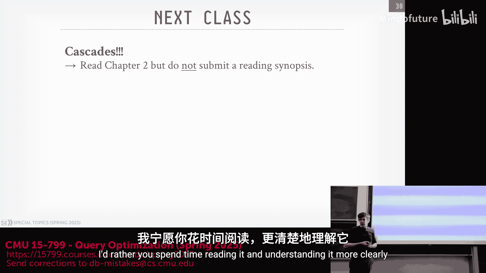

# 数据库专题：查询优化-CMU-15-799--(2025-年春季)-p04-P04-#04---EXODUS-+-Volcano-Query-Optimizer-Generators-(CMU-Optimize!)

在本节课中，我们将学习查询优化器生成器的概念，重点分析EXODUS和Volcano这两个系统。我们将了解它们如何将优化器构建为可配置、可集成的工具包，从而避免为每个新数据库系统重复实现查询优化器。

## 概述

上一节我们讨论了Starburst的查询优化器模型。本节中，我们将探讨查询优化器生成器，即专门设计用于构建和配置查询优化器的工具包。这些工具包并非完整的数据库系统，但可以与您正在构建的任何数据库系统集成。

## 课程通知与更正

项目一已发布。数据集已于今晨更新。如果您直接重命名了文件，请注意更正拼写错误。我们将在下周三的课程结束时简要概述项目一的预期内容和要求。项目说明应相当详尽，您应能快速上手，并通过GradeScope提交作业。

请尚未填写GitHub用户名和AWS账户信息的同学，在Piazza上发布的电子表格中填写。我们将提交信息至亚马逊，以便为每位同学的项目使用提供100美元额度。

关于课程内容，首先进行一些更正。上周课程中展示Starburst的查询图模型时，有一处拼写错误：“T1.price is less equal to all speak Q2.price”应为“T1.price is less equal to all Q2.price”。我们将在幻灯片中修正。

## 回顾Starburst与优化器生成器理念

上节课我们讨论了Starburst。我们研究了分层搜索方法，即查询优化器包含两个不同的阶段。

第一阶段是重写，您将查询图模型转换为另一个查询图模型。此阶段应用无需成本模型的转换或规则，您确切知道这是需要进行的优化。其中一个核心思想是处理可能位于独立查询框中的嵌套子查询，将其整合到同一查询框（如查询图模型的根节点）中，以便执行一系列连接操作，而无需为外部表的每个元组反复调用嵌套查询。重写阶段完全基于启发式方法。

目标是获得一个可以进入计划枚举过程的查询图模型表示形式。在此过程中，我们使用规则将QGM转换为星型结构，这些规则可以将一元星型操作符转换为另一星型操作符，或将星型操作符转换为棒棒糖型操作符。不断应用这些规则，遍历查询计划中所有可能的选择，最终在时间耗尽或搜索穷尽时得到可实际执行的最终计划。

需要指出的重要一点是，除了这两个阶段（Volcano优化器没有此阶段，并特别指出Starburst这样做不好，我们稍后会探讨原因），他们还引入了属性作为查询计划和规则中的一等组件。规则可以感知转换是否会以某种方式改变查询计划，导致其无法满足查询计划中上层所需的属性。排序是我们反复看到的一个属性。如果您知道某个操作符的输入要求数据已排序，那么在应用Starburst中的规则并进行转换时，若违反了该属性，则这是一个无效的转换，不应执行。

相比之下，早期的System R则采用不同方法：它跟踪关心的排序，仍然运行基于成本的搜索过程，但不会因为不满足排序属性而使选择无效或丢弃，而是在之后回溯并评估：如果目前看到的最佳计划不满足我所需的排序属性，我在末尾添加一个排序操作的成本是多少？是否比另一个保持了该属性的计划更好？现在，我们要摒弃所有这些技巧。EXODUS仍会使用一些技巧，但Volcano将尝试将属性视为一等属性。

我们在学期初描述过这一点，现在再次提及，因为今天的所有内容都围绕这个核心理念：查询优化器是数据库系统中最难实现的组件之一。每次有人想构建新系统时，如果都必须重新实现查询优化器，那么构建新数据库系统的门槛就会提高。

优化器生成器的理念是将优化器的功能抽象出来，提供一个API，使得实现新数据系统的人可以向某个优化器生成器提供必要的输入。然后，这个生成器可以作为一组服务在侧运行，与您的现有系统集成，从而避免重复造轮子。

两个最著名的独立或模块化查询优化器是Calcite和Orca。严格来说，它们并非Volcano论文所定义的优化器生成器，因为Volcano的定义是关于编写规则，然后将其转换为过程代码并为您编译，最后链接到数据库系统中。而Calcite和Orca，您只需用Java实现其API并进行编译。这是否相同并不重要，因为您没有进行翻译。但核心理念是相同的：拥有一个独立的事物，可以为您的数据库系统生成优化器，无论数据模型是什么，这都是这些系统试图实现的关键。

实现这一点的很大一部分还在于将转换规则与逻辑操作符、物理操作符分离，让这些成为系统中的独立概念，而不是试图一次性混合所有内容。我们在Starburst中看到了一点区别，他们区分了星型和棒棒糖型。今天我们将在EXODUS和Volcano中再次看到这一点。

此外，用于确定可以将哪些规则应用于哪些操作符的机制，将与搜索策略独立开来。这样，如果有人想替换您正在实现的用于确定查询计划的任何分支定界搜索，他们可以在不重写所有内容的情况下做到。

我们首先讨论EXODUS，因为许多核心思想将被延续到Volcano中。但我个人非常喜欢你们阅读的Volcano论文，因为它在讨论自己先前系统的错误的同时，也与IBM的系统进行了比较和对比。在我看来，在Grayson（Grffy）撰写的关于他的三个优化器（EXODUS、Volcano和Cascades）的所有论文中，他写得最好的一篇是Volcano那篇。因为您可以借鉴它并实际重新实现很多东西。

Grayson Grffy是一位非常著名的数据库研究员，他在1980年代和1990年代致力于三个查询优化器，在近十年的时间里真正推动了他的优化器生成器理念，并为此奠定了基础。

## EXODUS优化器

EXODUS优化器是威斯康星大学正在构建的名为Exodus的更大系统的一部分。与IBM的Starburst类似，它旨在成为一个可扩展的数据库系统项目，因为这是1980年代的热门话题，旨在回应当时出现的面向对象数据库。这些工具包和可扩展系统旨在证明，您实际上可以在关系数据库系统内部完成所有您想在对象上做的事情，而其中的一个重要部分就是提供一个可以扩展的查询优化器。

威斯康星大学通常是世界顶尖的数据库研究机构之一。David Dewitt是Jignesh的博士导师，显然也是Grffy的博士导师，他可能是世界上仅次于Stonebraker的第二著名的数据库研究员。

EXODUS将实现以下理念：将我们从解析器和绑定器输出的逻辑计划进行转换的逻辑，与最终生成可实际运行的物理执行计划的过程分离开来。同时，我们还将保持用于维护所有这些内容的内部数据结构的分离。

我们将避免System R所采用的穷举搜索，不是通过丢弃可能不想查看的计划（如浓密连接树），而是通过使用动态方法和分支定界剪枝来识别是否在树中之前见过此路径。尽管EXODUS在这方面做得不好，但Volcano会做得更好。其思想是，如果遍历树的一部分的成本永远不会超过目前所见的最佳查询计划的成本，则尝试避免那些不必要的计算。

EXODUS将做的一件很酷的事情是尝试学习规则的应用顺序以及规则对成本模型的影响，这是Volcano和Cascades不会做的，但我们将在学期后期看到。这意味着，如果我为某个查询运行查询优化器，并且看到某些规则的特定更改能更快或更早地带来益处，或者看到某些规则转换对我的查询计划有益，我会在下一次运行查询优化器时尝试优先考虑它们，因为我可能了解到这些做法会是好主意。

他的问题是，他们是如何做到这一点的？我们稍后会看到。但这基本上是在搜索策略内部完成的，是您无需在查询计划中修改的东西。这不是额外的规则。其思想是，您有一个成本函数来评估执行此查询操作符（物理操作符）的成本。我可以了解实际执行能带来多大改善。这一切都在查询优化过程中完成。所以，实际上并不是在我实际运行查询时，它是否真的产生了影响。我们将在学期后期看到，他们确实尝试去学习：在优化器中，我在查询计划中尝试了此规则，并获得了预期的收益；当我实际运行时，是否真的获得了该收益？然后通过反馈循环来判断这是好是坏。而EXODUS所做的只是在系统内部进行，您实际上并没有运行查询，只是说，根据我的目标函数和成本模型，应用此转换是否会带来收益？如果是，则未来尝试更快、更多地应用它。

与Starburst和System R一样，EXODUS将采用自底向上的方法。另一种表述方式是前向链接，因为那是80年代。我们稍后将解释Volcano和EXODUS在前向链接与后向链接之间的区别。

我很高兴您在这里。EXODUS中构建的第一个查询优化器的初始实现，他们知道会使用规则，因为那是80年代，人们在进行实验。他们认为可以直接使用基于逻辑编程的深奥编程语言（这是他们推广的一等概念），并在该编程语言中定义所有规则。然后，该语言将拥有自己的运行时，可以自动进行模式匹配、规则实例化、应用以及不同“事实”（在查询计划中）的扩展。

所以他们说，好吧，这是80年代，我们试试看。他们选择了Prolog。但后来他们谈到如何最终抛弃了所有内容，并用C语言重写了所有东西，因为他们发现该语言的运行时内置了深度优先搜索算法，无法真正根据规则应用的结果在运行时改变和操作其行为。就像您告诉Prolog：这是我所有的规则，事情不会改变，直接运行吧。此外，我认为他们有自己的Prolog解释器实现（在互联网普及、广泛可用版本出现之前的80年代），而那个东西对他们来说太慢了。他们抛弃了第一个实现，转向了C语言。

那么这里的教训是什么？不要使用深奥的语言。Prolog和Lisp是之前就存在的东西。我可能会认为，理论上您可以采用那种语言（如Prolog），然后将其重新编译成有用的东西，比如C，对吧？但他们没有这样做。他们实际上切换到了C。他们为系统的实际实现发明了自己的编程语言E，我认为它基于C。我认为Lisp来自哪里？Lisp是Dennis Ritchie发明的吗？我不确定。我认为E可能基于Dennis Ritchie的早期语言。无论如何，在Prolog中做这件事是个坏主意。再次强调，那是80年代，人们在做很多实验性的事情。你知道第一个Postgres是用什么编程语言写的吗？我在课堂上说过。Postgres最初是用什么写的？Lisp。没错。所以他们必须编写自己的转换器（transpiler）将Lisp转换为C，然后实际编译并运行系统。在80年代，人们尝试各种疯狂的事情，比如在伯克利，人们试图构建可以直接在硬件上运行Lisp的CPU。所以那是一个错误。他们删除了所有Lisp内容，并用C重写了所有东西。这就是我们今天拥有的代码库。

## EXODUS的集成流程

那么流程是怎样的呢？数据库系统实现者（试图在其系统中集成EXODUS或Volcano查询优化器的人）需要提供一个模型描述文件，以及实现您告诉优化器您的系统将支持的不同操作符的C函数。显然，系统内置了一些如扫描、连接等基本操作符。但如果您想要超越他们已有的基本关系代数构造或操作符之外的东西，您也需要提供这些。

然后，您将其输入优化器生成器，优化器生成器将对其进行处理，输出一堆C代码，接着调用GCC或您喜欢的任何编译器和链接器，生成一个共享对象文件，然后您将其链接到数据库系统中。这被称为数据库系统生成时，将作为构建数据库系统实际软件的编译过程的一部分完成。

当系统实际部署后，SQL查询到达，我们像以前一样运行解析器和绑定器，这会产生一个逻辑计划。然后我们将其输入查询优化器，优化器执行我们现在要讨论的所有操作，最后输出一个物理计划。

其理念是，与其从头编写查询优化器并让其深深嵌入数据库系统中，不如将其作为一个独立的共享对象链接进去。它为您提供功能，从而避免了每个数据系统都必须重新实现自己的查询优化器。尽管这是1987年写的，但今天仍然基本适用。

Calcite和Orca试图提供类似的东西。但使用Calcite全部功能的系统很少，使用Orca的人主要是编写Orca的Pivotal员工，所以并未被广泛采用。

## 模型描述文件内容

模型描述文件中包含什么？首先是操作符定义：您必须告诉它参数数量、操作符名称以及该操作符处理数据所需的任何额外属性和期望。其次是访问方法定义：例如有哪些类型的索引可用，输出数据是否已排序等。

然后是用于转换查询计划的规则，以及用于映射哪些操作符可以访问上述定义的哪些访问方法的额外规则。这本质上是元数据，以结构化形式告诉优化器您提供的C代码实现了什么、参数需要什么数据类型等等。可以将其想象成Python或Java等编程语言中注解出现之前的东西。

## 规则类型：转换规则与实现规则

现在我们来谈谈规则。他们明确区分了转换规则和实现规则。可以这样理解：在Starburst的上下文中，星型操作符是执行高级功能的高级操作符类，但会有规则可以将该星型转换为另一个星型，或转换为棒棒糖型和一堆其他星型。他们总是称之为规则或转换规则。在EXODUS和Volcano中，他们将区分转换规则和实现规则。

需要说明的是，论文有时可能相当令人困惑，而教科书关于下一章（周三阅读的Cascades）的内容稍微清理了这一点。部分原因我不让你们阅读原始的Cascades论文，是因为他们提到“我要进行转换”，但该转换基于实现规则，然后还有表达式（我们稍后介绍）。他们使用的术语数量过多，在查询优化器的概念中含义容易混淆。

因此，即使您阅读论文时看到“当我们应用此实现规则时，它进行转换”，这和他们所说的转换规则含义不同。

转换规则是将逻辑操作符映射到另一个逻辑操作符的方法。在模型描述文件的定义中，还会有额外的提示，可以警告此规则是否可能陷入无限循环。解释点试图说明，如果我进行这种交换性操作，将连接顺序从AB改为BA，我不希望再次应用同一规则将BA变回AB。所以他们只是在这里设置了一个小标志，表示：当您应用此规则时，不要尝试在刚刚生成的输出上再次应用它。

实现规则则是将一个或多个逻辑操作符映射到一个或多个物理操作符。这是EXODUS与Volcano对比的一个关键区别。这更符合Starburst的做法，尽管Starburst的星型在某些方面比这更复杂。他们在这里的意思是，在EXODUS中，他们实际上会建议工程师或实际构建数据库系统的实现者，如果您知道某些规则总是按特定顺序连续执行（例如，您总是知道要将过滤器下推到连接下方，然后紧接着进行其他转换），那么不要将它们实现为单独的规则，而是在代码中将它们组合成一个单一规则。这样，搜索过程更高效，因为它不会花费时间应用规则，然后在表中查找下一个要应用的规则，再继续应用。

Volcano不会这样做。Volcano会说，最好让系统自动学习这些规则应该一个接一个地组合，而不是尝试合并它们，因为那只会增加实现的复杂性，使您更难推理在应用程序中所做的更改。同样，Starburst声称他们也想要这样，希望所有规则都是独立的，但比Volcano要做的更复杂。

另一件他们也能做的事情是支持双向规则，意味着您可以进行逻辑到物理的转换，然后也可能反向进行，从物理回到逻辑。Volcano不会这样做。

## EXODUS的搜索算法

EXODUS中的搜索算法相当简单。他们确定下一个要应用的规则的方式，基本上是重新实现了Prolog中用于确定下一个应用规则的运行时。他们将维护一个名为“open”的优先队列（这是80年代AI中的术语）。这个优先队列将包含所有可以下一步应用的转换，它只是对将存在于称为“mesh”的哈希表中的转换的引用列表。该哈希表跟踪所有已应用的转换，以及他们已经执行的所有逻辑和物理操作符。然后，转换规则基本上是对这些操作符的引用，系统在mesh中查找这些引用，然后执行转换；如果它们不存在，则继续应用它们。

这是一个非常简单的循环：当还有更多转换要执行时，从队列中选择第一个，根据mesh中存在的内容应用其所有转换规则。然后，执行转换规则后，执行实现规则，将第二步中生成的所有逻辑操作符立即转换为物理操作符，并进行成本分析，以确定实际上哪个是最值得追求的。

因此，他们将在执行逻辑转换后立即急切地考虑和评估所有物理操作符。Volcano也会做一点类似的事情。Cascades不会这样做。Cascades将在遍历过程中急切地应用转换或将事物转换为物理操作符，而不是立即爆炸式地扩大搜索空间。

他们要做的一件关键事情实际上也很有趣，那就是在每一轮开始时，他们将尝试估计进行此转换将获得多少改进，然后根据他们认为哪个将带来最大收益来设定优先级。他们称之为预期成本因子。

因此，“open”是一个优先队列，其中还有其他东西跟踪您想要应用它们的优先级。然后，当我进行转换时，我希望能够查看它们并确定优先级队列中的顺序将基于此预期成本因子，该因子表示我认为哪个将对整个查询计划的总成本带来最大收益，然后首先应用它。

可以这样思考：如果我当前查询计划的总成本是某个值C，那么转换的预期成本将是这个因子F，它表示应用此转换对我的查询计划的影响以及这将如何影响成本。其思想是，如果F小于1，那么您知道您认为它将为您带来更大的收益，并且越接近零越好。

对于中性规则，例如，交换性不一定等于1，但某些规则（如投影下推）在您的特定系统中可能无关紧要，那将被视为中性规则。

因此，与其总是去成本模型询问“进行此转换我将获得多少收益？”，他们将尝试学习该收益将是什么，并应用他们所谓的传播调整。

这里的理念是，我想跟踪最近N次应用此转换规则的情况以及我实际从中获得了多少收益。他们有不同的公式和不同的计算方式，其中一种可以是取最近K次转换或尝试的滑动平均值，或者可以是所有转换的平均值，但一旦开始跟踪所有历史记录，在80年代这会变得非常昂贵。他们基本上说这并没有太大区别，但他们认为这是一个好主意，即跟踪并学习当我应用此转换时，未来实际获得了多少收益，这可以指导您是否有意义再次应用相同的事情。

他们没有详细说明如何考虑诸如数据变化、如何使此信息失效，或者查询参数变化时如何解释等问题。当然，您可以想象对于单个查询，如果您只关注该查询的范围，那么这些问题就不再是问题，因为我在优化这个查询，我再次应用此转换规则，看看实际获得了多少收益。但如果跨多个查询、在更长的时间范围内进行，这就变得有问题了。

他的问题是，在上下文中，他们不是在谈论实际运行查询。他们不这样做。他们只是试图表示，这是我认为收益将是什么的期望。但此时，我只有一堆逻辑操作符。所以我认为，如果我将您转换为哈希连接，那么我将获得这个收益。我估计那个提升将是多少。然后当我实际执行时，我运行我的真实成本模型，它会告诉我实际获得了多少收益。所以这是对其成本的近似，因为逻辑操作符没有成本。据我所知，他们将其范围限定在单个查询的上下文中以使其工作。但您可以想象，您可能希望将其扩展到多个查询。正如我之前所说，这只是在查询本身内部。没有关于我是否应用了此更改来实际使查询运行更快的内容，因为这实际上很难做到，因为如果我应用了某些更改并获得了一些收益，但我的最终查询甚至没有包含该更改，那么我实际上无法运行查询并为此获得任何反馈。

另一件要讨论的事情是，当他们应用更改并获得这种传播调整时，您实际上并不将其应用于刚刚应用的转换规则，而是应用于该规则和前一个规则。因为可能存在这样的情况：您应用的第一件事实际上使情况变得更糟，但这为您设置了某种状态，然后您应用到第二件事，现在您走出了搜索的“低谷”，情况变得好多了。所以他们硬编码规定传播调整应用于最后两个规则。应该是三个还是四个？他们没说。这有点技巧性，方向是对的，但我不认为这是正确的方法。但再次强调，他们在80年代就思考了“我能从过去的经验中学习吗？”这个理念，而现在这在强化学习AI和其他事物中被视为理所当然。

## EXODUS的一个重大缺陷

EXODUS的一个重大缺陷是，他们表示所有当前已生成的操作符（通过这些转换规则在mesh哈希表中）的方式，他们进行查找的条目或键将是逻辑操作符和通过实现规则转换到的物理操作符的组合。

这意味着，如果我有一个逻辑操作符可以转换为排序合并连接，而同一个逻辑操作符可以转换为哈希连接，我将在我的mesh哈希表中拥有两个不同的条目来表示它们。

这清楚吗？因为Volcano将做不同的事情。Cascades当然也会做非常不同的事情。所以，基本上，现在您在这个mesh哈希表中拥有所有这些重复的逻辑操作符，因为它们无法在从一个逻辑操作符产生多个物理操作符之间建立联系。

关于添加可能要求特定属性的额外操作符的所有逻辑，必须放入成本函数中。您可以有这样一个概念：操作符期望数据以某种方式出现，但如果您想推动查询计划确保满足或强制执行这些条件，那么该逻辑就必须存在于成本模型本身中。正如我所说，EXODUS应用逻辑转换规则后，立即应用所有实现规则，基本上爆炸式地扩大了搜索空间，即使实现规则中的某些转换可能实际上并不是好主意。

他们在论文中还谈到了其他事情（我认为是在Volcano论文或EXODUS论文中），因为又是80年代，他们想使用A*搜索算法（如果您熟悉的话），但他们无法以A*算法所需的方式计算实现规则的预期收益或改进的承诺。因为您不能有来回振荡的情况，它必须是一个清晰的阶跃函数。

## 过渡到Volcano

这现在将我们带入Volcano。Grayson Grffy从威斯康星大学毕业，然后我想他曾在科罗拉多大学任教，后来成为波特兰州立大学的教授。我不清楚具体细节。但他多年来一直在真正推动这个优化器生成器的理念，这是真正开创性的工作。

Volcano项目与EXODUS类似，旨在成为一个可扩展的数据库系统工具包。当我们在并行算法中讨论交换操作符时，我们有时会提到那是Volcano方法，这些都来自他为这个职业应用程序构建的同一个项目。

因此，与EXODUS一样，它旨在成为一个灵活的系统，您可以添加新的操作和等效规则。再次强调，他们试图在规划过程中将数据属性视为一等实体，他们将比EXODUS做得更好一点，但我们将在下节课看到Cascades正确地处理了所有极端情况。

他们还将采用与EXODUS中相同的规则编译流程：您用更高级别的元数据定义这些规则，同时为您尝试添加的不同操作或操作符提供C实现，然后他们将其编译成共享对象，您再将其链接到数据库系统中。

## Volcano的不同之处

与EXODUS和Starburst不同，Volcano现在将首次采用自顶向下的搜索来生成查询计划，或称为后向链接。他们将基于分支定界搜索进行。

他们现在还要尝试做的一件大事（EXODUS也能做）是，他们希望能够生成所有这些不同的排列或应用规则并开始进行更改，然后不必重复并反复重新访问事物。因为EXODUS中维护的数据结构方式不允许他们跟踪事物。

原始源代码从未在学术界之外使用。我认为EXODUS在90年代被德克萨斯仪器公司用于一个原型面向对象数据库系统，但除此之外，我认为它没有走得更远。而Calcite据称（至少在他们论文中声称）是基于此实现的。

有趣的是，看看他们在Volcano中实际试图实现什么EXODUS无法做到的事情。我还要说，如果您听说过“第二系统综合症”这个术语，它来自IBM。基本上，第二系统综合症是指，如果您参与了一个构建一个新系统的项目，然后您说，好吧，让我们构建下一个，进行重写。当您构建第二个系统时，您试图纠正您在第一个系统中做错的所有事情。但然后您说，既然我已经在重写系统了，让我添加这个功能和那个功能，让我们做这个疯狂的事情，您开始在这个第二个系统中添加一堆新东西。然后第二个系统从未建成。所以我必须赞扬他，Volcano是他的第二个系统，他完成了它，遵循了他的目标，并且实现得相当不错。

## Volcano的目标

因此，与之前一样，他们希望与现有的数据库系统协同工作，希望比EXODUS更具计算和存储效率，这样您就不会让这个mesh表爆炸式地包含所有您以前见过的可能事物，或者不必提前生成事物。

他们希望拥有可扩展的物理属性，超越排序和压缩，您希望能够更轻松地指定这些内容，并再次将它们作为一等属性来支持。他们希望能够允许您重写搜索以及在遍历过程中确定如何剪枝分支的能力。我认为除了他们实现的深度优先搜索算法之外，没有人超越这一点。论文谈到，如果我们将来能做到这一点就好了。

我们现在不会过多讨论这一点，因为我们将在学期后期介绍，但他们希望成本模型能够支持所谓的参数化查询，即查询计划中可能实际上没有谓词或WHERE子句中使用的所有常量值。例如，SELECT * FROM table WHERE id = 1,2,3。如果您将其声明为预处理语句，您会说SELECT * FROM table WHERE id = ? 或 $1。其理念是，在运行时，当应用程序实际调用该查询时，他们将以其预处理语句的形式调用，然后将值传递给该参数。理想情况下，您希望能够在被告知“准备语句”后立即生成查询计划，然后在稍后的运行时填入该值，而不是再次运行整个优化器。论文没有过多讨论他们如何支持这一点。实际上，如果您尝试适应查询计划的结构可能根据作为参数传递的那些值而发生很大变化，这将非常具有挑战性。我们将花一整天讨论如何处理这个问题，但这是另一个重大挑战。

我认为他们具有基本的能力来保留占位符，并且您实现成本模型时说，嘿，我不知道这个值是什么，让我只选择最坏情况或平均值，这就是他们所做的全部。

## Volcano的实现

在实现本身中，他们现在将引入这个理念：他们有两个不同的代数，一个用于逻辑表达式，一个用于物理表达式。这回到了我之前所说的，他们在论文中重载了一堆术语来表示非常具体的事物。Cascades会更糟。但他们基本上引入了“表达式”这个术语。它基本上就是我们之前在Starburst的QGM（查询图模型）中看到的查询框，表示某个完整的SELECT操作及其FROM子句等。

所有规则将是独立的。与EXODUS中他们说“如果您知道这些规则应该一个接一个地应用，请在您的实现中将它们组合在一起”不同，在Volcano中，他们将建议或劝告您不要这样做，而让查询优化器或搜索引擎自行弄清楚这些规则应该一个接一个地应用，而不是您必须手动强制执行。我认为您仍然可以这样做，或者模式匹配不支持，但最好让优化器自动学习这一点，因为再次强调，您在说“将这两个规则组合在一起”时对数据所做的任何假设，将来可能会被打破或不成立，所以如果这些规则只是小的原子单元，我们会将它们组合在一起。

他们还讨论了他们内部关于是否继续采用EXODUS的方法（让我在系统生成时编译所有内容，将所有规则编译成C代码，然后编译成机器代码，因为这将实现更快的搜索）的辩论。与之相对的是使用解释器，这是Starburst开始做的，以便您可以在查询优化器运行时动态更改其行为，而无需重新编译和重新链接所有内容。这种灵活性很好。我认为当时他们说，至少在当时EXODUS论文中，唯一这样做的是Starburst，而Starburst使用的是解释。所以在这篇Volcano论文中，他们说，好吧，既然您看到了Starburst，他们做的是解释，而我们做的是EXODUS编译，我们认为拥有更快的搜索更好，所以他们将坚持编译方法。在Postgres中，您可以安装新规则，因为您只需将其插入到目录表（如pg_rules）中，并且这些东西知道如何在运行时查看。但他们并不试图以Volcano的方式进行完整的查询优化。

## 什么是表达式？

那么什么是表达式？再次强调，这只是他们用来定义您在查询优化器中试图推理的某个作用域查询的术语。对于逻辑表达式，它只是表示用户请求的查询的表示，定义为逻辑操作符及其之间的依赖关系。

物理操作符是相同的东西，是查询计划的表示，但通过物理操作符，您可以实际在数据库系统中运行此查询计划，假设它知道如何读取它们。

我想指出的关键一点是，在所有这些早期查询优化器中，它们都假设它们操作的是树。我们稍后会从德国人那里看到，您实际上想使用有向无环图，其中您可能希望一个操作符有两个父节点。而在所有这些树结构中，总是只有一个父节点。我想这样做的原因是，如果您想开始物化中间结果，比如CTE或嵌套查询，您可能有查询计划的不同部分需要将数据输入其中。您可以像Postgres那样作弊，基本上有一个引用来表示：我知道我的输入是在查询计划另一部分定义的子查询。但当涉及到进行更复杂的转换时（他们在这里没有做），我们会从德国人那里看到，您希望将事物表示为DAG。这只是现在的题外话。

## 操作符与属性

因此，这一切应该与之前看到的相同：您有这些逻辑操作符，它们具有不同的属性、模式、基数，还有一个属性函数来表示此事物是否提供该属性。对于物理操作符，同样的事情：它们有自己关心的属性类型，它们有一个成本函数，因为现在您可以说，如果我在查询计划中运行此物理操作符，预期的成本是多少。而在逻辑操作符中，没有成本：扫描的成本是多少？这取决于我是进行顺序扫描还是索引扫描，您无法在那里做到。

然后会有这个适用性函数的概念，它将表示此物理操作符是否将提供或满足来自其所源自的逻辑操作符定义的物理操作符。

现在，他们还将引入这些强制器操作符，它们类似于虚拟或占位符操作符，并不真正映射到我们实际执行的任何东西。这只是一种在我们的查询计划中设置屏障的方式，表示我们需要通过查询树的这部分向上馈送的数据提供我们关心的某些属性，比如排序顺序。再次强调，强制器基本上等同于Starburst中的粘合操作符，只是一种在我的查询计划中检查时跟踪的方式，或者通过该树中的流或边上来的数据是否将是我需要的形式。

因此，如果您将Volcano与数据库系统集成，您必须再次提供：这是我的强制器，以及它们将处理的属性。我认为，如果您只是说我需要一个可以保证这些属性的强制器，他们会为您合成该代码。因为强制器实际上不做任何事情，它不获取任何数据，它只是作为一个占位符存在，表示我需要数据以这种形式呈现。

## Volcano中的规则

Volcano中的规则基本上与EXODUS中的相同，但用于具有某种匹配函数，然后查看查询计划的形式，如果匹配，则触发一个操作函数来执行转换，对吧？然后，为了避免必须为所有可能的逻辑计划或物理计划组合定义规则，您可以参数化这些匹配函数，例如，我有一个连接，我的哈希连接，然后在我下面可能是一个扫描操作符，我不关心是索引扫描还是顺序扫描，您不必为这些事物的所有可能组合定义不同的规则。

他们有这个称为辅助函数或支持函数的东西，我的理解是，这些只是在基本模式匹配完成对查询计划形式或结构的检查后，如果您想检查操作符本身内部的更多信息，那么您可以附加这些支持函数，然后在模式匹配后触发它们。因此，模式匹配是在这个高级方言中完成的（我认为论文没有说是什么DSL），但如果您实际上想通过过程代码明确检查某些内容，那么您提供这个额外的函数。

成本函数在实现中也抽象出来了。再次强调，这是您作为数据系统实现者必须提供的东西。可以这样想：在面向对象模型中，您会有一个抽象的成本类。然后，如果您重载或覆盖它，您必须提供如加运算符、等于运算符、小于、大于等。所以，没有任何内置的关于成本实际是什么的概念，它不是基于CPU或Volcano知道的任何其他东西。这是您必须提供的东西。再次强调，它不使用我们在EXODUS中看到的预期成本因子或传播调整，他们完全放弃了那个。我不认为有人提到它。

## Volcano的搜索算法

那么搜索算法是什么？同样，规则的设置看起来基本相同，属性比EXODUS中的更细致，现在我们有了这些明确的强制器操作符，可以保证数据将以我们想要的形式出现。

搜索将使用自顶向下的方法进行后向链接。可以这样理解：这是一种面向目标的搜索，意味着我将从想要的答案开始，即查询本身的最终结果，然后我将向下遍历并开始填充将使我达到该点的物理操作符。

与EXODUS中他们有一个哈希表来跟踪在应用这些规则时生成的这些操作符一样，他们将拥有相同的东西。他们没有给出明确的名称，我认为在论文的某个地方他们称之为查找表。在Cascades的工作中，您会看到这被称为备忘录表，但它基本上应用了相同的理念。但Cascades中的备忘录表比这个更复杂。

现在，在我的搜索算法的每一轮中，当我在查询计划的树中的某个点检查逻辑操作符时，我会查看是否应用转换，该转换的结果是否已经存在于我的查找表中？如果是，那么我不想重新应用它；如果否，那么我应用它，然后填充它，以便下次如果我尝试再次应用它时，我不会浪费周期做同样的事情。

这确实允许我们能够重用我们在单个查询上下文中生成的成本计算，因为数据没有演变，不是在很长的时间范围内，我们可以重用我们已经产生的任何计算，而不是重新分析向下的不同子树。

而EXODUS无法做到这一点。

再次强调，自顶向下与自底向上，或者后向链接与前向链接，在高层面上，这两个术语基本相同。但为了澄清，后向链接基本上是说您将从根开始。它实际上是用逻辑来定义的：我有这些事实，我将扫描艺术家表，我将扫描出现表。然后我可以应用规则，对于这些基本操作或基本访问方法，我可以应用规则来不断生成不同的选择，然后在每一层我找出哪个是最好的，保留那些，然后我遍历并查看所有下一个规则，依此类推。所以我最终在顶部得到我的目标。

我们在System R中以前看到过这个。在后向链接中，理念是当您从根开始时，我希望我的答案是艺术家与出现表连接的查询输出。所以我首先向下走一层，说在最初我只有一个选择，比如从这个逻辑操作符进行新的转换，我可以产生一个物理操作符。然后在该分支内，该物理操作符现在向下说，好吧，访问艺术家的最佳方式是什么？向下走另一侧，获取访问出现表的最佳方式。现在在这一点上，我有了一个可以实际执行的完整查询计划。可能有很多我甚至没有考虑的事情。

我可以比前向链接更快地获得初始查询计划。它可能不是更好，但我肯定可以更快地获得初始计划。

他的问题是，目标是更快地获得计划吗？不一定。这取决于查询的简单程度，您可能能够更快地找到它。但然后，这个东西也会快速遍历它。关于Volcano的事情是，与EXODUS相比，它只会探索实际能为表达式做出贡献的计划部分的子查询。所以，就像它可能决定……我知道Cascades是什么，我知道Volcano是什么，界限变得有点模糊。所以我可能看到一些实际上是Cascades中而不是这个里面的东西。但请容忍我。理念是，当我向下遍历时，我可以为它们设置优先级，并说这个选择可能更好，让我只检查这个，甚至不用费心看另一个。这有点像EXODUS中的预期成本调整或优先级调整部分。我认为这实际上是Cascades，而不是这个。我所描述的是Cascades。是的，所以忽略我所说的，下节课再讲。

因此，在这种情况下，在Volcano中，他们实际上会探索所有这些。没有指导。Volcano中没有指导。谢谢，是的。有三个需要跟踪。

## Volcano示例

让我们看看Volcano的这个例子。谢谢。同样，我们从最开始开始。这是我们之前的查询。我们想要获取所有出现在Mushu致敬专辑上的艺术家，然后按艺术家ID排序，对吧？所以那个红色的小块，那是我们需要强制执行的属性，对吧？从这一点开始，我们将应用可用的不同规则，然后向下展开搜索树，开始填充我们实际需要的部分。

一个简单的转换可能是，虽然这将来自逻辑查询计划，我们知道我们需要以某种方式对前两个表进行排序。然后我们需要对所有三个表一起排序。再次强调，因为这是PowerPoint，我没有展示所有可能的组合，您可以想象所有不同的逻辑连接顺序以及物理连接顺序也会出现在这里。

我从最顶部开始，说，好吧，我想在下面产生一个物理操作符，它将给我艺术家连接出现连接专辑的输出，并且该输出必须按艺术家ID排序。所以我会应用所有逻辑到物理的转换，将三路连接转换为连接实现：我可以在连接结果A1 A2上进行哈希连接，或者在连接结果A1 A2与A3上进行排序合并连接，或者我可以引入一个强制器操作符，它只是说，好吧，我仍然不知道您将如何连接这个，但我保证无论从我这里出来的数据都将按您想要排序的东西排序。

那么我们可以做一个……您知道，我们可以丢弃这个哈希连接，您实际上甚至不会为此生成物理操作符，因为它会违反这里的排序顺序。所以是的，也许我只是想展示它的存在，但您实际上不会扩展这个，因为它会说这不提供我所需排序顺序的数据。所以我们直接忽略哈希连接。但在这一点上，我作弊说，不是合并连接，而是排序合并连接，所以排序内置于操作符中。但这将保证我的输出。然后这个强制器，我不知道下面实际上是什么，但我知道它将保证我的数据实际上是排序的。

是的。所以这个艺术家ID。就像这里上面的那个东西。就像我没有这里的SQL查询，但上节课应该有。就像它是一个带有ORDER BY子句是artistId的SELECT查询。所以，再次强调，这是在PowerPoint中完成的，但您会……绑定器会知道您引用的是某个列，并能够将其映射到A1、A2、A3，或者艺术家、专辑、出现，或者无论什么，就像在顶部我知道我希望我的数据在馈送给我的某个表的某个列上排序。

还有很多规则的东西是不完整的。这是非常不完整的。这是PowerPoint，是的，这是PowerPoint动画，它们不是，是的。有更多的规则。

所以它的右侧我提到了我们连接所有表并排序，就像我们先对艺术家表排序。您的问题是，抱歉，这个在这里？所以我们排序然后……是的，所以您知道，也许应该是不同的颜色，也许是红色什么的。所以它不是物理操作符，因为它实际上不做任何事情。它是一个占位符，表示在向下遍历树时，