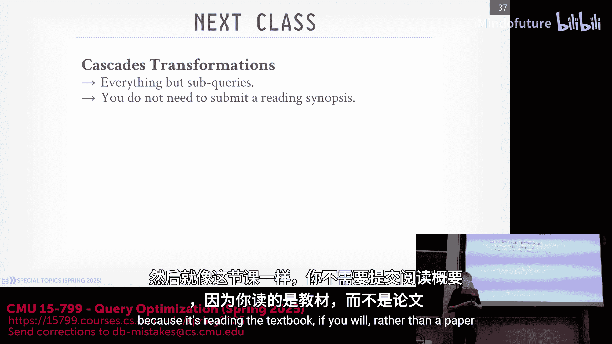
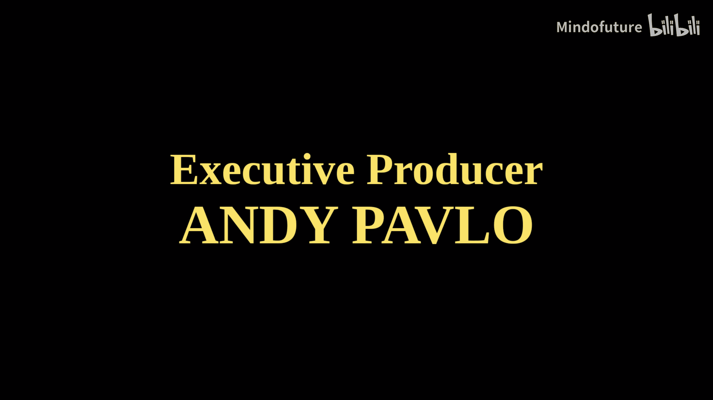

# 【卡内基梅隆---中英】数据库专题：查询优化-CMU-15-799--(2025-年春季)-p05-P05-#05---Cascades-Query-Optimizer-(CMU-Optimize!)--BV1wDE9z9EfK_p5-

あ。🎼おって見せ。🎼A journey drove that Taas carry up the message。

This course is filmed on location at Carmicgie Mellon University in front of a life studio audiences。

So today we're going to continue reading along the Hertz Grffee。More like。

Corpus of his career optimizers， so this is me the last one that that he sort of developed in the 90s called Cascade's career optimizeizer。

 which again I think is still before you guys are born。

 but we're slowly creeping towards the 21st century。

 but this one's really good and the same before class。

part of the reason I had you guys read the chapter from the book is there really wasn't a complete description of what the Cascades thing actually is and actually had an implement on it prior to that book。

 like there's remnants of it in like the Orca paper， which you guys read later on。

 Microsoft some people giving them talks with us and other places that describing it but there really wasn't anything until this book describes how to do it I think it's fantastic。

So all right， before we get to that， I want to make some quick clarifications based on an email someone a student sent about maybe slight confusion about CA volcano and how we're doing enforcement。

 and then I also want to emphasize something else those too that I shared last class but didn't really clearly delineate about the volcano optimization phases。

😊，And as he sort of brought up last lecture， you know。

 volcano is the precursor to Cascades and Cascades is kind of like。you know。

 the object oriented version of cascades or of volcano。

 so it's kind of important to understand what volcano is doing and then that'll help us understand the design decisions that they made in cascades。

All right， so in volcano， they even though it's considered a unified。

Cty optimization framework they're still going to have these sort of separate phases of when they when they do logical transformations and the physical transformations and so the first phase is called the generation phase and that's where they're going to still do top- down search but there would basically going explore and explode out all of the logical expressions you could have for every single logical expression that you're going down so basically as you traverse down to the tree you're going to play all the logical rules that you can for the logical expression or operator looking at and then traverse down further so it's sort of like youre exhaustively expanding out all the possible logical expressions you could have for your query plan so say at the very beginning here we have a query that's doing a join an ABC and for simplicity I'm going to say here's a grouping of A join B followed by join C so you would traverse down here and there would be a rule that says okay I know I need to join A and B。

If I come down here， how am I going to get the values or how am I going to get data from A and B into my query into this joint。

 so as you're going down you're now bidding out these components here and then you could do additional logic ordering you could swap the order in A and B here。

 but we'll ignore that。😡，But then say now you have another transmission rule that says swap the order of the join so that you join C with the output of A and B so that're just swapping order which we can do because the swap is commutative so again now I'm going to do the same thing now I'm going to traverse down my tree exploded out all the the possible variations on the logical expressions I have as I'm going down but they have this hash table the early version of the memo T what the cascades are going to use where are they going to keep track of what logical expressions they've seen before so in this case here we saw get a we get on join A and B we've seen this expression before so we know we don't need to go down and traverse anything below this because even though already fanned that down so we don't need to go further here。

So then now again at the same level， I'm expanding out all the different ones。

 I need different variations of this join and again because it's PowerPoin， I can't show everything。

 but it gives them to keep applyinging the same rules over and over again and I'm getting more logical expressions at this level。

Right。And then now once I reach sort of say all possible logical rules been implied。

 now I enter the second phase， which they call the cost analysis phase。

Or now that I'm going to do a top down search again。

 but I'm going to try to pick what is the best physical operator to use to implement a logical operator at each level of entry。

RightSo say sort simplicity， I'm just going to go on this side Ill say， all right。

 well I know I need to join A and B or I need to take the output of A and B and join it with C。

 so I'll use a hash showing for that and then now I know I got to get the data from the join A and B and from table C down below so I'll follow these logic operators apply rules to convert the get A and B。

 get the join A and B into a hash showing on A and B and then likewise go down below and now get whatever the access method I needed to access to this table。

I'm not showing the arrow going down， these arrow are indicating that I'm applying a transformation here。

And the same thing since I need to know how I'm going to access C， say there's only one option。

 it's a sequential scan， so I traverse down and do that。So again， in volcano。

 the key ideas here is that you're going to expand out all the possible logical expressions you have in this first phase。

 then go back and try to figure out what the lowest cost to implement those logical expressions。

 those logical operators。And the Cascades， they're not going to do that。

 they're going to only do the expansion or the application of the rules to expand out other possible logical expressions for a given operator or given expression on demand as controlled by the rules and the promises that determine the order that the rules could apply。

So you can sort of think like this is again。It's sort of like the stratified search in that they're doing。

嗯。They're。It's not like rewriting where you go into one form to the next in the case of Starbursst they were taking a choreograph model and then rewriting it into another choreograph model。

 but you never went back and kept the other one around This is you're sort of expanding out all the possible choices I could have ahead of time then you're going through in the second phase and actually then costing them。

😡，So it's unified in the sense that it's a single sort of framework that's applying all these rules to do this transformation。

 it's just running in two different modes， two different phases。

The next thing I want to clarify is how enforcers work in volcano。 right。 So again。

 in volcano enforcers are actually these these virtual physical operators that get put into the query plan that are meant to guarantee or provide to ensure that whatever the output it is that's coming out of that enforcer will satisfy the properties that the query plan requires sort order is。

 is the most obvious one here。And so the to say we have another example here we have a select star on a table and we have a predicate on column A and they have an order buy on column B right so again in top down goal oriented search you start with what you want the output to be right？

And say again in the first phase we're doing the generation the transformation of all the logical operators logical operators。

 so in this case here we would inject the enforcer operator here to say in order by on column B and then below that now is I'm getting data out of table XXX that satisfies with this predicate being satisfied。

So then now on the other side now I can start expanding out in the cost analysis phase。

 now I can start converting applying rules that convert the root of the query plan tree into physical operators。

 so on one side here I can say， oh， I know I need to do an order by on table B well I have an index on B。

 so let me do a scan on that followed by a filter on on A。I'm showing this sort as one step。

 like converting that logical plan to physical plans and expression。

 but it could be one or more rules could do that。In this case here， for this expression。

 it has the property that the data is going be ordered by instead of TBB be XxB column B。

 so that is guaranteeing that that's satisfying that the property is's required by this。

On this for the property on the route， so the rules would not let you do an expansion or convert the logical operator into physical operator that did not provide that property。

And so the enforcer is a way to allow you to still consider。

Alternative query plans or cell plans in the tree that may not actually satisfy on their own the property that you need up above。

 but when I do my conversion now to physical operative to a physical plan。

 I would know that I could convert that enforcer into a physical operative that provided for sort order a quick sort sorting algorithm。

So over here again I have my order by enforcer and the Me's feeding in it's getting input from the get logical expression on table Xxx with this predicate here then now again now is that as I do my expansion and I convert this logical operator to the physical operator say I'm nowm doing inexcan on。

😡，On A， then do the filter in A， and then now since this data this has no properties that are being satisfied。

 I know now when I convert this enforcer， so do you want to generate the physical plan for this expression。

 I know I need to convert the enforcer into sorting algorithm。😡，That sorts on the column that I want。

 and then now the properties of this expression and the data coming out of it satisfies the property that the parent needs。

So this made a big distinction in between volcano and cascades， volcano。

 they're explicit operators called enforcers。In in cascades， there're just going to be rules。

 like any other rule。So the problem with this one in the approach。

 and they say this in the Ca case paper and in the chapter you guys read， right？

It's basically that they had to add a bunch of ad hoc code in the system or in the optimizer to do this like injection and then sort of sort of。

It wasn't exactly maybe entirely a rule the way other rules were written。

 but then when you want to do this conversion it's kind of like this ad hoc thing say， oh。

 I know I need this property， be satisfied what property is it。

 and then there's a mapping to say for that property。

 here's the physical operator you need to enforce it。😡。

So similar to how like the sort order in system R in that first query avenue we looked at was we sort of tacked on at the end based on the interesting orders。

 they're doing somewhat similar here， although it's not as。😡，It's not as。

Not as hacky for lack a better term than what systemr was doing。

then Cascades will have again treat enforcers as the first class entity as a rule。Okay。

So today I want to again do an overview of Cascades， go deep into what the tasks look like。

 the optimization that you can then apply Fwards， and then we'll finish up quickly looking at a preview of some of the other query optimizer implementations on Cascades。

 we'll look at the rest of the semester， so OrCA and Microsoft and we talk a little bit about cockroach as well。

So as I said， this is the third query optimizer that Gerth Gry developed and this was done after he left University of Colorado and then went to Portland State and there's a paper in I think not like Sigma A ADB but in IEEE conference or bulletin that describes what Cascades is and that's the original cascades paper but then he as far as I know。

 he didn't actually build a cascades optimizer like in volcano。

 there was a volcano there was a volcano system and there was a deployment down in Texas and actually was based upon it。

 so far as I know with Cascades， he wrote the paper left Portland State and didn't actually end up building it。

 but then he was on a masters thesis that came out in 19998 called Columbia that was one of the first implementation of Cascades。

But the reason why he didn't build it at Portland State that he got bought up by Microsoft or left Portland State to go to Microsoft in 1995 and he got hired to help build their new query appizer based on cascades and the volcano parallel exchange execution stuff that we talked about in Introclass。

 right？So as I said， here's this one is the first cas paper in 95， but again。

 you can't really take this and implement it the same way you could Starbursst and the system R one or even volcano。

All right， so it's going to be top- down approach， just like we saw a volcano with backward chaining。

 it's a new depth first search and also like volcano。

 but the way they're going to order the task and I'll find that in a second and basically what thing I need to do with optimization needs to do to keep exploring。

 expanding upon in the query plan that they're going to maintain the order in which you need to apply this task in a stack。

Whereas in volcano it was just recursion， like I call this and call them this and call this and then as I reached the bottom end of the tree and I'm playing ruless when I unroll and basically just calling return and go back up the stack and then this ones gonna to be stack can to be separate data structure with last in first out。

 they're going to apply the tasks and there'll be some scheduling mechanism that can pick things off and figure out what to run and it's not always going to be last in first out we'll see it promises in a second you actually can reorder the tasks based on how beneficial I think something's going to be。

So the other thing they're going to also be able to do is is。

The paper doesn't really talk about this， but my understanding is that they can actually do some rewriting of predicates and their expressions directly in the code without without necessarily having to resolve search like if you know that one equals one should be true they have a way to fire that off and do that rather quickly in the very beginning and we'll see how they do multi least stage stuff in the second。

All right so what are the key ideas in cascades that makes it different than volcano so one is they can to treat automation tasks as sort of separate data structures orstructs that kind of say here's the thing that I need to do rather than having rule firing mechanism that says okay if I do this then apply this change and update things and the rule itself is kind of the keeping track of what the task it is trying to do where now they're going to have explicit tasks again as a firstclass component in the system and then now you can do all the scheduling tricks you want to do to make sure things are run correctly and in parallel。

Instead of doing enforcers as separate sort of virtual plan nodes or operators。

 they're going to use rules to figure these out， we'll put that one in a second。

 so'll have this notion of a promise that's similar to that sort of cost adjustment we saw in Exodus where they have a way to say I think this thing is going to be a bigger win for me。

 so give this rule a higher priority and try to apply it sooner or maybe instead of later compared to others。

And then the other big one is that again this unified representation of all the rules and all the operators。

 no matter whether you're operating on a logical operator or physical operator in some systems。

 you throw predicates in there as well， the prediiccate trees， all that is in a single search engine。

 this single representation， oh here's what a rule is， and here's what an operator is。😡，Again。

 in the the volcano paper， it's not really kind of clear， but like basically they have like。

 here's the API you would write rules for。Loudical operators。 And here's an API。

 you would write for rules for physical operators。 And then there were sort of separate mechanisms or。

Executors， if you will that would then fire off those different rules and couldn't intermingle them whereas in cascades they're going to say sometimes I actually want to do maybe some logical expansions first or sorry physical expansion first before I do some other logical ones and they can intermix these things and then try to guide the search to find the things that are more beneficial more quickly。

All right， so now we've got to go more detail what these expressions are。

 and then that's going to feed into to groups。 and that's the that's that's sort of the。

The scope in which we're going to examine the query plan tree as we're going down and it's a way to compress the representation of what our query plan looks like through these concepts of groups that are climate expressions so that we don't have to have all this redundant information in the memo table as we're going down and then have a mechanism to figure out。

 are these things actually equivalent or not over and over again。

 we're going combine these things together in groups so that within sort of a single location in our program or in the optimizeizer implementation。

 we can find all of the things that we know are the same。So expression。

 we said this before is to be some set of operations with zero more input and expressions。

 it can be a combination of physical expressions or logical expressions， right？😊。

And then we're going to have a mechanism in our system to be able to figure out whether two expressions are equivalent。

 and that means both logical expressions are equivalent。

 but also our physical expressions equivalent with logical expressions。

We need to go go both ways and volcano。As far as I know。

 since the logical stuff was kept separate from the physical stuff。

 they only had to compare logical with logical or physical with physical in this world we got to know that across both lines are things equivalent。

This allows apply all the transs we'll see next week to do rely on comm and sensitivityit to know when we reorder things to things that are okay。

And then the container we're going to use to represent equivalent expressions is going to call it a group。

And a group is going to have some output that's defined as a logical expression defining what's coming out of it。

 it can have properties that specify what the data that it's going to emit is going to look like。

 sort order and all the things we talked about before。

And then they're going to have sort a unordered list。

Of all the logical expressions inside this that are equivalent。I shouldn't say unordered。

 this could be ordered if you wanted to， it doesn't matter。

 but here's all the logical expressions that are equivalent to produce the output that I expect for this group。

 and likewise here's all the physical expressions that are equivalent that will produce the output specified by the group。

😡，So this this， this overall container here， this is considered the group and then the。

The sort of the two pieces here， these are just again all the equivalent expressions like A join B join C。

 that's equivalent to B join G B join C， but join A right and our output is defined a more even more high level to say here's A B and C coming out。

 I'm not even specifying the order of anything。so this output sort of looks like the QGM or the choreographal software is like。

 I'm not saying this isal calculus， but like it's a higher level than these relational algebra definitions of what the expressions are because。

 I'm not specifying what the order is I'm just saying here's some output coming out that it will be the logical representation of A or and B join C。

So what is this thing， so again， this is going to be a placeholder for us。As I said。

 thats that's what is the logical output that I expect for some。Expression or subexpression。

So now we're going to use this to compress down how much data we actually have to store or how many redundant expressions we're going to store for a given group。

 because now instead of saying within our logical expressions or even our physical expressions。

For the things that are below me in the query plan。

I don't know how that's actually going to even be executed。

 but in this higher level part of the quaplan tree that made me looking at any given group。

 I don't care。So going back here right so here I have log expression A join B followed by take the up of that and then join C。

 but I don't really want to keep all possible combinations of how I want to join A and B at the logical level I'm just going to say I have this representation here that says hey there's AB down below below me in the query plan。

 they're going to be joined together I'm not going to tell you what order I don't care what order at this point here。

 but just know that if there's a placeholder here that says。

 there's some group below that's going to tell me how how to do this join here。😡。

Likewise on the physical profession same thing right so I have the the join order being specified is I'm going to join A and B。

 don't know how that's below me， then I'm going to do a server join on C。With the Apple to C。

 and again， the placeholder here with the curly braces is just saying down below me。

 you're going to get C， I don't know how， but you don't need to record all possible combinations of that。

And that was one of the problems that going back to Exodus where they were they would basically they were doing。

They were doing this， they were destroyoring everything over and over again redundantly。再 clerk。😊。

Yes， groups。Tend to have an input their inputs are other groups。 His question is groups。Canm inputs。

 I think I see that here。I don't say that。 well， an expression can have。

expression can have zero more inputs right and so the group is just a collection of expressions that produces output so implicit by that they have inputs。

 zero or more。If you're a sequential scan at the bottom， typically you're to have no inputs。

 joins up above， they'll have more。And for S ever just can assume that we're doing binary uninary groups。

 that its either one input or two inputs or zero inputs， but if you're doing multijos。

 which we're not going to cover this semester， they could have three or more。Right。

So now what are our rules of like， well the rules are to be just as we saw in volcano。

 let's class them and before in other systems。We' going have the distinction between the transformation rules。

 the implementation rules， transformation rules is going from logical logical。

 so a logical expression to an another logical expression。

 the implementation rule is between logical to physical。😊。

And then each rule is going to be represented by a pair of attributes。

 I think in the implementation they talk about it's a function that you call where you pass in。

 here's the expression I'm looking at and maybe other context information。

 but it's just a way to say， is there is there something in my query plan that going to match based on some pattern and if yes。

 then there's some rule that can say here's the change I want you to make to a either a logical expression or a physical expression to produce some variation of the query plan？

😡，Right。So again， we're going to go in way more details and different kind of transformations to the next class but。

Here's a more complicated rule maybe we seen before。

 say we have now we're trying to find when we have two joins and then we want to figure out how to optimize them and then now we have this notion of groups in our in our rules again there's just placeholders to say there's something below me in this equijo that I'm doing here。

 I don't know how I'm getting what it's doing but I don't care think it looks like a wild card say it doesn't matter what's down there but I know I have sort of this structure my rule that I want to match on。

So then now my query plan comes along and it matches on this， right？

So now I I could have a logical logical transformation that does flips the left to the right。

 So we now we're just on the root one here， we're just moving。

The A to be on stay on the one side of the join and moving B to the other side。

 or I could have an implementation rule that converts the two expressions here。

 the two logical expressions that do joins into S's join or hash joint or whatever you want。Right。

We'll see this in a second， we also need to maintain now basically a bitmap or additional metadata to keep track of like。

 have I applied this rule as I sort of go down this patent in the search tree because I don't want to then do the reverse and just get stuck in an envelope。

😡，Over and over again of doing the same thing。And volcano。

 I think they had explicit rules theyd inject things to avoid that in cascades。

 they talk about there's like a bitmap that keeps track of these transformations。All right。

 so now again， the fourers are just going to be rules。

I think it's a way to guarantee that the data coming up from an input from your group is going to be in in the have the properties that you need。

 right？😡，So if we go back to that simple query we had before， right？Now。

 instead of having an enforcer plan node in my query plan like I have a volcano。

 I'm just going to keep track of have a rule and say。

Am I allowed to do the transformation if I'm allowed to do the transformation into this other form to this other expression or group down below me。

 if that will produce the property that I care about？😡，So rather than。

So of having rules based on the enforcers that not exactly written same way we would write other rules but。

Having additional logic figure out is this enforcer going to give me the data I want。

 it's just another rule to say when I do a transformation from a logical form to a physical form。😡。

I won't do it unless the property I need is going to be guaranteed。

So if there was just a sequential scan here， it wouldn't allow you to do the conversion of the get logical operator into a sequential scan physical operator because squ scan is not going to be sorted。

So in the same way that there's rules being checking for other things like hummidivity rules and all the other things we care about in relation。

 relational query plans。Properties is just another one。And so it's not treated any differently。

 it's just another rule attribute that we can check and do look on based on。That idea， again。

 it seems kind of obvious now， I don't know it was the 90s or whatever like like。

To me that this is the right way to do this。Alright。

 so now we're gonna talk about how we're are gonna execute。The actual process of doing the search。

And so Cascades introduces this notion of a task。Which is just going to be a。know。

 they sort of use the term fine grain unit of work that can be executed by the query optimizer during the search process or the planning process that will know apply some change to the database system or sorry sorry。

 apply some change to the query plan。And the idea is that by breaking down the optimizations into smaller pieces。

That ideally or independent。We're allowing the query optimizer to learn on its own what's the best way to actually apply them in the order to actually apply them。

Again， we saw this in volcano。Which was again was。It was sort of a rebuke of the approach done in Starburst where they were saying。

 oh yeah， you can combine wols together and do a bunch of complicated things in cascades and volcano they' saying。

 no， no， you wanted these things to be sort of small pieces of work that I do some transformation。

 throw them all into this queue and then we'll figure out the right way to order them。Now。

 in the case of Microsoft， there's a subsession in the chapter you guys read where they talk about。

 oh， you can do multis stageage or macro rules， macro optimizations。

 which goes against again the original ethos or the design decisions of cascades。But again。

 if you're not letting any random programmer work in your career optimizer， maybe that's still okay。

so by default， again， in the original implementation。

 it's just a stack where you're choosing what the next thing to execute to you by whatever in the order that they naturally appear in the implementation。

 but you can do something more sophisticated now and also keep track of what is's called a promiseise。

 which is a way to allow to customize the order in which these tasks are going to be executeded to the rules are going to be applied。

And in the case of Exodus， the。They had to again that notion of the expected cost factor。

 the idea there was server similar to our promise here， but it's inherently tied to costs。

 the cost or objective function that you're trying to optimize the query plan for。😡。

Whereas in this notion of a promise， it's actually independent of the cost。

 there's certainly sometimes where you do want to consider cost because that may be the right thing to do and choosing the right promises for tasks as you go along dynamically could steer you towards a better cost。

But the calculation of itself is not directly tied to the cost function。Because again。

 when you're doing large optimizations， there may not be any cost in the very beginning。

Because you haven't figured out how you're going to scan a table， for example。

 so there is no notion of a cost for a logic operator。

 but so you need promised to then figure out what could be a good decision to make。So again。

 the promises just going to be an estimated benefit of a move or a given expression relative to the other tasks that the query optimizer could choose at that point。

😡，So to say we have a simple query like this， we're going to join A and B。

And we're keeping track of the the sort of the relational properties of like what's the cardinality the of each of these individual operators again it's not a cost it's just an estimate how much data is coming out of it。

Right。So I could have again， two transformation rules like we had before。

 where I could do convert the logical operator to the join to do a hash join。

 or I could convert do a swap the join owner， put have B be the outer table versus the inner table。😡。

Right。So again， without a promise， it would just be almost random， however I implemented the system。

😡，In the order in which these schools can applied， that's how things will get pushed under the stack maybe I would execute them。

 right？But。If we were aware of。Somehow it just getting through by examining what the current state the expression I'm trying to optimize for。

If we are aware something about it， then we can make this decision which ones actually would be better。

😡，So in this case here， since we know the cardinalities of the get operators in the two tables。

 we see that the bigger one on A is 100 million tuupples， B is the smaller table， it's 10，000 tuups。

 so that's just textbook query optimization from the interclass。

 you always want the smaller table to be the outer table。

And so you can then have a way to compute the promises based on these properties so that you'll give a higher priority to doing the swap because I rather explore that side of the query plan with B being the outer table of A being the inner table rather than the messing around with this trying the physical operator of joining a followed by B。

 A with B。So again， I didn't actually compute the cost of this logical plan。

 the promise is somehow some magic function that I have to implement in my query optimizer。

 the promise is telling me， hey， this thing is probably a better rule to apply。

 go ahead and do this before you do this other one。😡，Because then now I could。

You know say there's only two tables in here we'll basically do there was also a search。

 but I would end up exploring you know this logical expression here。

 then look at converting a logical operator B joint A。

 convert that to a hash joint or server join this loop whatever joint implementations I have。

 then I'm going to get a cost for that。😡，Then if I then come back and now apply this a rule to convert the logic operator A join B into a physical operator。

😡，I would then get now a potential cost estimate of how what the rest of the query plans could look like below me。

 but I would see that I've already got the physical。

I you already figured out what the cost of the physical joint of B to A。

 and that's going to be less than anything I'm ever going to do on this side here。

 so I don't even explore anything else below me。So again， it doesn't。

 it's not going to guarantee that we're going to speed up the search like complexity is still a mess。

 we still have to deal with that， but in practice right we're going to land on a better quarter plan more quickly。

😡，You think it depends on how good your carin now estimates are， right？

If there's the no prediicates on A and B， it's just the number of twos， the catalog will have that。

 but if you're now trying to estimates the predicate or the select of a predicate and you don't have good statistics。

 the promise may actually end up being wrong。So logically， the implementation may be cracked。

 the data being fed into the function that computes the promise made to be wrong。😡，But again。

 we're not there yet， but we'll cover that later in the semester。So this clip。Okay。

 it's pretty simple， it's pretty clever and obviously you can expand this and do more sophisticated things。

All right， so now we want to talk about what these tasks actually are。

And then what I was saying before is like the。Some of this is in a little bit of the Columbia paper or sorry the Columbia thesis from that student in the 1990s。

 but like the orca paper like the complete definition of what these all doing in Cascades wasn't really anything out there until this book was written。

So there's sort of sort of four three groups of the different tasks you'd have。

 so the first are just doing optimizations of either a group or expression to generate the best physical plan for any one specific thing for either one target。

And then the exploreer options are going to be looking at the group or looking at expression and applying all the logical transformations that you have to generate more expressions or more groups。

Right and the way you would generate more of them is by applying rules for taking some input expression and a rule。

 apply it， and then that's produce one or more outputs that you can then either feedback into to logical expressions or groups you need explore later on。

 or I can then convert them into。😡，at this point if I have them in a physical form。

 but I know that the group that I'm looking at， especially I'm looking at。

 has children down below that I haven't optimized， then I recursly call down and optimize there。

So be in handway we didn't make any sense so I'm just go through the flow diagram so at the very beginning we have a SQL query。

 assume again out of the parser we would generate the binary we would generate the sort of the top level group again it's goal top down goal learned to search so the top level is going to be here's the expected output。

That I need for this query plan to find it in the root of the group because I root for the root group of the query plan。

 but there's nothing below you at that point。Then now in the first step， you got to then say， okay。

 well I have a bunch of these logical expressions， I don't have any physical expressions this point。

 logical expressions in my root group， let me go ahead and explore it by applying all the logical transformation that I may have to then generate more logical expressions within my group。

😡，Some of these could actually then also be further optimized within the expressions within the group。

To generate more。the physical plans for the things that I have in my group at the top。

 like if it's select star from table without any predicates or select one， something really simple。

 then you don't need to go traverse down， you would then neat call it this thing and generate all the physical expressions you need。

And then exploreer group is going to do more expansion， creating more expressions within my group。

 and then I want to do exploration of those and expanding out theological expressions within my group。

 but then some of those I'll feed back into that I'll generate more groups。

 I want to explore those further and then in some case here I may do some optimizations on the logical expressions。

 converting them to physical expressions that also generate other logical expressions our new group and I want to explore them further。

While it's all gone， basically the way you're going to。

do the actual conversion from the to logical logical and logical and fiscal is actually playing the rules and there's a feedback loop again where if I apply a rule I may generate more expressions。

 I want to do further exploration or now if I know that I've exhausted everything I want to look at maybe this level and I want to go further down into the query plan I' look at the subgroups。

 groups blowing， then I do optimized inputs which didn't just can call and over again。

 but then starts to the process in the next stage。So I mean kind of hand here。

 we'll look at an example in a second， but basically the idea is that you're recursively applying rules on your group over and over again to keep expanding it out and then at some point based on the promises you may decide。

 oh， I actually want to go down and start looking at things below me because I'm not applying more rules that the group that I'm looking at are not providing any more sufficient information。

All right。So as I said， there'd be this stack where we keep putting tasks on perform actions on the groups of expressions I'm looking at。

And the idea of this stack is powerful because now is this centralized work queue that's independent of where sort of like the execution thread。

 your search thread is actually located in the query plant。😡，Right under the volcano。

 the order when you would actually apply transformations and explore things。

 I mean sort of defining the way the program counter is in the code and going down into the data structure。

 but now I could have a sort of a separate work queue where I keep putting keep putting。Task on。

 and then my worker right just pull things off and it can theory you start jumping around to different locations in the query plan。

Without having to go in the exact order that may would define underdoing recursory based programming。

So now I still need to make sure that I。Follow the order of dependencies in my tasks like if I had to resolve things at the very top before I can jump to anything below in the query plan because those groups may not have been materialized yet。

 so I I have to guarantee those things get followed but now potentially within a single group。😡。

I could have you， could go down one side of the queryrry plan and another side of the qua plan and sort of ping pong back and forth without having to do exhaustive search down in either one of them。

If you just do last in first out， then you get that same sort of property of the recursive calls that you saw in volcano。

 but I made one to these promises and do different kind of more sophisticated reordering。

 you could do that。It's the 90s， so computers weren't as powerful as they were now。

 so they make a big deal that in the case of volcano。

 because it's just recursive calls down into the queryrry plan。

 that you would overflow the stack at some point and you run out of memory but now if your task queue is a separate data structure。

 that just lives on the heap where you have more memory。Al right。

 so next thing to discuss is the memo table。 And again， this is going to be a。

 a separate data structure where we're going to keep track of all the the。

The things we've explored in our query plan。And we're also now going to use that to keep track of what's the best physical operator we've seen for any sort of expression or our group in our query plan。

 right？😡，And how you actually implement the memo table depends on what you want to do in the case of Coroach DB。

 as far as I know they have a separate hash table on the side。

 they use maintain the memo table in the case of SQLS。

 my understanding is the groups themselves maintain the memo table information on their own。

And so so implicitly， the memo table is just embedded inside of the groups and you maintain the group data structure of the tree。

Right。So I think the original Cacade paper talks about being about a graph data structure。

 but it's far as than most people just use a hash table， right？

So again it's a global view of what the optimizer's progress is as it's optimizing our query。

 so we keep track of all the transformations we've done from logic to physical and so we don't repeatedly do the same thing and over again。

 likewise if we see that we are generating a new group from some task explodes out now expands the expression that generate to new group。

 if that group's output already exists in our query plan， in our memo table。

 then we know we don't need to exploit further。😡，This is useful if。

know for like if you have subqueries that are basically doing the same thing instead of treating them as each independently and optimizing them individually。

 if you see that you've already seen that sort of subquery expression or group in the memo table。

 you don't have to expand it further。They also keep track of all the properties and the costs as you go down and then they。

The paper talks about we can maintain a bitmap that keeps track of have I applied this rule to this group before。

 if no， then go and imply it， but if yes， because I see it to my bitmap。

 then don't do it because again you're trying to avoid wasteful computations。😡。

So this is not specific to Cascades， volcano would have the same property as well。

 and like us with Strberus and SystemR， which is this idea of Bellman's principle of optimality。

 and it basically says that，If I'm。If I have a subplan in my query plan tree。

 and that subplan is the optimal sub plan I could possibly have for that portion of the query plan。

Then by definition， the optimal plan will have to include that subplan because otherwise the global optimal would not be the global optimal。

So of tology saying the subplan is optimal， if the global plan is optimal。

 then every subplan within that global plan has to be optimal。

So what this matters for us is that as we're traversing down and expanding our groups in the search tree process。

 if we have some global costs that we've calculated for that we say the best query plan we've seen before。

😡，And if now we come upon a group that when we calculate its costs。

It causes of the current metaization of the query plan we're dealing with right now。

 if that cost now goes above the best cost we've ever seen before。

 we know we don't need to consider anything further in it。

It's just a way to explain how the branch of bound property is going to work。So basically。

 if we see a subtree and we're at the root of it， before we traverse down to it。

 and we at this point we have some estimated costs and that cost puts us at an overall cost that's greater than the best cost we've seen so far。

 we can just ignore everything below it。There isn't going to be some weird curve where like we go into some valley and then po all of a sudden we end up the optimal plan。

It doesn't work that way， things are going to go linearly。All right。

 so let's look at a simple example here and see how the search occurs。

 I'm not going to define the task we're going to do them because how we do the search and then what's going to go in the memo table and how we populate the different groups。

😊，So say this to the query we had before， we want to join AB and C。And at the very beginning。

 all we have is this group here that the the binder is going to give us when we come out from from that first stage。

 so there's no logical expressions and no physical expressions。

 The only thing we have is we know our output needs to be。ABC。Join you again。

So the first rule will apply will basically say what are the different kind of logical join or I can have for the produce the output that I would need。

 so say the first one is going to be A join B and take the output of that and then join C and again I have these placeholders in my logic expression with the curly braces that are saying I don't know how I'm joining A and B and I don't know how I'm accessing C。

😡，But there's a placeholder there and I know I'm going to go down below and look at groups that will provide me the output that I need to then fill in for that less logical expression。

And so say that the the again， based on the promises， we would say， well， we'd rather explore the。

How we're going to join A and B rather than just iterate or enumerate all possible different kind of joint orderings for this point of the tree because again。

 with logical expressions， there's no cost at this point。

 So like I can expand them out like in volcano， but it actually doesn't help me anyway I kind of want to get a first cost of something And I want to get at least an initial plan and probably not gonna be the best plan at least I'll get something。

 get a cost for that and then that's gonna help me do the pruning I would need again， in volcano。

 you would do all possible permutations of A join B join C the very beginning before you traverse down below anywhere else。

All right， so now we have a group below this and this is connected together based on the placeholder we have in the first group and this group is going to produce the output of A1 B and same thing I can then apply a logical logical rule that then generate。

 I'm going to take the output of some group that's going to be the values of a， the tus of a。

 I'll join that with some group down below me that's going to give me the tubs of B。😊。

Same thing rather than exploding this out looking at B join A， I'm going to traverse down now。

 get to a root in my query plan and in this group is going to produce the output of A。

And the only logical expression going to have is。Get A。give me to was a， nothing there。

So but then now I'm going to apply rules that can then convert the logical expression of get A into the two physical expressions I could possibly have。

 do a central scan on a or some index scan on a。And then now at this point here。

 because I have physical expressions。And they don't have any inputs like there's nothing feeding into them。

 It's like it's， it's so。The base access methods is going to access to the table E through index or through central scan。

 I can now cost these。And choose which one of these is actually going to be better。

say that this index is whatever reason is not a good idea， but the sequential scan is a better idea。

 so I'm going to choose now that the sequential scan is the best physical expression for this group at this point in my search and it's going to have a cost of 10。

Okay we'll cover how we compute those costs later on。 just assume it's 10。

 But then now in my memo table for group A， right， And as we see in the first column。

 I'm going to keep track of the best physical expression that generated the data generated the the the。

Yeah， the data I need to produce the output that this group is required to generate。😡。

I'm going to keep track that I chose the sequentiall scan it has a cost of 10。

So then now I traverse back up into this group here。😡。

And now I'm going want to look down on the other side of the join。 I don'。

 I want to do the same thing。 What's the， what's the best expression I can get or what's the。

Explore how what the best favorite expression for the group that's can produce the twos of B same thing I in the first step I get a logical rule that just says。

 well you want to B get B like that's the logical operator and then have another apply the implementation rule is that you can need the sequential scan on B or index scan on B and then say again sequential scan is better has a cost to 20 I update my memo table and say for a group for the group that produces the output of B。

 the best physical expression is sequential scan on B and has a cost to 20。

So then now I pop up here and at this point， I know that I've explored low me down on how to get A and B。

So now， again， based on the promises， I could say， well， rather than maybe look at B join A。

 maybe I want to look at the。I want to look at the。What。

 physical algorithm a physical joint algorithm I want to use。So your promise could do that。

 or in this case here， if I do actually just do the swap， well， that's cheap to do。😡。

Because it's just a logical expression so now all I need to do is say okay well now I have this new logic expression I want to evaluate I need to get the two of B。

 but I've already done that， I've already gone down below right and I can look up on my memo table now and say oh I've already got the best physical expression for A and B so you actually't need to do the exploration you're done。

😡，And the mamote table will give you do that to avoid the redundant computation。Right。

're just ignore that and instead we're going to do the implementation rules where I' going to replace now the logical join operator with actually what is the physical algorithm I want to use so I can donessA loop join hash join for A join B or B join A and so forth right？

And now for all of these。I can then now start costing them。

Because I know what the cost of the input inputs are。

 you'll have some approximation of what the card nowas on how many tuupils are coming up。

 and then now you just run your textbook， join cost calculation based on whatever join algorithm you're actually using。

 things that come with the in class。😡，most simple form。

And then now we can pick which of these joint algorithms is going to be the most efficient。

And then the cost of this group now is going to be whatever the cost of the physical operator we're implementing here。

 so the cost of the join plus the cost of getting the data up into us from down below。😡。

And we put that now in our memo table。Then now I say I bounce back up to the top。

 now I when to look look at how to access C， same thing。

 I would look you know lots of professionals get a。

 I want to do it either sequential scan or index scan and say the index scan is now cheaper， right？

And then now that gets a cost of five， I populate that in my memo table。

 and then now I can then compute the total cost of this grayplan。😡，Now it may not be the optimal。

 but say before I explore the other joint owners， but at least at this point here。

 when I have this and I feed that back up， I have a physical plan I can execute and I have a cost。

So then now maybe I want to then fire off rules that do more further exploration in the join orders in the join algorithms and so forth to maybe find some obscure plan that can compute a lower cost for me。

 but at least at this point I know if I time out and I can't do any more exploration。

 then I have actual physical plan I can run。😡，Yes。So so we know that the sequence skins that she were looks like being in what like that output A how to have an facility。

Would it still pick like， so we're sorting on something table in A。there's an order。

So your question is， index would then be？So going back here。

Say there's a property the word a I had to be sorted on a right so when I pop down here say that the index scan on a satisfies that sort of property right so what would happen is you wouldn't even be allowed to consider the sequential scan because the sort of the metadata about I need data to be coming into me to be sorted。

😡，Right you wouldn't make naming necessarily have so wed start at the top right because the output has to be sorted right and that would sort of propagate down。

 and this would basically say that like again， like these enforcement rules to say。

Do not do the expansion of get A into sequential scan A because if it's not clustered on the thing I need to be sort of on。

 it won't satisfy that property。 So it wouldn't even be expanded out as a physical expression you would even consider。

So if it we were to like use it would have to like spit out another logical expression with a sort expression。

So yeah， so how would it work if like， if I did want to do a bunch of scan。How would I？

Still to the sequential scan and then inject like a like a yeah an order buy or quick sort or whatever right that would just be another rule you could say like okay。

 if you do do a sequential scan， if you do want to do sequential scan。

 you would actually create another group to do the order by that then links down to blow the group that was doing the look up on B。

But then now you had this thing wherere like the。You could have like the。

Like the output a could go to sorry， the input a to get into this thing could go to the order by one or could go to the sort of base one。

Other questions。And again， when you。When you apply the rules， they may produce other expressions。

 they may produce other groups。And then this thing is like there's， there's linking occurring。

 I'm showing the lines here， but it's really like。There's there's a。

The memo table could keep you track of like， okay， here's for the output you want， like A。

 you table A， here's all the groups that we've seen so far that can produce that for you。😡。

And you're sort of stitching together what the path is through the query plan。

 and it may be different from one sort of incarnation versus another。But you're keeping track of。嗯。

You don't delete groups。You just keep track of everything and again。

 that's different than we saw in the choreograph model when they were doing rewriting because when they went from one choreograph model to another one in Starburst。

 they threw it threw away the old one。Because it was a sort of one way transformation in this world。

 you're keeping track of everything。hi in volcano， that was sucked because they you would keep track of things you maybe never even got around exploring。

 where in this case here， I don't materialize a group that I want to keep track of in my system unless I've actually。

 you know I'm going to go ahead and explore it。Okay。So。All right。So。As I said before。

 the promises allow us to。Target more potentially beneficial transformations more quickly in the search process again。

 and is decoupled from the cost or objectiveive function the way that exodus wasn't， right？

And so that's nice， but there's。And we can we're going to be able to use that promise mechanism to。

Sort of force or handguide or the。Guide the sort of the search mechanism to consider transformations that we think are be more beneficial more quickly right it's another way to again to do that sort the Stars rewriting。

If the cost to sorry you set the promise is something to infinity。

Like the higher promise means that it will be chosen more likely than others。

 if you said much of things to infinity then like those things will get fired right away and that's equivalent to the in the Starbust like here's the rules I always want to play in the very beginning。

But so that's nice and d。The overall flexible in nature。

 the way the system is actually engineered and designed。

 is going to open up other optimizations that weren't easily done in the other systems that are not going to change the asymptotic complexity of the search algorithm。

 but again in practice in the actual implementation itself。

 it'll allow us to potentially reduce search times the amount of time it takes to find good cr plans。

😡，So the first optimization in this again this comes from the。From from the Microsoft book。

 I don't think the Cascade paper talks about this。 I don't remember type point of this was again。

 the， as I just said before the。As we do the exploration of the groups in a query plan。

 we keep track of all the groups that we've seen before。But there may be some cases of。

 I know I'm always going to want to apply some optimization。So。Don't keep it around。

 basically do the same thing Strs was doing like I knew I always wanted to do predicate pushdown so why keep the old query plan or the old choreograph model that didn't do the predicate push down because that's just wasting space maintaining state I don't need about。

So in SL server， they have a way to specify that。For this rule， when you apply the transformation。

 delete the old one。😡，And then you keep tracking in the bitmap。

like have you applied this transformation before to avoid like reversal going back to that the previous form？

So again， this is just an engineering optimization it's not going to make the thing run faster。

 it's just a way to reduce the amount of resources the actual implementation actually needs。

The other type of sort of。that goes beyond the original Cascade description is this idea of macro rules and this is what I was saying before where it's Microsoft's optimization that allows you to do multi stage transformations within a single rule。

Rather than as whatvolcano prescribed was， you have all these independent transformations。

Throw them in the mix and then the algorithm will just sort of find them they're saying no。

 there's certain things you always want to do one after another。

 so go ahead and define find a macro rule that can do that and that reduces the complexity or the number of transformation rules the algorithm has to consider。

And going run more efficiently。Again， there's no analysis of whether how much this actually helps。

 they just say this is what they're doing in SQL Sub。And the last one that's super important。

 but we' not going to go too much into detail now because we'll cover this whole two lectures on this on in 16 to 17 is。

Because now I'm not relying on the again whatever thread that's traversing my query plan to keep track of like where I am in that query plan because I had this separate dedicated task queue。

That now I could have multiple worker threads。Do the search optimization in parallel。

So what happens is in the very beginning， because again， as I showed before。

 like you start up with like there's nothing， you just have a single group。

And then you sort of build out the group as you go down the very beginning。

 it's basically going to be single threaded there's no magic to make that parallel。

 but then now as you start expanding out the expressions you have。

 you could have separate threads exploring down different branches of the tree。

 the memo tables keeping track of the global state of the system。

So now you know anytime you update that thing and you know what the best cost you've seen so far。

 so the threads can check that to see whether they need a prune rubber branch looking at， right？

And of course， you have to make sure that whatever dependencies you have between tasks。

 like that's still guaranteed， you don't want to be optimizing things below the tree before you do anything up above。

 but now again， youre going to have multiple threads do your search in parallel。So as far as I know。

 the only implementation that actually does multithreaded cascades is OrRCCca from Greenpllum。

 which we'll do a whole lecture on that later in the semester and I'll mention that in a second。

 but the Seal server one as far as I know is single threaded。

 the cockroach DB one it's open source you can look at it that's single threaded。

 calcite's not cascades but that's single threaded。U。So。Yes。

 this makes with the taskque with cascades， you could do a parallel surge。

 but most people actually don't do it， it's easier to do than certainly volcano exodus。

And potentially， I think also stars as well。But on the engineering side， it's still challenging。

I suspect the reason because SQlor doesn't do it because。In the 90s。

 when they started building their casss optimizer， that was like。

 you the penium4 era maybe even earlier than that， it was had a single CPU， it had a single threat。

UIt wasn't until like 2005， 2004s for like intels in the Halo market where they started throwing a ton more cores。

 Sun had this Niagara thing right like the idea they have a multi core CPU was，It's an old idea。

 but it didn't actually become more mainstream in the actual commercial world until the 200s。

And so to go back and retrofit an existing codebase that's already running production。

 you're making billions of dollars on it。ToGo rewrite them to get parallel is probably risk they weren't willing to take。

Again， we'll cover this more detail in a few weeks for both the top down and the bottom up search。

All right， so as I said， there wasn't a。There wasn't a sort of single codeb that existed that say this is the Cascade' Oper implementation right The SeQel server1 is what he went off and helped design and build at Microsoft there was a couple other some projects in the 90s so Columbia we already mentioned where he was Ger Grray was an Amazon the thesis committee there was one at was constant called Op plus plus which I think was written by Jake Nesh's roommate when he was in grad school Green Plum we've talked about we'll mention again a second and then this is what we're trying to build at CMU and OpD The first invitation was more or less volcano。

And then we threw it away we're going to Cascades now and so there's again there's a bunch of other commercial limitations tandem nonsSQL。

 there's a paper from the 9s describes what they're doing This is the parallel database that Jim Gray helped build after he after he left IBM so he left IBM in late 70s early 80s and he had a non competeete clause where he couldn't go work on another database system So he went to this company called tandem they had these things called nonstop servers think of like super redundant parallel hardware they had like。

😊，2 CPUs or three CPUs doing the same computation in case one of them failed like space shuttle kind of stuff。

 right， But for like banks and in high trading。 But in in the 80s， they ended up building up a。

A parallel data distributed data system called nonstop SQL and Jim G because non compete was over。

 He worked on that。 So they built a Cascade's optimizeizer。

 Cs was a startup in the 2000s came out of AL。 they got bought by Merid D B and it's renamed like。

San it's not called close anymore it's called expandse or something stupid。

 but their documentation mentions that they have a cascades optimizer they don't say how they implement it it was their open source Coroach Db or we mentioned their cascades optimizer is in single threaded written in go by one of Stonebaggrs former PG students Snowflake has a Cascades optimizer what they're doing and Datas sort of in the same thing where they。

They actually don't do a full transformation of the query plan because they're trying to run on data lakes where you may have incorrect statistics or no statistics。

 so they actually try to defer certain optimization decisions until actually runtime。

We'll covered this kind of adaptivity style later in the semester as well。

 so its cascades but then it's sort of。You still end up with a complete physical query plan you can execute。

 but there's like placeholder for certain things so they may make decisions and change it later on。

All right so the SeQco server one is super interesting again actually going back here so for the SeQco server cockroheB Stfl Databricks and I think Orca as well these links here will take you actually to YouTube videos because we've had all these people come and give talks for us in the seminar series for you know a couple times of all these the Seco server1 is probably the best one of the best talks I ever seen in my life in previous years of 721 I didn't because the Cascades people was not。

😊，I mean you can read it it doesn't help you the assigned reading was watching this video because it's amazing they go to a bunch of different things that I'll talk about in a second so can I highly recommend that because again they're not going to really describe the algorithm and they're going to talk about how they've contorted cascades to fit the sort of engineering priorities that they cared about and again some of the optimizations we'll see in chapter5 and some of the things that they talked about in chapter2 you guys read chapter4 and then things you read chapter2。

 they mentioned like SQL server stuff but that talks about all such of crazy things that's amazing so SQL Ser had the first cascades implications started in 995 and there was a single codebase in SQL Ser that was cascades and then because it was such a fantastic query optimizeizer as Microsoft put out different data products over the years they forked the code and made modifications for the data where。

House version or like other internal data systems that they built right they're all going to be sort of using the same cascades appizer The paper we read at the very end of the semester is about their unified query optimizeizer。

Or they basically。Instead of having all these different forks they all merge it back into a single code base。

 and then they had the different rules that are specific to the different systems they need to support。

😡，Whi I think is obviously a good idea Everything's in CB Fluffs， there's no DSL。

 yeah the paper didn't really the book they're going to talk about that and the original cascades paper they talk about instead of writing C or C+ code for your rules。

 you would write in this high level language， the DSL。

 which then would get compiled down into CF CB Fls。Cchroz does this in somewhat。

 but Microsoft does not， everything's procedural code。Right everything is all。

 everything is all procedural， so what they're going to do is apply the transformations in multiple stages。

Based on the complexity of the query so the idea and again。

 this is going to smell a little bit like Starburst I said before like oh。

 the unified search was the stratified search， even though Microsoft SQL server is cascades。

 they're going to do this multistage thing and that kind of smells like what Starburst was doing where there's transmissions you always want to apply maybe not even without a cost model but that's going to set you up to that when you do the costbased search。

 you find good plans more quickly right。And the。Unlike what we saw maybe in volcano and cascades where they talked about。

 oh， you're automatically can learn what some of these rules would apply very early on。

 they say we're not doing anything that we're dating， we preparedpa a lot of money。

They're going to basically handpick which transformation rules they want to apply。

In these different stages。All right so the first stage is to through simplplicationification and normalization and the idea here is like I'm converting a logical tree to a logical tree and these are like the things we talked about in Star Wars we always going to want to do them so you always want to do pre to get push down entry result pruning like if you have a subquery like it says like select star from table where false you know that subquery isn't going to produce any results just throw it out。

 ignore it right。😡，Subquery removal， we're not going talk about that and actually I skippped that or actually for Mondays test next week when you read the chat about transformations。

 I'm telling you not to read， how they do subquery because we're going to see how the Germans do which is the right way to do it we'll cover that later but ater joinins inner joinins all these things so these are things you can want to do very very quickly in the very beginning for like really simple queries like you can do this in milliseconds less than that。

Then there's a setup they called the preexation phase where it is going to be。

 it's not going to be a call based search， it's more like you're going to set things up for getting ready to do the call based search。

So if you again， treatment plans， you throw away。Normalization projections。

One interesting thing they do is that if you start looking at your logical plans and you realize that you don't have the statistics you're going to need at that point when you actually want to do the cost based search。

 because the cost models made based on the statistics under the catalog。

 but if there's nothing in your catalog， they will actually stop the query optimizer right here。😡。

Invoke， tell the data system， I don't have statistics I need， go run analyze right now。😡。

And then when analyze finishes， it then reverts control back to the query optimizeizer。😡。

My SL does something sort of similar， not exactly go cut physicss， but if they have like a subquery。

😡，And rather than try to do the German style rewriting， they will take that subquery。

Actually go execute it， so block the query optimizer。

 go execute that subquery which game recursly calls back into the optimizer， then run the query。

 then take rid of the output of that nest query and then feed that back into the query you're trying to optimize。

😡，That's not the right way to do it， that's wrong， we'll cover that later。

 but like if you don't have statistics telling you to go get statistics is actually a good idea。😡。

Data breaks and snow if they can't do this， and that's why I'm saying that they do try to do late materialization of the query plan because。

😡，If you have a bunch of parquet files in S3， you've never seen them before。

No one's going to want to run analyze on that because someone's got to pay for it。

 snowflake doesns going to pay for it， customerss going to pay for it so they kind of defer you know some decisions later on in SeAL server because they're assuming at least in this version of it。

 they're assuming running on the box that has the data just go run analyze。

So then now that feeds into the exploration phase。And this is where they're going to do a。

 they're going to do the。So the cost based exploration of converting the logical expressions to physical expressions as we showed before。

 but they're actually going to do this in multi stages。😡，So in the first stage。

 you can basically predeeclarre what rules am I allowed to apply？Like for trivial things， select one。

 actually select one and get thrown out here。For Sgeable queries like select star from table where primary key equals this。

 right， so you do all those transformations at the very beginning。

Then there's this sort of similar to the promise， there's this when the stage finishes。

You check to see how much time you should have left。

If you still have time and if you think you can find a better query plan。

 then you're allowed to go to the next stage， the next stage is basically the same thing as or it's again。

 doing logical to physical transformations。😡，And you're relying on the best physical plan you've seen in the previous stage to maybe trunncy parts of the query search street。

 but now you're allowed to apply more rules in particular。

 you're allowed to actually start considering parallel query plans。

With inter exchange operators and having allowing multiple threads to scan the data。

 search the query search in the optimizer is not parallel。

 but the query plan could be parallel then when that stage finishes if you still think there could be you know a better improvements you could do how they estimate that that's the black magic of this right。

Then you're allowed to go to the full plan。 So some queries might even might not even go past the first stage or they'll finish the first stage and be done。

 but like for really complex story it's going to go through all these stages。

 And then what they're doing is' they're enabling more rules we fired。😡，Basically。

 instead of setting thing of like setting the promise to negative zero。

 they instead it to something that actually is real。

 and then the optimizer is allowed to choose that rule to fire。And when that's done。

 they still have another stage where they do all the optimizations for whatever that they know the target engine that they're actually running on。

So again， there's different flavors of SQL server， there's like the parallel like the data warehouse version now there's like fabric or synapse。

 bunch of stuff like that and we'll come this later in the semester。

 but like if I know I'm running a distributed version of SQL server。

 then I take the single node plan that comes out of this third stage here and then I basically do cascades again on that。

 but now I introduce like the ship operators the send and receive operators between the query plans across the different notes。

Yes。So。You said that the exploration stage is at cost based。Yes。

So like these are going to be all like well， these are like this is like if I don't have the thing I want。

 tell somebody or doing collapsing， like that you can do logically。😡，Yeah， I mean， but like。

 shouldn't it be like promise based。Even the pre。No no。

 so promises tell you the order in which you apply the rules。😡。

The cost is going to tell you whether the plan is actually a good idea or not。

 you still you need both。But you can do cascades without promises's just。And it was random。

 It is not good。 It's。 Yes， it's volcano， yeah。But then you need the cost to figure out this is the best physical plan I could have。

So you think of like the promises here， as I was saying。

's my understanding the way they describe is like it's basically this file that says in the source code。

 okay， here's the rules that you're allowed to go apply and then you're sort of passing that input to the cascade search。

😡，If you had promises， another way to do this is like you just say here's the rules set their promise to negative afffinity so they never get even selected and then when you get to this stage。

 if you want to include them whatever stage you're looking at， then you set them to some real value。

😡，All right。So。We talked about this first optimization the SQL somebody else before， where basically。

 instead of setting the timeout period because again， like going back here。

 like this thing could run for potentially hours。Instead of setting it based on the wall clock。

 they set it based on the number of transformations that they've applied。So going back here。

 as they're going along， it's mostly for this one because these two phases other than having to go over un analyze。

 which it' expensive， but like these two phases can be done pretty instantaneously。

 it's this one that's expensive so like if I know that if I've applied 1 thousand0 transformations and that's my budget then you terminate there and that's better than the wall clock time because they said that。

This guarantees that the database system will always produce the same quality query plan for a given query。

 no matter whether the system is overloaded or underloaded。Because it's a bad experience to say。

 if my system is super slow。And I now give it a query to optimize and it just it's going to generate a crap query plan because you know。

Because I was trying to get it out based on some time budget。The other thing cool thing they do。

Is that in all my examples before， I showed like， oh。

 you started the memo table was completely empty。😡，In SQL Ser， they have a bunch of logic that says。

Or these heuristics， they apply to pre populate the memo table with things think they should look at。

RightAnd so like if you know simple queries like， you know， if I doing a look up on a primary key。

 I'll put that as the best thing physical expression that I have my in my memo table ahead of time。😡。

So I don't think go bother and explore that because I know that's the best thing for me。Again again。

 it's throwing away computations or it's a way to sort of。Short circuit。

 the sort of raw exploration to find the thing that made the best query plant。All right quickly。

 I'm not going to talk much too much green plum because we'll read a whole paper on this。

 but then as I said this is a standalone C of sation of cascades。

 they originally wrote this for green plum and this thing called Hawk Greenpllum is a distributed version of Postgress that was a fork in the 1 sorry 200s Hawk was basically their version of hive of like SQL on top of map produce oroop and instead of building two different query optimizers for the do systems they took Orca built as a standalone service that can then take queries in both of them。

 I think that's a really good idea。 but as I saidre one of the only ones that I know that can do the multithreaded search The way you use Orca it's similar to how likere setting up things in calcite for Project1 is that they have this API or you give it a much Xml about which catalog status and logical plans look like and then it does a search for you to do the physical plan So this was only sort in the 2010s but。

This is complicated so pivotal got bought by pivotal was a spin out of the EMC and VMware then it got bought back by VMware and then Brocom bought VMware and then Brocom made everything close source in 2024 so even though the old version is there it's not the open source versions not actually maintained anymore。

 which is disappointing。But again we'll cover this more detail Cocker Gb is another interestingching one custom written by Strbergers For student in 2018。

As I said， what they do that's different than we've seen in SQLer in other invitations is that they had this custom DSL called OpGm。

And link here we're taking you to the GiHub page I actually just sort to show you here like so they have this DSL here where like here's the matching rules and everything and then this is just going to get compiled into go and then linked into the program right so it's like the idea of like we saw in volcano of like you're taking your rules and then cogening code that's much more faster than interpreting。

As far as you know cascades originally didn't do that。

 but they had the same thing here in and Orca doesn't do this， they had this in in cock Gpi。

 but there's still a fall there's a fallback mechanism if you can't express the the logic you want in your rule all in their DSL。

 you can put in or the transformation itself， they can put this in。And Rogo。All right。

 so quickly to finish up because I want quickly about Project one all right。

 so I like cascades because again， I think it's a cleaner to me， I can think about。

What the CRats is actually doing obviously the devils and the details of how you the promises and determine the order rules get fired。

 how to do parallel searches are somewhere are complicated， But to me。

 this seems a like a cleaner model of doing career optimization than in Starburst with the lollipops and stars and and some of the other things we'll see later one now the。

The accuracy of course of the query plan or the quality of the query plan could be highly dependent on the statistics and cost estimations。

 it just so happens that SQL server has some of the best statistics and cost estimations and so oftentimes when you look at comparisons of their query plans versus other systems。

 they do better they get the card estimates be more accurate and so oftentimes their query plans could end up being better。

😡，But again， that's， I think it's more tied how much is you can attribute to the cascade search they implemented versus the cost estimations。

That remains to be seen and the Germans do not care for the top down search。

 they're all in on bottom up search and so we'll see how they do the joint enumeration in actually I think next week。

O。All right， any question about cascades？It're going to quickly bang through Project one again so for this one。

 the plan is to actually play with one of these costs query optimizes as a service。

 so using Apache Calcite calcite will read this paper land in the semester but there's a project called LucyDB out of Europe there's a startup that failed and then for whatever reason they took out the query optimizer they built in LucyDB and made an open source thing called calcite so the idea for you is you start playing with some of the rules you can use in in calcite to take queries SQL queries and see how the transformation rules that they applied to them can improve performance so the two ways you're going to run the SQL query is going to be one through DDB in an optimized form and then another one that I think they then built an engine way and right。

Is that an engine， but they have either built an engine in calcite or that you can run the querieses there and then compare them you want to compare the results and see that they're correct。

So we provided start a code to actually get Calalite up and running。

 it's in Java so sorry and again the idea is that you're going to interact with this interface that that Calite gives you to turn rules on and off obviously populate with Cis and so forth。

 like the ideas that you want to，😡，Start playing with calcite and see how the queries change as calcite applies those rules and it's going to spit out SQL for you again So're not going to have a nice clean plan we can talk about later on we did try to actually use something to generate query plans and run those called substrate that didn't work So it's SQL to SQL but you can still be able to see what it does And so you to make sure that when you run your queries on DB there's a flag called disableable optimizer that basically takes almost the exact logical plan that the par binders pits out and doesn't run the additional optimization on it And that way you know you're running the queries that calci's giving you。

Yeah， but it's a little translation of the SQL query coming in。it doesn't do it costs to search。

All right， so the Wro beautiful instructions where I'm to get started。

 just just follow those and then beware of like stupid table name sensitivity issues。

The standard library rules do not include Op specific rules。What's this again？So， for example。

 we look you to like something called core rules。 That's not all the rules。

 If rules for de correlation。 and therell be something else。Yes。

 so calcci basically has grouping of rules similar we saw in like Sequel summer and they're not all alone by default。

 thank you right and then。No we can cover this later as well okay so more instructions here again it's in Java we've tried to make it as easy as possible I've given you think they package up environments。

And then you will submit things on gradesco and then gradesco will basically run。

 And And the idea is you want to check to see the goals to see whether you can。

Have calcite produce queries that run as efficiently as the one that DDV query optimizedminr generates？

Because the LB corrupt reserve is actually really good because it's based on the German one。

We'll recover later， okay？Again， I'm mostly do that and I apologize but we can come answer questions with Piazza all right so next class we're gonna to now talk about in more detail the transformations we've been sort of like。

 oh yeah， know connectivity switching join odor like we're talking about what are the actual transformation you want to apply to optimize your queries and to cover everything in chapter4 except for subqueries so we'll spend a whole lecture on have to do that correctly and then just like in this class you do not need to submit a reading synynopsis because it's reading the textbook if you will rather than paper okay？

🎼You'll go up brown of fact。

🎼带 wood grain time。🎼My dogs get one girl like。I'm not the one who be ever enough we dash rags if you suspect if they don't re to your man we this disappear straight punch I'。

🎼you the creep with the bullshit， I keep the like cr for the long cr。

 I got the remedy for beaches when the star shit sound like a。

🎼It's a big crown me the you what the fuck you don't if you did。🎼多手。

