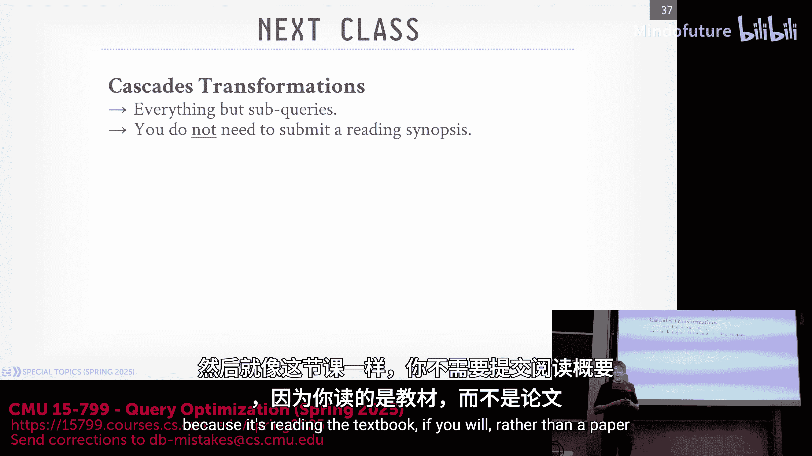

# 数据库专题：查询优化-CMU-15-799--(2025-年春季)-p05-P05-#05---Cascades-查询优化器-(CMU-Optimize!)


在本节课中，我们将深入学习Cascades查询优化器。Cascades是Goetz Graefe在20世纪90年代开发的第三个查询优化器，它建立在Volcano优化器的基础上，并引入了许多关键改进，如任务调度、承诺机制以及将强制属性（如排序）作为一等规则处理。我们将详细探讨其设计理念、核心组件和工作流程。

## 概述：Cascades优化器简介

Cascades查询优化器是Volcano优化器的演进版本，采用了一种更面向对象和统一的方法。与Volcano将逻辑转换和物理转换分为两个阶段不同，Cascades将优化过程分解为细粒度的任务，并通过一个集中的任务栈进行调度。它引入了“承诺”机制来指导规则应用的顺序，并将属性强制执行（如排序）完全整合到规则系统中，而不是作为特殊的虚拟操作符。这些设计使得Cascades更加灵活，能够更有效地探索查询计划空间。

## 核心概念澄清：Volcano与Cascades的对比

在深入Cascades之前，我们需要澄清Volcano优化器中的两个关键概念：优化阶段和强制操作符。这有助于我们理解Cascades所做的设计决策。

上一节我们介绍了Cascades的概况，本节中我们来看看它与前身Volcano的关键区别。

### Volcano的优化阶段

Volcano虽然被视为一个统一的优化框架，但它仍然将逻辑转换和物理转换分为两个独立的阶段。

*   **生成阶段**：这是一个自顶向下的搜索过程。优化器遍历查询计划树，对遇到的每个逻辑操作符应用所有可能的逻辑转换规则，从而穷举出所有可能的逻辑表达式变体。它使用一个哈希表（Memo表的早期版本）来记录已见过的逻辑表达式，避免重复探索。
*   **成本分析阶段**：在生成所有逻辑可能性后，优化器再次进行自顶向下的搜索。这次，它尝试为查询树每一层的逻辑操作符选择成本最低的物理实现操作符。

Cascades则不同，它不会预先穷举所有逻辑表达式。相反，它根据规则和“承诺”值，按需地、受控地应用规则来扩展逻辑表达式。

### Volcano中的强制操作符

在Volcano中，强制操作符是一种特殊的虚拟物理操作符，用于保证其输出数据满足上层查询计划所需的属性（例如特定的排序顺序）。

其工作流程是：在生成阶段，当需要某个属性时，就在计划树中插入一个强制操作符。在成本分析阶段，当将逻辑操作符转换为物理操作符时，如果下层输入无法提供所需属性，优化器就知道需要将这个强制操作符转换为一个具体的物理操作（如快速排序算法）来强制执行该属性。

Cascades摒弃了这种特殊的强制操作符。它将属性要求完全整合到规则系统中。规则在将逻辑表达式转换为物理表达式时，会检查所需的属性是否得到满足。这使属性强制执行成为规则系统中的一等公民，设计上更加统一和清晰。

## Cascades的设计理念与核心组件 🧩

了解了与Volcano的区别后，我们现在聚焦于Cascades自身的设计。Cascades的核心思想是将优化过程分解为可调度的小任务，并统一处理逻辑和物理表达式。

### 关键设计思想

Cascades相较于Volcano有几个关键创新：

1.  **任务作为一等公民**：优化过程被分解为独立的“任务”数据结构，而不是隐藏在规则触发机制中。这使得任务调度和并行执行成为可能。
2.  **统一的规则与操作符表示**：逻辑操作符、物理操作符甚至谓词树都在同一个搜索空间和表示框架内。规则可以混合应用于逻辑和物理转换，提供了更大的灵活性。
3.  **承诺机制**：这是一个与成本函数解耦的启发式值，用于估计应用某个规则可能带来的收益，从而动态调整任务执行的优先级，更快地导向有希望的查询计划。
4.  **规则化的属性强制执行**：如前所述，属性要求通过规则来保证，而非特殊的操作符。

### 表达式与组

Cascades使用两个核心概念来组织查询计划：

*   **表达式**：表示一个具有零个或多个输入的操作。它可以是逻辑表达式或物理表达式。系统需要能够判断两个表达式（无论是逻辑-逻辑、物理-物理还是逻辑-物理）是否等价。
*   **组**：这是等价表达式的容器。一个组定义了一个逻辑输出（即它产生什么数据），并包含一组能产生该输出的等价逻辑表达式，以及另一组能产生该输出的等价物理表达式。组用花括号 `{}` 表示，作为查询计划树中的占位符，避免了像Exodus那样冗余存储所有可能的子计划组合。

**公式/代码表示**：
一个组可以非正式地表示为：
`Group(LogicalOutput) = { Set<LogicalExpr>, Set<PhysicalExpr> }`
其中，每个表达式中的子节点引用的是其他组。

### 规则

规则是执行转换的基本单元，分为两类：

*   **转换规则**：将一个逻辑表达式转换为另一个逻辑表达式（例如，交换连接顺序）。
*   **实现规则**：将一个逻辑表达式转换为一个物理表达式（例如，将逻辑连接转换为哈希连接）。

每条规则由一个模式匹配函数和一个转换函数组成。规则模式中可以使用组作为通配符，以匹配更广泛的查询计划结构。

### 任务与承诺

*   **任务**：是优化过程中的细粒度工作单元，例如“优化一个组”或“探索一个表达式”。任务被放入一个栈（任务队列）中，由优化器调度执行。
*   **承诺**：是一个与成本解耦的启发式数值，用于评估应用某个规则可能带来的相对收益。承诺值高的任务会被优先调度。例如，如果知道表B（10，000行）远小于表A（1亿行），那么“将`A JOIN B`交换为`B JOIN A`”这条规则的承诺值就会设得很高，因为让小表作为外连接表通常是好的起点。

**代码表示**（概念性）：
```python
class Task:
    def execute(self): pass

class ApplyRuleTask(Task):
    def __init__(self, rule, group, promise):
        self.rule = rule
        self.group = group
        self.promise = promise # 承诺值指导调度优先级
```

### Memo表

Memo表是一个全局数据结构，用于记录优化过程中的所有状态，以避免重复工作。它跟踪：
*   所有已探索的组和表达式。
*   每个组中当前找到的最佳物理表达式及其成本。
*   已对哪些组应用过哪些规则（通过位图记录），防止循环应用。

Memo表是实现**贝尔曼最优性原理**的关键。该原理指出：一个全局最优计划必然由它的局部最优子计划构成。因此，如果在构建计划时，某个子组的成本已经使得总成本超过了当前找到的最佳全局成本，那么就可以剪枝掉这个分支，无需进一步探索。

## Cascades优化流程详解 ⚙️

现在我们已经了解了所有核心组件，本节中我们来看看它们是如何协同工作来完成一次优化过程的。

Cascades的优化是一个受任务驱动的、自顶向下的深度优先搜索过程。整个过程从一个仅包含目标输出逻辑定义的根组开始。

以下是优化流程的核心步骤：

1.  **初始化**：解析SQL查询，生成顶层的逻辑输出组（根组）。
2.  **任务调度循环**：
    *   优化器从任务栈中取出承诺值最高的任务执行。
    *   任务类型包括：
        *   **优化组**：为该组寻找最佳物理计划。
        *   **探索组**：对该组应用逻辑转换规则，生成新的逻辑表达式（可能创建新组）。
        *   **优化表达式**：将特定逻辑表达式转换为物理表达式并计算成本。
        *   **探索表达式**：对特定表达式应用逻辑规则。
3.  **规则应用与反馈**：当任务应用一条规则后，可能会产生新的逻辑或物理表达式。这些新表达式会被加入相应的组。同时，可能产生新的优化或探索任务，并被压入任务栈。
4.  **成本计算与剪枝**：每当为一个组找到新的物理表达式时，就计算其成本。Memo表会更新该组的最佳成本。如果当前探索路径的累计成本已超过全局最佳成本，则进行剪枝。
5.  **递归深入**：当优化一个涉及子组的表达式时（如连接），会创建任务来优化其输入组，从而递归地深入查询树。
6.  **终止**：当任务栈为空，或达到资源限制（如转换次数上限）时，优化过程终止。根组中成本最低的物理表达式即为最终查询计划。

**示例流程**（简化）：
对于一个查询 `(A JOIN B) JOIN C`：
1.  从根组（输出为`Join(AB, C)`）开始。
2.  探索任务应用逻辑规则，生成逻辑表达式 `Join( Join(A, B), C)`。
3.  优化任务决定先深入探索如何获取A和B。它创建子组`Group(A)`和`Group(B)`。
4.  在`Group(A)`中，应用实现规则，得到`SeqScan(A)`（成本10）和`IndexScan(A)`（成本15）。Memo记录最佳方案为`SeqScan(A)`，成本10。
5.  同理，`Group(B)`的最佳方案为`SeqScan(B)`，成本20。
6.  回到`Group(AB)`，现在可以应用实现规则来计算`HashJoin(SeqScan(A), SeqScan(B))`的成本（例如成本=10+20+Join开销）。
7.  同时，也可能应用逻辑转换规则生成`Join(B, A)`，但由于Memo已记录子组成本，可以快速计算其物理实现成本。
8.  优化器比较不同连接顺序和算法的成本，选出`Group(AB)`的最佳方案。
9.  最后优化`Group(ABC)`，考虑与C的连接，完成整个计划成本计算。

这个流程展示了Cascades如何按需、增量地探索计划空间，并通过Memo表和承诺值提高效率。

## 实际系统中的应用与变体 🏢

Cascades的设计理念影响深远，许多现代数据库系统都实现了自己的变体。本节中我们来看看几个重要的实例。

### Microsoft SQL Server

SQL Server拥有最早且最著名的Cascades实现之一。其实践中包含了多项工程优化：
*   **多阶段优化**：将优化过程分为简化/规范化、准备、探索（多阶段）等。每个阶段启用不同的规则集，类似于Starburst的分层策略，但仍在Cascades框架内。
*   **基于转换次数的终止**：为避免系统负载影响优化质量，设置一个转换次数上限而非时间上限。
*   **记忆化表预热**：使用启发式方法预填充Memo表，避免对明显最优的路径（如主键查找）进行重复探索。
*   **过程式代码**：规则直接用C++编写，而非使用特定领域语言。

### Orca (Greenplum)

Orca是一个独立于执行引擎的Cascades优化器服务。
*   **多线程搜索**：是少数真正实现并行化搜索的Cascades变体之一，利用任务队列和共享Memo表实现。
*   **服务化架构**：通过XML接口接收查询和元数据，返回物理计划，便于跨不同系统（如Greenplum和HAWQ）使用。

### CockroachDB

CockroachDB的优化器采用Cascades框架，但有其特色：
*   **自定义DSL**：定义了一种名为Optgen的领域特定语言来声明式地编写规则，然后编译成Go代码，以提高性能。
*   **回退机制**：对于无法用DSL表达的复杂转换，允许使用过程式Go代码作为补充。

### 其他系统

如Snowflake、Databricks等系统也采用了受Cascades启发的优化器，并可能结合数据湖环境的特点，进行延迟物化或自适应优化。

## 总结

本节课我们一起深入学习了Cascades查询优化器。我们从回顾Volcano优化器的阶段和强制操作符开始，明确了Cascades的设计起点。然后，我们系统地探讨了Cascades的核心组件：**表达式**与**组**的结构、**规则**的类型、作为调度单元的**任务**、指导搜索方向的**承诺**机制以及记录全局状态的**Memo表**。

接着，我们分析了Cascades的优化流程，这是一个由任务驱动、自顶向下、按需展开的搜索过程，通过成本计算和贝尔曼原理进行剪枝。最后，我们浏览了Cascades在Microsoft SQL Server、Orca、CockroachDB等实际系统中的实现和变体，了解了工业界如何根据自身需求调整和发展这一框架。

Cascades通过其统一、灵活、任务驱动的设计，为构建高效的查询优化器提供了一个强大的蓝图，其影响持续至今。




