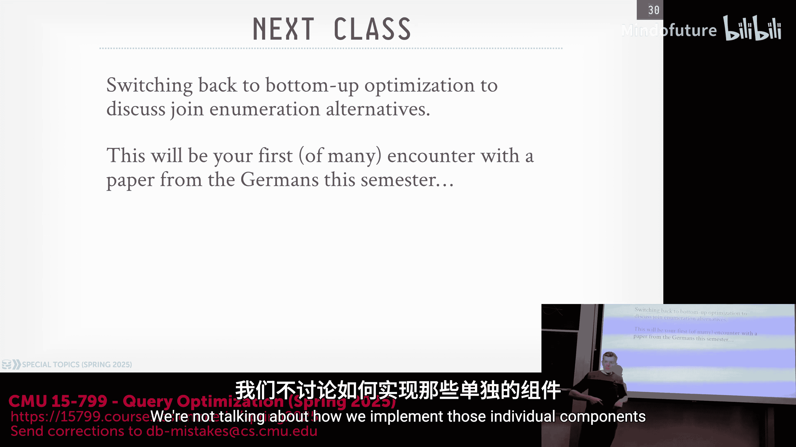
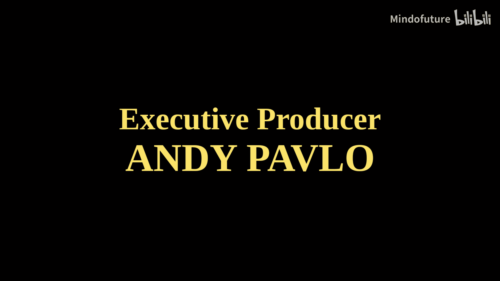

# 【卡内基梅隆---中英】数据库专题：查询优化-CMU-15-799--(2025-年春季)-p06-P06-#06---Query-Plan-Transformations-(CMU-Optimize!)--BV1wDE9z9EfK_p6-

だ。🎼おてみせ。🎼A journey drove that Taas to carry up the massage。

This course is filmed on locationtion at Carmicy Mellon University in front of a life studio audience。

Today what else coming。Qu thanks making， so。We have， again， the the overload。

You highigh level view of how we build an optimizer and so I'll talk about this in a second' to now go through the integral part of the query optimizer talk about how you actually want to implement them and optimize them and optimize the optimizer and make things work efficiently so before we get to all that for you guys in the course paper reviews we'll resume again this Wednesday on the fifth you reading a paper from how to do the joint enumeration in the hyper umbr system and then I know some people suspended the PRs for the notes Wayne and I will go through those this week and start getting credit for all those and then project1 will be due on Friday the 28th。

Okay， if you haven't gotten started yet， please get started okay。

 any questions about the reviews the notes or Project one？Yes。

And they you know you sent us above damage。So yes， everyone should have gotten an email from me yesterday from an assessment of the reviews。

It's just saying like， hey， you know， maybe add more， like like if you're below it。That's all it is。

 yes， we do read them。 We do， if people say， oh Andy's not reading this。

 like we'll find it by the way。 So it wass like， yeah， but in terms of like。

Getting like specific feedback on like， hey， you've got this completely wrong in the review with so many papers and so many students we're not to be able to do that。

 right？😡，What's that？How will that be grade it。Does it look like cha tea， Chiy tea yes or no。

 and did you do it， yes or no？What about like the statistics， I just told you。

 like it's like for your own guidance。Because some of write too much and we' start too little。

 just sort to land in the middle。Again， it this is an upper level graduate class。

 So it's really like if you put like the。The knowledge you're going to give out is the effort you put it into it。

😡，Right。Yes， I was going to say like if we all。你要。U。Sure， yes， it's okay， it's not time to make。

It's just like people， people in previous years like， like。

 I don't know whether I'm ready too much or too little。'm like， okay。

 well here's here's what the stats are。There's no grading base on this， it's upper level class。Right。

Again， like the word special topics means something， it's kind of like， hey。

 we're here for a good time。Okay。I'll leave that out。U。

I don not know sure I'm surem sure you're recording things yep okay cool all right so we posted I mentioned at the beginning of the semester and now we actually have the schedule all set up for the seminar series this semester and again this is optional these are things that you want to go beyond the lecture materials in this course and you just again what more databases in your life like I do so again the seminar series this semester is going be a combination of。

😊，People that have replacements for SQL or language that sit on top of SQL so this is actually a rather new phenomenon where rather than saying SQL2 but let's get rid it entirely now people build their own DSL on top of SQL you write your application or whatever queries you want in that and then that gets trans pileed into SQL that then runs on the database system so convex and the Germans will talk about actually I don't know I forget what the Germans transp but convex does but like Maloy PRQL OQL these a bunch of the DSLs late in the semester will do this and then we also have the other sort of half of the seminar are the database people building query optimizeoms basically the things we' talk about in this class they're going to talk about how they actually implement theirs。

And so Pot would be the first one of this we have。Starucks guys can to talk about the career optimizer。

 the inventor of My SQL and Maria Db， he's going to talk about their new career optimizer， Maria DV。

 that's late in the semester。So again this is optional。

 but when you go beyond the things we talk about in the course encourage you to check these things out and the great thing with the ones where they could talk about how their quit optimizeim is actually implemented is now you'll pick up on think。

 oh yeah， we're doing bottoms up or tops down this is how we're doing this transformation or're we don't this kind of nueration Now all the things that we've been talking in the semester start to click and put in the context of a real system and you realize I'm not making everything up right。

Okay， again， we'll post the schedule and everything on Piazza。All right， so。

We're at so far in the course well in last class， we spent a whole day talking about cascades right then Cascades was the successor to volcano from the gridgraph guy and it' basically volcano with the key difference that you don't have the separate generation and cost analysis phase。

 everything all these transformation rules are thrown into the mix into a single search space and the optimizes is then free to decide in order and what supply rules。

 where going transformation first or physical first or logical or logical physical first based on what it knows about what the query wants to do and there don' guidance or promise mechanisms that we can add to our implementation。

 is to sort of push or nudge the query optimizeer in the right direction。

Another key thing is that they have this taskbased transformation concept where there's all of these tasks that can apply rules and do different things and you're throwing them at least in their implementation to a stack and you're picking things off of the stack rather than just sort recursly calling thing after thing after thing and doing a depth first search。

Then the way they're going to avoid the explosion of just recomputing the same thing and over and over again is through this memo table。

 volcanoes sort of had the similar thing， but the one in cascades was more formalized and more rigorous。

So as I was just saying in the beginning， where we at now in the semester is that we spent time talking about system R's optimizer and Starburst and volcano and cascades。

 and those are basically going to be the high level architectures or blueprints， if you will。

 of how to build a query optimizer。😡，Not throwing postgressres in there because that thing is like rat's nest just。

You know。House on strolls been on top of house on straws like it's。It's sort of。

No one sat down and thought through， here's what the Postcast optimizer is going to be for the longevity of the project as far as I know。

 so I don't want to include that， but the Starbust one and the Cascades one。

 that's where people have built multiple optimizes really sat down and like okay。

 here's what this thing actually needs to look like。

 here's how to actually architecture it so that we can not only be extensible and add new capabilities to support things beyond maybe relation relational model which is maintaining an engineering the thing over long periods of time and making it easier for the system developers to add new new optimizations。

Right so that's the big thing we're at at this point we know that， okay。

 we know how to build something that looks like Starbus。

 we know how to build something that looks like cascades。

So now the quality of the plan that's going to get generated by these optimizers is going to vary on a lot of factors。

 but the three key facet that we're going to care about for the next few weeks is what the search algorithm is going to be it's actually how we're gonna to do the enumeration of the alternative query plans we could have to decide can we find a better one and that's the top down versus bottom up kind of thing then there's also the cost model to say how can we predict whether one query plan or one alternative is going to be better than another based on statistics and other things that we're collecting either through analyze phase or through hints provided by somebody else doesn't matter well it doesn matter we'll see how to handle that but certainly like we have a crappy cost model who cares about everything else because if our statistics are way off and we're gonna end up picking bad things。

😡，And then last one is going to be the transformation。

 And this is what we're going to talk about today and starting on on Wednesday this week。

 we'll then pick up going back to the sort of top again go the search algorithm。

 But the transformation is going to be the piece where we're going the。😊。

If we don't have the ability to recognize that， hey。

 here's a better alternative plan for this query that we're looking at。😡，Then again。

 who cares about how good our search algorithm is or cost model is。

 so you don't you need all three of these things to be good。

 so that's what I're going to go sort through each of them one by one。😡。

And it's all about the combination of accuracy， as I just said。

 I want things to be correct when I think one query plan is better than another。

 and then it's also going to be in efficiency and we'll talk a little bit about today and we'll see this definitely next class on Wednesday。

 like if my search algorithm is like super， super slow。

 then it doesn't matter how great my cost model is or how great my estimates are or my transformations are because I'll never even get to even explore everything。

😡，Likewise， if it takes me forever to generate you know all the transformations。

 then I may never get to to exercise the other ones。

 So it's semibiotic between these different factors。

 but it's a combination of efficiency and accuracy that I'm going to care about。All right。

 so we've already defined what a transformation is through multiple times。

 but just to put it now on a single slide and then that'll guide us going forward。

 the idea that we want to have some kind of mechanism in our query optimizeizer that's going to allow us to change our query plan that we're currently operating on we're trying to optimize into a different form or different structure。

 different shape if you will， where the new shape that we're going to end up with will be semantically equivalent or logically consistent with or correct in regard to the original query plan that we were dealing with。

😡，Right。And in some cases。Sometimes the transformation rule。

 if transformation might put a query plan into an invalid state where the result would not be correct。

 then and we know we have to apply another rule immediately afterwards to make sure that is correct。

 then we essentially want to combine them together in what the cascade paper or cascades chapter talked about being like a macro rule。

😡，Right， so when you apply one transformation， you always want to end up on the other side with a correct query plan because you may。

 the the search process may trunccate right there， you may not even get to and make any corrections。

So the way this is going to work is that we need to we're going to rely on our knowledge。

 domain knowledge with both the system we're building as well as the relation algebra equivalencies that we know about and combine that with information about what we know is in the database in terms of what the schema is。

 like what constraints there are， what the foreign and key dependencies。

 references between different tables， the data types and so forth and then also what the data itself looks like in terms of select or the number of tuples。

 the size of the tus and so forth， so it's really a combination of these things that we're going to use to guide a decision making to decide whether we want to apply a transformation rule or not。

So our goal is going to be during this entire process is。

 of course we want to ideally end up with a lower query execution costs。

 but another key factor also too is that there may be some transformations that we want to do that may actually make the execution costs worse。

 at least immediately， but because we do this transformation that unlocks a bunch of other transformations that we can now do to then end up with an query plan with a lower cost。

There's one key example in the chapter you guys read and you're of to pick up on like for this last one here。

Remember what it was？Converting outer joints to inner joins。Right we'll see that in a second。

 like that one is a huge one。 if you can do that then like because the outer joins always can't be flipped around。

So it's things like that we want to do it again to make the optimizer essentially be more efficient or uncover the optimal query or the near optimal query plan more quickly。

😡，All right， before we get into the transportation we want talking about today。

 I to always want to note that。You know sometimes in other lectures and other classes or in an angel class or if you're taken in 721。

 we oftentimes show the expression trees of like prediicates as this like separate thing that's either embedded inside an operator or for you to a joint operator an internal attribute of the joint effort itself would be what's the joint predicate but in the book although they're not always consistent。

 they're going to represent a predicate expressions as just another logical operators in the query plan。

 so I'm going to try to follow along with the same sort of nomenclature or representation style that they're going to use so if I have a query here select select from a table S where S。

 a is greater than 10 and3 equal 20 so they'll have the filter operator here and so normally sometimes in another lectures I would show the expression trees being internal to this filter operator and instead what they're going to do is say it's actually like a child operator。

Again， I just bring that up just want to be consistent with what they're doing that way you follow along the book。

 what I'll say today will'll match with them。Again， they're not always consistent。

 Sometimes they instead of filter， they' call select， right。

 but I've just try to normalize everything and make it more clear。And then the pseudocode。

 I know they put the the join clause in as an operator sorry as an attribute to the join operator we can ignore that all right so today we're going to talk about sort of the four main categories of transformations are going on do so access past internet or joins and then group by and then I want to finish off something like sort of one example of like special case scenarios you could have in your transformation rules where if you recognize immediately。

That the query plan is following the combination of the query plan and the schema that the query is on the the query is trying to access。

 if they follow an unknown design pattern， like a star query or snowflake schema or snowflake sma and a star schema。

 then like there's rules you can say， okay， neat put this in the form。

 I know that it's going to be it was near optimal choice。But we'll see that at the end。All right。

 so the first thing I'm going to do is figure out how we're actually going to even access tables。

 relations in our table or in our Davis。😊，So the goal here is again。

 we want to choose the access methods that will access the data that we need and think of like base relations leads of the query plan。

 and that's going to have the lowest cost for us。So again。

 we're not talking about how we do cost model estimations yet， that'll be in a few weeks。😡。

But obviously again， given your background knowledge of taking the intro database class。

 we know that the things are going to matter to us are going to be some combination of like how selective the predicate is what the prediates being based on what columns in the table they's even accessing is the table or the index they're accessing sorted and I'm going to need that sort order somewhere else in the query plan if there's additional things maybe we're added to the table or the index like zone maps or include clauses and I realize I't I don't teach in the introclass when including clauses are but I'll do one slide on that real quickly other things like encoding scheme with the compression scheme of the data itself。

And if we know that our predicate can operate directly on compressed data。

Without having to decompress it， maybe that's something we want't choose that password versus another。

So again， it the idea here is we want to figure out。For a given table or given relation in our table。

 how should we access it， should we go through an index or should basically view a sequential scan？😡。

Right， so let me quickly could talk about the include columns because I think they're cool and we didn't get a chance to talk about them in the。

😊，In the in the in class they're cool and not widely used。

 even though it can make a big difference so the big idea of an include include column in an index is that it allows you to embed additional columns in the index that aren't actually going to be part of the like the search key。

😡，So here I'm going define an index on some table food and the key that I'm going to do lookups on is going to be columns A and B。

 but then I have this occlude clause so I'm going to add C。

 and that just means that in the leaf nodes， assuming this is a B plus tree。😡。

And the leaf nodes will be the actual value of column C for every single tuple that's being indexed or being referenced in the index。

😡，So all the inner nodes the guidepost that gets you down into the leaf nodes。

 that'll just be on indexes or columns A and B， and then when I land on a leaf node I'm when I say。

 okay， well what's the record ID or the row ID I need to follow from this leaf node to go get the original tuple along with the record ID and that payload will be column C。

😡，So now for certain queries， I can I can essentially execute them as a covering index query。

 meaning I don't actually even have to go look at the original tuole。

 I assuming it's a row store because everything I need is in。😡，Is in the index。

You know if it's being packed in as a clue column right so in this case here select B from F where a equals 1。

2，3 and C equals bot， so for a， since I have that it's a prefix my b plus3 for index F。

 I can do a look up on the index on a then traverse down get to the leaf node or the starting1 A and then find all the AB combinations where a equals 1。

2，3。I can't do anything with the C on my index probe down to the leaf nodes。

 but when I land in the leaf nodes and now I start scanning along on all the values on all the index keys where a equals 1。

2，3， I go peek and look see， hey does that C value， does that equal Wutang if yes include it。

 if no exclude it？😡，And what's even better also too in this case here。

 because I'm also packing in B as the key， so even though it's not being referenced in the where clauses。

 I still can get the value of B because it's part of the key。😡，So in this case here。

 assuming it's a row store system， for this query here and this index on this table。

 I never to go look up the actual TL itself， I can answer this query just through the index。Okay。

Petsgre added this I think a long time ago， but it's Postgres 11。 So what is that maybe。

eightight years or so， but like SQel server Ork and all these guys heard this for a while。

Im bringing this up because we want to mention this as we start talking about access methods for one example here。

All right so。This part is here， this sort of。This sort of。Again， this taxonomy。

 oh here's the different。As that you could have， this is going to be SQL server specific。

 but this is generic enough where I think it's still applicable to a lot of systems。

So the default choice， no matter what to access the table。

 it always going to be the squial scan or what they call a table scan。😡，If I have no indexes。

 I have a way to iterate over the pages in the， the heat file for the table and still access everything and for some systems this is okay like it a column sort。

 this actually might be the fastest thing to do like in snowflake。

 you can't do index probes you can only do table scans。

At least for the non hybridbrid tables we know that but then for indexes there's three ways I could actually do lookups on them。

 The first is do an index seek where I'm going to retrieve all the tuples based on some predicate。

 you know if it's a thing of like range scan I could I could get all the things I sorry I get all the tus for a single predicate。

For like an exact match on a key， a subset of that would be or a special case of the index Cq would be what they call an index key lookup and this is where I do a probe in the index and rather than getting actually to the tuL。

 I'm just getting true or false about whether the tuO actually exists or not。

And this can be useful for some of the transformations that they're going to want to do because I don't actually want to get the two。

 but I just want to see whether exists。And that can， you know。

 I don't have to worry about copying all the data around。Index scan would be again。

 range scan on the index。 So the idea is that for a given index， we would look at the catalog。

 sorry for a given  query。 We would look at the catalog and say， well， what predicates is this。

Is this query accessing， sorry， what tables this query accessing。

 what are the predicates on that table and what indexes do I have available to me。

 and that enables much of these transformations that I can decide now which one's going be the best one choice for my query。

So if I want to try to pick a single access method for a table， then again， just as I said。

 I look at all the choices that I have available with me and then I'm going to pick the ones will be that things is going to have do the least amount of work。

😡，And so this picking when indexes avails me， it's sort of a qualification round。

 it's like deciding of the index choices that I have for this table。

 which ones can I use for my given query？😡，So if I have a bunch of indexes or a bunch of tables that have on a table that has a bunch of attributes。

 and I don't reference any of those attributes in my query。

 then I don't need to consider exploring it。Because it's just going to be a sequential scan along leaf nodes。

 and that's typically going to me a bad choice。In other cases。

 I don't think I taught partial indexes in the intro class。

 but in some cases you have wear clauses and indexes， so you can say create an index on tablefo。

 where date equals February 2025 and then you make another index where date equals January 2025 and then now my where clause is if Ive referenced that date field or date attribute。

 the optimize can pick which the partial indexes are going to be the ones I should use。

So again it's is this qualification around it's not just like am I accessing the attributes。

 there may be additional properties on the indexes that could determine whether I can access things Another obvious one would be if I'm doing a。

In a quality predicate， then I could do a look up on a hash index。

 but I' had a less than or greater than I can't do a look up on the hash index。

And so it would disqualify that。And they say if there's no good options。

 then you always just fall back to special table scan。I have to look at a simple example here。

 this is that query we had before， select a A and B from S。

 where S a is greater than 10 St B is equals to 20。😊。

So if we look at our two indexes that we have here sorry right so we have a index on a with the include columns C and B an index on B with include columns C and A right so again fallback options to say okay well I don't want to look at enemy indexes。

 I'll just choose the central scan physical operator for this。RightAnd again， think of like again。

 I'm not showing this in Cascade， but like there would be a memo table or say there would be a group when Id keep track of here's all the alternatives I would have for the expression。

 get table S。 And so I would one of the things I would put in there as an expression that I may want to explore physical expression I may want to explore will be the table scan option。

But let's say I want to try to do an index scan on this so I could look at the first predicate here whereas S。

 a is greater than 10。 well I have an index on S。 a assuming it's a B plus tree so we can do a range scan and so I could create a transformation that would convert the get operator here into an index seek because that's doing a range scan on the index and then now I'm going to move the expression that was in here under this logical and operator that gets extracted out and is now being part of the index seek so now representing what index I want to scan and then here's the predicate I'm gonna apply to determine what my starting point is and then in some cases you would have determination point as well like the upper bound when the range scan to stop。

All right， so that's example obviously like again we say SA。

 we have arranged scan pick the index physical operator In this case here now we have an quality predicate on SIB and so again we could use this index on B itself and then do another transformation that would convert this into an index scan because now we're going to be retrieving you know exactly one key sorry for a single key giving all of the attributes or the matches in my index。

😊，And again， same thing， we just moved the S dotB to be attached to the index or indexc operator。

Right。And again， the cost model will then determine which of these are the best approaches。

 but we're not there yet， yes。The C would be like it could be unbounded for how many things I across multiple keys I may be looking at right so I'm saying where S do a is greater than 10。

Rang value yes， but but in the actual implementation itself its just another iterator assuming that the say say say this this is not a unique index。

 so it's basically it' give me all the key value pairs where S do B equals 20 and it's basically you're calling get next get next to get next on the iterator over and over again it's equivalent to this it's just this is sort of unbounded you can keep going forever。

😡，Oh would till you reach the end of the tree， yeah。It might be again， this is what I think there's。

This might be a distinction in SQL server， but as far as I know in Postgres。

 there is not a distinction between the two。But there are may be other cases where we want to actually or no one one access method is is the best and therefore we could choose multiple access methods and now what ends up happening is is that the。

😡，It seems like it' be wasteful to have to access two indexes。

 but it turns out that doing that allows us to reduce the amount overall amount of work we have to do because now we may not have to do a bunch of sequential scans。

Or a bunch of lookups in the table itself to go find the additional attribute we need to determine whether they're going to satisfy our predicates。

So going back here。I'm not showing the full physical plan here。

 but like I'm doing N scan s doB equals 20， but then I still got to go figure out whether they're going to match S do a is greater than 10 so what would happen is the physical plan would converted to actually some kind of look up on the table。

😡，All right， because you would get back either the row IDs or do the lookup on the row ID to go get the table from the table itself so you new a lookup and guess the table heap to go get the rest of the troubles you need and that could be really expensive。

😡，Because maybe this doesn't satisfy a lot or this doesn does that a lot。

 But the combination of the two of them is quite selective， but。

Since Im I got to go to the table to look get the other attribute， and that's not。

 that's going to be slow。So in most systems actually I don't know whether the SQL can do this but I know all the commercial systems can do this。

 Postgs can do this， My SQL can do it， although people say the MySQL one slow because the implementation is poor but that's what the documentation says。

 but that's what the log say， but the basic idea here is that we want to select or two or more indexes to actually access based on our prediicates and then we're going to take the intersection or the union depending on what the predicate is with the conjunction distribution。

 take the intersection combine the results of the two index lookups。

And then that combination would then produce the correct answer that we're looking for。

So in the book， the way they're going to representing multiple having multiple access methods on a single table is that they're going to represent this as a logical selfjo on the relation you're trying to access。

😡，And it makes sense， right， you would say I'm going do some some some scan on one side of the join for the same table。

 get back with the results based on something again whatever access method I want to use。

 Now I'm going to take the output of that and join it with another access method on that same table。

And then that thecom putting that together will produce the result that I'm looking for and whether or not SQLS server actually implements this as just regular joins。

 I don't know， but I know in case of Postgress， they will I don't think they even get to representing a selfjo。

 they just recognized that I could have multiple I could do multiple index probes on the table and those combine them to a single physical operator called a bitmap scan。

 bitmap heap scan， bitmap index scan or bitmap heap scan。conceptual， it's basically the same idea。

So going back to our example here， so say now we get rid of those include calls indexes and now we do have an in distant index on the A by itself。

So we could choose this and say， yep， that looks good。😊，And for that one index here。

 what we'll do is we want to we。We'll have one side of this NAA loop join。

 we're going to do an index scan on it， so that's going to be a range scan to do a look up to get all the keys or all the twooles where S do a is greaterd than 10。

 but then we now since this is not going to actually give us the actual value of B that we need for this query。

😡，We're going to do another probe into the primary key index again and they're assuming that this is being organized as a clustered index or index organized table。

 so like the leaf node or the primary key is actually going to be the tus themselves。

So this probe which just gives you the row IDs， and then given that row ID。

 you would then do a probe into the primary key to then get the actual tooll that you would want。😡。

And then that gets filtered up here to produce the final result that you're looking for。Right。

So they're choosing this index to do the index scam。

 but it's only kind of giving you half the data you need。

 just telling you whether it's finding the records that satisfied this predicate to get the actual data you need。

 you have to go down the other side here。😡，But again in the intertro class we talk about taking tune tune index probes and oing them or aning them together。

 taking the intersection， and then that would produce all the record id that would match as well So this is because' the same idea。

 but it's the idea is that the nestA loop is actually this is going to give us all the data we need。

 this is just a match that we're passing along down here to say find the actual tuple that match down here。

So when is this a good idea， well it depends on a lot of things right depends on what you what the data structure you're using to represent your data right I just said like this would only really make sense if you're doing this if this is a cluster index or index organized table where the primary key lookup will give you the value that you need from B。

😡，In other systems like Postgres， for example， I did not say this iss a bad thing about Postgres I this is the way Postgres is implemented。

 this doesn't make any sense because if I do a key lookup on the primary key。

 all I'm going to get back is the record ID and I had that before over here that doesn't help me。

So it was better off maybe if I had an index on B， do an index on pro that。

 then take the intersection of the two of them。Right。

Obviously also depends on less activity of what the predicates are。

 like if this is going to match 99% of the tuples， then I'm just wasting work here because I wouldt better off just sequentialtial scanning the table and finding all the tuples that would match this on my own based on that。

There's other things about the the multiple acts methods that we don't get into like the actual implementation。

 like in Postgres， for example， they'll try to use it they maintain a bit mapap to say。

 here's all the you know， he my table has a million tus。 So I'll make a bitmap of like。😊。

Say like I don't know a million million bits that I just set a bit to truth I know if I matched it when I'm sort of on one side of like of an next method here。

 But if it' if it's larger than a million and they'll switch like a balloon filters。

 you may have false positive it in yourre matching And so they have an extra step to actually go to look at the tube again and see what you ever match。

 But again from an optimizer perspective。That's just included in the cost of whether an excess method makes sense or not。

 which is a combination of the selectivity of the predicate or the size of the data。Yeah。Okay。

So now that we know how to pick the access methods for our base relations。

Were now going to do what the most common thing don people do in databases other than。

 select Starware just select count star。And actually start joining things together。😡。

And so as we said before， the goal here is to generate all the possible join orderingance we have for the query so not all possible。

 but the ones we think that are actually going to be be beneficial for us and we're going to special or we're going to start off talking about our inner joins or inner echo joins because they're the most common but we still need to handle all the corner cases and be aware of as we're generating the join orderings。

 especially when there's outer joins， are we violate the correctness of the query plan。

 if we start swapping things that shouldn't be swapped。So the challenge is going to be。

 especially in a transformation based query optimizer like Cascades。

 and we'll see the Germans approach that doesn't have this problem next class is that。你。

Although the memo table is going to make sure that we don't waste time exploring duplicate expressions or portions of subplans in our query over and over again because we just look at the memo table。

 yes， we've seen this before， don't actually explore down that branch。

But the cost of generating these transformations could be quite expensive and again。

 cascades got around this problem because they wouldn't eagerly transform everything all at once prior to that in volcano they did and that blew up the search base。

So the problem is if you just do an exhaustive transformation of all your logical rules of changing all the possible join owners you would have。

 the space complexity of all all different alternative of the store is three to the end。

 but the computational complexity of actually applying all of them is four to the end because you just keep recursively doing the same thing and over and over again。

Right。It's basically saying the cost of not only the cost of exploring the different combinations you have expensive。

 the cost of actually generating all the different combinations you have is expensive and wasteful as well。

And so this is this paper from some of the 90s。Where they show for a small number of relations。

How many different operators you guys to consider in sort of the memory structure as you expand things down in all the transformations and how many of them are just all being duplicated。

Right。And as you see， it's not growing linearly。All right。

 so the way we're going to get around this in a transformation is query optimizationism。

Is we're going to leverage information about the behavior of the transformation rules to decide in the order in which those transformation rules can get applied。

😡，And then when we apply a rule。It would then disqualify on a per operator basis what additional rules that we could then apply again in the future。

😡，And the goal here is that we want to not end up generating duplicate expressions or even looking at even considering should we even apply this rule。

 like you know， checking the pattern in the query plan itself to go see whether our rule should apply。

 we want to avoid that check entirely。😡，And so the way we're going to do this is that on each operator。

 we're going to maintain a small bit mapap that keeps track of here's the transmission rules that I have applied and which ones am I allowed to apply？

😡，So the idea is of a bit set， basically it's disabling that you're allowed to apply this t rule again on a per operative basis。

😡，How to handle comments from multiple operators， that's more complicated。Yeah。You basically have。

 I think， sort of virtual。Vir operators virtual rules represent for giving one operator。

 here's the combination of rules that bank can apply。

 but the paper doesn't say that this early one is based on I think volcano not cascades and so it's more simplistic。

This is one of the things that the book doesn't say。Thats my understanding how they do it。

 All right so here's sort of four basic rules when you do join and enumeration that again。

 a lot of things we've covered in before how to do community right sensitivity and less sensitivity exchanges to be able to it's like community。

 but you're just sort of swapping one element of of a subplan for a join with another element on the other side this case here I'm joining W and X and Y and Z。

 so I'm going to swap the X and the Y so W is still still on this side Z ins stillill that side I'm just floppping position of Y and X。

😊，And the idea here is that when you apply a rule。You would then specify for some operator in the output of that transformation of what rules are not allowed to be applied in the future again。

 so in this obvious one here， like if I do the comm one at the top。

 like x goes to y and x join y becomes y join X， then the new I'm spitting out is this join one。

 what I don't want to go ahead and imply obviously the rule again because that's going just put me back where I was before。

😡，哎。We're looking at a more complicated example here， the write of sensitivity。

 so if I apply this rule and then I end up with this new join2 here， then I don't want to apply R2。

 R3 and R4 for this join operator here but I am allowed to do the humidivity rule because now I may want to put the join of Yz on the out side of the join so I can't swap the order。

😡，But in course now once I do that， then that blocks any doing any other operations again。

 which again you sort of of see the circular dependency because if I do that comm order comm swap put me into rule one。

 if I then apply the re sensitivityivity rule or the left sensitivityivity rule。

 I'm going to be basically swapping back and I'm stuck in an different loop。

 so I're just going to send a little bit and say okay， if I go apply in rule for this given operator。

 if I generate it from this rule， then here's the rules that I cannot apply。And again。

 it's only for the subset of the operators that got generated here， so look I created a join3 here。

 but now I'm free to do whatever I want inside of that thing。😡。

And that won't put me in an infinite loop so I can go ahead and swap the order of why join Z was becoming Z join Y。

 and that's fine。And again， depending on the query， that may be what I want to do。

So by did again just keeping track of like when I apply a rule。

 what rule It understanding sort of the categories。

 the classes of these rules and what they're actually doing。

 and you're sort of linking them together and say， if I do this， then I can't do this other one here。

😡，Is that clear？Yes， for rule four， why can't we apply rule one？This question is for rule4。

 why can't you apply rule one， again， it's just for this。

Right so you could change the join3 and5 if you do say comm one。

So then he wouldn't be able to switch back because one disabled。Or you would be good。Yeah about this。

I think because it's like so heavyweight that that's why you don't do that。嗯。

Like in terms of like just moving a whole subplan from one side to the other side。嗯。

I don't think it limits you in any way。I mean， wouldn't all be able to scatter in groups and expressions。

 if at least for cascades。heavy notYeah right yes， so his statement is and he's correct that like it's all a away as groups and cascades。

 which this paper isn't getting based on volcano， but like like this is just some like this is just Wx I'm not saying what the hell I'm actually doing how to get it so it's not a really heavyweight an opportunity just moving the group to one side of the other actually yes。

 I don't know the answer to that one a Y exchange is special case that blocks everything。嗯。

I think never okay。😊，The order in which they get applied is the top to the down so you would do you would do comm first so you could swap these right and that's fine And then it may be the case that you sort of iterated over this and swapping things around。

 and then you get to the last one and at that point you you would have already explored the。😡。

You know， the community swap in this you don't export。

 swap begin with and then you check place it in， if you swap it。

From four Jo one and it applied at some point earlier， you applied rule1， which if you applied four。

 would give you the in of what you did of four down here。

 but you won't ever apply rule four because Rule one once you apply it to York。Yeahep。是。

That没 sense点简呀。Let me just look like that because our four is definitely useful right because I want to be able to move things around。

Right as when once to be able to do like for the right。

 where 5 and 3 are squped and see if that's better then。The other one， I don't see how we get there。

Yeah， It say yeah， yeah。Let me double check what gets disabled and I'll post some the。Again。

 think I think that you end up through the first three you would end up with。

You may have already actually already explored this， and this is sort of a catch all at the end。

 but I'm double check。Yes， no I have a general question about having any of these to save your。

You you're using a cascades， you have a memo table。 and in there， the expression already exists。

 And so itll always have a marker saying that， hey， either a exploring this。

 or here's the cause for that expression。 So disabling them really just avoids one function call。

 because it not。 Yes， so that's useless。Well it's it's pennies on the dollar。

 right like it's not it's it's not that much his his statement is and so he's right going back here it's。

What I'm saying is like this is。Like。With the memo table。

 you avoid doing the explanation of something that you've seen before。

 And so what I'm showing here is just the ability to not check。 Yes， So as you said。

 it's one function call。 but again， the the if you're exploring。You know。

 thousands or tens of thousands of different。You know。Because this。Be said is right。Next to the item。

 But technology look out the empty。这。好是的。Yes， you're both right。

So what they're trying to avoid is that jump to the hashable yous say oh well that's the no one who cares right and he's correct that like's you know it's jumping into some other data structure doing a luck alone on right yes it's constant time。

 but like if you're doing this tens of thousands of millions of times for a query。😡。

Not doing that extra jump and then evaluating whether something can match or not。

 like that's a big win。Right。And again， this paper is written from 97。

Computers were crappiier links slower。 and like in their world， this， this is， this is。

Just is problematic because also minimum talk about this like the the complexity of the queries now suddenly have gotten more complex than what they were in the 90s because the SQL has expanded that people have more data right different tools are generating you know different dashboards and things like that。

 but the the。The curve of the complexity where like most of the queries aren't going complex。

 so they' trying to deal with two two table joins， most queries look like that。

 if there' are newer joins can be two table joins， we're in the same world。😡，就。You know。

 they're trying to basically plan the same in queries most of the time that we're trying to plan today。

 So， yes， like in that in that in that environment， avoiding that look up to see。

 should I even apply this rule may make have a bigger effect on performance than what it would today。

 but it's still。It's still going to be use for us again when you start exping out the number of tables were want to enjoy。

All right， so I'll follow up with him and let me double a check of like。

You go from top to the bottom， let me check how you still end up with this if you're disabling the like R1。

 for example， on that Jo for。Okay， all right， so then the other this next what's opposition everyone does is predicate push down or also predicate push up。

And so the idea here is that。If we recognize that a predicate does not reference any attribute that's going to be in that requires the output of the join。

Then we want to push down the predicate to be below the joint so that we're not。

 so we're filtersing things up before we get into the joint。So in this case here。

 say that this wants to look on S do a where he goes1ty3。

 so in that case here that's a cheap computations we definitely want to push that down below this join here。

 but it could be also the case too that even though if the attribute still only references things that don't require the full join。

 but the computation itself is expensive。😊，The joins another filter basically another filter too because it's trying to match things on the outer in the inner So maybe the case that the predicate itself is computation expensive to execute and therefore I want to keep that above the join and this is why again when when the query shows up we parse it it runs with the binder the binders trying to figure out what all the columns you are're trying to reference and then it's going try to split up where the app measure is of the binder it's going to split up all your predicates based on the conjunction so that there's sort of separate separate units because then now you start moving them around because even dlicating if you want it to you can start moving them around independently in the query plan based on where the best place today is actually executed So in this case here even though this could be below the join the query apparatus to say。

 well I know computing the like is computation expensive therefore I don't want to put above the join and then now in my rewritten query I only move I only move P1 to be。

your filter below the join， but I'm keeping all the elements on the other side。Right。

This would be like an advantage when we have like an R operation and will make sense to have like push down。

His questionSt is， this only works when you have conjunctions where I know I can push things down and I don't have to check something else。

Yeah。U。Not for everything， right， because you could have。Like again。

 if this was like S dot ID equals 123 or S dotb equals you， 4，56。That could be pushed down。

 that's fine。It's when things reference maybe from the twoDs on the joint to Yter， right？😡。

Stt ID plus one equals t dot value plus 4， I need both of them。

 so I' for I have to do it after the join， but justjun is you can still push down。😡，Alright。

 so the last one is in how to transform the， the。What join operatortor actually want to implement and again this would depend on what the predicates are and what the data actually looks like in terms of what's coming into the join and we already mentioned this like most obviously things would be like a hash join。

 if my join clause has like a less integrated greater than on the join key then I can't use a hash hash join because I can only do a quality predicate lookups。

They're not that common， but sometimes you see joins that look like that。

Anti joins would be another one like where something isn't doesn't equal something。

 that's very common in like data cleaning workloads。

 you're trying to think like have I seen this thing before yes or no？😡，So in that case。

 you can't use the hash join， merge joins certain merge joins。

 like the data coming into it obviously has to be sorted on the Jo key。

 and we talk about how to use enforcementr rules to make sure that the data does look like that。

 but if it doesn't， then the optimize needs to know I can't pick the merge join operator。

And like the sequential scan or table scan is the fallback option if we have no other choice。

You know， for our access method， the NeA loop join for as slow as it is is the fallback choice from when we want to join data together because no matter what the predicate is。

 no matter what the data looks like， the NeSA loop join will produce the correct result。

It'll be slow， but it'll deal， right？So another thing that that happens too during the career optimization the book doesn't talk about is for these join operators。

 there's sometimes additional parameters that specify how the thing would actually run at runtime or when you actually actually query。

 so the most obvious thing would be if I'm doing a hash join。

 I want to be able to know what size of the hash table should be when I run it， right？😡，And in a。

If I'm doing a。Like in a row orientationiented system like Postgress or if I'm using like a vectorized execution model。

 where I don't have that size of the data I'm at to join as it's coming in。

 if I'm doing the materialization query processing model。

 then that's easy because I run the scan it produces the entire result and I know number the tus I'm going to access and therefore I can choose my hash table size。

😡，The only mode A0B does that most systems don't so I got to know how big of my has tableap should be because I don't want to run out of space and then have to stop everything。

 double the size and load everything back in and make things super slow。

And I can't really do this at runtime because again。

 if I'm kind of processing one two at a time or a vector at a time。

 I'm not going to know what the full。The full data is going to look like and so as I'm doing my query optimization。

 I have estimates of what the selectivity of predicates are because that's part of the cost model so at the same time I may be picking I'm picking a join up I want to use physical operator'm also going to pick how to set things up when they actually want it。

So in Postgds， for example， they'll set this value for the HtL size in the query optimizer。

You can imagine other things too like if I'm doing a sort I may have different sorting algorithms right and they have like bubble sort works really great if things aren't already sorted so maybe I want to use bubble sort versus a quick sort right so those are the kind of things you could choose and they'd be you know they would not be distinct physical operator it would be a setting or parameter for that physical operator。

So we mentioned the beginning before that adder joints are going to be the tricky one。😡。

Because just like interjoins。Different orderings will make a big。

 big difference in the performance of the query。But the challenge is going to be that not all the transformation rules we can apply for interjoins。

Will work for outer joins because what will happen is if I start changing the order in where to do joins。

 then I'll get end up getting different matching。Given not matching tuups because when I do an outer join。

 if I don't have a match on the say left outer join for the for the inner table。

 if I don't have a match， I'm still going to produce an output tuple。

 but for the inner tables columns， there's all the values there just null。😡。

So depending on the order in which I do a left out of joins， I may get completely different results。

So our goal is that we want to be able to either transform a left outer join。

T it into an inner join or do the small transformation that we're allowed to do to still produce the correct results for the non attribute and then nu values for the attributes。

So the the book doesn really I mean， it sort of explain briefly how to do the。

How to determine whether you can convert things to an inro and or aro to andjo the basic idea is that。

If I recognize that I have a predicate on my query that is going to throw away anything that has a null value from the inner side of a left outer join。

Then it's okay for me to then convert that left outer join into an inner join because I'm going to still produce the same result here。

so in this case here， I had this predicate where S a is greater than 10， right？Um， so。

That means that if I know that anything coming out of my join。Is。

Go and ignore anything that or one side is。Is this query actually correct？That should be I mean B。

 a right， yeah， sorry R。 a。Because this is left say this is the left side。

 so if I do left out or doing to s， so that means if I join with R。

 there's no match in R for S then R comes out with a bunch of null values， right？So in that case。

 assuming that it's r dot a greater than 10， well， that means that if R dot a is null。

Because there's no match SNR that then I'm checking whether null is greater than 10。

Ns is equal to nothing。😡，It can't nu is equal to null， so null greater than 10 is just false。

So that means that I'm going to throw away anything that would have been that is null coming out of this left outer join。

 so therefore it's safe for me to convert this into an inner join。😡。

Because semantically it's going to be the same result。I'll fix the slides afterwards。

 so is that clear？And you do the same thing of as and right outer join。

Four out of joins work more tricky when we can ignore that。

 left out ofs right out of join is just the inverse of this。Right。

So again the reason why we want to do this because I can't apply under transformation rules。😡。

If it's an outer join， but if I can convertvert it to an inner join。

 then that opens all the optimizations that we just talked about before。😡，And again。

 I'm showing there' a two table query here， but if I have dozens of tables。

 if I can convert a bunch of the outer drones that I have into inner joins。

 now I can do all the optimization I want to do to find out the optimalim ordering。

So this is a big win if we can do this and you can't always do it， right。

If I get rid of this wear clause， then I can't do that conversion。All right。

 the last class operator Im want to talk about is group buy。And again。

 the basic idea here is that if I'm doing a join and there's an aggregation。

 then it may be the case that I actually want to compute the aggregation before I do the join。

Because that'll end up reducing the amount of twos thatll be be sort of fed into the join operator。

 if the joins are always going to be， you know， usually a mis expensive thing。

 we're going to compute。And in some cases I can move the aggregation completely below the join。

 and in other cases I can only remove， I still have to keep the one of the root。

 but I'll basically duplicate the aggregation operator， the group by operator。

 put that below the join， it's compute some partial result that I can then join on。

That's going to be much faster than getting roll twoples up and then as the output of that joint。

 I'll then compute the full aggregation， the correct aggregation that I would need for the query result。

So for a complete complete group I push down， there's a bunch of rules that you have to satisfy right like the most obvious one if if I'm doing a join and the I have an aggregation that only references twos in one。

In one table， then I can easily push that down。Right。

In other cases like if I know that the prim came to look up it's a subset of a con main references。

 there's a bunch of other the rules here， but maybe look at this re example。

 right I'm going to compute some sum on R do a， but I'm joining R R with S on some foreign key reference。

 so S has a foreign key reference on the primary key of R。

 but now I'm going to do my group I it's going to be a combination of。😊。

The the IDd and then the R ID， which essentially are just the same thing， right？

And so in this case here。The default the initial query panel look like this。

 I have my group I and my aggregation being computed above the join right but because I know that the only thing being referenced inside of this is the are things that I'm getting from S I can put that below the join so again even though I'm referencing R out ID it's the same thing as。

😡，R I I D， sorry， R I D is the same thing as Sstar R I D。 So when I do my join on R I D。

R dot ID and S do R ID， then that's going to basically do the same thing as my group I and that coalesce all results and produces the correct result。

Do a group a column or doing a group I on two columns that has the exact same value。

 it's equivalent to do a groupI on one column。RightBecause if I if I IDd equals one or two or three。

 if I try to do a group on IDd equals one and Id equals one。

 they're going in the same bucket there isn't an additional subdivision。So in that case here。

 because I can recognize that these things are equivalent and then my joins going to be aggregate a co correctly in the same order。

 I put the group I down below the join。And then now again， say that。

Sa this is producing a million tuples reading out of S or billion， always think bigger。

But now if I do my group eye and there's only 10 unique values coming out of this aggregation here。

 now my join is based on 10 tus instead of a billion。Right， yes。If。Like the。是吧。Tri here。

 can I also be like an you need index。Yes， David is。

I'm saying it's the primary key of R could it also be a unique index。Uniqueness is the key thing yes。

Let about this。😊，Yeah， if R is the primary key and。But S has a foreign key to R then。

The S that RD is not guaranteed to be unique， but you know there's going to be a match in RD ID。

 so I think that's still okay if you just say it's unique。😡，Yeah。Good point。All right。

 so again this is a complete group by pushdown， the aggregate goes completely below the join。

But in some cases you can't always do that， so in this case here that what we can do is we can create a new group I operator that we still keep the original movies we augment in a slight way。

 but we're going to make another aggregation， we're actually going to compute aggregations twice。

 but in some cases is actually still may be more efficient because again。

 the amount of data that I may be coming into the joint operator will be substantially less。

So in this case here it's the same query we had before， but now we're doing just group I on this R。

tB right， so it's just before we're doing join RNS group I RR。B。

 and then the aggregations can be on S。 A。😊，So in this case here， we can。

🤧Create a new aggregation that goes below the join， and now we're going to group by on RD ID。

 which is when our join key is going to be based on， right？

My I said this is basically because the join key is the same thing as how I've grown to coalesescence than I do the group pie。

So this is matching things up for me， but then now I'm going to compute a partial or sum。😡。

On these values of our that ID。That's getting， excuse me， fed up into。Enjoy appm。

And then my group I is being based on the RDB， so as I match the RD ID with the S RID that's coming up as part of the join。

 then I'm once I have that match， I know what the RDB value is because I have to do the match and then that's how I do my additional aggregation。

😡，And now I'm just summing all the values that I've generated for each category or each group of RID in this aggregation down below。

😡，Snowake famously does this， right， but they actually do late binding so they will have a placeholder and a query plan because it's a distributed system。

That the scan starts running， if they recognize that， hey。

 there's way more data coming out of this than we thought there would。

 then then this turns on a then they would do this partial aggregation pushdown。

I think they may always do it。I think they always do it and then they turn it off for they never do it and then they turn along。

 it's one of the two of them。But it's the same basic idea。O。So， any questions about the group eye？

All right， I want to finish up talking about the special case scenario。 So as I said before。

 there there。There are some Davis design patterns that are very common。

That if the optimizer recognizes that a query shows up and it's accessing the table。

 that that table is following one of the design patterns。Then。

There are there are transformations you want to apply immediately because you know。

 like nothing worth considering a bunch of different options or joint orderings or bushy plans versus lefty chains。

 like there may be things you'd think， I know this is the right way to do this。

Let me go ahead and immediately put you into a form that's going to make my life a lot easier later on right we saw a simplified version this before where we said a query shows up and it's ser meaning we know it's you know it's select star from table where ID equals four and ID is the primary key。

😡，I don't want to bother maybe looking at all the applying all the transformation to the different xx methods I have。

 I know I have an index on the primary key， I want a quality predicate on the primary key index。

 skip all that crap and immediately do the transformation to pick the index that I want for this because that's nearly almost always going to be the optimal choice。

😡，So this is the same idea， but now we're looking at sort of a multi level query plan that joins。

So in the book， they physically talk about how to handle snowflake and Star seas。And again。

 we mentioned this in interclass， but there's。In the 90s there was this very famous book Ralph Kimball on like data warehousing and he was basically an early proponent of the star schema because you have this giant fact table of like here's everything every event that's occurred in my business like every item someone's ever bought at Amazon or Walmart。

 whatever and then you have these dimension tables that are that far key references that keep track of like here's the name of the product here's the price here's the location of the store where it was sold at so then now when I went to do any analytical operations and those queries。

 I'm just joining that fact table with all the various dimension tables that I have right and so the star schemas just but you have one level dimensions。

 snowflake is multiple of dimensions right。So when this shows up， when we recognize that， hey。

 we're doing a join on the fact table with a bunch of dimension tables because clearly we have far key references from the dimension tables the the table to the dimension tables。

Then I may rather me exploring all the different bushy plans I don join orderings。

 then I can just short circuitr all of that， have a transformation rule that puts me immediately into a left deep joint tree or right deep going tree and in some cases I can also order the dimension tables based on the selectivity of them it could be something stupid like just the number of tus that are that are inside the tables themselves or if you actually look at the predicate。

 you can then determine what the selectivity of doing look up on them on So I skip all the bushy tree transformations or anything else and say I'm only going to do in this case a right deep tree。

Because that's just going to be way faster just to jump for that query plan than doing any possible exploration。

And again， if if you've taken 721 or I think we talked about this in even in interclass。

 like this is going to be super fast on a column storm， right， because this is like。

Soum these are all going be hash joins。 So I've got a hash table in dim dim 3， D2， dimm 1。

 And now I'm just going to do a sequential of scan through。

 through fact table and write that up the pipeline， just probe the hash tables。

 actually probe the balloon filterer first to see whether it's be in the hash table。 if it is。

 then probe the hash table。 like just rip through that in our single pipeline。

 and that's going really fast。So what snowflake does， Clhouse does， near Duck EB， we all do this。

So again， rather than dealing with anything else， go right to the form that I need。哎。And again。

 when we saw this in Cascades last class， and we talked about Microsoft SQel server。

 that they have stages where they apply certain transformations。

 and this is one of the ones they applied first before they do the cost based search。

If I have a star schema， do this transformation， and that could short circuit things further down the line。

Okay。Yes， how does it determine the schema architecture and the fact that that there's a fact table that we。

 because all it sees we get are optimize is that he， I have 10 tables。

One of them is really big is that how you just says it like hey。

 one of thems like yeah1 thousand times bigger than the other one Yeah。

 like so his question is how do you actually detect that it's a star schema？

It'll be you have a single table in your database。😡。

That has only as foreign key references to these other tables and you don't have multiple level foreign keys It's not that hard right Some of you even just name it dimension one dimension like you know dimension store。

 dimension date， like don name it that too， you know don't rely on that。

 but like you just look at this schemeche of structure you'll know。Right。嗯。In this case here again。

 you would know that I far key dependencies between I call it this。

 it's not always going to be blatantly obvious like this， data is always dirty。

 schememas get dirty right right because they you know。They might have like fact one。

 table name be fact one and then fact real right like you， but like in general。

 you you would know from the query， I'm doing much of far key lookups from one centralized table to all these dimension tables on the outside。

😡，It's going to be， you know， it'll be like that。It can be also like there can be some easy ways to find patternss。

 right like like we know that like suddenly something has really big differences than others。

 So it's like that that can give idea that it's a task。Yeah I said yes， as he said。Again。

 it would be the combination of the sche itself plus what the query is doing on the schema。

And the point I trying to， may say this is do。 as I said， like， it's not。

It's not always me extremely obvious like this Boy is。You so。

You apply the transformation that put you into this form and then maybe there maybe additional refinements to change this right or maybe it's something weird where you have two fact tables and trying to join them together right like' you'll still maybe want to do the additional transformations but because I've sort of。

😡，Sort of guided the search to get into this form right away rather than sort of natively discovering a few transformation rules。

😡，that I can start doing the branch bound and start throwing things away that I know I can do as well as this。

 so you still want to do the call based search。😡，It's just sort of prepot it's almost like prepottting the amendment table。

 it's not exactly the same because there's nothing in it yet。

 but like you're just saying here here's something that's really pretty good at the very beginning and that's going to allow you to prune on bunch stuff later on。

It just put like a a earlier phase before you get into like that。 yes。

 but it's different the part of the memory was like。I guess you could do that too this way。

Like you've nudged into a form rather than being a random starting point based on rather than being the initial joiner be based on the order that the table is going to period in a query。

😡，putting into this form that I know is probably going to be good for me。The binder could do it yes。

 well I think that's an engineering point so the binder could do it。

 but you don't want to do that in the binder because think about it that's a query optimization logic。

It forcess you to have rules like these that consider the schema and most students don't consider the schema。

 they could。It can， but trying to the logic of that like this is an optimization to do this。😡。

This is ultimate making your search the search algorithm of your career better。

 Don't put that in some other component， like the binder。😡。

put that with all the other logic you have do query optimization。So yes。

 the binder could do it with adult。Yes， it is data。Microsoft S SQL server also does this。

 but usually people would use that as a traditional RMS S。 And probably they won like the top。靠的。

Based least， they usually use that traditional speedhouse。

 Why would this be so attractive to them rather than。Okay， his statement is that。Databricks。

 snowflake， pick your favorite know。Data warehouse system， they're all going to do this。

 That makes sense。 Why would SQL server do this， because。By default， it's a row store。

 so why do they care about illegal operations？We will cover this late in the semester。

 so they have their own， they have their version of databs or you know， pay。

It's like synynapse or whatever So they have， I think I mentioned before。

 they took their cascades optimized that they built for sort of the Ro SQL server and they forked it and they've written it for like there was a SQL server parallel data warehouse and now it SQL server。

I think a synapse made cheap changes if now it's fabric when I keep changes than name。

They had been different versions of cascades where they had all these like specific rules in them for for whatever the system they were trying to target。

 there's other internal systems at Microsoft too that were based on their cascades up rather since then and the last week we'll read in the semester will be their attempt to unify all that and nowll have a single code base。

So again， to your point， yes， it may be the case that like if you're running the roast store version of Seaco server。

 you don't want to check for this， right？😡，And so to his point。

 maybe there's an additional analysis that is being done when you call Create T to say， hey。

 well this looks like an OTB schema， don't enable later on this transformation check in the optimizer。

And we say that kind of like hybrid。This or seaco server。

There's a lot of so this is like the brand like if you download SQL server you're going to get a row store。

 you can get columns from indexes inside that， but at it's hard to mean a row store， right？

Then there's like the online， again， I think it's called synynapse now。Which is a。Honestly hacked up。

 but they'd taken a lot of seer parts and then refactored it to be run in like a data like warehouse kind of like snowflake。

Then there's the parallel data warehouse that was built by Gnesh's advisor when he left Wisconsin Microsoft。

 that was like a shared nothing system， but again， that was also based on SQ server。So Se server is。

So when I say SecoE， I think like the thing you download， you run locally or even their host version。

 it's going to be a row store。But then there's other things that。

That maybe falling into a particular division。That maybe still use bits and pieces of SQs server like the Cascades Careup。

 but maybe the core engine it may be different。O。I's finished up all right。😊。

The thing to stress is like， okay， we went through some basic operation optimization that are kind of obvious。

 but the。Generating all of these possible transmissions you can have or any possible query plan you could ever see。

 that is almost done through trial and error。Like just go search， you know。

 pick whatever data session you want， put bad query plan at the end of it。

 you'll find all these blog articles to talk about how like here's the query plan。

 here's my query and look how SQL server oracle Postgres MySQL doesn't matter who it is how they pick the crappy query plan and like that should have been so obvious。

 right？😡，And that's it's a combination because maybe the cough funnel was insufficient。

 but oftentime it's also the the the transformations just weren't there。

 it sucks that they they they archived。Badcom bought pivotal or VMware and they archived the OrRCca repository on GitHub。

 and I think they've removed all their issues and pull requests because in that you would see， hey。

 here's this query we saw and we missed this transformation。

 oh here's a new transformation rule that's then catch catch it for us right？😡。

And this is done through again， like somebody runs a query， hey， this sucks。 why I didn't do this。

 and then they add a rule it to go and do this。 I said this takes years if not decades。

 So what would be really nice is instead of just the book covers some basic ones。

If there's a way to then extract what's in cockroach， calcite。

 if there's something you know mirror or something that was in orca or maybe's looking at old commits like it'd be nice to say。

 hey， here's this library， there's this repository not targeting any specific one system although might be kind of hard to make it more generic。

 but like here's all the route transformation you can have anyone building a new query like us then just bootstrap all these things rather than taking a decade of people running queries and finding mistakes like I know like we'll talk about the German sex class like Thomas sits he has on his phone。

 he has slack or whatever the German version of the free version of it he runs that and I know he gets notification when someone runs a query in his data system that the authorizer chokes on he gets an alert and immediately goes and tries to figure out what transmission rule he needs to add to fix it。

Right so again it's just through trial and error seeing random queries the fs can't find everything right so'd be nice to have this ahead of time so the other key thing we didn't talk about this class and I said don't read it it's hopefully you didn't there's a whole part of that chapter about subquery decocorlation that's super hard we can spend one entire in lecture on how to do this。

😡，The book doesn't actually cover everything actually how to solve it。

Right because there is work that I can't share， at least not yet where Microsoft has another paper in the works that actually fixes a bunch of things that they can't handle in the book and then's we will read about the German approach。

 they have a new paper that just came out。😡，This month or next month that we have it's on the website now that fixes a bunch of stuff that he didn't know about in 2015。

 So this is super hard。 I'll spend a whole lecture on this。 the book is not the book is incomplete。

 but we'll cover this in a few weeks okay。😡，All right so next class will be your first of many encounters in this semester with the German papers。

 they're phenomenal， they're freaks in nature and so we'll think about how they're going to do joint enumeration so we're going to switch back to now do bottoms up so we do bottoms up join and immereration then top down join enumeration bottom up parallelization。

 top down parallelization and then un nesting and a much of other thing so again we're now going to go in more detail of since we have the caetteful framework what a cr atmospheremeter looks like we're now talk about how we implement those industrial components okay。

😡。

Okay， see Wednesday it。🎼Youll go up brown fact。

🎼This is that that would rain touch。🎼My东ge one就是里。🎼ImAnother one。

Lo me describes a huge spec if you don't risk through your mind where this dissipated。

 no straight punch down like a reverse。🎼Can you the equipped with the bullshit。

 I keep the cailla equipped for the long trip。 I got the remedy for beaches when the star shit sound like a。

😊，🎼It a me never' if did please。