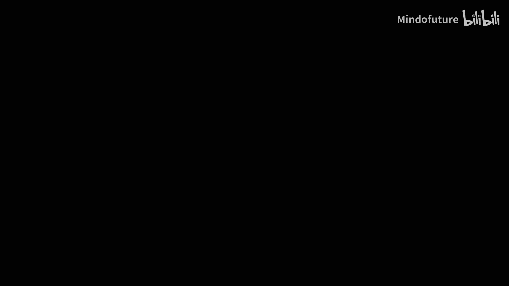
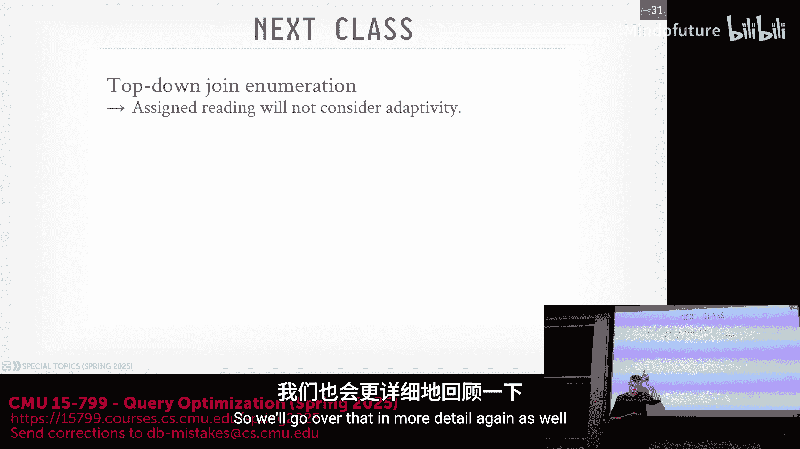

# 【卡内基梅隆---中英】数据库专题：查询优化-CMU-15-799--(2025-年春季)-p07-P07-#07---Join-Ordering---Bottom-up-(CMU-Optimize!)--BV1wDE9z9EfK_p7-

だ。🎼おてみせ。🎼A journey drove that Taas to carry up the massage。

This course is filmed on locationtion at Carmicy Mellon University in front of a life studio audience。

啊这不进去啊。But we've already gotten two emails from Google and Amazon because they know the courses exists。

 they know the course exists， they want to know who's taking the course because they want to hire you already so we'll do what we did last semester and we'll have a spreadsheet if you want to talk to companies。

 a bunch of you are going to hang out with Larry Eson so you know。You're making a face。At what。

 you're going to hang on Larry Eson。And的。You got an workacle， yeah yeah。看变。这个で。

it's about the same right， you know， no， so we'll do the same thing if we'll put up a spreadsheet and if you're looking for either full time or internship or even internships be。

one of them said the internships for this summer。 So that would surprise me And yeah。

 so if you're interested in talking to them then we'll put your name in spreadsheet。

 And then if you're doing internship this summer and you can be out in California。

 why you're out there might as well go interview with them It's always good to have competing authors。

 And again， there's not another course in the US that I'm aware of that teaches career optimization and they're always looking someone to do career compensation。

 there's two other courses in the world that I know are doing career optimization and often in the Germans。

😊，Rshiftiff， yes。嗯。Companies are emailing about hiring students taking this class already。嗯。Yeah。

 it was Bitcoin no， alloy DB， sorry。Yeah， which is。Which is。When is February 5th？Oh， that's today。Oh。

 allright。 take， sorry， I got like an hour ago or 15 minutes ago。 I just got an email from L OD B。

 wants to hire you guys。 there's another one。嗯。There's another。

 there's another Google1 It might be Big query。 It might be a big table。 I forget。 And again。

 this part， right。So you should get paid a lot all right， so today again。

 last class we were talking about the progression we on the course。

 so today was the know our initial jump in discussing in more detail how to do joint enumeration and join ordering so again the paperhead you guys read was from the Germans how did everyone do with that one。

It's okay。RightBecause that one's probably the most successful one of all the Germans for  queryer optimization right now he's sort of name droppingrop a bunch of algorithms we'll go through them as much as I can。

 but the other ones like the dynamic hypergraph one their dynamic program hypograph one like that one he goes hard in the paint the theory was this one again it's a lotre trying to cover much as you can but my painting is most successful accessible and and its to me。

 it's a brilliant idea or the suite of ideas he's throwing up the problem are brilliant All right so again。

 as I said last class， we were stepping off from the sort of jumping off the ground from this nowing the foundation of what a crude is going to look like again where the top down or bottoms up and now we're starting to go in more detail about how you're actually going implement the different pieces of the optimizer you need to actually generate query plans So last class was smoking something on transformation rules and the idea here is that their heuristics。

Or that you can apply to transform the query plan into one form to another。

 and then you're sort of pushing things along towards anyone up with the final physical plan you actually execute or moving the plan to a sort of point in the search base that is amenable or is open to more additional opposition rules you can apply。

😡，So we talk about how to access path selection with a single access path and multiple access paths。

 innerjoins， ater joinins， ater joinins we'll see more again next class。

 we'll talk a little bit about today but outer joins are complicated because you can't always。

 they're not always community different associated in the same way that innerjoins are groupbys and then special case for star and snowflake queries as well。

Okay。All right， so again， today's class， now I want to go more detail like okay， so yes。

 transformation rules， we know how to swap things from left and right from basic community and in rules。

 the next question is okay， how do we actually start looking at the different possible joint or in an intelligent way so that we're just not falling back into doing an results of search？

Like as we said， it's an MP hard problem to select right joint order。

 so we can't just enumerate everything。And I made the comment last class also too is like， well。

 the good news is that。For a lot of queries， most of them don't do any joints。😡。

Most of them are single table queries and we still have to do some challenges to those but we don't have to do the join duration And then when joins do arrive。

 we see queries that do have joins well the good news that most of them are gonna be two tables most of them are not gonna be the 50001 he mentioned in the paper So for those cases。

 we can do action also search like that'll be good enough I'll find the optimal join ordering and I was trying to find this graph。

 I know I've seen it in either a paper or some presentation in point。

 but I want to show a graph that basically if you look at sort a collection of queries in real customer real data to workloads。

 you would sort of see a power law of like for the queries that do have joins they're all gonna be mostly two table joins and then three tables maybe half as much four tables half it's an exponential curve of the number of tables are going to join the table So for the ones that are。

The most common case we'll be able to handle those just fine sort of run those do an optimal search right it's the things the outliers that we have to deal with and those are going to cause a bunch of problems for us because again。

 as we know picking the wrong join order can have order to manage a difference performance and so now if you're talking I'm doing a hunter table join which exists you know the result of picking a bad joiner is catastrophic right。

And so。你。You know in the paper he mentions that like oh yeah。

 like there's a bunch of citations where people have done analysis through Sap and Tableau Tableau was bought Hy。

 which the first data system the German Thomas Merman So they actually access to real workloads and they said oh yeah' oftentimes you see realqueries written with hundreds or even thousands of tables and the largest known query that been publicly disclosed that people talk about is this one behemoth from Sap where they were doing a 5000 table join and clearly this is not written by a human this is all generated through some dashboard people cooking things it's a machine generated query but these things certainly do exist。

 They're rare but they do exist。 And so I've seen the。At a private event。

 I've seen the schema of the SAP， one SAP the customer that had this particular query and I thought I took a photo of the best I could find was。

😡，This thing here。So this is just showing you what a sample query looks like and the details are not important。

 but I want to point out here it's declaring a view so in SAP your enterprise software you pay a lot of money for the reason why SAP is a huge company right it's views upon views upon views upon views you're building views on top of views on top of other views and inside of all those views you too much of joins so one query may show up and even though it may reference like a single table or single view。

 that thing blooms out and it is massive dependency tree of all these joins you have to do right so this this is just one example of something nasty that come your way in real workloads right。

So the。When we build our optimizer， we obviously want to be able to handle the common case。

 the easy queries and we'll define what we mean by easy in a few more slides。

 but when these behemoth queries show up， we don't want to fall apart and just give up have horribly terribly plans that are no better than random we still want to be able to handle them and then one of the key insights that comes out of this paper is that they recognize that you actually do need different strategies based on the complexity of the query and so that again for the easy ones you can do optimally from the medium ones。

 you can do a little bit better than just just blindly jumping into your dynamic programming algorithm you sort of set things up and simplify the problem at least with having a good starting point and then for the large queries。

It's going to be a bit random， but you can be a bit intelligent of what your random start looks like。

 and then you start sort of tackling the sub problems in the query plan。Right。

 so today we're to most of the time going over the paper。

 you guys were assigned to reading theput join optimizationization from the Germans。

 and again as I said， they name drop a lot of different algorithms and tell'll figure the methods it's a very thorough related work section。

 and I can't cover everything that he mentions， but I'll try to go through the most important ones。😡。

Okay， and then I'll finish off briefly talking about randomized algorithms just because I think they're kind of interesting。

 they're useless for what we want to do in a real system。

 but we'll look at three different variations of this because that's one of the ones that showed up in the paper actually he had two randomized algorithms that he compared against。

Okay。All right， so as I said， the key insight of this paper is that。😡。

Instead of your optimizer just having a single search strategy to do joint eneration for all possible queries that ever show up。

😡，That you're better off selecting a。Algorithm that is best designed to handle the complexity or the logical complexity of that query。

😡，And so that for the smaller ones and the more simple ones。

 you can probably find the optimal query plan， but then as things scale up things。

 you have to sort of switch your strategy。And so for the small medium queries。

 they're going to do a combination of a dynamic programming approach that we serve similar to the system R1。

 but actually more advanced version of this that's going to be based on hypergraphs we'll quickly talk about and then we'll see again next class。

 so you do that for the small medium queries， but then for the larger queries you want to degrade the quality of the plan gracely because it's just impossible to find the optimal query plan。

 and so you have a sort of a way to say I'll spend a little more time trying to sort of set things up or maybe target the things that are the worst part of my query plan。

😡，And then just you know， rumada。So the decision tree for how this is going to work in your optimizer is that SQL query shows up。

😊，And then there'll be a mechanism to identify， do we think the complexity of this query is small？😡。

Theres simple thing to be the number of relations you see in the query。

 but as we'll talk about in a second that's not going to be sufficient because it's actually the structure of the query that matters so complexity is some logical complexity。

 not necessarily like how much data you're actually going to read。

It's more about the structure of the query plan， so if you identify that it's small。

 then they're going to solve optimally using a dynamic of programming algorithm could be the system R1 we saw before。

 but they're going to do a variation of this。If it's not small。

 then you check to see whether it falls under the scope of being medium if yes。

 then you're going to do a another dynamic programming approach basically the same one as the first one。

 but you're going to simplify the problem by。😡，Converting the graph structure of the query plan into a linear chain。

So again， you can't prove you're going to be able all to solve this oftenly。

 but because you put things into a more simplified form。

 you're going to do better than just trying to tackle the whole pro in itself。😡。

So you make some assumptions about what the query plan is going to look like again。

 without violating any constraints you may have how things can be joined。

 but you simplify the problem and solve that。😡，And then if it's， if it's。Still too big to be medium。

 then you fall back again to this greed greed approach， we sort of start off with a greedy search。

 generate something， and then again you do more target and refine it based on the worst parts of the query plant。

All， so as I just said， the logical complexity of this query isn't based on how much data you're actually going to read。

 their algorithm doesn't care whether it's you're reading a billion tuples or 10 tuples。

 it really comes down to be what is the structure of the query plan itself。😡。

And it can't just be because you're going to count the number of to your relations you're going to access because again。

 if all the relations are joining with each other， then that's more complex than a chain so it's the relationships between the relations and how they're to be joined together that matters。

So there's a bunch of different categories of queryograph structures but I want to focus on the two extremes and in actuality most que is going to be somewhere in between like the start scheme of stuff we talk about less class。

 that's going to sort of be in between two of these， right？😡。

So the simple or the best most simple queryograph structure you have is it' called a chain graph。

 and this is where each relation is going to be connected to at most two other relations。

 and it's going to define the later linear ordering of in which you need to do the join。😡。

So it looks what'm going say I have a query here that I'm going to join four tables， R1， R2， R3， R4。

 but the way the join clause， the predis are set up is that I'm going to join R1 and R2 on the RID and then R2 can either join R1 or R3。

 R3 can either join R2 or4 and R4 can only join with R3。😡，Right。

And because I know I'm going to want to throw away Cartesian products or cross joins。

 then I don't even bother looking at whether I want to join R floor with R1。

which again would be valid， we throw things away， to mean these are all innerjos。

 but if we have we see this structure here， we basically know the order in which things need to be applied。

😡，In relation to the other tables right So again， this is the best case scenario right because you just sort of think the number of edges in the graph is minimal。

😡，to have a connected graph。The other extreme is called a click graph or cl graph。

 and this is where every relation can be joined or connected to each other。

 connected to all other relations in the choreograph， right？😡。

And it'd be something like this where're again joining four tables。

 but now I'm going to have join predicates that for every relation。

 I'll have some match up with the ID field in every other relation。Right。So this is kind of bizarre。

 like who would ever to write this， they do exist and oftentimes you maybe you don't see like the entire graph be the or sorry the query represent the entire cl。

 but like a subgraph of the total query plan could look like this， right？😡，So the idea is that。Again。

 when a query shows up， we're going to generate this join graph here。

 which is easy to because just look at the preddiates and understand how the relations are connecting to each other。

 and then based on that we'll then determine which of those three categories of complexity classes the query will be in。

😡，And again， just going back what I said before， like again the star scheme of stuff like it's going go。

 you can still to see how like the。The fact table would be in the middle here。

 and it would connect out to all the dimension tables。

 But like the dimension tables would not connect with each other。 So it's more complex than a。

Then the chain graph， but it's less complex than a clique。So what's going to happen also too。

 is that when they set this up， you're basically putting entries into instead of a memo table。

 it's the DP table for the diamond programming table。

 like you're going to set up here's the entries of the things I need to explore when I'm about to do join enumeration。

 and the number of entries that you're going to see in that table that's going to correspond again to the complexity。

😡，So for small queries。😊，If you recognize that the。When you populate that DP table。If there's 10。

000 or less entries then you know the graph is considered simple or small and therefore you can use the optimal search algorithm right so if it's a chain graph you can have up to 1。

000 relations sorry 1000 relations all linked together and that'll be roughly corresponding to 1。

000 entries but for cliques， they can only go up to 14 relations。Again。

 just because of all the dependencies between all the different combinations of the joins。

 if you go beyond 14， it explodes the size of the table。Right。All right。

 so if we recognize that our query is small， then we're going to use this dynamic hypergraph。

Dyn probing hypergraph album， I'll tell you about in a second， to generate the optimal ordering。

And the idea here is that it's going to be able to enumerate all possible join orders。Exhaustively。

 so it's guaranteed to find the the the。The optimal query plan。

 and it doesn't have to look at redundant things in the same way that the system Mar post did。

So the key difference between this approach， the dynamic probably hadgraph one。

 and from the system R1， is that in the system R1， they were getting into sort of enumerating all possible possible joint combinations and sort of exploring the entire graph structure。

And the key insight with this newer algorithm， which is also developed by the German。

 so this was developed by the same guy that wrote wrote the paper that you guys read for today design reading and with his PhD advisor。

So this is after he graduated with his PhD。Before before you started at Munich。

 so the idea here is that instead of modelingqueries just all possible these combinations in this giant graph。

 instead， if you can model things as hypergraphs，😡。

Where you recognize that there's some connected subgraph within your join graph。

 and instead of looking at all the possible join nerves individually for the elements or the nodes within that hypergraph。

 if you just treat that as that grouping as a single unit，😡。

And then you don't need to explore everything inside of it all at once。

So the idea is that you're going to generate bunch of these subgraphs and then you'll connect them together what they call hyper edges。

 and then you will incrementally add edges between the other nodes to eventually have a complete connected graph that you can run as the joint algorithm。

😡，And then you can sort of within each subgraph or within subgraph。

 you can then figure out the optimal order of that and we rely on that principle of optimality we talked about before。

 where if the subplan is optimal， then it has to be by definition， part of the global optimal plan。😡。

So again， it's a divide and conquerchrant approach， but when they do enumeration。

 because you' representing theque with these hyper edges。

 you don't have to look at every single one individually the same with that system market。😡。

I'll briefly show an example so this approach he first developed again back in 2008。

 he implemented this in Hy which is what Ca Lobot Ure was the system that well we hadn't then mentionedumb I think in this paper but that's the system he was running on for the paper you guys read so this is the successor to hyper the DDB guys basically took this paper and reimed the same thing I don't think they implemented the stuff we talked about today。

 this adaptivity piece but they certainly implemented this hypergraph search。And then Gity B is a。

There's a new datatism out of Texas where they started off using data fusion and then they threw it all way and the guy claims he's rewriting it based on this algorithm here。

But I don't know public yet， at least the source code is' in public。All right。

 so again what are these hypergraphs the idea is that it's a again it's a grouping of nodes that are being joined together in some way and then now when I want to represent that I'm going to be able to do a join between two different groups I would represent that through this hypered so again now as I'm doing my en numereration looking at all possible join odorines。

 I don't need to consider R1 r2 r3 individually with R4 or or5 and R6。

 I can to say let me optimize this subgraph first， let me optimize this other sub graph first and then now for all the possible hyper edges between the different subgraphs。

 figure out the right joining of those things。Right。

And' it's like a's a it's a divide and conquer approach similar to system R， but again。

 its the idea is that we're。We're grouping things more intelligently based on we know how the query wants to join the tables rather than blindly just looking at all possible combinations。

😡，哼。So I've already said this， Ill just say it again again。

 the idea is you traverse the graph in a fixed order and recursly go into different subgraphs and join larger ones and then you only have to consider the ones that are connected sorry then you start connecting the larger subgraphs with each other through these hyper edges and they eventually end up with a qua for your plan。

I forget the complexity of this， but it's less than the system R1。

The other thing that this also can handle is that can handle complex joint predicates。

 non inner joins， cross product joins， right it does a bunch more things more efficiently than what the SM did。

So we'll see this overall approach next class， I I want to rush through it because I want to get through all the other ones。

 but this will be the backbone for what they're going to do for small queries and meeting queries。

 the small queries you run this thing to its completion。

 it produces the perfectlyably optimal query plan。And then for medium queries。

 we'll see the next slide， they'll contort the query plan into a formula to get it something that this makes the problem more tractable inside this。

Any questions about small crews？Yes。😊，To find this or hypered。

De edges where there are multiple node being together inYeah。Its basically。

 so like R 1 or23 connected all with all the other ones。 So represent edge iss just one edge。

 over here is the edge indicating a join。 There a simple edge I I indicating a join。 If so。

 Why is the query like that， Because the query says R1 dot A just R 2 or B。

 That doesn't indicate there's a join green R1 R2， that just indicate that we need to consider both those。

You have to mash them up in order to do those。No， it's like a cross product。Yeah。

 which is still a joint。そた。One questionDid we get the most optimal plan for this， I don't Yes。

 this one you do， yes。You do， it's just like four different shape of when it can get quite expensive。

 but it only has a change。That yes， that's it I know that Yes about because let's say we just try to check for like each one of them we joins with each other right then that will have because this can miss out some scenarios is what I。

But I'm not sure so in the paper， it doesn't describe how they handle cross product joins。

And outer joins that's in another presentation he gave a presentation how to handle that in this as well。

 let's skip that for now， but to his point he's correct like for like if you let this run forever it'll find the optimal query plan right and so the idea is that they don't want to let it run forever。

So they instead of like letting it run like up， you're going too long。

 what they're instead of going to do is they're going to recognize by doing the categorization of the complexity of the query before you start running it。

 then you have some reasonable guarantees that it's going to be going to finish in a certain amount of time。

😡，And for the ones that don't fit this categorization or fit the limitations of a small query。

 set up they're going to change the query graph so that when you feed it into this algorithm。

 it then can actually then finish because as you said， the chain queries will finish。

 the cliques won't。😡，In reasonable on time。Okay。So with that。

 let's tell about how they actually do that， right？So if they say you have。

For a query more than 10 relations then。The goal is going to be to try to convert the query into a chain query。

 as I showed before， because this is going to greatly simplify the problem because again。

 if you reduced the number of edges you have between relations， then there's fewer。

There's fewer possible joint enumerations you have to consider。So again。

 the manager is going to be how do you actually then convert any arbitrary query plan into into a chain query。

 So this is going be through the technique they call the search based linearization this sort of flattening be the arbitrary queryreograph into a chain query。

And so when this happens now， then we only need to consider the soivity rules of doing those transformations and not commivity。

 because now we know that you can't， you're not going to swap things around。

Or you don't like I of hopping around because that's going to again to explode the search base。

 so you're reducing the number of possible enumerations the nuerationations you're considering by simplifying the problem。

 but you'll least be you'll be close to then you're optimal more。But you can't prove it。All right。

 so how are they going to flatten things down？So the idea here is that again， if you。

You know the order sorry， the way this is going to work is that you're going to have some kind of oracle tell you。

 here's the optimal ordering of the relations rejoins。

I'm not going to explain how they do that just yet。

 just assume that someone's going to tell you at the very beginning。

 here's the optimal ordering you should use。😡，And then now what you do is once you have that。

 then you're just going to do a DP algorithm where you'll look at progressively larger size of join sets。

😡，In the query plan and then start building up the query plan。

So the idea is that at the very beginning， I'm just going to look at just combination of two relations and again the order in which I' want to execute my joins are going to start from here to there。

 so I know I need to join R2 with something first before I joined join something with R6 and R4。😡。

Right。So I'm going to look at， can I join R2 and R1， I look up at my graph up above， yes。

 there's an edge between R2 and R1， so I know I can join them。😡，Then now go to R1 and R3。

 I recognize that there's no edge connecting R1 and R3， so I can skip that。😡。

If you want to support cross product joins or Cartesian products。

 you could then add that kind of edge， you know connect you would add that here for simpleimified things。

 we're going skip that doesn't add R2 three right checks R1 R3 and checks R23 and then adds the R23。

U。Yeah， you're right， yes， it does add to yes。Yeah so yeah。

 the animation is wrong so instead of sliding on here you would look at R2 and R3 R2 and R5 R6。

 right？😊，I'll just simplify it this way。All right， so then we do R5 and R6 to an edge there。

 we connect those， R6 and R4， we skip。So then now we look at progressively larger ones。

And as they said it would be2 and R1 R3， R2 R1， R R5 and so forth right again the key thing is that you're always sort of going in this order and you want to start try to joining this before anything else。

So in this case here， the output R2 and R1 from up above has an edge between R2 and R3。

 so therefore we know we could have a join between those。😡，Sing this all the way down， we get R3。

 R5 and R6 if we join。If we take the output of R2 R1 and R3。

 we can then join that with the output R5 and R6 because in the output of this three way join here。

 we would have the R2 values we need to then join it with R5 so we then added to that and then to we get the end we add R4 like this。

Right。So again， we're sort of starting on this side here。

 adding up adding up the joins going from left to right until we produce the full query plan。

And so the key thing about this is one that we can actually generate bushy plans here。

 whereas in systemR， they throw away all the bushy plans and all in consider left deep joint trees。

And then the other key thing is like， well， I said that some magic oracle is going to tell us how we get this ordering because that's going to influence how we're going to build out the joint tree。

 so the question is how are we're going to do this。Yes。

So the join order means that the scan order that we are going to view this tree， not the actual。

我就会跟铁 join。去。His question is， what do I mean by optimal join owner， it just means that like。

As I build the tree， I want to make sure I join R2 with something else before I try to join R4 if I'm allowed to according to my graph。

😡，If I'm allowed in Cartesian products， cross joins。

 then I can join in order with anything I want because simplify the problem we're not doing that。

 we' only do inner joins。Right， so again， in this case here。So we have this query plan here。😡。

The database system could decide that I wanted to execute the joiner R5 and R6 first。

 then execute R2 and R1， it's sort of a runtime decision it can make。

 but from the query planet itself， the idea is that this would be the leaf node here。

 I mean R5 and R6 as well， but the output，😡，The system could then decide I don't want to join these because I know I to join it with the output of this and depending on how I sliced up the query plan with pipelines。

 I may want to delay exceeding that， but so R2 would is very likely to get run first or the scanner R2 would get run first。

😡，Okay。So Thomas loves finding papers from the 1980s that have very few citations but solves exactly the problem he needs。

 so here's another one that he pulled out。I forget this I think the number of engine is like was like 60。

 There's one one paper he does NBCC that does precision locking。

 He found this paper from like 1983 that literally had like 20 citations and it does solved the exact problem that he wanted It's amazing all right so。

The way he's going to generate the optimal joint owner is he's going to approximate it by using this algorithm from the 1980s that will generate the optimal left deep plan for a tree in n square time。

 so in polynomial time。So the idea is here is that instead instead of doing a more expensive algorithm to figure out it is the true optimum ordering。

 he's going to figure out what the optimum ordering should be for a left deep tree。

 run that in very quickly and produces a reasonably good result and then had that be a starting point of how he's going to start looking at。

The don the rest of the query plan tree。Right， so the basic idea is that you're going to in this algorithm。

 you basically take the queryreograph again with these joint owners or sorry with the joins。

 and then you're going to transform it into a precedence graph thatll define some linear order of which in which you have to generate the query plans or do the joints。

😡，If the graph has cycles， then you just run the minimum span tree algorithm to convert it into an acyclic graph。

 acyclic tree。And you make decisions on which edges to include based on the like choosing like the most selective edge。

 because the most selective prediica is going to throw away as more tus than anything else。

 so I want to keep that around。So then now I'm going to assign a rank for all the nodes that's going to be a combination of what its selectivity is divided by the cost of actually executing it。

 so it's basically a cost benefit benefit ratio。😡，And then not I'm going to successfully merge child chains together according to the ranks to make sure that I'm keeping things in the right rowm。

Choosing nodes in the order of my initial joint owner that are going to be sent to have the most benefit of me most selective and at least overall cost。

 choose those first， and then whatever I have a conflict where something is largely required to be joined after something else。

 but the rank ordering says I want it to be above the other one， I'll just combine them together。😡。

So let's look at an example。As well as I' say too， I think the original idea came from this 84 paper in Todds which is sort of theory conference and then I think the 1986 paper is the actual I don't know I forget whether I should check what they cited each other but like here's the actual implementation of doing this and again this is like in the 1980s everyone was started trying to come up with different algorithms to not have to do the Smar style of exhaustive search or the DP search that they were doing so this is a way to approximate what be or come up with what would be the optimal joint ordering for a left deep tree without having to solve the overall joint ordering problem。

And so Thomas is using this and his approach to again。

 provide a good starting ground for the join ordering。

 because then you can run a more expensive DP algorithm to find bushy plans and other things。

All right， so what it's going to work is that we're going to build a precedeence graph for each image relation that we have in a query plan right and you have to build a precedeence graph rooted at every single and every single relation。

 so if you say this is for the one for a precedence graph for a query rooted that a。

 it would look like this， but then you have one for a rootr that B， C D and so forth right？😊。

And then there's no logic here， there's no cost calculation。

 it's literally just saying in what order something has to be joined something else， my example here。

 I'm going left to right。So then for each of these graphs， thatll pick the one root of the a。

 we're then going to generate the the sort of sequence of the the join orders and then for each the each of the nodes representing the relations。

 it'll be that cost benefit ratio so what's the selectivity of the。

The selectivity of the predicate that might join and what's the cost of executing that query or that join operator or based on the number of two pole I expect to actually have to read in so that each relation。

And then what happens is。If you recognize that going from top to the bottom that you have two nodes where the rank is actually it doesn't follow from lowest to highest so three1s that's a lower cost than four1s or three-1 down here this is less than this so in my graph structure I actually want to join this before this but logically I can't because of my edges up above where I had to join E with F and I can't join f for than anything else。

 otherwise and again end up with a cross bottom。😡，So when this occurs。

 they just combine it together into a single node and then sum together the two costs like that。

So you end up with。you know seven10s like this， and then now I'm just going to go from the top the bottom and merge change based on increasing the rank until I end up with a linear form like this or a chain query like this。

So that's how they're going to again to approximate which would be the initial join ordering。

 and this is probably going to be the optimal join order only for a left deep tree。Yes。

 where are they getting the initial rank the rank so it would be it's the selectivity is like the numerator and then the denominator would be like the number two bowls I have to re for that relation。

which you would have because again it's in the optimizer。So again， this is an old algorithm。

 I don't think。Well actually， it's an old algorithm。

 this is private a lot of people when to build a first career Adv will basically implement something like this。

😡，because you don't have to do deep call search or a DP search。

 which is like' applyinging heuristics to generate this thing。All right， so again。

 for medium queries， we're going to first linearize the graph using IKKBZ algorithm。

 and then from that linearization， we know we have now an upper bound on our query plan cost。😊。

Because again it it's a prove optimalmal left deep joint tree so any any other query plan we're going to pick will have be better than that so we're basically now looking for a bushy plan that's going to be better than that then the left deep one but if we don't find it then we least have that left deep one okay it's a good starting point for us we can run efficiently and if we use the remaining time to then actually look for。

You know， do the DP algorithm to refine it and try something better。Again， it's N cubed。

 so that's fine for， I think。IThink for 100 queries it does okay beyond that it explodes and things get worse right it's not as bad as exponentialential because it's polynomial but still still not great。

And if you you the goal again， if it's able to find a decent linearization。

 then it may then be able to uncover the global optimal bushy plan， it's not guaranteed。

 but it's going to be close。All right， so so that's small。 we've done medium。

 Now the question of how we're going to handle the large。Right。So for this。

 they're going to use a technique where they were going to rely on a greedy algorithm to generate an initial query plan。

And then they're going to identify sub portions of the query plan of size K K relations。

 and they're going to target the ones that are the most expensive。😡。

And then run the DP algorithm to optimize those for some amount of time。You know。

 put it back in the query plan and then go find the next most expensive subgraph and optimize that and keep doing that to you run out of time。

So the key thing' going to point out though is that in the original paper I think from 2000 that describes using sort of this technique。

 they talked about having subgraphs of I think four to seven relations like that was their ideal case。

 but if they do that same litigation trick we was talking about before to again simplify the problemm before you feed it into the DP algorithm they can say we can get the K equals 100 and still produce pretty good results in a good time。

So there's a bunch of different greedy algorithms you can use。

 I want to focus on the greedy operator ordering because it's amiss one。

 there'll also a minimal select， it's basically you're just picking whatever edges have the minimal select one。

 right？We'll see something similar。In the quick path。a quick pick。I'llWithin in a second。

All right so this Go algorithm goes back from late 90s so you kind of see like I gave you guys a paper that you guys were all born since you were born then keep following back to odor ones because in a lot of these techniques he finds whether it's the core foundation a lot of these optimization or techniques goes back to the 80s and 90s so the idea is that we had this queryreograph again with connecting edges based on joins and we're going to find a pair of connecting nodes。

 I and J that have some the minimum value for this formula here。

 so it's mean the size of the tubs that I mean fed into each of these nodes。

 each relation multiplied by the selectivity of the predicate in the join clause for those two relations。

So you can think of like some approximate numbers for these four relations， ABC and D。

 here's the size of the data of the number tools that they're going to generate。

 and then for the edges there were some estimates on the selectivity。So again。

 what we want to do is we're going to look at all possible combinations of nodes in this graph and then run this formula on them。

and I'm actually missing but they have to be connected right， so the reason why I have AB。

 BCC and BD and not like A D or AC because again there's no edge between them。

If I'm not considering cartegeian products， then I don't want to do that。

So this is pretty easy to do again just do this math here， and then now what I'm going do。

 I'm going to pick the one that has the lowest cost。

 the minimum value of the three choices that I have here。😡。

And then I'm going to merge those nodes together。Right and then in the new graph that I'm going to generate。

 I'm going to have this new node of the of the merge node from the original one。

 and I'm going to set the size of the node to be whatever I've calculated for this formula here because that's again determining the number of twos I're going to come out of this thing so implicitly I'm saying I've done the join say on B and C here and look at the graph I've done the join in BCc here and then when I'm emiting what I'm spitting out now is 2000 tuples。

And then now you got to go back to all the other edges that are connected edge to the two nodes that you merge together and you update now their selectivity to say。

 okay， well， if I do my join predicate on my original relation A。

 but now on the output of the join of BC， what is the selectivity of that predicate it's going to be？

It'll be very wrong as it's hard to calculate these things as we'll see later on。

 but like it's the way the formula works the algorithm works。

And then now recursively keep doing the same thing over and again until I run out of node only the ones left right so again for the two connected edgeers A and B and BC and D。

 I just run that same formula， I would then pick this one or the lowest call so I would end up merging A。

 BCC together， I would then again in the next round I would then merge it with D and then I would end up with essentially the join order that looks like this。

Right。And so my example here， because it's the graph of above is sort of simple。

 I ended up with a left deep joint tree， but this algorithm would still work for de generate bushy lens as well。

Right if I had maybe like an entertain C and D， I kind of ended up joining C and D first and had that one side of the joint tree and then joined B and C and A on the other side right for this example。

 I just ended up landing on。Left deep tree。But the whole point is is not that only consider left deep trees in the same way we did for the other linearization technique。

All right， so again， this is going to work with thecyclic and acyclic  queryographs and then again。

 not just left deep to trees， it can generate the bush ones as well。

So then now you have this you have this first approximation of what the query plan is going to be right and this is a pretty simple algorithm to run and then you're going to go through and target the connected subgraphs and how you identify what's connected sub graph and so forth that's a bit more complicated you identify the subgraphs。

 then run the DP optimization algorithm on that just that subgraph and thinking of like。😡。

With the hyper edges， you're trying to say like， okay。

 here's this piece of the query plan that is connected to other things and I don't need to worry about how they're being connected to other things I'm just to worry about how to optimize within that small region。

 run DP on that and then for a certain amount of time and then stop that and go choose the next subgraph to optimize。

And until you run out of time。So again， this algorithm runs in and cube time， which again。

 it's reasonable again for really large graphs， it really large query plans。

There really isn't an alternative。All right， so I know there's a lot of tables and a lot of the appendix in the paper。

 I'm just going to focus on one graph he had where he's comparing the how well。

 his adaptive approach can handle increasingly large queries with larger number of relations compared against two commercial systems。

 oracle sequenceQL server， and Postgress。And so I shouldt maybe include the performance numbers for his own system because he compared ones through an algorithm how good the query plans are actually runtime but for we're going to say how fast did the query optimizer compared to these other ones so in case an Oracle within I think the first 5050 relations just shoots to the roof and in some cases I don't think it even completes more than 100 queries。

 100 relations。😊，For SQL server， it starts balloons over 300 in Postgres。

 we'll talk about in a second， they're actually going to use a randomized algorithm that is based on time so you basically say I'm going to let my randomized algorithm for a bit and then when I running out of time to stop but because all the internal data structures for how they set up keeping track of what these relations are and in the query plan itself。

 that becomes end up becoming the bottleneck， so after 700 queries you' just blocked on setting up all that metadata about the query before you then feed it into the randomized algorithm。

And then that's where everything falls apart from them and then for that for theumbr for the adapt approach。

 they're completing things in 500 milliseconds， which is impressive。

And the query plans are reasonably good。within 10%， yes， which is very impressive。嗯。Okay。

So I want to really talk about。Another category algorithm that he mentioned bunch everyone's and again the idea here is like it's a sm' forward like here's bunch different approaches of how to do this。

 the Uber guys are putting everything together but it's of good to know what else is out there and then we'll see more of these again next class on Monday。

All right so all the the things we talk about today assume everything's innerjoins and know crosspos。

 of course we talk about floor how outer joins， you want to be able to clue them and I don't think this paper talks about it。

 but he has other work that talks about like in some cases the crossjo sorry the crosspo joint actually。

😡，Is the best thing to do。When tables are sufficiently small， like tens of tus。

The Cartesian product is actually going to be the best choice then rather than an inner joint。

And of course， you don't want to just。Blindly include Cartesian products in all your possible you know joint selection algorithms because if you have two massive tables。

 cross joins would be a terrible idea， so they have some additional heuristics to say if I recognize that these tables are really。

 really small， then maybe I do want to consider doing a Cartesian product on。

But I don't think they go beyond the roots or the bottoms of the query plan。

 so like once you get hired in the query plan because you know the cost estimates when we you're way off。

 you definitely don't want to be doing Cartesion products so they skip all that so we'll talk a little bit more about that next class as well。

All right， so I want to bring up now of these random eye algorithms because they showed up in the paper and they're interesting or at least worth considering。

 there's the only one na system that actually does this， I've already said what the ways is。Posgres。

 right， and it's actually terrible。And it's advised not to use it。But they don't really it again。

 they're joiningr algorithm it's not very good relative to certainly SQL server and other things。

 right？All right， so。IfIf you have a really large query of a huge search space。

 one approach is to take a flip of coin， do a random walk。All in the solution space。

Keep track of the best query plan you've ever seen so before。

And then if you magically stumble upon a new one that's even better。

 then absolutely go ahead and just use it， right？Random is actually surprisingly good A lot of times when you。

 when you see these。LMs are different Ds now， but like these。

A lot of times these optimization algorithms are baing optimization techniques。

 where using heavyweight machine learning methods， a random walk does surprisingly well。

And so it makes sense we want to apply this for database systems。

So the three albums that I think they were mentioned in the paper and they compare against the Postgres one and this quickpic one。

So the way Quick PickBook works is you have this set of all the edges between in your join graph。

You randomly pick one， remove that from sort of the edge set。

 and then add the join of the two relations represented or connected together by that edge in your query plan。

😡，Check whatever the current cost is of that query plan。😡。

And if it's worse than the best query plan you've ever seen before， assuming you start with infinity。

 then you just throw it away and start with a random set and reset everything and start it over again。

 but if it is still less than the best cost you've seen before。

 then you random pick another edge and join that。😡。

And then you keep doing this until you run out of time。Right。And， you know it。In some cases。

 it works okay right and instead of doing sort of random sampling or uniform sampling from the edge set。

 you actually can bias the sampling function to be based on to try to choose the edges that have better selectivity。

so that you again， end up choosing joins where you know you're going to throw eight more twos earlier than the query plan and other ones。

Yes， what about explainability？In terms of what， you you leverage to explain your own。

So I mean told him you can explain the query you can like if you his statement is what about explainability。

 there's explainability the query plan explain a bit of the algorithm if I run explain and I get this it'll tell me what the query plan looks like。

 but is how did they find it。😡，It's random。 Well，'s about that the second。

 So you can say you can't recreate it。 So for this， Postgres does this。

 I don't know what are these guys， I don't think these guys ever put it action production。

I think this paper came from CWI in Postgres， they use determinant succeeds for the random function so that if the same query shows up today versus tomorrow and it runs through the genetic algorithm。

 it'll produce the same result。Now， if you change the time。

 if you say like I'm going to run for a minute versus 30 seconds。

 then it may not produce the same result all。 but the idea is that you end up with the same thing。

All right， so this is one approach。 Yeah， sorry。先到时。

It means it's going to be always the worst possible plan coming out of everything So his statement is。

If you just have bad luck and your random algorithm picks the worst possible plan ever and that no matter if you come back and try to run it again。

 you would end up with the exact same crappy plan， I don't know what you can do Postgre actually maybe I think the Postgre is you can override the seed So you could say this is terrible try a new seed try it again but then you you just like you set the slot machine just you try and over again until hope something works out。

 Yes， complain Postgre。So the statement is， and he's correct。

 aren't there enough people complained about Posts credit Adv in today's age for someone to change it。

Yes， who's going to change it？都个病嘛。咋整。Oh nothing do that， yeah。

So the Postcode code is beautiful if you go look at it， it's a well documented C code。

 it's pretty well structured in some cases like the documentation is like， hey。

's here's this algorithm implemented from this paper and when you teach like its it's。

I looked a lot enterprisepri code， but like it's the best I've ever seen。The optimizer， though。

 you put all the documentation you want。 But like the overall structure is just a rat's nest。

 which it is because if then this， then that， right like like。

My understanding is that the well talk about Postgres and second my understanding from speaking to developers that work on these things at Postgres or than Postgres Pro you know。

And in on Postgres is that the optimizer is quite brittle in that nobody wants to make any big changes because like there's a bunch of those latent or implicit assumptions about what the query plan' is going to look like from one stage to the next。

 so if you violate something like them up above， it'll break down below。😡，Because again。

 like as I said， no one's sat down like since the beginning of Postgres and said， okay。

 well like here's all these advancements in query optimization that I realize we've been reading order papers。

 but here's one that's actually from six years ago that's modern， no one's really sat down say， okay。

 here's how we actually should build this thing。At least it's gone about trying to do it。Yes。

Takes the precedence。This question is， does the sampling function take you press in account so the the。

When you generate the precedes mean like this thing has to be joining for this thing， no。

 there's no notion of that， it's more like。Am I joining these two relations together。

 so I don't have an order in which I need to do the join， that's what the random choice is doing。😡。

Then I'm going to join A and B and then C And D， it's picking that。

The only thing that it knows is like because it can't pick like joint A with D if there's not an edge between them because it wouldn't be in the edge set when it does the random choice。

So logically， it's making sure it's not choosing， again， Cartesian products。

 but it's not there's no knowledge or information like I need to join these tree tables where these other three tables。

 it just randomly comes up with it。😡，All right so another technique from late 80s is with you simulateimd kneeing that was the hot thing in the 80s right and the idea of as simulateimd nailing is you。

You basically swap operators in you generate some random query plan and then you just sort of swap maybe the order of of a join right so I join AB。

 I'll just flip coin decide whether I want swap AB to be BA。😡。

And then you check the cost of that new query plan。

 if it's less than the one you just the best you've seen so far。

 then you keep it and swap something else， if it isn't， then you reverse it back and then try again。

😡，ThereWith that' a bunch's one math behind it about buys coins and whatever right like the advantage of this you'll be be able to break out of a local minimum。

 but again it's a random walk there's no guarantee you're going to end up with something that is that is good right they said if quantum code come real then you could do this。

All。Oh， I can't say that。Because it would be anonymous，Yeah， so again， we have all our。

We got to impose all the correctness guarantees we had to talking about before about the properties and enforcement rules so that we end up sort moving things around in ways that we shouldn't we need to reject it right or set the cost in affinity so you never include it there's a paper on this nobody does this one。

Okay， as we've been dancing around the the Postg story right So Postg has this thing called the genetic algorithm。

 G E G E Q O。 and by default， it gets tripped on when the number of。

If the number of tables that you're referencing in your query is 13 or more。

 then this thing fires up anything less than that they' using the system R styles Jo search。

 but anything above that this switch is on and you can change that flag or when you actually want to want to enable it or disable it entirely。

 right？😡，So again， the idea is that you have one of these rounds are generations。

 you generate a bunch variants of the query plan， and then you pick the one。

 some subset of them that's going to have the lowest cost and you're going to permute them or cross-breed them with other query plans so that you end up with a bunch of new offspring of other query plans that are somehow inheriting the traits of the best query plans in the previous generation。

 and then you repeat it over and over again until you end up with until you've run out of time。

So let's say that I'm joining three tables R S and T right and so I just do randomly generate a bunch of different join odors and here they're actually going to be picking maybe also what physical implementation I' use for the join either hash1 or N loop join。

And then now for all of them， I'm going to generate some cost using my cost model that I have my system。

 and then I'm going to anoint one or pick one that has the best cost。

 throw away the one the lowest cost and maybe I'll keep them I'm showing three three children or。😡，3。

 three entities per generation you would have a lot more pick the one the maybe the top two and then pick a random portion of the。

Of the the query to change in some way right and then keep the rest right so in this case here I decided to keep this nest loop with the s here and going to keep this。

Where's the other one， yeah， and then the hash join SNR that's in there as well。

 these are the trays getting populated over and then everything else doesnt get randomized。So again。

 the idea is that there's some trait， there's some joint order or physical algorithm selection I did here in this first generation that caused me to have a good query plan。

 I don't know what it is。😡，I'm going to random pick something。And then I permute the rest。

 and then now in the second generation I compute the costs all over ym。

 if I have something that has the best cost than the one I've seen before， I choose that。

 throw away the one that has the highest cost， pick some trait that I want to keep around and then do it again all over again keep doing this until you run out of time。

And as he brought it before， to make sure that you don't that the same query I send in today and emerge with the optimizer。

 if I don't have a cache query plan or a prepared statement。

 if I come back the next day and run the same query on the same data on the same statistics。

 that I don't get a completely different query plan。

 they set the random seed deterministically so that you're guaranteed to be producing the same result from one day to the next。

So while I do this， well， again， sometimes when the search is really difficult。

 then randomly jumping around might be okay and help we get out of local minimums。

The memory overhead is super cheap for all of this because all I'm knew is a foot the the coin and not keepinging back the full search entry of everything I've seen before right in the case of the paper guys read。

 they talk about how the DP table could get really really big and there keeping track of the history of the scene you applied and they had a bit set to keep track minimal bits set to keep track of the history that you would need for entity in the DP table。

 like there' a bunch of tricks they had to do to make sure the memory overhead was in balloon up and there random stuff。

 there's none of that。Because it's just so simple。As he brought up。

To trace through this and figure why something picked what it was going to pick is very。

 very difficult and there's extra things to do make sure that the query plans are deterministic。

Did I take this out？嗯m。One second呢。I thought I had a screenshot on one the show。I did， perfect。

So we had somebody a few years ago。On the Postgres team， come and talk about。You know。

 all the challenges and things they're facing in the person's query optimizer right and in particular。

 he talks about how the。You know， all the problems of genetic algorithm and like it doesn't scale。

 it actually isn't really entirely random。You know there's a bunch of limitations and assumptions that they make to sort of simplify it so it isn't truly maybe as random as we think it is and then as I said。

 like just go search Postgres bad query plans。😡，And you'll see a bunch of people complaining about how this thing doesn't work。

 but again， this is so hard to do and just nobody has been around to work on this。And it's。

If most of the queries are going to be 10 tables or less。😡，They'll find the opt watering。

 assuming your sta are correct， but not always the case。But for the harder ones。

You know you should not be running you know， 100 table joins in Postgres， you want to be using like。

 you know， a data warehouse for those kind of things。Right。All right。

 so Finja so we saw a bunch of different ideas， strategies。

 how to generate join orderings and the idea that we one of the main things we talk about is like if I know the complexity of the query。

 then I want to choose a different approach。It seems sort of obvious。

 but most systems most career app measures are not implemented that way。

Right and the the German paper shows you like here's why you want to do this and here's how to do it and it's pretty pretty well Another good thing to have in your bag of tricks for。

 you know， whether you got career optimization or databases or anything else rest your life in computer science is the idea that when the problem is really super hard。

There's all these divine conquer approaches， there's all these throw ML or AI stuff at it。

 but one trick that is actually a really good idea that would be useful for rest of your life is the idea that I know the problem is super intractable。

 then rather than just starting at a random location or just starting from nothing。

 if there's a quote unquote  inferior algorithm。That can at least approximate a good answer in a short amount of time。

 at least get me something better than I would have been any without doing anything or random。Then。

That's a good choice to make because now you're at a good starting point where you're basically refining the solution you gender from the fear algorithm to make it be actually even better。

😡，And so that linearization or the IKK BZ technique he was doing。

 like those things aren't going to produce the true answer you want。

 but it's going to push you in the right direction that's going to make things a lot easier for you。

So not just cization， in CS for a lot of things， this is a good idea， okay？

All right so that's it for today next class we're going now do so this was bottoms up drone nourration now we're going to top down the paper I guys said in the reading isn't going to be adaptive have an adapt approach the way that the paper guys read today is so it's really like okay here's how to do enumeration in the context of a cascade style volcano style system and it will also go over that dynamic hyper programmingm dynamic programming hypergraph approach again because the original paper they wrote was how to do this in a bottoms up system but then the Thomas's German Pe advisor he wrote another one how to how to do a top- down system like cascades so we'll go into that in more detail again as well okay。

Alli guys， have a good weekend， see you。有。🎼You brown fact。

This is like that wood grain touch。🎼My dogs get one。🎼IAnother one movie。

Don rocks if you suspect if you don't through your mind we this dis straight punch line like a。

🎼Get you the quick with the bullshit。 I keep the cab quit for the long trip。

 I got a remedy for beaches when the star shit surround sound like a。🎼It a big。🎼ど some。

