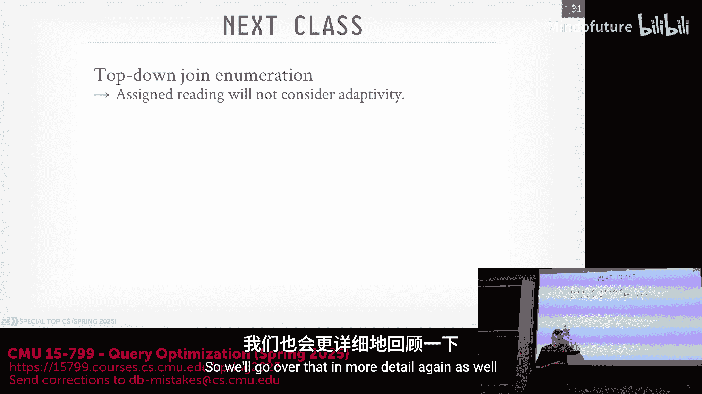

# 数据库查询优化：07：连接顺序优化 - 自底向上方法


在本节课中，我们将深入学习数据库查询优化中一个核心且具有挑战性的问题：如何为多表连接查询确定最优的连接顺序。我们将重点探讨一种自底向上的优化策略，它根据查询的逻辑复杂度自适应地选择不同的算法，以在可接受的时间内为各种规模的查询生成高质量的执行计划。

## 概述

连接顺序选择是一个NP难问题，穷举所有可能性对于大型查询是不现实的。因此，优化器需要智能的策略。关键思想是：**根据查询的逻辑复杂度（而非数据量）自适应地选择最优的搜索算法**。对于简单的小型查询，我们可以进行（近似）穷举搜索找到最优计划；对于中型查询，我们先将问题简化（如线性化），再进行深度搜索；对于大型复杂查询，则采用启发式或随机化算法，在有限时间内找到一个“足够好”的计划。

上一节我们介绍了查询优化中的转换规则和基础概念，本节中我们来看看如何具体实现连接顺序的枚举。

## 查询复杂度分类

连接顺序优化的首要步骤是评估查询的“逻辑复杂度”。这并非指待处理的数据量，而是指查询图的结构复杂性。查询图是一种表示方法，其中节点代表关系（表），边代表连接谓词。

以下是两种极端的结构，大多数实际查询介于两者之间：

*   **链式图**：每个关系最多与两个其他关系相连，形成一个线性序列。例如，`R1 JOIN R2 ON ... JOIN R3 ON ... JOIN R4 ON ...`。这是最简单的情况，连接顺序基本被确定。
*   **团式图**：每个关系都可以与所有其他关系相连。例如，四个表 `R1, R2, R3, R4` 之间两两都有连接条件。这是最复杂的情况，搜索空间巨大。

基于查询图的结构和动态规划表中需要管理的条目数量（这直接对应复杂度），优化器将查询分为三类：
1.  **小型查询**：动态规划表条目 ≤ 10,000。例如，链式查询可包含多达1000个表，而团式查询最多只能有14个表。
2.  **中型查询**：复杂度介于小型和大型之间。
3.  **大型查询**：超出中型查询的复杂度上限。

## 自适应优化策略

基于上述分类，优化器采用不同的策略：

### 针对小型查询：动态规划与超图算法

对于小型查询，目标是找到**最优的执行计划**。这里采用一种基于**超图**的动态规划算法，它比传统的System R风格动态规划更高效。

**核心概念**：
*   **超图**：是普通图的扩展，其边（称为超边）可以连接任意数量的节点。在查询优化中，超边用于表示一组因连接谓词而紧密关联的关系。
*   **算法思想**：该算法将查询图分解为多个子超图（即关系组）。优化时，先将每个子超图内部优化到最优，然后将这些子超图视为单元，通过超边进行连接组合。这利用了**最优子结构原理**：全局最优计划必然由局部最优的子计划构成。

**公式/代码描述**：
算法递归地遍历超图，先优化子超图，再通过连接超边逐步构建更大的计划。它能够处理内连接、外连接甚至笛卡尔积，并能生成左深树和浓密树。

```
// 伪代码概念
function OptimizeHypergraph(Hypergraph H):
    for each connected subgraph S in H:
        local_plan = FindOptimalPlan(S) // 递归优化子图
        memoize(local_plan)
    // 然后基于超边组合子图计划，寻找全局最优
    return CombineSubgraphsViaHyperedges(H)
```

这个算法是后续策略的基础，由Thomas Neumann等人开发，并已在HyPer等数据库中实现。

### 针对中型查询：线性化与动态规划

对于中型查询，完全的最优搜索可能耗时过长。策略是：**先将复杂的查询图简化为近似的链式结构，然后在这个简化问题上运行动态规划算法**。

这个过程称为**基于搜索的线性化**。关键步骤是获得一个初始的“良好”连接顺序。这里使用一个来自80年代的算法——**IKKBZ算法**，它能快速为**左深树**找到一个近似最优的连接顺序。

**IKKBZ算法简述**：
1.  为查询图中的每个关系节点计算一个**秩**：`rank = selectivity / cost`。选择性越高、成本越低，秩越大，越应优先连接。
2.  基于连接谓词构建一个**前驱图**，表示连接的顺序约束。
3.  按照秩的降序尝试合并节点和边，如果顺序约束（前驱图）与秩顺序冲突，则将冲突的节点合并为一个组（合并其成本）。
4.  最终产生一个线性的连接顺序。

获得这个初始顺序后，将其作为起点，在此约束下运行动态规划算法来探索浓密树等更优计划。这样，我们至少有一个良好的左深树计划作为保底，并有机会找到更优解。

### 针对大型查询：贪心算法与局部优化

对于超大型查询（如涉及上百个表），即使简化后的问题也难以处理。此时采用**迭代改进**的策略：
1.  **生成初始计划**：使用一个快速的**贪心算法**（如GOO算法）生成一个初始的、可执行的查询计划。
2.  **识别瓶颈**：分析初始计划，找出成本最高的子图（例如包含K个关系的连接部分）。
3.  **局部优化**：对识别出的高成本子图，使用动态规划等更强力的算法进行局部重新优化，时间有限。
4.  **迭代**：将优化后的子图替换回原计划，重复步骤2和3，直到时间耗尽。

**GOO贪心算法示例**：
在查询图中，迭代地选择一对可连接的关系 `(R_i, R_j)` 进行合并，选择标准是使公式 `cost = |R_i| * |R_j| * selectivity(R_i, R_j)` 最小。合并后，更新图，直到所有关系合并为一个。这种方法可以生成左深或浓密的树。

## 与其他方法的对比

论文中将这种自适应策略与商业数据库（如Oracle, SQL Server）以及使用**随机化算法**的PostgreSQL进行了对比。

**随机化算法**（如遗传算法）在搜索空间巨大时作为一种备选方案，但缺点明显：
*   **不可预测性**：虽然PostgreSQL使用确定性随机种子保证同一查询计划可重现，但不同查询或不同参数下可能产生差异巨大的计划。
*   **可能陷入局部最优**：随机搜索可能永远找不到高质量的计划。
*   **解释性差**：难以解释为何选择某个特定计划。

在实践中，自适应策略在优化时间（500毫秒内处理大型查询）和计划质量（接近最优的10%以内）上均表现优异。

## 总结

本节课我们一起学习了自底向上的连接顺序优化自适应策略。核心要点是：
1.  **分类处理**：根据查询图的结构复杂度（小型、中型、大型），选择不同的优化算法。
2.  **算法工具箱**：对于小型查询，使用基于超图的动态规划进行最优搜索；对于中型查询，先用IKKBZ算法线性化简化问题，再进行动态规划搜索；对于大型查询，采用贪心算法生成初始计划，然后迭代地对高成本子图进行局部优化。
3.  **实用哲学**：面对NP难问题，一个强大的策略是先用一个快速、近似但“尚可”的算法获得一个良好的起点，然后在此基础上进行精细化改进，这比完全随机或盲目搜索要有效得多。




下一节课，我们将探讨自顶向下的连接顺序优化方法，以及如何在Cascades风格的优化器框架中实现这些思想。