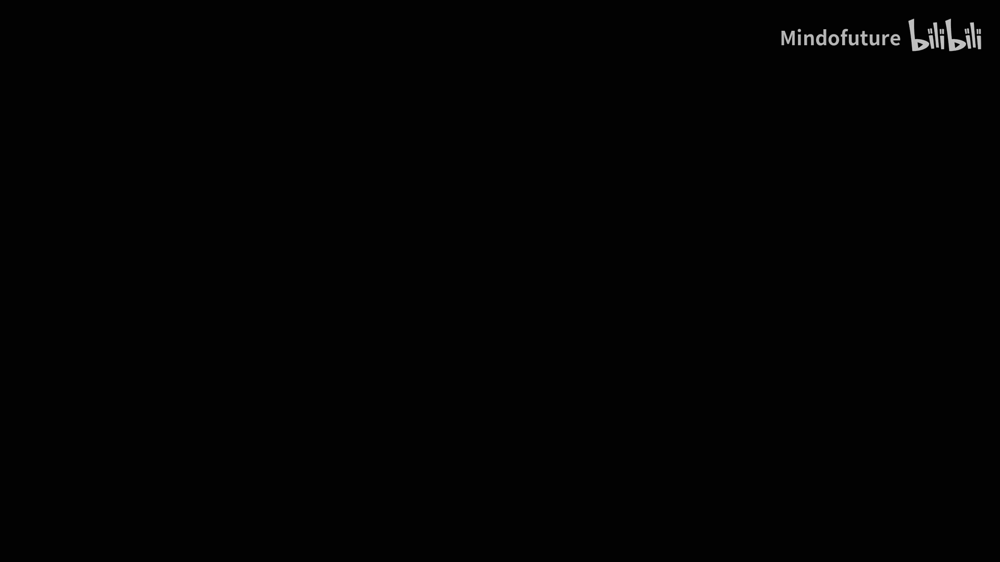
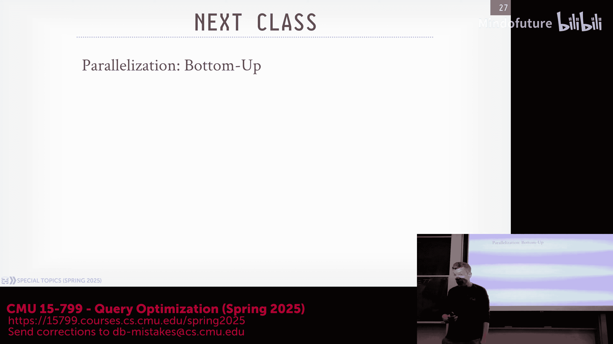
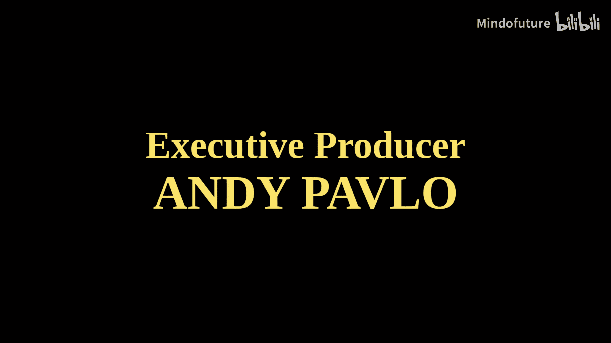
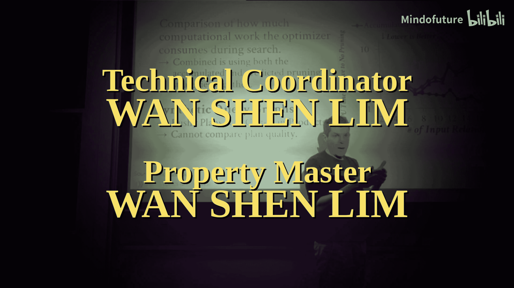

# 【卡内基梅隆---中英】数据库专题：查询优化-CMU-15-799--(2025-年春季)-p08-P08-#08---Join-Ordering---Top-Down---Transformational-(CMU-Optimize!)--BV1wDE9z9EfK_p8-

だ。🎼おてみせ。🎼A journey drove that Taas to carry up the massage。

This course is filmed on locationtion at Carmicy Mellon University in front of a life studio audience。

🎼对。Forward example to change materials， change lecture on administrative side of things again。

Pay reviews are ongoing the February and fifth piece。

 main one is the project one is due on February 28th， if you haven't got started on that。

Please please get started with that as soon as possible。 Who here is finished Project one。

Cows it's a bit rough， right yeah？'s my trying to replace it okay all right。Again。

 post on Piazza if you have any questions。 And then I didn't check this morning。

 has the Amazon money showed up yet。😊，Just log in your account and see whether it' should be $100。哎。

去。If it's there， again， I submitted it two weeks ago。

 I don't know when it's going to show up and again， they don't get an email。

 it just shows up in your account。All right， so starting actually today on the 10th。

Today that we have， again， the seminar series for this semester is kicking off and we're beginning today with the cofounder of Convex。

 James Cowlling， he ran basically databases at Dropbox for a long time a massive MySQL fleet of clusters。

And so he's going to be talking about this new startup he's built where。

They have a DSL that you write your applications with。

 and then it basically trans piles down into SQL for on Postgres。And like I said。

 this semester that the theme is either people that are trying to build DSLs that often get compiled into SQL。

 which you still have to optimize the cratomizer or people that are building new query optimizeizers for SQL and like I said the Pot guys will be tuggling that as well and then the Germans are coming next week or giving your talk on Zoom next week it'll be Thomas Oyman and Victor Lice。

Again， probably the two best database researchers in the world and systems。

And then we've mentioned Thomas many times how he's a freak Okay， cool again。

 this is optional this is going beyond what we were covering this semester。All right。

 so before we jump into today's paper， I want to go back and go a little bit over again on the hyper algorithm from the Germans that we sort of briefly touched on last week but I didn't really show examples。

 I'm going to go through that a little bit more because you'll see similar techniques being applied to the paper guys read where they're partitioning the graph to then try to solve the subset of problems and then building up to a larger solution and then I'll briefly mention end of this lecture that there is a adaptation of this paper that the other German not Thomas。

 his P advisor that came out in 2013 that applies this technique for top- down search and then we'll go over that more detail when we talk about how to do parallelization because one of the big things that came out of the paper you guys read today's class is they're like。

 hey， this kind of works， but you end up not being going to parallellyze as much because the way you're doing this branch around Pudding again。

We'll cover that。But before we get that， let's briefly talk again what this hypergraph algorithm does。

So the basic idea is that we want to model the join graph the query graph as a hypergraph and the idea is that we would have these hyper edges that allow us to link multiple nodes together and then now when we reason about as we start building up the query plan andumerate all the join orderings。

 we don't have to necessarily look at each of those sort of hyper edges individually when they want explain excludingloing the search base。

 we can sort of treat them as a representation of multiple edges。😡，And again。

 it's not going to reduce the overall complexity， it's just a way to knock down the constant factors。

So basic idea is that you're just going to iterate over all the subgraphs and add new edges to them until you complete the giant queryreograph and then what they're going to have that's sort of similar to the transformation rules and you force of stuff that we talked about before is that they basically have rules now to decide when is it allowed to add a node or from add a node to the current sort of subgraph that you're building up and this has to do with whether you want to support outer joinins and noniner joinins or not。

😡，So the more formal edition hypergraph is going to be it's a pair of vertices and edges where the edges are going to be contain hyper edges which allows us to be representing multiple connections from multiple nodes to each other and so this is a better example and then the cr of before this is actually from the German so now we have joining between R1 to R6 and so for just ignoring this bottom part here。

 we can connect edges just on the predicates here， the m clause like that and these are represented as simple edges and that's similar to what we've seen seen in other algorithms that we'll see again today in the top down approach。

 but then now you have this little gnarly predicate here we're taking the absolute value of adding R1 and R3 together and then joining that or un quality predicate on R4 and R6 so again instead of representing all the sort of the pairs of R1 to R6 R1。

R4 and so forth， we can just represent these as hyper edges to say that on this side R1 and R3 are connected together and the product of their connection is then being used to connect together with R4 under R6。

😡，It's just a way to compactly represent a more complex app predicate where you're looking at multiple nodes at the same time and you kind of need to have them together in order to compute the calculate or compute the join。

😡，Alright， so let's look a simple version of this without the without the hybridgraphs。 And again。

 the idea is that we're just going to pick some random node and then recurly go down into it and look at smaller and smaller subgrass。

 And then we're going to then build back up the the the graph by adding other nodes back to our sort of subgraph as we go along。

 And this is a simplified version of it。 There's。😊。

The the full algorithm is slightly more complicated。

 but I'm just going to show the basic version of it。 So right， so say that we pick。

We picture sort of this subgraph here with R2 connected to R3 and R4 and then we can traverse down it even further and say。

 okay the smallest subgraph you would have is just R3， so that'll be our starting point。😡。

So we started R3 to say okay some way we're accessing R3。

 we haven't defined what it is yet we want to access R3 and then now we're going to expand out the subgraph starting at R3 to include any edges sorry to include the nodes that we're connected to in this case here R3 is only connected R2 so the next biggest subgraph would be just R3 and R2 so now we need to consider all the ways you can join now R2 and R3 in this case here it's either R3 R2 R2 R3。

😡，And then we do the same thing， now we expand out the subgraph even further to now include another node。

So in this case here we now we include R1， so now from emanating out from this subgraph here or the joint variations represented by the previous subgraph。

 now we dis enumerate all the possible ways you can join with R1。Right。Likewise。

 we can go down now expand to the subgraph to be R4 instead R1 and just do the same thing and look at all the different nuerations for adding R4。

one before we do this kind of agregation His statement is。

 shouldn't we be choosing how we're actually going to access R one R two or 3 like the the access method for the tables。

 Yes， I'm not shown。Right， it's， it's again， if they。It's a variation of the。Of the。

The system R one what we saw before where they weren't really really considering how things are connected theyre just saying。

 okay， I can join any possible way。 and then basically what happened is implicitly because if there wasn't an edge between two nodes。

 then that would end up being a cartesian product and then they would just discard that and throw that away。

😡，But this sort of the guiding the search wasn't sort of starting at sort of applying the structure that's actually in the graph to help you decide what the next thing you want to envererate and expand upon。

😡，Which again is the we'll see again in the top down approach from today。

And this just expands out further and further。Other questions。Again。

 this is a gross simplification and obviously you're costing as you go along so that you can decide。

 okay like of the choices that I'm looking at， here's the ones and maybe only one consider again there's that principal optimality that says if my subplan is a part of the optimal plan。

 then by definition that sub plan has to be optimal。SoYou know。

 you don't have the backtrack and look at anything else。So now with the hyper edgeges。

 the challenge is going to be when we want to start expanding the subgraph。

 if we include a hyperedge， we just can't pick one of the nodes that are on the other side of the hypered。

😡，So for example， if I'm looking at the subgraph here。

 R1 R2 r3 right and then now I want to expand this further。

 I got to pick something now in the set of R4 I 5 r6 on the other side of this hyper edgech so it's just the this algorithm basically says now if I just add R4。

😡，Then R6 will be disconnected because it's going to join with R 5 later on， but at this point here。

 I can't connect it back to anything with R4。😡，Because the only way I could then connect it through the hyper edge is I had to look at R6 with R4 together or R4 with R6。

So this is just saying that when I do my expansion now。

 that I have to recurly keep expanding along the hyper edge that had all the nodes that are connected to my hypereddge。

So if I'm doing the same thing before， if I'm looking at the larger subgrass。

 I just can't say I'm going to choose R4 which I would do in the previous algorithm because I can just choose one node to add it in。

 this is saying like I collect the also automatically bring in R6 because that's connected to the hyperrech。

😡，Questions。Again， it's just a way to simplify the problem to allow you to consider more complex graphs for queries without again exploding up the search base。

😡，Because you had to add all the additional simple edges where a single hybrid edge could represent all of them。

O。All rightSo last class， we spent the whole time talking about joint imeration。

 but in the bottom approach， basically what I just showed there before。

And one of the first key things to think about recall from last class is that we started understanding what it means to define the complexity of a query。

 but now we based on the structure of the join graph rather than something simple like the number of where clause is the number of relations that's going to reference it was really about the structure itself like whether it's a chain or a clique or star or something in between。

 and that's going to allow us to determine at least in the approach that we read last class。

 what enumeration or where search strategy you're going to want to use。😡。

Whether we want to try to exhaustly search for the true optimal solution or we just do some kind of approximation and the goal was there again is as the complexity of the query increases like neural relations and the relationships between those relations and the joint clauses。

 as that increases， we don't fall off a cliff because our algorithm just becomes terrible because we can't produce a good result very quickly or very efficiently。

Right。And one of the key takeaways the way he was doing that his paper is that by starting off with approximations or ways to simplify the problem。

 then solve that more simplified version， very efficiently using one of the known techniques for simpler query graphs。

 and then use the remaining time that you have for the query optimize and try to then come up with something better。

😡，It isn't always the case that the left deep tree is going to be the best query plan to use。

 but you can find a left deep joint tree pretty quickly and then use the remaining time to look for bushy plants。

We didn't talk about how maybe also introduce Cartesian products as well for some small tables with another way to enhance what you built off the left deep joint trees。

 you could say， all right， let me also consider Cartesian products the cross joins。

Because then maybe that will actually be the true optimal。はい。So again。

 it was a good bag of tricks we can use。We'll see a little bit of that today。

 but then we'll see this later on and other papers read later in the semester。So again。

 last class is all about bottom up search， again for the next two weeks。

 we're going back and forth between bottoms up， top down， bottoms up。

 top down and looking at different ways to solve the key problems in an optimizer for the  two different0 approaches。

😡，And one of the benefits that made the top down search so attractive when it came out in the '90s with volcano and Cascades。

 late '80s， early '90s was that，Instead of just sort of blindly searching the way the system R did of is enummering all the possible join orders。

You could define which。Whatch parts of the query plan you want to explore based on these promises or called demand driven。

 like identifying here's the parts of the query plan I think of maybe was promising that I really need to figure out right away and you sort of focus and prioritize those parts first rather than blindly looking at everything else。

😡，The branch of brown puing well see again later today。

 like that allows us to identify that there's sort of whole sections of the search tree where I don't think I'm going to find anything better than the best plane I've seen so far again where let's just say not say think where like I。

Either through my cost estimates， I can decide I know I'm not going to find anything。

 I'll see another example today where you can guess that you're not going to find anything and sort of cut off all of those that part of the search tree to speed things up。

😡，And then the last one again， we can exploit our partial plant information because again we don't have to have the full query plan available to us to be able to start costing it。

 we can sort of cost subsections， subreies of it and then use that to guide maybe other decisions we make later on the optimize。

😡，Right。So these are going of considered the three key advantages of why you wouldn't use a top down or transformation based approach over the bottom up dynamic programming algorithms。

This all seems great。Excus me， the top down search is going to have other problems that went to deal with today。

😡，And you know most of others that， unlike in the DP algorithms。

 where as you're sort of building up from the bottom to the top， going up。

 you can just throw away the partial plans you've seen down below in the lower parts of the tree where you know they're not going to be part of the A plan。

 you can just discard that entirely。Because there's no backtracking ever as you're doing your search。

In a top down model， we may end up looking down the same subre multiple times and therefore we want to keep keep track what branches we've gone down before with this memo table so that we're not repeatedly computing or revaluating the same expressions over and over again。

All right， so that means we got to keep track about everything we've seen before， which， again。

 for large queries， that can be quite expensive。And then the other challenge is that and the paper points out is that there's no considered optimal method to generate the all possible query plans you could have for any query without any Cartesian products or cross joints and again so this problem here this is what today's paper is claiming that they solve and I'm underlining what it means the term optimal here because we'll have to define what that means as well because it may not it's not again not going to mean the it is the true best query plan you could ever have physical query plan for a given query it's optimalim in terms of the implementation of the algorithm。

😡，Again， we'll define what that means in a second。So again， indy。In the last class paper。

 when there was a small query， they ran the exhaustive search on the B algorithm for the smaller queries where you're going to guarantee you're going to find the best the globally optimal physical plan。

But then there's another notion of optimality in terms of like the implementation of the algorithm itself。

 which again we'll cover that。So todays I'm going want to focus on this partition-based top down Joan and immersion that some paper you guys read。

 we're also going to more detail which I really enjoyed where they discuss the different ways you could do pruning for branch and bound search and they actually have some numbers measuring their the efficacy of them but although again it's all synthetic data so they don't show you where the query button is actually better。

 you're just saying how much work theyre one is doing versus the other and I'll briefly again mention that about the hypergraph approach you canly for top down and we'll cover that next week when we talk about parallel execution。

Okay， so this right， so this paper， I actually really enjoyed， like I said。

Maybe I'm just dumb and I don't understand all the Germans papers。

 but every time I read a top down paper， I'm like oh I get it may not be the best thing in terms of a computational standpoint。

 but like oh to me it just clicks on I can understand it pretty clearly and so this was just another extension I'm saying okay here's a better way to do top down from what cascade was proposed and to me this makes sense。

All right so the basic idea is that we're going to。

Split the join graph or the query graph of the forgiven query into smaller and smaller partitions。

And then the idea is that we're going to hopefully be able to pick out what is the optimal ordering of joins by sort of stitching these partitions back together。

😡，Right。The challenge is going to be is that the query plan is obviously going to depend very highly on how good our partitioning scheme is going to be。

 I want to talk about that because if I generate crappy partitions and I don't end up exploringing the ones that I arem actually going to be useful for me in my query。

 then I may end up just never getting around to finding the things that I want。

 similar to with in the graph based approach I showed earlier where if you start picking the wrong subgraphs and joining them with other subgraphs and sort the bad order and you may delay the ability or delay amount the time it takes get to find the true best partitioning scheme。

😡，Right。So the whole goal of this paper and they state out in the very beginning is that they want to prove that the performance of a top down joint immigration through this partitioning method they proposed。

 and through memorization can achieve equivalent performance and quality query plans as the bottom up search with dynamic programming。

😡，And again， there'll be a follow up paper from Hycra approach applying to the top down where they're basically going to adapt the min cut partitioning scheme that we'll see today。

Right。So this paper obviously didn't invent graph partitioning that's a really really old problem and actually wasn't even the first implementation of or application of graph partitioning to join enumeration for top- down search。

 there was early paper from Microsoft， but to me again。

 this paper has it sort of check a lot of box of the things that I find are interesting that a lot of papers don't cover。

All right so here's our sample query， we want to join a through E and we have a bunch of prediicates where we're in our warehouse clause where we are sort of defining the sort of basically the chain of the ordering we want for our joins。

 so the joining graph will look like this。😊，So the way the algorithm basically works is that the very beginning you just。

😡，Genry all the different random partitionings you have for the graph。😡，sort of end up like this。

and then now you're going to do the depth first search。

 we're going to sort of pick one of them and then go down that branch and start looking at what's the best joint ordering or partition scheme and then determine the joint ordering for that sort of sub branchnch so say we pick this one here。

😡，So we would end up with sort of two sides of the search tree。

 you would just have one where A' is in a partition by itself。

 again these are just logical expressions at this point so we could then traverse down further and figure out what the best access method is that the physical operator is for a。

But then for the subgraph of BCDE， we are again all bunch of variations of how we could partition it。

And again， we'll see this in a second wait when we choose our partitions。

 we don't want to have any disconnected nodes， so we're not allowed to like put nose。You know。

 a random node here that they'll be completely disconnected from all the other nodes。

 right we at least have an edge from one partition to the next。😡，So again， same thing。

 we have a bunch of different partition scenesition partitions we could use。

 we'll just pick one of them and how we're going to pick them what we'll see in a second。

 and then now again， we'll expand down on those two partitions。😊，Look at， you know。

 look at the the logical profession side of them。 I'm not going show this but either B C or C B and D E and E D and then say get it traverse down further to you get to the the bottom of the the joint tree here。

 And then now again now we're picking the physical operators for the。嗯。For， for for the。

 for the graphs。I sorry for the for each of the relations。

So that's the basic idea here that we're going to basically split things off。

 and that's going to determine how we're going to expand and go down in our in our in our。

In our third street。Whereas before when I showed cascades， and it's kind of like。

 yeah there's A and B and yeah， they'll get split up in this way right。

 now we're actually guiding that split process and allow us to prioritize partitioning the partitions where we think we're going to have find a better query plan。

Rather than is blindly just doing the search similar to the system hardware。All right， so again。

 they're claiming that this is an optimal top down partitioning scheme or partitioning algorithm。

 right？😡，But again， as I said， the optimality that they're claiming isn't based on the quality of the query plan that they're going to produce。

So it's not going to say， can't guarantee that it's going to produce the best global query planning you could ever possibly have that really defining the optimality based on the algorithm itself relative to otherarrows。

 again， finding the optimal join ordering is empty hard。

 so it's impossible to say that the optimizer is going to find the best global join or join ordering for a query unless you just run it for infinite amount of time。

😡，Right。Or let it do it and it also the search。So the question that we want to then consider now when we start looking at these other joint nueration algorithms is how efficient is it going to do that enumeration steps or nueration process？

😡，And the more efficient it's going to be then the increases the likelihood or the chance。

 we can't prove it， it increases the likelihood that is's going to be able to find that optimal query plan that we want or near optimal。

😡，So prior to a paper about a second in 2006， the sort of conventional wisdom to define what it means to have a optimal search algorithm for join orders in your optimizer was based on this definition from the Starbst guys where it was really defining that the lower bounds of the opt amountities based on the lower bounds of the number of joins that algorithm or ordering that the algorithm actually at nu rate。

 so trying to say like in order for me to find the optimal plan， here's the minimum number of。

Joint orderings I have to consider。Right？But then the problem we saw last class。

 it isn't just the number of relations that I'm examining。

 it's actually the relationship between those relations。

 how they're connected in the join graph that's going to determine the complexity of the search process。

So this paper is going to agree with the paper that came out 2006 from the Germans。

 where they're going to define optimality as being not having no more than linear overhead between the amount of processing that the algorithm has to take when it goes from one joint enumeration consideration to the next。

In other words，I don't want to have to like enumerate all possible joint earnings ahead of time。

 so I want to do this in sort of in an incremental fashion because otherwise can I run I memory if had to look at all possible considerations。

😡，So。If I have to then brute force search。For one one sort of set of joint orderings I've generated so far。

 if it takes me a long time to then say， what's the next join in ordering I want to look at。

 then that's going to suck， that's going to make things slow。

So the question is getting how quickly I can say， here's the next join order。

 here's the next join order。And if you can have a linear time overhead from doing that step and say。

 here's the next join order you need to consider， then they're going to consider that a optimal algorithm。

😡，Is that clear？It's different than a lot of times when when we talk about complexity theory， right。

 like it's always like you know， it's always in relation to the number of， you know。

 number of elements of that input。 And that's still true。 you know。

 we're still obviously going care about that。 But now it's again it' this idea that how quickly can I。

 can I， can I algorithm say， here's the next piece of work to do。Getting blank stare。

Or letters is this obvious？Okay。All right， so that's what they're going to claim that it's going to be an optimal join nutrition algorithm。

 and again we can't guarantee that we'll find the optimal query plan。

 but we'll be able to show that the amount of time it takes for us to rip through all the possible join orderings we have。

 we want to look at for the time that we're allotted in our optimizer that we'll have again linear time overhead。

😡，So the。The big challenge that they're going to face is that the relates to what I was just saying the amount of work they're going to have to do to say whats the next what's the next set of join owners or the partitions as I split things up that I want to look at。

 that starts to get expensive， as the join graph grows in the size。😡。

And so what happens is that those all these repeated operations or repeated computations you have to do over and over again on the query graph as you're traersing down and partition things up that starts to become expensive and again as the size of the graph grow is the complexityity of the graph grows then these operations become more expensive they basically a much of set operations like is this vertex in this set taking intersection of two sets and so forth。

 right？😡，I check to see whether an edge exists in a graph， things like that。

So the paper points out that one of the key observations or key observations that they found out is。

😡，usings that definition optimality from the previous slide。

If we want be able to minimize the amount of work we have to do on these。

 as we analyze and extract things from the graph and modify things。

 so that again we only have linear time overhead in our small constant overhead as we do our search。

😡，Then the way we're actually going to implement and encode the graph itself is going to be is going to have a lot of influence on how efficient the actual implementation itself so the algorithm is what it is right like this is nothing fancy this is splitting things up in the partitions and traversing down into smaller smaller partitions and then keeping track of the best plane you' seen so far but it's all the actual implementation of the algorithm itself in the actual code that's going to determine again what is the。

😡，What is that constant factor that you the overhead that you're going to have for the algorithm implementation？

So they talk about two ways to encode the graph。The first is to like CS 101 or whatever 151 here stuff here that we do at CMU。

 where you're just going to represent the edges within the graph within the edge list。

Where every element in the list is just going to be an ordered pair。

 unordered pair of the two nodes that are comprising an edge。Right。So this is fine。

 You can do operations on in constant time， like if I need to find。You know。

 and if I need to find a whether an edge exists in this。

 I can just rip through that pretty quickly and that's fine。 right。

 But when you start doing more complicated things like taking sub intersections or unioning the。

The these edge lifts together， now you're sort of allocating a much of memory that can be randomly sized that's going to either sit in your heap or your stack。

 like that all starts to get expensive， right？And again， think of like。

 I'm just trying to rip through my joint im fast as possible， and I don't want to have to。

I don't want to have to spend a lot of time just maintaining this graph。

So what they say a better approach to do is often a common trick in database systems is use bitmps or an array of bitmps。

 so now you just can represent the adjaency matrix for for the edges in your graph just as just a bitmap so for node a。

 I have a one in bitta set of one if I have an edge to some other node there。😡，Right。

And what they're going to claim is that the。Because now you have a bunch of bit maps。

 and now you can slice and dice these bit mapps using bitwise instructions on the CPU。😡。

This is papers 2007 it before Cdy I mean Cdy was around but the bit stuff the larger lanes the larger registers really took off in 2009 ish。

 but like there's a bunch of CD instructions you can use to rip through these things very very efficiently so now you're talking about to do things like is B connected to A now you can do that in a small number of cycles versus like having a for loop iterate over an edge list now you're talking hundreds of cycles course it depends on where things are around memory。

 but' operating on bitsps going be way way cheaper than lists。So now。This is fine。

 what's one big thing that they sort of。Don't think about it or don't discuss in the paper about this。

iss the operations on your graph always going to be the most expensive thing？😡。

What could be this if it's a thing， was that？好退。I don't like in terms of like as I'm traversing the graph and I'm。

umerating a bunch of joins and say again， also， I'm actually costing them。And， that's the。

I'm giving you the answer， the cost model， right， because we haven't talked what cost model yet。

 but what does the cost model do？😡，Well， you got to look at some predicate。

 figure out what it's actually trying to do， go look up in your statistics in your catalog。

 look at some histograms， some sketch or whatever， and then try to derive some selectivity estimate。

 and then take that estimate and use some weight factors to decide what's the actual physical cost of that selectivity or the amount of work that you're actually doing。

That asked me way， way more expensive than any of this stuff。

 but in this paper they didn't actually implement a real query optimize in a real system。

 it's all synthetic standalone implementation。😡，Like like I said。

 that's why they don't show experiments of saying， oh。

 here's how much better the query plans are because they couldn't actually run any real queries。

It didn't have a real system。So。I'm only big this up because so I think this this is a good idea。

 you definitely want to represent it as bitmaps， but the。😡，你。

This is not the high poll in the 10 or the biggest。

The most expensive thing that you're doing as you're doing is joint nueration。

 This can matter certainly。 But if you got to end up going to a cost model or the memo table to do some hash hook up things like that。

 that's going to be a lot more expensive than this。Now， for large graphs。

 like if you get into the 5000 table example that we taught about last class from SAP， yeah。

 this could definitely make a difference too， but like most queries are going to be joining 5。

000 tables。So I'm only brings this up to say like， I think it's a good idea I wanted to discuss this because it was。

It's nice to actually talk about how actually things are actually implemented in the real system。

 but to me this sort of smells like a premature optimization。That's more of on the side。All right。

 so let's talk about how again， the how the partitioning algorithm is going to work again。

 because this is the most important thing in this。In the for this album， because again。

 without partitioning， we're basically just default cascades where the。The the sort of。

The search will be guided based on promises， but now promises are going to be what are they going to be based on。

 whethers some logicdge you've got to use to figure out whether you look at some some some tree or subtree versus another。

And this is a way to do all that。All rightSo say you want to do left deep joint trees with Cartesian products。

Well that's super simple to do because all the we just take all our vertices and just remove each one from the graph。

😡，that just sort of disconnects it and then now you have part of the graph over here and then one for over there they be connected together and you do the same thing recursively going down until you reach the very bottom of the surgery。

 then you end up with a lefty tree。That's pretty simple。 But again， this is。

This is not really doing anything this is basically system R where you're not taking any consideration of how the graph is actually connected because I'm not checking to see whether there's even an edge between if I move this vertice。

 removed this vertex， well I even have an edge back to something to the original graph because I may have removed the vertex that this vertex was connected to。

 I think of like a long chain coming out of like an arm。

 so therefore now I end up with a bunch of cartesian products。That suck sucks because as we said。

 we don't do cargenent products so to way to hint to basically do generate left deep joint trees with those partitioning products is that you just add an extra check right here。

Before you say， here's the new partitions for my graph。You just add a check to see if I removed this。

If I root this vertex。Is the sort of remaining subgraph。

 is that so completely connected or does that cause a bunch of vertices one of our vertices become disconnected？

And if it does causing the subgraphographic disconnected， then you just ignore it， move through it。

 to the next one。Right。So again， this is where bit this bit wise stuff comes at play because like now I can just do a bunch of checks on those bit maps to see。

 you know， is the what are all the vertices of this？

What are all the vertices that the verect is connected to。And are those other vertices。

 at least have one other connection to the graph if I've removed this vertex？

And that's not a complicated calculation you need to do。All rightIf you want to do bushy plans。

 then instead of iterating over each vertice 1 by1 and just removing it。

 then you're going to iterate over non empty subsets of the vertices。😡，And then to do the same。

 we split the partitions up to two pieces。And then recursively go down into the original subgraph or the remaining subgraph that just keeps splitting that up further and further。

But likewise， we had the same problem that we had in number one where we're just blindly splitting things up。

Without checking whether this will cause the subgraph become or other vertices or the sub graph sub become other vertices in the remaining subgraph become disconnected。

 then we just add additional check where we。😊，Where we just check to see if I removed this subset is the original graph connected and then is my the my new partition I'm wondering if that's still connected and again just doing that the bitwise checks I talked about before then me upload this out and then now I have。

Now I have two more partitions for my original graph where I know that there there aren't any nodes of vertices that are hanging out。

 not connected to either one of them。没有。So this weekend， was the call the naive purchasing scheme。

 it'll work， but it's not ideal because you you're not really leveraging anything in the join graph。

To decide how you want to split things up， you're just sort flipping a coin and deciding you know。

 just splitting things up in order to Bay peer as you do that iteration。

So the if we want to avoid the carten products， the other problem is that we basically， as I said。

 we're not exploiting the graph structure and you're basically doing like a。

You're like flipping a coin， generating a new partition from your graph。

 and then you're going to go check to see whether this is okay and you're not going to add any cartesian products。

And then if not， then you're allowed to proceed with it， if you are going to add products。

 then you discard it and then flip a coin again and try another one。

So you're kind of doing wasted computation because you're saying like let me just do almost a random walk to decide how to split things up and then go check before I proceed down in the algorithm whether this is going to cause a problem。

So what we want to do instead is instead of trying to identify。

After the fact if we generate a partition， whether it's bad or not。

 we want to identify in the very beginning， what are our bad choices。

 and then now as we go through our selection process， we can then decide how we want to。

 whether or not we want to break a partition up。So if we want to do just left deep trees。

 then this is pretty easy to do because we just generate what are called articulation emergencticies。

 which are just the points that decide whether if I cut this。

 if I remove this vertex and then does that disconnect a bunch of other vertices， right？😡。

That's easy to do， but if we want to do bushy plans。

 then we had to actually consider what are the edges that they going to cut rather than the vertexes themselves。

And so this is what the Min cut part algorithm that they they discuss and again。

 they didn't invent us they just adapted an existing algorithm from the networking theory people to make it to sort of simplify it because you know you're working in a。

A， Sir。Its specific environment picking the jointmiration for quirks。Right。So again。

 this has be an efficient approach for generating what petitions that you want to have for a query graph ahead of time。

And so that you can avoid Cartesian products。So the basic idea is you sort of pick a random vertex。

 so we're going to pick B here， and then you're going to generate this by connection tree that just keeps track of。

😡，Within for given one sort of vertex。There's an edge to some other vertices。

 and then here's the things that are sort of connected below it。😡。

Again it's a way to precomp ahead of time where you're allowed to make cuts and what will be disconnected from the graph below you when you partition up that manner。

😡，Right。So the idea is that break up the you generate this bisection tree and then you depth the sort of search going down and you're deciding。

 or at least in the original algorithm you would go down and decide how to cut things up and then what they claim is that you don't want to have to generate this whole tree ahead of time。

😡，And then do the search upon it so they have this method to kind of do this in a lazy manner we say all right start with some vertex。

 look at what's being connected below and then not sort of figure out what the entire join graph looks like below me here or the by connection graph now my example here。

 the query is so simple that like。You know the first level。

 there's only was there one level of these these set nodes， right。

 but you can imagine a larger tree would have a。When it had a lot more things blow it and you don't need to materialize everything。

So the idea here is that I could choose to partition。The graph here by cutting off this edge。

 and I know that a will be disconnected from the most of the graph。

 but that's okay because now the I'll have a join between a A's partition and then my remaining partition that I have for the rest of the tree。

 that's okay because I have an edge from A to B。But I know that because of this set node here as can tell me what's below me。

 I know there isn't some other vertex or some other node down here for another relation that I could cause me to become disconnected。

😡，嗯。Because say it was somehow being connected to like C。

 and then now we can't if we partition A further， now we have some other relation we can't easily join you without a cartesian product。

So again， this is just an adaptation of existing algorithm as a way to precompute what decisions we can make and whether or not it's going to introduce a Cartesian product without having to traverse generate the entire tree or blindly do that walk and then check things for the fatAP。

It's similar to like an index you would have in a database table where like I don't want to sequentialial scan。

 I want to find quickly things through an index， but in case in the index you could build on the entire table。

Whereas this again， it's an index， but it's only for sort of you're doing it stage by stage as you go down。

Okay， so the next thing I want to discuss that the hubab， which I think is fantastic。

 to me this part iss more interesting than the partitioning method。Is how they're going to do the。

 the pruning strategies for when you， when you are doing the branch amount search， right？ And again。

 in the。When I showed cascades before， I basically showed accumulated cost bounding。

We'll go that more detail what was going there， we're just sort of keeping track of like here's the cost as I'm going down and it's if the subree that I may want to explore is already worse than the best cost I've seen before then I know I don't need to go down it。

Right。The goal again， the pruning is that we want to avoid having to just look at subexions or expressions in our subtrees that we know aren't going to contribute or find a better plan for us。

 so that's good so we're to basically reduced waste of computation for subtrees that don't matter。

 the challenge is going to be is that if we're bad at pruning。

It meaningan we're pruning things that maybe we shouldn't have pruned。

 then we're actually trouble escaping local minimums because we'll be sort of thinking that a subt is not going to matter where the thing that's going to break us out of。

 again， that local minimum is down to that subst， but we end up missing it。

Another way about the two options we'll discuss is that。

The limited cost is going to be based entirely on physical costs。😡，Of the operators。

 So that means I've got to get down to the bottom of the query plan。And then once I have that。

 then I know now I have a physical， I start costing things。

 so I may end up having to explore logical expressions。that I maybe didn't do want Expr。

 but I can't turn them off because I can't have a cost on logical operators。

The predicted cost bounding was going to be trying to predict what the cost of a logic operator is so I can not go down ahead of time without having to go down to the bottom。

Then we'll go through the demo of both of these。Again， pre limited costs。

 this is what I showed before when we talk about cascades。

 the basic idea is that you have this global upper bound where you just keep track as the best physical plan I found for the entire search tree。

 so think in the very beginning the upper bound is infinity and then once I get down to the bottom of the search tree for all the sort of scan operators and at least have the cost at least one of the physical operators。

😡，Then I know that's going to be and that can then be the upper bound for me。So in cascades。

 the idea is that you want to get to a least initial physical plan right away， it may be crappy。

But at least I can try to get to that first， and then now I can set my upper bound and then decide how to prune things。

So again， going back to we taught our last class， you could restrict the search to only consider left deep trees。

Get a left deep physical plan。And then now you can start doing pruning because at least now you have an upper bound for deciding how to throw things away。

And then as you traverse down the lower expressions in McCassier' search stream。

You pass this thing called the lower bound L， which's going to be the summation of all the physical operatorsters that you're looking at within that sort of part of the subt that you're exploring。

So let's say here， so say that I'm starting at this upper bound here or sorry the expression at the top here and I've already had some best physical plan and it has a cost of 100。

 I say you it's AB join CD， right？So now if I'm looking at the second logical expression here。

 I want to go down to the two sides， so again because of memorization I know I would have have had explored and gotten a physical cost for a cost for a physical operator on scanning A because that's how I got the upper bound in the first place because I had to read A so let's say that scanning the best physical operator we've seen that for that is the cost is 50。

So then now I want to explore this other expression with PCD so now I'm going to pass down the lower bound because that's again the cumulative cost of this sort of this part of the subree that I'm examining so now one side of the subtre one side the qua plan is the cost of a that's 50 and now down the other side is。

That's what I'm trying to figure out。So now I get down here and say again and do the same thing whatever transformation rules I have。

 it generates these logical expressions and so now I want to explore down in this one here and see how I want to join B and C again same thing my lower bound at this point is 50 because I only have one physical operator I've cost it so far I get down here and then now again I have scans accessing B and C I've already computed the physical operator costs for those because in order for me to get at least the physical cost from one query plan。

 I got to know how I'm going to access B and C right so I can go down to these guys I get now their cost is 30 and 35。

So then now my cost at this part of the subte going below is now 50 plus 30 plus plus 35 so 105。

So at this point here， I would see that my computed cost for this part of the subtree is now greater than the upper bound that I've seen before。

 so at that point I know I don't need to explore any of the physical operators for how I want to join B and C by B join C。

 I don't need explore any of these guys because I know that whatever join out I'm going to pick for this logical join is going to introduce additional cost on top of the scan cost of 50 plus 30 plus 35 and it's already greater than the best cost I've seen so far so way there's no magical way I'm going to end up with a cost that's going to go down as I convert a logical operator into a physical operator。

😡，That cost is always been to going up。So at this point here。

 I can ignore looking any of these physical expressions even trying out the different costing the different physical operators to do the join。

 I ignore all that， I pop back up here， same thing I know that。

And there's no way that I'm going to make the but however I'm going to access D for BC join D。

 that's not going to make my cost go down either， so I can ignore any of the physical expressions that I've generated from this logical expression here。

😡，And I don't need to look at it。 And the way you actually would implement this is you wouldn't actually expand out and implement or generate the the physical expressions before you finish causing theological expression。

 just trying to show here that like。You're not eager to look at the physical expressions for this live expression because you know the cost is going to be worse than the best cost you've seen so far。

😡，s that Claire？悪くし？But， this one's easy to understand。

 this one makes sense to predict the cost is a bit more tricky。

So there's still going to an upper bound， but that's going to be what's the best plan found。

 the physical plan found for the current logical expression。😡。

And then as you go down into the search tree， you just reset what that upper bound is to beat Tfinity because I'm landing at a new logic expression I haven't visited before。

😡，I don't have any physical expressions generated yet。

 so therefore the cost is unknown and we just set it to an infinity。Right。So let's say now again。

 I'm starting at the very， very beginning。Right my memo table is basically empty so I want to join ABC and D。

 so I'll run some transformation rules that generate different join orderings for these four relations again I could use the partitioning scheme that we just talked about I could use in the or naive approach。

At this point doesn't matter。So I'm going to generate a bunch of logical expressions。😊。

And then now for me to before I I need to decide which of these ones I want to actually explore further again。

 I only have logical expressions at this point so there isn't any physical cost I could look at there aren't any physical expressions or operators I could look at and say this is actually what's going to be cost to actually access these things So I need a way to approximate。

😡，What the lower bound is for the cost for these logical expressions。

 so then I can pick which ones I think are going to be the most beneficial for me arrive at a better qua plant。

Right， so they have some so basically you have a way of these formulas now forgiven logical operators。

 what's going to be the cost of doing the work right actually I'm missing。😡。

Mising missing the join cost here， right， so it should be。

Should be what's the cost of this logical scan， What's the cost of the join。

 So it should be another number I'm missing that。 sorry， And then here's the cost of this join here。

 So say that the logical expectation a logical expected cost of A joining with B。

 I don't know how I'm joining it， whether B comes first， A comes first。

 But I'm just gonna approximate what's the no more tus I expect to spit out from joining them。

 which again， because joins are commutative， it doesn't matter whether B goes first or A goes first that。

That estimate for the number two thats coming out of it， that's going to be the same。

And then I could have the。The same thing for C and D so say I'm going to get 300 tus out of that and then I have the same thing now for this side of the joint and this side of the join for this joint in the middle here。

 what's the number twos coming out of that？And again， you have to go to your catalog。

 your cost model， say to estimate the selectivity of these joint operators。Right。

 but it's not going to be tied to a sort of concrete physical cost that you could use to like if you have physical operators because you're not choosing what the access method is or the joint algorithm you're actually going to use。

So it's based on again， just the number twos I expect to spit out。

 which is always going to be the same regardless of what physical operator are using。😡。

So that's why I'm saying it's a lower bound， right？

I'm not accounting for what's the cost of computing this join here。

 if I'm just saying it's going to spit out a thousand00 two boltts。😡。

So then now if once I picked the physical operator for this logical join operator。

 that's going to be 100 plus whatever the real world cost is going to be of actually running that algorithm。

😡，So these predictions are going to be the lower bound for us。That only go up。 Yes。

 do you compute those like sort of the statistics。I know go forward。

So question do you compute the carin nowomy before you do this？I mean， I think you do it on demand。

 right query shows up you run a bunch of transformation rules。

 you generate a bunch of logical expressions， then you say。

 okay now predict the logical cost for each and then to then now you say I'm joining AB。

 go to the cost bound and says the number what's the activity of cardinality the thatagin？So I mean。

 you could precoute it and put it in the memo table。or some kind of cash。

 but I think the paper doesn't have like。If you see the same tables as over again。

 you could precede that and if the statuss haven't changed。All right， so now。

 we have a much of costs again're missing a different plus operator what I point to else also too。

 they claim that for accessing tables， you set the cost as zero for those because you don't actually know whether it's going to be a sequential scan or using an index as part of a join so you pick the most again you're trying to guess the lower bound you just pick you set the cost is zero because you don't know whether it could be it's going to be used it's going be access to through a join operator that uses an index and therefore the cost of accessing the table is more or less zero or so they claim so that's why accessing A and B those costs are zero again it's the lower bound。

 the physical cost actually is obviously going to go up even if you're using an index but at this point here we don't know how we're going actually going be able to access it。

All right so then now you do some kind of ranking and say， okay。

 choose the logical expressions that have the lower costs。

 so say we pick the first one and the third one， and those are the logical expressions we're actually going to explore。

And go down further to see what's going on。Right， so say we pick the first one。

 and go down the side on A and B， and now we do the same thing。

 we can expand out join A and B with A join B or B join A and we generate predicted costs。

Should be should be 0 plus 200 plus zero because the join can generate 200。

 but accessing either table is going to be zero right so I apologize and I'll fix that。All right。

 so then again， same thing， we pick whatever one we think is going to have the lowest cost and we traverse down and find things we're looking for。

Right。And then for that， going back here， for for this one here， since this one。

 A join B has a lower particular cost than B join A。

 actually they would be the same because it's commutative。

 but we would then expand out the physical expressions for just maybe the first one here。Right。

So again， it allows us to prune things out without actually having to go to the bottom。

But it's kind of like it's kind of a hack in some ways because it's like you're。You can't actually。

The cost you're generating is somewhat disconnected to the final cost you're using to decide the best physical plan。

But again， it's a lower bound that allow you potentially not even have to go to the bottom of some paths in the query tree。

嗯。And then later on as you convert logical operators to physical operators。

 you just then accumulate the predicted cost， you're just adding on those additional costs。

So you can then figure out which one is me the best。All right。

 so this paper actually does a bunch of experiments looking at the human approaches applied to the min cut partitioning item that I showed before。

 And again， so the' real system。 So these are synthetic workloads or synthetic queries is what they basically have a random number generator generating a bunch of。

😊，Random graph correspond to queries。And then they're going to do the cascade search and the idea is that they want to compare how the two different pruning strategies。

 how efficient they are and how much work or unnecessary work they're able to avoid。

Relative to doing no pruning pruning at all， so in both of these graphs。

 the one is going to be that's like if you don't do any pruning at all。

 here's how much work you would actually do as you scale up the number of relations。😡。

So the first graph here， I'm just trying to measure the stored size of of the。

Of the memo and number of the number of branches that they actually end up having to evaluate and look at。

Using one printing strategy versus another。And so the main takeaway from this。

 I don't know why there's a bump here， right you think it would be smooth。

 but there's this weird bump here at 11 that goes up and then comes back down。

They should just maybe write random more graph and more experiments。

 but the main takeaway from this is that the k cause bounding ends up being better。At pruning things。

 because the。Because the costs are going to be derived from real physical costs and not some approximations。

 so that again， the predicted costs， they kind of need to be conservative because you don't want to end up throwing away branches that actually have the things you actually want to explore。

So the lower bounds， again， just by saying， oh yeah， it's going to be based on the the number of。

The you know， the number output coming from a joint operator or whatever setting the this the the。

The cost of accessing the table to zero， right like thats。It's's better than nothing。

 but it's still not going to be， it's not as good as actually having the real physical cost， right？😡。

So the other challenge it's also going to be is that。你。With accumulate cumative cost。

 although it's going to allow us do less to end up prune more things than we would do with predicted costs。

 the challenge is going to be that because now we're sort of have。

We're passing down that lower bound and cumulative thing as we go down。😡，You know。

 with the best physical plan we've seen for this sort of subt。

You end up serializing the search within a subtree because you needed to keep track of like here's the physical plan that I'm sort looking at within the subte here。

😡，You， you lose all the benefit of divine and conquer now because you kind of need to make sure that these the tasks as you go down are executing in the order that you need to make sure that you the the。

You're sort of looking at the subtrees and the nodes and the subtree in the right order。😡。

Is that clear something like going back here？If I'm。At this point here I have a cost of 50。

 so then now I come down here and now within this I have a cost of 105。

If I have another search trying to look at other parts that over here， well。

 like they shouldn't be doing that because I don't want them to do that because I end up deciding that this whole subt。

 including what these things are pointing down to， is actually things I don't want to look at。😡。

See either you have to wait and see you figure out what happens down this subt before you start exploring other subtrees。

 or you have your worker thread to start exploring things you end up throwing away anyway。😡。

And in their implementation over this paper， they actually wait to see what happens when you go down below before they start exploringing other sides。

 so again now you lose all the benefits of doing parallel search。😡。

Which we'll start talking about on Wednesday this week。So this shows up now in this graph here。

Where they measure the amount a CPU time that you're spending in the system relative to。

Relative to doing no pruning。So。Now we see that the actual predictive one is better because again you're throwing away things that the branches that't and I'm looking at at all。

 but whereas in the case of the accumulated one，😡，Because now you're sort of blocking to see what happens down within one sub before we explore another。

Again， CPU time is not like a number of instructions is how much time I spent right so now that the implementation takes longer to run the algorithm because I end up blocking and I can't take advantage of additional core and additional parallelism。

The combined approach is just you just you're doing both of them right and what ends up happening is going back here to the previous graph。

The combine is basically doing the same as accumulated， and you basically see the same effect here。😡。

Because in the day， in order to accumulate it， if you have to keep track of like。

 here's the subte best cost， don't go exploring the best I figure out what's going on here。

 you end up with the same problem， even if you can make prune things that predicted the end of the day you still have to block things for accumulateulating。

Okay， like I said， it would nice if they had written it in a real system to actually see whether the quality of liquidity query plans。

But as I said， there is no standard benchmark people run for career optimizers。

 so it's really hard to measure these things。All right。

 so again I want to briefly just mention this about the hypergraphs。

 we'll cover this in for the detail next week， but so the algorithm I showed you， it's nice and all。

 but it still one supports single join predicates and only support inner joins。

And so when we go over the hypergraph approach it's an adaptation of the dynamic program bottoms up hypergraph technique we showed before。

 plus the min cut partitioning one we just talked about。

 you can basically combine these two things together and still get the parallelism you would need。

If you're using the accumulated method or accumulated branchbound pruning。

So you can combine all the things together and you end up with something that outperforms everything else。

And again， that's a bit of a teaser， but I want to put this in the context that we can talk about search specialization next week with top down and then that way it all sort of click together。

 okay？Youcon again， we're seeing how we're building upon now the history of all these algorithms we' generating it right now the paper episode in 2007。

 everyone should have been alive right I think yes。

 we're all alive and that came out it's not like before you guys were born。

 but now we start seeing we're building top of all the papers we've read before in the 80s and 90s start building one of these modern court are actually going to look like。

And so this method here is the combination of the min cut partition technique and the hypergraphs stuff from the Germans even though these guys are German too。

 and the key advantage is going to be we're get we're going to get that branch bound pruning that we're going to want。

 we're going to get rely on the memo table to avoid redundant computations。😡，嗯。And the， the。

So the algorithm ends up being more efficient than you would be just doing bottoms up。All right。

 so finish up， so as I said。😊，I still think the top down optimization approach is。

It's easier for me to understand I don't know if you guys as you read the papers how you think about things again and I'm not cherry picking like obscure or obtuse papers that are all bottoms up for you guys to read and the top down ones are like。

 hey， here's some pretty pictures like I'm not picking things based on that and'm picking things like based on do they cover that the things I want to talk about。

😡，to me， the top down one， having this unified approach of just throwing everything in the mix and then tweaking the promises and other methods to decide how you went throw down。

 that makes sense， but I fully acknowledge that oftentimes what is best for how humans do software engineering isn't always the best way for actually CPUs and computers to run programs。

😡，m so。It may be the case that like because it's easy to understand。

 it's actually a terrible thing for a CPU， right？I'll also mention that all the techniques that we talked about for doing addivity last class could still be applied to the top down search stuff we were talking about today。

And I mentioned it before， like you could have the the initial partitioning scheme just generate a lefty tree。

And then go back and expand upon the logical expression and start looking at the bushy plants。

At least that'll get you a quick lower bound quick upper bound you could use to decide how to prune branches as you go along Another technique would be to apply some of the approximation stuff that we saw last class and populate the memo table ahead of time before the Queen query starts running with things you know are actually going to be good ideas or things you want to explore and in some cases if you can just precompute what those costs are ahead of time。

And then now you're able to maybe generate an initial plan very quickly without having to go all the way bottom and do expensive computations it to explorations。

So again， again， the idea of like injecting knowledge that we demand knowledge about database systems and queries and the database itself into the memo table can help push the search in the right direction to where you want to go。

Okay。So again next class we're switching back over to bottoms up search and now we're looking at techniques of how to actually do make it parallel so again it'll be the bottom up DB approach doing paralyzing that and then on Monday next week will be the top-down search how to parallel that and the goal again for next week could can break that dependency that we have as we start doing accumulated cost pruning where if we can allow independent threads to search in parts of the tree without having to wait for everything block behind each other。

That's a good idea。The supposed to me the initial plan you basically get the run is single threaded。

 is get some initial plan， and once you have that， then you need can start forking off worker threads at higher levels in part of the tree。

好吧。😊。

🎼You'll go up brown of fact。

This is like that wood rain touch。🎼My dogs get one me。🎼I们的 one努。

The we drives if you to if you don't through your mind where this disappeared straight punch line I can reverse hands of get you the fade cr with the bullsh。

 I keep the cailla cr for the long grip I got the remedy for bites when the surround sound like a。

🎼It's a big crown me Nick fuck if did。