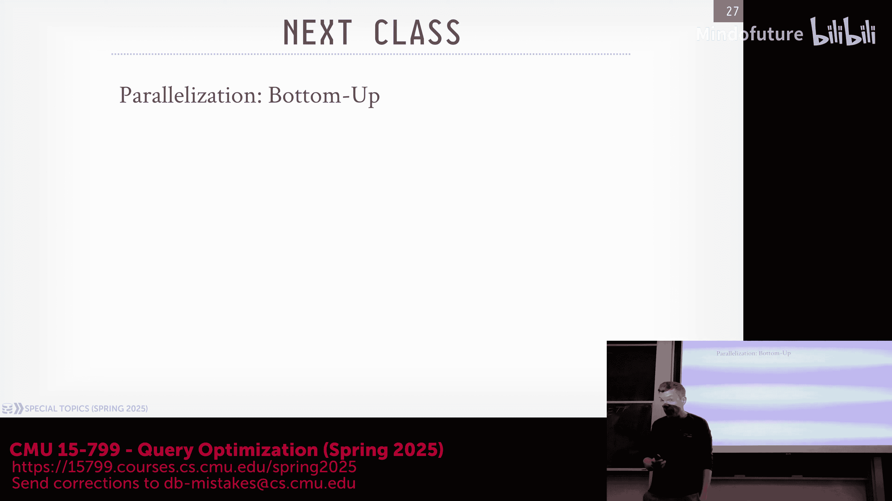

# 数据库查询优化：08：自顶向下连接排序 - 转换法

## 概述
在本节课中，我们将学习一种自顶向下的查询优化方法，重点关注连接排序问题。我们将探讨如何通过图分区技术来指导搜索，并比较不同的剪枝策略，以实现高效的最优查询计划搜索。

---

## 回顾：自底向上与超图算法
上一节我们介绍了自底向上的动态规划连接枚举方法。本节中，我们来看看一种不同的思路——自顶向下的方法。

在自底向上的方法中，算法从最小的子查询开始，逐步构建更大的计划。而自顶向下的方法，例如 Volcano 和 Cascades 优化器，则是从完整的查询开始，通过应用转换规则递归地探索可能的计划。这种方法的一个关键优势是**需求驱动**的搜索：我们可以优先探索那些看起来最有希望的计划部分，而不是盲目枚举所有可能性。

此外，**分支定界剪枝**允许我们基于当前找到的最佳计划的成本，提前放弃那些成本显然更高的搜索路径。我们还可以利用**部分计划信息**，在计划完全构建之前就开始估算成本。

然而，自顶向下方法也面临挑战。与动态规划可以丢弃次优子计划不同，自顶向下搜索可能会多次访问相同的子表达式。因此，我们需要一个**备忘录表**来缓存已计算过的表达式结果，避免重复工作。另一个挑战是，如何在不引入笛卡尔积的情况下，高效地生成所有可能的连接顺序。这正是我们今天要讨论的论文所解决的问题。

---

## 分区法的基本思想
该论文的核心思想是将查询的连接图分割成越来越小的分区。

基本算法流程如下：
1.  为查询图生成所有可能的分区方案。
2.  进行深度优先搜索，选择一个分区方案，并递归地向下探索，为每个子分区确定最佳的连接顺序。
3.  在分区时，需要确保不会产生孤立的、无法连接到其他分区的节点，以避免引入笛卡尔积。

这种方法与 Cascades 优化器的区别在于，它通过图分区来主动**引导**搜索过程，优先探索那些我们认为可能产生更好计划的分区，而不是像 System R 那样进行盲目的搜索。

---

## 算法“最优性”的定义
该论文声称其算法是“最优的”自顶向下分区算法。但这里的最优性并非指总能找到全局最优的查询计划（这是一个 NP 难问题），而是针对**算法实现本身**的效率而言。

在 2006 年的一篇论文之前，优化算法的最优性通常基于其需要考虑的连接顺序数量的下界来定义。而这篇论文采用了不同的定义：算法的开销在于，从一个连接顺序考虑切换到下一个连接顺序时，所产生的**额外开销是线性的**。换句话说，算法应该能够快速、增量式地生成下一个待考察的连接顺序，而不是预先枚举所有可能顺序或花费大量时间计算下一个选项。如果能以线性时间开销完成这一步，该算法就被认为是“最优”的。

实现这一目标的主要挑战在于，随着连接图规模和复杂度的增长，在遍历和分区过程中需要反复进行的图操作（如检查顶点是否在集合中、求集合交集、检查边是否存在等）会变得非常昂贵。

---

## 高效的图表示：位图
算法的实际实现方式会极大地影响其常数因子开销。论文讨论了两种图的表示方法：

1.  **边列表**：每个边表示为一对节点。操作简单，但进行集合交、并等复杂操作时，需要分配和操作不定长的内存，开销较大。
2.  **位图**：使用位图数组表示邻接矩阵。每个节点对应一个位图，位设置为 1 表示与该节点有边相连。

使用位图的优势在于，可以利用 CPU 的位运算指令（如 SIMD 指令）来高效地处理这些操作（例如，检查连接性、求交集），这比循环遍历列表要快得多。虽然在实际优化器中，成本模型的估算（如访问统计信息、计算选择性）可能比图操作更耗时，但对于大型查询图（例如涉及数千张表），位图表示的优势会非常明显。

---

## 分区策略详解
分区策略是算法的核心。以下是几种不同的方法：

### 1. 朴素的左深树分区（允许笛卡尔积）
这种方法非常简单，类似于 System R 的穷举枚举。
*   遍历每个顶点，将其从图中移除，形成两个分区（该顶点和剩余子图）。
*   递归地对剩余子图进行相同操作，直到得到左深树。
*   **问题**：它不考虑图的连接性，移除一个顶点可能导致剩余子图中的其他顶点变得孤立，从而产生大量笛卡尔积。

### 2. 朴素的左深树分区（避免笛卡尔积）
在方法1的基础上增加一个检查步骤。
*   在决定移除一个顶点并形成新分区之前，检查移除后**剩余子图是否仍然连通**。
*   如果移除会导致子图不连通（即产生孤立顶点），则忽略此分区方案，尝试下一个顶点。
*   这通过避免无效分区减少了浪费的计算。

### 3. 朴素的 Bushy 计划分区
为了生成 Bushy 连接树，我们需要迭代顶点集的非空子集。
*   算法迭代所有非空顶点子集，将图分割为该子集和其补集两部分。
*   同样，需要增加连通性检查：移除该子集后，原图是否仍然连通？生成的新分区本身是否连通？
*   检查通过后，递归地对两个新分区进行分割。

以上朴素方法的问题在于，它们没有利用图的结构信息来指导如何分割，更像是“随机尝试然后验证”，可能产生大量无效的尝试。

---

## 最小割分区算法
为了避免无效尝试，我们希望预先知道哪些分割点是“好”的。论文采用了来自网络理论的最小割算法，并为其适应查询优化环境进行了简化。

基本思想是：
1.  选择一个随机顶点（例如 B）作为起点。
2.  生成一个**双连通树**，记录从该顶点出发，哪些边被切割后会导致其下的子图与主图断开。
3.  通过深度优先搜索这棵树，我们可以决定在哪里进行切割，并且能立即知道切割是否会引入笛卡尔积。
4.  关键优化是**惰性生成**这棵树：不需要预先物化整棵树，而是在搜索过程中按需扩展，从而节省内存和计算。

这种方法就像一个“索引”，让我们能快速判断一个分割决策是否安全，而无需在每次尝试后都进行昂贵的全图连通性检查。

---

## 剪枝策略比较
论文中另一个非常有趣的部分是对不同分支定界剪枝策略的深入讨论。剪枝的目标是避免探索那些不可能产生更好计划的子树。

### 1. 累积成本定界
这是 Cascades 优化器中使用的方法。
*   **全局上界**：记录迄今为止在整个搜索树中找到的最佳物理计划的成本。
*   **累积下界**：在探索子树时，传递一个累积成本（当前路径上已确定的物理操作符成本之和）。
*   **剪枝条件**：如果当前子树的累积下界已经超过全局上界，则可以剪掉该子树及其所有物理操作符实现，因为任何物理实现都只会增加成本。
*   **优点**：基于真实的物理成本，剪枝准确高效。
*   **缺点**：为了计算累积下界，在探索一个子树时，需要等待其子节点的物理成本确定，这**导致了搜索的串行化**，不利于并行化。

### 2. 预测成本定界
这种方法试图在到达物理操作符之前就进行剪枝。
*   **逻辑表达式成本预测**：为逻辑操作符（如逻辑连接、逻辑扫描）估算一个近似的“成本”，通常基于其输出的预期元组数（基数）。
*   **选择逻辑表达式**：在多个逻辑表达式中，选择预测成本最低的进行深入探索。
*   **优点**：允许更早地剪枝，无需深入到底层物理操作符。
*   **缺点**：预测成本（如将表访问成本设为零）是粗略的近似，可能不如真实物理成本准确，为了不错误剪枝可能包含真正好计划的路径，预测需要相对保守。

### 实验对比
论文通过合成查询实验对比了两种策略：
*   **剪枝效果**：累积成本法由于基于真实成本，能剪掉更多不必要的分支。
*   **CPU 时间**：预测成本法在总 CPU 时间上表现更好，因为它允许更早的剪枝，减少了总探索量。而累积成本法由于串行依赖，即使探索的分支少，实际运行时间也可能更长。
*   **组合方法**：同时使用两种策略，其效果主要由累积成本法主导，因此仍然面临串行化问题。

---

## 与超图算法的结合
论文最后提到，可以将这里讨论的最小割分区技术与之前介绍的超图算法结合起来。

超图算法能更紧凑地表示复杂的连接谓词（涉及多个表的谓词）。将其适配到自顶向下的框架中，并结合最小割分区和分支定界剪枝，可以得到一个支持更复杂查询（如外连接、非等值连接）且仍能保持高效并行潜力的优化算法。这为我们下周讨论并行查询优化打下了基础。

---

## 总结
本节课我们一起学习了基于分区策略的自顶向下连接排序算法。我们了解了如何通过最小割算法来智能地分割查询图，从而高效地引导搜索。我们还深入比较了累积成本定界和预测成本定界两种剪枝策略的优缺点，认识到累积成本法更精确但可能导致串行化，而预测成本法能更早剪枝但精度较低。最后，我们看到了将分区法与超图表示结合的可能性，这为构建更强大、支持更复杂查询的优化器指明了方向。自顶向下的方法以其统一、直观的框架，为查询优化提供了另一种强大的思路。