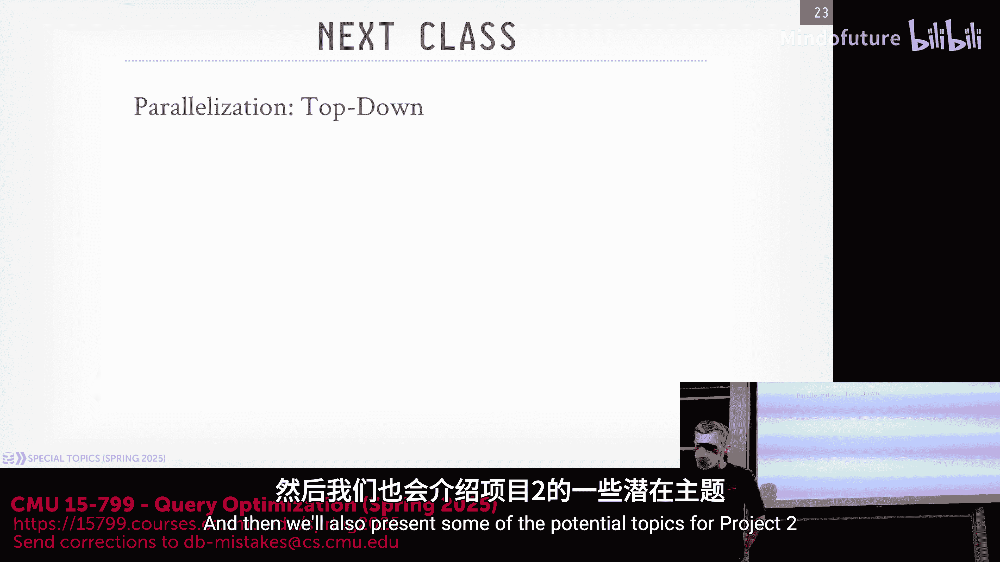
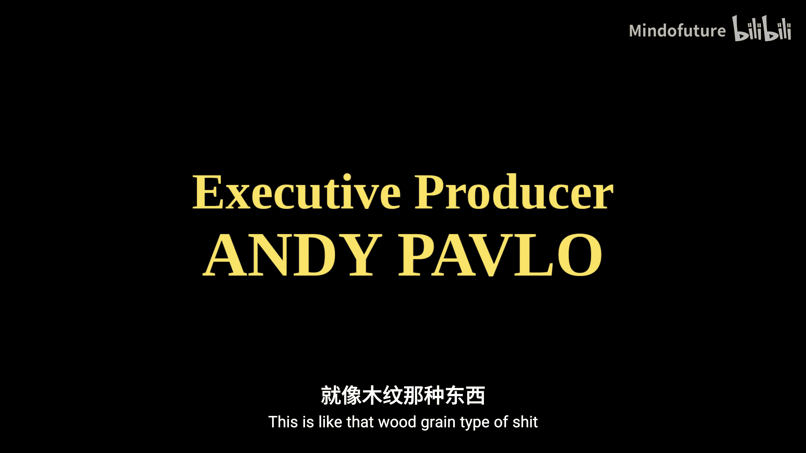

# 【卡内基梅隆---中英】数据库专题：查询优化-CMU-15-799--(2025-年春季)-p09-P09-#09---Search-Parallelization---Bottom-up-(CMU-Optimize!)--BV1wDE9z9EfK_p9-

だ。🎼おてみせ。🎼A journey drove that Taas to carry up the massage。

This course is filmed on locationtion at Carmicy Mellon University in front of a life studio audience。

Today we' going back and forth between bottoms up and top down and looking at the sort of core aspects of the search implementation the algorithm of implementation。

 So today will be a discussion on。How to paralyze the search in for a bottoms up and then on Monday's class excuse me next week。

 that'll be looking at how to apply it for the top down approach。

 which you's already started seeing inklings of that in the last class when we talked about how the the。

The pruning method， whether it was accumulated or predicted。

The cumulative one required you to sort of go down and do something and that sort of blocked other threads from slowing other parts of the tree。

 the bottom up isn't going to have that problem， but we'll address that again that issue again next Monday for top down。

😡，All right， so as I said on Piazza。😊，Okay I had no office hours today。

 send me an email if you want to meet and then I'll follow the people that who already have emailed me probably be like for tomorrow I maybe on campus tomorrow depending what the flu test says Project one again is due Friday。

 February 28th for project two topics for next class we'll start going over some some potential。

Directionions you may want to pursue again you don't get aside right away not until I think before after spring break and then after spring break what you want your project2 to be based on。

 but at least you can talk amongst yourselves and figure out what groups you want to form and then we'll post on the spreadsheet。

 what groups you want to be and if you're not in a group will have like a sort of side buffer that you can put yourself in as a free agent and then we'll figure out how to assign you to a group everyones and again for project too it's supposed to be it's open endeded it's supposed be ideally touch on the things we've talked about in this class but's other areas about database optimization or optimization that you're curious about that you're doing in your own research for some other class or something else I'm all for combining ideas so just don't think oh whatever I talk about next week。

 those are the only ones you can pick。But if you have a good idea， then I'm all ears， okay？

Any questions about Project one？O。All right。So all right， last class， as I said。

 we started looking at， we were looking at how to do the top down join numerium。

 and one of the techniques that we saw was this idea of partitioning the query graph into subgraphs or smaller connected graphs。

And that was， that was done in such a way to。Not necessarily paralyze the search。

 but at least be more targeted in how we're doing the search going down。😡。

But it doesn't take much of stretch with imagination to say， well。

 if I'm already partitioning the graph， if those partitions or the subgraphs are independent。

 I could start exploring them in parallel。😡，cross driven threat so even though last class we saw a partitioning technique and that was the idea of sort of gettingnaing down on the parts of the graph you think are're going to be providing those benefit。

 so try to optimize those first before we run out of time we'll see basically the same technique today in next class of how doing the same thing to paralyze things。

😡，And as I said， the challenge is going to be is that there's going to be dependencies between different parts of the solution space within the join graph that we're trying to en nuerate upon。

 where we're going to have to do some part first。😡。

Before we can start doing exploring other parts of the tree。

Me like we have to know the answer for some things for some part of the joint graph before we start saying。

 okay， let's look further down the tree and start looking at other stuff。😡，For。

 we saw this accumulated cost there's a predicted cost bounding。

 I mean top down this is more of an issue because again if you're doing accumulated cost，😡。

You need you need you need a physical cost， you need a physical plan。

 at least get that first initial cost to figure out what your upper bound is going be so you kind of need to have one thread go down at least least the bottom generate some physical plan even though it's not not ideal just have something and then once you have that that can then unlock up bunch through other stuff but we saw this in other cases too where we talked about。

😡，Doing transformations from an outer join to an inner join， well。

 you can't start doing join enumeration on the inner join until you apply the outer join transformation。

😡，so like that's another example where like you have to do certain things before you were allowed to kind make a more。

 I don't say exhaust a wider search into the different options you could have for our query plan。😡。

So the。As I showed this before， what we're trying to figure out now is。

We know the general framework of how to design a query optimizer and whether it's top down or bottom up。

 and now we're trying to say okay， what can we do to ensure that our query optimizer actually produces good query plans for whatever SQL query shows up。

😡，And so we're at this point here， we're trying to understand how to make the search algorithm as efficient as possible and obviously accurate as well。

 But you'll see in all the algorithms we'll talk about today。

 there's always these disit checks to see。😡，If I if I try to partition the graph in a certain way。

 is that going make me disconnected therefore that's going to introduce either correctness issues or Cartesian products。

 which is an efficiency issue like there's to be bunch of checks with to do to make sure that we're producing accurate and correct results。

 but now we're kind of also really focused on how can we make this run as fast as possible。😡。

So that's what this class is and then for next week。

 and then we'll start talking about the cost model。

 which is kind of this big this big albatrosssses hanging on the side that we haven't really addressed。

😡，Right。All right， so up until now also too， say for all the methods we've talked about。

 with either with the im of the framework or the algorithms to do joint emeration。

 they've all been assumed that you're running in a single thread in the mi。😡，Right？And so the goal。

 again， what this class and next class is about is how can we make the query optimizer run the search in parallel？

And the challenge here is that most query afteromers are not going to be parallel， right？

Even for for most modern systems are not going to be parallel right so the optimize itself is going to be a single threadtic component of which you can let the data system allow multiple threads to run at the same time。

 so it could be optimizing multiple queries or independent queries at the same time。😡。

But they don't take， you know for one single query。

 following a bunch of worker threads to then do that search at the same time， right？😡。

And this is for two reasons， right， One is for historical reasons， because。You know。

 most database systems up until you know， you know really snowflake made it big in 2013 or that sort of architecture came along。

 like most database systems were these single node monolithic architectures where everything you needed to do to run your data system was on a single box or within the single。

😡，Program， you will， I want say process because。It could be a multiprocess system。

 but it's assuming you're running everything on a single box。

 that means when a query shows up it goes through this connection handler thing and then that goes through the parser and then the binder and then it goes through the optimizer and all that's running on the same machine where you're actually running queries。

😡，Right。Like this is what MySQL does what Postsgres does， SQL light， Oracle， SQL server， right。

 this is how people built these systems since the 70s。And so the challenge is going to be now。

 if I want to have a parallel query optimizer， or now I'm taking threads away workers away from other parts of the system just to do query planning。

😡，And so again if I'm running on a single box， I'm not elastic。

 I can't magically conjure up more threads， they got to come from somewhere。

 so I'm taking away threads that I could be using for background tasks or query execution。

 and they're using them for query planning。😡，So that that's a hard thing to do in terms of like。

You know you know how much better would my query plan actually be if I'm multi threaded versus just throwing more hardware at the top again。

 the multi core stuff that's really only early 200s。😡，From the '80s to the '90s。

 most machines were like a single CPU with a single threat。UmI mean。

 the enterprise stuff was a little bit different， but like most of the time you didn't have all the threads that we haveccds that we have today。

All right， so again that's a historical reason for monolithic data system architectures。

 but even now also in a cloud environment， something like snowflake。

 they' still going to have a single threaded query atomizer。

 even though it's running as a service so again multiple queries can get optimized at the same time。

 again within the context of a single query that's going to be running as。😡。

As a sort of single thread of context。So the goal for doing parallelization is that even though the search problem is MP hard exponential。

 we want to have the search time for our trying to find optimal plans。

 we should improve literally in regard to the number of cores were given it。

 so if if I have go from one core to two core， then my time should be in theory cut in half。😡，Right。

Again， as we talked about before， it depends on what the stopping mechanism is for the optimizer if it's a wall clock time。

 then you have to then account for that in your implementation or in your setup。

 so even though you had more core， you have a parallel optimizer。

 if you set it and run for 20 seconds， it'll still run for 20 seconds。😡。

Maybe it was alsos maybe gets through all the possible choices and it just quits。

But you you'd have to account for that， but again， if you do like the Microsoft way where you say how many transformations you're allowed to do。

 then now that you would automatically scale that time out as well as you add more course because things are just running faster。

All right so the challenge is going to be why this is going to be hard to do。😡。

Unlike other parts of a database system， again we think of like parallel execution data system。

 we know how to do that really， really well， we know how to do parallel scans。

 we know how to do parallel joins， parallel sorting， all those tricks we've been doing since， I mean。

 really since the '80s， right？But this is a bit harder to do now。

 it is somewhat similar to query planning or query parallel query execution we you have these pipeline breakers you kind of need to wait to finish some pipeline before you let another pipeline start running because you know it depends on the output of this so that's sort of the challenge we're trying to face here。

😡，It's that sort of dependency and so for joint liberation。

 this sort of the classic algorithms I've been looking at for dynamic programming are called non serial polyta。

😡，And so nonse means that the computation that we're going to do at one phase or one level of think of like the search tree。

 well it's going to depend on multiple levels of results from the search tree below me。😡。

A lot of times the dynamic programming it's just like I' about whatever the last one was。

 the last level。But in this world， we care about。Everything since the beginning of the query because in order for you to know how I want to join things maybe up above。

 I'm relying on some computation I did at a lower part of the tree。

 assuming I'm going bottom up to figure out the optimal join ordering for some tables down below。😡。

Right。And then the poly just means that。Think of like a recursive call we're making for our search。

We're passing into parameters like we'll see this in like the some of the algorithms here。

 like you got to know the left side of the tree， the right side of the tree you are。😡。

And that complicates what you're allowed to。You know how you're allowed to paralyze things？

So it's a more restrained environment， it's just like。

 it's not we're magical going we throw more cores at。Ha had a problem， and it's all going to。

 you know， just get magically faster There is some。

So some intelligence we have to put in our decisions of how we're going to slip things up。

So the basic idea of how're going to do this though at a high level is going to be the same thing we do when we want to paraze query execution。

😡，We're going to partition the search base in such a way that we can divide the work the tasks of the work。

 even among the workers， so that at any time during execution。

Every worker always has something to do。 There's not like a bunch of threads sitting idle。

 holding for work。That's hard to always achieve but。In general， we should be okay with this。

And then the other challenge is going to be or the other technique we're going to use is， well。

 once we split things up。And to partitions， it'd be really nice if that we could then have other tasks be able to execute without being dependent on what other workers are actually doing。

 so the idea is that you want to sort of localize almost like like a pipeline a bunch of work we want to do in our search so that one worker can kind of do a bunch of things and just rip through the computation without waiting for other workers to produce some result。

😡，This should not be if you're taken 418 or 618， all of this should not be new and we discussed this in 721 last year。

All right， so I'm going to briefly talk about three algorithms today。

 the one would be sort of the straw man that came in the paper you guys read about this。

Dy program for subsets， which is basically the same thing of system R。

But was slight different of what the method in which we're going about and generating the subsets。

 and then we'll talk about the maline parallel DP， algorithm'll run from paper of you guys read。

The paper' is okay， what I like about it is that it covers。

You know covers like sort of the background of like here's what an algorithm is based upon。

 I also like it because it's the one of the only ones that it is the only one that I know of that runs on a GPU like there's another paper from that runs a GPU。

😡，That predates this one， but this one covered everything and also they're doing that addivity piece or that technique from the hyper guyss as well。

So a lot of ideas sort of thrown into one， which I like。You know， the writing's okay。

we take out offline then Im going to finish up talking about another approach to do a multi planned join DP。

嗯。This is from the。Or one of the guys at IBM， but it was done by IBM research。

 but this was not part of Starburst or DB2。This sort of side project。Right， so the。

The DP sub algorithm is going to serve as the basis for what the algorithm or MPDP algorithm is going to do。

 and the basic idea again， as I said， this is just going to be more or less the same thing the system are。

 except how they're going tostruct the subsets and that exploration is going to be slightly different。

And the basic idea is that we are going to split the joint graph based on vertices into subset sizes。

 based on the number of vertices， and that's going to slowly get bigger and bigger。

 meaning we'll start looking at more larger and larger subsets。😡。

And then for each of the different subset we have， we're allowed to split them up long as there is a way to connect sort of the left side and the right side。

 the two subsets that we're looking at， and then we just do what's do the standard stuff of like。

 okay， what's the best way to evaluate the join on these two subsets。

 is it better than the best plan we've seen so far， if yes， then become the new best plan。

 otherwise we throw it away。Right。And again， just like before we have to do much much stop and make sure that if we split up。

 we start splitting the choreograph into subgras to avoid Cartesian products。

 we've got to make sure that we don't have any disconnected notes。So again。

 I don't normally like to show code， but I just want to visualize what's going on here。

 and the algorithm is pretty basic。😡，But you start at the beginning here and you say， okay。

 I'm going to start looking at subsets these of sort of size two。

I see these generate all possibleliberations for all possible subsets， and again in this one here。

 when they generate the subsets， they're not actually checking you see whether they're connected or not。

😡，They're going to do that later I remember we talked about how in the case of the hyper guyss。

 the hypergraph one where they were they would make sure that they only generated subsets that were valid rather than checking after they've generated them and see whether they were valid or not this one just generates all of that。

All right， so then we get down here and now we're to go through all the different subsets again。

 starting with size two。And for this one， we're going to just start picking each one and you take whatever is on the left side here。

 And then this part of the loop here can now be done in parallel。 So within one。😡。

Within one sort of subset， in this case here it's only size two， right？For each of these。

 I could have a different thread now evaluate the best join order for that part of the subset in parallel and they don't need to coordinate each other because there's no information I need to know about what's the best join plan for sort of the subset that I'm looking at。

😡，Nothing I need to know about your subset。RightSo again now that again they're going to do that systemR approach where you just go through and expand out so if this one here do I look at a hash join or merge join then same thing I keep fanning out and relying on what came down down below me to tell me the path I'm going to generate and I'm not showing this because it's PowerPoin but they can think of all possible combinations for the subside2 and all the possible combinations of additional subsets like this keeps going over and again。

But again， the important part here is this is where they're going to check to see whether if they split a subgraph off of the main graph they're looking at。

 is it going to be disconnected if yes， then you discard it， if no。

 they're allowed to proceed and do it。Right。Yeah this is just the system ourselves through said before。

 but it's slightly composed differently yes this one？Yeah的。I loop back around， I just show that Yeah。

 instead of like cinics， I could expanded it this way and I went。 Yeah。

 another loop now I'm looking at sub aside side too and now I don't care about like it's it's scary。

 It looks a lot somewhere at the top down。 I don't care about。

How I'm joining AB because down below me has told me that how to do that。Right yeah。Okay。

So the MPDP algorithm is it going to expand upon this， and it's basically the same thing well。😡。

Its sortt of confusing they there's the MPDP algorithm that sort of technique they they talk about and then of which of that there is the MPDP algorithm that's based on the DP sub one。

 but then collect load， they're also saying that if you tack on this adaptivity piece where they use this。

This union Dp1 or the IDP stuff， then that's also sort of。Part of what they're calling NPDP。

 but for simplicity， we's say the MPDP is just going to be the extension of the parallel version of the DP sub。

😡，So again， they're going to have that same check that Hy or Ubra is doing about the complexity of the query。

 decide which album they want to use， for so for simple ones。

 they'll use TP sub to do the search exhaustively， but for larger queries。

 they use a combination of their own heuristic technique and DP。

But the difference of that they're going to do here is now。

 instead of just picking vertices and deciding how to split based on that。

 they're going to do a combination of vertex and edge based enumeration and the goal here is that it's like again precomputing。

 what are the valid cuts you can make in the querygraph。

 to avoid having disconnection and then having digital checks later on within that for loop to see whether something that is connected or not and it's going to matter later on when they put this on the GPU because in GPUs you don't want branching。

😡，Because you don't want your different cores or threads down within a it's a grouping or warp。

As the video calls it， you don't want them to start going down different paths。

We'll see that in a second。So what's the difference between vertex anderation and edge based imeration？

So again， vertex is you're just exploring the search base by deciding how to pull off subgraphs of the joint graph you're examining based on vertices。

😡，Right and then you then build back up the relation as you add back in the vertices。

 you sort of split things up and then you add things back going up， and then you have to then。

You again， take and make sure that you're not generating invalid subgrass because if you're trying to avoid Caressian products。

In the case of edge basin， you're going to。Get look at look at the joint pairs， the edges themselves。

 and that's how you're going to decide what you actually want to cut or not。

so this is going to be better in terms of reducing the amount of waste of work because you're not having to you know value much of joint pairs that are you know you throw away anyway。

 but now it's more difficult to paralyze because now again you're sort of blocking。😡。

The the generation of these these different partitions you could be exploring photographs you can be exploring until you finish the slicing up of the。

Of the joints， I'm sorry of the subgraph。so I don't have an example of MPDP， but again。

 it's basically the DP something， which is how they're slicing up the edges slightly different。

But then again， they have and now this heuristic that kicks in when they recognize that the query becomes a too complex。

And they have something that looks very similar to the goo thing we talked about either the last class or two classes ago。

 where they're going to look at the。You look at the join graph and calculate some cost of each join using heuristics and then just decide which one they want to combine together。

 assume that's the order you're going to apply the joints。

RightSo it's basically the same thing we saw before with the go right you have all these edges。

 they don't talk about how they're calculating selectivity intermediate results。

 they just say there's just a size of the result， but the cardinity you would get from the size of relation and the selectivity of a predicate so now you have a way to say' here's how much here's how much data is going to come out of a particular join and then they're going to end up picking the largest one。

😡，And had that be merged together？And then that's saying that I want to apply this join first as early as possible。

😡，RightAnd again， they do this。They sort of split that up into the small size you have within some size K。

 and then they keep adding up the larger pieces until you have the full complete join graph all over again。

It's basically in the case of goo， we saw them merging it into。

combiningbin the two relations together， say they're being joined， they call it a composite node。

 a composite vertex， but it's basically the same thing。

 it's telling me I know I want to join BD first and this is going to give me the ordering that I want't apply this。

Yes。So。This will work really well for snowflake。But I was just wondering。

 will it work well for sche as a not snowflake or starfish。Like cleaeks or trees which would the。

Yeah， I mean。His statement is， this would be terrible for cleaiquets。So you。

My understanding is that they do this。Sorry， so the K matters here， so you're going to keep。

Building this up until you have the subgress of size K。And then you take those subgress of size K。

 and then you run the MPDP hour on that。在对。In the paper， yes and this what I'm doing， I don't know。

It's a small graph but you could do like four something like that right so I would do this heuristic。

 I would end up these composite vertices now with four four relations tables in them。

 then run NPDP on that and so the reason why they're ordering it based on the size so the larger ones go first because they want to make sure that they optimize those clusters first。

And those will naturally be like those will naturally be very obvious and important parts to optimize if you have a snowflake or a star stma。

 but you don't have that， you have clickeas in a bone。Stavid is that it if you have clicks。

Let say that。You say becauses notfl starts， it would be obvious when you want to optimize first。

 but in cleks you wouldn't have that right but still based on their algorithm。

 somebodys going to be have the biggest cost。Just go optimize that first。

 but then there's a lot of things in the show， yes。They they ran the experiments。

 then they're conveniently。Not，Yeah。There's a tech report it wasn't in there either okay。For a large。

Joins they give the results for snowfl and star， but they say theyre ran them for peaks。

 but they don't show you results。Again，嬉しい です。In addition to learning a bunch of here's what have a bit of quaizer。

 which you all should be getting from reading the papers is just one how to read a scientific paper。

 but also healthy deal of skepticism about like， yeah。

 they're saying this it doesn't really make sense right and it's hard because you got to go read back the paper multiple times like what the hell are youre talking about right so？

the German papers are great， but they're also very ete to understand this one is missing a bunch of things and they have a bunch of stuff that doesn't really matter and then they cite to the longer tech report that's on the archive。

 but that doesn't have the things we were missing as well。😡，So。 has it？

Its there's not a lot of papers on que parallelization， this is like the one of the newest ones。😡，Oh。

 it's a good paper。Yeah， sure， yes。Okay， so again。The the main thing I want to point out is like so they are it's hard to share this with a small graph。

 but like think of like a really big graph or joint graph and you're trying to figure out again which of these。

😡，whichch ones are going to have the largest intimate result？😡，You start putting them。

 I'm going use the term cluster， be putting them in a sort of composite group。😡。

And you keep going until you have a group of size K。And then once you have that。

 then you go run the NPDP algorithm and that that cluster and figure out how to do that optimal join for that one。

😡，And then you find the next cluster and do the same thing。

So again it's like you can't do the exhaustive search across the entire join graph would be too difficult to run forever。

 so instead you're kind of like zooing in on like portions of it， optimizing that piece。😡。

And then hopefully that least puts you in a good direction。So。

The goo is actually choosing the smallest one one that you can approaches to。 Yeah。

 so Sam is it's correct。 the the goo， which I can bring that slide back up。 The goo is is。😊。

It's choosing the smallest one Yeah， so that was a way to simplify the problem to generate with the joint ordering。

😡，S they bring up。Yeah， should it？ItShould include slides。

But then the objective is slightly different。Yeah， so again。

Go back and put this back in more context。So again， this is for the large queries in。

And the German approach， and so the idea here is that。They。

TheThe high level goal is to say you want to simplify the search problem because you can't do it because it's also search。

 So in the case of Guo， what they want to do is。😡，Literalize the the the。

Sor of the search base so that you at least have sort of the left deep tree and then。

Then do the more expansive search， then look at bushy plans and other things。Right。

The same you like that， they say。How big of a sort sub probably we want to look at。

 they're doing K100 here。All so again， you have this cost。

 the number of two plus that have come out of a relation， and you have this selectivity。

 so the same thing like you do the simple math you have the cardinality。

So the idea here now is they want to choose the smallest one。

And you want to merge them into an up graph the。By choosing the smallest。

 you're basically saying that。This thing doesn't really matter in terms of the entire query plan because they're not joining that much data。

 this is not my big problem。😡，So you you just combine them together so that you don't have to have in your exhaustive search。

 considering B and C explicitly in the search process， you're just kind of have again。

 get some placeholder to say， yeah， there's a joint happening here。

 but it doesn't really matter in the grand scheme of things。😡，So that's what Goo is doing here。

 it's a way to hide things that you don't think actually are going to matter。😡，Right。

 to simplify the search process to keep doing this rigorouscurly。 So then nowm going back to。

What the UNDP is doing。This is doing the opposite， this is trying to find the things you think are going to matter by taking one with the highest cost。

And again， combining them into a bunch of nodes， and so I could use heistics to decide how I want to join the A with BD and C with BD。

 but I really want to know what is the optimal best choice for me to join BD because the data set size is so huge。

😡，Is that clear？Again， it's a。It's a different approach to to trying to solve。

 this really hard problem of like how do how do you pick the join order and the idea the idea of the。

From the German paper was like， okay， simplify it through Guo and then use that as the starting point。

 at least my initialization， so I'm not spending time just trying to find a quick upper bound。

In the case of UnionDP， it's a way to sort of highlight the parts of the query plan and you know you want to spend most your time competing on and try to find the best joint order。

Okay， so I' am not a GPU expert， and so what they're saying seems reasonable。

 but the basic idea is that they claim that because you can rewrite because you can get rid of those if clauses where you're checking to see whether the graph is connected when you start building up the subGras。

If you can remove all that。And just have the computation of it we're deciding。

 here's the numererations I want to look at by doing it based on edges so that you don't have to generate invalid join graphs。

😡，Then now you basically have this sequential code that you can run down the GPU and you don't worry about what is called branchstone divergence where like the threads are going different threads within the same warp。

 like a grouping of threads are going down different code pass or pass in the same code。😡。

And then that requires the GPU I think， to understand。

 my understanding is to execute them in serial order。

So you kind of lose all the benefit of having a GPU with thousands of thousands of cores because now you end up giving executed in single file。

So they're going to do the same trick we talked about last class where you represent the join graph as there's an array aff with bit mapps。

 that's great because again GPUs don't like variable length things if you know exactly the offset of stuff you can jump to that very quickly and again they remove all the branches to the conditionsals get rid the branch divergs。

 right？Another thing we don't talk about， but is in the paper that they cite is。

You can't have the GPU threads as you're doing this geoumeration。😡。

Call back to the CPU for any additional information。So， yeah that's one of the the concerns I have。

Like you have to make the entire table for the necessary data fit into the GPU memory。 Yes， it like。

For the best performance it should be fit into that shared memory in their。Yes。If。

If it's like the data lake service like a snowflake and you'll have to dynamically evaluate something as outside and making such function called very cost Yes so hear what he's saying。

We talk about how there's this cost model thing we keep pointing to on the side that it's going to magically tell us the selectivity of an operator or predicate or the cardinality of an operator right so when we look at the algorithm of 4 there's always like。

 oh this cost function within these algorithm in the paper and that's making a call to some cost model to figure out again to estimate what the cost of your operator is。

😡，So where does that exist， well that's in the catalog。

 right there's some other piece of code that's going to generate those estimates for you。😡，So。

 but now if you're running your jointumeration where it's trying to look at the cost of query plans to decide which one's better。

 it's basically's looking at like is this thing better than this。

 but it's the algorithm structure in a way to sort of rip through the possible ordering you could have very quickly。

😡，If all of a sudden you got to say， okay， well， here's a valid query plan I could consider。

Compute the cost for it because you want to check to see whether that's better than the best cost you've seen so far。

😡，You can't make a call out to the catalog in the GPU because now you're going back up to the CPU and you're blocking your fed in the GPU and you're losing all the benefits of the parallelism。

Right， so the payer doesn't talk about it， but the other one does where you basically have to package up all the estimates that you're going to have for any possible joiner you're going to consider or down below。

 that has to get sent down to the GPU with you。😡，And that way。

 all the computation and analysis is localized in the GPU and you never have to go back to the CPU until you say。

 here's our computational result or give me more work to do I didn't find anything yet。Right。

So GPs are great like they're really good at doing parallel computations。

 which is what they're trying to do here， but you've got to have everything be local in the GPU。

Because soon as you go talk to somebody else， you're blocking it and you're screwing。Ex that correct。

Okay， settle。These papers got results， which's another reason I like it， right？😊。

So I'm going to chry pick three graphs。So the first one is going to be what is the search time for these different methods。

 the DPCP CCP that's the sort of the graph based ones the precursor to the hyper1。

 I forget what DE is but D sub DP size DP size system or D sub is one we talk about before but again they have a bunch of these running on the CPU they have a bunch of these running on the GP as well it's actually quite impressive and so the two workloads they're considering our the Jo out of benchmark which is based on the IMDB database that we're going to see a lot through the newer papers we look at this is the common workload that everyone does and then music brains was online music database and I think they generate synthetic queries for this right？

So the。If you look at the music brains once， and again。

 they're scaling up the number of relations that are being joined。This seems like。

You know the GPU is the clear winner here because everything else is falling off the cliff。

 whereas this one is doing okay up to like 2025 again it's log scale so it's not great anyway。

 but it's doing quite well here right？But then when you look at the join on of benchmarkrock one。

It's surprising that， the GPU is basically flat lined for both the the DP size one and the。

And the red one here is the GP1， right？And now you see the performance gap between what the CPU can do and what the GP can do is not as great。

And I think if I remember correctly， it was just because of the the。

The complexity of the joint order benchmark queries。

The predicates were more restrictive and there were there was fewer options they could consider in a parallel search。

So even though GPU has hundreds of thousands of cores。

 actually they're running on like a 2016 GPU every it。It's like as of Ram。

 but I forget how many cores they have， but still like。

All the there isn't as much opportunities for parallel search as there was in this one over here so that they're not getting a big of a win and the。

😡，The reason why it's sort of flatline is the cost of like。

packackaging up the request or the search for you in such a way that the GPU wants to read。

 sending that down to the GPU， letting the GPU crunch on it and then come back up to you。

 that's why there's sort of like a fixed cost， no matter what the size of the query is。

 you're always paying that penalty。😡，Yes。So if you come out the music braincraft the 18 relations。

 which is the highest number of the job goes to yes and they kind of look very similar so his point is it also the number of relations so his point is like if you ignore everything on this side after 18。

 it kind of looks very similar。So is the benefit you would get from？You know。

 from using a GPU or a parallel search， like it limited higher。So again， the hyper paper didn't show。

Crazy number of。Of good tables in a joint they mentioned there's the 5000 one for S。

 but I forget what they what's the highest one they went up to in their experiments。

 but it was definitely I think a little bit higher than that like 30 seems like。I mean。

 the next slide they go up to 100， so I think there's only 30 tables in music brains。

 so that's why they couldn't see all beyond that。😡，And then during our benchmark it's just 18 tables。

For 17 tables， the bottom of German， that one was like 100。呃。Yeah。

 so they're going to go to  a00 in this one， but like。So for these these are real data sets。

 synthetic workloads， synthetic queries， and so they're maxing out the number of queries that they have the number of tables that they have in the database and that determines how many you knew in the join。

😊，That is。They didn't do the same sort of Sboat experiment。I guess thats actually the next slide。

 but they don't show the search time， I don't think for going up to 10 queries。Yeah。

They show what the。Plan cost is and we'll discuss that in the next slide。Wch sketch good well， okay。

Al right， so let let's get to that。 Okay， so all right， so again， so this is search time。

 So this is like for these given queries with different number relations。😊。

How well does the search algorithm scale， right？The next one they did is they measured what is the quality of the plan？

For these different methods relative to each other。So they didn't actually run the queries。

They're just saying， here's what the cost model in the query optimizer thinks is the quality of this query plan。

And I don't think they even try to prove run some random ordering to see whether the relative ordering is actually correct or not。

Is it because the quote is that big I mean？justifiedSo as I would say I don't think you I don't think you want to do an exhaustive search of like try to run everything prove the ranking is correct I mean you could on a reasonably side data set you maybe could。

 but the。I think if you did a bunch of the system method you randomly sample。

And this showed that for any random sample， the ordering is correct and therefore with some kind of guarantee or confidence。

 I could say the global ordering is correct。😡，Reれ do。Right。This paper is what 2022。

 so it means they wrote it in 2021。So data fusion wasn't a thing back then。

Duck EB was still pretty early。Right。嗯。这不是个。Yeah， but that would take run。

 right to run of this on Postgres。because it's a row store right all right so for this one they they're throwing everything in which is kind of nice so GQO that's the genetic algorithm from Postgress L DP that's the adaptive ones from the Germans gu we've covered IKKBZ is the approximation they used to generate optimal lefty trees we saw this in the hyper the  Uber paper and then I didn't talk about the iterative DP1。

😊，It's mentioned in the Hy paperper it's a different formulation right it's a way to get for a really large number of joins it's way to sort of approximate things and be easier so they talk about how they run it thempDP algorithm on different sizes of k and then I'm show they only look put 15 because that's like I think the medium but they do scale up the size of K to show that different cluster sizes are going to be difference so this graph here it's all way relative to what their best implementation can do the unDP withDP K equals 15。

😊，So all these numbers here are just relative to this， right？And again。

 it's based on the plan cost estimate from the query operator itself。

 So the query operator is saying I think this query plan is going to cost five。😡。

And this other aquarium plan is going to call six， that's what they're reporting here。

 it's not wall clock time。😡，You might making more phases。

What do they say for a large uncommon click join graph。

 we summarize the evaluation results and the interest of space。

And then they say it times out after relations。系。Whereas the Germans don't， right？And then again。

 the X is here just saying that this is when the optimizing or the algorithm fail to finish。

 and then for these here is when you go these are up in like the 40s or 50。😡，Relative difference to。

The interesting things that they say is that after or in general， for Cross。

 the IP2 is every MPDP is much better than。For a clek graph it this is a swiftflake graph the graph the star schema one looks basically the same as well。

Um， but you don't report don't numbers of that is yeah， it might be in the techport。Again。

 I don't remember seeing it them。Okay， so this again， this is the one from EPF。

I want to briefly talk about another approach from IBM that predates that since it came out in 2008 and the basic idea here is that we're going to。

嗯。You're going to represent the possible joint order you can have。In a racial database。

And then now when you want to figure out what kind of enumeration you want to do。

 now you're just doing self joins on that same table within your database to then do the enumeration。

😡，And then there's a little bit trick that they're going to do to decide how they want to allocate the task to do the exploration to your workers。

And they're going to do this in such a way that you want to to maximize the amount of work So maximize the or minimize the amount of wasted time workers are have because they don't have any work to do。

 So the blindly handing out like you do this。 you do that is not always going to work out because it may the case that。

Because they're not going to figure out what are valid joint orders before you actually start doing the evaluation of it。

 you could end up with a thread with a bunch of stuff they don't need to do and everything gets thrown away and then they become idle。

Right。So in the paper， they talk about that they're going to split things up based on what our quantifier says。

😡，And then remember what that was， we talked about racialal calculus。Nobody， good， excellent。Again。

 beyond this class， you don't you don't need it does。

 but the quantifiers again are just going to be the。

Think of like the things that are producing tus that are being fed into other other。

You know other other sort of blocks right this is from the I think lecture three or four about in Starbucks right so the quantifiers are again things that are producing tus right but they don't want to call it that they don't to call it like tables because it could be in nest queries and other things。

😡，All right， so same a simple query here， joining ABC D， and a choreograph looks like this。😡。

So in the first step， they're going to generate the set of all the plan tus you have in this memo table。

 but again， the memo table is just going to be a table in your database， right？😡。

And then now they're going to do logical partitioning。To divide up this work。

Into groupings where the size of the subgraph， the number quantifiers you're having in your subgraph are all going to be the same。

So what do I mean by that， so the first part P1， these are probably where the subgraphs are size1 P2 is all the subgraph of size 2。

3，4 and so forth， right？😊，And again， it's not the ordering， the ordering doesn't matter。

 its logically what's within them， and again I'm saying logically partitioning just because it's you're just saying there's some other mapping to say these rows here belong to this partition。

😡，So then now you're going to then explore each partition starting from the bottom because we're doing bottoms up。

 so we have first got to figure out how we're going to do what are the sub queryry plans for this first partition here。

And again， that's just running the。The DPL algorithm than figure out。

 here's the best joint ordering or the best access method I want to use for this subgraph。

 I'm examining here。And the reason why there could be multiple query plans is because。Again。

 it's not just accessing tables， by quantifiers， it could be like a subquery。We can ignore that。

then I go to the next one。 And so now if I want to evaluate the。

If I want to evaluate a little of combinations I could have here， well。

 that's just doing a join of all the things I've generated in the first partition P1 with itself because now I'm going to get up with all combinations within。

😡，You of subset size two。So I do that， do the same calculation again ya and a general of query plans expand upon Q3 again sorry partition 3。

 and again now I either I can only have its a combination of partition size one or partition size two and now is join the top one and the bottom one so that the top one and the second one together and that gives be all possible permutations。

😊，Again， you're just doing this within the database itself。And then now I get down to this one here。

😡，And for P4， now I have two choices right， it could be a combination of subgrass a size1 with a subgras of size3 or subgras size2 joined with itself。

😡，Right？But again， like in this is basically like TP sub where they're not checking as they're generating these enumerations。

 whether the joints are actually valid， so you're just basically coming up like through these selfjos。

 here's all the possible tasks or join orders I could consider。😡。

And so if you do the naive thing say okay， well I have two worker threads so I'll give this one to the first worker thread and this one to the second worker thread。

 the problem is when we look down here， we know a bunch of these are actually useless and invalid because we just kind of took a Cartesian product of P2 with itself right so a join of。

Of A B with A B is useless because it doesn't actually contain。You know， C And D。

 which I need to have。Right。So all of this work would get thrown away and the only thing we're actually really into computing is what's in this sort of task list here。

😡，So now we need to be a bit smarter on how we're going to decide which workers are going to do this enumeration。

 because we don't want to assign this one thread， it throws everything away minutes's vital。😡。

So the paper really， this paper really is really focused on how do you do that allocation of the work I have to do to the workers that are available to me and doing it in such a way where you're mindful of what the。

😡，The Jograph is actually looks like to make sure that you are evenly distributing the work amongst the different threads。

In the case of the MPD paper for the GPUs， they're kind of throwing everything in there。

 and then you just have so many coreors who cares。2008， there was basically like four core。

 six core machines。嗯。You're not that sort of behemommus we have now， but still。

So the first thing to do， the easiest thing to do is just like take。

Do what I said at the beginning is you just take all the plan joins I have divided by the number of workers I have and just hand them all off。

 It's easiest thing to do， but again， it's going to be you have imbalance in the workload because one worker could have a bunch of stuff that throws away。

 there's nothing to do。So instead what you would do what they call stratified allocation。

Where you want to。Divide the work I had to do into sort of multiple subsets。😡。

And then hand them out in an intelligent way to kind of try to can easily distribute the work I want to give out to my workers。

So the three ways to do this is， again， if you just think about the joint integrationeration as a self join。

 like a nest of loop join，Then now I can think about it in terms of like what's the outer table and the inner table。

 the outer loop and the inner loop right so in this case here I have my outer loop would be this line here for I in one to this floor。

 the size of I2 that's an outer loop that's going to be grabbing sort one half of a join graph and then now you have an inner loop is to say okay look at all the possible combinations I could have or the different join orders I can have for the rest of the subgraph the question is how do you want to assign that evaluation out。

😡，So Ade has said you just take， I know my a looks like and divide into ranges amongst the。

Most of the threads that I have， so like within one iteration of this outer loop here。

 one thread would take all of that。😡，All of the things you wouldn't do in the inter loop。

Another one would be you just， every time you iterate through the outer loop。

 you just hand that work off to one worker in a around Robbin fashion， and again。

 then they take all the work that's within the inner loop。

 the alternative is that you do the round robin within the inner loop itself。😡。

Right so distributing on the outer one actually turns out to be the best because you end up it works really well for starchemas and。

And other queries that have skew joins because you're kind of handing out the easy problems even amongst everyone else。

Among all the different workers， right？This one works well too。

 but it's a more complicated to figure out in the calculation。

 but this can handle again the swed workloads， star schemas， and Sflake smas as well。😡。

It's really great when you have a central table that's really large because now you don't have one thread。

 try to figure out all the joins for that really large fact table。😡。

Because it's iterating all through the dimension tables on the inner loop here。

 that work is spread across multiple workers。Okay， so let's finish up。

So hopefully the main takeaway from this is that the idea of how to divide up the join search or。

 the join ordering search。😡，Is complicated to paralyze because again。

 there's so many things youve got to worry about not just like how do you divide work up so that everyone is all the workers are active and have stuff to do。

 but also how can you do do the eneration ahead of time so that you don't generate much of work that's actually useless。

So that part is super tricky。In terms of whether or not it makes sense to the run the optimizer on a GPU。

 I would say the way the video keeps jacking the prices and the scarcity of。😡，Discreet GPUs。

 like again， they were running on a GTX 1080， which is in。It was high end。

 but high end six years ago。No would want to say， like， I'm going to run my daily system。

 but I also have to have。You know， a a $10000 GP on it， right just just to do joint optimization。

 right， I don't think that's feasible and practical。

 But there are CPUs now that come with what they call these A and B calls them APs。

 They're basically integrated graphics chips， right。

And so like you can now get like Rzen this is from two years ago。

 but you can get risezen CPUs that'll have like some kind of radon thing in there。

Is it going to be super powerful like a 5090， no？But it's going to be better。

 it's going to be a lot of cores， yeah。And that might be something to be interesting now in your。

You know， since they since it looks like the's sort of limits on them cores， they can cram into。

A general permit CPU that seems to be。Not increasingly much as it used to。

 like that's another opportunity where this is something the Navys could take advantage of。

 if there's a cheap GP right there， it's not cash coherent。

 which that's not a problem right for Join search， like that might be something the Navy system could take advantage of to do the MPDP algorithm that we talk about today。

是。But I don't think Amazon， I think Amazon， you can't an easy too。

 You can't get in AMD processor with with。With APU。

But the paper also shows that this kind of the age of GPU only starts to show out。设定。

Like number of relations。 And at that stage， we we're not sure where this low end GPU will skill。あそ。

6。All right， so his statement is。The paper shows that the GPU really only make sense when you get to a large number of relations and it's not clear whether you actually for those large relations you have to have a speed GP or would an integrated one be sufficient。

😡，I think one is ifs the thing。😡，If every CPU is coming with this now， and it's just there。😡。

You could take advantage of it The other thing you could also think about is like。Well。

 if I already have to bundle up the jointumeration to put it down to the GPU so I doesn't talk to my CPU。

 there's no reason that it has to then run on the same box and IAT so if I'm like a snowflake or running Davis as a service as a business。

 I could have a bunch of GPU machines sitting on the side that I could then send these discrete requests to do joint eneration on that。

 and in that way it's a shared resource across multiple things and then it amortizes the cost。😡。

Across multiple。You know of multiple customers。Yes， that could be part of it。

 but I think that for better worse from a business perspective， it'd be very hard to justify， hey。

 we've got a bunch of buy H100 so we can do joint imeration versus like trading and LLM to do some chat bot thing right I think joint immer is a more important thing Yes but like that's sort of not what the。

It's not the hot thing， it's not going to get people， oh man， I can't I'm going to buy。

 I'm not going to give the video 10000 to make my joint immigration look a little bit faster。😡。

So again， these things might be a cheap way to achieve some of those benefits， but to your point yes。

 it's not clear whether the integrated ones because they' handle it。

You'd have to look at where the harbor specs or what this is now versus what their 1080 was six years ago。

Okay。All right， so that's it for today， we'll pick up again on Monday next week and start doing parallel search now for the top down stuff。

 okay， and then we'll also present some of the potential topics for Project two。

🎼brown fact。

🎼This is like that wood rain touch。🎼走 one。I'm not the one who ever enough the me arrives if you suspect it if you don't your mind with this dis straight punch line I don't give the head of time get to Captain the faint cr with the bullshit。

 I keep the cab like cr for the long trip， I got the remedy for beaches when the star shit surround sound like a mnum。

🎼It's a big fuck you' if。🎼デストシン。