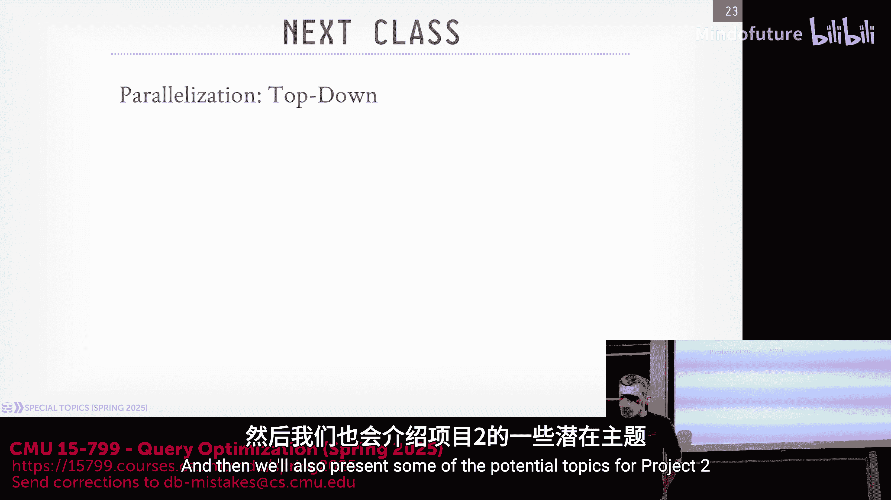

# 数据库查询优化：P09：搜索并行化 - 自底向上方法


在本节课中，我们将学习如何并行化自底向上的查询优化搜索算法。我们将探讨并行化面临的挑战，并介绍几种不同的并行算法，包括DPsub、MPDP以及一种基于关系数据库的独特方法。我们还将讨论在GPU上运行优化器的可行性。

## 概述

查询优化器的搜索过程是NP难问题，计算复杂度呈指数级增长。为了加速这一过程，一个自然的想法是利用并行计算。然而，与数据库系统的并行执行不同，查询优化的并行化面临独特的挑战，主要是因为搜索空间内部存在复杂的依赖关系。本节课我们将深入探讨如何设计并行化的自底向上搜索算法。

## 并行化的挑战

上一节我们介绍了自底向上连接枚举的基本框架。本节中我们来看看将其并行化时面临的主要挑战。

与查询执行不同，查询优化的并行化更为复杂。大多数现代数据库系统的优化器仍然是单线程的，这既有历史原因，也有架构原因。在单机架构中，优化线程与执行线程共享计算资源，将宝贵资源用于查询规划可能得不偿失。即使在云原生架构中，单个查询的优化也通常是单线程的。

并行化的目标是实现搜索时间与核心数量成比例的加速。但挑战在于，连接枚举是一个“非串行多面体”问题。这意味着计算某一阶段的搜索树结果时，可能依赖于搜索树下方多个层级的结果。例如，为了确定上层的连接顺序，可能需要知道下层子图的最优连接计划。这种依赖关系限制了简单的并行化策略。

## 基本并行策略

尽管存在挑战，但并行化的基本思路与并行查询执行类似：将搜索空间进行划分，使得工作负载可以分配给多个工作线程，并尽量减少线程间的依赖和空闲等待时间。

核心思想是**分区**和**本地化**。我们希望将搜索任务划分成多个分区，每个工作线程可以独立处理一个分区内的计算，而无需频繁等待其他线程的结果。

## DPsub 算法

我们将首先介绍一个作为基础的“稻草人”算法——DPsub。它本质上是System R动态规划算法的变体，主要在生成子集的方式上略有不同。

DPsub算法的基本思想是，按照子图包含的顶点数量（即关系表数量）来逐步构建更大的子集。算法从大小为2的子集开始，逐步扩展到更大的子集。对于每个子集，算法尝试所有可能的方式将其分割为两个更小的子集，只要这两个子集在查询图中是相连的（以避免笛卡尔积），然后计算连接这两个子集的最佳方式，并与当前已知的最佳计划进行比较。

以下是算法核心循环的简化示意：
```python
for subset_size in range(2, total_tables + 1):
    for subset in all_subsets_of_size(subset_size):
        # 这部分循环可以并行执行
        find_best_plan_for_subset(subset)
```
在这个算法中，对每个特定大小的子集进行最佳计划查找的循环是可以并行执行的，因为处理不同子集时不需要彼此协调信息。然而，算法在分割子图后需要检查连通性，这个分支判断在后续的GPU实现中会带来问题。

## MPDP 算法

接下来我们看看MPDP算法，它是对DPsub的扩展，旨在实现更高效的并行化，特别是针对GPU架构。

MPDP算法结合了**基于顶点的枚举**和**基于边的枚举**。基于顶点的枚举就是我们刚才在DPsub中看到的。而基于边的枚举则是通过考察连接对（边）来决定如何切割查询图。基于边的方法可以减少无效工作的生成（避免生成不连通的子图），但并行化更困难，因为需要先完成对边的“切片”才能探索不同的分区。

MPDP算法的一个关键特性是它采用了一种**启发式方法**来处理复杂的查询。当查询过于复杂时，算法会计算查询图中每个连接的成本（基于关系大小和选择性的启发式估计），然后选择成本最高的连接，将其涉及的关系合并成一个“复合节点”。这个过程会重复进行，直到形成多个大小为K的集群。然后，算法再对每个集群内部运行MPDP进行详尽的连接枚举优化。

这种启发式的思想是：优先优化那些会产生最大中间结果的数据集部分，因为这部分对最终查询性能的影响最大。这与我们之前看到的Goo等方法（优先合并最小的、影响最小的部分）思路相反。

## GPU上的并行化

MPDP论文的一个重要贡献是探讨了在GPU上运行连接枚举算法。GPU拥有数千个计算核心，非常适合大规模并行计算，但有其特定的编程约束。

在GPU上实现的关键挑战是**分支发散**。GPU的线程以线程束（Warp）为单位执行，如果线程束内的线程执行不同的代码路径（例如由于if条件判断），性能会严重下降。因此，MPDP算法致力于消除所有条件分支，例如通过预先计算所有有效的图切割方式（基于边枚举），避免在运行时进行连通性检查。

另一个挑战是**数据局部性**。GPU线程在计算过程中不能频繁回调CPU获取信息（例如从目录中获取成本估算）。因此，所有需要的元数据（如关系基数、选择率）都必须预先打包并传输到GPU内存中，使整个搜索过程在GPU内部完成。

## 性能评估

根据论文中的实验结果，并行化算法的性能提升因工作负载而异。

在MusicBrainz数据集上，GPU版本的MPDP算法在连接表数量增加时，搜索时间显著低于CPU版本。然而，在Join Order Benchmark数据集上，GPU的优势并不明显。这是因为JOB的查询谓词限制性更强，可考虑的连接顺序选项较少，导致并行搜索的机会有限，无法充分发挥GPU的并行能力。同时，向GPU传输任务和返回结果的开销成为了一个固定成本。

在查询计划质量方面，论文比较了MPDP与其他算法（如遗传算法、IKKBZ近似算法等）的估计成本。结果表明，对于星型模式和雪花模式查询，MPDP生成的计划质量很高。但对于团状查询图，某些算法会超时，而MPDP虽然能完成，但计划质量的相对优势可能有所不同。

## 基于关系数据库的并行方法

最后，我们简要介绍一种来自IBM研究部门（2008年）的独特并行方法。该方法的核心思想是将连接枚举过程本身表达为数据库内的关系操作。

具体做法是：将所有可能的子查询计划存储在数据库的一个备忘录表中。然后，通过对此表进行自连接来生成更大的连接组合。工作负载被逻辑划分为不同大小的子图分区（P1为大小1的子图，P2为大小2，依此类推）。自底向上的枚举过程就转化为对这些分区进行自连接操作。

这种方法面临的挑战是如何将自连接产生的任务智能地分配给工作线程。简单的平均分配可能导致负载不均衡，因为许多任务组合可能是无效的（会产生笛卡尔积）。论文提出了几种任务分配策略：
*   **范围分配**：将外层循环的迭代范围平均分给线程。
*   **外层循环轮询**：每次外层循环迭代时，将内层循环的所有工作分配给一个线程（轮询）。
*   **内层循环轮询**：在外层循环的一次迭代内，将内层循环的工作轮询分配给多个线程。

其中，对外层循环进行分配的策略对于星型模式等具有偏斜的工作负载效果最好，因为它能将涉及大事实表的工作均匀分散。

## 总结与展望

本节课我们一起学习了自底向上连接枚举搜索的并行化技术。我们了解到，由于搜索空间内部的依赖关系，并行化并非易事。我们探讨了DPsub、MPDP等算法，它们通过图分区、启发式聚类等技巧来划分工作负载。我们还讨论了在GPU上实现并行搜索的机遇与挑战，以及一种将枚举过程转化为数据库内操作的独特方法。

主要的收获是：并行化查询优化搜索是可行的，但需要精心设计以处理依赖关系、避免无效工作并保持所有工作线程的忙碌。是否使用专用GPU取决于成本效益分析；但随着集成显卡的普及，利用其并行能力可能成为一个有吸引力的低成本选择。

下节课，我们将转向自顶向下搜索方法的并行化，并讨论项目二的潜在选题。




