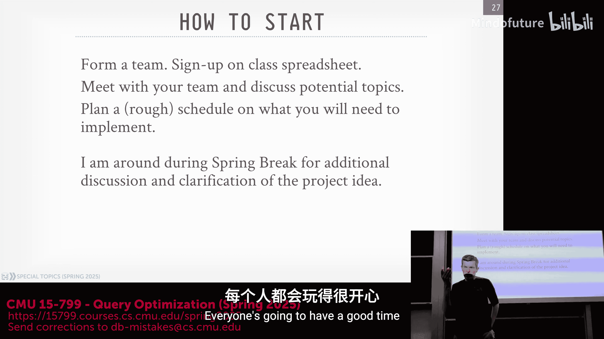
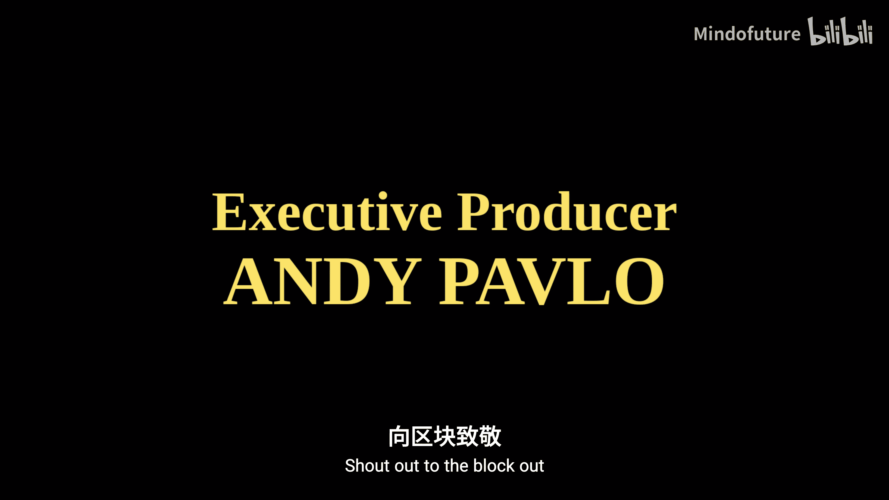
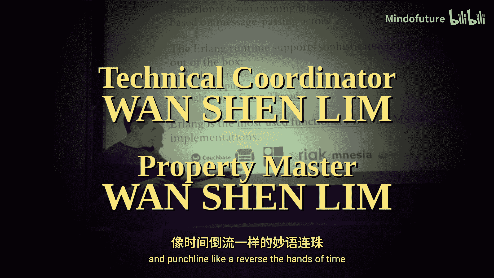

# 【卡内基梅隆---中英】数据库专题：查询优化-CMU-15-799--(2025-年春季)-p10-P10-#10---Search-Parallelization---Top-Down-(CMU-Optimize!)--BV1wDE9z9EfK_p10-

あ。🎼おって見せ。🎼A journey drove that Taas carry up the message。

This course is filmed on location at Carmicgie Mellon University in front of a life studio audiences。

No ideas。Dpo you like here that Calite is the state of the art is the only sort of open source standalone optimize as a service。

There's orca， which we're talking about about today。 But like that's now clue source， right。

 that that's the best。So if you're unhappy with the best， let's make a better one。Right。Okay。

All right， a lot to discuss today actually today's paper was pretty brief and Phy in terms of what they're explaining。

 so I'll got a little bit more background based on sort of jumping ahead to what we'll see in Orca because that paper guy's read is the precursor to orca Earllang orca is not in Erang and get rid of that。

 I'll explain why Erlang matters in a second but like。And， going back when what I said before， like。

 I can read it。 I can understand it。 I know what they're doing， and I can read them to myself。

 Where like the bottom up stuff is always a bit more complicated， but。We'll come to that Atlanta。

 Okay all right， so obviously Project one is still underway for you guys。

 I'll talk about Project 2 at the end of this class today for the talks coming up today we have at 430。

 So in one hour and a half two and a half hours， the Germans like the Germans are gonna be giving a talk with Victor Lyis and Thomas Neyman Thomas you've read a bunch of the papers we be his read paper next week or next Wednesday。

 So they're going to give a talk about their proposal replace sQL with this thing called sane IR。

 It's a sane replacement for basic relation algebra expressions for as an intermediate language for。

😊，Going from one sort of secret light deal like from one session to another secret another system。

 So they're gonna to be talking about that today， that would be 430 again。

 you'll get to see the real Germans live you know you not making stuff up how awesome they have P will be next week again they're going to talk about Koatizer there's actually Oracle talk tomorrow that'll be at noon for the Davis group I post on Piazza for that once I get the information。

 And then in two weeks， we're gonna have a speaker from I think he's not Facebook。

 but he had a startup called Looker that got bought by Google And as part of that project they had this thing called Malloy which is going be one of these。

😊，A replacement for SQL， so like a DSL that looks a claim is better than SQL。

 but instead of actually just going directly from their language into something their physical plan you would execute。

 which the Germans I think and the Germans are doing transpiing to。

 but what Maloy is going to do is going to take take your Maloy query and then convert that into Postgres query a Postgres SQL and then run that。

And again， instead of replacing the whole the physical representation。Yes， what the I don't know。

 maybe Jasons top， I don't know。I mean。You Larry and figure what he says。No， it's tomorrow noon。

 all right。Again， these are optional， again， this is going beyond what we discuss in the course。

 just to give exposure to more things other than the papers we read in the topics we discussed in the lectures。

All right。So last class we began the discussion of a parallelization of a query optimizer and we really only focused on solving one problem or paralyzing one problem of a query optimizer in the context of a bottom up system and that was joint im immigrationeration because they're going to argue that the joint immigration part is the most complicated or the most complex subproblem of the overall problem of doing query optimization and they to they want to have a parallel version of that search should own that and then remember that because it's a bottoms up optimizer that they sort of have this again stratified approach where they have heuristic rules in this first phase where they're just doing a bunch of rewrites to。

You know put the query in a form that be that where optimization you know you want to apply like a predict push down or converting outer joins to inner joins and then once they sort of figure out once the optimize it figures out like here's the overall logical plan that I want to go with for this given query。

 then they would run the bottoms up jointmiration， figure out the optimal join ordering and also the physical limitations of the joins at that point and then there might be an additional round where they have additional heuristics to sort of clean things up。

😡，But at that point， again， after the joint， that's the hardest part for them and they want to spend all their time trying to optimize that and therefore want to paralyze that。

And the key technique we saw for them to paralyze the joint enumeration was to partition the query search base into disjoint subsets based on that joint graph where you know you could have workers。

😡，Do the join ordering enumeration on a portion of the subgraph and it can run in parallel of other workers doing the same thing on other parts of the join graph because they didn't depend on each other。

 they didn't require to know the output of one as an input to another So therefore you could break it up into smaller sub problemss。

 run all that in parallel and then once you it was like a pipeline breaker once you get the in visual parallel responses from all the workers。

 then you could go into the next phase maybe just do two table joins。

 then go three table joins expand it out as you go on， but you're sort of doing this in waves。Right。

Again， because the key thing we'll see this again today is like you need to know that the parallel tasks are independent because otherwise then you're executing in serial order。

😡，So again， that was in the context of a bottom up search。

 So now we're switching over to the top down or transformational search。

And the challenge here is that the search complexity is going to be a bit more's be larger than in a bottom up joint an emeration because again。

 in a top down query optimizer， there isn't this stratified search where there isn't isn't。😡。

You can have heresistic can apply without doing a cost based search。

 but just assume that we're just throwing everything all together into our search base。

 doing explanations and the transformations， and therefore the complexity of the search problem is much larger because it's not just trying to solve the joint ordering problem。

😡，So an example from this from the OrRCca guys is to consider this query here TPCH6 a query6 and it's a pretty simple query like not that complicated we're only doing a six way join and so this case here the number of different join orders we consider they claim is going to be less than 1100。

000 right assuming you're throwing away Cardeian products you know maybe you don't look at always。😊。

You know exact copies are all commmative operations right so they would say all right。

 if you just do join order in a transformative system。

 transform sort of a query appizer then about 10000 choices you have to consider for the joins。

 but if you do look at if you look at all the possible transformations you could apply for this given query。

 then everything else is going to be roughly 230 million different choices you have to consider。😡。

So what they're claiming that is that in a transformational based system。

 because you're trying to do everything all within a single unified search model。

 there's simply way more choices and therefore parallelism is going to have a bigger impact and make a bigger deal in this environment and that's why we want to definitely paralyze our system and we doing again doing a top down system。

 top down optimizer。😡，So if we go now back to in lecture5， when we talk about cascades。

 the original cascades paper sort of mentioned that you could kind of do things in parallel。

 but the original definition or at least description of how they were proposing to queuee tasks and execute them was through this last and first out stack。

😡，So as a transformation rule gets applied， it can generate new tasks for new actions。

 additional rules to do different explanations what to do。

 and those are going to just get appended to or put on top of the stack and then now there's some schedule thread that is picking off whatever's at the top of the stack and executing it right。

So the idea is that this stack is a way to implicitly represent the dependencies between the tasks because if I'm on the stack and I put my children that I need to know that they complete before I run on that stack。

 then I put them on top of me， and then the schedule pick those tasks off， execute them。

 and then at some point you pop off the stack enough for like that task didn't get executed and at that point it knows all its dependent children have been executed and therefore it's safer for it to execute。

😡，And they argued again in the McCascades paper， I think the Microsoft textbook also mentions this too。

 that instead of having the doers of recursive calls by putting everything in this sort of global he stack you're less likely to have a memory errors because now you're not worried about doing super deep traces down in a stack from functions calling calling functions。

 right？But the downside of this， obviously what in the paper you guys read talks about is that if you're putting everything in a stack。

 then you actually lose more detailed information about the tendencies between the different tasks。

 all you really know is that for a given task that's in the stack， if it's at one level。

 then anything that's going to be dependent on it， has to be below it in the stack。

But it doesn't say anything about for two different tasks right after another， a particular tasks。

 are they dependent？You don't know。Right so let's see the name of it this。

 say that we start off doing some task right and tasks being generically defined。

 we'll go more detail in a second， but say it's doing an exploration of a group or a group expression。

Right so then this task says okay why I'm going to generate a new task my children tasks so the first thing you to do is put yourself back on the stack this is the way to essentially recue yourself and say all right I'm going to pause myself now but I want to execute some point in the future。

 but there'll be some tasks that I'm going to add in the stack above me and I can only run when those guys complete。

😡，So then it says， all right， I now want to add task2， it goes ahead and has task2。

 but then now it suspends itself or pulls itself， kills itself， however you want to implement it。

And then now task two is at the top， it's allowed to start running so it runs on the worker and then same thing it wants to generate new tasks that wants to execute that it's gonna to be dependent on so it puts itself back in the stack。

 adds task three and task four goes ahead and kills itself and now the worker just pick off the things off the stack1 by one so take task four。

 run that， take task three， run that and then now task two knows that there's nothing above it in the stack and knows that it's children tasks。

like could have been exploring down below its group children could have been running the implementation rules to convert logical expressions to physical expressions。

 it doesn't matter， we know that task three and four are completed and that's what task two required to finish first because then task two is allowed of us are executing and then when it's done。

 then task one can run。Again， it's a simplistic model。

 it doesn't require really any deep thought about how to schedule things。

 assuming we have one worker thread， but again now we' reduced to running on a single CPU core。😡。

Right。And again， the issue is because it's just the order in which they appear in the stack。

 that's all we know about the dependency between these things。😡。

And what we really want to be able to do is actually track the fine rate dependencies between them and so that we know at any given time。

 what is allowed to be run and is one task allowed to be run in parallel to another task because they don't require the input of the output of each other。

So that's what we're trying to solve today， right， how to do parallel top down search in this particular model when we have all these tasks are being generated and we need to keep track of who's waiting for what。

喂。And then I'll finish up going over what's expected for Project two。I should say also too。

 if you have questions as I go along， please stop interrupt me that don't come ask questions at the end。

 if you have questions during the lecture， somebody else may have the same questions。

 so just stop me as we go along okay？I sure have said that beginning of the semester。

 but I say it in an the intro class right。In this implementation。

 what they're going to do is they're going to replace the stack with a more general purpose scheduler that's going to track the state of each task and it's going to be going to pick them off when they're allowed to run。

😡，And the way they're actually going to implement this that the paper doesn't say it is that within E every single group。

 there's actually going to be their own little minijob queue。

 we're going to keep track here's all the tasks that have've been suspended like what are the portion of this dependency graph we're going to maintain what portion those tasks are going to be living at a different group so that we're not traversing the entire this graph every single time we can just look within the group and say what can run actually right now？

😡，again， replace the stack with a scheduler and once we identify that a task is runudtable。

 meaning it doesn't require the output of any other task。

 dependent task to complete before it's not to start running。

 it's going to go ahead and pay or pick it off and assign it to a worker。

And the way we're going to keep track of these things is through this dependency graph where we're going to link the sort of child parent relationship between。

 here's some parent tasks that created a child task and therefore a Indian nogan its output before I can start running。

And the guarantee is that again we have to provide is that we we can allow a parent has to start before its children start because obviously if a parent's going to create children。

 it needs to be able to run before the children actually start running because we don't know about the children yet。

 so we can allow the parent to start before that children do。

 but we can't allow a parent to finish before it' children do。And in some cases。

 we could have a parent create a child， the child runs， it completes。

 then we come back to the parent and the parent says okay， thanks for that output。

 but now I want more children， it's a weird Elon Mustk thing like it makes more children tasks。

It's terrible person right so it makes more children task and then。

 but it still has to if it's going to create more children。

 it has to wait till them they finish it can finish。And I said。

 the paper doesn't say this because I think it's what 2007 or 2009 figure。

 but this is a precursor to what later on became Orca。Again。

 this is going to be in EarlLang we'll explain why that matters in the second orRCca is going to be in C++ so they threw away the Earl prototype and switch over to OrRCA' sorry switch over to C++ but like a lot of the core ideas that they developed in this prototype then ended up in orCca so we'll see some of these same ideas later on。

Yes， they don't talk at all about the shacheding costs or how the entire sha are gope we were schedule stuff。

Correct，あん。Are they going evaluate whether or not it's not the dependencies something。或者 tough对。

Are those things very like it talk anywhere else。 No， orchestra paper doesn't talk about it So the。

My understanding of the way the prototype works is that for like to know where your dependencies are they finish。

 that's they're relying on Erling to do that because you would have child processes in earling and say notify me when this actor object thing finishes right。

 but if I'm launching five things and one of them finishes I'd have to go and check here on the other photo。

It's， it's like a like a counter。Yeah so this is the only paper that exists that I know out there that describes a parallel top down optimizer right it is also what nine pages long right。

😡，はい。My three paragraphs are on their actual。 Yeah， yes， I know。 yes。

Just feel like they can say we write a very good scheduler。

 like multi writing scheduler or a very good direct pool。Yes。😊，I， so。

couple of things One is in the late 2000s VODB and I thought was VDB and maybe Sigma was doing this。

 they were playing with the idea that instead of people writing2 page papers。

 we're going to write nine page papers right and to try to be more more conse and then have a quicker turnaround for reviewing I know VDB did that。

 this is a sigma paper So that's sort of surprise me。 So that's one side。

 So I think it's from that era And that's why it's pretty short。

 The second one is I think this is also in the industry industry track as sigma。

 And for better or worse， the industry tracks are typically。😊。

Less scientifically rigorous than the regular research track。

 because one you're trying to encourage people in industry to talk about what they're doing， right？

And then the and so not they don't always maybe divulge their the seekers of everything they're doing and oftentimes we'll see in industry papers the graphs will actually be all normalized numbers these actually have somewhat real numbers。

 but like。😡，LikeAlthough that one graph of that spiral thing is useless， but like the I don't know。

It bingo， it looked cool。They say because it's like because it's too whatever， it doesn't matter。

That so that's an example where were like， I think it's because its injury track paper。

 they allow that in。Right。質？But like I said， implement this is the only description of a parallel top down optimizer。

 the other description was going to be in the orCca paper。

 but that's literally going to be half a page and it doesn't say anything more than what's in this paper。

😡，So it is what it is。 most， it looks like you're feeding。Yeah， this paragraph。

So so that the authors are top people right that Fian Ros guy， he was at he was at CwiI。

 he was at Green Plum for a long time and then now he's got a startup called detometry where they basically convert terror data queries into I think SQL several queries and PostQurez queries so that he's a legit data and then the second author is Joe Heellerstein who was like the top database professor at Berkeley right he was like one of the Stonebreaker students right like so that's why again。

 I think it's an industry track papers different。😊。

You think a lot of things right now they for granteded but at that point。

 were just starting to have like。Ws and stuff。No， 202009， no， no， no no no。

 the his statement is like the。The multicore era， people started building data and being aware， oh。

 we're not getting faster clock speeds。 We're getting more cores。

 Let's build something know that can be multi threaded or multicore。 That's probably 2005，2006。Right。

嗯。No again， I think this is an injury track paper right and like I said。

 most of you aren't building a  query appr， Microsoft didn't really have any papers describing how their things actually their thing is not even parallel I was able to do。

 Orca， as far as I know is the only parallel  query apper that I'm aware of。😡。

At least that they publicly talk about。 And this is the only paper that describes the top down one。

 is' is why I picked it。嗯。So is it a great paper？是。Is it the only one， yeah， the good yeah。

 the idea is good you I did spend some time looking at the code to try to figure out what they' were actually doing No no no。

 not they're like in orca。😡，And there。啊。And a lot of the stuff， I mean， in C plus plus。

 La of is extract away。 So they have。I trying to think what's useful I got out of that So some of the things they talk about in the paper do match up with wooden code but I don't but they're not maintaining dependency graph sort of explicit data structure or the way they describe here right it's my understanding is like within every group you sort of have this like here's what I'm here's what I can queue up and run right now and then you go look in the group and look at that job queue to say what can action run that's how they're figuring things out instead of having a giant dependency graph for everything which would be huge they break it up group yeah。

Okay。So this has become later in the Orca paper， but I was wondering。

We over this so these are the seven task types that they have in Orca。

 which is again what came after the paper you guys read and this is basically going be the same thing as the Microsoft one that we discovered in the textbook or the original Cascade's paper except they have seven and the cascade ones had six but this is all the stuff we saw before we have the way to explore the expression or the group expression to generate new ones。

 we had this optimized call where we can just figure out what's the best plan is or subplan within a group or group expression right instead of apply rules it's transform。

I forget where the actual one comes into place， but if you go back to what we had before。

 like this is this is the diagram we showed before right， instead of optimize inputs， it's yeah。

 optimized inputs allows you to。It's basically equivalent of those two up there right instead of optimized inputs。

 they have one per group expression， one per group。Right so again。

 what their buttons maped back to what we talked about before， there isn't。

 know it's a cascades implementation， the slight path to things is a little bit different。

 but at a high level， you you could apply the same scheding mechanism with the dependency graph to this and the there's doing it for different tests different function for implementation rules and for。

😡，Yes， not that's just volcano then， why would we have the input the I。Why would have this？

Because why would cause。movesSo I think this just iterates over all the expressions and calls this。

 that's all it is。Like that's not there in unless their apply like apply their in vision that their apply。

Yeah。So I put that transform is no just okay， theyve split it up。And the code doesn't say like， oh。

 Cascades did this， we're doing there's no common describes this。嗯。All right。

 so as a task is an execute， as I said， it can generate additional tasks and that can either fan out sort of going across the same level and adding more things and those could run in parallel because you're not required in the the output of those as your input。

 or you could traverse down into the search tree and those would be considered dependent task for yourself。

So now they're going to define tasks in terms of their goal。

 essentially what the call of what function are they calling from the seven list I had before and what given input？

😡，And then the idea is that if now there is a task that is running that is described based on one of these goals。

 if other tasks start getting queued up and they have the same goal， you're just going to pause them。

😡，Until you wait to define the output or whatever the task it is that's producing this output they have a mechanism to do that automatically right and then once once the first task with the same goal finishes。

 all the other tasks that are waiting for the output can then start up and then you don't have to pass data between or information between the different tasks。

 they just immediately go look in the memo table which is the global state of the search。😡。

Right whether it it's a global for the entire entire tree ors based on perar group。

 depends like plantation， but they would go in the memo table and that's how they would learn about what was the result of this。

Of this the goal， the other task for the same goal is you。Right。So again。

 because yout you don't want redundant tasks computing the same thing like traversing down on the same group expression of the same children。

 producing the same result because you the other rules don't need to know what other rules are running at the same time。

 therefore you don't do zero coordination， so if other rules are generating the same thing over and over again。

 this mechanism here prevents you from doing unnecessary calculations。😡，All right。

 so the serci dimension graph is。It's a pretty simple state machine。

 nothing here should be too exotic for anyone task starts the first thing has to do is gets created by another task when you mark it as runnable right and then once there's a worker available it's assigned that worker then its status changes to running no surprises there but then as soon as it tries to create tasks where it depends on the output of those tasks it has to get suspended。

And then it's put into this inactive state and again that's just put back into a queue for the given group that it's based upon and then at some point when it gets notified that all the other tasks that it depends on the output are completed。

😡，Then then it's allowed to switch back to the run state and then it could contribute this process over again。

 So the same transformation rule， the same task could get sort of woken up and run and woken up run multiple times because every time I might run。

 you're getting more information about what other tasks ran。

 and then that allows the task to make other decisions about what it wants to do next。

And then at some point when it finishes， then it goes in this final last state and then it just gets discarded now again its state is maintained in the memo table because you don't want to end up recomputing something that you've already computed so even though the worker or the task context。

 whenever metadata or' maintaining about I'm doing this task or this time for this thing。

 all that gets thrown away， but the result of its computation or calculation that persists in the memo table for the life of the query。

 at least in the optimization phase， it that way you don't you don't end up queuing and running things again。

So if you go back to that example before， we had sort of a one task generating series of other tasks。

So when the very beginning， we had just have task one， it starts running。

 it's going to create a new task， task two， this gets marked as runable。😡。

But then taskask one immediately has to get suspended and then it marks itself off as inactive。

 and at which point some worker could pick up taskask2。

 its status changes as running that prevents another worker from trying to pick it up and running at the same time。

And then it's say a creates task three， task four， the both marked just runnable。

 task two has to get suspended， it goes inactive， and then now the other workers can pick up three and four when three is finished goes to the final line state two can't still run because it's waiting in the output of task four once that's complete then it completes。

Task two can run， it finishes， and then task one can run。So the。

The key thing and I sort of mentioned this but I'll be more explicit and say that the tasks has to be implemented using arant reenttrant protocol meaning like。

We have to have the ability to pause the task and we to where it's at when it says， okay。

 I need these output， right the task gets paused。😡，And then when it resumes again。

 it has to pick up exactly where it left off when it was pausedd。

 So this is different than item potentent itemPoent just means that if I run the same thing over and over again。

 I'm gonna get the same result reentry it basically says there's some internal state where I'm keeping track of like where did I stop the last time I ran so when I run this task again。

 I'm not starting from the beginning， I'm starting wherever it is that I left off。😡，Because again。

 now you can think of like a task having a four loop where it's generating inside the loop。

 is generating a bunch of more tasks。And。You maybe generate the first batch and then you want to wait to see what happens to that first batch。

Before you go， maybe generate the next batch。Because you don't want to flood the search base with the much of task all at once because then you're just doing volcano。

 when you do a little bit， see what happens and then now you can make decisions about what you're going to put out in the next batch because the promises could change and other things could change as well。

 right？So again， we need a make of this as being reenttrant， when I looked at the OrRCca code。

 it's just an internal state machine where they have these blocks like I'm doing this。

 if you come back you know where to jump into where you left off。

I think Python yield is basically another the same idea it if you have an itertor。

 where Python is doing that for you automatically through the yield function for this one。

 if you see see+less， you have to implement yourself。And then Erling。

 I think EarlLe gives you this for free too as well， and that's why they did it。All right。

 so let's look at a simple example。 this is a come orup。

And the ordering is a bit weird because the or paper doesn't really describe what they're doing and again try to trace the code and understand how it goes So this is my understanding of how these parallel tasks are going to execute what happens So the very beginning you call the optimized function on the first the group at the top and request is I think is' just like for the invocation of this query run my optimize。

So the first thing they're called implement group。Where it's going to go say， okay。

 well'll go figure out how to actually pick the physical expressions for this group expression。

 but at this point you don't have any of those， See then you got to do you call exploreer group。😡。

So then you get out now for my given output start firing off rules that generate logical equivalent logical expressions for my output at this point we don't have any of those so we generate sort of one sorry we do explore expression on the sort the null set of the output which then just converts the output into most basic logical expression so now we get it all like that so now we least have one logical expression we start doing something with。

😡，So now we could go down and start doing exploration rules from the transform functions。

 and that could generate different permutations of the logical expression that we have so far。

Alternatively， I could then also start exploring down the children。

and make an explore children call down and to go now recursing down into below me。

 start looking at additional groups down below， right？So at this point here。

 these things could be at sort of this level of the tree， these could all run in parallel。

Because this is just applying transformation rules。

 it doesn't require the output of another one or any other task。

 likewise I could explore down into the children， that's fine， I can run that in parallel。

 me moms generating more logical expressions up here right so within one level of the tree。

 all these things can run in parallel。😡，So soon this guy's going down doing whatever exploration once。

 that's fine。😡，Then coming back up here。😡，We could now now that we have some logical expressions。

 we can start running the implement calls on them to generate the physical expressions for for any expression that we have so now we call more transformation rules which then fire out the implementation rules then start generating the physical expressions here now in this case here。

 if you want to start costing them which I don't think happens in this pass over here。

 that happens in the optimized pass， which is sort of subbart of the tree。

 at this point here if I want to start costing I'm going to have the block when I go down into my group below when I say for AB hash join on CD since I need to know what's the physical cost of actually joining AB below me。

 the Mac of a block have depend on anything that goes down below here。

So I think this is just to do exploration， as like I said， without any costing。

 and then there's this other optimized group expression call that they make where that's actually now trying to look at。

 okay， for the physics professions that I've generated during these implement calls。😡。

Start then computing the cost of them And like I said。

 these are going to be a recurs of calls because I need to go to my children So G0 has got to go to group G0 that has to go to group G1 like okay。

 what's your best physical plan or physical expression to do whatever it is and I'm asking you to do And so in this case here。

 this would be a blocking call for the first one here when you go down because you have to wait until some task down below produces this result for you So again we can't do recursive calls。

 this thing is gonna to get blocked waiting for the output of this for finally arrive and then it can then percolate that cost going up。

😡，And again， this is happening actually I don't I think OrCca is doing accumulated cost bounding。

 not predicted cost， accumulated costs it's obvious right because then you just say okay。

 as I'm looking is maybe like where there's forking here。

 I would know I could cut things off because I know I don't want to explore up。

 but it mostly makes sense when on this side over here， when you start fanning things out。

 so you can do the predicted cost bounding when you fan out epim and given level。Im sorry。

 the cumulative cost bounding when you fit on a different level。

 predicted costs would do the same thing， but you could just avoid having to go down and fan out even further。

At high level， this is clear。For the prediction cost， like when you're expanding the， like the。

Like sort of similar to what you were doing this four years。

But like when you are doing the good cost， you sort of know。Based on the logicals in here。

 But like also， you could potentially like。In the like the serial cascade， you sort of could down。

Like the optimization of the right hand side say the joint to to be the cause of the operatorer plus。

 like whatever the left side。sorry if you're doing predictive cost。

 like maybe the question is if you're doing accumulated costs will allow you to pack these things off。

 right， where does predicted cost come in so。My understanding is that would be it' when you explore the group expressions I'm only showing one line from one group of group expression。

 but you can imagine this thing would fan out too so now when I say all right here's all my group expressions that I have they're all logically equivalent A AB join C。

 A join BCD now I want to say all right which one of them that I predict is going to have the most benefit for me。

And therefore only do the transformation rules for those right so you would do the cutoff for predicted costs could be would happened over the side here。

And then now if you go down this path say optimize children to get actually the physical cost of things。

 you since this thing's not going to do a bunch of implementation goals。

 you would just look at whatever you have and say， okay， this is the best one that I've seen。😡。

So they limit the number of children that。in that case， theyre locking it as。

 but theyt sorry again limiting in predicted cost。😊，So you look at the group expressions。

 right so the logical expressions， right？You you。Yeah。

 because maybe I'm be able to generate all of them until you run all of these。

Thinking about this event。I you generate all of them， but then you order them。

 you generate all them and you order them， but you could。Yeah， independent of the predicted cost。

 you could limit to say how many you want to like in the first wave。

 how many we're going to generate right now and then pick which one has the predicted lowest predicted cost and then when you come back when this task gets executed yeah。

 this task gets executed again， you could then say okay for the expressions I do have。

 maybe look at the next 10 things right and apply 10。10 transformation rules on them yes。

 and they used evidence。The work I only doesn' doesn't do。

 it's only cum cost I'll check the good again I'm just trying to say like even though the paper doesn't talk about particular cost cuum costs。

 that paper， I'm trying to say how we apply the concepts from other papers to what they're trying to do here。

Right。And I'm just trying to point out that like the eal cost happens over here， over here。

 if you're just dealing with the logical expressions。

 you don't have accumulate you don't have a physical cost。

 but this is where you could use the predicted cost to start truncating things。

And you would order them， right， Like， that's the promise。Yeah， I'm not sure the promise here。

 but you would when you which loop you would optimize first in their inputs would be dependent on the promise of the moves that。

That we made to create those expression。In the。Within one group or within the globe so within a group you create these expression Yes and you order the ones that you want to actually whose student you want to optimize first。

 Yes， based on promise yes。Yes。Does that clear everyone？I'm not sure the promises here。

 but every single time you have these different choices of rules you could apply。

The attached to them is going to be a problem to say。

 I think I'm going to be this amount of benefit for you。

And again it's an arbitrary number just a weight to say we think this this rule is going to matter more than others right。

 it's a relative thing， so now I'm only showing in two here with dot dot dot。

 but like there going be hundreds of rules I can apply。

 but then I'm going to use the promises that maybe put the first 10。😡。

Right apply those transformations and now that's going to drain a much more logical expression for me within my group so this column here we're going to expand in and then now when I want to go now sort doing exploration I could use the again if I'm doing predicted cost bounding。

 I could decide， okay I'm not going to go down and start looking at the implementation rules for giving a group expression if I don't think it's going to be a big win for me because this is trying to convert the logical expressions into physical expressions so I predict how much how much benefit how much work I I have to do like。

Based on the number two I' going make my out join， and then I could cut off the ones that would be too costly。

Yeah I showed Joan on error， I'm just trying to show how you apply promises and apply the logical cost bounding and the physical cost bounding in the context of all the same search street。

They just happen in different locations。All right。So there's two graphs that are interesting in this paper。

The first is identifying， okay， well， if you build a parallel optimizer。

 how much can you actually parallellyze？And so the first experiment they did they take two synthetic queries。

 a star see query and a chain query or a linear query。

 and they're going to run their optimizer prototype and at every single step along the way。

 they're going to look at all the cues。That are inside the system and say how many tasks are available to run right now in total and then how many tasks could actually be run in parallel with each other And the idea is the goal would be the smaller that gap is the better off you're off because there's more tasks know you don't have to run things in serial order。

So what they point out， and it's kind of hard to see in the graph here， but at the very。

 very beginning on both of them that it's basically a sequential execution because you had to sort of build out the first pass of the tree。

 figure out a bunch of the tasks that be able would execute in parallel。

 you had sort have to get to the bottom and build an initial query plan first。

RightSo there's always this initial phase where。There isn't a lot of parallelism to be achieved。

 but then once you sort of flesh out the overall query plan， then the floor opens up。

 the room opens up， and now there's almost 90 to 85% of the tasks that are available could run in parallel。

😡，So this is good right this matches our expectation that in a transformation based query optimizeizer or top down query optimizeizer。

 since we're throwing everything in the mix， a lot of these tasks can be run or independent each other and therefore can run a parallel。

 so that's good。😊，But then what kind of speed up you're getting。 Well， first of all。

 the downside is that this is 2009。 So they're running this on。For core desktop machine， right？

Your cell phone at this point might be more powerful than this。

 but so what they're going to do is for both of those twoques again。

 they're going to scale up the number of cores that the optimizers allowed to use to do the parallel search and then you want to see what the speedup's going to be and again the goal would be in a perfectly scalable system。

😡，That if I double the number of cores， then the search beat or of the optimization time should get cut in half。

I should have a linear speed up。And what you see in the case of the star query for the。

As expected because there's just going back here again。

 this is way more parallelism opportunities than for the chain query here right that for the higher number of tables you're joining so go from 24824。

6810 tables you want to join with as you add more tables to join therefore just more tasks and more things you have to consider and therefore there's more parallelism opportunities in the case of a two table query。

You see that the performance doesn't do that great after going beyond two cores because they're just。

amount of independent tasks。To deal with those， you know。

 joining two tables goes down quite a bit and it actually gets worse because at the overhead of。

you overhead of the coordination between the different threads。

 everyone' is writing that to the same memo table there's last contestion and so forth， right。So。

In the case of the chain where the same issue， it doesn't。

It doesnn't get the same kind of scalability as you get in the Star query because again。

 the chain query basically specifies that here's a specific order I had to have for when I join things and again that limits the parallel opportunities。

So the other thing the main takeaway from this graph also as it already says。

We're going have to apply the same techniques we do in actually building a data system to build a scalable multithreaded data structures and the internals of the query optimizeizer。

 that's going to matter a lot when you start running things in parallel。All right， quick show has。

 who here has ever written in Earlling？Nobody， who has ever heard of Erling for this paper。

Some of you， you went to CMU， this is like P O Heaven。Yeah CMU that's like SML， okay。

Is everyone considered a boatin？I'm looking at you because you hang out those guys。

Because it's useful， yeah， okay。All right so airline is is a functional programming language from the 1980s based on message passing actors。

 although I think it was they don't describe in terms of actors。 it's like message passing objects。

 but it's basically the actor model and this was developed by Erics in the 1980s it's actually it's fascinating because they were trying to scale up build scalable systems to handle all the telecommunications infrastructure they had to build so they built their their own query language and sorry their own programming language and their own runtime that is based around these sort of core principles of like here's how to of everyone reimplementing the same sort of functionality and features you want to build a scalable system that's all just build that as first class concepts in the language itself and then everyone gets these for free。

 So out of the box you get fault tolerance meaning like if one what they call process fails。

 you'll get a message but it can get fired up again automatically for you。 they can do hot swapping。

 So like I can have code actually running and I can replace。😊。

Like do live updates on the code whilst' running replace other actors without having to take the whole thing down and then everything's be implemented through what are called green threads they're basically。

They're like。They're like fibers basically they're managed threads within the language runtime itself。

Sayve what you want about functional programming languages。

Whether not you should build an entire system on it， that's a whole nother story。

 but of all the functional programming languages that are out there， this is the most common one。

 the most used one that are used most commonly used one that's built to build a full entire database minimum system so probably the most famous one is actually a simple DB from Amazon which is before Dynamo they had to think simple is a key value store that was meant to be fastpath the store small files instead of doing S3 you would use simple DB I think that's really entirely in Erlang couchb is a forkca couch DB they use EarlLang for like the clustering the distributed infrastructure React was a。

诶。Key value store based on like consistent hashing like the rings similar like sort of Cassandra that was Riley entire entirely in Erlng。

 This company failed in。2014，15， but now this actually runs all of the N NHS in the UK。

 like their entire the web services are based on Re。

 which is the dead thing so there's one guy in the UK that basically still maintains it。

And so so you， all right， this is fantastic， EarlL is a big deal because it's I'm saying it's the most used functional probing language to build database systems。

 hold your horses when you look at the full list right there's I only know a 13 databases built at ErLang and you just see the list of all other languages there's more Python there's more JavaScript databases in EarlLang databases。

So keep that in mind question what happened to Orca。Green P started in 20076 as a for Postgres。

 they got bought by EMC。And then that was maybe 2011。

2010 and then pivotal or sorry VMware bought SQL Fire。

 they bought some other database companies right and an EMc like wait a minute we're hardware company what are we doing why do we have a database VMware is like。

 hey， we're VMware we're a VM company。 why do we have databases。

 so then they took Green Pe out of EMC andL Gemfire out of SQL fire out of out of VMware They mashed the two together。

 they made a new company called pivotal。Right so then pivotal was this sort of a standalone company。

 and then they made GreenPb open source， they made Orca open source。

 they had another system called Hawk with a queue that was like single on top of Hadoop that was open source。

 I mean OrCca was built as the query optimizer to work both Greenpl and in Hawk so instead of having build a queryizer for both theyd build one standalone service that could handle both right that's a good idea。

So， then。Pivotal got bought back by。TheMware。And then VNware got bought by Fcom。Two years ago。

 and then broadcom basically just， yeah， all the things are open source and now closed source。

So the source code， like it's marked as archived on Gitub， it's still there。Other than calcite。

 the most successful we are getting ahead of ourselves here。

 What's talk about calite anorca like in context of the market later on， his statement is。

Second to calcite， orca has the most famous or most。Sucucful， what's your definition of successful。

 Okay， I thought you're going mean most widely used and like it's Nobody uses it。

 I' like never meant anybody like even tried orca。 but the is same。😊。

I say the purchase saying is good。 again， we'll get to that later on like。

Calcite is the defect factor in。 if you need a query optimizeizer as a service。

Calite' the only game in town right at this point。Right。

 and the fact that it's in Java caused some problems， you know， in。

And it's very opinion on how to do certain things， right？I think we are another problem outside Yes。

 okay。Let's keep ya。W， what what was that？All right， so。As I said beginning。

 like top down optimizers， again because you're kind of throwing everything in the bathtub。

 all the transformation rules， to me， this means that that's a better target a a better environment for parallel search because。

😡，because there's so many different things you consider。

 if you keep track of the dependencies between the different tasks。

 then you just let the scheduler figure out what the right way to execute things and obviously you know the quality of the query pan I generate is going to depend a lot on this the other mini decisions you're making as you go along the way like bunch a tasks which one should actually run first if they're all parallel like the promises try provide these guidance like it's not just say hey。

 can I have a way to say up all come on in parallel because I showed in the beginning。

 there could be thousands of thousands of tasks could run at the same time and you need to be intelligent how you're going pick them。

The counter argument today's class would be that， well。

 of course you need a parallel search if you're doing top down because you're kind of just stupidly throwing everything in the optimizer search space and therefore you have to run in parallel to get anything good out of it。

😡，RightAnd that the better way to actually limit this be don't do top down， do the stratify search。

 do the bottoms up search because then you can have a set of having a sort of general purpose search engine try to apply these different transformation rules and figure out what actually you should be doing。

 if you are the Davis developer or the person actually building the system。

 you know when in the order certain things will be applied because you can applyly that domain knowledge of you actually building the system and therefore you don't need parallel search if you just do things more efficiently。

😡，And so it's not just me saying this， this is coming from the German。

 the German Thomas right because I asked him， hey I'm pretty sure a Hy andumbbra is singlethed。

 is that true， yes they're single-threaded because he says that the DP album has exponential risk is complexity and therefore if you switch to a multithrereaded system。

 you're reducing the problem size by just a small constant。

 like maybe you can do three or four more relations like bump up that threshold and when you go from small to medium in his paper and that all additional complexity you have to deal with now building a multithrereaded system isn't actually worth it。

So my counter， this counter would be。If again you're building a sal optimizer service。

 you still want to be efficient， but now you're not worried about so much about like， all right。

 I'm taking threads away that I could be actually using XU query because Ombra and Hy they arere going to run your queries in parallel very efficiently。

😡，But now if I'm not worried about running the quiries and some optimize it's a stand one piece。

 then maybe I do want to do the parallel search。Because I had the resources to use for it。Okay。Yes。

 I don't send your initial argument about why two bottoms are。

W so the is bad but you have some domain knowledge what domain knowledge are you the order in which you're doing the steps of the opposition So the stratified search。

 do the pre push down stuff first， do whatever， do the unesting。

 we'll see next class then do the do the Germanman eneration because now the problem is scope down to。

As I said， just maybe 100，00 choices I had to make just still a lot。

 potentially rather than one of the 230 million。And so the top down people say， okay， well yeah。

 we know this is a problem， so this is why the promises can help to sort of guide us so that we're not looking at all 230 million at at onces。

O。Next class。U。We're going to read a。The the an updated version of a paper that the German wrote in 2015。

 So this is the 2025 version of it of how to do arbitrary un nestesting。 So matter。

 there was that subsection in chapter 4。 I had you guys not read on like how to do un nestesting because I said the Germans had the right way to do it。

 So that's what we're going to cover next class。 So this is the updated version of where he fixes a bunch of the problems in the corner cases。

That the original paper doesn't doesn't handle。 So we'll go over that。 I'll briefly also talk about。

 like。Here's what Oracle does and SQL， the old SQL server does and another system where they basically had a bunch of heuristics and rules are pattern matching for looking for subqueries in a certain way and then try to apply the transformation to then convert them to nest of queries into joins。

😡，But the German approach you can read can handle anything。And in my opinion。

 this is the way way to do that。And I haven't we haven't really thought through how to actually do this in the top down optimize yet。

 So they're gonna doing in the contexts of a bottom up。

 And I think maybe have to do it this one in the bottom up manner， okay。So this is a great paper。

 there's another paper that's also an optionalist， if you like math。

 he proves the bounds of this thing。And you also notice it's a single author paper。

 That's how he easy you freak， right， Like， he not only implemented the optimizer。

 to do the thing he needed to do。 he wrote paper by himself。And he's got three kids。All right。

Project 2， okay so the final project for this course， the website's not up yet。

 I'll put that up later tonight after class but the goal is for you to build some projects。

 something based on the topics we've discussed through throughout the semester and what we've discussed so far and what we've talk about going forward and the idea is that you want to get in a small group and most three people pick some topic do you think is super interesting and then propose something about what you actually want to build。

😊，So the deliver is going to be there'll be a project proposal on the first Monday after spring break so March 10th and then a month later you'll do an in class update a five minute presentation I'll talk in the second Im like here here's what we've done so far and then we don't know when the final exam yet is yet but instead of the。

😡，The final exam date will be you come and do like a 10 minute presentation about here's all the code be built and then we can vote for whoever has the best presentation and then the winner will get a sign copy of Larry Ellson's biography or something it's signed by me So it's not real So again。

 March 10 be the first proposal and the idea is that you want to pitch what you're going to do to the class and the idea is that you actually want to have thought about what you're actually going build so you got to think about how you're going implement whatever it's going to implement how you're going to test to see what your thing is actually correct not。

 how you're going to benchmark well workload are going to use to evaluate it again that's why I prompt you those things in the reading synopsis So ladies again just get the ball rolling。

 get everyone to understand what you're trying to do get feedback for myself when in the classmates。

And then later in April again， this will be a status update and the idea here is that you're reporting to the class like。

 hey， we've worked on this for about a month。😡，This is not going well。 We got to change ideas。 or。

 hey， this is going better than we thought。 Look how much great progress we're we're doing。 And then。

 you know， just， if there anything that surprised you， like。

You know calcite not being useful or helpful is not a good was not a good surprise at this point or sorry surprise at the status update。

 but it would be things like that like oh， we thought this be easy because there was this library they claim they're going to do what we needed and it turns out it was a nightmare it's things like that。

😡，When you turn in the final report it'll be basically a design document and I'll provide a template for this right so like here's what here's what you build。

 here's how it works， here's why you made certain decisions or why you did certain things in your implementation。

 how you test this thing， what unit tests， what fuzzing tests。

 whatever you're going to do to actually make sure you're thinking actually works， how does it work。

 what is some of the tradeoff potential problems someone might have they actually use your implementation。

So we make everything of the source， we put out a you know if you've seen the other 721 or old 799 courses。

 there's always a showcase page where's you know here's all the project presentations and the source code for everyone everyone's projects so people sometimes pick those things up and actually try to run it so just writing out what people might hit problems they might hit in the future and then if you know if you add more time。

Either for a， you know， a master's capstone or a thesis or as a side project。

 if you want to do more on the project， what would you actually do。And then like I said。

 instead of doing a final exam on the day of a script final exam。

 there'll be a10 minute presentation depending on the time where you look at bagels or pizza。

 wherever it's going to be， and then we'll come and talk about everything you've done。

 and then if you can benchmark yourself against something or give a demo， that's always super cool。

Okay。😊，Again， this will all be in the website and I'll provide templates for not the presentations。

 but for like any design documents， any reports， there'll be a markdown template you just use that。

Okay。All right for the topics， so we are building a new cascades optimizer here at CMU it was originally written by another master student and then we've been trying to expand upon it for a couple semesters now but we decided beginning of this year about a month ago to throw it all away and start from scratch So unfortunately it's not not at the point where people going actually start playing with it but the way we're starting to think about this is like some of the project ideas would be prototypes that are in the periphery of this optD thing that we're building and depending on if you're doing away MCJ capstone or want to do a master's thesis or things like that。

 like the idea would be。Build it in mind that we want to be able to integrate it in optD at some later point。

 get through this semester， you know get a grade grade and all that stuff and then if you come back in the fall or we could hand it off to another student could then take your project and then do the integration。

😡，Right。So this is a nonexhausive list of different projects that I've sort of been my think about and the optD team and when I' been thinking about。

 so again this is not don't think of this as like these are the only things you can possibly pick if you're doing research in some other area and you say hey。

 this cool technique that we're using in。I don't know。In theory， you want to apply it or algorithms。

' going to apply it to the optimizedor。IBy all means I'm moving to it right。

 so I don't feel like this is this is the final list which you' got to pick。

So I'm going to go quickly out to highlight what these all are so the the first one is you know building infrastructure to allow us to learn what these promises actually should be。

It it been kind of vague oh， you know the developer can decide how to choose how to pick the right promise for certain things。

 but how do you know whether it's right if you pick a static number in there is that going to be a good thing for any possible query？

And so it'd be interesting to explore。Whether this is down in calcside or a small prototype。

 if we can learn the， for consider， class of category of， of tasks or rules， like which ones。

Which ones seem to provide the most benefit。So assume everyone starts with the promise is zero。

 but then as you basically iterate and try out different promise combinations。

Try to retain knowledge or learn from that exploration， what is actually the best ordering？

And then can go even craz saying things like is there a way to look at patterns of the query when it shows up to identify what set of promises might be the right thing for it like if I have three tables in I join versus 10 tables in I join。

 should the promises actually be dynamically shifted based on that？

And this could just be for the initial promises， but then it could be a technique to say as I'm doing the transformations。

The promises can dynamic up themselves， update themselves based on what I see as I go along。

As I said just a moment ago， we're going to read the paper on arbitrary nesting from the Germans。

 that's going be a bottoms up approach， how to then write that into the context of a transformation rule in a cascade styleyle career optimizeizer that would be definitely worth pursuing as far as I know I think databricks。

 my former student is a Data， I think she said she implemented this in their Ca career optimizeizer。

 but she didn't implement all the things needed to do so I think it can be done I think but the only one that I know it actually maybe has tried to fully implement it would be databricks。

At least in the open source optimizer。Another one that I'm interested in pursuing is。

Its doing rewriting with L OMs。So you can ask Claude or ChattBT。

 whatever everyone in your favorite is， you say， hey， here's my SQL query。

 make it better right and it'll come back with SQL that's rewritten。And in some cases。

 if you do this with Postgres queries， it'll actually run faster。

There was a whole there was a startup called EverSQL at Israel that got bought a year ago and they were basically using Claude to do this he optimize my query and they would go to the LLM and ask going to rewrite it and they give you explanations of why I got rewritten The problem is though they didn't actually check anything and I can give examples of this where you ask Claude for the query hey。

 you write this it gives you gives you SQL query back it is faster but it's actually semantically incorrect。

 meaning it's can produce different results from the original query。😡。

See the idea of this project would be you， yes， you go to Clade or Lama。

 whatever whatever your favorite LLM is， you rewrite the query。

 but then you take that query and then you basically do fuzzing on it。

 So you make a synthetic table or synthetic tables with fake data and you run that query multiple times if you written one and see whether it produces the same result as the。

As the original query， and if not， then you reject it。

So the idea is that we actually to have maybe a plugin system in an OpD where as like a rewrite pass。

 I I say call out to some LLM。 And again， the idea would be producing the query in a better form for the  query app。

TheAnother thing I want to do is build on a corpus or a library of all these different transformation rules so that we can sort bootstrap the OpI project。

The way things like Orca and calcite and pretty much any query optimizer。

 the way they have these they build out their transformation libraries is that they give the optimized to customers。

 customers complain about my query didn't get optimized well。

 and then they go at the optimization rules to fix those problems。😡，So。

The problemm for us is we're not a company nobodys using OpD right now so how do we get these rules so I'd be interested in seeing if there's a way to take the open source query optimizes the cascades ones so there's the cockroach Gbo DB calcite orca I don't know what's there in the Datarick one but find other cascade limitations and we define a universal language a lingua Franranca that we could then translate like the cockroach Gb transformation rules into this unified language and then we could take a unified language and then convert that into optD rules so now anybody building a new query optimizer could have this library of 10 transformation rules。

Al ready to go， they just plug into their existing system instead of trying to bootstrap everybody。

 everything from scratch。Wn is interested in this for research purposes。

 but we are interested in trying to play around with Postgres with its query optimizeomizer to inject statistics into it。

 to force it to do things that it otherwise wouldn't do so the idea is like can you extract out the statistic that Postgres generates from analyze and then can you then use like an extension to load that back in to override certain things？

Based on when you actually ran the query， what are the results you're actually seeing？

Another problem or another big important problem of all this is like how do you actually test and benchmark？

Query apps and benchmarking could just be not only how fast it is or how fast can I generate a query with so many tables in it。

 but what's the quality of those query plans as well。

We'll see this scan later when we talk about Orca because they care about this a lot because they're trying to run this in production any query would care about this。

 but OrRCca actually explicitly calls it out where they have this testing framework called Taco with a queue where they take like the best query plan and the second best query plan and actually run them for real and see whether the execution time actually matches up with what the relative cost differences were。

Right。And so start building automated infrastructure to evaluate these things。

 and then not just taking like TPCH queries， but could we sort of build like a fer or using an LLM to generate a bunch of random queries and build a benchmark suite to test these things out。

😡，Or that one could be how do I， I'm say my query optimizeizer can support SQL 92 queries。Okay， well。

 can I use an LM or something to generate something from the SQL spec， which we have？

All the queries all those different keywords and patterns you would have over SQL 92。

 and then verify your query a can handle that。And then go to SQL 9099， go to the next one， right。

 2003。And start building automated infrastructure for that。

Another important thing we want to be able to do is。Using Op D。

 we want to be able to take the physical plans that optD generates。And run somewhere。

 So in the initial version， we're supporting data fusion。

 But eventually we want to be able to support Postgres。

 So you can imagine like a web interface somebody comes through that's that CMU where people copy and paste there are crappy Postgre queries in。

 opt D runs on our side and we come back with them。 like here's the better version of the query。

 The problem is， if you do SQL to SQL translation。 Like if you take the SQL input and then produce the SQL output。

😊，You may lose actually what all the knowledge of the information that the optimizer generated or what the true physical plan should be so what you really want to be able to do is take the physical plan from OpD。

 convert de it or convert it back into SQL but then in line plan hits to force join orders to force index scans or sequential scans。

 there's a extension and postcodes called PG hint plan。

 so the idea is not just generating SQL from a physical plan。

 but also embedding inside of the optD decisions。And the last project would be we're interested in better ways to represent what a predicate is for machine learning purposes。

 like right now there are basic techniques that can done it in embedding just for conjunctions and like simple grade than less than queries but can you do more complicated。

 can you build a transformer a bit more complicated embedding that can handle justjunctions in clause of subqueries。

 like more complicated things you need to do to predict the potential cost of a query？

And I said I'm running these very quickly， I'm happy to discuss any of them during office hours or I'll be around also in spring break as well if you want to go in more detail what I mean for these different topics so the way to get started is I'll post this on Piazza tonight on the administration spreadsheet there'll be a page where you have your sign up for your group of three members and which your project topic is and then if you can't if you don't have any friends。

For whatever reason like and you can't find a group they'll be like a list say I'm a free agent and then we can figure out who how to match you up so your plan is you should form form a team now and then try to meet up with your team discuss potential topics now and then come up with a rough schedule what you actually implement and then that'll put you in place to present it on the 10th after spring break okay？

Any questions or comments about Project2？Again， my list is not exhaustive。

 if there's other things you want to do， by all means， let me know。🎼It's a special topic course。

 Everyone's gonna have a good time。😊。

🎼This is like that wood rain title。🎼My东 one就是。🎼慢慢的 one努。

Don me rocks as you suspect if you don't re through your mind with this dis straight punch down like。

🎼the cr with the bullshit， I keep the for the long grip。

 I got the remedy for beaches when the star shit surround sound like a。

🎼Its a big crown me shit Nick never't if did。🎼This多 some。

