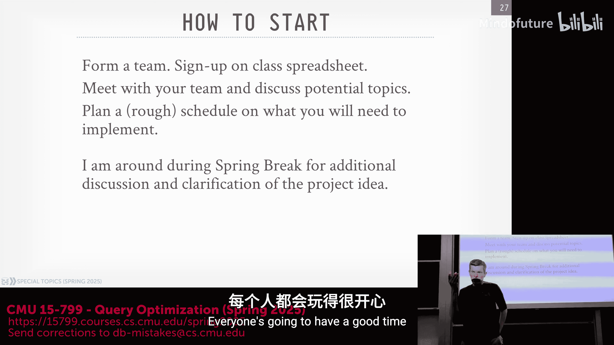

# 数据库查询优化：10：并行化搜索 - 自上而下方法

## 概述
在本节课中，我们将学习如何在自上而下（转换式）查询优化器中实现并行化搜索。我们将探讨为何这种优化器比自底向上系统面临更大的搜索空间挑战，并介绍一种通过依赖图来调度任务、替代传统栈模型的并行化方法。

---

## 自上而下优化器的并行化挑战

上一节我们讨论了自底向上优化器中连接枚举的并行化。本节中，我们来看看在自上而下的转换式优化器中，如何应对更复杂的搜索空间并行化问题。

在自底向上优化器中，搜索被分层处理（例如，先应用启发式规则，再进行基于成本的连接排序）。而在自上而下的优化器（如Cascades风格）中，所有转换规则被统一应用于整个搜索空间，导致需要考虑的备选方案数量急剧增加。

例如，对于一个TPC-H Query 6（六表连接），仅考虑连接顺序的选项可能少于1100个。但如果考虑所有可能的逻辑转换，备选方案数量可能激增至约2.3亿个。因此，在这种环境下，并行化能带来更大的性能提升潜力。

---

## 传统栈调度模型的局限性

在原始的Cascades论文中，任务调度是通过一个**后进先出（LIFO）栈**来管理的。当一个转换规则被应用并生成新的子任务时，这些子任务被压入栈顶。调度线程从栈顶取出任务执行。

这种模型的优点是能隐式地处理任务依赖（子任务必须在父任务之前完成）。但其主要缺点是，栈结构只保留了顺序信息，而丢失了任务间**细粒度的依赖关系**。系统无法判断两个并排的任务是否可以并行执行，因为它们可能并不相互依赖。

---

## 基于依赖图的并行调度模型

为了克服栈模型的限制，论文提出用一个更通用的**调度器**来替代栈。该调度器维护一个**依赖图**，显式地跟踪所有任务及其依赖关系。

### 核心概念：任务与依赖
每个任务代表优化过程中的一个目标（例如，探索一个组`ExploreGroup`，优化一个组表达式`OptimizeGroupExpression`）。任务在执行过程中可以创建新的子任务。

依赖关系的关键保证是：
*   父任务可以**在子任务开始之前启动**（因为它需要创建子任务）。
*   父任务**不能在子任务完成之前结束**（因为它需要子任务的结果）。

调度器的核心职责是持续检查依赖图，找出所有**可运行任务**（即所有依赖项都已满足的任务），并将其分配给空闲的工作线程。

### 任务状态机
每个任务在其生命周期中遵循一个状态机：
1.  **可运行**：任务被创建，依赖已满足。
2.  **运行中**：任务被分配给工作线程并正在执行。
3.  **挂起/非活跃**：任务需要等待其子任务完成，被放入队列。
4.  **完成**：任务执行完毕，结果存入备忘录表，任务实例被丢弃。

### 任务的重入性
一个关键要求是任务必须是**可重入的**。这意味着任务可以在执行过程中被挂起（当它需要等待子任务结果时），并在之后**从挂起点恢复执行**，而不是从头开始。这通常通过内部状态机或类似Python `yield`的机制来实现。

---

## 并行执行流程示例

以下是一个简化的并行任务执行流程，展示了依赖如何产生和解决：

1.  初始调用 `OptimizeGroup(G0)`。
2.  `G0` 调用 `ExploreGroup`，进而可能并行触发多个任务：
    *   `ExploreExpression` 在当前层级应用转换规则，生成新的逻辑表达式。
    *   `ExploreChildren` 递归探索下层子组。
    *   这些任务在同一层级，**彼此独立，可以并行执行**。
3.  当获得一些逻辑表达式后，可以调用 `ImplementExpression` 任务来生成物理表达式。
4.  进行成本计算时（例如在 `OptimizeGroupExpression` 中），任务需要向下层组请求最佳子计划成本。此时，该任务**必须挂起**，等待下层 `OptimizeGroup` 任务完成并返回结果。
5.  下层任务完成后，上层任务被唤醒，整合成本信息，继续执行或创建更多任务。

通过这种方式，独立任务广泛并行，依赖任务则有序等待，从而充分利用了多核资源。

---

## 并行化效果与可扩展性

论文通过实验评估了并行化的效果：

1.  **并行机会**：对于星型查询和链式查询，在初始构建阶段后，高达85%-90%的任务可以并行执行，这证实了自上而下优化器存在大量并行潜力。
2.  **加速比**：在多核机器上运行不同规模查询的加速比。
    *   **星型查询**：随着连接表数增加（2, 4, 8...），并行机会多，接近线性加速比。
    *   **链式查询/小查询**：并行机会有限，超过2-4核后加速比提升不明显，甚至因线程协调和共享数据结构（如备忘录表）的争用而下降。

主要结论是：要实现良好的可扩展性，不仅需要任务级并行，还需要精心设计优化器内部的**并发数据结构**，以减少锁争用。

---

## 项目二介绍

本节课的最后，我们简要介绍本课程的最终项目（Project 2）。

### 项目目标
学生需要组成小组（最多3人），选择一个与课程主题相关的项目，进行设计、实现和评估。项目应围绕构建或增强查询优化器的某个方面展开。

### 项目阶段
1.  **项目提案**：春假后的第一个周一（3月10日）提交。需要清晰阐述项目目标、实施方案、测试方法和评估计划。
2.  **中期汇报**：约一个月后进行5分钟的课堂进度更新。
3.  **最终报告与演示**：在课程最终考核日，进行10分钟的演示，并提交最终设计文档。

### 潜在项目方向（非 exhaustive）
以下是几个可能的研究方向，供参考：
*   **代价承诺的自适应学习**：动态调整转换规则的“承诺”值，以指导搜索顺序。
*   **任意子查询去嵌套的转换规则实现**：将自底向上的去嵌套算法实现为Cascades风格的转换规则。
*   **基于LLM的查询重写与验证**：利用大语言模型重写SQL，并通过模糊测试确保语义等价性。
*   **跨优化器的通用转换规则库**：定义一种中间表示，将不同开源优化器（如CockroachDB、Calcite）的转换规则统一并移植。
*   **优化器测试与基准测试框架**：自动化生成查询、验证计划正确性、比较计划质量。
*   **物理计划提示注入**：将优化器生成的物理计划，通过提示（如PG Hint Plan）的方式嵌回给数据库执行引擎。
*   **复杂谓词的机器学习表示**：为更复杂的SQL谓词（包含析取、子查询等）构建嵌入表示，用于代价预测。

学生可以自由提出其他与查询优化相关的创新想法。

---

## 总结
本节课中，我们一起学习了在自上而下查询优化器中实现并行化搜索的核心思想。我们分析了传统栈调度模型的不足，并介绍了一种基于**显式依赖图**和**可重入任务**的并行调度模型。该模型通过调度器动态管理任务依赖，使得大量独立任务得以并行执行，从而有效应对了转换式优化器庞大的搜索空间。最后，我们介绍了课程最终项目的要求和一些潜在的研究方向。理解这些并行化技术，对于构建高性能的现代查询优化器至关重要。