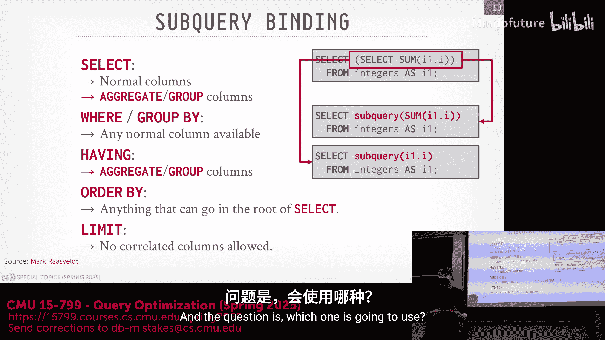
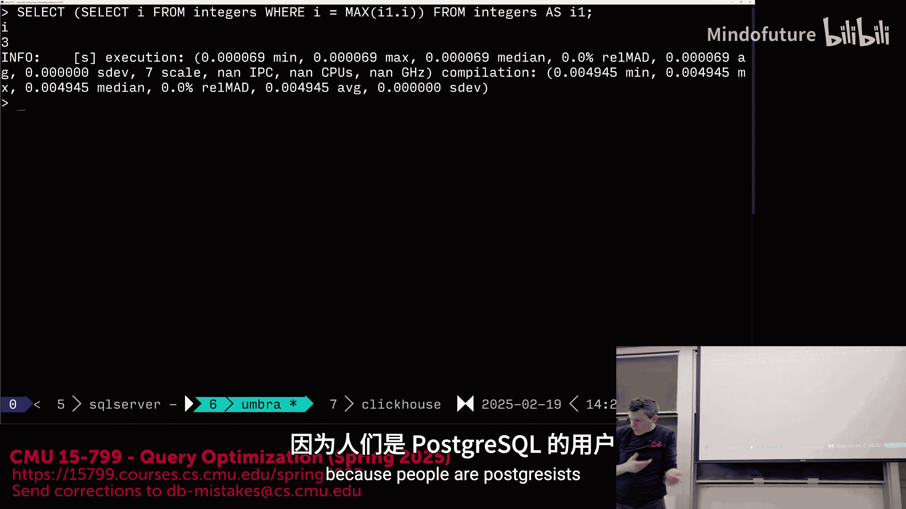
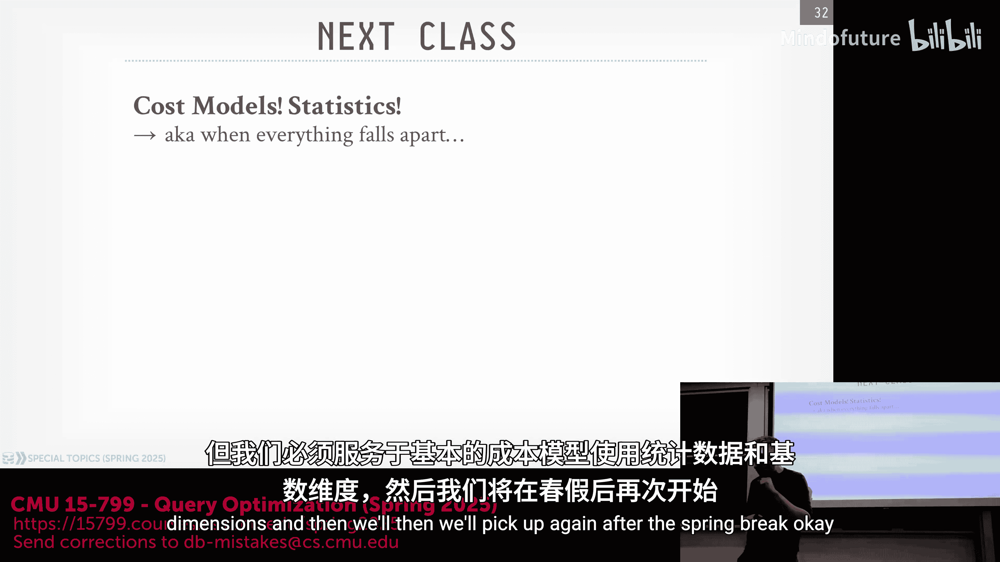
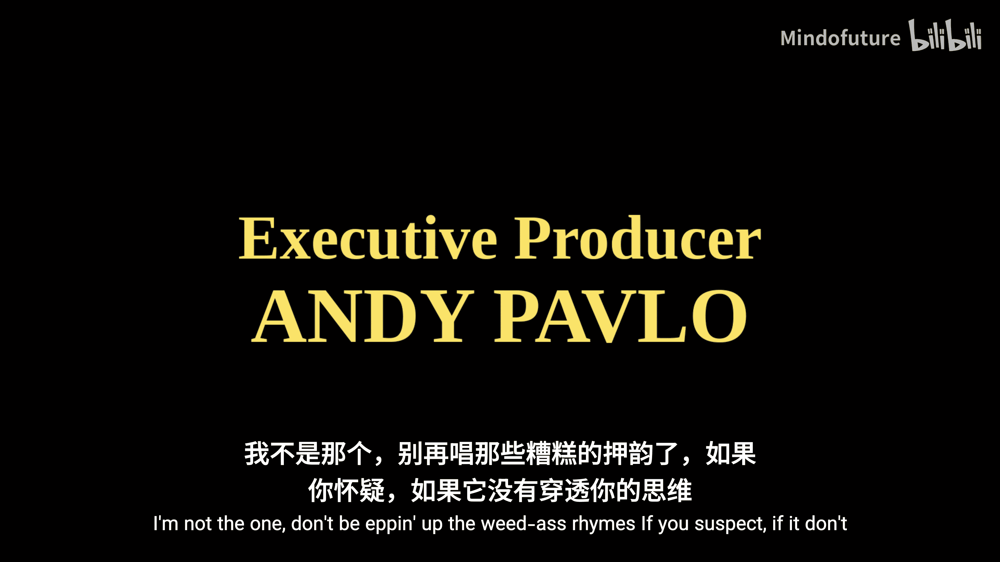
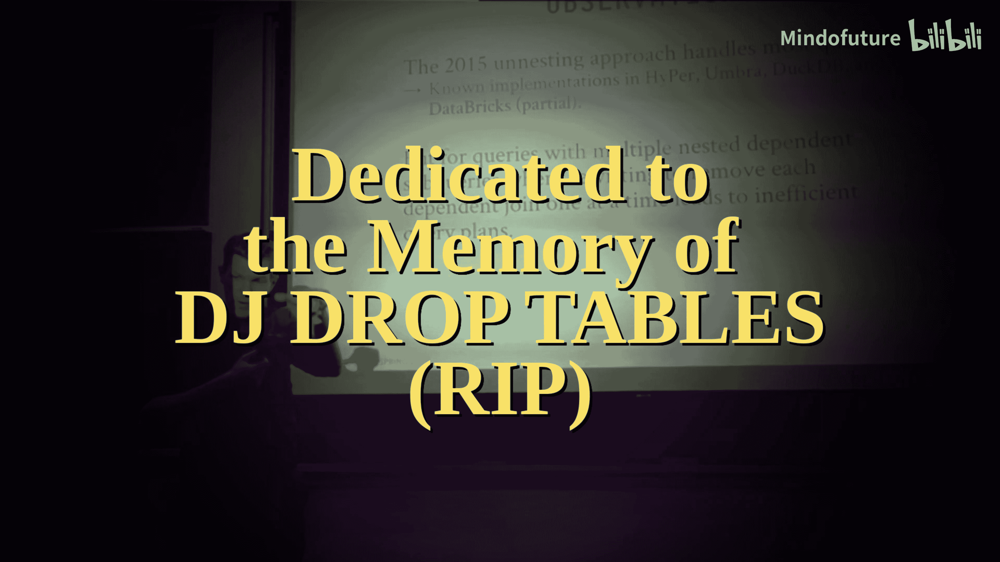

# 【卡内基梅隆---中英】数据库专题：查询优化-CMU-15-799--(2025-年春季)-p11-P11-#11---Unnesting-Queries-(CMU-Optimize!)--BV1wDE9z9EfK_p11-

あ。🎼おって見せ。🎼A journey drove that Taas carry up the message。

This course is filmed on location at Carmicgie Mellon University in front of a life studio audiences。

Today to be valuable。We thought through discussing we've bunch variation of different approaches。

' done the optimizer， whether it's doing a top down search， this is a bottomd up search。

 and so at this point of the semester now we're going to switch to finish up from the last thing you't care about like in the optimizer search strategy how a on uned queries or core subqueries and then next week again we'll in the now we're talking about this other major sorry the optimizer we have to discuss that that's the cost model。

So todays sort of the last lecture we'll do on search strategies just for an economic implication。

 then we'll build on cost models and then we'll go to looking at some other adapt techniques excuse but before we get back then as I says last class was talking about how to paralyze when you have transformations in a top line optimizer and that was coming after we discussed how to do parallelization in a bottom up optimizer。

And the main takeaway to get out on the paper from last class was。That once again。

 we saw the importance of keeping track of dependencies between different parts of the query plan and the opposition process to allow us to identify。

 okay， we know that these tasks are going to be independent。

 therefore it's safe among them at the same time and we'll see end in today's class again。

 where we have to figure out okay， as I'm traverse the tree。

 I have to know how the data actually columns flowing what off of the next the query plan so I can sign when it's safe when it even move things around。

😡，So the。Again and going back to like the assist our approach they in the class that was like okay I know I'm going to do these joins just throw a bunch of look at all possible limitationss and do the dynamic programming research on that but it's really a sophisticated in that where you have to keep track of here's what's happening with the query grant as I make changes and here's the task that I'm I'm making those changes for me and that's going help them reason it out and figure out what is the what's the next best thing I should do that can't guarantee that I'll to the optimal query grant at least it'll push me in the right direction and I can do this in a statement the then thing single thread that you don't need to track dependencies to the tasks but certainly we need to check dependencies between the query print itself。

And as I said， this is the last pass the last one we like we're making this big distinction from bottom up and top down。

 although today's paper it is a top down algorithm right。

 and I'll contrast this the bottoms up algorithm that he proposed 10 years ago。

 but it's still it's not the same thing as like， are you a transformation of search for the D search from the bottom。

😡，So today's class， so we're going to focus on subs and I don't think I' really discuss them too much in the inter class just say they exist and they can write them。

 but now we've got to figure out how we actually get them optimize， which is much much harder of。

 right？😡，So I think since the very beginning， when sequence was first proposed in the '70s at IBM。

 there's always been the capability to have nest queries that you have a select inside of some part of an insert update flexlexing。

 you had all back then you couldn't do flex and inserts， now you can in some substance。

 but the idea that you have a select and inside that's another select。

 and then we arbitrary number of nesting that allowed you build up more complex queries that that has been around since from the 1970s。

And you really could put it on the right you can put projections from where limit having orderbi clauses can do it。

 but it doesn't post you do if anything it gets ignored， right？😡，And we'll see in this fact。

 the way runss think about a sub is that it's almost like a function。

That you have you will have your querying call to get some data you then can use for for its purposes whatever that query you needs to use it for。

😡，And so again， to allow us to declare within everyone single query。

 here's some complex logic we want to compute without having to manuallyly separate queries。

 like you know run the select followed by this select。

 and you can kind of send in the guidance send more generate query。

 which will be problems for us in a second to the gateway server and have that do all the the computationplication all on the server side without having to send results back to the client。

😡，Right。So we need to make a distinction about correlated and uncorrelated sub wayss。

 because how you're going to optimize them is mean way way different， of course。

 correlated ones hard work。😡，So hopefully data query just you have an data query that doesn't depend on any attributes。

 any data or information from the out of callway query。😡，Right。So in this case here。

 I'm doing the select statement， select star select name for students。

 where their score is the max score of all the students。Right。

And the way this will get executed is that they system to recognize or the optimize can recognize。

 oh， well， there's nothing in this inner query here can select max score from students that needs any information or any attributes or any data from the out way calling it。

 so therefore I can run this thing once like a CTE orize it as a temp table and then now just do a join against that。

😡，Right，It' be again，'s super super cheap to do and the main takeaway from this is that logical。

The database system。I only has to execute that in phrase once。

 no matter how many times I'm going to execute it。😡。

For whatever whatever the tu i'm looking at on the outer query。

 the result is going to be the same so logical you know that this thing can probably run once and then you don't have you don't have to run for every single two now whether or not the data system is smarter to recognize that isn't always case like my sQel will up until like 5 point six maybe so making like 10 years ago David would run this inner query for every single tu from the outer two right even the result will be the same over every right？

😡，So again， the unqued someemparies， those aren't hard we can handle those。

It's the core medicine executive that don' cross problems for for us because。😡。

It's going to rely on the interpret is going to rely on some attribute some data from the outer core。

 and now the context of when this inter actually even get executed is going to matter。😡。

Because in this case here， like I'm trying to get the name and the major of the students that has the highest score of all the students in their same major。

Right， so you think of this outer query， I could run this。

 you know I would run this starting with this and think of like if there's a nest before inside of it where for every single people in the outer Cl here。

 I want to do something do some kind of look up on the inner。😡，Right so you start the beginning。

 you know， do the name of Gizza， you look at the major Kciai。

 and then now you're just going to get iterate through the entire table who is what to stand to figure out whatever is the max sports to be for the science major in this case here the sports tonight。

Then now I come around and do the next two， which will be the R of。😡。

RightSa thing like he usings through the science major。

 so I got to start my scan from the beginning and scan through and find the max score。

 which is just going the same thing with 90 because it was the same major last time。😊。

Come back to third time around now we want to do a look about new D。

 he's the only one majoring streets， so we start from game beginning loop through and we get to score one00。

😡，So this is semantically correct， like what I just going to hear is produces the correct answer。

 but obviously it's inefficient because I'm scanning do a special scan on this the inner period table over and everywhere in the case of like the first two two pools。

😡，They were both computer science majors。The match score was the same。

So our high level goal is to avoid this sort of worst case scenario where we're stupidly executing the inner query from every single tuple on the data。

😡，And the main takeaway is going to to trying to do this by rewriting things convert to convert very into joint。

😡，Right。So。what I just said again， the goal we're trying to do here is again'm trying to pull out this four sub and then try to be able be able to rewrite it into a join which we know how to actually that efficiently。

😡，The things you should optimize first when youve build a database system。

 so in this case here we report out the inner pry as now and another still inter queryry。

 but now it's being referenced as if it was a table and like I it a CTE。

So now I could run this query once， I'm going to do the the maxps4， but I can do it by the major。😡。

which again the group by clause didn' appear in the initial query and in this piece here also in the inner query I'm not referencing the aom table anymore so now it becomes an uncorrelatedated subquery so I can run this once materialize it and tempt table S2 then now just to join。

😡，On the out table， students and dinner table， we could the， right？

So this example here you you can kind of squish and say， okay， well。

 I can figure out the logic by hand when I actually want to do this， how to do this rewriting。😡。

right you know you're doing a join on the quality predicate s2。 majorjo because thats1。 majorr。

 so in that case here you probably want to use a groupI and then that'll just narrow it down so you're not looking at all possible tools on the inner table。

 you're just looking at the whatever groupey clauses。

So the challenge is going to be is that we have public number on nest。😡。

Where we'll see an example later on today， like where a un nest query or a nest query can call another nest query call another nest query。

 this can go on technically infinitely。It's sL。And how you now going to be able to identify when it's safe rag like this and how did we get dragon it？

That's what today's paper is really about。I how to take any arbitrary nest query and handle the be able to un nest in this method。

So I want to talk about real quickly the challenges in just pointing get to the optimizer of how to binding the query。

 I know we don't not the binder as soon as that was done upstream after the parer before we get to the optimizer。

 but it is worth looking at there's some nuances of how you bind things and we'll look some demos work。

😡，Different data shows actually different results from nest queries。

Then we'll talk about the precursor to the unested tape you guys about。Well。

 how people basically trying to do this in like 1980s like early 1980s before everybody was born。

 like for the last four years people basically been using heistics to try to figure out how to solve this problem。

 but they wouldn't be able to handle all possible cases。

 then we'll talk about the three curs of the paper you guys mentioned earlier they called the simple duplicate elimination。

😡，Or sorry the a simple dependent joint of the nation where they were。

I couldn't handle everything but basic ideas back this is all bottoms up and then we'll finish off talking about the paper you guys ran。

😡，It's actually not even announced yet， the paper comes out next month at the conference。

 but this is like what we're looking at for how to do un correctly。😡，Yeah。😊，Did you read it。

 whose name is in it， we'll get to it yeah。All right， so binding， okay。

 the idea of binding is the you're trying to take references in a SQL statement。😡，You know。

 after you parse it in the end of syntax screen， you have these tokens。

 and you're trying to map them to objects in the database this catalog。😡。

Right and then in some cases， if you have a derived。After your derived column in your query。

 now youve got to figure out， okay， well what part of the query plan。

 what other part of the query is actually producing this result。😡。

That I could then use for this computation， right？And so for basic things it me quite easy right in this case here we know we're scoped inside the innercur here students as S2 somebody see S2 got major。

 I know where that's coming from right likewise that's where' not major， I know where that's coming。

The challenge is that when you have there's different interpretations to what the orderment could be。

 that's when it becomes problematic。😡，And the only way to think about this is that。

The subquery is like a function as I said， where it's set up saying like there's actually gain or select query it's some subquery that I'm some function I'm invoking that's going to give back can result in any here underneath if the coverage obviously it's a SQL query that needs get executed but if you just treat it as a UDF and now you know that anything that can be passed as a argument to mis function could then be referenced inside of the in query that that's going to get invoked to。

😡，So the challenges comes up when you start looking at in the the。

when things start referencing other parts of the query， and it's not clear what is action for。😡。

And the different gaming systems that have different interpretations from what that order actually looks like。

And so all right， so to select the events， pretty straightforward straightforward any normal column。

 and then you can also reference emitt in aggregation or groupI in a where in groupI any of the normal columns coming from your base table either in results from the table below you。

😡，Having it access aggregatewalls is order to buy anything that going here select going there and then limit it。

😡，Technically， if you can't have any correlated columns， I think postpasors can do it。

It just treats it as an attorney of one。And there's an actually。

 if you can't take to the out of the people and use that as a fes。

 that's the column name I want to join on do my limit I order buy one to technical else to do this。

 but like I think Congress love to do it。😡，So at of a challenging example where things can be ambitious。

We have a select statement here， we have select， we have an outer to the select。

 and then we have this inner query where we're going to create an aggregation without a front call on this integer table and then we're just referencing say a single column from the integers table that's being referenced in the outer。

😊，So there's actually two ways to pick like， again， if you just pick up like the nestary。

 a select sum i1。 I， you think that as a subary。😡，Then the question is like。

 what is actually being passed in？Is it the competing aggregation first and then pass that into the subparring or is the subparring actually going to be doing the aggregation？

Right， so there's actually。Two technical correct interpretations on this。

 and the question is which one a new city is going to use to depend on how it's actually implemented。

So let's bring up。Terminal and play rounds。All so I have a real table table。Good。All right。

 so really simple table。Interverse click， click， click。Yeah。It has4 course。

Once we agree and then not。So if we take that same query， I just had the floor。😡。

You that you get set all right， so what's happening there。Right well。

 post person is interpreting this as I'll run the I'll run this inquiry first。

 it' getting the value of。I1。i from the ater table。And then as an iter into that， it keeps the soft。

Right， so let's go to my。Same query right does it produces the single agreg6 that's nu。

Is that a super light？It does sex， that's good。读几啲。I get sick， that's good。This is what Thor。

Right allal doesn't like having from calls are selected that from。

 so Ive got to put this fake table do have we covered dual yet before right so third。

It's like a fake table in Oracle。I just has my。One attribute was one value and so anytime you do a your query where you're without a from cost。

 you have to put this dual thing in。对。Yes， actually I totally you for know。OkayIt's an oracal。

What are does are？You're going to look at over， empty space。

And these string no right there's a way to make it kit null but whatever so what what is doing here is again it's taking for every single twofold in the integer table。

😡，And it's computing the sum on that， well what's the sum of one。

 one it's the sum of two two right so what his last here is no。Is it wrong？

Well it's different than the other ones but technical you think is actually correct。

It's one way to interpret the。The inner。Right。So let's do now Se server。so single S gives you sex。

 at least now there're also even rewarding to say like， hey， look。

 we saw a nu there and it got moved。So that's kind。嗯。And then， let's go to。

This isumb from the Germans and this is like this is their。

They have interface you can connect from the post pass because I'm doing directly to theite terminal。

 right？Ignore all the stats what you see is that for some here is six。

So everybody agrees here except step four of them， but again。

 I'm not saying awful is wrong because this one way to interpret reject computer。😡。

Let's look at another okay。So this query is now in our inner query。

 we'm speaking with sum of I plus the sum of I again。

But now nowvi're getting the eye from the inner table its the eye from the outer table。

 and then now we're going also to the sum of I again from the outer table in the inner table as well。

😡，questionest is you are my queries like this？I mean， yes， I mean， this is like thegene case。U。

But like could this occur， certainly， right， I think the whole this whole paper were releasing today was because of mean machine generated。

Right。All right， let's go to my SQL。my circle matches right， you get 117，228，339。

 they just put nu null first。呃是个 white。1172283 three，9 that matter。呃，比彬。That matters。播。呃。Yeah。Right。

Well， sounds great that。So it was getting one so again the last round was null getting one， two。

 three null from the outer from the outer integers then for the first summation it's getting that it's just counting you know what's the sum of one one with sum of two two right that's fine and then for this inner guy here again because it's interpreting the。

It's interpreting this， or binding this。Like up here， it's getting this one， no。

 it's getting this out of one。Passing from this， so you're getting one。嗯。Yeah。

 I can't with that math stuff。It's different。We had to say about that one， right。And seaL server。

So everyone is going to match post best Europe。Right， yeah。

 that matches gives you a nice money again and then Ubras can do。Okayme， thank you。U。

Let try one more example here。But so here again， we're trying to get now the enterprise select iPhone integers where i equals the max of the outer。

Okay， so we now got a compute the audit query with that max first to then be able to use that as an input for the innerver。

😡，That's a little weird， but it's again 200 equalequ。

And in here it's got really to derive from the subplant other than seeing that like in the explain plan。

 other than it knows that it's getting the max。I to keep that first us from the out。Right。

So good my sQel。I think you'll give three that matches。Gos in the light。

See the light doesn't like magnets in the where flaws。DoD should met Postpass is are three。Or both。

Sa like dual， y。doesn't like doesn't like the max。The wear clone is that' surprise that my signal takes it because my signal is originally trying to mimic local's behavior a lot of away。

Sal Ser gives。Three， and then last ones weekumbbra。

I gives three right so Orle is the odd odd question down here but's other examples we could do where。

My and people like start。没想过。Qu question is thats any sort of mimic process behavior。嗯。

So what I'd say what number does is slightly correct。Correct implicationsplication。は。

I basically had to be like you know how you going the find like so this is this other example where like you would see that。

😡，If you know it's being a heuristic based rewrite and actually it'll do weird things if produce things like result because it's trying to move things around that it shouldn't have。

I think all of these examples here is just like it's the bind of the society when things are like how things are and oral does it different and yeah。

 I'm not trying to say orphaal wrong or the second example the numbers are weird but like in that first example。

 again， both were technical valid interpretations of that nest query is people or Postg everyone seems to be doing the Postgre way。

😡。

OO。So。All， so that's where you's going be dancing。8月6。In our optimize。And as I said， the。

Since the early 1980s， there's been many proposals about。Theuristics and rules to do this rewwriting。

Basically like the transformation。Rules we saw in the top downtop or those rewriting rules we saw in Starburst early semester semester。

 where you're trying to identify patterns where you see I have an operator that things calling this operator and of this type and he's doing this thing or this kind of data。

 if I see that pattern， then I don't safely to rewrite。Um。

 and so these are all have to be written by a human by basically looking at a bunch of nasty subries or or nest queries and then figureig out okay。

 should what should I be doing here， is it safe for me to do？😡。

So to give you an example of what this can look like this is from the documentation of sleep light and you see they have basically 24 different rules right if the subquery is the right operator on the left out of join then the subry may not bejo and and the front clause of the subquery may not contain the virtual table the out query may not be inacrant like these are what the rules someone would have to write the optimizer identify these patterns to then be able do the rewrite transformation。

😡，Again， I'm trying to lift out the list query to be a。

Uh to be something the same level as the auditary so that you do join against。Righte。So I mean。

 I'm not taking to see the light pretty much every system except except for Duckyb and  Ubra hyperper are doing something very sensitive。

😡，So here's the real there was much approaches in the 1980s， 1990s。

In the early 90s there was now a technique called magic sets so sometimes we see I don't think if paper this paper mention it but sometimes some of these rewrite papers you see those nest queries but mentioned oh yeah。

 you can do this with magic sets and basically idea of a magic set is it's just rewriting the。

Just rewriting an a query such that it's writing into now a table。😡。

That's then reference in their fromlas and in that table you're doing some you're adding additional filter that may actually not be for your query to not narrow down the number of attribute that you're looking at。

 number two you're looking at so that if you end up doing the stupid thing when you do a evoke the in over and over again。

 you're not looking at successful scan， you're least putting it down on amount of work you have to do。

So this work I thinks invented magic Se invented actually forget where the late 80s but this is actually what Star Warrst was doing they pick this up in the 1990s and this from this so this is that example we hadn before being this lecture and like all right。

 how do I get the student in the major that has the highest grade student majors and my example I showed was prewriting it as a front calls basically what a magic set？

And again， you' using the heuristics that we just saw these mentioned from the last slide。

That's how you would identifyent but I can do this with a magic set and I may again add additional things andware of clause here based on how I know the audit query able to access things sort of to incredibly to get pushed out the sides of this and then the result more materializing for whatever reason they call it a magic set。

😡，Right。Is it magic？It's a clever name like as stand up， right？Again。

 the idea is that if you generate the magic set and you then do a joint against。

 thats me more efficient to do。😡，This to joining against this。

 then doing the dumb thing of bed rain comes out people calling the in aper over again。

You can also do magic sets of TEs， you can also just you can write to a table。

 a attempt table and then rewrite the query in the chat for this simple example here I'm just doing this as a。

😡，You know， using the first thing we had before。I don't want to go too much into what Microsoft does。

 we'll see this a little bit later on when we talk UDS。

 but they all the heuristics that are out there。The decision of using characteristics there is probably the most sophisticated and they have severals on this technique。

 but basically they you have bunch of these rules that you can apply that aregon to each other independent。

And it's sort of like the transformation world was saw before and like if I can rewrite things from from outer join or an inner join。

 then that unlocks of digital transformations， it's the same idea for what they try to do。

But their whole thing thing is that they had this apply operator sort of like a lateral joining if you remember that from the interclass we'll see that later on today and later semester。

 but the idea is get these apply operators are。😡，Or what going be linking things we have as players and if I can convert these supply operators to inter join。

😡，Uh，Then I can just you know， do my own opposition that I had before。

Right so this paper swingwars from about 2001 M9 rules。

 there's a follow up paper I mentioned at the end in this class that they then start doing some of the things that the Germans are doing and the new version of SQel summer。

 but that paper actually is not out there。😡，But they fixed a lot of the things。

 the traffics a lot of the things that the Thomas did in his 2025 paper that was missed in the 20。

to the main takeaway of here be ready stuff like its it's useful you absolutely want to do it。

 you can identify。So probably the most common patterns you're going identify the right way to rewrite them to make things better。

 but it's really basically possible to see for any possible scenario any possible amount of nesting that be's soque to be able to figure out when can we rewrite them maintaining them is also very difficult too。

 as I said like someone's got to sit and sit down and look at all of these ques one by one I would be here's what I should be here's on my background should here and there and then it becomes very brittle now because if you change the logic of one trans。

Then that may break assumptions that are being used in other Postss basically has this problem Postcras can do some equationation on subqueries。

 but like the optimizer is just much if analysis and if you break something about。😡。

You change what expected output is for one of these rewrite rules that can break through later。So。

You can get， yeah， I don't I don't want to put a number on it。

 can maybe get 75% of the way they're using hes or from an engineering perspective。

 is this is not maintainable sustainable。😡，All right， so as it says。

 the paper guys mentioned was this a 2025 edition that is coming out next month on this earlier paper in that came out 2015 from the Germans about how to eliminate any possible necessary you have by doing this rewriting between the optimize。

 rewriting the freight plan to convert what I'm called independent joints I' spend that second into regular inner joints。

And the goal here is that you identify that when you would have to like run a nest perform to call the inner query of every band for every keyboard in the outer query。

 if you can recognize that when this occurs and you rewrite it as innerjo。

 basically from from an ON to。😡，donN squared。Operative implementationation like a miss lookoid to something more has。

 and it's significant improvement。And then their claim in is in paper， the Fo paper actually does it。

 is that for all any possible theory， any possible amount of nest base that this approach piece can。

😡，All right so the first thing they there one key idea is that they're going introduce this new operator on an app tour。

😡，This is an extension to relation algebra where it's a way to represent that there is a dependency between。

😡，TheRight hand side left hand side of that operator because it corresponds to coordinate than software。

 right？And so you just think of this like it's a across line。

But you're not actually one exit is cross going， it's just a placeholder to keep track I'm like， hey。

 I am dependent dependent Jo here。And then again， the whole goal is to be able to get rid of these things so that you can then convert everything them to interface。

So say we have the inter query here。And we see that again we're trying to do a we referencing something from the out query。

 so there's some there's some filter operator that's going to reference the sub query right and again if we're the。

Extcuting as it was a nest loop of broken innerqu for every tool in the outqu in this query probably works。

 so we want to convert that subway now into a dependent joint where we keep track of like here's the dependencies that we have for that joint。

And so for all from today's past， you have this side here because it's the left hand side and over there is on the right hand side。

So the right hand side， and of course is calling what to be the innerpyirie。

 and it's going to have references to things that are on the left hand side， that's from Car word。嗯。

All rightSo now here we have this filter clause on the right hand side where together is referencing something from the outer query。

 so' again doing this comparison to the student major the outer query and the student major on the innerque here so need to understand how can we how can we how can we rewrite this part over here to not have to do the dumb invocation of the inner query for episode of the。

So the depend joint is just going to to algebra which it's going to keep track recordinging something。

And the。The way with the implemented again just blindly was for everything single twoful on the right hand side。

 you got to join it at something on the left hand side and so it's just a way to keep track of like here's the pen going here I know it I want to remove it and so the goal is can be to try to push it down to the bottom of the right hand side and they convert it to a regular join in some cases just eliminate entirely。

😡，So then now the placeholder joined here just become energy。

So this that's the height of the and so the album is first invitation。😡，Is。

I going to go from the bottom， find the first dependent join that sees from bottom going to top and then rewrite that and keep going until it gets to the very top three brand I know't have meaningful independent joints。

And then the paper you guys read is going to do the meop direction and actually look at multi penies at the same time。

All so the way more we write this down is that again。

 we want to push down this dependent join on the right hand side and we'll do this sort of step by step as we go down until we get it near the bottom。

 right？😡，So depending joining's going this correctly。😡。

So we're going to then target this filter here。Because we know this is actually this is the joint fall that we're to care about。

喂。😊，So we're going to add a join up here。And that's what is looking at the major from the scan operator from the student table and then if you look at the major that's coming out of this dependent join down below。

 so going back here， we sort of swapped the we move the pen join down by one and then the filter operator came to the top and then convert it into an interter。

 we still have the filter down below up here。😡，And now we introduce this new operator as well called the Dlic Elilimination scan。

And all of this' going to be is a sort of special type of stand that only has have distinct claws and that's going to guarantee that the tus coming out of it will be sticked。

And we need be able to do this because we。You know。

 as we're doing the scan here on the students here， like if somebody doesn't have a major。

 it may not get produced as part of the output of the the scan here and the aggregation。

 but this please guarantee that something will come out of it we still capture every single record that's in the。

😡，In the stands right？So， we're trying to do this again without the semantics are the same。

 even though the physical plan is changing as we go along。OO。😊。

To take a duplicate scan as a select query where the projection is the same as whatever means to provide list。

 is guaranteeing that things are coming out without any difference。

All right so now going to keep pushing down this dependent join far down is agains possible so in this next step here we're going we're going to move it down by one and move the agnation to the above the dependent join and so because this is eli scan and attach to dependent join it's going to come down from down with us like this。

😡，Again， now the agation of the above， we have a dependent join。

 we have a duplicate elimination scan， and that just can be tied up with the scan of the completed。

Nothing to point out too is now because we know we're doing a join on the major coming out of this side of the tree。

 the right hand side， now we can actually also introduce a fruit like fall on the major and this guarantees that we're not going to have duplicates。

IDo think the majors coming out of this。Reduce the amount of tools we have to look at when we do our joint。

Again， same things keep going push the penant going down further。

 so now we're going spot places with this filter， that's going to go above you book at elimination scan have come down below and the penant join moves down。

拜e拜拜。This is good now we're at the bottom， right？And so we can't go any water because it's a join between the stand table and then the specialty bucket andmination scan。

So the dependent joint basically standss as a cross join， just has a special market it says。

I' you know I'm a dependent joint， but you could implement this as a cross joint with a special flag and say。

 hey， I'm a pendant joint， but keep clean， you just have to sort of separate just to operating。

So then now that we have the at at the bottom， we convert the dependentant joint into a frost。

Which again， is stillsymmetrically correct because this will do the drawing robust to into because this we don't mean。

But now if we have a filter above a crossboard， going back to assist Mar or Starbs。

 we know that this could be converted into an inte。And then these guys slide up。

Right now it's not better。We got into our cross growing， the filter just filter into the door not。喂喂。

呃。And then now we can remove the duplication scan entirely because we know that the group by calls。

It's going to remove duplicates for us as well。So then this part here just gets to be written now to be the scale of students。

And then at this point here， we have to then。Conver convertver the filter with the and the inner join sign filter and the join into now inner join。

Where now the I can take the alpha the aggregate from the max score to do that in my join in my。

Am I intering up that？I think the reason the papers study lung first we know that one。对。Oh。

Which rings about this step here here yes。So the paper says why。

That's the dry condition that we forward at this point。ItIt's a。mean like this。我蔡医识。Yeah。Yeah。

 this is a unique。Yeah， yes。Yes， I'm saying andll give。They。So per student has one major yes。

 it's like a one to one correspondence so then in this piece here， you know that coming out of this。

Yeah sorry so his point is here like the join column here is D major and equal goes that too major right so it's not matching students so this is basically kind of doing a conheion product i'm like for every student the same major mashed up the everybody opportunities the same major right and that's not because you're you're just going collapse it down on the agregation here so you're saying we don't look at this aggregation up above。

对O。Regardless， long you they want understand the flow of happening， right？

Coming back and very minute。So we start about back up here。

Right we had this independent joint where there there was this filter down below that was trying to reference something on the left hand side and so I'm going to try to push this down so that this thing percollateates off and then now i'm just scanning the。

But know scanning the table on the left hand side， computing the result when they need and being able to pass that up to this joint and then the place up here。

 and without having to look at react that right hand side query every single on left hand side。

So going back here， so now I can give my join， I'm going to match it on major here dependent joins here。

😡，This is just making sure that I see everyone that I expect to see and then sort of like almost like I left I of doing and then now this is doing the a I needed that for the score right？

So then now when I push this down further。aggregation goes above。

 I add the group by here because I know that's something number I'm going to join above and I don't care about every single student in a major。

 all they care about again， whatever the max score is from me。😡。

So the group I guarantees that I'm passing on the minimum information I need up to do this join。

 and then now it's just pushing this thing down further。😡，And here now I recognize that， okay。

 I'm going to reference the the major。So I know that I need to get just pass along the major in order to do the group by here。

 so now when I rewrite something and put the filter up above， that just becomes then an inner join。😡。

After I given it the crosspoint and then now at this point here I'm doing a join where I'm getting some like a mini cross productm from primary students in the same major matchinged up with all episode of the same major。

 but I don't need that so I therefore could stay for me to go ahead and remove the duplicate scan and just do the scan on itself。

And there's a logic can keep draggon what access you would actually need to come out of this。

 and therefore if there's something I don't need with this combination of the join operation that I don't need。

 then I can go ahead and eliminate that。He's not new guys， I'm going to start blink。OK。I mean。

 does everyone understand us， because it gets worse。喂。Yeah。对。喂喂。Sure be。OO ok。

So there's a approach initiative here， as I said， when the paper came out in 115。

 it didn't actually get a lot of attention because he published it in this thing called VTW。

 which is like the German German only Davis conference。

 I spoke in there they might be there it's the best in the Germans。

Not so snitchtures of Much otherwise， I'm like you know it's not sigma not the WD but you know regardless this paper like picked got picked up by a couple of people。

 theduct Eagleag reimmented this， I know my student had Databricks， she implemented part of this。

 not everything。😡，I don't know any of any other systems that does this that you would actually use。

But the challenge would be that might be。If you now have nested queries with nest queries。

 that's when this approach actually is going to fall apart because it can only examine one dependent join trying to eliminate that one at a time。

 and it may end up producing the inefficient querying plan because itll remove one dependent join and then it goes in to move the next one and actually new about both them at the same time。

 there are additional optimization you can do。😡，Right so as you read the paper。

 you guys all these get mentioned weren't like， oh yeah。

 somebody named Sam Arch would sent us a bunch of queries or things didn't work and that led to him writing this paper。

Well Sam is the number one PA student at NCU right， this is an older photo。

Like this is my students upstairs on my floor， he's the one that found problems with this his approach and sent Thomas an email and so this is the query he sent him。

 obviously you can't read this， but like almost in in one piece and so it's lateral join calling。

 lateral join from lateral joins so this query is actually being generated by computer program using a technique for a thing the program from the compile called upfill basically takes UDFs if you're calling from a SQL query and then converts them into in this case here a lateral joins they have a newverse that convert things using CTEs but instead of having like a UDF call like thing like PLCQL calling that as if it's like a black box you basically rewriting the inline now SQL inside of the problem query then now you fill the optimizer and it knows how to reason about it instead of doing poorly the estimate what the UDF is actually going do。

Right， we'll have a whole class on this。The paper you guys we produce is theteel server and then we use the apply operator I mentioned before。

 but in this in it usually later， so you can see like it's a nest queryary calling anes queryary called anes query calling thees query。

 right？😡，And that phone heart came in Ur at the time。So here's a reduced version of the frame。

I just showed you and the thing I want to point out is where where does the technique fall apart right so we have two dependent joints。

 we have this one at the top here。😡，And one in the middle here。

 and again this join operator with the shade of side and the open side。

 that's the design sign for independence。All right so then we have this patent join here where now we have' referdcing things on the left hand side here so in the first pass using that album that I showed you。

 it would go ahead and try to rewrite this piece here， get rid of the pen join。

 rewrite everything down here。But then now。It would then try to say， okay。

 now I got to get rid into the second assignment joint and you end up with this more convoluted query where you now you see you know the output of21 being fed into all of the parts system and basically claims that like。

😡，I think the air of them hittingway it was running out of memory。

 number couldn't compute this in grape。And a big part is that there's there's。

There's there's cross ones in here where it actually isn't going to get they're all going to get thrown in the way。

 but because it has to materialize the immediate of thoughts going up。

 just wastes a bunch of time creating things that are uncess。😡。

So the other thing I want to point out too is that's important to this and that's be necessary for the talking about Steve is notice that this query plant is actually not a tree like we normally show in the inter class and maybe bunch of beques we worked out the semester right it's actually a adapt。

But I can take the output of one operator here， and that's being fed as input to other operators。😡。

NoNo systems don't represent mitochondriaqua cls the dags， most of them be trees。

And Ura and inducted B and in hyper and our own thing we're trying to build here。

 we want to represent these guys since allow you to begin。

To know and where things are being fed into it， you want to re use competition。You know。

 in different parts when2 request。That's one of the key things to make this solve。All right。

 so the paper guys read they the 2025 edition of the duplicate illmination dependent Join Elimination album that show。

 and the key difference here is that again that that 2015version was going bottom to the top doing removing one dependent join at its point。

And this one they call hoistic undesting where you're going to basically do a pass and plan first。

 figure out what all your dependent drawings are， and then now work from the top to the bottom and try to eliminate them。

And in some cases， if a dependent join。IHa another dependent join below it。

It may end up getting eliminated before you move to that second attendance joint。

 or if you keep going down and you see that second attendance joint or third or fourth。

 then now you can then reason about how to climb them all at once yeah。😡，Right。So again。

 if you do do sort of two phases， the first phase to go through and figure out where all the pens are。

 keep track of how the data is being moved between different operators and then the second phase is then going to the top bottom rewriting it。

😡，So one of the things the paper talks about is that you want your optimize to be able to find the things that are understand where the data is being moved being more up than next and understand the dependencies between that。

 so's what I'm saying in the beginning of like need better dependencies from the tasks in this piece here now you need better dependencies within their operators where data is actually being generated where is they going。

😡，So they mentioned that they had the state called their index outcome。

And this is basically a a additional data structure that the optimize is going to maintain internally that keeps track of。

What operators are generating what attributes and then what other operators in that cr are actually using those tasks。

😡，So they have this notion of what they call a source operator and this is just saying for the base cables that I have emission relations or if you just a projection that we do computation。

 here's where they're actually coming from in this case here A is going to generate X Y Z B will generate X and then C will generate Yzz and so IU just the information unit so we to describe the scale of values that are coming out of the。

呃，可以例假在就些。And then they had social notion of consumers。All right， so yeah。

 so you would have it for but the the base table set in for the。

For the traditional options in the paper。And then they had this notion of the IU consumers and that's just pushing track I'm like。

 okay， for the IUs that an operator generates。What other os in the prey plant are actually going to use them？

😡，And the reason why you want all the additional metas is as I'm going down and trying to do that rewriting my query point and' removing those independent joints。

 I want to know if I move an operator above or below or start moving those dis locations。

Are there other operators in terms of that sub the sub3 year or other parts of the equity plan that actually depend on the result that my operator is generating and therefore I know what it' I'm allowed to。

😡，So in this case here， like A produces XYz， and you can see where A。x A that y。

 A does V RV reference， and you have the same customer similar connections for everyone else。Right。

 so。Before we talk into any optimization， we just have the initial logical plan。

 we'll do a pass over this， generate this additional data structure。😡。

And then they'll represent later on when they actually do opposition。All right， okay。

 so first pass' do identification， right？So we want identify all the all patent points we have。

 and then we want to determine whether we think we can use the basic algorithm that I showed before and just rewrite it or that do I need something more complicated。

So they're trying to compute again， what it's called the most common ancestor for Amazon operator to know whether that data is being generated by something below it。

😡，That thinking is allowed to swap with or not right so don hear something this guy here this first time join。

 right？You identified， okay， well， I know I need to do look up on。

TA T1 and T2A or T2A on my left hand side is' going to come from this operator6 down here。

 and then I'm also going need to reference or sorry the T1。

8 is being referenced by this guy over here。😡，Right so that's problematic dynamic because accessing on this side but I know to make over here on the other side right and then also need to access to one that other side here and that's coming from the same source here so in this case here for this pen joint top one I need to know about where data the data I need is coming from operator six operator nine down the line。

In the case of T5， and we only came about the left hand side。

 so in the case here at the left hand side is xT1。A。

 that's being generated by something going on the right hand side of the queryI brand。

 beside the left hand side of the queryI plan and therefore I got to keep track that I care about that。

😊，I don't care about this one here because again this is on the left hand side。

 I only care about whatever in my brain hand stuff。Like the operators have access next。

And that then now you seem to see get this idea that I can keep I identify where things are。呃。

What national these these operating references is I have that next algorithm tells me know I would have this link to say I'm asking098 and I know it's coming over here and then you would know also that that。

That 21。a is coming from a parent parent of this object up above it's my hand side。

 so it's my left hand side， and， therefore I know I' got to figure out how to resolve that anymore。

All right so now again I'm just doing a quick inspection to say to all all my operators doing accessing all the operators access to this left hand side of pen organ and then if if it's simplistic meaning like I don't have。

Uh if I my dependencies can easily map to other side and I pull things up we should report and I go ahead and run that same argument we have before。

 right？Otherwise， when I had to start doing this for first rewriting going down from first penegjoin and just do that same thing where I'm trying to move things up and switch things around so that I end up decocorlating any of my references。

So the example they give is pretty。😊，I mean， it's pretty explanatory。

 but it's a pretty big jump at the end。😡，Because it's the same query plan and then all of a sudden oh it。

 here it is， we get it， I was trying to walk through what they're actually doing。So again。

 we have to deal with these two tens and because what are we going from the top to the bottom we to first start with the one at the top。

はい。So the full feistic plaintiff idea is that we're going to try to rewrite on the right hand side。

 all dependent pen joints so that there's no references is what they call the outer side of the operator。

 the outer side is going to be the things where like it's referenced on the left hand side， right？😡。

And then I'm going to keep track of the state of where we are where we're at as going down。

 to me this is being run as a single Fred， where I know what level I am on the query plan。

 I know how I got there as I turns down I know any dependencies that can occur across those operators as a voted down。

 and then that's how I identify when it's safe for me to go and do the right。😡。

It's start to everything， right？So here's that same query frame we just saw and then now we have this starting with join one at the top and then now we have the state formation here so the out of reference is telling us that there's something on the right hand side of this algorithm that we're starting with here that is coming from the left hand side so T1。

 a which is being reference here and also here that's the coming from over there so that's the thing we got to deal with。

The C classes thing is like equivalent columns and they use us for transit reason。

 sort of things like。If I have like a equals B and D equals C。

 then I can replace that reference to C with a， if it's available to me。

 which I would know because I had that index out。😡。

So this requires allows the debate to identify that I'm accessing something that is going to be on my left hand side。

 but oh， I know it's actually completely be map to something that I already have my right hand side so therefore I can remove that dependence。

😡，And then the RPR， is just a mapping from。From our Ref columns to have any new columns that we can generate。

 this exam touches that。😡，And then this here， the D are just telling us as we traverse down what's next what's the next operator we want to examine here。

 so in this case here I went from this this aggregation how to operate before we know that we to hear down and try to handle Ken that。

And then just keep tacking in the stack as we go down so now that this operator here。😡。

Right nothing changed on our item of reference we someone accessing  Q1A at this point there's no equivalent those classes。

 the RPR thing is taking ignore that and so the only way identified here is that when we know when we look going down because at this point here。

 we just has this aggregation， there's not enough for us to be able to do any rewriting agreement of thatatory one of the tough here so this is saying that at this point we got to keep going down。

So then we land here and now we end up with another dependent。Right。

And so this one down has references from its left hand side and right hand side to things that on the left hand side of the。

Of the the the depend during at the top which we're keeping track of the stack as as were going down so we know we just can't do again simple elimination keep travering down go further to find what we can be right and now we see what we have in our equivalent classes we are aware that t1。

 a is going to be equivalent to t2。 a because we have this。Quality pre here。

And therefore we know we would have a match。Or match at this point so we can substitute things as needed。

So now this case here now we're going to go on the left hand side and look at this projection operator。

 I'm sorry the fifth operator where because now I'm looking at2。

8219 so I'll go here and then keep going down and try to figure out when it' safe each to everybody。

So this point here， if we haven't done any， haven done it。😡。

All we've done is just maintain some state information about what we're seeing as we're going down。

 but we haven't made any modifications to Grfront yeah。All right。

 so now we're here and you know this is just a filter。

 so we know't ahead to keep going down and then end up with the scan on the base table to meet you here。

Equipment classes is the same， our reference is look the same and our generous perspective is telling us what we're doing as we're going down。

So now this is the first amount of rewriting they're doing， and this is again in the example。

 you go meeting from this to this to really try to explain what what's happening here。😡。

So we have this。This part of the originalqua plan got rewritten into this part here。

 so we still have the filter on t29 that t19 and now we have a。😡。

It' joint clause where that's telling us you're scanning T2。

 but now we're also getting a data actually from T1 here。So because again we're daAg。

 we know that we can connect T1。From this part of the the query plan that its information can then fed up into。

For us of you to join here。Not determining what order I created take any of these joints。

 which is logically I know that the data I need to be able to do join the t2。A t1。A。

 that's now going to being able to come from this thing over here。😡，系系。

So at this point here we still have a hiddenoid though。

 but now we have a way to get the data we need for an out of MS 21。 a。

 now we have a way to link it and get it into， right？😡。

So then now we got to come down to the other side of this。And rewrite this piece season。

This is doing a nanation and then coming out of a filter which in a scan for tooth。Again。

 this was another big jump occurs。So what's happening here now is that。

We kept this scan of T1 feeding up to destroy here。And then now we're we down on T3。

 but now we're able to map over these dependent joins to regular joins。

 because everything that we need to do the computation that we need。😡。

For pen joints is now available to us。U。And here， because of the equipment classes。

 instead instead essay say t3。a equals t1。a because we know that T1。a is equal to。T3。

 adding because refing that in our join。Then we just substituted the。And that filter here to say t3。

 a equals t3。 which then can be stripped out because unnecessary so that's the way the trend of clause allows us to say we can get data from this part2 here without even how to connect it because we know where do up above the equivalence check on t3。

 A and t1 on a and I can push that down and eliminate that need to get that data over there。

And then the top and so you' that gets sort of the joined five is dependent to join here going across。

The aggregation still stays the same， but now I think a group from my own TP similars what we saw before and then up above now。

IWe're getting the same count grade five clause for the join， but as well as now matching 219823。

I think it's correct。It's obviously big leap here how like they don't explain my。

You know this part here is sort of magical me that you say， oh yeah，219a from seafo。

 and sort of get that how this part here though get got connected。啊。

Without getting people going up and coming with a。If how would you actually then able to execute this as you're spitting out twos。

 you know you need to feed this and then also feed the soil of the fall like I don't know whether this pad gets in or not。

😡，Logly， I think this makes sense， but the demos in the details。Yeah。Yes。はい。Yes。好。ま。没错。But。快点是吧。好。

So the question is， how do you maintain this thing？😊，They for how and when。对。你的一。Yes。

 you might so question is this one of these things for the up right this a you go down then。

And then you basically things when you look at whatever operator you're looking at。😡。

And then you look at that index that maintain you and tell you what they' actually keeping here。

 right？😡，So for example like。Yes。He's missing the step here like t3， t1。A becomes t3。8。

 you would get nothing to this。😡，But he didn't show that right because that's the big trick to remove that dependency like this edge to this edge that goes away because you can recognize in the logic we've seen over here that I'm going to do a look up on T2。

 A， that's my match t1。😡，And then I can push that up to do t1。a go t3。A。

 but I got T1 for the joint of a T2。And therefore， I know that that matches when it happens with kids like that that's the magic part。

 I don't know how he's doing that。嗯。And I said， it's a pretty people need of going from like。

this to this figure。How that all works is not very clear。啊 question。That。し。我不啥事。好吧。Thank。Yes。

He did give some places。是吧。I don't see。Ados。Yes。好。His question is like this one work quite。

ThisThe top one I can kind of see it's the c one we have before right like you're pushing up the filter and that becomes up the top。

 this one here's the magic this chief， the joint five here right because you're rewriting on the other side now standing out what the joint is start pushing up clauses that you had over here。

😡，And then the she。He's got the algorithm and just one method。And I mean。

 in the back of the paper too， he has also for。I mean he has rules how to do the rewriting for。

More compelling things and because TT is about， I forget whether it was physically me they have the exact algorithm instructions。

😡，嗯。The high take which you get from this was like， okay。😡。

One did you can do this right and whether you could actually influence the algorithm based on my presentation likely which should not be likely。

 but you could take that paper and understand because this is what it's trying to achieve and then actually go ahead。

😡，And again， there is an that I've been mentioned about。😡，They are making decisions he folks。Of。

And this connection piece here was actually a cross based lookup。😡。

Where there's two different choices of what you could do and they sort of they handling you on that。

The first album I showed you you can do without a cost model。

 this one you actually fill out a cost model， then make better decisions about how you might actually rewrite this。

 but I'm just going to ignore that one。😡，I mean， this's super hard， it's a non tribal algorithm。

As long as you get little% the high level that like I can stuff from the top toward the bottom and rewrite things based on the。

 I mean it's similar to the patterns that we saw， but like the。😡，For the heuristics。

It's it's more like。Here's the methodology to go forward and look at the the operators decide how things are being moved around and when does it say for me to go ahead and do them and I'm doing that at the low level looks sort out of the level where those heuristic rewrite rules I'm sort of looking at a higher amount operating。

😡，Like do I see inner fault like this， therefore it' go ahead say me3 right？

So the first demonstration I showed of beyond nesting from 203。

 that was showing that at sort of the operating level。

 the heuristic rules would be the same way that he's doing this so low about。Okay。

I think you could this say the art approach， it just now only Ubra implements this。

This is the definitive way to do this second。Again。

 you need to have the your query point via Dg otherwise you can't keep their connections he's doing and then it's not required to have the index algebra。

 but thatll definitely speed up the。😡，The diversity and identifying the connection between different operators if you have that tough data structure that they maintain。

So we're going to see these national sub according some again。

 again mucher the midterm sorry after the spring break。

 because we'll see you again we'll see dip in but again that was the motivation。

For why he hadn't running with something。So side comment and I'llble this out to like this is super challenging very few things that handle like this。

嗯。The umbbra and umb the art，ductDv can do some of these things as well because。

Again going back the Sam he set passes ofducty B when he he took 721 two years ago as they were trying to do this UF mining thing and Dy B couldn't handle lateral glance soducty B does more of the。

Of the Uber paper， not the new one， but the old one because of we sent them patches。

So again this is Caelion。All right， so next class， we're being starting talking about next section of semester is talking about cost models。

And this is the dirty the dirty secret's going to be all the things we've talked about so far like oh great。

 we do panel searches， we can do you know fish majority a。

 all of this is going to fall apart and you come down crashing because our cost models are going to be terrible。

And this is not just anyones a terrible about test so we'll understand the basics of it and then we'll see where things go wrong and then actually after the midterm after the spring break we'll actually look at adaptive techniques when we actually try to learn when your cost models go wrong try to get feedback from that and try to correct things we get better sort of like a reinforcement on new thinking but we sort the basic we'll basic cost models use statistics and then Car analysis measures and then then we'll we'll pick up again that method spring break okay？

🎼brown of fact。

This is like that wood rain touch。🎼My dogs get one out my joke sc。🎼他们的 one。

Don be rags it you speak if you don't re through your mind， we this dis。

 no straight punch line like a reverse。the creep theshit I keep the for the long I the remedy for when the star sound like a if。

