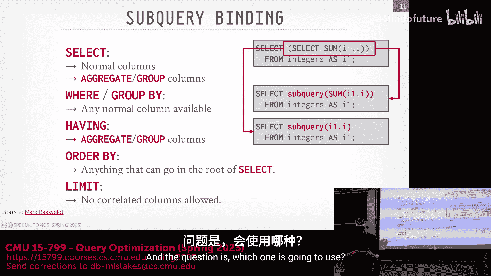
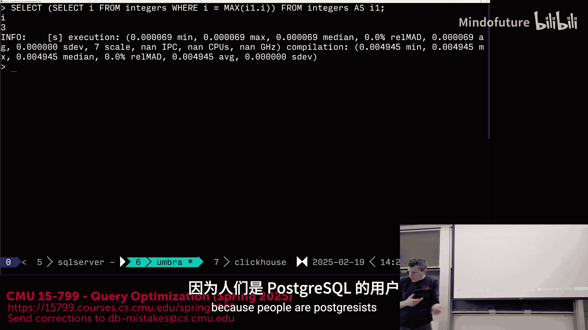
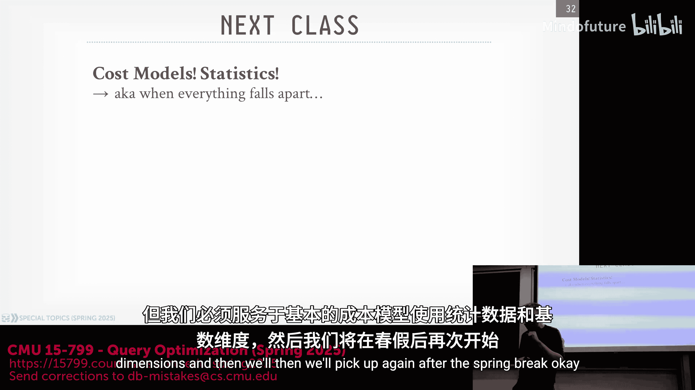
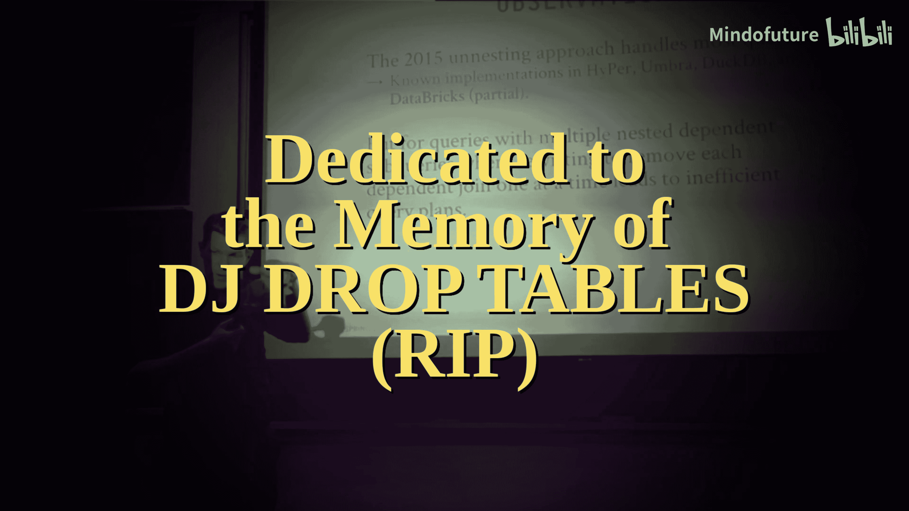

# 数据库查询优化：第11讲：子查询解嵌套 (CMU Optimize!)

在本节课中，我们将学习查询优化中一个关键且复杂的主题：子查询的解嵌套。我们将探讨如何将嵌套的子查询重写为更高效的连接操作，并介绍从早期启发式方法到现代系统性算法的演进过程。

## 概述

查询优化器在生成高效执行计划时，需要处理各种复杂的查询结构，其中嵌套子查询是一个重大挑战。子查询允许在查询内部嵌入另一个查询，增加了逻辑表达的灵活性，但也给优化带来了困难。本节课我们将深入探讨子查询的类型、优化挑战以及系统性的解嵌套算法。

## 子查询类型与挑战

上一节我们介绍了查询优化器的搜索策略，本节中我们来看看一个具体的优化难题：子查询。子查询主要分为两类：非相关子查询和相关子查询。

*   **非相关子查询**：内层查询的执行不依赖于外层查询的任何属性或数据。
    *   示例：`SELECT name FROM students WHERE score = (SELECT MAX(score) FROM students)`
    *   优化简单：内层查询可以像公共表表达式（CTE）一样只执行一次，物化为临时表，然后与外层查询进行连接。

*   **相关子查询**：内层查询的执行依赖于外层查询的属性或数据。
    *   示例：`SELECT name, major FROM students s1 WHERE score = (SELECT MAX(score) FROM students s2 WHERE s1.major = s2.major)`
    *   优化复杂：最朴素的执行方式是为外层查询的每一行都执行一次内层查询，效率极低。

我们的高级目标是避免这种最坏情况，即愚蠢地为外层查询的每一行都执行内层查询。主要方法是通过重写查询，将相关子查询转换为连接操作。

## 绑定与语义歧义

在深入优化算法之前，我们需要理解查询绑定过程中的一个挑战：语义歧义。绑定是将SQL语句中的引用映射到数据库目录中对象的过程。对于子查询，不同的数据库系统可能对同一查询有不同的解释。

以下是几个展示歧义的查询示例：

*   **示例1**：`SELECT (SELECT SUM(i) FROM integers) FROM integers i1`
    *   **PostgreSQL/MySQL/SQL Server**：先计算内层聚合（SUM），结果为6，然后与外层每一行连接，产生多行结果（如6, 6, 6...）。
    *   **Oracle**：为外层每一行（i1.i）执行内层聚合（SUM(i1.i)），结果为每行自身的值（1, 2, 3...）。

*   **示例2**：`SELECT (SELECT SUM(i1.i + i2.i) FROM integers i2) FROM integers i1`
    *   此查询展示了更复杂的引用模式，不同数据库可能产生不同结果。

*   **示例3**：`SELECT * FROM integers i1 WHERE i = (SELECT MAX(i) FROM integers)`
    *   此查询需要先计算外层的MAX(i)，再用于内层过滤。

这些例子表明，在优化器中处理子查询时，绑定和语义解释是首要的挑战。大多数系统（如SQLite）采用基于启发式的重写规则，而像DuckDB和Umbra/Hyper这样的系统则采用更系统性的方法。

## 早期启发式方法

自20世纪80年代早期以来，人们提出了许多基于启发式和规则的重写方案。这些方法本质上类似于我们在本学期早期看到的Starburst中的转换规则，即识别特定模式，然后安全地进行重写。

例如，SQLite的文档中列出了大约24条不同的规则，用于判断子查询何时可以解嵌套并转换为连接。另一个著名的技术是“Magic Sets”，它通过重写查询，在FROM子句中引入一个带有额外过滤条件的表（即Magic Set），从而减少内层查询需要扫描的数据量。

微软的SQL Server采用了一套更为复杂的启发式规则，并引入了`APPLY`运算符（类似于LATERAL JOIN）。其核心思想是，如果能够将这些`APPLY`运算符转换为内连接，那么就可以应用标准的连接优化技术。

然而，启发式方法存在局限性：
1.  无法处理所有可能的嵌套场景。
2.  规则需要人工编写和维护，工程上难以持续。
3.  修改一条规则可能会破坏其他规则所依赖的假设。

从工程角度看，启发式方法可能解决了75%的问题，但并非可维护和可持续的解决方案。

## 系统性方法：依赖连接消除 (2015)

接下来，我们看看一种更系统性的方法，源自2015年的一篇论文（2025年有更新）。其核心思想是引入一个新的关系代数运算符：**依赖连接**。

*   **依赖连接**：这是一个扩展的关系代数运算符，用于表示运算符左右两侧之间存在依赖关系，对应于相关子查询。可以将其视为一个带有标记的交叉连接，用于跟踪依赖关系。
*   **算法目标**：识别执行计划中的依赖连接，并通过重写将其转换为常规的内连接，从而消除嵌套执行。

该算法（2015版）是自底向上进行的：
1.  从计划树底部开始，找到第一个依赖连接。
2.  尝试将该依赖连接下推至尽可能低的位置。
3.  在重写过程中，可能会引入**去重扫描**运算符，以确保语义正确性。
4.  当下推到底部时，将依赖连接转换为交叉连接，进而与上层的过滤条件结合，形成内连接。
5.  消除不必要的运算符（如去重扫描）。
6.  重复此过程，直到消除所有依赖连接。

**局限性**：2015年的算法一次只处理一个依赖连接。当存在多层嵌套子查询（即依赖连接嵌套）时，它可能产生次优计划，甚至无法处理某些复杂情况，因为它没有全局视图。

## 系统性方法：整体解嵌套 (2025)

针对2015年算法的局限性，2025年的新论文提出了**整体解嵌套**算法。关键区别在于，新算法是自顶向下进行的，并且能同时考虑多个依赖连接。

该算法分为两个主要阶段：

1.  **分析与标记阶段**：
    *   遍历整个逻辑执行计划，识别出所有的依赖连接。
    *   构建并维护一个称为**索引代数**的辅助数据结构。它记录了：
        *   **源操作符**：哪些操作符产生了哪些属性。
        *   **消费者**：哪些操作符使用了这些属性。
    *   这个数据结构帮助优化器理解数据在操作符之间的流向和依赖关系。

2.  **自顶向下重写阶段**：
    *   从最顶层的依赖连接开始处理。
    *   在遍历计划树时，维护一个状态栈，跟踪当前处理的依赖连接、外部引用、等价类等信息。
    *   当遇到一个依赖连接时，利用索引代数和状态信息，判断是否可以安全地进行重写。
    *   重写可能涉及：
        *   利用等价类替换列引用，消除跨分支的依赖。
        *   将依赖连接转换为常规连接。
        *   将过滤条件下推或上拉。
    *   算法会递归地处理子节点，确保在消除高层依赖连接时，已妥善处理其下层的依赖关系。

**关键优势**：通过自顶向下的方式和全局的索引代数视图，该算法能够更智能地处理多层嵌套和复杂的依赖关系，避免2015年算法可能产生的次优解。此外，该算法可以与成本模型结合，在多种可行的重写路径中做出更优选择。

**实现前提**：该算法要求查询优化器能够将执行计划表示为**有向无环图**，而不仅仅是树，以便重用子计划并清晰表达数据流。Umbra/Hyper等系统支持这种表示。

## 总结

本节课我们一起学习了查询优化中关于子查询解嵌套的核心内容。

我们首先区分了非相关子查询和相关子查询，并明确了将相关子查询重写为连接操作的核心优化目标。接着，我们探讨了子查询绑定中可能出现的语义歧义问题，这是优化器需要面对的现实挑战。

然后，我们回顾了早期基于启发式规则的方法，虽然实用但存在覆盖不全和难以维护的缺点。之后，我们深入分析了两种系统性的解嵌套算法：2015年的自底向上“依赖连接消除”算法，以及2025年改进的自顶向下“整体解嵌套”算法。后者通过引入索引代数和有向无环图计划表示，能够更有效地处理复杂的多层嵌套子查询。

子查询优化是一个极具挑战性的领域，目前只有少数先进的数据库系统（如Umbra）完整实现了这些最新的系统性算法。理解这些原理对于构建或深度使用高性能数据库系统至关重要。

从下一节课开始，我们将进入查询优化的另一个核心模块：成本模型。我们将探讨优化器如何估算不同执行计划的代价，并理解当前成本模型存在的局限性，为后续学习自适应优化技术打下基础。