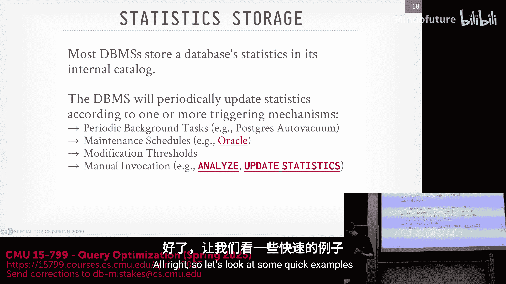
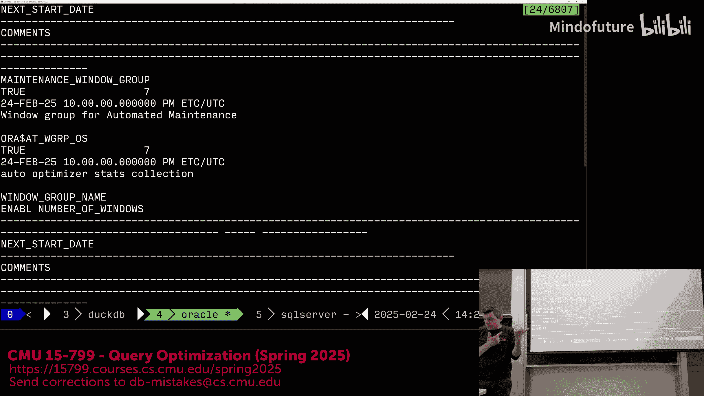
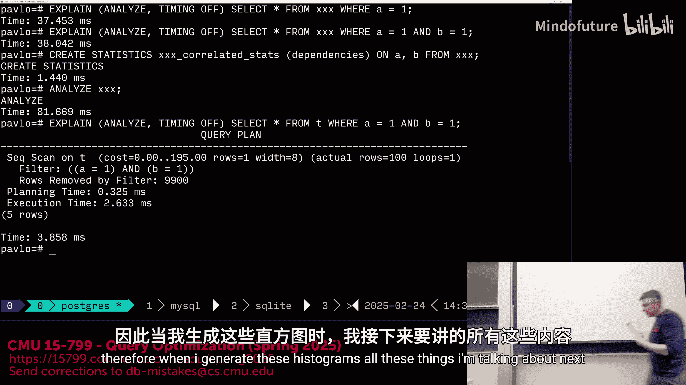
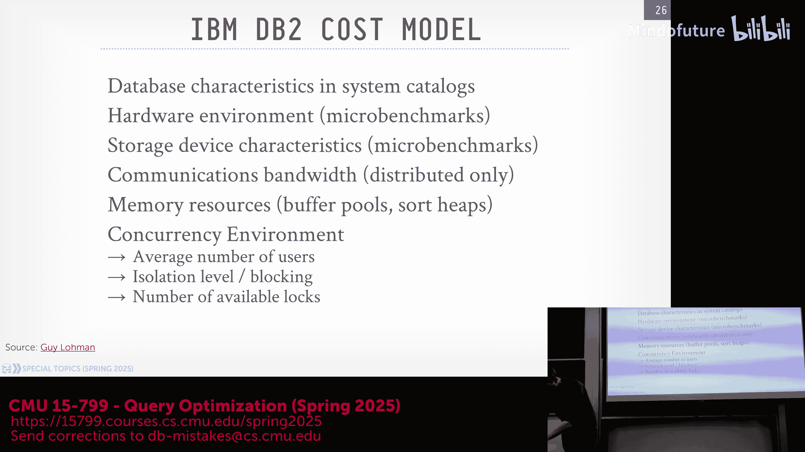
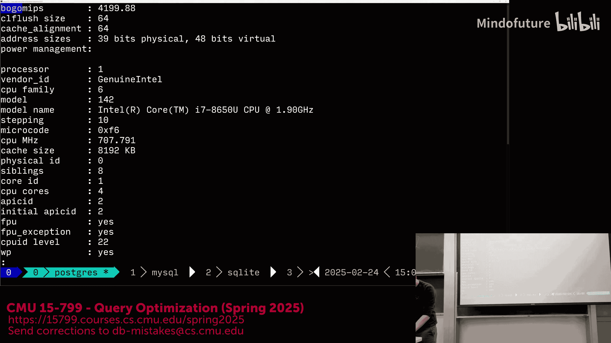
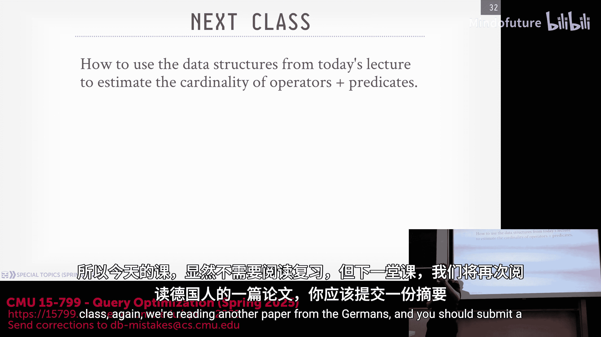
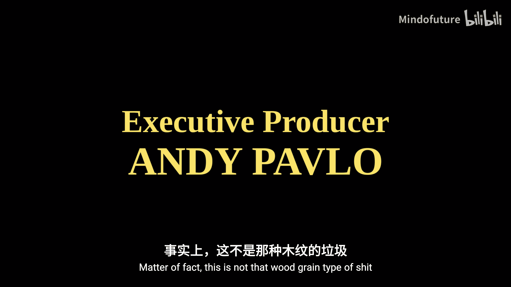
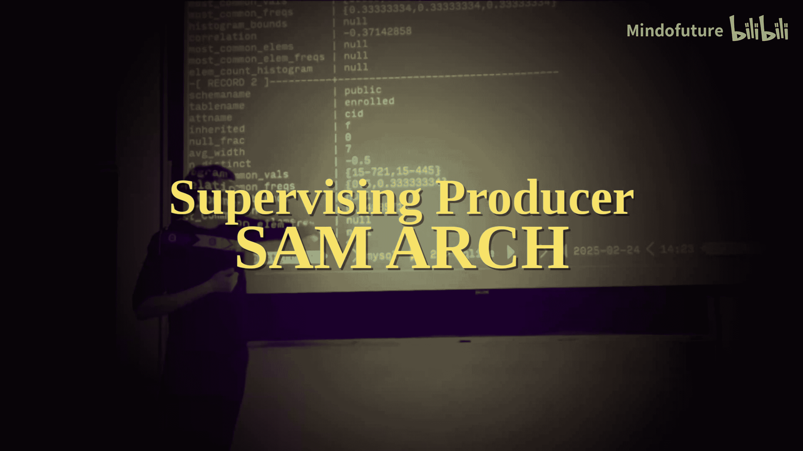

# 【卡内基梅隆---中英】数据库专题：查询优化-CMU-15-799--(2025-年春季)-p12-P12-#12---Query-Cost-Models---Statistics-(CMU-Optimize!)--BV1wDE9z9EfK_p12-

あ。🎼おって見せ。🎼A journey drove that Taas carry up the message。

This course is filmed on location at Carmicgie Mellon University in front of a life studio audiences。

我。Right。So today we're going to， as I said， begin the journey of like discussing。

We know how to now build the either top down or bottoms up query optimizer we know what basic algorithms applied to do transformations but now the main thing we need to know about is okay how we're actually do those cost estimations to guide the search so that's what the next couple of lectures will we'll focus on so before we get to that I'd remind project one is we do this Friday excuse the 28th post some piazza people have done if you have any questions some of those submissions have been pretty impressive what people have done like copying up the Calalite code that doesn't do what you wanted to do with the modifying and putting back in so anythings on the table for project two I know I was going to sit I was last week I was gonna to follow people about signing them the topics behind on that we would try to get that today but I'll be around during spring break if you want to discuss the plans for your project or what your proposal presentation should look like on the Monday coming back after。

Spring break next week， so in two weeks， so any questions about project one。

 any questions about project two。So we're ready aside today。

We have like this week to make a presentation we present on the call。

Next week's spring break so we could also spring break that was assumed that's grad school our year still undergrad。

Yeah， we hurt legally at kids。University policy says you're not supposed to do something spring break but。

Again， the proposal supposed be five minute presentation。

 which is the there is a you want to write up like what you're actually going to do。

 it's it's better to sort of plan things ahead of time so you know what you're getting into and not just。

😡，Seeing like， oh， we're going to fork orca and make all these big changes and it's going to be a nightmare so think it through first I had a question about Project one。

 project two。All right for the database talks， we actually slight change in the schedule so today we still have the Pot people coming talk about the query Opr and what the focus in their talk is going to be about how they actually support two different query languages I think promQLs a query language for Prometheus and I think also they're supporting SQL but do time series analysis and how they can convert them into the same sort of relational algebra and have a single query optimizer handle that then we had spring break and had something scheduled for that that got bumped and then we come back from spring break on the Monday。

We'll have somebody from Google research give a talk about this paper they wrote in last year about adding basically things look like pipe semantics or it was like data frame API to SQL and they have it in in their Google SQL App。

 it's obviously meant to be more general but as far as they know nobody's adopting this technique Time scale Db has something that looks a little bit similar to this。

 but it's not exactly the same。 So they'll talk again。

 this would be an extension to SQL then the Maloy guy is going to give a talk the following week that would actually with schedule for next week that got bumped after two weeks after spring break and this is where he had a startup called Look or M got bought by Google if they had this new query language that transpounded into SQL called Maloy he's now at Facebook meta and he's still working on that project So he'll talk about that again this is an example it's a veneer on top of SQL that then gets transpoed down into SQL。

Right。All right， so last class。We went through what I consider one of the important papers in the last decade for query optimization there's a lot of papers on MLt we'll cover later in the semester。

 but like this is just straight up algorithm do un nestesting of arbitrary correlated subqueries which has been something that people in trying to do for 4050 years since the early 1980s and with NI success and so this paper is like the paper guys read and actually the one the precursor to it are what I consider to be the definitive guides on how to handle this in a query optimizer to convert all the correlated subqueries into innerjoins or with additional operators to get really great performance and so again if you're building a query optimizer today which we are that paper is the goto guide on't how to do this and it's compatible with a top down and a bottoms up optimizer。

But again， very few systems actually do this。All right， so as I said。

 the we're at now in this point in the semester is。Now we need to have a search algorithm。

 a search engine that can take a SQL query and start enumerating different possibilities for the plans and in somewhat of an efficient manner and within the constraints that the SQL query is specifying either through the schema or the query itself。

 and then now we need to be able to determine is one plan going be better than another plan。😡。

And this can be done through the cost mode， so it's like it's an estimation of what would be the physical cost of actually executing that query for a given database state。

😡，The database statement can be defined based on the hardware on the contents of the database。

 like what's actually inside the table， the distribution of values and so forth。

 some ways it could also be tied to the configuration， but we can ignore that。

 but at the end of the day it's a way where it's say this plan we think is better for this other plan or even this operator or subplan is better than another operator or subplan。

And that way， we can choose that one， the better one rather than the one we think is worse。

So this is an eternal cost， it's not something that's tied to the outside world。

 there have been attempts to take the estimations that optimize makes inside the query cost model and then be able to map that to like real wall clock time say hey。

 this query is actually going to take you an hour or 20 minutes or something like that that has been shown to be a very difficult problem then there's been sort of a simplification of that is say okay well I can't predict how long a query is going to take but if I know if it's been running for so many minutes or seconds don now at least how far long I am to finishing like try to percentage completion。

 that has mixed results here that's very difficult but again we can ignore that we care about just saying is this plan better than another plan。

Right and this sort of goes without saying too that the cost models for various different database systems are going to be completely incompatible with each other。

 I mean you can't take a query plan know cost estimate from Postgres and try to compare that with any kind of query cost estimate from MySQL Postgres and so forth。

 some logical things like the estimated cardinality of an operator that has obviously compatible。

 but whenever number Postgres fits out， that's Postgres number， you can't use that for other systems。

😡，Right。And again， as we said in the beginning， the reason why we're going to have to do these estimations using a cost model is that it's simply going to be too expensive for us to just run all the query plans。

And figure out when which ones actually going be the best。

 or even just run individual operators and figure out which ones are gonna to be the best。

And we'll see the way Mongo does this later on， but in general。

 most systems can't actually run queries of get estimates。

So there's be two components for our cost model。😡，The first are the physical cost and then the second it will be the logic cost。

 So the physical cost are going to be the。What the end of the day。

 what will be the in the cost estimate for a query plan and it's going to be。

How much hardware is the query plan going to consume when it actually executes that particular plan and so it can be a combination of the CPU time。

 any kind of IO either a disk or the network how much memory we' be consuming to build whatever data structures we need or stage intermediate results as we run the query plan some cases nobody actually does this。

 but there's been papers that actually predict， well what percentage of the data is this query going to access will be inside the buffer pool so I know I'm actually not going have to go back to the disk could go fetch things？

and obviously that's really that one's really challenging do because the time the time in which you're optimizing a query and generating the plan may be completely different than when you're actually running the query。

 so any estimates you would make what's in the Buff pool you know a half an hour ago are clearly useless。

Even 10 seconds ago， it potentially useless， right？

So these estimates for the physical cost these obviously going to be tied to the physical implications of the operator。

 like if I know I'm doing a hash join I'm going to build a hash table。

 okay so in that case I can estimate how much memory I'm going to have to use to build that hash table。

'm can also estimate what the accuracy rate will be of the hash table。

 so therefore is it a giant hash table where therefore I'm always do01 lookups or as most of them going to be ON。

😡，and we'll talk a little bit at the end and the class today。

Obviously these things are we're trying to tie this to wall clock times so we're trying to say like oh to do one diskIO。

 that's going to be 50 milliseconds or 500 milliseconds depending it's on the cloud or not right and so coming up with the constant weights for these different hardware resources is a really tricky problem and in some systems we'll see later in today's class。

😡，They'll actually run some kind of benchmarks to figure out what are the values for these things。

 whereas Postgres it relies on you to tell these how much does the CPU costs versus disk IO cost。

 but the high end systems will try to figure this out for you。😡。

Then there's this notion of a the logical cost and the idea here is that just like before when we had the logical operators and the physical operators。

 the logical operator represents the high level task that we're trying to perform like a join。

 and it's not specifying what the implementation or the algorithm' going to use to compute that join。

 so therefore the logical costs are independent of the actual the physical algorithm。

 the physical operator。😡，And so the most common thing is going to be。

 the most important one is going to be， and the whole next class will be in this exact problem of how to estimate how much data is going to be coming into my operator。

 and how much data is to be coming out of my operator。😡，And this would be cardinality estimation。

 and again， this is what we'll discuss on Wednesday this week。All right again， think about this。

 if I'm doing a certainrs join versus a hash join， the join predicate still going me the same。

RightFor either these physical operators and therefore the number of tus that are going be filtered or not filtered coming out of that operator will be the same regardless。

 And again， that's why it's a logical cost and we can compute this without having to know what the physical imation is going to be。

In some cases， we also can compute things like how wide are the tuupples going to be like how many columns per tuple？

And you can start doing this， you know you could use this decide whether you want need like projection push down or you're doing late early materialization if two those are really wide。

 maybe you don't want to pass all them up through the operators。😡。

Because you justre copying useless data and therefore we want to push down a projection or something right。

 but in general， the one we care about mostly is this one right this one you can derive。

If they're fixed length things like ins are easy to do。

 if they're from if you're coming from like text columns then you got to look at like what's the distribution of the length of the strings and then you have to get that from statistics we care about this one and obviously if we have this then that's essentially how we're computing this。

Right， so again， if I'm doing a scan and I'm trying to estimate， okay。

 how many twopo am I have to scan spit out。 Well， I can just go say go look in the catalog and say。

 well， how many pages。How many pages is this table occupying。

 therefore I know that's the number of things I'm going to have to scan。

 the number of pages I' going to have to scan， and then I can multipied that by whatever my weight factor is for doing diso。

How to handle S over versus random， that becomes more tricky， right， obviously。Um， but again。

 the idea is like you figure this out and then you have some constant weights that you u for your formulas up here to tell you。

 okay， how to convert this into this。😡，Lodical cost we've already seen before。

 we saw this when we were talking about the branch of bound search， we do predicted cost bounding。

 like we were using logical costs and say we expect to get X number tuples out from the operator below and therefore I could decide to cut off exploration of that branch going down if I didn't think it was actually going to be fruitful。

Logical calls are basically also the same thing for promises as well right it's helping you decide I think that this operator is going to generate a lot more tus and therefore I should explore what the best way to optimize that is first versus something like it's going to read one twople or 10 twos。

You want to spend time you want to spend more time exploring the different physical operator choices you have for the operators you expect to have the highest logical cost therefore you would get the most benefit if you figure out the best operator implementation for it right but I just point out that like well。

You know people may think， oh， if it's the logical cost。

 that's going way cheaper to calculate than the physical cost costs right the physical cost I wasm saying is accommodation combination of all these things。

 and I'm saying the logical cost is just like oh the car down estimation。

 the car down estimation right that you're going use for the logical cost。

 that's actually the most expensive thing to do。Because that's again looking up in the statistics catalog。

 which we' talk about in a second and then imping some formula on whatever data structures you maintain for for the data summarizations from the tables。

 that's the expensive part plugging chugging a bunch of constant factors in based on the number two I expect coming out that's relatively cheap。

 that's easy math。 It's deriving the logical cost is actually the most expensive thing。

There's also more that。The logical cause。Here， statement is。呃。

I is the conversion of logical to physical appear to that introduce additional inaccuracies Yes so this whole this is my parting thoughts for the today's class。

 this is all house of cards we're building approximations on top of approximations we making other assumptions about the data it's all a way to simplify the problem because you can't actually go run things for real so to to your point yes。

 these weighting factors if it's Postgres and I'm punching in some numbers myself。

 yeah that's going to be problematic even if it's like oracle DB2 trying to drive these as well。

 like that harbors you never deterministic and always have the same performance for everything the same time。

Because there's so many different caches and things like that， different levels of extraction。

 So yes， so this is an approximation， this is an approximation。

 So we're approximating this by taking this approximation。😊，Yes， it's all mess。But again。

 there's no magic wand to get this。Okay， all right， so today I want to to talk a quick background of。

what does it mean to maintain statistics inside of a database system that were going to been used for the optimizer to make Carinality estimations and other cost estimations right it's really about understanding what the data structure what data structures are going to maintain how we're going to generate them to then feed into later parts or next lecture so we talk about the three main categories。

 histogram sketches and sampling and then we'll briefly talk about what real world implementation actually look like at least for the open source ones that we can see right again the idea is that we talk about these data structures today and then next class we talk about how to derive the cardinality estimations from the data structures。

So when someone says they have the statistics in their database system basically means the data structures that the data system maintain that are going to summarize what the real database looks like right and there's a bunch of different choices as it is said。

 like up choices of what data structure you want to use， but even within the data structure choice。

 there's a bunch of decisions we can make about how much space to allocate for that data structure。

 how aggressively we want to be in updating it， there's data structures when our data changes when new data arrives right？

And so the things we got to consider is。How much accuracy do we care about。

 can we even quantify what that the confidence intervals might be for the data structure we're using how efficient it is to maintain it and update it and keep track of things how much memory we're gonna have to maintain for this again even though we are destroyed this in our our statistics is like a regular table in our catalog get written out the disk like any any other data in order to use this information we got to fetch it back into our buffer pool and then extract the information we need to do our cost estimations so if our database is one gigaby but our statistics or 10 gigys that's not a good tradeoff because that's not taking it's memory pressure in the system that could have been used for。

For running queries， but instead you're maintaining statistics。

How well how good the coverage of the applicability of the data structure is going to matter a lot as well。

 right like some data structures will see enampment or for the hyperlog log。

 it can only tell you the number of distinct elements you have。😡。

But I can't do any additional filtering beyond that。

 like can't tell you things like the number of same elements I have that are with values within this exact range or for values that the end of the letter ABC going to give you sort of coar grain approximations and so we'll see the fallback the fallback data structure everyone's going to rely on is going to be the histograms because those you can handle pretty much any query preddicate you may deal with。

 but the other ones are going to be for certain cases will be much much better。And then of course。

 as I said， how are we actually going to build these things。

 when do we actually build them and how do we maintain them？So as I said。

 the data system basically stored statistics with most systems will store statistics just in its internal catalog where it keeps track of the metadata about here's the tables I have。

 here's the columns I have， here's the types and so forth right like PG catalog if you're want Postgres or an information schema in some systems and these are just tables that are sort like any other tables。

There is little magic to them because you're basically。

 they have to be been be the ca has to be bootstrapped。 like you can't have。😊。

If you need to know what if you need a catalog to put anything in the catalog。

 you obviously need a catalog So look at this weird circular appy。

 So a lot of times the statistics and the catalog are sort of bootstpped with hard coded commands and then everything else just insert them like regular twos。

 right。So again， we're going show this in our database， we can look at that in a second。

 we'll look as I can posts in other systems。And then there will be some mechanism that the system is going to have to decide when it actually either wants to create them or update them。

😡，In the case of something like Postgress， they had this thing the auto vacuum especially the garbage collectover cleans up the old multiversion tus。

 so they just piggyback off of that so when the vacuum runs。

 theyll actually then recompfuse statistics on a block by block basis and keep track of which ones have been updated since the lesson in they pass which put things that get updated further。

 right？Some systems like Oracle have a fixed schedule， you can adjust when it occurs。

 but basically in Oracle I think by default， every night at 10 pm this UTC time whatever your time zone you're in at 10 pm by default。

 it fires up and just starts scanning all the data and compute statisticss updates all the internal catalog information Oracle does other cool things like figure out what queries are bad。

 maybe run them through the optimizer again and then try to come up with better query plans and the background so that when you run them again has a better plan for you。

 right？😡，Obviously most systems will have a modification threshold to say if my Ive updated 20% of the data in my table。

 I'm going to sue my statistics are out of date and therefore that triggers a a rebo to the statistics and then of course the backup choice would be there do manual invocation where some administrator some user can then fire off command and Postgds' analyzed。

 I forget what the SQL standard says but like SQL server。

 I think Oracle you call update statistics and that forces it to then scan all the information to update the repopulate is statistics in the catalog。

😡。

All right， so let's look at some quick examples。And again。

 the catalogs are just tus right like they're just regular data that obviously have this special meaning because it's being used for for statistical information。

 but you can just go look at it and see。You know see what's actually in them， so let's use Postgress。

嗯。So Postgs has this table， it's a view， it has PG stats， and there's P statistics。

 PG stats is just a view on top of PG statistics， but I can go and say select star from PG stats where cable name equals enrolled。

Right， and actually got nothing which surprised me when the first time I ran this because I was like。

 wait a minute， this table exists。 There's something in it， right， I can do select star。

From enrolled。And there's data in it， but there's nothing in my statistics， so I can force it。

If I run analyze and then pass in the name and rolled。

 that runs takes eight milliseconds because there's only six rows in it。

 and then now when I go back into PG stats，That's hard to read and me fix that。

Right now I want I go back in PG stats and I get all the records there for this table。

 now you start to see what the is going to be maintaining for every column in the table right so you see。

The top says schema name public and then the table name is enrolled and then the attribute name is the column name。

 SID， student ID， and then here's course ID， and then so Postgres。

 what's about hisograms at a second， Postgres is going to maintain an equid histogram where it basically groups up the ranges of values that are going to have basically the same total count number elements it it'll maintain that data structure for histogram they can see where is it。

It's common values I with。嗯。TheHisogram bounds is null。go down here for this one。

 We have to look at a better example。 Yeah， hisogramms are not， Maybe because it's so small。

 it doesn't do anything。 But you hear you have the most common values and this common frequencies。

 So this will be like the the end bias history Im must see in a second。

 saying157 21 is most common and then 1545 is is the the next exp come1 right， And again。

 if I go look at the schema of P G stats。There's nothing fancy about it， right。

 The histograms are just as， the most common values are just arrays。

 any array means it's an unknown type at the time you're putting things in。 All right。

 it's just tuples with a arrays。And the optimizer knows how to interpret those tus and there's as to say。

 oh， I knows the histogram， who knows how to read the values， read the other attributectors。

 and get the information that it needs。Let's look at more。So this is the database from DBDIO。

 the database of databases。But I just want to show a more busy table。Right。

 so now this is what a real table would look like now you have history and bounds。

 doesn't have the mis values just scrolling down this thing is huge， right。

Right here's what either these are timestamps so it's keeping track the hisogram balance both Ri values is useless because there's timestamps they would never never be the same。

 So there is some logic where postgressreors trying to figure out， oh。

 I don't see a lot of different values， therefore I don't need to maintain maybe the full histogram or I'm seeing nothing but completely different values。

 therefore I don't keep track of one of the most common values like the heavy hitters。

But I will point out， Postas is maintaining stats for everything。 right， for scrolling down here。

 I have certain things like， here's much people's names。 and they're always going to be unique。

 or here's the。RightHere's a bunch of logos for the various database systems that are keeping track of the URLs in the database like I'm never gonna run a query。

 select star from table where I'm looking for this information like someone the logo。

 they maybe I am but assuming I'm not but since Postgres doesn't know what queries you're going to execute。

 it still maintains everything in some systems they will actually watch what queries you're running and they figure oh I see you care about this table and this column so therefore let me go get the statistics that you're going to need later on。

😡，All right， so quickly this bump to the other ones， so we can do My SQL。😊。

I wasn't able to figure out how to get good information out of my SQL。

 but they had this thing called information information schema。

t statisticsistics and it's basically you can see what metadata they're maintaining about every different columns in this table so there's a student ID and the course ID and then you can see things like it's keeping track of the cardinality whether it's nullable or not the histograms in there somewhere I' been be able to find it。

😊，We can go to SQL Ser。So SQL server has this command。Thanks to Chat GBT called DBCC Show Staistics。

And you get nice information of like here's where it keeps track of the Cys。

 here's the last time I was updated， here's the average length of the data I' being stored in that column。

 and then within the column here's the values， the number of values that match up。

 this is basically the histogram right here， right？Again。

 it might be sortoring some additional more sophisticated things underneath the covers。

 but as far as it can tell， well back， I don't know whether they're storing this as regular tuples like Postgres does。

 and whether this is just a view on top of whatever internal data structures are because I don because obviously I ran some command that maybe this got translated to a SQL query。

 I don't know， but again it's basically maintaining similar things to Postgres。

The last one I'm going to show is this oracle。 I don't know how to get the stats out of that。

 but I just want to show you this scheduling thing they have。

Right so they have DBA scheduler window groups， so this is all the maintenance tasks thatll execute on the nightly Kron job automatically for you。

 so here it's going to run whatever the 24th is that today。Yeah。

 so today is going to run at 10 PMm UTC， which is what now 2 PMm。

 but the things that's going to run for you is the tuning advisor right they tell you where you have crappy queries and then here's somewhere。

You should run the。Yep， auto optimizer stats question。

 so to run basically analyze automatically for you does this every day。

that's oftentimes when people we have crappy queries' like， why is my query so slow， oh。

 it's because you have bass statisticss。Right。So what I'm trying to say here is there isn't。

There's nothing magical about these statisticss。All these data structures we're talking about today。

 we can just chuck in tus in our catalog， there's nothing special about them。😡。

All right。As I said， most data systems will create single column statistics for each comment of table when you when you first set up the table and putting data into it and other systems will wait to see what a ques you're actually going to run first。

 but in general it'll maintain。😡，What are called single column statistics。

 so basically for one column， here's the information I need to know about it。😡。

The challenge is going to be， and we'll see you more in this next class is that。

Sometimes you want to know whether columns are correlated。Right zip code and city and for addresses。

 that's definitely coordinate right， know， zip code can if for a given city。

 you're going to be in know one zip code。So in some cases， the data system。

I can I don't think any system tries to figure this out for you。

 you definitely to I know you can tell it， but you basically would to call it column group statistics or correlated statistics。

 where you basically can build multi columnlum statistics。

 I think they have to be in the same table so that when a query shows up that maybe references both columns in the where clause instead of looking at the single column statistics for each of those columns1 by one and making assumptions about the relationship。

 I go look at that multi columnlum statistics I've generated and I can get better estimates。😡。

So let's a do quick example of that in Postgs， PostGres has this。😊。

S me pop out of this。So。So I'll create a simple table。X X X。嗯。And I'm going to put in。

P putut a million peoples in。So what's going to be is I'm going to put a million tus in where the the first tule is going to be whatever this you know value1 to a million and then the the。

Actually， both of them are going to be values one a million， but I'm going to modify 100。

So in this case here， the values for the first column and the second column are going to be exactly the same。

 and then within the distribution from one to million。

 it's going to be repeated for every 100 values， right？So if I now go to my。

And go see how much data I actually have now。Right， there's nothing in here。 That sucks。

Because I don't think it actually ran anything yet， right？

So I run analyze on it now I go back right now I have some statistics about what's it So in this case here。

 even though I just inserted the million twoupples。

 Postgres didn't update its catalog and say here's how much data actually have it's only until I go run analyze then it actually does it。

Right。If I do that query I did before with PT statistics。嗯。Right now you can see that， you know。

 it put now it populated the， the hisogramms of bunch of information。 that's good。 Okay， so now。

 though， if I run a query that。Just looks at one attribute。 say is a equals one。

 So here I'm running explained， but then you pass a flag and say analyze what is actually going to run the query and then the timing opt just produces gets rid of the timing information for each operator right And so now here you see that。

😡，你你你。So， the estimate is that it's going to remove- it's going to generate 4，695 tuples。

 but it actually generated 333。RightAnd then you have the estimate four the number of rows removed by the filter。

 All right， so that's fine because it's in the single column it could use the single column statistics。

 But now if I do a conjunction query where a equals 1 and B equals1。

 which are going to be the same because again remember when I insert then， there's the same values。

When I run this now you see that the number of twoples I'm going to expect to filter their way is way higher than what I think is going to be because it's assuming that these two clauses are independent。

 a equals 1 b equals1， so it says okay well the distribution of this。

 the probability that something can be selected by this and this are independent。

 therefore I can multiply them together and get what I think is going to be the the true selectivity of the predicate。

😡，Right。But now， if I go back and。I can actually create statistics。In Postgres。

 so this is saying create statistics called poorlate stats by the name on the table dependencies。

 and I'm telling I wanted the B or on columns A and column B in Xxx。😊，Right。So that builds that。

 but I don't think it actually generates anything so I' got to run analyze。So we're good there。

 So then now when I do explain again on that same query。

Now you see that the estimates are more accurate because now it knows that these things are correlated using those correlated statistics。

 and then I get the true selectivity and not be the sort of overzealous one I'm underestimating the number twos I'm going to admit and this one is actually more accurate。

Right。So again， you're able to say that these two columns are going to be used together off in queries。

 therefore when I generate these histograms， all these things I'm talk about next。😡。

Based it on both of those columns， not just one by itself。Okay。

So how can we summarize things again this is what book the chapter in the book you guys read today。

 there' obviously could be histograms， the classical approach in database systems， sketches。

 or be these newer probabilistic data structures that can give approximations for different types of queries。

😡，Sampling will be a way to basically get a subset of the base tables I'm trying to scan in my query。

😡，either get that subset by looking at the data itself or maintaining a little reservoir on the side with the information。

 and then now I compute my estimations based on that sample。

 and then the last one will be machine learning models with sort of magic way to estimate this activityivity in predicates by extracting some kind of summarization in some kind of known or model later on。

So the most common one obviously going to be histograms。

 sketches are becoming more common these days， most the major systems are going to use some combination of these sampling is still very rare。

 SQL server does it， I don't think anybody else does， at least I'm not aware of anybody。😡。

And then machine learning models we'll read some research papers on this。I it's so as you know。

 it's still， its use is very， very， very limited。And certainly not to replace histograms and other structures yet。

Not to saying that it can， just saying that we're not there yet。All right。

 so histograms and this should be somewhat review from the intro class。

 but again it's a way to just approximate the distribution of the values that we have in a column or multiple columns that we can then use for cardal estimates so say this is that this is the distribution of values we have and then for every single time I see the value again I increase the counter by one and obviously the downside is going to be if I maintain this exact histogram like this for columns like an incrementing a serialre of column where just every primary key or every value is going to be unique and out of one as you insert things then maintaining this be super wasteful because。

Now for every single value I have and a billion tuple table。

 I have data structure that keeps track of like， oh， I've seen it once。

So for small data sets and exact count， historyM might be okay。

 but for obviously for the more general case of larger data sets， this is not going to work。😡。

And that's why you see it in way to。In these additional data structure， the district grams。

 it's basically compressing down。The exact values of restoring in exchange for a loss of accuracy。

So the first approach would be to do equid with histograms。

 and the idea here is that instead of certain exact counts for every single individual value that we have。

 we're just going to group them together in equal sized buckets。

Just take the number of unique keys divided by some whole number。

 and then now within for each of these buckets， I'm just going to add together the individual count all the keys in that bucket and then represent that now in my histogram。

😡，So again， now I'm compressing the of data I have to store in my histogram for each because since it's now only one count per bucket。

 but obviously now I have to approximate make some guesstimate about what the distribution of value is going to be within that bucket and the simplest thing to do is just the number of keys I have in a bucket divide the count by the number of keys that I have and assume that each key occurs。

😡，Occurs the same。Which obviously we know instute workloads， real workloads is not going be the case。

So a better approach is to do what's called an equid histograms and this is the most common one。

 Postgres uses this SQL server uses this。😊，Where you basically instead of having fixed length or fixed number of elements per bucket。

 you're going to vary the number of keys you have in the bucket so that and all you really care about is that the count or the population of the bucket is going to be the same across all the buckets so in this case here the first bucket I'm going go through one through five。

 the count will be 12， but in the second bucket it's 678。

 so only three elements versus five elements here but the count are the same。

So I'm still going to do that trick where I just take whatever the count is。

Within within one bucket and divided by the number of keys that I have in the bucket。

 at least now I'm getting a bit more accurate of those estimations than I would have in the equith form。

 right？😡，And the research shows that the echode histograms have better error rates than the E histograms。

Right。Sorry question number no yes， Does't this cause a problem like like like if you wantt analyze。

 obviously when you do the analysis， you get the right answer。

 but it's like I'm inserting two goals into a database and have。有有最后。

We' competing it before everything。Obviously if you add to change the skill。So his question is。

How's this actually being maintained？Like am I， if I'm inserting new tus？Do what you know is。

You know， if I'm starting new twoups and say I'm starting a bunch of you know threes and also sudden this count is gonna spike up。

 And now the the height of this thing doesn't match anyway else。 What do you do So again。

 you let it be wrongish for a while。 And then at some point， you say， oh， well。

 the data has changed so much。 I know I it need to recompute this。

 Another way to handle this would also be。You and the Postgcre doesn't do this。

 you could partition this data structure on ranges of blocks or pages so you would say。

 okay the first 100 pages here's the hisogram for that for the next100 pages here's the histogram for that and if most of your action。

 the new updates are happening in the latter half of the pages。

 it doesn't change affect the old one now how do you then combine the histograms and then that merging back together thatll produce incorrect estimates。

 at least in that case here you're sort of isolating the damage if you will the inaccuracy to some portion of the histogram space。

Okay， again， this is the most common one。 And then the the the。

It's usually combined with what are called heavyer data structures or end bias histograms。

 where you basically identify what are the keys that occur the most often。

 and therefore I'm more likely to query against them or know that these。

Frequently occurring keys are going to have the most effect on the distribution or the cardinality of my operators when I'm executing things so instead of trying to lump them in with all the other values you say these guys are special because they occur the most so I'm actually going to maintain exact counts for those keys that occur the most。

And then everyone else sort of gets lumped into this R bucket here。

 we just take whatever the average count was for all of them inside back。Again。

 we saw that in Postgress， they didn't actually maintain this R piece here。

 but they had a separate list of the heavy hitters。Right。Just without this so they had this。

 but without without this step over here。And again。

 the idea is most you assume that these keys occurring the most。

 therefore are going to be used the most in queries。😡，m， and therefore。

 it's I'm going to have as now because I all'll know the exact count of these things。

Not it doesn't tell you where these things actually are going to appear in your table by thelational models is unordered。

 assuming we're not doing cluster tables，😡，There's。

This is just telling you that this thing is going to exist in your table or in your data set for this given column。

 you can't actually tell you where it would exist because in some cases if you knew where it was，😡。

You could be a bit more strategic about deciding where to start scanning things if you're doing a special scan。

 but these data structuress don't have a new app。哎。

So next category of data structures are sketches and these are going to be similar to the histograms where there are approximations of what the actual data looks like。

 but they're going to be probabilistic data structures that exploit some some aspect of information theory that allows us to producing further how much data we actually have to store in these data structures。

 but exchange is going to be the will get worse。sorry is。

 we won't get the full expressiveness and capabilities or applicability of histograms or all possible queries。

 like these have to be very narrowly used for exact questions。

 like how many keys exist in my total table， but it won't be able but these end will be more accurate than histograms much easier to use。

😡，So the， I think probably I mean， B filter is an example of this。

 although it's not exactly the same just it's a filter to tell you whether something exists or not。

That's an example of something you can use with this。

 but obviously you know if you're trying to do a lookup like you know where ID equals something。

You could use a balloon filterer for that， but you couldn't use it for like Id less than something。

 because it has no notion of order in what it's storing。

So countmin sketchtes are basically counting bloom filters。

 hybrid log log are super common to the count emergency elements。

 some systems like RedDis who actually VolT will expose this to you can say create a hybrid log log for me。

 Postcodes has an extension to do this and that's like so it's not for statistics internally for the query optimizers for the application you can get directly to a hybrid log log。

There's a bunch of OStim probably the most famous one is Apache data sketches it originally started off in Java and then since then it's been expanded to now be in I think C plus+ or C I think they have Python versions of these things Google Ziaketch has a optimized version of the hyperlo log this was supposed to be a counter alternative to this the last update was like three years ago as far as I think it's dead but data sketches is probably the most common one if you want to use something get started here right。

And it's pretty baller。 if you go go to the homepage。 they have this quote here。

 a truly excellent example of theoretically informed algorithm engineering。 Graham commode。

 That's the guy they invented accountman sketch。 like that's how you you're bad as professor of like you're being quoted on something you actually didn't write at the very top So that's impressive because again。

 they have imations of accountman sketch inside this。😊。

I think he was a professor in the UK he might be at Facebook now or meta now all right so Countman sketchtch can think of this just as an accounting bloom filter where we're going to have this multiventional array。

 we're going to keep track of counters and then we're going to increment every single time some key exists so think of like as I'm inserting data or if I'm running analyze is just a sequential scan that's updates these sketches or these summarizations as I see every single key within a column I'm going to go insert it into my data structure or my countman sketch。

😊，So to say I'm inserting ODB。I'm gonna have a hash function in that corresponds to each sort of row within my array。

 And then for each of these I'm just gonna modify by the number of bits I want to maintain in my array going long horizontally。

 So the first case here， I end up withh hashing mod 8 equals 6， then it ends up here。

 And then so I just go into that cell and just increment。

 whatever the value is by one So they're all zero is here。 So I'm gonna add1 to it。

And I did the same thing for all the other ones， right？So again， as I'm scanning data。😡。

I'm doing this hashing and updating this sketch。Then now inside the query optimizeomizer。

 assuming you think it's popular with much all the stuff now for my query optimizeoms， I want to say。

 okay， how often does this key occur？And again， think， we'll see this in this class。 But like。

 think of like。If I know I'm doing a join on a column and in the where cause it says like where name equals ODB。

 I want to know how many tubups I expect to come out of the right side and left side of the join because it's going to help me determine the ordering of the join。

So I'll just basically do the reverse what I did before， take the four hash functions， has mod by8。

 that's going to point to a bunch of different cells。

 and then now I just take whatever the minimum value is for whatever cell I'm pointing to and that's going to give me the approximation of this particular key here。

😡，Right？Again， it's it's。It's not a false positive like you could have in a balloon filter because that's like a set membership does something exists true or false。

 this is like an approximation of how many times you've seen a given key。In in the sketch here。

 and it could be wrong， but at least give us an upper bound for the maximum number of times we expect to see this。

 so I know that for this given key， I'm not going to have seen it more than two times。

 I might have seen it less than two times right because somebody else might have hash to the same cell updated the counter from one to two。

 which is a different key， but at least I know I'm not going to see some higher number。喂。Again。

 this is gonna be helpful when I， when I want to do card analysis space for joins。

 because now assuming I have， you know。Assuming I have the predicate of what the key I being passed in。

And because the sosociative clause， I know I can transfer like that key from one side of the join to the other side of the join。

 I can again， I'll have a good estimate of what the number of twos each of the scans below my joint are going to produce。

I assume they're coming directly from the tables and I have this sketch。Right。

The challenge is gonna be if now I don't have something like this。

 I don't have like the actual constant string。 I'm gonna to do a look up。

 And how do I actually then do estimations like for every single key from this table。

 how many times you expect to see it in the other table。

 the Acman sketch won't help with that because you basically have to go scan one of the tables and then then put the account sketch。

嗯。I think the quality of this will depend on the number of buckets。 for all these things， Yes。

 the statement is the quality of the the estimations。

 approximations is gonna to be the not only like the number of it made both dimensions how many bits Im going this way and how many。

 how many arrays I have going down。 Abutely yes。 as I saying before， like。😊。

I could have this massive thing that's like 10 gigabytes for a one GBabyte database。

That's going be super accurate， but it's wasteful。So what's the right size of this。

 I mean there's some formula online basis as how to do it。Right， again， like it's it's。

I think like the default for some like for aac data sketches。

 like it might give you me punch in the number of keys that you expect to have and then itll give you like a 2% error rate or something。

So comm cases are super common。But again， you can't use it for all a possible card estimations you may need in your optimizer。

😡，The other one that's super common is also hyper log log and there's a way to do the the。

I think what's the cardinality of some set of tus coming up from in an operator， right？Again。

 if it's a base table， I could have this it's if we're trying to estimate the。😡。

What's the cardinality of some set of tools coming after if you to join another opera executes。

 unless you're building this hyperlo log as you're actually doing whatever executing an operator。

 then you're not going to have this kind of aspect。😡，So this works pretty simply， pretty simple。

 except for the harmonic means stuff we can hand over that piece。

 the basic idea is that anytime I want to insert a new tuple into my table。

 I'm going to hash it once。😊，And then I'm going to look at the bit sequence that comes out of the hash。

and I'll take the right most bits over here and I'll say I'm just taking the two bits and that's going to tell me which these buckets or registers they call them that I'm going to update。

And then now for the remaining bits， I'm going to count the number of zeros I have going from left to right until I have my first one。

For this simple here I two zeros， add one to that so then we'll have three。

 so then now I take whatever the value I have in this count here。

 take the max or whatever is inside it currently and where my first one appears for this key。

 take the max of that and update that now youve got three。AndAgain。

 you just do this for all the keys as you're scanning the table。😡，And then now to do estimates。

 you're basically going to compute assuming the things that got populated。

 you compute the harmonic mean with a little fudge factor in there to handle bias， and again。

 that'll give you some theoretically bounded estimate for the number of keys that you have。😡，Right。

 and the general idea is that the by counting the number zeros in the in the objects of restoring。

 this is going to be。It's a way to estimate me， what's the probability that some number is going to be occurring？

😡，Right。All right， so the one thing you can do with sketches that I think is easier to do than with histograms unless because you may have different bounds of the histograms or so the bucket lists of the histograms is that you can combine them pretty easily。

So doing what Ive said before， like I can maintain an countman sketch for different parts of my of my table and then now when I want to say。

 okay， give me the countman sketch for the entire table， I can just。😡。

Take the buckets I have and just union them together。

 take whatever the max counters or actually add them together。

 and that'll give me the what's the total sketch for the entire table。😡。

So it allows again to decompose the problem of maintaining these things into independent pieces。

 and then at runtime you can put them back together without any loss of accuracy。All right。

 so the last technique is to do sampling。And the idea here is that。

It's super hard to maintain accurate statistics and any either sketches or histograms。

 And so what I can do instead is。Just look at a random sample。

 whatever the target data I'm trying to access in my optimizer or in my query plan。

 and then basically compute them running like a mini query。😡。

Where you're not actually producing any results， You're just trying to see what the flexibility estimate is for your predicates。

 and then you use that information to feed that back into your optimizer to decide how you what' what's the carbon nano estimates for different operators。

So the two approaches to do this is basically you maintain a copy on the side or whatever data you have typically you want to it obviously small and in memory and then now you run all your estimates on this thing and obviously as the data changes。

 you appear not looking to go through and refresh this the alternative is that assuming all the data is local like running on the same boxes as you you could just run queries directly on the table you're trying to access anyway。

 assuming it's transactional and you run this as like read uncomitted mode you're not not interfering with anybody else running at the same time and then this will give you some same the real data and the challenge this one's gonna to be if other queries are running the same time updating the database while you're trying to do this estimates on the actual table itself。

 you may seem to see the same TL logical multiple times because things are turning through and you're just blindly scanning and reading stuff and values may jump around as tuups are updated。

So as far as I know， nobody does this， especially in the modern era with like data lakes where you assume that the database is bunch of parrquet files sitting out in S3 and it's sort of cost you wanted to go get them as be super slow so that nobody does this。

😡，I mean Mongos they're not same by actually just running the queries。

 you could already Mongo is doing this， but they're not actually feeding the cost episode back to the optimizer it's just it just the  query itself。

 they're running。And so like I said， SQL server， I know does this。U。But it's very limited。

 and yet have the turn alone， I think it's not alone by default。All rightSo again。

 the basic idea is that I have some querying where I have some prediccate like where age is greater than 50。

 and I have my original data assuming I have a billion tubs here， right？

So I'm going scan through flip a coin， I can either do this at the block level or I could do this on an individual tripleal level。

 assuming I'm doing an individual triple level here。

 so now I have this table sample on the side here， basically has the same schema as the original table you can remove derived columns anything fancy but you have the basic data of the table here and then now when I want to get the estimate for my predicate where age is greater than 50 I could instead of looking at the histograms。

 I just scan from the beginning to end on this sample table and then find the records that match this activity and then that's gonna to give me the estimate that I then say assuming this sample is representative of the entire data here's what the cardinality S iss gonna to be or here's the selectivity estimate' is going to be。

So this is nice because again， I could handle any possible predicate， any kind of wear clauses。

Because it's just it's going to be the same query engine as I'm running the query in the real system。

 but maintaining this is non trivial and expensive。So again， most systems don't do this。

 but I think in practice this shows you， I think research shows that this actually produces the estimatess。

And think the paper you guys read next class， I think covers that。All right。

 so any questions about sampling， histograms or sketches？

As far I know calc does hisytogram and sketches， right。

 they don't do sampling or it does histogram sketches。

Posgres only does histograms and the newer systems will do a combination of both of them。All right。

 so we talked a little bit about Postgres already， but。All right， so question。

 beginning have an ML approach， that's like lecture 1817， yeah， that's later。Yeah。嗯。

You're disappointed or it's on the schedule。喂。Nobody does it though， right。

 but it's like super early it seems。我在。It It seems like a really cool idea。 I mean， that's what。

Those were right。You know， like to me。It makes sense because they like like。It's still early， though。

 like the early invitation could only do predicates like where something equals something。

And then it got a little better and I can do less any grade them。

 but it can't do like clauses it can't do in clauses there's still limitations of what they can do right but the way to think about it is everything I've shown here is like smart humans are deriving these data structures and algorithms to extract the cardality against one of them right and the idea of machine learning is there may be implicit correlations implicit signals in the data that a human's not going to be able to see and therefore I can train machine learning your model to identify that and figure that out for you automatically that's the promise。

Like a very easy approach would be the histograms that were that you were showing。

 and then the condensed version。Right equal that conversion。

 I see feel like an animal model would do significantly better than。最近 and依那。Sa it is。

My example of like the E depth hisogram that I was hand waveaving how we're gonna pick what the buckets are and in most systems's gonna be some kind of actually all systems it' gonna be some kind of heuristic It says here's what the balance should be and that it's a machine learning model could do something better Sure。

 but like。It's like。machine we're going off track here we'll come to later so we will see papers IBM has actually done a lot on this area and the challenge has been is like when what happens when the thing goes wrong？

And so I forget whether I signed this paper or not。

 but they bunch have a bunch of fail mechanisms that like if the ML model looks like it's getting the shit wrong。

 then it falls back to like sketches and histograms， you still need both。And so yes。

 is ML going to be a the future， yes， right now， the current state of the art is like you want both because ML can't do everything。

Right and there's a cold start issue。 there's bunch challenges。But again。

 we'll send a whole lecture on this later。All right， Post as we had to talked about right。

 its physical cost have being estimated based on the comments of the CPU amount a CPU you're going to consume the IO cost。

 but in the way that they're going to determine how much time or work a piece of CPU work versus doomnes from IO is going to cost is going to be based on these magic constants you have to specify when you configure the system。

 so if by default it assumes that you're going to running on a disk system that doesn't have a lot of memory and that the cost of processing a trople that it already exists in memories we 4 x faster than reading from disk and then they have you can also separate people with the cost of differential sequentialIO versus random IO I guess scanning a table versus probing an index right？

So。If you go read the president's documentation they have this huge disclaimer here that says unfortunately there's no welldefined method of determining ideal values for the cost variables。

 they are best treated as averages over the entire mix of queries that particular in will receive that means changing them on the basis of just a few experiments is very risky。

😊，So they're basically saying like。If you run a few queries and see what happens and try to tweak these values。

 you may end up with bad cost model estimates because there's so many different factors involved in the hardware and they're just basically stripping it down to like a single value。

 hey， you random IO costs this much more， this much less than a CPU。

So this is where machine learning does help， I had a startup they did this to try to figure this out for you automatically and it made a huge difference。

But again， in case of Postgs， they're relying on you to either run that machine learning algorithm or figure it out on your own how to set these things and nearly nobody knows how to set them。

So in the high end systems， what I'll call the enterprise systems。

What they have is the ability to automatically figure out what these constant weighting factors should be。

And they can do this。They'll do this when the system boots up and then periodically every so often they'll run something in the background similar to what Oracle does and then they'll figure out these weights for you。

 So that way， if like if Harvard degrades over the while over time or like you can solve the system on one SSD and then you swap out the SD and put a better one in or you put more RA in then it can can update itself and update these constant factors about you having to rerun experiments manually or run some machine learning algorithm to figure out what they should be。

So SystemR actually did this back in the day in the 1970s。

 a lot of things SystemR did that like people mon used today like basically they did everything back in the '70s they did cogeneration。

 they did alternative storage models they did a lot of interesting stuff back then so they would have basically had a bunch of humans write these synthetic queries to go like sequential scan something or do an index probe and they would then run this experiments in the lab and then that's how they figured out what a constant factors should be。

In the case of DB2， when the system boots up， they run a bunch of experiments automatically。

 then figure out what all these constant factors could be and as we said before。

 machine learning can help figure this out as well。So Db2， right？

They have much of micro benchmarkch that when you boot up， they basically。

 you know what Bogo MIps is in Linux， like when Linux boots up。

 it runs a little micro benchmarkchmark that then says， here's how much how fast my CPU actually is。

 right？

You can see this。Is it pro CPU info？可。Where is it？I just to it。We should have pickedd it， sorry。

We're at the top right， sos bogo Mips。Bgus million instructions per second。

 So this is some microbichmark that Linux runs when it puts up and now it has an estimate of how fast your CPU is and it uses that for scheduling decisions obviously it's not accurate estimation of what the speed of a CPU is but they need something like a waiting factor it gives them some kind of number like that so that DB2 is basically doing the same thing。

 but not just for the CPU for everything if it's a distributed system how fast can you send things over the network。

 how fast can you put things into memory have if you're if you're running a multiuser mi。

 they're going to try to estimate how many queries is going to run at the same time how much time you expect a  queryries is going block trying to access some resource or some page from another query so they have a very sophisticated suite a microbench are're going to run not just like CPU time and then going to use the results of these micro benchmarkch marks as the input for its cost。

あの。And as far as we know， these are all， these aren't actually queries。

 they're just like internal little programs around tests。Small base was at Em system in the 1990s。

 This actually came out of。HP Latin AT and T， this came out of AT and T， it was called data blitz。

 and they got renamed a small base， and then it got renamed to times 10。

 and then Oracle bought them and。2006， 2007， it's an image database it' still around today。

 but I think Morel basically uses it as a cache in front of regular Oracle。

 but they would have this sort of two separate phases where the developers and they were building a system they would figure out。

 well， here's all the low level operations that my data business is going to do when execute use query。

 like open a table， close a table scan a page， read a page and so forth， right？

And so they would come up with a bunch of micro benchmarkchs for all these different operators you could possibly have remember like SQL light SQL Light has this operas and its VM when it runs a query。

 think of like taking all those things。😡，Making microbes for them。

 then when a system boots up it then runs those micro benchmarkchromarks。

 now it has the CPU and memory costs for every single operator or sub operator operating within the database system。

😡，Then now when you're say， okay， what's the cost of executing this query。

 they would they would have formulas that say for those for all those opera I'm going to have to execute。

 I know what the waitinging cost is going to be and just sew up for the query plan right for every operator you know I'm going to execute these number of operas and I know if I know the cost of those opera because I run micro benchmarks and that gives me an estimate there。

😡，Didn't you say earlier in that it's too expensive to do this to run small benchmarks for each operator。

didnn't I say there it was too expensive to run small benchmarks for each operator？

While you're planning a query， they just do this once when you boot up。

 then they get those constant factors， right？Yeah， certainly when you're planning。

 like if I'm looking at 100，00 query plans for a single query， I can't run this。

This is just when I boot up， again， like bugimps。Is in this like a slightly weaker approach in the sense you filter below a joint then the cost if your micro benchmark。

A to be X。 The filter is going change how that operators cost its。So his question the statement is。

Um。Wouldon't this be problematic if now I'm saying to execute this operator？

It doesn't depend on basically doesn't depend on the inputs coming in， yes。😡。

So this would be like like think on a glow level to read one tuple。

How much work do I do like one probe at the has table， how much work is that。

 then you multiply that the number two， but I expect to come up from my card all estimates。

 which is the logical cost。 And then that convert that to be the physical cost。So again， the。

I know Smallb says this because it's a paper about it right DB2 has a blog article from Guy Loman。

 the guy from Starburst， he's got a paper， he's got blog articles and they paper talk about but they do for Sgel Ser。

 I don't I don't think there's anything there tear data and other enterprise systems。

 I'm not aware of what they're doing， right。All right， this finish up quickly。

Everything I talked about today is great。Assuming you have access to the database access to the data or you know what the data is going to be。

knowWhen a query shows up。But so the modern era with these data lakes or lakehouse systems。

You have a bunch of files on S3 or whatever your favorite object store is， bunch of parquet files。

 orRC files， whatever you want CSVs worst case scenario。

 So now queryry shows up wants to access them， it may be the case that your data system has never seen those files before like someone put them in S3 yesterday or an hour ago now you're being asked to run a query or essentially to estimate the cardinality or on data that you've never even consumed or scanned because again in these lakehouse systems there's the database systems is no longer in charge of storage not no longer managed storage meaning like order for me insert data in like I just did my example on Postgres I got to go to the database system and then insert it so the database can see the data as it's coming in。

In these Lakehouse systems， it's a bunch of files in S3 and the data system wasn't in charge of putting them there。

 some Python app or some other random thing put this data in there。

 but now I've got to run queries on them。😡，So the challenge is going to be how can I even do cardio estimations？

On data that I have no statistics on。Right？And so this is called with Institute data processing。

 the idea is that you're going get execute2 queries on some object store if you've never never seen them before。

 there's a paper from Drel from Google and this system called DrMel。

 which is the internal version and internal naming of Google BigQuery and they talk about how some large percent of the queries that they execute are going to be on files that they've never seen before because they were generated by some third party application。

😡，So the challenge is going to be like， again， how can I do cardna estimations here？

So the answer is going to be， you can't。😡，And in the case of。In systems like Snowflake and BigQury。

 they're going to instead。Make sort of worst case guesses on what the estimation is going to be。

 but then they're going to set the query up in such a way that or execute the query in such a way that they can adapt and change the behavior of the query or basically change the query plan on the fly as you're executing queries。

😡，Other systems will run and then see whether their estimations are incorrect。 and if they are。

 then they then they record what they saw for the for the portion of the query they've executed and then go back to the optimize browser and say。

 hey， you thought that selectivity was this。 But here's what I really saw when I ran。

 Then now run the optimizer all over again。So we'll have a whole lecture on how to handle this in both scenarios after the spring break。

 but I just want to point out like again， there's no magic one that's going be able to solve this problem for us。

So in the case ofductDB。Since they're running on an embedded system。

 it's meant to run anywhere and any possible file and throw at it。

 they can't assume that there's going to be any statistics。

So there's a master thesis that they talk about bunch the assumptions they're going to make about what the data is going to look like。

And then that that's going to guide them how to do searches like so they can assume that if you're doing join。

 it's going primary key farm key， the consumer independence and uniformity data will'll see that next class that's what assumption everyone makes If you have a hyperlo log fantastic use that。

To estimate estimates or do cardinality estimates。Otherwise， the default is going to be 20%。

Why didnt pick that number。 I don't know。 right， seemss reasonable。 Now I'm not picking on D D B。

 We'll see other systems that are basically have the same kind of crap like this。 We're like。

Is it wrong， yes， is there a better choice， you don't know because it's data you've never seen before？

At at the end of the day， you have to tell the optimizeminser something。

And so people are going to pick pick your favorite number。Right。Again。

 we'll cover this in more in detail。Laterate in semester how to basically overcome this through adaptivity or feedback mechanisms。

All right， so the main takeaway for this。The statistics that we're going to be generating in our data system。

 it's to allow us to summarize what we think the database is going to look like so that when we start looking at enumerating different query plan options。

 we we have an idea of whether we think ones way be better than another right and so these going back what he was said at the beginning of the class like these data structures are be approximation of what the real data is because we can't go look at the real data because it's just too expensive but then now if we're trying to then guess the number of twos that are going coming out of an operator。

 we're now going to be doing approximations。😡，And with some certain assumptions about what this predicate is actually going to do。

 we're going to make。We're going to make approximations。On top of those approximations。

So and then now you're even worse now if you're gonna make approximations on the output of one operator is being fed into another operator and they're gonna make approximation of what that operator is gonna do。

 now you're basically screwed because it's just errors on top of errors on top of errors on top of errors and the results are actually quite quite terrible。

 So again， the problem here is that and there's no easy way to get around this。

 we're generating approximation on top of approximations。

 and that's going to lead to a bunch of problems。 And this is again why the。😡，In certain systems。

 they try to be adaptive because they they know the optimize is be wrong。

 The costs models is be wrong。 So therefore they'll correct it later on。Now there was a comment made。

 I think， in one of the papers from the Germans where they talk about。

 they know that the statistics are going to be incorrect。They know they're going to be inaccurate。

 but it's okay because they still end up finding what they consider to be a good plan because if it's a crappy estimate for all queries or sorry for all the operators or as youumerate things。

 then it's okay that they're all equally crappy， you're still finding the best crappy plan。

So that in some cases， if you're smart and can quickly enumerate all possible choices。

 you'll find what actually is the best plan。Even though your estimates may be incorrect。

I don't know if that's entirely true， but again， we can't prove that because the problem is so complex。

All right， so next class we'll take all the datas we've done today and then start doing Carinial estimates on the operative and predicates of those and so today's class obviously it wasn't a reading review required but for next class again we're reading another paper from the Germans and you should submit a synopsis for that okay。

🎼that would rain time。🎼My dogs get one。🎼ImAnother one。

Let me get rocks it you spit if you don't live through your mind with this disappear。

 no straight punchline like a be Thursday。🎼you the cr with the bullshit。

 I keep the cab for the long trip。 I got the remedy for beaches when the star shit round sound like a。

🎼It's a big ground a never fuck if did。

