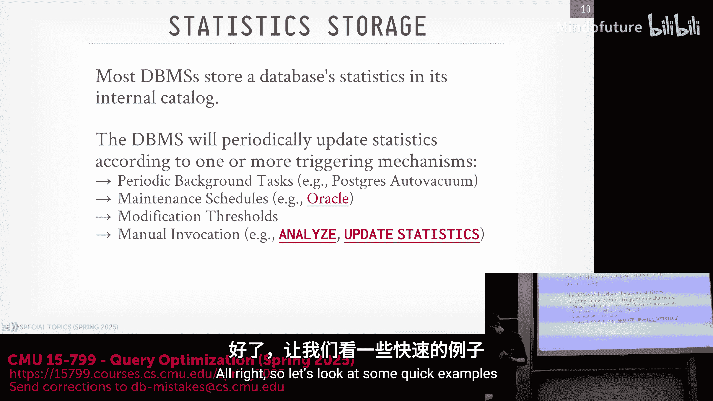
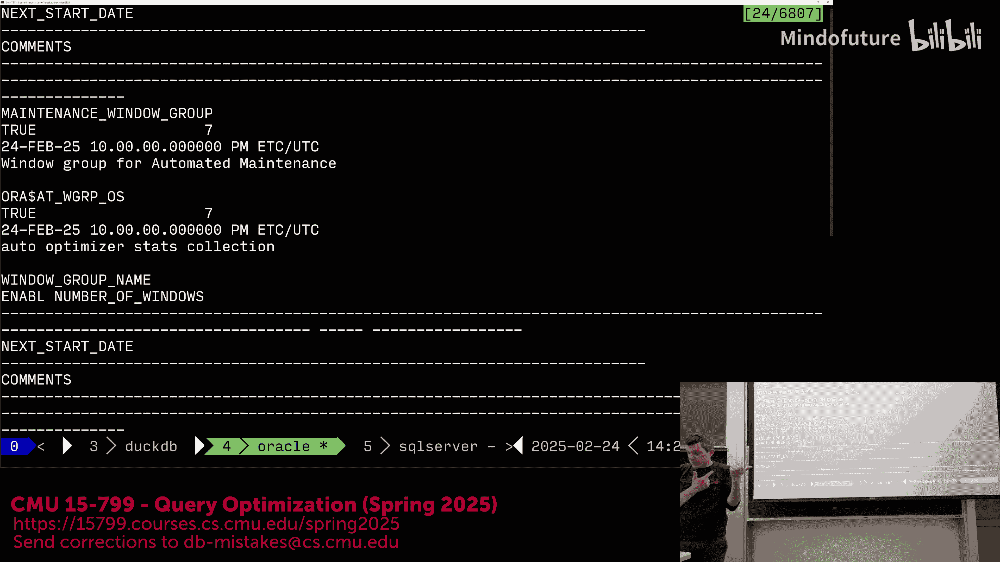
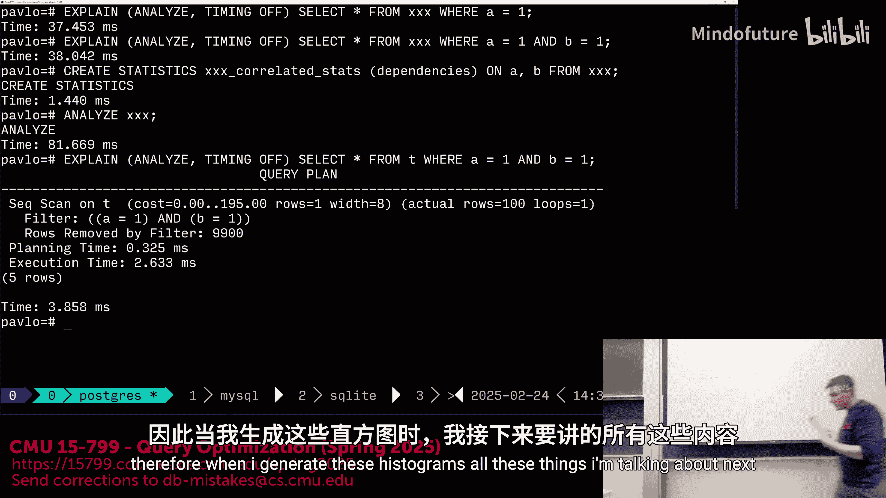
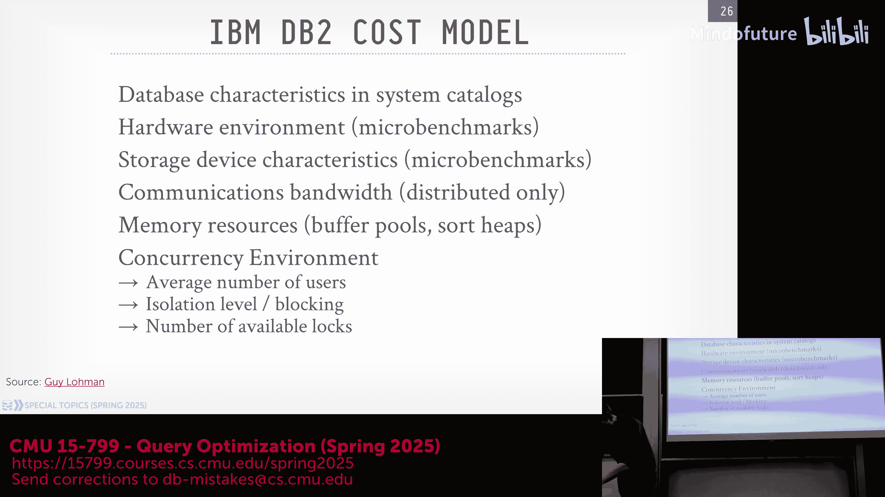
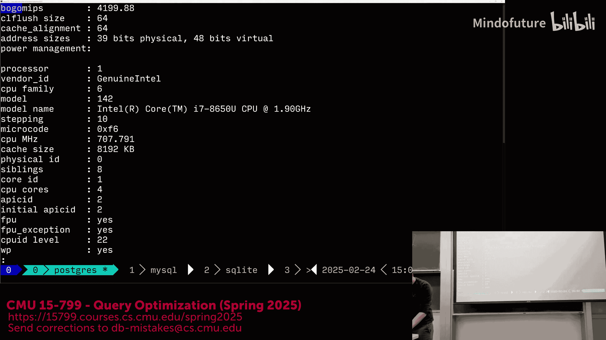
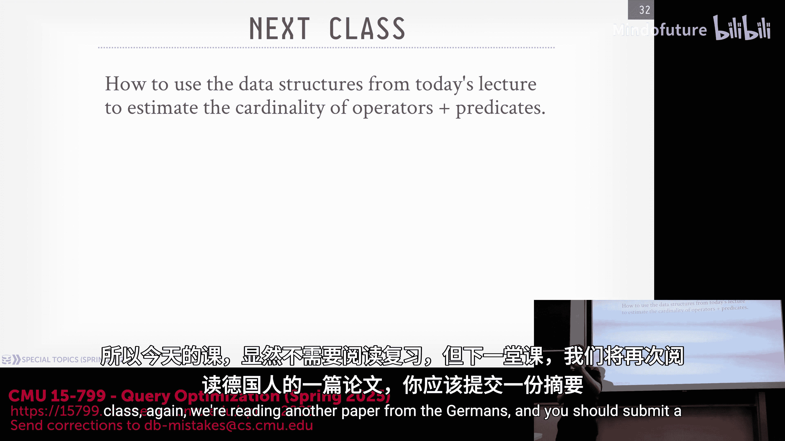

# 数据库专题：查询优化：12：查询成本模型与统计信息

## 概述

在本节课中，我们将学习查询优化器的核心组成部分：成本模型与统计信息。我们将探讨数据库系统如何通过维护数据摘要（统计信息）来估算不同查询计划的执行成本，从而在众多候选计划中选择最优的一个。课程将涵盖统计信息的类型、维护方式，以及它们如何被用于成本估算。

## 成本模型简介

上一节我们讨论了如何构建查询优化器以及应用基本的转换算法。本节中，我们来看看如何通过成本估算来指导搜索过程。

查询成本模型是对执行特定查询计划所需物理资源消耗的估算。它用于比较不同计划或操作符的优劣，从而选择成本更低的计划。成本估算基于数据库的当前状态，包括硬件配置、表内容、数据分布等因素。

成本模型无法预测查询的实际执行时间（挂钟时间），因为这是一个非常困难的问题。它的核心目标是相对比较，即判断计划A是否优于计划B。

不同数据库系统的成本模型彼此不兼容。例如，不能将PostgreSQL的成本估算与MySQL的进行比较。

我们之所以需要成本模型，是因为实际运行所有候选查询计划或操作符来比较性能是极其昂贵的。

## 成本模型的组成部分

成本模型主要包含两个部分：物理成本和逻辑成本。

### 物理成本

物理成本估算查询计划实际执行时将消耗的硬件资源。主要包括：
*   **CPU时间**：处理数据所需的计算资源。
*   **I/O成本**：从磁盘或网络读取/写入数据的开销。
*   **内存消耗**：构建数据结构（如哈希表）或暂存中间结果所需的内存。

物理成本与物理操作符的具体实现紧密相关。例如，哈希连接需要构建哈希表，我们可以估算其内存占用和查找效率。

为这些不同的硬件资源分配权重常数（例如，一次磁盘I/O相当于多少CPU周期）是一个棘手的问题。一些高端系统会通过运行基准测试自动确定这些值，而像PostgreSQL这样的系统则依赖管理员手动配置。

### 逻辑成本

逻辑成本与具体的物理实现算法无关，它关注逻辑操作符层面的数据特征。最重要的逻辑成本是**基数估计**，即估算流入一个操作符的数据量以及从该操作符流出的数据量。

例如，无论是使用嵌套循环连接还是哈希连接，连接谓词是相同的，因此通过该连接过滤或产生的元组数量在逻辑层面是相同的。逻辑成本可以帮助我们在搜索早期进行剪枝（如界限剪枝），或者决定优先优化哪些可能产生大量中间结果的操作符。

需要注意的是，虽然逻辑成本的计算公式本身可能不复杂，但**获取基数估计值**本身可能是成本模型中开销最大的部分，因为这需要查询统计信息目录并应用估算公式。

## 统计信息的维护

为了进行基数估计等逻辑成本计算，数据库系统需要维护描述数据特征的**统计信息**。

统计信息是存储在系统目录（Catalog）中的数据结构，用于汇总数据库中数据的实际情况。它们就像普通的表一样被存储和管理。

以下是关于统计信息维护需要考虑的几个方面：
*   **准确性**：我们需要多高的估算精度？能否量化数据结构的置信区间？
*   **维护效率**：当数据变化（插入、更新、删除）时，更新统计信息的效率如何？
*   **内存开销**：存储统计信息需要多少内存？统计信息本身不应占用过多资源。
*   **适用范围**：该数据结构能支持哪些类型的查询谓词估算？
*   **构建与更新策略**：何时以及如何构建和更新统计信息？

### 统计信息的存储与更新

统计信息通常作为元数据存储在系统目录表中（例如PostgreSQL的`pg_statistic`）。系统需要决定何时创建或更新它们。常见的策略包括：
*   **定期任务**：例如Oracle在每晚自动运行统计信息收集作业。
*   **变更触发**：当表中一定比例（如20%）的数据被修改后，触发统计信息更新。
*   **手动命令**：管理员执行如`ANALYZE`（PostgreSQL）或`UPDATE STATISTICS`（SQL Server）的命令。
*   **附加操作**：PostgreSQL的自动清理（AutoVacuum）进程在清理旧版本元组时，会顺便更新统计信息。

### 单列与多列统计信息

大多数系统会为表的每个列自动创建**单列统计信息**。然而，当查询谓词涉及多个列时，如果这些列的值存在相关性（例如“城市”和“邮政编码”），基于单列统计信息并假设列间独立的估算会产生很大误差。

为此，一些系统支持创建**多列统计信息**（或扩展统计信息）。例如，在PostgreSQL中，可以使用 `CREATE STATISTICS` 命令指定相关的列组。优化器在处理涉及这些列的联合谓词时，会使用多列统计信息来获得更准确的基数估计。

## 统计信息的数据结构

数据库系统使用多种数据结构来汇总数据，主要分为三类：直方图、草图（Sketch）和采样。

### 直方图

直方图是最经典、最常用的方法，用于近似表示列中值的分布。

**等宽直方图**：将值域范围划分为若干个宽度相等的桶，每个桶内记录值的总出现次数。估算时假设桶内值均匀分布。
**等高直方图**：调整每个桶的边界，使得每个桶内值的总出现次数大致相等。这是更常用的方法（PostgreSQL、SQL Server使用），通常比等宽直方图误差更小。
**最频值直方图**：在等高直方图的基础上，单独精确记录出现频率最高的N个值（高频项），其余值归入一个“其他”桶并用平均值估算。这有助于提高对常见查询的估算精度。

直方图的挑战在于，当数据频繁更新时，需要有效的维护和更新策略来保证其准确性。

### 草图

草图是一种概率数据结构，利用信息论原理，用极小的空间提供对特定问题的近似答案，但适用范围较窄。

**Count-Min Sketch**：可以看作一个“计数型布隆过滤器”。它使用多个哈希函数和计数器数组，用于估算某个特定值出现的频率（提供一个上界）。它易于合并，适合分布式场景。
**HyperLogLog**：用于估算数据集中不同值的数量（基数）。它通过哈希值中前导零的个数来概率性地估算基数。

草图结构通常非常节省空间且易于维护，但只能回答特定类型的问题（如“值V出现了多少次？”或“有多少个不同值？”），无法像直方图那样支持范围查询等多种谓词。

### 采样

采样的思想是直接对数据本身的一个随机子集运行一个“微型查询”，用这个样本上的结果来估算整个数据集的 selectivity。

**维护样本表**：在侧边维护一个小的、随机的数据样本。
**实时采样**：在优化时直接对基表进行随机读取（可能以读未提交模式）。

采样的优点是能够处理任意复杂的谓词，因为使用的是真实的查询执行引擎。缺点是维护样本有开销，且在数据更新时样本可能过时。目前，只有少数系统（如SQL Server）有限地使用采样进行基数估计。

## 实际系统案例

### PostgreSQL的成本模型与统计信息

PostgreSQL主要使用**等高直方图**，并结合**最频值列表**。其物理成本权重（CPU vs 顺序I/O vs 随机I/O）依赖于一组需要管理员手动配置的魔法常数。文档明确指出，没有完美的方法来确定这些值，调整它们是有风险的。

### 高端系统的自动校准

像DB2这样的企业级系统，会在系统启动时自动运行一系列微基准测试，来测量当前硬件（CPU、内存、I/O、网络）的实际性能。这些测量结果被用作成本模型中的权重常数，使得成本模型能够自适应具体的部署环境。

## 无统计信息时的挑战与自适应优化

在现代数据湖或湖仓一体架构中，数据以文件（如Parquet）形式存放在对象存储（如S3）中。查询引擎可能在从未“见过”某些数据文件的情况下就被要求执行查询。此时，传统的统计信息可能不存在。

面对无统计信息的冷数据，系统通常采取以下策略：
*   **做出最坏情况假设**：使用一些经验性的默认值（例如，假设连接的选择性为20%）。
*   **自适应执行**：在查询执行过程中监控实际数据特征，如果发现初始估算严重错误，则动态调整后续的执行策略（甚至重优化）。
*   **反馈循环**：记录查询执行过程中观察到的实际基数，并将其反馈给优化器，用于未来对相同或类似查询的优化。

## 总结

本节课中，我们一起学习了查询优化中成本模型与统计信息的基础知识。我们了解到：
1.  成本模型通过估算物理和逻辑成本来比较查询计划。
2.  统计信息（直方图、草图、采样）是数据库系统维护的数据摘要，用于支持基数估计等逻辑成本计算。
3.  直方图是最通用和常用的结构，而草图在特定问题上更高效。采样则提供了另一种思路，但应用不广。
4.  实际系统中，统计信息的维护策略和成本权重的确定方式各不相同，从手动配置到自动校准都有。
5.  在现代云原生环境下，处理无统计信息的冷数据是一个重要挑战，催生了自适应查询执行等技术。

核心在于，我们构建的是一套基于**近似**的估算系统：用近似的数据摘要（统计信息）去估算近似的中间结果大小（基数），最终得到近似的成本。误差会层层累积，这也是查询优化器有时会选错计划的原因，也是自适应优化技术发展的动力。下一节课，我们将深入探讨如何利用这些统计信息进行具体的基数估计。