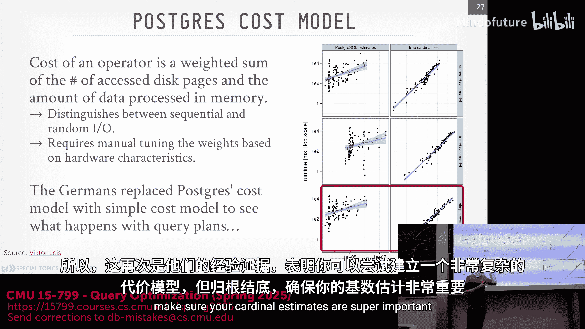
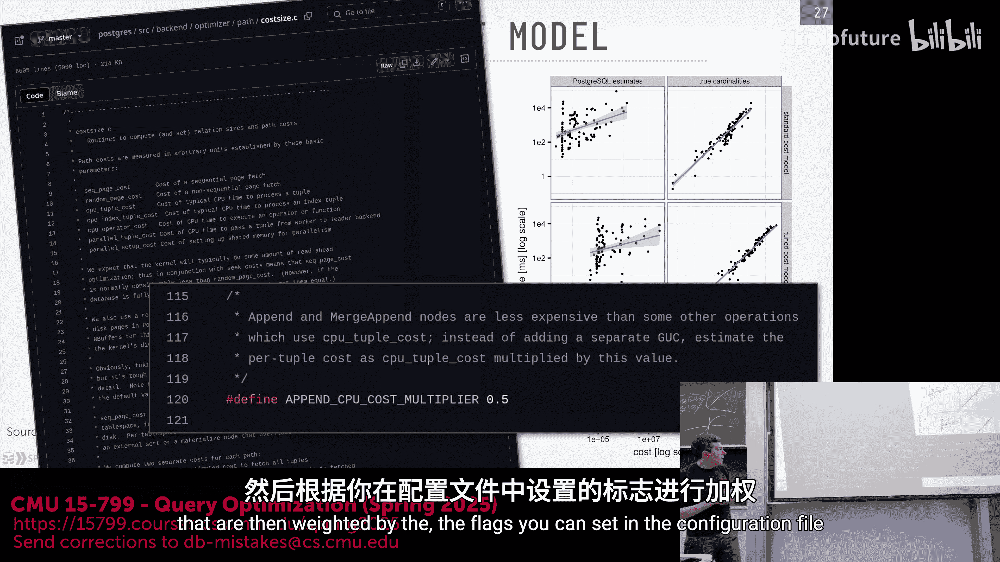

# 【卡内基梅隆---中英】数据库专题：查询优化-CMU-15-799--(2025-年春季)-p13-P13-#13---Query-Cost-Models---Cardinality-Estimation-(CMU-Optimize!)--BV1wDE9z9EfK_p13-

あ。🎼おって見せ。🎼A journey drove that Taas carry up the message。

This course is filmed on location at Carmicgie Mellon University in front of a life studio audiences。

对不です来快 to theこ。Great so today we're going to again continue the discussion of how to use the cost models inside of query optimizer to estimate the now is going to be how much data we think an operator is going to emit because again。

 that's from the backbone for how we use cost model calculations。For you guys in the class。

 all Project one is obviously due this February 28th， who here is not finished。

 I didn't look the reached up this morning。Sort of， okay。I mean， somebody asked for an extension。

I mean， I can give you one， but it's like it。Because it is。If we say Sunday， is that enough？It't。

 he's notdding yes， okay， let's just say someday， whatever that is March。Second。Yeah。

 it's more second， this is make it do Sunday more second。

 not a big deal again it's a special topics class。 it's more about the journey rather than the outcome and。

And then project two is the proposal for you guys when we do first Monday， March 10th。

 when we come back from spring break， the I sent emails out to some of you for the assignments and then the spreadsheet updated with the green the green indicate thats been approved。

 I will send up follow emails to every group today tonight with additional materials and what you need to get started with some of these things there's some additional papers I want to throw it at you guys and take a look at and how to sort of get started certain things and then I'll be in my office hours today and then also be around me next week if you want to meet either Zoom or in person。

Is anybody going somewhere exciting for a spring break？As't count。It's exciting。Yes's not。

 I with him。Like Silicon Valley or San Francisco。No， Jo it's worse。All right。哎对。How is it？One year。

 someone one kid didn't do the project in this class because he went to Miami for spring break and then had come back and had a film。

 So I'm not not saying'm doing that。 just like if you can't go to much exciting， do that， okay。

All right so again last class with' all about the data structures that the data system is going to maintain inside its catalog that are going to be approximations or summarizations about what it thinks is inside of the tables again in some cases like for data lakes you may not actually have any statistics。

 we didnt talk about like what parquet files maintain inside of them but it's not much basically these zoom maps。

 some balloon filters but there's not really good statistics we could use。😡。

s certainlyly not anything like hisograms here and so again。

 these are data structures we can maintain that are going to summarize what's in the tables and the most common data structures people going to use are going to be a combination of Edef and end biased histograms or heavy hitters we saw in the case of postgs they had the histogram was just an array of values and an array of frequencies and it stored as as a regular tuple and then for heavy hitters again it was just just a list。

😡，And then in some cases， hyperlo log is being more widely used to stay because that gives you a pretty cheap and easy way to estimate that the number of or the distinct cardinality of a set。

So again， today's class is really how to take these things and then compute the cardinality estimate or compute how manytables you think is an operator is going to produce or emit either within with single predicate or across all the predicates within the single operator because again that's going to be the backbone for how we determine the cost of an operator and every said that the cardinality estimate is going be a logical cost that regardless of what joint algorithm're using or what filter algorithm you're using。

 or in what order you apply the predicates， the cardinality is going to be always the same and we can then extrapolate from that。

 what is going to be the physical cost。So I've sort already said this。

 but Car estimation again how the optimize is going to be able to predict the number rows that expects an operator should be operate in an operation。

 an operator is going to generate like a scan or a join or a filter and then again this is the logical this is the backbone for how we're going to be able to determine whether one query plan is going to better than another。

And at a high level the way this is going to work is you just say。

 oh I know whatever it is the predicate I may be applying in whatever operation I'm doing。

 like if it's a scan， you have a filter， if it's a join。

 you have a join clause and on that predicate， you have this noional selectivity。

 like what's the probability that any tuple from your input is going to be emit as part of your output。

 you take that selectivity estimate， you multip the number of twos that are coming into you and that gives you roughly or gives you an approximation which you think the cardinality is going to be。

😡，Right so today we're to talk about the basics of how to do Car out installation and then we'll talk about the survey paper you guys read from the Germans。

 which I think is phenomenal as he said it's a well written paper and then I want to finish up just talking about。

So what Postgres does and SQL Ser does because you definitely see two。I mean。

 in the results from the paper， you definitely see how the quality of SQL servers Car estimations are superior to Postgress。

 and that's going to lead to getting better query plans that are closer to what the actual true card estimates are going to be。

So to Duke Car S mission， there's three core operators we need to be able to support。

RightSe conditions like filters， join size estimation， and then distinct value estimation。

 right and if you have these， especially the first one and the second one。

 then from there you can build upon those and。Handle all of the other operators that your data system might support like do multiple way joins or multiple table joins。

 group filess， aggregations， and so forth。So a lot of the research a lot of the focus has been on how to handle these three things because again。

 these will then allow you to do the more complex things and you're sort of building up from these basic calculations。

 these basic constructs。Right。All right， so this should somewhat be redundant from the interclass。

 but I don't forget whether we actually cover this anymore， I don't think we do all of this。

 but the basic idea is that can derive statistics from we can derive the card estimations and statistics from the statistical models that we computer to calculated the history ends and other sketches from our tables。

 and then we can use that to sort of plug and chug some formulas that are going to allow us to produce the card ion estimations。

And a lot of these techniques I'm going to show you today。

 like these go back to system R from the 1970s， I think even the system R paper talks about some of these basic formulas and we didn't go over them in much detail。

 right？So these are ideas like you have a way to predict the number of tus in R and then you have some function V that's going to tell you the number distinct values for an attribute in that given table and again this is where a hyperlo log may。

😡，The Hy log log will help you because if you have this per table per attribute。

 you can get this information。😡，And then from this。

 you can now generate what's called the selection cardinity。😡，Defined by this function SC。

 and this is just to me the average number of records you expect to get for with a given value for an attribute A divided by as total number of two you're going to get right so it's sort of the it's the taking of all the tools that I' I'm going to get how many all the tables that are coming into me as part as my input for an operator how many tools are expected to produce as an output like they want to qualify on some attribute some predicate。

😡，So from this， you can then compute what's called thisivity on an app predicate。

And the easiest predicate you can handle is an equal cause and obviously there's some optimizations you can do if you know they're doing a quality predicate on the primary key。

 but we can ignore that for now。😡，to say you have some query here。

 a select star from people where age equals nine， you're trying to find much in nine years old。

 so for this the formula is really simple because it's just the selectivity is be cutd from the number of occurrences we have from our histogram for the values we're trying to do a lookup one divided by the number of elements in our number of tuples in our input。

😡，So in this case here to do the activityivity on age 9， you just jump in the histogram。

 find this entry here and says four， so therefore we know this selectivity is going to be4 divided by right 45 so you' gonna have 45 tuples if you add up all the histogram counts here and so the selectivity of this preddicate age equals 9 is 0。

08。😡，Whereas the last class， what did I say I said nobody actually stores the full histogram like this。

Because for every single every single value I may have in my， my attribute。

 I don't have to store an exact account because that' would be terrible if I have like a monotonically increasing value。

 I'm restoring all the values over again with count of one。

So now we have to have to adapt these formulas to handle when we have an equide histogram。

So in this case here we take age equals nine， we find out what bucket we belong to。😡，Right in here。

And so we know we have nine elements， sorry the total count of this bucket is nine and this one has five right 9。

10， 11 12 9，10， 11，12， 13， five distinct keys， so you take nine， divide by 5。

 and then divide that by 45， and then you get an approximation of a selectivity or 0。04。

So the first number here， this is an exact value， 0。88。Because again。

 I had a histogram that told me exactly the number of tus I had for age equals nine。

But now because I'm combining or aggregating together the counts for the different keys within a bucket together。

😡，I need a way to approximate how many keys I think or how many instances I'm going to have for a given key within this bucket range。

😡，Right。So this brings up one of the first approximations that we're going to make in our query optimization。

 And again， this is not going to be， this is pretty much how everyone does this。

 We'll see SQel summary tweak this a little bit at the end。

 but they're going to make this big assumption that the。

Within the a given bucket in our equi histogram。The distribution of the values or the keys are going to be uniform。

Meaning again， going back here。I don't know how many exactly number of keys I have number instances I have for key 9 or age equals 9。

 But I know I have other five of the keys in the same bucket。

 So I don't know what that distribution is for inside of my bucket。 So I just divide up evenly。

 And I assume that every。Every key would have the equal number of occurrences。Right。So by doing this。

 this simplifies how we can do our calculations because otherwise。😡。

We'd had to maintain additional information to have a more exact estimation of what the actual true cardinity or sorry true selectivity of that predicate would be。

So this assumption is super important and there will be three other assumptions we're going to make again。

We now basically it's going to allow us to simplify the problem so we actually can compute something rather than nothing。

But in some cases， these assumptions are really incorrect。

But like it's the best you can sort of do right now without having exact data。

Samp sampling could solve this problem， and in some cases， if you have a good sample， it does。😡。

But again， like it's impossible to have a complete sample。

 there's no guarantee that you're going to have a full representation of what the real data looks like。

All right， so next we're got to deal with how to do range predicates。

So here we now have select star from people where age is greater than you go to seven。

So the basic formula for this again assuming we have equiative histogram is that we know we have a we have a starting point for our range where we're gonna to start at seven went all the occurrences or all the keys that are greater than than greater than equal than 7 so we first start up with the range rows where we're above the bucket where we know our starting point is so we know seven is going to be in here going from between 68 so in this case here for all of the for the buckets to the right of me then I want to include them so I know I'm going to have9 plus 12 occurrences because because the two buckets are 9 plus 12。

But then now for the key for the bucket where my key lands in seven， again。

 I have to make that same assumption about uniformity that I did before where I I don't know whether how often seven and eight occur within my bucket relative to6。

 so I'm just going to divide the count here by the number of keys， that's 12 divided divided by3。

 and then I know I have two keys inside this that would match。😡，And therefore。

 I multiply the count by two。And then divide that by 45 because again。

 I have 45 keys throughout my entire hisogram， and then I produce my estimate like this to 0。6。

What's the big assumption we're also making here？In addition to uniformity， with another one。I mean。

 so in this case， here again， my histogram is based on the age column。

 So I know I'm basically gonna have a continuous set of values。 right There there's， you know。

 it isn't all sudden like。A bunch of  seven to eight year old old died， right， And there's。

 there's nobody left， you know， in this range。 I know there's gonna be somebody within this range。

 But again， not all attributes， not， not all value domains are gonna to be like that。

 So I may have gaps。And if I'm doing a range credit like this。

 I don't actually know whether a key actually wouldn' even exist because I'm not going to store all the exact values and then a bucket。

😡，my toy example here because I the fill in PowerPoint， it's pretty easy to see， oh， yeah， 67 and8。

 but again， think of like larger ranges of maybe like 10，000 keys。

Becauseuse that's sort of how things got got chunked up。 I may have gas in that。

 And then so I now may be counting or including the。

Additional counts for keys that don't actually even exist。In this case here。

 I would end up overestimating the selectivity。So this is assuming that we have a continued distribution of all the values within a bucket。

 but there's no guarantee for that。sometimes you can know that like， oh， yeah。

 it's likely to be there like if it's a an auto increment key， but again in that case。

 you don't want， you know， maybe don't well， you still maintain equi histograms。

 but someone could still delete keys within that， you know the auto increment increment range and you would have gaps。

But the formulas still work， again， you just be overestimating the selectivity。😡，All right。

Nation is pretty easy， negation is just the inverse of an equality predicate。

RightSo in this case here age doesn't equal2， well that's simple well first I'm going to do just compute what's the selectivity of age equals 2 because it's in a quality predicate。

 I jump here， I do the same formula that we did before， I take I have five keys inside the bucket。

 take 12 divide by by 5， divide that by 45， and then again I just take subtract that by one。

 subtracted to one， and then I end up with the estimate of 0。95。Right。That's pretty straightforward。

Nigation isn't that common， but it does show up and you definitely still need this。

So you can kind of see now what's happening is that these selectivity estimates that we're making。

 they're basically probabilities。😡，It's like what's the probability that a tuple within some input is going to match my predicate？

Right？And so because now it we sort of think it as a probability。

 you can do all the tricks you did in Stats 101 to combine them together。

 start doing more complex things when you want to start handle multiple preddiicates on the same table at the same time and want to start computing them。

😡，So again， we know how to compute things for a single predicate。

 but now the question is how can we actually combine them right so again the challenge is that even though the attributes like these two predicates here。

 they're on the same table， but the value domains， their distributions are completely different。

 potentially independent of each other。Not always the case and Microsoft argues the opposite。

 we'll see that in a second but。There's nothing you can learn from age equals 2 that it helps you to filter things out from the name clause here。

😡，Right。Again， in practice， this is not only true， if you do know that they're actually correlated。

 remember last class we show how to correlated statistics， I can tell the data is some hey。

 create a histogram for these two columns together。

Instead of doing them one by one because I know if they're going to be correlated。

 I'll be querying them together all the time。Right， so in this case here， I have。

 I can compute this selectivity for age equals two and name like。

A followed by a wild card I'll point Alex that too for from substream matching。

 you don't actually want to can't use history answer this right because again。

 there's gaps and things like that you don't you't want any false。

alse falsese negatives and so in some systems， they'll actually maintain separate data structures like like a try or something or use the sample mechanism we talked about method last time because that allows you to actually then compute the estimates correctly on on strings。

 but we'll ignore that now。All right so it essentially you what we're trying to do。

You can think of like the we have two predi against P1 P2， right mapping down from here。😡。

And this sort of circle is all the things that are going to match predicate1。

 and this circle is all the things that are going match predicate 2。

 So what we're trying to figure out is what， what is this overlapping range in the middle here。

 the intersection。Like， because that's gonna give us what the。The the select of these predicates。

Put together。So to make this work， most systems are going to do another assumption called the independent assume that the prediuss are independent。

The basic idea here is that as I said， the selectivity of one predicate is not effective by whatever values are being selected by that first predicate for another predicate。

So therefore， if you assume they're independent， what do you do in Stats 101。

 you can multiply them together。And that'll give you the。

 what has perceived as the true selectivity of the combination of the two predates。

 at least when you're doing a conjunction。So going back to our example here。

 right we're trying to figure out what this middle part is so if we just assume that we have two predates and we're combining them by the end。

 we take one of activityivity of the first predicate。

 multiply this activity to the second predicate and that produces our answer。😊。

And then it's just just plug and chunk to end up with a selectivity like that。

Do you think that's a good idea or a bad idea？Bad。Who have already given the answer because if it's correlated。

 then this is going to be way off and we'll see an example in a second。But again。

 what's the alternative， What can you do？Microsoft has a， has a。

Microsoft is basically going to do the same thing， but they're going to diminish or reduce the weight of additional selectivities when you start multiplying together and we'll see at the end the class today。

😡，All right， so that's conjunctions。Disjunctions is just the inverse where you take the selectivity of the in two predicates and then you're going to subtract it from the multiplication of the two predicates together so you're basically trying to figure out what is this entire range here。

Right。So again， plugging， chugging with an example， you just end up with a formula like this。😡。

And again， for this， they're assuming that things are independent。In some cases if you're lucky。

 you can rewrite a query to maybe get rid of the or clause。

 not always it depends on what the predicate actually is and how it's being used with other prediicates。

 sometimes there's redundancies in the predicates with justjunctions and you can rewrite those out。

But it'ss not always the case you can do that。And this would be something this rewriting phase would be done again in sort of like that normalization step or the rewriting step before maybe do the cost base search。

 you would recognize that I can rewrite disjunctions in a way that's better for me later on。

All right， so let's go see why this independent clause is going to cause problems for us。

So this is a really great example from Guy Loman， the guy that built the Starbs we read earlier。

 so consider a really simple database that contains cars。😊。

And then we have 10 makes and 100 different models make would be like Honda， Kia， Toyota， Ford。

 whatever， and then the models would be like the Cam accord。pickick your favorite car， right？

So now a query shows up with a pre like this where make equals Honda and model equals a chord。😊。

So if now we assume that independence clause， the uniformity assumptions remove four。

TheWhen we compute。The selectivity of this warehouse clause here。

 we would take the first part would be on makes so there're looking for one key because it's a quality predicate。

 I have 10 I have 10 car manufacturers 10 makes so that's one divided by 10 and I'm looking for one model the accord so I can I have 100 models it's one divided by 100 so I multiply those two again together which I'm assuming I can because they're independent。

 then I get a selectivity of 0。001。But we as humans know that these aren't independent because。

What other car manufacturer makes in a quarter right there's only one。

 so there's a one in one correspondence between the model and the make again， they're correlated。😡。

Similar things like if if I know that the city you're in， I know what zip code you're in。

 those are correlated。So the true cardinality should just be the one over 100， which gives us 0。01。

 so we're off by order magnitude。And our Carinality estimation for a really simple query because of this correlation here。

So this is just a toy example I shows you。Yes， these assumptions are going to make things easier for you in implementation。

 but it's going to have some pretty dramatic problems or consequences when you start running your query optimizer because the card estimates are going to be way off。

😡，And in the paper you have in the Germans， it talks about， oh， well， if you're uniformly always off。

 does that always cause problems if if you're always wrong and you're just wrong。

 the same amount always， does that make a difference。

 what they show basically you're not always wrong by the same amount that some queries the difference between where you start and what the actual true caralityity is and what the estimate is can be quite significant and that causes the end choosing bad query influence。

😡，So any questions about this？Yes。Chrisians， how do you fix this？Um。

Which one uniformity or the independence one is the tough one？Okay， it。

I don't know whether there's any experiments that show the Microsoft One is the right way to do it。

 but like the textbook talks about this and then there's I think is' in the documentation where again。

 it's the。When you still multiply them together as if they're independent。

 but you rank them and you sort them based on their selectivity when we jump ahead and I'll show you what I'm talking about。

嗯。I don't know why I can't。Uses now， Sir。Let me just jump ahead and I'll come back to this there so it's this this bottom here right so they're going to use this exponential back off where they're still going to multiply the predicate selectivities together right but the first going to sort them by by which ones ever the most selective like from S1 to SN and then for the second most selective one。

 you're going to take the square root on it。😡，Because it diminishes the effect of it。

So instead the problem is you don't want to underestimate。😡。

RightSo if you reduce these values when you all them together， that reduces the underest points。但是呢。

He says it's a hack。Don't ever say what's going on right so again。

 like you take whatever whatever the predicate you estimate to be the most selective just doing the formulas we talked about before。

 right。😡，Let let's ignore joins。 a single filter。 All right， And then you rank them。

 you short them based on what the selectivity estimates is could to be。

 So then you take the first one， take its full selectivity， right， leave by itself。

 And then when you multiply all the other ones， you exponentially reduce their effect on the end selectivity estimate so that the。

The most， the least selective ones don't have a large effect because the idea is that you're going run by you're going run the most selective first。

 So you want that one to be the the most pronounced in your selectivity estimation。

You're sort zing correlation for every single because you're z so say're assuming correlation right so Microsoft says that they found in their real workloads that that the selectivities aren't independent they're actually positively correlated always。

meanThey're not assuming everything's 100% poor。They're basically。

Seeying it's better to be partly wrong all the time than it is to sometimes be really。

 really around estimation sometimes。The bulls were up on our wrong。

 Like there still isn't as it' still not solving them。Yes。I mean， what is。

So would a better idea be to maintain a multiplier for your estimate。The question is。

 his statement is， would it be better to basically figure out what the weight of these things should be？

And then have。Data， and actually， there'd be a lot。

 It would increase the complexity of your district。

You' have to actually runBut isn't doesn't the survey people。这个民斯。

Yeah so his statement is in the paper guys read， everybody's underestimating， right？Again。

 and that would happen if you took if you without these square roots。

 then this thing is going to become way more selective right so therefore you're underestimating number two is going to come out so by reducing this by having this reduce the weight of them。

 then you get closer you're moving back up to that middle line greedy to a。😡，即实我。

The problem you'd actually have perfectly， you would have to calculate the correlation for every single variable in each table and there's no looking and there's nothing like that single No。

 and then if you do that， they already have the answer to all those things。Like that's'。 no。

 but when you're running analyze， you could just run。

But so a couple of things one assuming you know that the product are gonna to be ahead of time now there's an Amazon paper we're not reading this class where they talk about like 90% of their queries or 99% of queries show up look exactly the same。

 like not even parameter the exact same parameters from day to day therefore you could compute that things now data evolves over time then whatever there could change but I don't think I don't think it's gonna change dramatically from day to day。

 I think it's something you could learn realize this is not exciting for me reading from the book but so Microsoft Ser server made a major update to its card estimator 2014 based on the aggregated benefit observed over several OTp and data warehousing workloads in practice that made two changes to assumptions first。

 instead of assuming independence， it assumes that data distribution on different columns are positively correlated however instead of assuming perfect correlation it also assumes they so called exponential backoff that's this're increasing the number of square roots you're doing model correlation which strikes。

In middle ground， while still keeping the overheads of statistics low。

 then the overhead of actually computing this is trivial。😡。

Whereas like if I can maintain or learn something what the weight jacket should be， right？So。

Let's just say。Microsoft's not dumb right theequL'm sorry the SQL server Opizer team。

 that's like K in the crop like Car， Nikko and the Serge。

 all those guys right I don't think they it not like they're like sitting around a little lunch。

 hey guys， what do we did this whatever put it in and like you know know pushed that commit right like they sat and like looked at the traces and try to figure out whether this that can make sense。

Nobody else does this as far as they know。Again， the textbook talks about it。

 the sequence word documentation talks about it。😡，But as far as I know。

 nobody else had influence this。So yes， are there any systems that will like do different optimization if you're even prepared statement that like just one statement like for this。

 like you can calculate a lot if you're say， okay， if I know I'm。

You're suggesting them going to prepare a statement。

Then you're suggesting to me you're hinting I might do this multiple times。

 so it's okay for you to run a lot of extra data to get better statistics there the new way you do that Yeah。

 sorry I I can't do this I was going to bring up a schedule that is called parameterized query optimization。

That's after spring break so like he was asking that hey， can't you learn the shit， Yes。

 that's next class after spring break the proposals。

 then your your question of like parameter optimization that's that's later as well after spring break basically what you end up doing is you you。

You have to start generating ranges because' you don't know what these values are actually going to be so you can't actually compute this selectivity so you say。

 well， I'm assume like maybe the average case or like the lowest value the smallest value。

 differences doesn't do different things postscript I think generates one。

 I think this choose average value but you get the average value from the histogram right I think people well this this is independent of doing that parameterization stuff right。

😡，In that case， yeah， we'll cover the pization stuff later。

Then that's another example where the enterprise guys is going to be way more sophisticated than。

Then the open source ones for prepared statements。All right， again， I don't want to jump ahead。

 but like this came up， like everything was going on here。I think this is a good idea， but it's。And。

I guarantee you like all the cloud vendors， Redshift， BigQuery， Azure。

 all those guys have tried this out along little data to see whether that makes sense and then maybe they just don't talk about it。

Yes， what about the uniformity This is the independent question， all right。

 so this solves the independence problem。 How do you handle the uniformity problem。

So the response with that would be。If you assume that most of the time you're doing lookups on the heavy hitters。

Then you wouldn't go to the histogram on buckets， right， You would go to the you know。

 you would go to the the end bias histogram。 So then therefore， you would have an exact count。Right。

What's that scratches ores， sketches？呃。Yeah， I mean， the countman sketchcher will help with that。

Right？But it's， you know， it's， you don't have to do always。

Do you have indexes sometimes I will help give you long that time。So David is， if you have indexes。

 could you then probe the index like you could store like aggregate the formation at a sub and then you know like the ranges。

Save it as you could store aggregate information in a subte。

 and then you' know a range of the values in subtes and you could use that to figure out， yeah。

There is a nobody actually does this， there's a data structure called the history。

 which's basically instead of it's a BPA tree， but instead of key value nodes。

 it's basically histogram inside the nodes。So then you it's of like， as you said。

 it recursively tells you how big the ranges are as you go down。

 but so far as nobody actually implement that in a real system。U。Okay。对。All right。

 so the next thing wem got to deal with is join size estimation。

And this is where things get really hard and this is where it all falls apart so given two tables R&s。

 we want to figure out like what's the ranges of possible number twos we expect to emitit right？And。

For this， we're going to make a big assumption called the containment principle。

 where we're going to assume that every key that exists in one relation that we're joining with is going to exist in the outer relation。

😡，Assuming we're doing innerjoins。And just trying to say again that the main of the join keys that you're trying to join these two tables are are going to overlap。

😡，Right now， if you're doing a left out join， that's bit a tricky， but we can ignore that。

 it's basically saying， like if I do a probe from a tuple in my inner table into my outer table。

 I'm going to find something。😡，And then that just， again。

 you end up potentially overestimating the number two is going to match。

 but then there's other tricky things like， you know if it's end to M join or the cardinalityity is not always one to one。

 how do you estimate things， but we can ignore that？😡，So the first thing thing we got to do is。

Align the histograms from the two tables you're trying to join on because again。

 soon you're doing Eative histograms， the bucket ranges are going to be completely different from table R and table S。

😡，So you take the histograms， do a quick processing pass on them。

To then just align what those ranges actually are。 and that means moving things around。 and again。

 now you can introduce additional error because again， assuming uniformly within a bucket。

 say I'm moving the inner table to be to align with the outer table as I start dividing things up and putting into the ranges the buckets of the outer table。

😡，I'm going to end up with incorrect estimates， again。Or again。

 if I have keys that don't exist and I start copying things over， then they'll have errors there。😡。

Then now on a per bucket basis， you basically go through and figure out， okay。

 what's the number of twoples I expect to generate when I join my bucket from the outer table with the bucket from the inner table。

😡，RightAnd guys now again， you've instead of saying， okay。

 what's the joint p going to be across all the tus， I'm sorry。

 all the values on the join key if I'm looking on a bucket per bucket basis。😡。

Even though course it's been aggregated together， the scope is much smaller because there's only a portion of the table。

 therefore it reduces the effect of erroneous summarizations， erroneous errors。

And then now once I have the estimates on a per bucket basis， I just combine them all。

 sum them all together， and then that produces the joint estimate my entire for these two tables。😡。

So you do all those selectivity estimates that we talked about before against means inter clause。

 so we know how to do that calculation to say how many matches expect from one bucket to another bucket。

 and then you add them together and that tells you what the estimate cardin now is going to be going above。

So again， this is fraught with more errors because like I said， as you defy the buckets up。

 the buckets are already coar grainined and then now you're rebalancing the bucket so that the values align up and that's just causing more problems。

😡，And then so now if the of your cardality estimate for your joint is inaccurate。😡。

What if you now join the output of your join with another table another set of joins。

 now you have this propagation， this error from one operator to the next。

 and that just makes just ruins the estimates all near the top of the tree。😡。

So is a simple example here of just how bad estimations can go wrong right so we're trying to join three tables。

 A B and C。😡，And we just have a predicate on the BID column here， right？

So the way we compute the cardinality for the entire query plan， right， again， you would。Again。

 it's a top down， if you're doing a top down query optimizeomizer， you would traverse down。

 you would have the memo table keep track of all this and keep track of what the Car is。

 but I'm just going to show you how you just do it from the bottomer on the top。

So the first thing were going do is compute the cardinality of the base tables。😡。

So for A and C that's simple because there's no predicate。

 so if I just know the number of tus that are in both of those tables。

 then that's the cardiac an estimate for them coming out in the case of B because I have the predicate on the ID field。

 well that's just computing the selectivity on the range predicate which I showed how to do before。

 you based that on the hisogramms you would generate and then multipied by the number of twos you expect are in the table。

But then now we come up to this first join here。And so now we sort pluging talk with the formula again。

 what's the。What's the total number of twoples either coming from we're taking the maximum number two is coming from a A or B after the filter and then assuming that I just matched the two together because I'm going to have every key that's in a is going to match something in B。

 so that's going to tell me in this case here I'm multiied together because I can match with everything and by that the maximum number two I' expect to come up and that's going to be a rough estimate of again how many twos this joint's going to produce。

😡，But then I'm going to take the next join and take the output of auto edge computer for this join。

 and now feed that into the estimate for this join。😡。

So again you see this sort of this effect where like if this thing has a bunch of errors in it and then because I'm feeding them from up above going inside this and now this thing's got a bunch of errors in it and I'm feeding that inside of this。

 so I have crappy calculations on top of crappy calculations and then when I get into the top my estimates are way off。

And again， in the paper you guys read， they talk about how the， you know near the bottom。

 you might be okay with like scanning based tables， but once you go beyond like one join。

 then the cardiac elementss basically become all garbage。

And we'll see it in a second they're all going to underestimate the number tools they expect to pick out in a case like Postgres。

 it ends up choosing the wrong physical operator for join because it thinks not a lot of data is coming up into it and then it runs it and gets prize getting a ton is assuming otherwise would do a like for this one here so statement is I'm not assuming independence because the is always that credit are so I'm trying to figure out whats the maximum numbers I expect to come up from this match。

Like you the expected value the max the the max， yeah。So I got to know， I think this many coming out。

 but then after I do that join， I'll have this minute attribute to what's coming out。😡，那是。是。Again。

 the main takeaway from this is that you start at the bottom。

 some of the assumptions we talked about before， they' were going to cause problems。

 but then as you go further up， the errors expand。😡，Yeah。So the paper guys read actually the ciation。

 this is the original paper in 2015， the paper you guys read is the journal version expanded version。

 the better version of this paper， but it's the same core experiments many additional things。嗯。

So this paper has been very influential in the Davis community and it's not about how to build a cost model。

 least original paper was this paper talks about alternatives to what other systems use and instead it's trying to show you here's what happens when your card estimates that your cost models mean based on are wrong。

And in particular， they're going to look at joins， so the join on benchmark。

 this JOB thing is now sort of like a standard academic workload that everyone uses。

 but it originated from this paper from the Germans。

It's basically just showing you as you add on a real data set， as you add more joins。

 you know what are the problems people have or the systems actually have right So in the setup here that're going to do is they're going to load in the IMDB database。

 which I don't think is that big as like 800 megs or something and then they let all the systems run analyzed cut stats and then they're going to get exact measurements of the runtime from the query plan。

And then they want to see and as they introduce more more queries。

 they want to compare what happens when the if the if the。

They want to compare with what the true card analog estimates are from the actual ques themselves from what the database systemss query out monitor thinks is the card estimates。

 so it isn't about runtime， at least in this first graph here。

 it's just looking at the cardinity estimates。😡，To see how off are they？So。

 this is a very famous graph here where they're looking at five different database systems。😊。

And the way to think about it is like this middle line here is when the cardinality estimate for a join operator in a query plan going up from zero to six joins。

 whether it's above or below what the true cardinality estimate is， so if it's above this line。

 then it's overestimating the number twoples an operator is going to generate。

 if it's below this line， it's underestimating it。😡，Right？

So the first one to point out is this guy here， this database system， again。

 each of these blocks here is a different native system， this one is doing okay。😡，Again。

 the overall trend is everybody's underestimating。😡，the closer you are to the middle line。

 the better you are right so this one is doing much better than all the other ones。😡，嗯。

For these guys over here， they have sort of these clean step functions where things are progressively getting worse as you add more joins。

 which again， as we just shared an example before， if you assume that the errors are going to go on top of each other as you're going up the query plan。

 So add as I add more tables to join and therefore more join operators in my query。😡。

if the input to my join operator is another join and I underestimated how much data it's going to generate that now feeds into my operator and all I know that for that operator is whatever is being told coming down below me。

 so now I'm going to underestimate whatever the underestimated estimate coming up to me is。😡。

So again， that's why you see that sort of stepping function like this。Right。嗯。

This guy here is the worst and it's a pretty big drop again going from three tables to six tables here。

 right？All right， so if youve taken7 21， you know the answers。

Don't't say the answer is very evident7 21， everybody what Davisism this is？😡。

The paper tells you Postgress， and what is the last one？Hyper right， that' before Ambra。

 there was hyper， right， it's the system of the Germans。All right。

 and me take a guess what the best one is。SQL server， okay？And what about the worst？PoralPoical。Yeah。

And then Db2 is the last one， right。All right， so what's going on， why is SQL Service so good？Right。

Well， he just popoed that exponential back off on activityivity estimates。But that's that's。

I'm not saying that I would attribute all of that to this。

 but that's exactly what that exponential backup is trying to solve where you're you're not underestimating as you go up the tree right is's just putting an bond and how that。

😡，That's always it's trying to play。Yes， but like you。

His statement is that exponential back is a way to get upper bound on how bad you actually are。Yes。

Again， I don't think you just， you know， I don't think he were sitting around like， hey。

 let's try this like they randomly thought about it right didn' want to。

I understand that the idea not to be visually bad and hence it makes sense。 I mean， I mean。

 these experiments are run。Actually， SQL server  Actually， this paper 2015。

 SQL server is SQL server 2014。Had that accident back off。

 I actually don't know whether this is actually running again then， maybe wrong。Let's double check。

 but so the paper talks about what SQL server is actually doing is it's actually a combination of histograms。

😡，And sampling。I don't hyper does sampling， but I don't know whether they did it for this earlier version of the system。

It added later on there's other things too， I think they match on strings and I think SQL Ser maintains separate tries to do that and get more accurate estimations right。

 but again like。In my opinion， if you say if you take thebook。

 take the data textbook from the Interclass and go look up how to do Carary estimations and assume you're doing the independence calls and uniformity of values in a bucket。

😡，Like， you'll end up with what's exactly the step function in Postgs。

 because Postgres basically implements the textbook definition of how to do cardiac estimations。Yes。

😊，I I see those figures are quite symmetric or can we just add。Can we calibrate them really like。

Just等。So this David is， hey， look， in case of Postgres。I mean， for this workload。

 it's almost a constant factor off right while we're long scale but。Like， cant you just budget？

And push it up。呃包括。Yeah。So， I mean。Going back to the same before。

 like Microsoft didn't just decided the exponential back off on a whim that they looked at probably real customer data sets and workloads。

 which they have access to because again if you're paying you're paying Microsoft for 100 million for your SQL server licenses because that's the core what your business is running on。

 like major banks thrown on that。 then like if you can make things better could you turn some data to SQL server so they can look at it。

 they'll have access to that。 that the cloud vendors have all everything so they can do a bunch of experiments I know。

 But like the。呃。To answer his question like， yes， if you had a way to instrument your data system to identify that you see this underestation pattern over and over again。

 could you introduce that fudge factor， sure。Would it work， I don't know。

 right depends on the Brookload。And I should anything about as to what they do。

In terms of how they do。His question is I mean， do other cloud vendors like Redshift vendor slightly approach his statement is a cloud vendor slightly different how they approach it in terms of like what experiments they would run？

Because they there and because they can sort of calibrate it a little better。

The statement is that a cloud vendor would have so much data and therefore they can have a better calibration than like。

 you know， again， SQ the Se server team play has a lot of workloads。

 but definitely not at the scale as a cloud vendor， but of course。

 they run SQL over in the cloud now， right。So。🤧哼。I don't know what server does。I mean。

 they collect telemetry on everything。 So whether or not within a single query plan。

Are they collecting what the cardality estimation is for a query plan， and then when they run it。

 what the true Carality estimation would have to be， I don't know。But。I mean。

 you one can imagine they they do。 But who knows what they're actually doing， right， isn't， I mean。

 it's not a really sexy part of。Building a behavior system， right？The？呃。

And the challenge is that if you going back to the lakehouse thing like。If you have no SAS at all。

 then the fudge factor might actually not make any sense because now you' go like。

 what are you actually estimating your estimates is based on， right？Again。

 this is a different model than the cloud systems like snowflake and others。

 well Sok has made a storage but like。If you're redshift that's running off S3 or Datas running off S3。

knowYou're not going to be able to build a sample。You just like you have a bunch parque files。

 And maybe we' never seen before。 So maybe as you start scanning this per K files。

 you can build some kind of stable， hoping that you're gonna maybe read them again。

 but that's additional cost to the。So the cloud vendor。

 which they actually might not want to eat because。If they generate a crap crappy query plan for you。

 you're paying for it， not them， right because you pay for compute time。

RightSo it's this perverse thing where' like。It's not really in their interest to make your queries run really fast because if you're paying for you know you're paying for the wall clock time of CPU then like whatever。

 but of course then now if your queries are crappy then like there's competition from other vendors like it's a very crowded marketplace。

So。Again， these companies are they're billion dollar companies。

 I guarantee they've looked at something and whether or not they publish it， I don't know。😡，Sorry。

 I know they don't publish it at least I haven't seen it。

 but Microsoft one is the only one I know it talks about it。Because again。

 everyone builds the first something they take the textbook， right。

 they just do all the formulas that I showed you here。😡，All right。

 so I want to show one example with Postgres and again this this is an older version of Postgres 9。

4 looking the latest version is 17 now， but I want to show the how the。

The problems that you have when you have bad estimates。

 but then if you can inject the correct estimates in， then you end up getting better query plans。😡。

So， in the。So on the y axis here， this is the percentage how much slower the query is sorry this is the percentage of the queries that are't fit in this bucket and then down here is the scale magnitude of the performance difference between the best plane you could have when you have the true carinity estimates right so anything like this is like。

For this chunk here， 60% of the queries are slower than the queries you generate if you have accurate cardinal estimates again。

 because Postgres is underestimating after join after join， right？😡。

So the problem is that because Postgres is underestimating the joint just going back here as I add more tables when I start doing above six joins it's thinking like I have a small trickle of tuples coming up from my join operator from down below so it ends up doing things like oh well it's not a lot of data I don't need to build a hasht able to do a hash join because it's like five tuups so let me just go ahead and do a nestA loop join right and then of course now 10000 people will show up and now you do a nestA loop join in your screw right。

So if they go back and they force the query optimizer to never choose NestA loop join。

 they allow for an index NeA loop join because in those cases if you have an index， it makes sense。

 but if you only make a level do hash join or sers join。

 right now you see that you're getting more queries are going this direction where you're getting closer to the optimal performance you get right？

😡，And then the。This is an early version of Postgres number4 in 9。6。

 if I remember correctly Postgs had the ability to rehash the rebuild the hash table without crashing the query sorry from restarting from scratch all over again right so again this is problematic if you underestimate the amount of data you're going to generate because if now I。

😡，If I'm underestimating number two that are coming up， I said， okay。

 I have1 thousand00 tuups coming up， I'm going to do ah drawing。

 so maybe build my hash table I can accommodate 2000 tus， 10000rupples now show up， what do you do？

Right。And so they added the ability PostCs added the ability to recognize that I have more peoples coming up me than I expected and therefore when me go ahead to rebuild the hashable。

 so if you add this optimization back， they backquartered it to Postscos number4。

 then that reduces some of the error as well。😡，Maybe things run faster。Again。

 the takeaway here again is that it's the next slide。That。

If you can generate better query plans because you have better card now the estimation。

Then sometimes that's actually going to be much better than designing your system be super high performance and having all these you know additional capabilities and digital features you know Postgress is a 1980s architecture。

 it's not meant to do OLAP， but people still do it。And so again， if you have crappy qua plans。

 then whether it's a roast store or a column store it's still going to be a terrible system， right？

They show that Caral estimates are routine wrong， and so to the extent you can design your system not to rely on the estimates。

😡，Or be able to adapt the query plan while it's running， which we'll cover after a spring break。

 then that's better than to that be a better target for your engineering time to modify the system rather than trying to make a more complex query cost model。

😡，whichhich is sort of what they say here that if you down here。

 like instead of spending time having super a and super accurate cost model to try to account for everything that your data is going to be doing。

 like every talked about like in DB2， they have bunch of these little microventtures that run or in small base。

 they try to aggregate together all these little level opera you're going to execute when you run queries。

 instead of spending your time making this very sophisticated cost model。

 if you just made your cardinality estimations much better。😡，Then you'll get a lot of the benefit。

Well that you have a bigger benefit in the system Yes， there was another lesson right。

 like which was if you account for errors within your estimate。

 like you could go with an approach saying that hey I have my cost isn't 10 my cost is 1000 plus or minus 500 minus 200 and you think use a heuristic to ensure that you're thinking the half joint with rest loop joint。

😊，What do you think of that that idea So David is。That's when this one is right。

Its I the second point Yeah， so so David is like。If you have a mechanism。

That that can get triggered in your query optimizer where you have a way to say。

 I think I'm going to be wrong within some bounds and have that be part of the decision making when you decide what physical operator to use。

 or even within the physical operator to allocate memory or something for the operator， right？

I think that's a good idea， the challenge of that one though is I think that could end up being like a lot of pathwork code。

😡，Like throughout the optimizer， if I think this and then knew that， right。Whereas again。

 I think I hunger agree with the Victor here， like you should make this be as good as possible。

Before do anything else。Now whether or not you're using machine learning to fix that or the fudge factor he mentioned。

We'll cover that later。But making Car under administration， getting that to be as good as possible。

 that has cascading benefits throughout the rest of the optimizeizer。是。I mean， but like， as you said。

 the best guys that we know are still using square root solutions。To。And you really hung up on that。

To me， the idea that you， you take on the estimate that you consider the bound and then you do the if else。

When you had a。The wes are cost model A， What is the cost of this thing， It says the cost is100。

 but I might be off plus minus-500。Knowing that information and then may setting up rules so that。

 hey， I'm converting a a logical joint to a half joint or a nest loop joint depends on whether or not。

 know， that's different。 So， so。Yeah。Whether or not you have like heuristics or if else is within the Op is about making certain decisions like like when I'm choosing a physical operator like。

Having trick mechanism like that are hardco for certain things， that's one thing。

 which you're proposing is instead of passing around a single number cost as the card down estimate。

 what if you pass around a range， maybe like a confidence interval？deviation。

 and then then have that be part of your calculations。

The minimum so is there is research on course called robust query optimization where like you can't guarantee that it's going to be optimal。

 but like it doesn't do it doesn't always end up with the worst plan。The average doesn't cr。そう。

It's just called robust query optimization， we're not readinging any papers on that。

 but I can share some afterwards right Anything that is a good idea do I think robust career optimization is a good idea。

😊，I mean， yeah， so I don't。 again， I'm not an expert in this。 I haven't seen。Nobody implements it。

I was on a thesis committee for somebody in Germany who's doing this。Then again。

 it's also promising again， if if you're。If the workload is noisy。

 the data is noisy and like the hardware you're running on is also maybe unstable because like noisy neighbors and things like that。

 then it probably makes sense。But extent， no， no commercial systems far as far as I know implemented。

 Snowfl would say rather than adding all the specificphistication to to the query optimizeizer。

 Bitcoin would say the same thing， like just have the runtime engine be adaptive so no matter what crappy query plan you get as you see the data you can adjust things。

对。Which is not we're not talking about this class， but they would argue that's the better way to purchase this。

Okay。All right， so I going to finish off， we're talking about two implementation， Postgres and SQL S。

So。The way Postgres works is that the operating cost of the computes is basically a weighted sum of the number of pages they expect to access to do some operation run an operator plus an estimate on the number of tus they expect to access in memory and remember last class I talked about how or I showed the example or these weights you set to say what's the relative cost of like random Io to diskIo to doing some amount of work in the CPU and requires somebody a human or a data provider or machine learning algorithm to figure out how to set those relative costs in order to figure out how to make this all work。

So。The Germans said that。When they look at Postgres code that it's actually quite complicated know Postgres is almost 40 years old now and that the cost model is a very sophisticated complex pieces a bunch of code so they had a question of like okay well if you replace complex default Postgress optimizer with a really simple one that just says here's the number where twos I expect to come up from an operator is that going to do better or worse for query plans so this now is gonna to be the actual runtime queries so lower it's gonna to be better so along this column here。

 this is gonna to be if you rely on Postgress like analyze to generate the statistics for its cost model and this column here would be if you inject the true card nowas this is one of the or one of the groups in the class of' working on into Postgress。

 what happens there and then the rows are if you don't tune those knobs I mentioned for the relative weights for like CPU versus random ion and Sch IO here's what you get the middle is if you。

do tune them correctly， and then the bottom one here is the cost model if you don't。

 the simple one you just estimate the number of tus。😡，That expect an offer to spit out， right？

And you can kind of see that the overall trend is this one does does pretty well if you have true cardinality they're all about the same。

 assuming you're not going to have true cardinality as we know that's the case。

 then the overall the scatter down here is，😡，much tighter than the others and the runtime cost is lower。

So again， this is empirical evidence with them saying， like， all right。

 you can try to make a real sophisticated cost model the end of the day it comes down to make sure your car down estimates are super important。

And you go again， if you go look at the Postgres code。

 for the query optimizeizer I know it's hard to read。

 but you can kind of see here again here's all the things that they're accounting for in the cost。

 sequential page cost， random costs， CPU tuple index tuple CPU operator costs then parallel set up and processing cost。

 I was actually surprised to see that' very few magic constants in this code。

 there's only one here where for the pen， the CPU cost multiplier So that says aend merge pen node are less expensive than some other operations which use CPU tuple cost。

 instead of adding a separate G C， which I forget what that stands for estimate the per tuupple costs as a CPU tuple cost multipied by this value So you just some magic constant set the 0。

5。And they multiply some calls like this when you know you're running these operatorstors。Right。

 but everything else is again， is being computed from Car in estimates and the that an then weighted by the。

The flags you can set in the configuration of the file。

I see what sort of we already talked a lot before， I want to talk about in addition to the exponential back off。

 two of the things that they do is that the cost calculations for an operator is not just the number of。

I based on the number of tus I expect to spit out the cost of generating all of the tuples as part of my output。

 they also keep track separately of the cost of producing the first tuple。Of an operator。

And the idea here is that if you want to say， is a nest loop join going to be better than an index nest loop join？

😡，Well， for a nest loop join。There's no real cost setting up the inner table to do the scan on it。

 I jumped my inner edge again the table and I produce the first tuple。

Whereas if I do an inness loop join， there's a cost of probing that index， right， finding whatever。

 the leaf node， then jumping to the jumping into the page that has the two that I want and those costs aren't the same。

So even though again， logically， both the in excessces loop joint and the nest loop joint are producing the same number twos。

The cost of actually getting them is slightly different。

There's other things they do to keep track of like if I。

If I know that I'm gonna to see the same value over and over again on the inner side in the interrelation。

 then I don't have to go do a probe in index go find the thing use the cache result I can the operator keeps track of the last thing that they' producing and sees the same thing is sps that out again So there's other tricks like that they do to try to to more fine grain in their estimations。

Another thing to do is maintain what they call row goals where it's not really a physical property or property of a query plan that we talked before。

 it's like this high level thing that they maintain for a query plan that just says，😡。

At some point in the tree， here's the number of tus that I'm going to need。😡，And the idea is that。

When I start doing calculations。Or doing cost estimates for different operators at lower parts of the tree。

 if I know I only need one tuple， like I have a top K like give me give me the the the first key the first value for for you know some relation below me like think of like a limit clause。

 if I only need one tuple then。😡，Coooseing to do maybe like an index probe。

Would be better because I only got to probe that index once， where if I need get all the tuples。😡。

Because， you know， it's like a limit 10000 or something。 Then maybe a squ scan actually be better。

 So what the。This is basically saying that the the， the。

The choice of what is the best physical operator down below me in the tree。

Can depend on what is actually going to be consuming my output above me。

And so this role goal is basically a global thing， again。

 I't know if it's global within the subtree to keep track of how much data I need coming up and that can help me refine my cost estimates down below。

And then we've talked about the exponential back off that he hates， but justtrus。Okay。

 so's finish show as I said， Car nano estimations is the hardest part of building queryry optimizer and the paper you guys read talks about a lot of the trade offs and different approaches to this and。

😊，The you know， it's not one thing like， oh， if you have better histograms。

 that's going to make a difference。 I think it's the combination of having good histograms。

 the right cost sort of cardinality estimation formulas。

Additional data structures to get Carnal estimates for substreamings matching like a try or something are in the case of Hy they use they use samples or this。

 so again， it's a combination of all the techniques we've talked about so far that can end up producing help you produce better results。

Of course， the challenge is that。When people building these optimizers。

 oftentimes they hardly quite a bunch of crap in there and then no one ever goes back and looks at it again。

 so I showed that 0。5 in Postgres and I didn't run blame on it。

 but that's probably written years ago and no one ever has gone back and say。

 does that constant value actually don't make sense anymore right？So as I said。

 the Germans research shows that the Carnaastic as mission is more important than sophisticatedd cost models and all this seems like it be you know a manable to machine learning is why we' cover learn methods or learn approaches Carna as missions after spring break again I don't to think I'm just picking on on SL server about like sorry and Postgres about their hard value this guy here sent me an email。

😊，Igno that。😊，Whatever he sent me a link care because he was looking at DoDB。

 so Do DB is a front end that Microsoft released and made open a source that speaks the MongoDB wire protocol。

 and so it basically allows you to treat treat Postgres as if it was MongoDB and store JSON in there。

 but then he pointed me here， if you go look at their Carinality estimations from the prediccateates for the Bson operator selectivity。

 it returns 0。01。RightAnd it says the dumbest possible not assume 1% rows are returned again that' sitting there in the code。

 people are running this in production right and again。

 I didn't run blame and I think it was at least a month ago when this was at least right So again。

 I'm not picking on Microsoft not picking on document D here like you see this crap all the time in when people be able query optimizers because again。

 it's just it's hard trying to build a thing at some point you have to start making assumptions and someone picked 0。

01 for this。😊，Right。Again， you're just making guesses on top of guesses and the original guesses you're guessing based on upon could be just like this。

😡，Ithi is terrible。All right， so again， that's it for today， next class。

 again the Monday after spring break， everyone has to give a five minute presentation on the project proposal and around if you want to discuss your plans for this or you want to send me this slide and feedback how to do that and then we'll pick up again on learn Carity estimation on the Wednesday after spring break okay。

This is like that wood grain touch。🎼My dogs get one out。🎼他们的我努。

The me rises in huge to space if you don't live through your mind， with this dis。

 no straight punch line like30。

🎼He got the creep the bullshit， I keep the cabin like equipped for the long trip。

 I got the remedy fores when the shit sound like a。😊。

🎼Its crown me Nick never the fuck you don't if you did。

