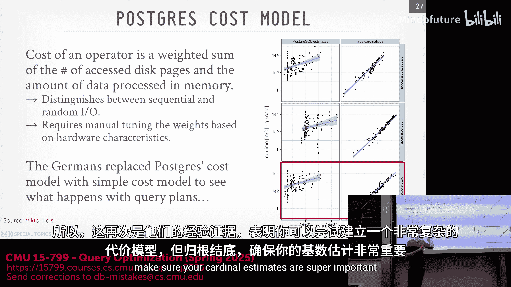

# 数据库查询优化：第13讲：基数估计与代价模型 🎯

在本节课中，我们将学习查询优化器的核心组成部分——代价模型，并重点探讨如何利用代价模型来估计查询操作符的基数。基数估计是预测一个操作符（如扫描、连接或过滤）将产生多少行数据的过程，它是决定一个查询计划是否优于另一个的逻辑基础。

## 概述

查询优化器通过代价模型来评估不同查询计划的执行效率。代价模型的核心是基数估计，即预测每个操作符将处理或输出的数据量。无论使用何种连接算法或过滤顺序，基数估计都是一个逻辑代价，我们可以据此推断物理执行代价。

上一节我们介绍了数据库系统在目录中维护的数据结构（如直方图、HyperLogLog），这些结构用于汇总表数据。本节中，我们将学习如何利用这些统计信息来计算基数估计。

## 基数估计基础

基数估计是优化器预测操作符将生成的行数的方法。这是评估查询计划优劣的基石。

从高层次看，其工作原理是：对于任何操作（如带过滤的扫描或带连接条件的连接），我们都有一个选择性的概念，即输入元组满足谓词并成为输出一部分的概率。将选择性估计乘以输入行数，即可得到近似的基数。

今天我们将讨论基数估计的基础知识，然后分析你们阅读的来自德国研究者的综述论文，最后探讨 PostgreSQL 和 SQL Server 的具体实现。

### 核心操作符

要进行基数估计，我们需要支持三个核心操作符：
1.  过滤条件（选择）
2.  连接大小估计
3.  不同值估计

以下是实现这些估计的基本方法：

*   **基本统计量**：从表的统计模型（如直方图、草图）中推导出基数估计。许多技术可追溯到 1970 年代的 System R。
*   **函数定义**：
    *   `T(R)`：表 R 中的元组数。
    *   `V(R, A)`：表 R 中属性 A 的不同值数量（可使用 HyperLogLog 估算）。
    *   `SC(R, A)`：选择基数，定义为属性 A 的给定值的平均预期记录数除以总元组数。
*   **选择性计算**：基于上述统计量计算谓词的选择性。

## 单谓词选择性估计

首先，我们来看如何为单个谓词计算选择性估计。

### 等值谓词

处理等值谓词是最简单的情况。

**公式**：对于查询 `SELECT * FROM people WHERE age = 9`，其选择性为直方图中键值 9 的计数除以输入总元组数。

**示例**：
*   **精确直方图**：若直方图显示 `age=9` 的计数为 4，总元组数为 45，则选择性 = 4 / 45 = 0.08。
*   **等高直方图**：实际系统中通常存储等高直方图。对于 `age=9`，我们找到其所属的桶。假设该桶总计数为 9，包含 5 个不同的键（9,10,11,12,13）。我们**假设桶内键值分布均匀**，则 `age=9` 的近似计数 = 9 / 5。选择性 = (9 / 5) / 45 = 0.04。

**核心假设**：在等高直方图的桶内，我们假设键值的分布是均匀的。这个假设简化了计算，但可能不准确。采样可以部分解决此问题，但无法保证完全代表真实数据。

### 范围谓词

接下来，我们处理范围谓词，例如 `WHERE age >= 7`。

**计算方法**：
1.  确定起始点（7）所在的桶。
2.  包含起始点右侧所有桶的计数。
3.  对于起始点所在的桶，再次应用均匀性假设，估算满足条件的键值比例。

**示例**：假设 `age >= 7`。
*   桶 `[6,8]` 计数为 12，包含键 `{6,7,8}`。满足 `>=7` 的键是 `{7,8}`，占 2/3。因此，该桶的贡献计数 = 12 * (2/3) = 8。
*   右侧桶的计数分别为 9 和 12。
*   总满足计数 = 8 + 9 + 12 = 29。
*   选择性 = 29 / 45 = 0.64。

**另一个重要假设**：我们假设桶内所有键值都是连续存在的，没有间隙。如果存在间隙，可能会导致高估选择性。

### 否定谓词

否定谓词的处理相对简单，它是等值谓词的逆运算。

**公式**：对于 `WHERE age != 2`，先计算 `age = 2` 的选择性 `S`，则 `age != 2` 的选择性为 `1 - S`。

**示例**：若 `age = 2` 的选择性为 0.05，则 `age != 2` 的选择性为 0.95。

## 多谓词组合估计

现在，我们知道了如何计算单个谓词的选择性。但当同一个表上有多个谓词时，如何组合它们呢？

挑战在于，即使谓词在同一表上，其值域和分布也可能完全不同且相互独立（尽管实践中可能存在相关性，可通过多列统计来捕获）。

我们可以将选择性估计视为概率问题：一个元组满足谓词的概率。因此，可以利用概率论知识来组合它们。

### 合取（AND）

对于用 `AND` 连接的谓词，大多数系统采用**独立性假设**，即一个谓词的选择性不受另一个谓词所选值的影响。

**公式**：若两个谓词独立，则合取的选择性为各自选择性的乘积：`S(P1 AND P2) = S(P1) * S(P2)`。

**问题**：当列之间存在相关性时，此假设会导致严重错误。

**示例**：一个汽车数据库，有 10 个品牌和 100 个型号。查询 `WHERE make = ‘Honda’ AND model = ‘Accord’`。
*   独立性假设：选择性 = (1/10) * (1/100) = 0.001。
*   实际情况：`Accord` 只由 `Honda` 生产，存在强相关性。真实选择性应为 1/100 = 0.01。
*   结果：估计值偏差了一个数量级。

### 析取（OR）

对于用 `OR` 连接的谓词，同样在独立性假设下进行计算。

**公式**：`S(P1 OR P2) = S(P1) + S(P2) - S(P1) * S(P2)`。

### 处理相关性：SQL Server 的指数回退法

独立性假设在实践中常导致低估基数。SQL Server 采用了一种启发式方法——**指数回退法**来缓解此问题。

**方法**：
1.  将多个合取谓词按其选择性排序（`S1` 最选择，`S2` 次之，依此类推）。
2.  组合选择性时，对第二个及以后的谓词的选择性进行开方运算，以削弱其影响。

**公式**：`S_total = S1 * sqrt(S2) * sqrt(sqrt(S3)) * ...`

**原理**：SQL Server 团队发现实际工作负载中，数据分布通常是正相关的。指数回退法是一种折中方案，旨在减少低估，同时保持较低的统计开销。这是一种经验性的“技巧”，但根据论文结果，SQL Server 的基数估计质量确实更高。

## 连接大小估计

连接大小估计是基数估计中最困难的部分，误差在这里会急剧放大。

我们引入一个**包含性假设**：对于内连接，假设一个关系中存在的连接键在另一个关系中也存在。这可能导致高估匹配数。

### 估计步骤

1.  **对齐直方图**：连接的两个表可能具有不同的等高直方图桶范围。首先需要处理直方图，使其范围对齐。这个过程本身就会引入误差，因为需要根据均匀性假设重新分配桶内计数。
2.  **逐桶计算**：对每个对齐后的桶对，计算预期的连接输出元组数。
3.  **汇总**：将所有桶对的估计值相加，得到总的连接基数估计。

### 误差传播

连接估计的误差会随着查询计划树向上传播而放大。如果一个连接操作符的输入基数被低估，那么这个低估的估计值又会作为输入传递给上游的连接操作符，导致误差层层累积。

**示例**：连接三个表 A、B、C。
*   首先估计基表基数（A、C 无谓词，B 有范围谓词）。
*   计算第一个连接 `A ⋈ B` 的基数。公式可能取 `max(|A|, |B|)` 或其他简化形式。
*   将第一个连接的输出基数作为输入，计算 `(A ⋈ B) ⋈ C` 的基数。
*   底层的估计误差在每一步都会被放大，导致顶层的估计严重偏离。

## 实证研究与影响

德国研究者的论文通过实验揭示了基数估计误差的严重性及其对查询计划的影响。

### 实验设置

*   **基准**：使用 IMDB 数据库的 JOB 工作负载。
*   **方法**：比较多个数据库系统（PostgreSQL, Hyper, DB2, SQL Server 等）的基数估计值与真实值。
*   **度量**：以连接数为横轴，展示估计值是高估还是低估。

### 关键发现

1.  **普遍低估**：大多数系统都倾向于低估连接操作的基数，尤其是随着连接数的增加。
2.  **误差累积**：呈现“阶梯函数”特征，连接数越多，低估越严重。
3.  **系统差异**：SQL Server 的估计最接近真实值（部分归功于指数回退法等优化），PostgreSQL 的估计误差较大且随连接数增加而恶化。

### 对查询计划的影响

糟糕的基数估计会导致优化器选择次优的物理操作符。

**PostgreSQL 示例**：
*   **问题**：由于低估连接输出，优化器可能认为只有少量数据，从而选择嵌套循环连接而非哈希连接。当实际数据量很大时，嵌套循环连接性能极差。
*   **改进**：
    *   如果禁止优化器选择嵌套循环连接，性能更接近最优。
    *   PostgreSQL 后来增加了哈希表溢出时动态重建的能力，这缓解了因低估导致哈希表大小不足的问题。
*   **结论**：拥有更好的基数估计所带来的性能提升，可能比设计极其复杂、考虑微观操作的代价模型更大。论文强调，**改进基数估计应优先于完善代价模型**。

## 实际系统实现

最后，我们简要看看 PostgreSQL 和 SQL Server 的具体实现。

### PostgreSQL 的代价模型

PostgreSQL 的操作符代价是磁盘页面访问数和内存中元组处理数的加权和。权重（如随机 I/O 成本、顺序 I/O 成本、CPU 处理成本）需要人工或自动配置。

**特点**：
*   代码复杂，包含许多历史累积的微调。
*   包含一些魔法常数（例如，某些 CPU 成本乘数为 0.5）。
*   研究显示，如果为其注入真实的基数，即使使用简单的代价模型，其查询计划性能也能大幅提升。这再次证明了基数估计的关键性。

### SQL Server 的优化

除了指数回退法，SQL Server 还采用了一些其他优化：

1.  **首次元组成本**：不仅计算产生所有输出元组的总成本，还单独计算产生**第一个**输出元组的成本。这对于比较嵌套循环连接和索引嵌套循环连接很重要。
2.  **结果缓存**：如果探测侧多次出现相同值，可以缓存上一次的结果以避免重复探测。
3.  **行目标**：维护一个“行目标”属性，表示查询计划树中某部分实际需要的行数（例如，受 `LIMIT` 子句影响）。这可以影响下层操作符的选择（例如，只需要一行时，索引探测可能更优）。

## 总结

本节课我们一起学习了查询优化中基数估计的核心概念与方法。

我们了解到，基数估计是预测查询操作符输出行数的过程，是代价模型的基础。我们从单谓词（等值、范围、否定）的选择性计算开始，介绍了关键的**均匀性假设**和**连续性假设**。接着，我们探讨了多谓词组合估计，引入了**独立性假设**，并看到了它因忽略列间相关性而导致的误差，以及 SQL Server 用**指数回退法**对此进行的改进。

然后，我们深入了更复杂的连接大小估计，指出了**包含性假设**和**直方图对齐**带来的挑战，以及误差在查询计划树中**向上传播**的严重问题。通过实证研究，我们看到了糟糕的基数估计如何导致优化器选择次优的查询计划，从而严重影响性能。最后，我们对比了 PostgreSQL 和 SQL Server 的实现差异。

核心结论是：**获得准确的基数估计比构建极其复杂的代价模型更重要**。它是优化器做出正确决策的基石。许多现代优化技术，包括我们将在春假后学习的基于机器学习的估计方法，都致力于解决这一根本问题。